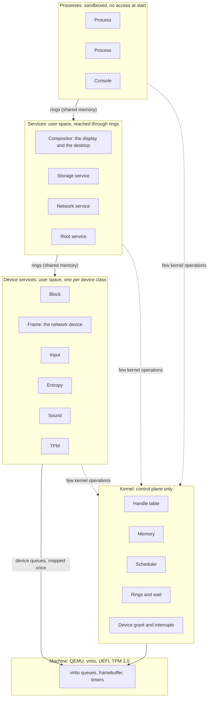
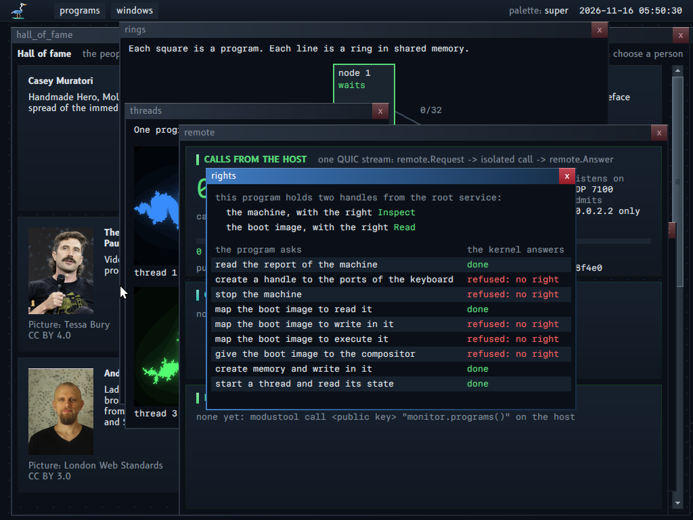
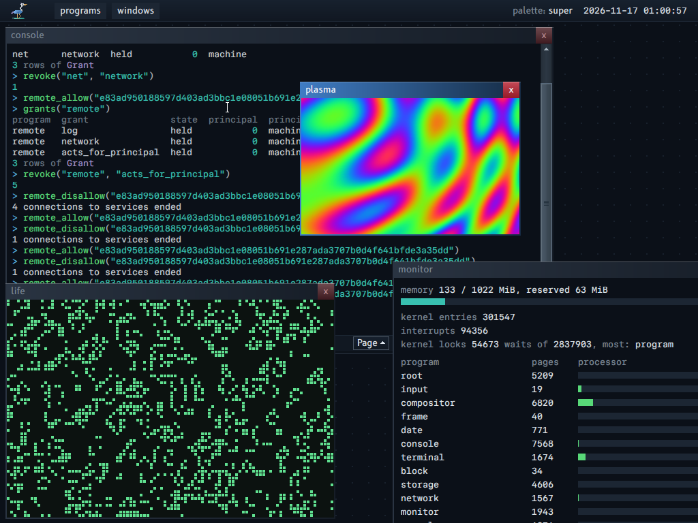
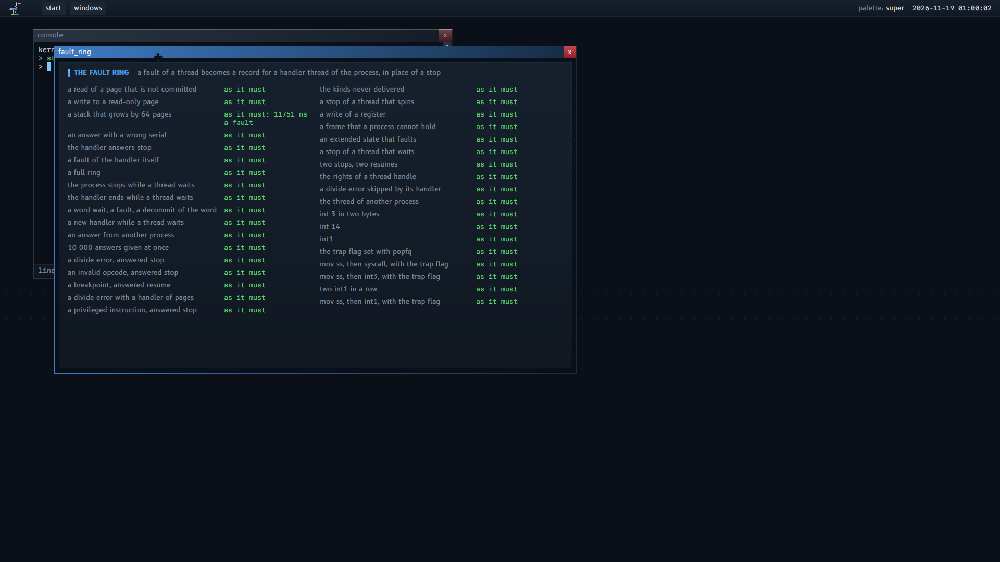
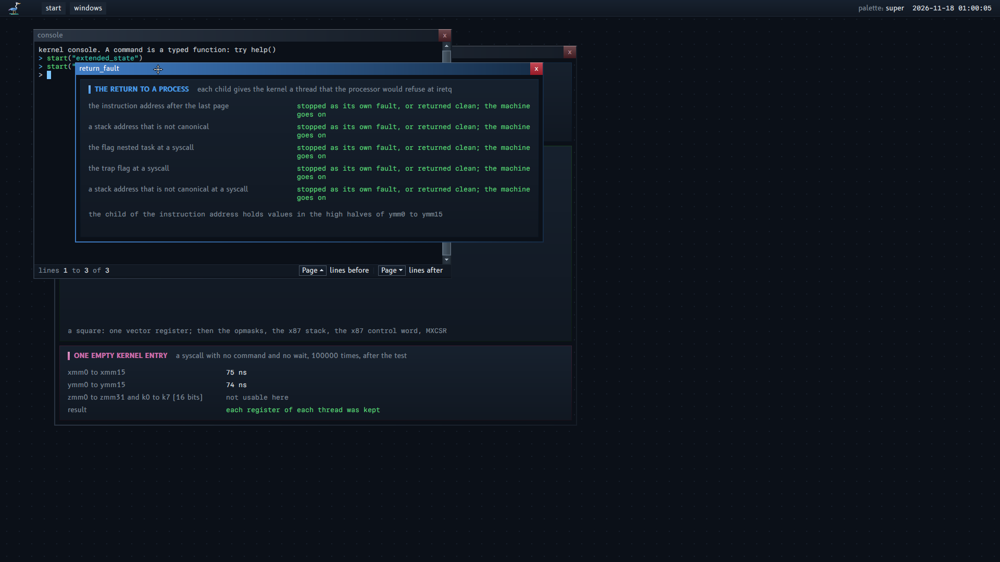
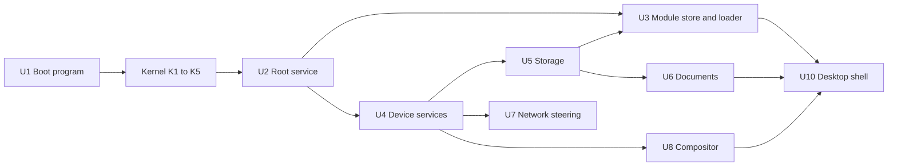
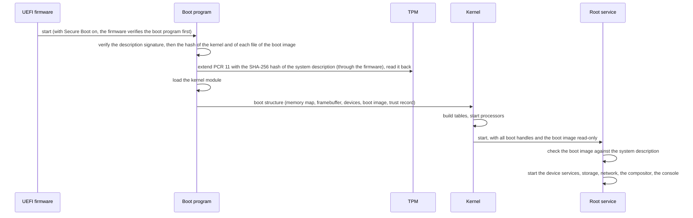
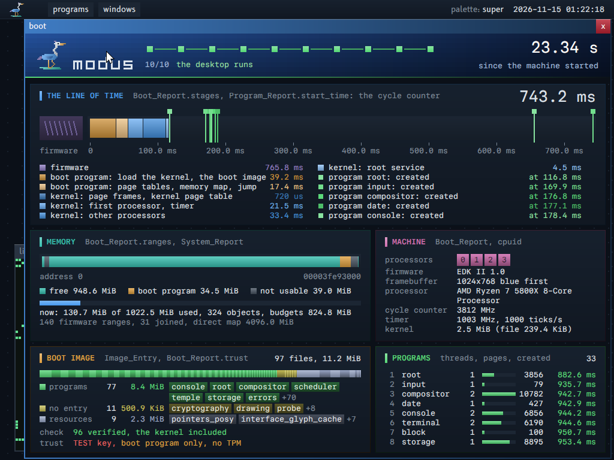
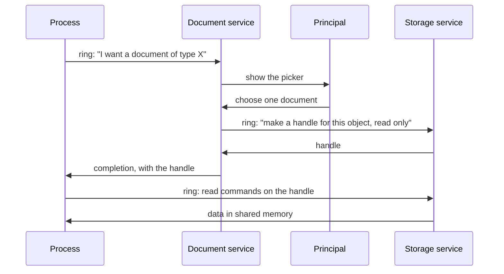
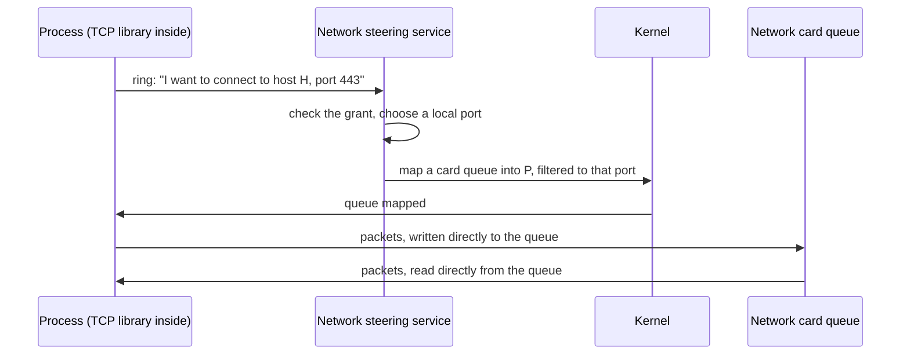

# Architecture

This document names the key systems of `modus` and shows how they connect: the kernel, the services in user space, and the processes. Then it gives the inside of the parts of the kernel that the rest of the system depends on: its locks, the virtual memory of a process, the extended state of the processor, the return to a process, its instructions, and its events.

## About this document

**What it covers.** The first half is the map: which system exists, what it does, what it owns, and what it does not do. Each system says what is built today and what is only designed. The second half is the inside of the kernel, close to its code (`src/kernel/`), with the reason of each rule.

**For whom.** A reader who wants to know where a mechanism lives before they read its code, and a reader who changes the kernel and must keep its rules.

**Read before.** `PROPERTIES.md` gives the rules that each system obeys: a reference such as (P4) points to the property with that number. `glossary/README.md` defines every term of this document; on the site, the first use of a term on the page links to it.

**The map of this document.**

| Section | What it says |
|---|---|
| "The whole system" | One picture of the layers: processes, services, device services, the kernel at the side |
| "Kernel systems" | The five systems of the kernel, its object kinds, and what the kernel does not contain |
| "User-space systems" | The boot program, the root service, the resources of the boot image, the loader, the device services, storage and its versions, the date, the network, graphics |
| "A text is never cut in silence" | The three ways in which the system handles a text that does not fit |
| "Locks of the kernel" | Each datum of the kernel, who reads and writes it, its lock, and the order of the locks |
| "The virtual memory of a process" | Commit, decommit, arenas, protection, large pages, page tables, and the fault ring |
| "The control of a thread" | How a process holds one of its threads and reads or writes its registers |
| "The extended state of the processor" | The vector registers: what the kernel enables, saves and restores, and when |
| "The return to a process" | How the kernel makes the frame of a thread safe before it returns to it |
| "The control registers of a processor", "The instructions of the kernel" | The state of each processor, and the code that the kernel runs |
| "Kernel events" | The records that the kernel writes of its own work, for a process that observes it |
| "How the systems depend on each other", "Three flows", "Direction", "Open questions about the architecture" | The order of the systems, three examples of a flow, and the decisions of direction. What is built is in `DEMONSTRATIONS.md`; what is left is in `ROADMAP.md` |

## Vocabulary

`glossary/README.md` defines every term of this document. A few terms carry the whole map, so here they are in one line each:

- A **process** is the unit of isolation: its own address space, its own handles, one or more threads.
- A **handle** is the number by which a process names one kernel object, with the rights that it holds on it. A process has no other way to reach an object.
- A **kernel operation** is one of the things that a process can ask the kernel; `PROPERTIES.md`, "1. Small kernel with a small, counted interface", gives their count. A thread asks with a command record in its kernel ring.
- A **ring** is a pair of queues of records in memory that two parties share. Data between processes goes through rings, not through the kernel.
- A **service** is a process that other processes call through rings; a **device service** is a service that drives one device.

## The whole system

The system has three layers of processes and one kernel at their side. Processes call services, and services call device services; each call is a record in a ring of shared memory, so data never passes through the kernel. The kernel only sets up what the processes cannot set up themselves: the memory that they share, the handles that they hold, and the waits.



Solid arrows carry data. They do not enter the kernel (P5, P6).
Dotted arrows are kernel operations. They set up mappings, transfer handles, and wait.
The picture shows the systems that run. The document service ("U6. Document service") and a desktop shell apart from the compositor ("U10. Desktop shell") have a design and no code. The module store is the store `module_files` of the storage service ("U3. Module store and loader").

The same picture in text:

```
 Processes            process   process   console
                        |         |           |
                  ======|=========|===========|======  rings in shared memory
 Services          compositor (display, desktop)  storage  network  root
                        |         |           |
                  ======|=========|===========|======  rings in shared memory
 Device services     block    frame (network device)   input   entropy   sound   TPM
                        |         |           |
                  ======|=========|===========|======  device queues, mapped once
 Machine             virtio queues, framebuffer, timers

 Kernel (at the side of every layer, not between the layers):
   handle table | memory | scheduler | rings and wait | device grant and interrupts
```

## Kernel systems

The kernel is small on purpose: it does only what a process cannot do safely for itself (P1, P4). It has five systems, and the kernel operations reach them (`src/library/contract/operation`, `Operation`; their count is in `PROPERTIES.md`, "1. Small kernel with a small, counted interface"). Each system owns a small set of flat tables of fixed size (P13), so the kernel allocates nothing while it runs.

The fixed sizes of the tables, from `src/kernel/process.odin`, `src/kernel/processor.odin` and `src/library/contract/operation`:

| Table | Capacity | Why a fixed size is enough |
|---|---|---|
| Processes | 64 (`PROCESS_CAPACITY`) | A process slot is also a bit in the sets of the kernel events ("Kernel events", section 7) |
| Handles of one process | 128 (`HANDLE_CAPACITY`) | A process holds what its grants name, not one handle for each piece of data |
| Mappings of one process | 128 (`MAPPING_CAPACITY`) | One mapping covers a range of any size, also a reserved range with no pages paid |
| Threads of the machine | 256 (`THREAD_TABLE_CAPACITY`); 32 for one process (`THREAD_CAPACITY`) | The extended state area of each thread is a field of its slot ("The extended state of the processor", section 2) |
| Memory objects | 2048 (`REGION_CAPACITY`) | |
| Budgets | 128 (`BUDGET_CAPACITY`) | |
| Processors | 64 (`PROCESSOR_CAPACITY`) | |

A full table is a status of the operation that asks for one more entry (`No_Slot`), never a failure of the kernel.

### K1. Handle table

The handle table is how the kernel knows who can do what. A process names an object only by a handle, and the handle carries the rights that the process has on it.

- **Does**: Keeps, per process, the table of handles. Checks the kind and the rights of each handle that a kernel operation receives: a wrong kind gives the status `Bad_Handle`, a missing right `No_Right`. Copies handles between processes with a part of their rights (`Handle_Give`), ends them (`Handle_Close`), and ends every copy that came from one handle (`Handle_Revoke`).
- **Owns**: one table of objects for each object kind; one handle table per process, of 128 handles (`HANDLE_CAPACITY` in `src/kernel/process.odin`).
- **A handle** (`op.Handle`) is one value of 32 bits: the low 16 bits are the slot in the handle table of the process, from 1; the high 16 bits are the generation of the slot. A close adds 1 to the generation, so an old handle number never names the next object of its slot. The value 0 names no object.
- **Object kinds** (`op.Object_Kind`):

| Kind | What it is | Made by |
|---|---|---|
| `Memory` | Pages of memory, which a process maps | `Memory_Create`, `Device_Create` (device memory) |
| `Process` | A process: its address space, its handles, its threads | `Process_Create` |
| `Interrupt` | One interrupt line or message interrupt of a device | `Device_Create` |
| `Ports` | A range of I/O ports of a device | `Device_Create` |
| `Machine` | The machine itself: reports, devices, the stop, the scheduling strategy, kernel events | Given at boot to the root service only |
| `Thread` | One thread of a process | `Thread_Create` |
| `Budget` | An amount of pages, processes, threads, processor time and log records that pays for objects | `Budget_Create` |
| `Log` | The log of the kernel | Given at boot; each process has it at `CONTEXT_LOG` |

- **The life of a process**: its starter makes it with `Process_Create`, and a budget pays for its slot, its page tables and its first thread. It starts with no memory and no handle, and it sees only the processes whose handles it holds. It runs while a handle names it: when its last handle closes, the kernel stops it with the stop cause `Handles_Closed`. A process with no thread stops too, with the stop cause `Last_Thread_Ended`. The kernel records the stop cause of each stop, and no process can forge it: a process that stops itself has `Itself`, a stop through a process handle `Holder`, and the kernel decides by the target, never by the argument (`src/md/api/process_stop.md`). A process that stops itself also gives its stop outcome: `Done`, `Failed`, `Refused` or `Stopped_On_Request`. The kernel refuses a stop of the caller with no outcome, and a holder's stop with one: only the process says what its work gave, so `outcome == .Done` alone checks a clean stop. A stop carries no data. Its kernel objects end with it, and what they cost returns to the budget that paid.
- **Not an object kind**: a ring, a timer, an address space alone. A ring is memory that two processes map. A time is the deadline of a kernel entry. The address space belongs to its process.
- **Does not**: know names, paths, users or files.
- **Example**: the process `rights` holds a part of the rights of two handles; the kernel does the four operations that those rights allow and refuses the five others, each with its status. The process `origin` shows the origin of a handle through twelve cases of copies, gifts and revocations.



### K2. Memory

The memory system gives each process its own address space and lets two processes map the same pages. A process asks for memory as an object, paid by a budget; then it maps the object where it wants. The kernel never chooses to give a process more memory than its budget paid for.

- **Does**: Tracks physical page frames. Builds address spaces. Gives "reserve address space", "commit pages", and "map this region in that process" (P14).
- **As implemented**: `Memory_Create` reserves: the budget pays for each page, and each page gets its page frame at its first use, by the process (a page fault) or by the kernel. The flag `Frames_Now` gives all the frames at creation. Map is a separate operation. No access fails for lack of memory: a reserved page always has a free frame. A page table lives while a mapping holds an entry in it, and returns to the budget that paid for it with the unmap that empties it.
- **Budgets**: the kernel gives one budget to the root service: all the free memory and all the slots. A budget made from it holds a part, and when the last handle to a budget closes, what it holds returns to the budget that it came from, which then pays for its objects. `Budget_Read`, with the right Read, gives what a budget can still pay and what it used.
- **Owns**: the page frame table; one address space record per process; the frame list of each memory object.
- **Does not**: page to disk, cache files, or allocate hidden memory for a caller.
- **Example**: `Memory_Create` with 16 pages and no flag pays 16 pages of the budget now; the frames come one at a time, at the first touch of each page. The process `frames` shows ten such cases with the answer of the kernel. The inside of this system is in "The virtual memory of a process", below.

### K3. Scheduler

The scheduler decides which ready thread runs on each processor, and for how long. It has one run queue for each processor, and it moves ready threads to idle processors, so the machine acts as if it had one queue.

- **Does**: Chooses which thread runs on each processor. Keeps time. Wakes threads.
- **As implemented** (`docs/SCHEDULING.md`): three strategies (round robin, fair, EEVDF), each as six procedures that the kernel calls through a `switch` on the strategy of the queue, one strategy for the whole machine, which a process with the right Schedule changes while the system runs (`Strategy_Set`). Wake preemption, also on another processor. A weight and a request for each thread, at its creation.
- **Owns**: one run queue per processor; the thread table, split in a hot part and a cold part.
- **Does not**: know about priorities of services by name. Policy is data that the root service sets.
- **Example**: the process `scheduler` runs the three strategies side by side and shows the wakes, the delay of a wake and the shares of spinners with weights (`docs/screenshots/scheduler.png`). The locks and the order of a wake are in "Locks of the kernel", "Rules that keep each path correct".

#### Processor time

The kernel counts the processor time of a thread with the cycle counter, from the pick of the thread to the moment when its processor leaves it, at each tick and at each switch. One charge goes to the budget of the thread, to each budget above it, and to the virtual time of its strategy. The limit of a budget holds in each period of 100 ms, and the tick checks it.

The time base is the 8254: at its start, the first processor measures the timer of its interrupt controller and the cycle counter against a count of 10 ms of the 8254. A machine with no 8254 has an output that reads high before the count, or a count that does not end in its bound. The kernel then takes the frequency of the cycle counter that `CPUID` leaf 0x15 or 0x16 states on a processor of Intel, the one vendor that defines them, measures the timer against the cycle counter, and writes `kernel: the 8254 does not count: the time base is the cycle counter, at <frequency> Hz, which the processor states in CPUID`. A processor that states none, or a frequency below 1 MHz or above 10 GHz, leaves the kernel with no time base: it writes `kernel: the 8254 does not count, and the processor states no frequency of its cycle counter (<reason>): the kernel has no time base` and stops with the code 1. The choice is the kernel part `time_base` (`src/kernel/time_base`), with host tests. The start of the other processors waits with the cycle counter. The processors come from the ACPI table APIC; a table that is absent, shorter than its header or that lists no usable processor writes one line, such as `kernel: the firmware lists no APIC table: one processor`, and the machine runs on the first processor. The design is `src/md/features/missing_hardware.md`.

Under KVM the cycle counter goes on while the host runs another task on the physical processor. That time is stolen time: no thread of the machine ran in it. Each processor registers the steal-time record of KVM at its start, and each charge subtracts the time stolen since the charge before, at most the whole run. A steal counter that goes back is refused: the whole run is charged. A real machine, and QEMU with TCG, have no record: each cycle of a run is charged. The boot line `kernel: steal time:` says how many processors registered, or why none did. Without the subtraction, a budget with a limit of 50 ms read 327 ms in one second on a loaded host. The length of a turn, the length of a period and the run time in ticks are times of the machine and do not change. The design is `src/md/features/stolen_time.md`.

### K4. Rings and wait

A thread talks to the kernel through a ring, and waits through the kernel. Rings between processes need no kernel at all: they are memory that both processes map.

- **Does**: Executes the commands that a thread puts in its kernel ring. Gives the one blocking point of the system: a thread enters the kernel and waits until a word that it names changes (`Word_Wait`, `Word_Wake`), or until a deadline. A ring between two processes uses that wait: a reader waits on a word of the ring, and a writer wakes it.
- **Owns**: the wait table (buckets of the words that threads wait on, named by their physical address, so two processes that map one memory object wait on one word). The kernel has no table of rings: a ring between processes is a memory object, and the kernel does not know its layout.
- **The kernel ring**: each **thread** has one ring to the kernel, one page after its thread record (`src/library/contract/operation`, the comment of the package; `MODULE_CONTRACT.md`, section 6). A completion therefore never reaches another thread of the same process. All kernel operations are records in that ring, and the one entry point is the `syscall` instruction, "enter": run the commands of the ring, then return or wait. One entry point keeps the interface counted and small (P1, P4).
- **A full completion queue**: the kernel runs a command only when the completion queue of the thread has room for its answer. Else it leaves that command, and each one after it, in the command queue, unrun, and the entry returns with no wait, also when the thread asked for one. The thread reads its completions and enters again; the kernel then runs the commands in their order. So no answer is lost, and the kernel keeps nothing for a command.
- **One writer of a kernel ring**: only its own thread writes a kernel ring. The ring is memory of the process, so the kernel does not enforce it; it is a rule of the library, and each thread finds its ring through its thread record. The check of the room before a command, the empty check of the library and the check of the tag depend on it. Another thread of the process that writes the ring breaks them only for that process.
- **The library and the kernel ring**: `system.commands_call` is the one path of `src/library/support/system` into the kernel ring. It runs a batch of commands in one entry, with a deadline, and gives the answer of each. `command_call`, under each wrapper, is a batch of one; `wait_end`, under each wait, is a batch of one `Word_Wait`. It uses an empty kernel ring only: a ring that holds a command or a completion gives `Bad_Operation` with the error record `Busy`, and no command runs; a wait then ends at once. An answer whose tag is not the tag of its command gives `Bad_Operation` with `Refused` (`src/md/api/kernel_ring_completion_room.md`).
- **The stop of a process**: `system.stop` ends the process whatever its kernel ring holds. It drops each completion that waits, enters the kernel so that the held commands run, at most one round for each place of the ring, then sends `Process_Stop` with its stop outcome. A ring that does not empty (false counters, or the bound of the rounds) ends the process with a write to the time page: the kernel gives no fault at that address to a fault handler or a debugger, so the process stops with the stop cause `Fault` and the report of a page fault, never with `Itself`.
- **A ring between processes** is one memory object (`src/library/contract/ring`): page 0 holds the counters, then come the command records, then the completion records. A record is 64 bytes: a kind, a tag and seven values. All-zero memory is an empty ring. The writer advances one counter and the reader another, each in its own cache line, so data does not pass through the kernel. A side that must wait (an empty queue, a full queue) waits on the counter with the word wait; the other side enters the kernel to wake it only when a flag says that it waits. A side never trusts the numbers of the other side: it computes the capacity from the size that the kernel gives, and a place is a count modulo the capacity. A process gets a ring as a memory handle from the process that made it; the root service makes the rings between a process and a service.
- **Example**: `system.word_wait(&ready, 0, deadline)` waits while the word `ready` holds 0, at most until `deadline`.

### K5. Device grant and interrupts

A driver is a process, not a part of the kernel (P7). This system gives a device service the few things of the hardware that a process cannot take by itself.

- **Does**: Maps the queues and registers of one device into one device service. Counts each interrupt, which the service reads. Programs the IOMMU so that a device reaches only the memory that its service declared.
- **Implemented**: `Device_Create`, which needs the right **Devices** on the machine, with five kinds (`op.Device_Kind`): `Memory` (device memory over the registers of a device, mapped with no cache), `Display_Memory` (the same over the video memory of a display that holds the framebuffer of the firmware, mapped with the page attribute of that framebuffer, with no requester for the IOMMU), `Ports` (a range of I/O ports), `Interrupt` (a line of the 8259) and `Message` (a message interrupt of the device whose memory base address register starts at its first value). Each interrupt adds 1 to the event word of the threads of the process that holds its handle, and wakes them; `Interrupt_Read` then gives the count of interrupts since the last read, and sets it to 0. `Memory_Physical` gives the physical address of a memory object to a holder of the right **Physical**, so a service can give it to a device. The root service finds the devices on the bus, not the kernel.
- **The IOMMU** (Intel VT-d and AMD-Vi; the design is `src/md/infrastructure/iommu.md`): when the firmware lists up to 4 remapping units of segment 0 (the ACPI table DMAR of Intel, else the table IVRS of AMD), the kernel turns translation on in each before the root service starts. A device then reaches only the memory that its service declared. The rules below hold for both vendors; the formats of AMD-Vi are in the last item:
  - Each device has the remapping unit whose device scope names it (an endpoint, or a bridge with the bus of the device behind it), else the unit with `INCLUDE_PCI_ALL`. A device that no unit covers reaches all memory, and `Device_Create` of its registers writes one line that says so.
  - `Device_Create` of the kind `Memory` names the function whose base address register starts at the first page: the kernel walks bus 0 and the buses behind each bridge through the configuration memory of the table MCFG, and writes nothing to the bus. A process that holds such a handle is the service of that device. A device behind a bridge of PCI Express has its own domain, with the context table of its bus, which the kernel made at the start. Every device behind a conventional bridge gives one shared requester, so those devices have one domain: the kernel makes it at the first declaration of a service only when the service holds the registers of each of them, and ends it when the service no longer holds one of them. A declaration that misses one gives `Bad_State`, with one line that names it: else a device of another service would reach what this one declares. A device of the group whose registers `Device_Create` makes later, and that the owner does not hold, ends the domain. The message interrupts of the group have their entries only while the domain lives. The root service gives every device behind such a bridge to the service of the first one that it starts (`src/md/infrastructure/iommu.md`, "The domain of a conventional bridge").
  - `Memory_Physical` from a service is the declaration: each page of the object is mapped in the second-level tables of each device whose registers the caller holds, at most 4, and the call gives its device address. A contiguous object keeps its physical address (identity); an object that is not contiguous gets a device window of 128 MiB above 2^38, chosen by its slot, where its pages follow each other; its pages get their frames at the call. A unit of fewer than 39 bits of address (MGAW) gives no windows, with one line at the start, and a contiguous object must end below the width of the unit. `Device_Create` of the kind `Memory` gives, as its second result, whether the device has a domain and windows (`Device_Memory_Facts`). The device writes the pages only while the service holds a handle with **Write** to the object: the close of its last such handle makes the pages read-only for the device. A process that holds no such handle declares nothing. Device memory is never declared.
  - The first process whose declaration to a device succeeds owns its domain until it stops, or until it holds neither a handle nor a mapping of the registers of the device, and its budget pays for the tables. A device that the root service gives to another service then reaches nothing of the first, and the declaration of the second service gives `Bad_State` while the first still maps the registers. `Memory_Map` refuses (`Bad_Operation`) to map the registers of a device with a domain into another process than the caller, so no mapping outside the owner can drive the device. A device with no service has no context entry: each of its accesses is refused. The kernel has 32 slots of devices; a slot is free again when its domain ends.
  - A device that a reserved memory range names has a standing domain from the start, with its ranges at their own addresses, so the firmware keeps using it; the domain of a service of the device maps the ranges too, and the device goes back to its standing domain when that domain ends. `Device_Create` gives no range that meets a reserved range.
  - A declared object leaves the domains of a service when the service closes or loses its last handle to it, and every domain when the object ends, before its frames are free; the domains of a service end when it stops, before its handles close. Each change that the unit could keep (an end, a write bit added or taken, an undo; a new entry only on a unit with the caching mode or a write buffer) goes to the queue of invalidations of the unit of the device: a descriptor of the context cache and one of the IOTLB, for its domain identifier only, with the drain of the accesses in flight, then a wait descriptor. The kernel waits until the unit writes the number of the wait, at most one second; a unit that does not, or that refuses a descriptor, stops the machine.
  - A refused access is a DMA fault: the unit sends its fault event to the first processor, and the kernel writes one line with the device, the address and the count of faults of the device, for the first 4 faults of a device, then one line of the count at each power of two. It stops no process.
  - Interrupt remapping: when the table DMAR allows it (the flag INTR_REMAP) and every unit offers it, the kernel turns it on after translation, with one interrupt table for all units. `Device_Create` of the kind `Message` writes the entry of the new message interrupt: its vector, the first processor, and the requester of the device whose base address register starts at `a`, which the unit checks on each message. It gives the remappable address of the entry and the value 0. The units refuse every other message: an entry of another device, an entry that is not present or past the table, the compatible form. A refused interrupt is a line with the device, the entry and the reason, with a count of its own and the rule of the lines of a DMA fault. The close of the last handle of a message interrupt clears its entry and invalidates it on each unit. A device with no requester gets the compatible form, which a unit that covers it refuses. With a table that does not allow remapping, or a unit that does not offer it, one line says so, and a device can send any interrupt. The lines of the 8259 reach the first processor on LINT0, not through the units, and are not remapped; a pin of the IOAPIC that the firmware left on is refused, with a line.
  - With no unit, a table that the kernel cannot hold (more than 4 units, 8 reserved ranges, 64 device scopes or 8 devices of reserved ranges, a path of more than 4 pairs, another segment), a unit that the firmware left in a mode (translation, the queue of invalidations, interrupt remapping), registers that are not device memory, or a unit with no queue of invalidations or no drain, one line at the start says so, and each device reaches all memory, as on a machine with no IOMMU; `Boot_Report.iommu_unit_count` is then 0. While the IOMMU is in use, `Device_Create` gives no range of the registers of a unit, of the configuration memory, or of a reserved range.
  - AMD-Vi: the table IVRS names the devices of each unit by ranges of requesters; the kernel reads the unit blocks of the highest kind that it knows, as one unit can have several. The source and the target of an alias get no domain, with one line. A reserved memory range of one device is a reserved range as on Intel; one of every device or of a range of devices leaves the IOMMU off, with one line, as do two units that name one device, a unit that the firmware left on, a unit with no translation through host tables, a unit whose function has no message interrupt, and a function that is not of the class of an IOMMU. Before a unit is on, the kernel clears its exclusion range and its apertures of memory access routing. One device table of the kernel (2 MiB) serves every unit, with an entry for each of the 65536 requesters. Each entry starts valid, with the empty domain: an empty table and neither read nor write; with remapping, the entry of each device that the table names gets the pass bits of its settings, so the virtual wire of the 8259 and the NMI of the chipset pass. A domain writes the entry of its device, with its domain identifier, and its end writes the empty entry again. After the units are on, each unit forgets the entry of each requester. The page tables have 4 levels in the format of AMD. The queue of invalidations of a unit of AMD is a ring of commands, with a completion wait; each change of an entry also forgets the domain 0, and a new page is invalidated when the unit has the flag NpCache. The unit writes each refused access in its event log and sends the message interrupt of its function, which the kernel writes at the start; the kernel reads the log and writes the lines of a DMA fault, with the flags of the record as the reason. With interrupt remapping, which the kernel turns on when the table IVRS names an IOAPIC, each device with a message interrupt has an interrupt table of its own, and `Device_Create` of the kind `Message` gives the address of the first processor and the index of the entry as the value. The entry of each device with no table refuses each message.
- **Owns**: the interrupt routing table; the root, context and second-level tables, the device table of AMD-Vi and its page tables, the queues of invalidations, the event logs and the interrupt tables of the IOMMU.
- **Does not**: contain code for any device (P7).

### What the kernel does not contain

File systems, network protocols, device drivers, the module loader, the module store, graphics, the TPM protocol, names, users.

## User-space systems

### U1. Boot program

A UEFI program (P17). It runs before the kernel. It holds the kernel module, the boot image and the public key of the signing key.

- Verifies the description signature, then compares the kernel module and each module and resource of the boot image with the system description (`docs/TRUSTED_BOOT.md`). A failed check stops the boot: the boot display shows the file and the two hashes, and the kernel does not start.
- Asks the firmware to measure the system description into PCR 11 of the TPM, and reads the register back.
- Loads the kernel module.
- Collects the memory map, the framebuffer and the device list. The buffer of the memory map takes the size that the firmware asks. The boot record holds 1024 ranges: each usable range is kept, and the reserved ranges past the room are left out with one line.
- A stop for memory, for the memory map or for the kernel module stays on the boot display with the watchdog of the firmware off, as a failed check does; the machine is not powered off.
- Gives all of this to the kernel in one fixed structure, with the trust record, then leaves the firmware.
- With Secure Boot on, the firmware verifies the boot program before it starts it, and the trust record says so (`docs/TRUSTED_BOOT.md`, "7. Secure Boot"). With Secure Boot off, nothing verifies the boot program itself: its checks then find a damaged or swapped file, not an attacker who can write the boot volume.

### U2. Root service

The first process. The kernel gives it every handle that exists at boot.

- Starts the other services and gives each one only the handles that it needs.
- Holds the system description and the grant records. Before it starts the first process, it checks each module and resource of the boot image against the system description that the boot program verified (`docs/TRUSTED_BOOT.md`, claim 5).
- Is the only process that can create access from nothing. All other access is a handle that came from it, directly or through a chain.
- Holds the records of the principals, and records for each process that it starts the principal of its session; it names that principal in each connection, in the name of each store and in the grants of the process (`docs/PRINCIPALS.md`).
- Reads the role of a process one time, at its start, and keeps it with the process: each rule after the start reads that role, never the name. A process receives a root ring only with a start grant that sends a command, and each command of the root ring goes through one border, then the table of its senders, then its procedure (`src/library/contract/root_ring`; `src/md/api/root_ring.md`).
- Holds no order of the start: it starts one start policy, which asks for each other start ("The start policy", below).
- Joins a record output of one process to a record input of another, or to the asker, with the command `Wire` or with the wiring list of a `Start` ("The wirings", below).

### The wirings

A wiring joins one record output to one record input through one output ring (`src/md/features/module_outputs.md`). The root service keeps the mechanism; a process chooses which wiring to ask for.

- **The list page.** `Wire` with the step `List_Page` gives the asker its list page: memory that the root service makes once from the budget of the asker and keeps, and a wiring ring for an asker that has none. The asker writes a wiring list there (`output.Wiring_List_Head`, then `output.Wiring`, then the lent process handles, then the wiring terms); the root service copies it from its own handle, which a revocation by the asker does not reach.
- **`Wire`** with the step `Apply` applies a list of one row. Each end is the child of a start, a process whose start the asker asked for, a service to which the asker holds a connection and for which it acts for the principal, or the asker itself as the reader. The completion gives the number of the wiring.
- **`Start`** names the list page in values[4] (`root_ring.Start_Wiring_List`), with the rows of the child, and a `root_ring.Start_Answer` in values[5]: with `Process_Handle`, values[0] of the completion is the process with the rights Read and Give, the handle that a later `Wire` names: the sender lends it back through its root ring. The root service applies the whole list before the first instruction of the child, gives the other ends after the whole start, or refuses it whole. A start policy sends no list before its start list wires rows.
- **The limits.** An asker holds at most 8 wirings, the machine 24, and a process 16 ends: each wiring costs the root service one handle. One asker holds at most 4 ends of a service to which it is connected, and at most 4 askers hold a list page: each costs the root service 4 handles and 2 mappings until it stops. A list lends at most 16 handles.
- **The checks.** The border of the list and of each row (`output.wiring_list_check`), the proof that each lent handle came through the root ring, the rule of the asker, the indexes in the two module files, the equal record descriptions (`output.record_descriptions_compare`), the size of the wiring terms, one wiring for a record input of the count `One`, two different processes, and the room of each wiring ring. Each refusal is a status of the kernel and an error record of the unit `Wiring_Rows`, `Record_Types`, `Wiring_Terms`, `Wirings` or `Lent_Handles`.
- **The cost.** The ring, the end page, a page of wiring terms, the description file and the wiring page that records the wiring come from the budget of the asker. The root service keeps a handle of the budget of each process that can send `Wire`, with Read and Spend, until its stop.
- **The ends.** Each end reaches its process through its wiring ring: the handle 16 of its context, or the ring that an asker received with its list page. The process answers each end in the completion queue of the wiring ring; a refused end ends its wiring with the end word `Refused`. When the process closes an end, it writes `Closed`, and that end leaves the count of the process; the other side then reads the end word `Side_Closed` after the records before it, and a wiring whose two sides closed ends. The root service drops any other word, with one line.
- **The wait.** The loop of the root service waits on each root ring, each control ring of the network and each wiring ring in one wait of 64 words, 12 of them fixed: it refuses a start or a list page that brings a queue past 26, with `Full` of the unit `Words`.
- **The end of a wiring.** At the stop of the writer, of the reader or of the asker, the root service writes the end word `Writer_Stopped`, `Reader_Stopped` or `Asker_Stopped` in the end page of the wiring, which each side maps with Read only, and wakes both sides. A writer that ends with no stop that the kernel recorded, an abandoned start, gives `Revoked`. The recorded grant `wirings` of the asker holds its wirings: `revoke(name, "wirings")` ends each of them with `Revoked`.

### The start policy

The root service keeps the mechanism of the start, and the start policy holds the policy (`src/md/features/start_policy.md`). At each start the root service checks the boot image against the system description, makes the principals and the seed, creates the pages that it writes for every process, starts the entropy service and the TPM service, writes the machine parts page, reads the choice of principal 0 when the machine key opens with no passphrase (with a TPM service and a data disk: `unlock` with no window, then the disk grant table of principal 0), then starts one process with the start grant `Start_Policy`, measured into PCR 12 first: the module of the store `module_files` that principal 0 chose (`PRINCIPALS.md`, "The start policy of principal 0"), the module `start_policy` with the list `start_list` of the boot image, or the list `rescue_list` when the boot record asks for the rescue.

- **The start grant `Start_Policy`.** A root ring for `Start`, `Stop` and `Machine_Usable`, and the machine parts page, read-only, with the list after it. No window, no store, no right of the machine. A `Start` from the start policy can name a part of the system (`input`, `compositor`), which the root service starts by its own procedure, and the completion holds a handle of the process with the right Read. A name that runs is refused with `Exists`. The start policy stops only the processes that it asked for.
- **A chosen start policy** from the disk holds its order in its code and gets no list. Its one grant is `Start_Policy`, and the root service refuses its start of one name past 16 restarts.
- **The default start policy** reads the list in its order, starts each row, and waits for each completion. A row whose part is absent starts or not by its rule, with one line. When each row with the mark `Needed` runs, or did not start for an absent part, it sends `Machine_Usable`; then it starts a row again at its stop, within the count of its restarts.
- **The rescue.** The root service starts the rescue start policy when the chosen one is absent, refused by its hash, or does not start, stops before `Machine_Usable`, or sends none within the hang bound. It first stops each process that the failed policy asked for, and writes one line: `root: the start policy 3f9a1c2e… stopped before the machine was usable: itself, failed; the rescue start policy starts`, with the stop outcome in place of "failed", or the text of another stop cause in place of "itself, failed". With no start policy at all, the boot display shows the cause, and the root service serves the root ring of each process that runs.
- **What a failed console does.** The console is the one row of the default list with the mark `Needed`: its failure stops the default start policy before `Machine_Usable`, and the rescue starts. The machine no longer stops for it.
- **The lines.** `root: the machine parts page holds screen`, one line for each part of the page (`root: the machine parts page holds no part` when it holds none), then `start_policy: the start list has 7 rows: each starts in its order`, one line for each row that does not start, and `root: the machine is usable, by the start policy 3f9a1c2e… of the list start_list: the budget of this service holds N free pages, M at the lowest`.

### U2b. Resources of the boot image

A resource is a file of the boot image that is not a module: data that a process reads in place, such as a pointer theme file (`docs/POINTERS.md`). This section is the one description of the mechanism; each kind of resource has its own format and its own document.

Today the boot image is the one source of every resource and of every module that runs before the storage service; after it, a process can also start from a module file of the store `module_files` ("U3. Module store and loader"). That is a state of the construction, not the model. In the model the boot image is a transport: it carries only the objects that the machine needs before the storage service runs, and the rest are objects of the tree of the system, named by their hash (`STORAGE.md`, "1. The model" and "5. Not built: the next steps").

- **In the image** (`src/library/contract/boot_info`): after the table of the modules (`Image_Header.count` entries), a second table of `Image_Header.resource_count` entries of the same record, `Image_Entry`: a name of 31 bytes at most, the BLAKE3 hash of the bytes, the offset and the size. Each file starts on a page. A reader of modules reads the first table only, so a resource is never taken for a module; an image with `resource_count` 0 has no resource.
- **Identity** (P11): the hash of the bytes, as for a module. The name is for people and for the code that chooses.
- **The build** (`tools/modustool/build/modules.odin`, `build_boot_image`): a command of the tool makes each resource in `build/` (`modustool pointers` today), and `build` puts it in the image with its hash. The same input gives the same bytes: `modustool check` builds each resource two times and compares them.
- **The grant** (P8, P20): no process reads the resource table by itself. The root service finds a resource by its name, checks the hash of its bytes against the entry, and gives it to one process as a read-only mapping of the pages of the image at an address of the context, with its size in a value of the context (`src/modules/system/root/resources.odin`, `resource_mapping`; the log has "root: the resource pointers_posy (883008 bytes, its hash checked in 1395 us) is given to compositor, read-only"). The process validates the bytes with the reader of its format: the root service checks the identity, not the format. A process with the grant `Image` (the whole image, read-only) finds resources with `system.image_resources` and `system.image_resource_find`.
- **Users**: the compositor (the pointer theme file, `src/modules/system/compositor/pointer_picture.odin`) and the process `pointers` (all pointer theme files, through the grant `Image`). The glyph caches of the vector font and of the interface font (`docs/FONTS.md`, section 5): the root service checks the hash and the format of each one once at start and maps it into each process with a surface, each terminal and the compositor, with the settings page, at their fixed ranges (`src/modules/system/root/text_settings.odin`). The size of a cache is in its own header; the context says only which ranges are mapped ("The fixed ranges that a process receives", below). The process `manual` reads the link pages `manual_pages` through the grant `Image`: it checks their hash and their format once at start (`MODULE_CONTRACT.md`, "The links of a page of the manual").

### U3. Module store and loader

A module is the unit of code of the system; a process starts from one module and the modules that it imports. This system finds a module by its hash and makes a process of it.

- **Store**: keeps modules by content hash, and answers "give me the module with this hash". It has no separate index: functions read the flat tables of the modules (P11, P12). A module comes from one of two sources. The boot image: the boot program brings it, the root service checks each file of it against the system description, and a process with the grant `Image` (the console) finds a module in it by name. The store `module_files` of the storage service: the root service starts a process from a module file of that store, named by its hash, and finds each library module that it imports there by the hash of its bytes (`src/md/features/processes_from_a_disk.md`).
- **Loader** (built: `src/library/support/system`, `load.odin`): builds a new process. It asks the kernel for a new process (`Process_Create`), maps the segments of the module and of the modules that it imports (`Memory_Map`), records each module for the reports (`Process_Module`), and starts it (`Process_Start`).
- The loader is in user space. The kernel only maps memory.

### U4. Device services

A device service is the driver of one device class, as a normal process with the handles of its device and nothing more (P7). A fault in it stops that process, not the machine.

- Each one owns the queues of its device. It translates between the device protocol and the ring protocol of its class.
- For virtio, this translation is thin, because a virtio device is already a set of queues.
- **Built**:

| Class | Process | What it serves |
|---|---|---|
| Block | `block` | The virtio block device, through the block ring, to the storage service |
| Network card | `frame` | The virtio network device, through the frame ring, to the network service |
| Input | `input` | The PS/2 keyboard and mouse (the ports of the controller and its two interrupts), as input records to the compositor |
| Display | `compositor` | The framebuffer of the firmware: the compositor owns it directly. On the standard VGA of the test machine, the two screen pages of its video memory and its display registers: each frame goes into the page that the display does not show, then a page flip shows it (`src/md/infrastructure/whole_frame.md`) |
| Real-time clock | `date` | Two ports of the clock, and the date page ("The date", below) |
| Entropy device | `entropy` | The virtio entropy device, through the entropy ring, to the root service, which mixes its bytes into its random generator (`RANDOMNESS.md`, "3. The seed of the system, and what is claimed") |
| Sound | `sound` | The virtio sound device, through the stream ring of a timed stream, to the one process with the grant `Sound_Device`: each record plays at the time that it names (`SOUND.md`) |
| TPM | `tpm` | The registers of the CRB interface of the TPM, after the start: Seal and Unseal of the machine key through the TPM ring, to `unlock` (`PRINCIPALS.md`, "The machine key sealed by the TPM"). Before the kernel starts, the boot program asks the firmware for the measure (`TRUSTED_BOOT.md`, "6. The measure") |

- **The bus.** Only the root service holds the ports of the configuration, 0xCF8 to 0xCFF, as a ports handle that it makes with `Device_Create`. It reads the configuration at the fixed place of each device, checks that the device there is the expected virtio device, enables it, gives it the right to use memory (bus master), sets its message interrupt, and starts its device service. On the test machine the places are fixed: the data disk at device 16 (`pci.DATA_DISK_DEVICE`), the disk of the measures at 17, the network device at 18, the entropy device at 19, the sound device at 20. With no device of the right kind at a place, the root service writes one line, such as "root: no virtio device for block at the place 16 of the bus", and starts no service.
- **What a device service receives.** A copy of the first 256 bytes of the configuration, read-only (`GRANT_CONFIGURATION` of `src/library/support/pci`); the device memory of its registers, one object for each base address register (`Device_Create` of the kind `Memory`, with a physical address that is a multiple of 4096 and a count of pages; the roles `GRANT_BAR + n`); one message interrupt; memory for its queues; and the machine handle with the right **Physical** only. The root service starts one block service for each disk that a process needs, with exactly one device.
- **Virtio.** The system uses virtio 1 over PCI, the modern interface, with no older interface (`disable-legacy=on` in the command of QEMU). A start asks the device for a reset and reads its status until it is 0, at most `RESET_READ_LIMIT` times (`src/library/support/virtio`); a device that does not finish its reset makes its service write "the device did not finish its reset" and stop.
- **The first lines.** Each device service writes one line when its device is ready. The block service, on the disk of the measures: "block: ok, 8192 blocks of 4096 bytes, a queue of ...", then the size of the queue of the device, the most requests in flight, and whether the disk has a cache that `Flush` empties. The frame service: "frame: ok, the hardware address 52:54:00:12:34:56, the link is up, ...", then the sizes of its two queues and the count of places for the frames that arrive. The test machine has one virtio network device, with the hardware address 52:54:00:12:34:56.
- **The disk of the measures.** The process `disk` drives a block service on the second disk of the test machine (the place 17). For one second in each measure, it reads and writes the first 4096 blocks (16 MiB) with one request in flight, then with 32, and counts the blocks and the kernel entries of the two processes for each request. Then it writes a pattern, flushes, reads the pattern back and compares. It shows the result in its window. Then it sends three words that name no command: `None`, the word one past the last command and the largest word. The block service answers each one with `Bad_Command` and the record `Unsupported` of the word, and serves the next `Info`. It writes the same three words on the ring of its window: the compositor writes one line at the first word, and the count 3 when the window closes.
- **A part that the machine lacks.** The system runs on with one line for the part and no stop of the machine (`src/md/features/missing_hardware.md`):
  - **No PS/2 controller.** Its status port reads all ones, or its drain at the start reaches `CONTROLLER_POLLS` bytes (`src/library/private/input/ps2_controller`): the input service writes "input: no PS/2 controller: no keyboard and no mouse" and stops with the stop outcome `Failed`, and the compositor runs with no input. That is the one reading of the absence: the machine parts page holds no member for the controller, and the root service adds only the line of the stop that it writes for each process, `root: input stopped: itself, failed`.
  - **No screen.** The root service and the compositor make one test: a framebuffer that maps, with a width and a height that are not 0 (`src/library/support/screen_presence`). With no screen before the first start, the root service writes "root: no screen: no console, no window; the other services start" once, and its machine parts page has no screen: the default start list then starts no input service, no compositor and no console, and starts its other rows; the root service starts no process in place of the console, and refuses a compositor ("The start policy"). When `unlock` must have a key typed, it writes one line that starts with "unlock: no screen: " and stops, and it does not start again. A compositor that stops later gives "root: the compositor stopped: no screen; a start of a window or a terminal is refused from now on", and starts nothing. In both cases a later start gives no window: a process that opens one gets the refusal `No_Grant` of a surface, a process with the grant `Terminal` does not start, and a service runs as before.
  - **An entropy read that never completes.** Each read has a deadline; past it the reads count as refused and the root service stops the entropy service (`RANDOMNESS.md`, "3. The seed of the system, and what is claimed").
- **Not built**: a device queue granted to a process, so that the process talks to the device with no service in the path (P5).

### U5. Storage service

The storage service keeps the data of every process, so that no process has a save action and every change has its earlier versions (P9). Its model and its interface are in `STORAGE.md`; this section gives its place in the system and its versions.

- Reaches the disk through the block service, by the block ring. Gives transactional object stores (P9).
- Creates one private store per process. Gives versions and clones; a snapshot is the versions of a store at one generation.
- **Implemented** (`src/modules/system/storage`): a native engine, with no SQLite. Copy on write with two places for the root block and a check of each block in the block that names it. The storage service is a service with exports; the root service names the private store of each connection and its limit of blocks. A store names one tree; a tree holds objects and trees, each tree a B+ tree of its own; a connection reaches the tree of its store through places, and a share gives a part of it to another process (`STORAGE.md`). The format of the disk is the contract `store`. A block with a wrong check damages its object only: the service serves the others, and does not give the bytes of a damaged object. The open of the disk (`src/library/private/storage/storage_mount`) is the same code in the service and in the modus tool, which checks on the host each image of the disk that a loss of power can leave: the tool serves the data disk with the Network Block Device protocol and knows each write and each flush.

#### Versions (property 9, "no save action, and versions for all processes")

The terms are in `glossary/storage.md`.

- **What a version is.** The state of one object at one commit: its size, the root of its block tree (and through it its blocks of data), the generation, the time and the date of that commit. A version of a whole private store (a snapshot) is not kept apart: the state of a store at a generation G is, for each object, its version with the highest generation at or below G. So one structure serves both, and a process asks for the versions of the object that the principal sees.
- **Who makes it.** Each commit that changes an object: the process makes no call for it. The state before the commit goes into the version index of the object; the new state is the current version. A damaged state (a block with a wrong check) is not kept as a version: the change replaces it. A remove ends the object and its versions (an explicit act of the process).
- **Where it is on the disk** (`src/library/contract/store`). The entry of an object in its tree names a version index (one block: up to 254 leaf blocks); a leaf holds 85 version entries of 48 bytes (`store.Version_Entry`: generation, size, time, date, the root of the block tree of the state). Up to 21590 versions for each object. A commit rewrites the index and the leaf that it changes: 2 blocks, copy on write as each other block. The versions follow the entry: a rename keeps them.
- **What a version costs.** Nothing more for its bytes: the blocks of the state before a commit are on the disk already, and copy on write never wrote over them. A commit keeps them in place of making them free. A block of data whose bytes did not change is not written again: the new block tree names the old block (a shared block), so a change of one block of a large object costs 1 block of data, one object node on each level above it, the leaf and the index, and the nodes of the trees on the path, the store block and the root block (`STORAGE.md`, "The cost of a commit"). The version holds the blocks that only it names: its object nodes and its changed blocks. The extra writes of each commit: the index and the leaf (2 blocks), and one read of each.
- **The accounting.** The blocks of a store are its distinct blocks: a shared block is counted one time (the reference count of each block, in the memory of the service, made again by the open from the disk). The limit of the store (the grant of the root service) counts the versions too: a process cannot fill the disk with versions (P20, and the rule of the budget: each thing is paid by its owner).
- **Thinning.** The retention rule: each version is kept 10 minutes; after that, one version for each hour (the newest of the hour) until it is one day old; after that, one for each day. The service applies it to an object at a commit of that object, at most one time each minute (a full read of its leaves). The hours and the days are counted from the format of the disk, so the buckets do not move from one application to the next, and a version that the rule keeps stays kept until it changes zone. The code of the rule is pure and has host tests (`src/library/private/storage/storage_retention`). At the limit of the store, a change that does not fit thins the oldest versions of the store (the lowest generations, in any object of the store), in the same commit as the change, until it fits: a commit is still one change, and a loss of power never keeps a thinning without its change. The order is the generation: the version that the change itself makes can go too, when each other version of the store is newer. A change that does not fit with every earlier version thinned is refused before any thinning, so a refused change destroys no history: Over_Limit, with the blocks that the current objects need with the change and the limit, and the sentence says "with no earlier version kept". The count of the current objects counts a block that two clones share two times: such a refusal can come early.
- **The time of a version.** Each version keeps the time since the format of the disk (the root block keeps it at each commit; the service adds its own time since its start) and the date (seconds since 1970, UTC; 0 when the system had no date). The age of a version for the retention rule is the smaller of its age by the date and its age by the time since the format (`storage_retention.age`): the date counts the time when no machine ran, but a clock can be wrong on one start (an empty battery) and right on the next, and then the versions of the wrong start would look years old; the time since the format never makes a version older than it is. A date at or after the year 10000 is no date. The generation orders the versions in all cases.
- **The exports** (P19, each with a description and error records). `versions(place, name)`: a Table of the versions (generation, time, date, bytes, the blocks that only this version holds). `version(place, name, generation)`: the bytes. `restore(place, name, generation)`: a commit whose current version has the block tree of that version (no block of data is written); the current version before it becomes a version. `compare(place, name, first, second)`: a Table of the byte ranges that differ: two equal pointers are equal bytes, so only the blocks that differ are read. `clone(place, name, new_name)`: a new object with the same block tree. `erase_versions(place, name)`: a commit that ends each version, a read back of its blocks, the root written again, then zeros over each block that the commit freed; a process with the grant `Versions_Erase`, on its own store, only (`STORAGE.md`, "4.8 The erase of versions"). The place is a place of the store of the caller, or a place on another store that `open_store(store)` gave to a caller that may name it (the console and `remote` for the host, which act for the principal): No_Grant Acts_For_Principal else (`STORAGE.md`, "4.1 Places").
- **The open and the checks.** The open walks the versions too: each object node once, each block of data once, and it counts the names of each block (32 bits; a count that would pass 2^32 - 1 refuses its commit with Over_Limit, unit References). A count that the format does not permit is damage, as a wrong check: an index of more than 254 leaves, a leaf of 0 or more than 85 entries, an object node that breaks the rules of its format (`STORAGE.md`, "3.3 The commit and the open"). The count of each store is its recount by the open: the blocks under a wrong block are not counted, and they are free in memory too, so they leave the limit of the store (a root whose count is not the recount, in a store with no damage, is a fault of the engine that wrote it: the log says it, and the open takes the recount). A store block, a node, an index or a leaf named two times, a block named from two stores, or a count that passes its type, is a fault of the engine: the service makes no change in those stores until its next start (Damaged, unit Counts), and it gives their objects. A commit that would take a count below 0 is refused in the same way: that is a fault of the engine too.
- **Damaged versions.** A version index or a leaf with a wrong check, or with a count that the format does not permit, does not lock its object: the next commit of the object drops those versions (they are not known) and writes no block in their place; the blocks of their states are not released, because the open did not count them. A write or a remove of the object works, and thinning at the limit skips them. `versions`, `version` and `restore` of that object give Damaged until then. A block tree that goes wrong while the service runs keeps its blocks in use until the next start, which counts again: the safe direction, as no block in use is given to another name.
- **Compaction.** The retention rule leaves a few versions in each leaf. When the index has its 254 leaves and the last one is full, the commit moves the versions to the first leaves, in their order (`storage_mount.version_leaves_compact`), and writes them again: up to 254 reads and 254 writes, one time in many commits. At 21590 versions the oldest goes first.
- **The capacities of one commit.** One commit changes the names of at most 262144 blocks (each block of a disk, so the remove of an object as large as the disk is one commit) and writes at most 4096 (`WRITE_CAPACITY` in `src/modules/system/storage/engine.odin`). A commit that needs more is refused with Full, unit Commit_Blocks, not with a full disk. A step of the removal of a tree frees at most 64 entries (about 200 nodes), so that it stays inside them (`STORAGE.md`, "4.4 The removal of a tree").
- **The disk format** is `STORAGE4`: the stores, their trees and their entries, and each object as a tree of blocks (`STORAGE.md`, "3. The format on the disk"). The counts of names are in memory only, and the open makes them again from the disk. A disk of an earlier format is not read.

#### The date

- **Who reads the clock.** A small service, `date`, not the kernel and not the root service: a driver is a process (P7), and the root service gives `date` the two ports of the real-time clock (0x70, 0x71) and the date page with Write, and nothing else. `date` reads the clock at its start, then each 10 s: it waits for the clock to change its second, so the date of the time 0 of the system is exact to about one millisecond (the clock gives whole seconds). Each read has a bound: a clock that never ends an update, or whose registers change at each read, gives no date. Each field is checked in its mode (two decimal digits, or binary; 12 or 24 hours) and its range (`calendar.clock_seconds`, host tests).
- **The year.** The clock gives two digits. The century register is not read: only the ACPI table FADT says if a machine has one, and where, and `date` does not read that table. The two digits give 2020 to 2099; 00 to 19 give no date, because a clock with an empty battery starts again at 2000.
- **The cost of the grant.** The processor gives a process a port, not a value of a port, and not a read alone: the port bitmap of the kernel (`ports_allow`) lets `date` write any index to 0x70 and read or write any byte of the memory of the clock, the settings of the firmware and their check included, and set bit 7 of the index (the mask of the non-maskable interrupt). A narrower grant needs a change of the kernel (a kernel operation that reads named registers of the clock for its caller, or a trap of each access to the two ports); none is written.
- **Where the date lives.** The date page (`src/library/contract/date`), on the model of the settings page: one page that the root service creates, with one writer, mapped read-only at a fixed address into each process that the root service starts (its bit in the context value 20 says that it is mapped). It holds the date of the time 0 of the system, in milliseconds since 1970 UTC. The date of now is that plus `system.time()`: no kernel entry and no call. A change of the page is guarded by an even and odd counter, as the settings page. A reader of the page gives up after 64 reads of a page that changes, or that a writer left in the middle of a change (a writer stopped between its two stores): it gives no date then, and never waits on another process. A date that is not from 1970 to 9999 is no date.
- **The fixed ranges that a process receives** (`src/library/contract/fixed_addresses`; the value 20 of the context, `CONTEXT_VALUE_FIXED_RANGES_MAPPED`). The value is a set of bits: bit n for the member n of `Fixed_Range`. The starter sets the bit of each fixed range that it maps for the process; a process reads nothing at a range whose bit is clear. A bit is the statement of the starter: a starter that sets a bit with no mapping makes its child fault at its first read there, and a process trusts its starter, which already chooses its grants and its budget. What each range uses today to say "mapped":

| Range | How the process knows that it is mapped |
|---|---|
| The settings page, the date page | Their bits |
| The font outlines | Its bit; the resource states its size in its header (`font_outlines.open`, bounded by the span of the range) |
| The pointer themes | The values 6 and 7, 18 and 19 of the compositor: an address and a size each. A value, not a bit: the size is needed, and the theme file does not state it in a header that the reader trusts before its validation |
| The storage file | The value 3 of the storage service: its size. A value, not a bit: the size is needed |
| The files of a module | The values 0 to 3 of `modus:contract/isolated` (address, size, the replacements): values, not bits, because the sizes are needed |
| The tables of an export | Mapped by the receiver itself for the time of one call, from the call region: no starter, no bit |

- **What a process does with it.** `src/library/support/calendar` gives the year, the month, the day, the time of day and the weekday from seconds since 1970, and back (the algorithm of eras of 400 years), the text of ISO 8601 and the date of HTTP (RFC 9110, IMF-fixdate). Host tests check known dates, the leap years 2000 and 2024, the year 2100 (no leap year), dates before 1970, and each day from 1900 to 2500.
- **The time zone**: the setting `time_zone` of the principal, a fixed offset from UTC from `-12:00` to `+14:00` by quarters of an hour, with no summer time; `+00:00` is the default. The process `settings` writes it on the settings page and keeps it in its store. The process `date` waits on the settings page, copies the zone into the date page (`zone_offset_seconds`) in one change, and wakes the waiters of the date page. The date stays in UTC. The bar shows the local time, the date of UTC moved by the zone, and the rule of the day of the setting `appearance` `auto` counts its hours in it. The design: `src/md/features/time_zone.md`.
- **Leap seconds** are ignored: a day has 86400 seconds, as in POSIX time and in the real-time clock.
- **Drift.** Between two reads the date follows the time of the system (the cycle counter, with the frequency that the kernel measured at boot). That time drifts: in a full check on a loaded host it ran 22 s behind the clock in 5 minutes. So `date` reads the clock again each 10 s and corrects the page: the date can move by the drift of one interval, forward or back. No network time.
- **Who reads it now.** The bar of the compositor shows the local date and time of day; the HTTP server sends the field Date (RFC 9110, 6.6.1); the storage service keeps the date of each commit and each version, and ages the versions by their date for the retention rule; `date.now()` gives it to a caller, with the remote service for the host.

### U6. Document service

Designed, not built. A process must reach a document of the principal only when the principal chooses it, never by a path (P2, P8).

- Owns the objects that belong to the principal and not to one process.
- Shows the picker that lets the principal choose a document. Returns a handle to the process that asked (P2, P8).
- Records each grant, so that the principal can list and revoke them.
- **Today**: the export `share` of the storage service gives a tree of one store to another process, read-only or not, and `unshare` revokes it (`STORAGE.md`, "4.3 Read only, and revocation"). No picker exists.

### U7. Network steering service

The network steering service owns the network identity of the machine and decides which process is allowed to send to whom. In the design it hands a process a queue of the card and then leaves the path of the data; today it stays on that path, because the device of the test machine has one pair of queues.

- Owns the network identity of the machine: address, ports.
- Gives a process a network queue and a port range, then leaves the data path.
- The TCP stack is a library inside each process (P5).
- **Implemented, first layer** (`src/modules/system/frame`, `src/modules/system/network`, `src/library/contract/frame`, `src/library/contract/datagram`, `src/library/support/network`): the frame service drives the virtio network device; the network service is its one client and gives each process with the grant one endpoint of UDP datagrams, with a grant of one remote. This differs from the lines above: the virtio device of QEMU has one pair of queues, so the network service is on the data path for one copy of what arrives, and writes the header of IPv4. On send it copies 8 bytes of the transport header for its check, and the device reads the data from the datagram region of the process, a read region of the frame service. It computes no checksum of data: TCP, QUIC, and the header and the checksum of UDP are libraries in the process (`NETWORK.md`, "The path of a datagram and of a segment").
- **TCP** (`src/library/support/tcp`, `src/modules/demonstrations/server`, `src/modules/demonstrations/fetch`): the design is in `NETWORK.md`. TCP is a library in the process; the network service checks each segment against a client grant or a listen grant, and keeps no state of a connection.

### U7b. The remote service

The remote service lets the host of the machine call the exports of services, as the console does inside the machine. It is the one door from the host into the system, and it carries only what the root service granted it.

- The calls of the host: the process `remote` holds an endpoint whose grant names the host, and connections to the services that the root service names for it. The tool encodes an isolated call with the description of the export; `remote` relays it and sends the typed result back. See `MODULE_CONTRACT.md`, section 4, "A call from the host".

### U8. Graphics: the draw table and the compositor

Each process draws its own pixels into memory that it shares with the compositor; the compositor alone owns the display and puts the surfaces together. So a process never draws into another process's window, and the display has one owner.

- **The draw table** (built, version 17: each record a header and the fields of its kind, in the contract package `draw_record`, the look of the system drawn by elements of the interface package with those records, one text kind for both fonts, colors with alpha that blend by one rule, one gradient along any line, edges inside a pixel, paths of lines and quadratic curves, filled and stroked with antialiased edges, and a clip that is pushed and popped; the steps of its rationalised form are designed: `src/md/api/draw_table.md`): the one 2D interface (P18). A process draws with `src/library/support/interface` (the elements of a window as a draw table, `INTERFACE.md`) and `src/library/support/graphics` (fills, lines, text, pictures in software). WebGPU is the later interface of the GPU: when a GPU exists, a back end draws the draw table through it. The code that draws a draw table into the pixels of a surface runs in the address space of the process in each case: compiled into the module of the process, or, for 34 modules with the terminal and the compositor, in the drawing module that they import (`src/modules/libraries/drawing`; `INTERFACE.md`, section 7), one shared copy of the code with the text state of each process in its own copy of the data of the module.
- **Compositor** (built: `src/modules/system/compositor`): a service that owns the display. Each process draws into a surface in shared memory. The compositor combines the surfaces and sends input events to the process that has focus.

### U9. Base library

A set of modules that most processes use. It is not a C library and no process is forced to use it.

- Ring access, with blocking functions built above the rings.
- Arenas above reserve and commit (built: `system.arena_create`, `arena_push`, `arena_reset`, `arena_end`; "The virtual memory of a process", "Arenas").
- Functions that give the information of the modules from their flat tables (P12).
- The TCP library.

### U10. Desktop shell

The process that the principal sees: starts processes, shows windows, shows grants. It is a normal process with handles from the root service.

- **Today**: the compositor is the desktop shell too: its bar has the start menu, the menu of the windows, the palette, the clock and the date (`DESIGN.md`). The grants are shown by the console (`grants`), not by the shell.



### The path of a key

**The rule: the system never loses a key in silence.** A key goes through four queues between the keyboard and the process that reads it. For each queue, one of two forms holds:

1. **Back pressure.** When the writer can wait, a full queue stops the writer. Nothing is lost.
2. **A stated bound and a counted refusal.** When the writer cannot wait, the queue has a capacity with a reason. Each record that it refuses is counted. The log has one line when the loss begins and one line, with the count, when it ends: not one line for each record.

| Queue | Capacity | When it is full |
|---|---|---|
| The keyboard controller, to the input service | The queue of the device (16 bytes in QEMU) | The device holds its bytes; a writer of the device waits for the status bit of the controller |
| The input service, to the compositor (the input ring) | 32 records | Back pressure. The input service takes no byte of the keyboard from the controller while the ring has no room for its record, and waits for room (`system.wait_room`). The log has `input: the input ring is full: the keyboard controller keeps its bytes`, then `input: the input ring has room again` |
| The compositor, to a window (the ring of the window) | 32 records in the ring, then 256 records that wait in the compositor for this window | A stated bound. The compositor cannot wait for a window: one process that does not read must not stop the desktop. It keeps the records that the ring refused and sends them, in order, before any newer record. With 256 records waiting, a record is refused and counted |
| The terminal, to its process (the terminal ring) | 4096 keys | A stated bound: the keys typed ahead during one line. The terminal cannot wait: its first thread also draws the window and moves the view. A key that finds the ring full is counted |
| The console, the keys that wait for the end of a line | 128 keys | Back pressure on the terminal ring: the console takes no more key until the line ends. One exception has a counted refusal (`CONSOLE.md`, "When a line ends, and the keys typed during a line") |

**The input service** (`src/modules/system/input`). One byte of the controller makes one record, or two after a dead key of the layout of France (the accent alone, then the character of the key), so the service reads a byte only when each record of that byte has a place (`key_path.input_byte_can_be_read`). A byte that it does not read stays in the controller, the status bit stays set, and the keyboard holds the bytes after it. The compositor wakes the service when half of the ring is free, and before it waits itself. The mouse shares the controller and the ring. A move of the pointer that finds the ring full joins the move that waits: the two relative moves add up, their wheel notches add up, and the end place is the same. A change of a button waits in order, in one of 8 entries; when none is free, the bytes of the mouse stay in the controller too. So the service drops no key, no change of a button and no wheel notch. In the queue of a window in the compositor, a pointer record with wheel notches waits in order, as a change of a button: a newer move does not replace it. A newer record with notches and the same buttons joins it, so notches take at most one place between two keys or two changes of a button, and never take the places of the keys. The decoder of the packets of the mouse (`key_path.mouse_decoder_byte`) takes a fourth byte only in the range of its protocol and starts the packet again one byte later when it is not, so a lost byte gives no false notches.

**No wait can form a cycle.** The input service waits only for the compositor. The compositor waits for no process: its one wait has each of its rings and a deadline, each of its sends gives `false` at once on a full queue, and it keeps a record for a window in its own memory. The terminal and the console wait for no process before them on the path. So the wait of the input service ends when the compositor runs a turn of its loop.

**The compositor** (`src/modules/system/compositor/window_events.odin`, `src/library/support/key_path`). Each window has a queue of the compositor. Its memory, 4 pages, is taken at the first time that the ring of the window is full.

- A key, a change of a button and a change of the settings have an order: they wait in the queue, the oldest first, and a newer record never passes an older one.
- A move of the pointer with the same buttons has no order: only the newest place counts. One record holds the move that waits, and a newer move replaces it. A move takes no place of the queue of the keys.
- The records stay with their window. A change of the focus moves none: a key was typed for the window that had the focus when it arrived.
- A window that closes ends its queue.
- The compositor learns that a ring has room again from the ring itself: it waits for room on the ring of each window that has records waiting (`system.wait_room`), in the one wait of its loop, and it sends the records that wait at the start of each turn. It waits only on a ring that is exactly full: a process writes the read counter of its ring, and a false count must not make the compositor run with no end.
- At 256 records, a record is refused. The log has `compositor: window NAME does not read its events: 256 records wait for it, and a new record is lost`, then `compositor: window NAME reads its events again: N key records, M pointer records and K other records were lost` when the window read each record that waited.

The counts are exports of the compositor, for a caller that acts for the principal: `compositor.pointer()` gives `keys` (the key records from the input service), `keys_waiting` and `keys_refused`; `compositor.windows()` gives, for each window, `events_sent`, `events_unread`, `events_waiting` and `keys_refused`. `keys_refused` is 0 on a system that works.

**The terminal** (`src/modules/system/terminal`). The log has `terminal: NAME does not read its keys: its queue of 4096 keys is full, and a new key is lost` when a loss begins, and `terminal: NAME reads its keys again: N keys were lost` at the first key that the ring takes again.

**The proof.** The host tests of `src/library/support/key_path` type 200 keys into a window that reads nothing, then let it read a few records at a time: each key arrives in order and none is refused; they also check the merge of the moves, the count at the capacity, and the rule of the input service. The machine test types a line of 100 keys while a call that does not return holds the console, and waits for the count of the keys that wait, the echo of the exact line, and no line of a lost record (`TOOLS.md`, "How the tool sends input and waits").

**Not built.** The machine test does not fill the queue of the compositor: no process of the test stops reading its window for a time that the test controls. The wait of the compositor holds 64 words; with about 30 windows it is full and ends at once, with or without records that wait.

### A text is never cut in silence

No helper of the system cuts a text without saying so. A text that does not fit in its place is one of three:

- **Written whole, in several parts.** The log takes a text of any length: `system.log` writes the parts of a text in a buffer of 512 bytes, and send it to the kernel as one line each time it is full, after a whole character; the text continues on the next line. `system.log_text` sends lines of 4096 bytes, the text of one Log call. The kernel writes the text of one Log call in as many log records (168 bytes of text each) as it needs, chained by `more`: no byte of a call is lost. A terminal writes a run in as many records as it needs.
- **Cut with the cut mark.** The start of the text, after a whole character, then "... and N bytes more" (`modus:contract/cut_mark`, the one form; the kernel and the processes share it). The writer of `src/library/support/sentence` counts the bytes that its buffer does not hold (`Writer.dropped`), and `written` ends its text with the mark: each sentence, each `format`, each text that a process builds with it. The kernel ends a record of its own that passes its 352 bytes with the mark. A Text field of a record of the information functions (`information.text_put`) ends with it. A line that a terminal record holds whole (the edit line, the status) ends with it past 256 bytes.
- **Refused, with an error that the caller takes.** An export with a Text result gives the count of the whole text: a caller whose buffer is smaller sees it and says so ("the result of ... has N bytes: it does not fit"). The storage service and `settings.get` give that count. The console refuses a name longer than the 31 bytes of a name of the root ring, because a cut name can be the name of another process. The kernel refuses a Log call of more than 4096 bytes.

A text cut to the box where it is drawn is not this fault: the eye sees where the box ends. The ring of the log keeps its last 2047 records; a reader that comes late counts the records that it did not read, and says it (the process `log`: "N gone before its start", and "N lost since" for a record that it was too slow to read).

The tool checks a part of the rule on the sources (`text_cut_check` in `modustool check`): outside `src/library/support/sentence`, no source sets the count of a variable `writer` by hand, and none reads its buffer by hand. It reads text, not types: a writer of another name escapes it.

## Locks of the kernel

Several processors run the kernel at the same time, and each lock guards one piece of data, not the whole kernel. A processor that needs two locks takes them in one fixed order, so no two processors can wait for each other for ever. This section lists each datum, its lock, and the rules that keep each path correct.

The kernel runs on all processors with no single lock: no kernel entry takes a lock for all the kernel. The code follows this section. A lock protects data: a table, or a part of a table. It does not protect a code path.

**What a lock is** (`src/kernel/lock.odin`). A lock serves the processors in the order in which they asked for it: a processor takes the next ticket and waits until the lock serves that ticket. So no processor waits for ever while others take the same lock again and again. A lock is two words of 32 bits (`next`, `serving`). Each processor counts its takes and its waits for each kind of lock; the console command `memory()` prints the sums, one line for each kind, and the process `locks` shows them in its window (`docs/screenshots/locks.png`).

### The data of the kernel

The table below is the reference for a reader who changes the kernel: before code reads or writes a datum, it must hold the lock of its row. "Read by" and "Written by" name the paths of the kernel that touch the datum.

Paths: **op** a kernel operation; **tick** the timer of a processor; **dev** a device interrupt; **fault** a processor exception of a process; **wake** a word wake, an event or a deadline; **revoke** `Handle_Revoke`; **stop** the stop of a process or of a thread.

| Data | Read by | Written by | Protection | Ties to other data |
|---|---|---|---|---|
| `processors`, `processor_count`, `gates`, `kernel_table`, `frame_count`, `cycle_frequency`, `timer_count`, APIC addresses, `boot_record`, `stage_cycles`, `time_region`, `log_head`; the lengths of the strategies in cycles (`fair_latency`, `fair_least_turn`, `fair_wake`, `fair_credit`, `tick_cycles`) | all paths | boot only | none: read-only after boot | |
| Processor record: `slice_left`, `charged_from`, `turn_start`, `busy_time`, `record_thread`, the counts of entries, interrupts, faults and locks, the counts of the scheduler (`picks`, `preemptions`, `moves`, `pick_cycles`), the report buffers, the log text buffer | its processor; reports read the counts (`Processor_Report`, volatile loads) | its processor only | none: data of one processor | |
| Processor record: `current` | its processor; a strategy of its run queue (`eevdf_average`, `thread_ready_held`) on any processor, under the run lock; with no lock: `busiest_queue` (a hint), `Processor_Report`, `kernel_interrupt` of its processor, `processors_with_table` and `sync_acknowledge` (atomic loads) | its processor, in `queue_pick` and `schedule` | run lock of the processor (a running thread has this processor as its home) | `current` names a thread whose `processor` is this one |
| Processor record: `look_first` | its processor (`schedule_pick`) | a waker that wakes it from idle (`kick`); its processor clears it | atomic | a hint: a lost or old value gives the pick of before |
| Processor record: `preempted_at` | a waker of a thread whose home is this processor (`thread_ready_held`) | the same | run lock of the processor | at most one wake preemption by another process in each millisecond |
| Processor record: `preempt_from`, `interrupt_preemptions`, `preempt_cycles` | its processor; `Processor_Report` reads the counts | its processor only | none: data of one processor | |
| Processor record: `table` | `unmap`, the cleanup of a process (which processors to synchronize) | its processor only | atomic store and load, ordered with the page table writes | the page table in `cr3` |
| Processor record: `pending`, `idle`, `preempt` | its processor | another processor sets them (`preempt`: `kick`, after a strategy said that a woken thread preempts); its processor clears them | atomic | `processor_sync`, the wake of an idle processor, wake preemption |
| Processor record: `observed_kinds` | each event point of its processor (an acquire load) | **op** `Events_Set`, **stop** (the end of the table of a process that ends) | control lock; atomic store and load | 0, or the kinds of the rules of the event table ("Kernel events", section 8) |
| Processor record: its ring of kernel events (`event_ring`, `event_records`, `event_capacity`, `event_written`, `event_read_seen`, `event_lost`); `event_table`; the counts of "one in N" | each event point of its processor | its processor at an event point (the counts: atomic additions); the control path only while `observed_kinds` of each processor is 0 and after a `processor_sync` to the others | control lock and that rule ("Kernel events", section 8) | the memory object of the rings has one reference of the kernel while the table exists |
| Processor record: port bitmap, `ports_loaded`, `ports_serial` | the processor (hardware) | its processor only, in `run` | none: data of one processor | the Ports handles of the process that runs; `process.ports_serial` |
| Run queue of a processor: head, tail, count, `weight` (the sum of the weights in the list) | its processor, a processor that takes work from it, a strategy; reports read `count` (atomic) | **op** thread create, **wake**, **tick** (end of a turn), **stop** | run lock of the processor | a thread is in one queue at most |
| Run queue: `strategy`, `virtual` (the queue clock) | the strategy procedures, `queue_pick`; reports read `strategy` (atomic) | `strategy`: the first processor at boot (`strategy_start`, before the other processors start), then **op** `Strategy_Set` (`queue_convert`); `virtual`: the strategy procedures | run lock of the processor | the strategy fields of each thread whose home is this queue are zero or belong to `strategy` |
| `strategy_chosen`, `strategy_changes` | **op** `Strategy_Set`, reports | **op** `Strategy_Set` | atomic | each queue converts to the value that it reads under its run lock |
| Thread: `state`, `processor`, `home`, queue links, `wait_serial`, `woken`, deadline | **wake**, scheduler, `Thread_State`, reports | **op** (wait), **wake**, scheduler, **stop** | run lock of `home` | Ready and not on a processor: in the queue of `home`. A thread leaves its queue and gets its processor in one section of the run lock |
| Thread: the strategy fields `virtual`, `virtual_deadline`, `lag`, `placed` | the strategy of the queue of `home` (**wake**, **tick**, scheduler, **op** `Strategy_Set`) | the same | run lock of `home` | zero, or the state of the strategy of the queue of `home` |
| Thread: `weight`, `request` | the strategies, `queue_push` and `queue_remove` (`Run_Queue.weight`) | **op** thread create, before the thread enters a list | none: written once, before any other processor reads them | |
| Thread: `processors`, `processors_limit`, `placement_restricted` (the placement) | `queue_pick` for a thread of another queue, `schedule` for the thread that leaves, `thread_queue`; with no lock, as a hint or as one word: `kick`, **op** thread create and process start (`processors_limit` of the caller) | **op** thread create, before the thread enters a list; **op** `Thread_Control` (`thread_placement_write`) | process lock of the thread and run lock of `home`; atomic stores | `processors` is never 0, is inside `processors_limit`, and holds only processors of the machine; `placement_restricted` says that `processors` does not hold each of them; `home` is in `processors`, or the thread is on the processor of `home` |
| Thread: `process`, `events`, `finished`, `serial` | **dev** and **stop** (`process_event`), scheduler | **op** (create, under the process lock and the control lock), **stop** (`thread_finish`) | process lock of `process`; `serial` changes for each new thread in the slot | a finished thread has `process` 0 and `events` nil, so `process_event` of its old process never reads the slot again |
| Thread: frame, extended state area, kernel ring, `in_enter`, `run_time`, `words` | its processor while it runs; a waker reads `words` of a thread that waits | the processor that runs it | the rule of the owner (below) | |
| Thread: `stop_requested` | the processor that runs it | **stop** | atomic | |
| Thread: `record_in_kernel`, `fault_waits`, `fault_serial`, `fault_address`; process: `fault_handler`, `fault_handler_serial`, `fault_written`, `fault_full`, `fault_serial` | **fault** (`fault_deliver`), **op** (`Fault_Handler_Set`, `Fault_Answer`), **stop** (`thread_finish`) | the same | process lock of the process; `thread.state` and `deadline` of a thread that starts to wait, under its run lock too | a thread with `fault_waits` is `Waiting` with no deadline and has no entry in the table of words; `fault_handler` names a live thread of the process, or 0 |
| Process: `fault_kinds` | **fault** (`fault_deliver`: first with no lock, then under the process lock) | **op** (`Fault_Handler_Set`), **stop** (`thread_finish` of the handler) | written under the process lock with an atomic store; the read with no lock is a filter only | 0 when `fault_handler` is 0 |
| Thread: `references`, `budget` | **op**, **tick** (budget) | **op**, budget end | `references` atomic (a copy of a handle in its own process adds 1 with no control lock); `budget` written under the frame lock | |
| Wait table: buckets of entries (word, thread, serial) | **wake** | **op** (`Word_Wait`), the start of the next entry, **stop** | wait lock of the bucket | an entry is valid while its serial is the `wait_serial` of its thread |
| Process: `handles`, `mappings`, `next_address`, the lower half of its page table, `thread_areas`, `thread_count`, `mapped_pages`, `modules`, `stop`, `state`, `code`, `has_ports` | **op**, **fault**, **revoke**, **stop**, reports | **op**, **fault**, **revoke**, **stop** | process lock | a mapping names a memory object with one reference; a handle names an object with one reference |
| Process: `references` | **op** | **op**, **revoke**, **stop** | atomic; the change to 0 under the control lock | the process runs while a handle names it |
| Process: `holds` | scheduler, **stop**, `stop_wait` | scheduler, **stop** | atomic | the processors that run a thread of it, plus the stop in progress |
| Process: `cleaned`, `serial` | `process_free`, `stop_wait` | `process_cleanup`, `process_create` | control lock; `serial` read with no lock | the slot is free only when `cleaned` and no handle names the process |
| Process: `entries`, `run_time` | reports | **op**, **tick** | atomic | |
| Process: `budget` | **op** (page tables, `Log`, the error record of a refused `Log`) | budget end | frame lock; an atomic store and load. A reader that holds a handle to that budget under the process lock reads it with no frame lock: it changes only when that budget ends | |
| Memory object (region): slot (`page_count`), `serial`, `budget` | all paths that hold a handle or a mapping | **op** (create), the last release | frame lock | free frames, reserved pages, pages of budgets |
| Memory object: frame list, `present` | **fault**, **op** (`user_range`, map), **revoke** | **fault**, **op** | region lock of the object | a page with a frame keeps it until the object ends, or until a decommit |
| Memory object: the state bits of a slot (`SLOT_COMMITTED`, `SLOT_DENY_WRITE`, `SLOT_DENY_EXECUTE`, `SLOT_NO_ACCESS`) | **fault** (`page_give`, `region_frame`), **op** (map, `user_range`, diagnose with no lock: atomic loads) | **op** `Memory_Commit` (commit: region lock and frame lock; decommit: process lock, region lock, frame lock, cache lock), `Memory_Protect` (process lock, region lock); `region_frame` keeps them when it writes a frame | region lock; each slot is one atomic word | a page that is not committed has no frame; the bits of protection only take away from the bits of the mapping |
| Memory object: `uncommitted`, `large_pages` | all paths that hold a handle or a mapping | **op** (create) | frame lock (written before the object has a handle) | |
| Memory object: `committed` | reports (with no lock: one word), the release | **op** `Memory_Commit` | region lock and frame lock | the count of the slots with `SLOT_COMMITTED` (checked at the release in the test build) |
| Mapping: `bits`, `protected` | **fault** (`page_give`), **op**, reports | **op** (map, `Memory_Protect`) | process lock | `bits` is the protection of the mapping now; 0 is no access |
| Mapping: `limit_bits`, `large` | **op** (`Memory_Protect`, unmap), reports | **op** (map) | process lock | `bits` never has more than `limit_bits` |
| Memory object: `marked_pages` | **op** (map, `Handle_Give`, diagnose: atomic loads) | **op** `Memory_Protect` | region lock; atomic | the count of the slots with a mark; not 0: the object is mapped once and not given |
| Processor record: `range_table` | its processor, in `Memory_Commit` and `Memory_Protect` | its processor | none: data of one processor | |
| Processor record: `operation` (the record of the operation in progress: `running`, `control`, the stops that it made, the refusal of a write of `Thread_Control`, the weight limit of `Thread_Create`); `stopped_serials` | its processor: `stop_wait`, `origin_attach`, the error record of a refusal | its processor: `command_run` sets the record to its start before each run of an operation | none: data of one processor | `stopped_serials[n]` is read only for the bit n of `operation.stopped_processes` |
| Memory object: `references` | | **op**, **revoke**, **stop** | atomic; the one that makes it 0 frees the object | |
| Memory object: `requester` | **op** `Memory_Physical`, the close of a memory handle, the end of a mapping | **op** `Device_Create` (before the object has a handle) | none: written once | |
| Memory object: `declared`, `declared_writable`; the slots of the devices of the IOMMU (`iommu_devices`: `requester`, `unit`, `owner_serial`, `top`, `present`) and the tables of their domains; the context entries, and the two words of translation of an entry of the device table of AMD-Vi | **op** (`Memory_Physical`, the close of a memory handle, the end of a mapping of registers), **revoke**, **stop**, the end of an object | the same | frame lock; the close reads `declared` with an atomic load first, and `owner` is an atomic store, which the fault handler reads with no lock | a bit of `declared` is set only while the domain of that slot maps each page of the object; `declared_writable` is in `declared` |
| The units of the IOMMU, the vendor, the context tables of the buses, the resolved device scopes, the reserved ranges and their devices, the standing domains, the buses that the walk found on AMD-Vi (`iommu_units`, `iommu_vendor`, `iommu_scopes`, `iommu_reserved_devices`, `iommu_standing`, `amd_buses_found`) | each IOMMU path | the start (`iommu_start`), before the root service | none: written once before any process | a context table exists for each bus that the walk at the start found and that a unit covers; on AMD-Vi, the device table has a valid entry for each of the 65536 requesters |
| The queue of invalidations of a unit (`queue`, `queue_tail`, `wait_number`) and the word of its waits | each invalidation | each invalidation | frame lock; the start before any process | the queue holds at most one batch, whose wait the writer waits for before it frees the lock |
| The interrupt table of VT-d (`iommu_interrupt_table`); the interrupt tables of AMD-Vi, their owners and the word of interrupts of an entry of the device table (`amd_interrupt_tables`, `amd_interrupt_table_owners`, `amd_message_tables`) | the units | **op** `Device_Create` of the kind `Message`, the close of the last handle of a message interrupt | control lock, as `interrupt_references`; its invalidation takes the frame lock | an entry is present only while a handle names its message interrupt, and names the requester of its device; on AMD-Vi a table has an owner while it holds an entry, and only the entry of its owner names it |
| The event log of a unit of AMD-Vi (`event_head`) | the fault event, the tick of the first processor | the same | none: only the first processor reads it, with interrupts off | the kernel reads at most one log in one call |
| The counts of the DMA faults, of the refused interrupts and of the other events of AMD-Vi, one for each kind (`iommu_dma_faults`, `iommu_interrupt_faults`, `amd_unit_events`, `amd_event_log_overflows`) | the fault event | the fault event | atomic | |
| Frame table: `frame_bits`, `frame_hint`, `free_frames`, `reserved_pages` | **op**, **fault**, reports | **op**, **fault**, **stop** | frame lock | `free_frames` + the frames of the stacks = pages of all budgets + `reserved_pages` - the `taken` of the stacks |
| Processor record: the frame cache (`frames`, `count`, `taken`) | its processor (**fault**, the end of a memory object); a drain and `System_Report` on any processor | its processor; a drain on any processor | cache lock of the stack; a change of `count + taken` also holds the frame lock | each frame of a stack has its bit set in `frame_bits` and is in no memory object |
| Processor record: the counts of the frame cache (`batches_taken`, `batches_given`, `drains`, `refills`) | `Processor_Report` (with no lock) | under the cache lock of the stack | cache lock | |
| Budget: `amounts.pages`, `live` | **op** | **op**, budget end | frame lock | the same invariant |
| Budget: `amounts.log_records` | **op** (`Log`, `Budget_Read`) | **op** (create), budget end | frame lock; `Log` reads it once with an atomic load and no lock | the amounts of a budget and of the live budgets that came from it add up to what it held before them |
| Budget: `parent`, `amounts.processes`, `amounts.threads`, limits | **op**, **tick** (`parent`) | **op** (create, end) | control lock; `parent` read with no lock (below). The limits are written only when the budget is made: a reader that holds a handle to the budget reads them with no lock | |
| Budget: `references` | **op** | **op** (copy, close) | atomic; the change to 0 under the control lock | the budget ends when no handle names it |
| Budget: `spent`, `spent_total`, `logged`, `refused` | **tick**, **op** (`Log`) | **tick**, **op** | atomic | |
| Origin table, `revoke_lost`, `revoking` | **op**, **revoke**, **stop** | **op** (map, unmap, give, close), **revoke**, **stop** | origin lock | each holding with links is a live holding |
| Interrupt objects: `interrupt_owner`, `interrupt_references` | **dev** | **op** (create, close) | control lock; **dev** reads `interrupt_owner` with no lock | |
| Interrupt objects: `interrupt_pending` | **op** (`Interrupt_Read`) | **dev** | atomic | |
| `time_milliseconds`, the time page; `period_time` (the first processor only) | all paths | the tick of the first processor | atomic | |
| Log: the log records, `written`, the own log rings | readers in processes, the serial writer (with no lock) | **op** (`Log`), kernel messages | log lock | |
| The serial port, `serial_next`, `serial_line_open`, `serial_copy` | the serial writer | the serial writer: the tick of each processor, a wait for a lock past 1 s, `machine_stop`, the report of a fault | `serial_writer`, taken with a compare and exchange: the tick and the wait for a lock do not wait for it, the others wait a bounded time | the serial port has the lines of the records before `serial_next`, in their order, or the line of their count |
| `machine_stopping` | all processors | `machine_stop` | atomic | |
| `serial_port_silent`, `serial_bytes_dropped`, `apic_sends_not_sent` | each writer of the serial port, each sender of an interrupt, the tick | the same | atomic | the tick writes a line when a count reaches a new power of two (`serial_bytes_dropped_written`, `apic_sends_not_sent_written`, taken with a compare and exchange) |

### The locks, in their order

A processor takes locks only in this order. It takes a lock of a kind only if it holds no lock of a later kind. The kernel checks the order at each take, and stops the machine with a report if it is broken (`TEST_BUILD_CHECKS_LOCK_ORDER`). A cycle of waits needs a processor that waits for an earlier kind while it holds a later one: the order forbids it, so no deadlock exists.

1. **Control lock** (one). The paths that change the relations between processes or the life of an object that several processes name: create, start and stop a process; create and stop a thread; give a handle to another process; map or unmap in another process; revoke; close a handle of a process, a thread, a budget, an interrupt or ports; create a budget; create a device object; read the state of another process or thread; the record of a module in another process; the stop of a process on a fault. It is not a temporary lock. These paths touch an unbounded set of processes (a revocation follows the origins through any process; a stop closes handles that stop other processes). One order among them makes each one atomic for the others, with no cycle. They are rare: a process does them when it starts, stops, or gives access, not in its work (property 3). The measures show that the hot paths do not take it.
2. **Process lock** (one for each process). Two at a time only under the control lock, so the order between two process locks does not matter: one processor at most holds two.
3. **Origin lock** (one).
4. **Region lock** (one for each memory object). One at a time.
5. **Frame lock** (one).
6. **Cache lock** (one for each processor: its stack of free frames). One at a time.
7. **Log lock** (one). The serial writer is not a lock of this order: its holder takes no lock, and no path waits for it with no end.
8. **Wait lock** (one for each bucket of the wait table). One at a time.
9. **Run lock** (one for each processor). Two at a time only to move a thread from a queue to another, in the order of the processor index: the balance, and a move for the placement of a thread.

Interrupts are off in the kernel, so a processor never takes a lock again in an interrupt. Two places take an interrupt, and each holds no lock and no serial writer: `idle_wait`, and `interrupt_window`, after each byte of the drain of the serial port in the idle loop, which frees the serial writer before the window and takes it again after. A processor that waits for a lock answers `processor_sync` while it waits.

### Rules that keep each path correct

A lock alone does not make a path correct: a path can free a lock, wait, and find the world changed. Each rule below names one such hazard of the kernel and the way the code closes it. The rules come in four groups: threads and processes, memory, waits and access, and scheduling.

#### Threads and processes

- **The request of the control lock.** An operation runs under the process lock of the caller. When it must touch another process, or end an object that other processes name, it gives the kernel status `Needs_Control` before it changes anything (`require_control() or_return`). `command_run` then runs it again from the start, with the control lock. `Needs_Control` is a member of `Operation_Outcome`, the status of an operation inside the kernel; it never reaches a process: one border (`status_of_outcome`) gives the status of the completion record, and stops the machine if the run with the control lock asked for it again. One value carries the request, so no path can ask for the lock and still run on without it.
- **The owner of a running thread.** A thread that runs on a processor belongs to that processor: only it reads and writes the frame, the extended state area, the kernel ring and the word list of the thread. Another processor that stops the thread sets `stop_requested` and sends an interrupt. The processor ends the thread itself, at its next pass in the kernel. No processor takes a thread away from another one.
- **Three rules against three forms of error.** (1) A state that is true only between two sections of one lock is a state that another processor sees: a thread is taken from its queue and given to a processor in one section of the run lock (`queue_pick`). (2) A slot named by its index across a wait for a lock can serve another object when the wait ends: a path that names a thread or a process across such a wait also keeps its serial and checks it (`thread_finish`, `stop_wait`), or holds a lock that keeps the slot (`process_free` only after `cleaned`). (3) A state checked before a work must mean that the work is done: Stopped means that the threads were marked, not that the process was cleaned up (`cleaned`); a new thread is refused in a process that is not Created or Ready.
- **A process ends after its last thread leaves its processor.** `holds` counts the processors that run a thread of the process. A stop adds 1, marks the process Stopped, marks each thread (a thread that waits or is in a queue ends at once; a thread on a processor gets `stop_requested`), then subtracts 1 and sets the bit Stopped in the same atomic addition. The one subtraction that leaves exactly the bit Stopped does the cleanup: unmap, close the handles, free the page tables. So no processor uses the page table or the mappings of a process while they are freed, and the cleanup runs one time. The slot of the process is free (`process_free`) only after the cleanup: by the cleanup if no handle names the process, else when the last handle closes.
- **A stop returns after the threads left their processors.** `Thread_Stop` and `Process_Stop` mark the threads under their locks; the operation then frees all its locks and waits until each marked thread that ran on another processor left it (`stop_wait`): after the operation, no thread of what stopped runs an instruction. A stop of a process that another stop already marked waits in the same way: the state Stopped does not say that the threads left. A wait inside the locks could wait for a thread that waits for these locks. The wait ends at once if the thread that waits is stopped too: two threads that stop each other do not wait for each other.
- **A read of the registers of a thread that waits in the fault ring** (`thread_held_off_processor`) can find the thread still on its way out of its processor: the record is published before it leaves. The reader then spins, with interrupts off, and holds the process lock of the thread, and for a thread of another process the control lock too. The way out of the thread takes neither lock (an event record, a charge of the budget, one save of the extended state, one run lock), so the spin ends after that way; while it spins, the reader answers `processor_sync`. Each other user of these locks waits that time too.
- **The ring of a debugger is memory of another process** than the one that faults. The debugged process keeps the address of that ring under its own process lock, and the end of the debug handler clears it under that lock before the thread record that holds the ring is unmapped. So a fault takes one process lock, and it never writes a record that is gone. The paths of the debugger hold the control lock, then the two process locks ("The debugger of a process", the interleavings).
#### Memory

- **The page tables of a process change under its process lock.** `user_range` and the `user_copy` that follows run under the process lock: no unmap runs between them. An entry that becomes present needs no message to other processors. An entry that becomes 0 (`unmap`, and the undo of a `map_region` that failed on a later page) is followed by `processor_sync` to each processor whose `table` is the table of the process, before the memory object can free a frame, and before a page table that the unmap emptied returns to the frame table ("The page tables of a process"). A processor answers `processor_sync` at each kernel entry, in idle, and while it waits for a lock: then it reloads `cr3`, so it keeps no old translation. It keeps its table only if that table is the one of the process of its current thread; else (no thread, or a thread picked before `run` loaded its table) it loads the kernel table, so a process that ends can free a table that the processor named. Two processors that synchronize each other at one time do not wait for ever: each answers while it waits.
- **The frame caches** (`src/kernel/memory.odin`, "The frame cache of each processor"). Each processor has a stack of at most 256 free frames in its processor record, with its own cache lock (kind Cache, after Frame in the order). A first use takes a frame from the stack of its processor under the cache lock only, and counts it in `taken` of the stack: a reserved page that the stack served. An empty stack takes one frame for the page and a batch of 128 for the stack in one section of the frame lock, and subtracts `taken` from `reserved_pages` there. The end of a memory object puts its frames on the stack of its processor (the frame lock is held there for the budget); a full stack gives a batch of 128 back to the frame table in the same section. The invariant, true whenever the frame lock and the cache locks are free: `free_frames + the frames of all stacks = the pages of all budgets + reserved_pages - the taken of all stacks`. Each step keeps it: a take from a stack moves 1 from the frames of the stack to `taken` (the two in one section of the cache lock); a batch and a give back move frames between `free_frames` and a stack under the frame lock and the cache lock; the fold of `taken` moves it to `reserved_pages` under the two. So the sum of each stack (frames + taken) changes only under the frame lock: `System_Report` holds the frame lock and reads each stack under its cache lock, one after the other, and gets the exact difference free pages - reserved pages, with no stop of the other processors. The free pages alone and the reserved pages alone are not values of one instant: a take from a stack after the report read it is in neither sum, a take before is in both. The leak check of the console ("budgets N pages: all the free pages") and the checks of `locks` compare the pages of the budgets with that difference only. When the frame table has no free frame for a take that cannot fail (a reserved page, a list page, a page table) or for a contiguous object, the taker, under the frame lock, takes each cache lock in turn and moves the frames of each stack to the frame table (`caches_drain`), then takes again. No frame can stay in a stack while a take fails: a stack is never touched under a cache lock that waits for the frame lock (the order is frame, then cache), so the drain always gets each stack. Frames on a stack are not zero: a frame gets its zeros when a page takes it, as before, after the locks are free (P20: a process never sees the old content of a frame).
- **Pages.** Each move of pages between a budget, the reserved pages and the frame table is one section under the frame lock. So `free_frames` = pages of all budgets + `reserved_pages` holds at each moment that the lock is free, and `System_Report` reads it under the lock. A page fault takes the region lock (to give the frame of one page one time), then the frame lock. The zero fill of a frame is done after the frame lock is free.
- **References.** A reference count is an atomic count. A holder adds 1 only while it holds a handle or a mapping of the object, so a count never goes from 0 to 1. The processor that subtracts the last 1 frees the object: no other processor can name it.
- **Budgets and the tick.** The tick adds the processor time to the budget of the thread and each budget above, with atomic additions, and with no lock. When a budget ends, its objects and its children move to its parent (control lock and frame lock), and its slot is used again only after `processor_sync` to all processors: a tick that walked through the old budget has finished its walk. The log records of each second are an amount that moves, as the pages: a budget counts only the records of its own processes, in one word with the second and the count, against what it holds. A count in each budget of the chain would tell a process, by a refusal, that the others wrote much (`src/md/features/log_side_channels.md`).
#### Waits and access

- **The word wait.** A word is named by its physical address. A thread registers each word in the bucket of the word, under the wait lock of the bucket, after it compared the value: a waker changes the word before it enters the kernel, so either the waker finds the entry, or the thread finds the new value. The waker then takes the run lock of the thread: a thread that waits becomes Ready; a thread that still registers (in its own entry) gets `woken` and does not wait. An entry carries the `wait_serial` of its thread; the serial changes when the wait ends, so a late waker of an old wait does not count a thread that runs as woken. A thread removes its entries at its next kernel entry.
- **Revocation.** It holds the control lock. It sets `revoking` and lists the holdings that came from the handle, under the origin lock. While `revoking` is set, a path that adds a holding to the origin tree without the control lock stops and runs again under the control lock, after the revocation. Then the revocation ends each holding under its process lock, after it checks under the origin lock that the tree did not change since it chose the holding: the count of changes travels from the choice of the first holding (`revoke`) through each step (`revoke_under`). If another processor changed the tree, it looks again from the handle: a slot that a close freed can hold a new handle.
- **The kernel half of the page tables** changes only at boot, on one processor. A report reads it and never makes a table (`kernel_entry` with no create).
- **Ports.** A processor changes only its own port bitmap, in `run`, when the process that runs or its `ports_serial` changed. A change of the Ports handles of a process adds 1 to `ports_serial`, then synchronizes all processors: each one checks again before it returns to a process.
#### Scheduling

- **The scheduler.** Each processor has a run queue. A new thread goes to the queue of the processor that created it; a woken thread goes to the queue of its `home`. If the processor of that queue is idle, the waker sends it an interrupt; else the waker sends one to another idle processor, which takes the thread. When a processor chooses its next thread (after a wait, at the end of a turn, or idle), it takes a thread from the queue of another processor whose load (the threads in its queue, plus 1 if it runs one) is above the count of threads in its own queue. It tries the busiest such queue first; if that queue gives no thread that it can take (each thread there has a budget with no time in this period, or a placement without this processor), it tries the next busiest one, each queue one time. So the ready threads move to the processors that have less, as with one queue for all. The order inside a queue is the strategy of the queue (`src/kernel/strategy.odin`, `docs/SCHEDULING.md`): six procedures, which the kernel calls through a `switch` on the strategy of the queue, and which run under the run lock of the queue (`move` under the two run locks of a move). The time slice (10 ticks) is the longest turn under each strategy, so each processor passes through the balance at least each 10 ms while it has a thread.
- **Wake preemption.** If the home of the woken thread is busy and another processor is idle, the waker wakes that processor and stores the home in its `look_first`, after the exchange of `idle` (the order of the idle protocol does not change); its next pick takes from that queue first. With no idle processor, the waker asks the strategy of the home queue, in the same section of its run lock as the wake, if the woken thread preempts the thread of the home (`processors[home].current`, under the same lock). A thread of another process than the thread of the home preempts that processor at most once in each millisecond (`preempted_at`, under the same run lock). If yes, it ends the turn of its own thread when the home is its processor, else it sets `preempt` of the home and sends an interrupt; the home processor ends the turn of its thread when the interrupt comes from a process. The decision is made under the lock and acted on after it: if the home runs another thread then, that thread loses its turn (one more pass through `schedule`), or the woken thread waits for the end of the turn (at most the time slice). No state is wrong in either case: a turn is not a state of a thread. Interrupts are off in the kernel, so the interrupt arrives either when the processor returns to a process, where it ends the turn, or while it waits idle with no thread, where it clears the flag and the processor picks a thread anyway.
- **The change of strategy** (`Strategy_Set`, `strategy_change`, `queue_convert`). The operation writes `strategy_chosen` (atomic), then for each processor in turn takes its run lock, converts its queue to the value of `strategy_chosen` that it reads under the lock, and frees the lock. It holds the process lock of the caller (`execute_locked`) and one run lock at a time: process before run, so the lock order holds (the test build checks it on each take; the full check ran 104 changes, no report). A conversion changes no list, no `state`, no `home`, no `processor`: no thread leaves a queue or a processor, so no thread is lost. It clears the strategy fields of each thread whose home is the queue and that is in the list, on the processor, or Waiting, sets `strategy`, and places each thread of the list with `ready(New)`, in the order of the list. The invariant: the strategy fields of a thread are zero or belong to the strategy of the queue of its home. The interleavings, step by step:
  1. **The tick of the processor of the queue.** `strategy_tick` takes the same run lock. Before the conversion: the old strategy charges the thread, then the conversion clears its fields. After: the thread is not placed; `strategy_tick` places it with the new strategy (`ready(New)`), then charges it. The strategy word and the fields change in one section, so the tick never sees one without the other.
  2. **A wake on another processor.** The waker takes `run_lock(thread)`, which is the lock of the home (it reads `home` again under the lock). Before the conversion: the thread enters the list, placed by the old strategy; the conversion then clears and places it again (it is in the list). After: the conversion cleared the thread (it was Waiting with this home), and `ready(Woken)` of the new strategy sees it not placed and places it as new. The decision of preemption is made in the same section, with the strategy that the queue has in that section.
  3. **A move.** `queue_move` holds the run locks of the two queues. If the two have the same strategy, its `move` keeps the virtual time or the lag. If they differ (the change visited one queue and not yet the other), `queue_pick` clears the fields of the thread: it runs on its new home not placed, and the strategy of that queue places it at its next tick or when it leaves. After the move, its home is the new queue and its fields are zero: the invariant holds.
  4. **A new thread.** `thread_create` writes the thread record with no run lock, while the thread is Ready, in no list and on no processor, and `home` holds the home of the last thread of the slot. The conversion skips such a thread, so it never writes a record that a creation writes. `thread_queue` then takes the run lock of its processor, stores `home`, and places the thread with the strategy that this queue has in that section; its fields are zero, which is valid for each strategy.
  5. **A stop.** `thread_stop` and `process_stop` take the thread out of its list under the run lock of its home, and `schedule` ends a thread that its processor ran under the same lock: each is one section, before or after a conversion.
  6. **Two changes at one time.** Let B be the operation whose write of `strategy_chosen` is the last one. B visits each queue after its write, and at its visit the word holds the value of B, so the queue gets it; a later visit of another operation reads the same value. So when the last operation returns, each queue has the strategy of the word.
- **The schedule of a live thread** (`Thread_Control` with `Write_Schedule`, `thread_schedule_write`, `strategy_weight_raised`; `docs/SCHEDULING.md`, "The schedule of a live thread"). The operation holds the process lock of the thread, then takes the run lock of its home with `run_lock`, which reads `home` again after the take: process before run, so the lock order holds. For a thread of another process, and for each thread that a machine number names, it holds the control lock first. In one section of the run lock it compares the new weight and the new request with the ones that the thread has (a write of a process only lowers them; a write through the machine handle also raises them and sets the weight limit and the new-thread weight limit), changes the sum of the weights of the queue when the thread is in the list (the old weight out, the new one in), and writes `weight`, `request`, `weight_limit` and `new_thread_weight_limit`. A write that lowers changes no strategy field. A write that raises the weight gives the thread the zero values of its strategy fields and, if it is in the list, places it again as a new thread, in the same section: what the conversion of a queue to another strategy does to each thread (`SCHEDULING.md`, "The schedule of a live thread"). The limit and the weight change in the same section, so no weight is ever above its limit. It changes no list, no `state`, no `home` and no `processor`, and it sets `placed` only through the `ready` of the strategy of the queue: no thread leaves a queue or a processor, and the invariant of the change of strategy holds. `Read_Schedule` reads the two values in one section of the same lock. The interleavings, step by step:
  1. **A pick.** `queue_pick` runs under the run lock of the queue. Before the pick, the thread is in the list: the write changes the sum of the weights, and the pick reads the new values. After the pick, the thread is on the processor and not in the list (`queue_remove` took its weight out of the sum): the write changes only the thread. `queued` and the sum change together under the lock, so the write never takes a weight out of a sum that does not hold it.
  2. **A move to another queue.** `queue_move` holds the run locks of the two queues, and `home` changes under both. The write holds the lock of the home that it read; if a move changed `home` before the take, `run_lock` frees the lock and takes the new one. So the sum that the write changes is the sum of the queue whose list holds the thread, and the strategy that it reads is the one of that queue.
  3. **A wake.** `thread_wake` takes the same run lock. Before the wake, the thread waits and is in no list: the write changes no sum and no kept lag (a raise gives the zero values, and the wake then places the thread as new); `queue_push` then adds the new weight. After the wake, the thread is in the list: the case of the pick. A thread that leaves its processor to wait (`schedule`, `stopping`) computes its lag under the same lock, with the weight of that section.
  4. **The tick and the end of a turn.** `strategy_tick` and `schedule` take the run lock of the processor, which is the home of the thread that runs. Each charge uses the weight that the thread has in that section. The time since the last charge is charged at the new weight: at most one tick.
  5. **The end of the thread.** A thread that ended (`Stopped`), or that another processor ends (`stop_requested`), gets `Bad_State` under the run lock. `thread_stop` takes the thread out of its list under the same lock, and `queue_remove` takes out the weight that the thread has then, so the sum stays exact. The place of the thread serves no new thread during the write: `thread_finish` gives the place back under the process lock of the thread, which the write holds, and `thread_create` runs whole under that lock too, so the write never sees a thread between its creation and its first queue.
  6. **A machine number and a new thread in the same place.** A machine number holds no reference to the thread. The operation takes the control lock before it reads the serial of the place: a place gets a new thread only under that lock (`thread_create`), so the serial names one thread until the operation ends. A number whose serial is not the one of the place gives `Bad_State`.
  7. **A change of strategy.** `queue_convert` runs under the run lock of the queue. A write before the conversion: the conversion then clears the fields and places the threads of the list with the new weights. A write after it: the queue has the new strategy, and the write reads it under the lock; a thread that the conversion cleared is not placed, and a write that lowers leaves it so; a write that raises clears a thread and places a thread of the list with the strategy that the queue has in that section. A thread that moves between two queues of two strategies during the change is cleared by `queue_pick`, under the two locks. In each case the fields of the thread are zero or belong to the strategy of the queue of its home.
  8. **A stop of `Thread_Control`.** `Stop` and `Resume` change the stop count and the list under the same run lock. A thread that a `Stop` takes out of the list leaves it as a thread that starts to wait (`strategy_leaves_list`), and the `Resume` places it as a woken thread: it keeps what it owes. A held thread is in no list: the write changes no sum, as for a thread that waits, and the `Resume` that puts the thread back adds the new weight.
  9. **A creation.** `Thread_Create` reads the new-thread weight limit of the calling thread and the one of its process with no run lock (one word each), takes the smaller (`creation_weight_limit`), refuses a weight above it, and gives that value to the new thread as its weight limit and as its own new-thread weight limit. The new thread gets one value computed once, so its two limits are equal. The creation holds the control lock from that read to the entry of the new thread in the thread table, and `Write_Process_Schedule` and the thread report hold it too: a creation is wholly before a write of the value of the process or wholly after it, and a thread created before the write is in each report read after it. A write of the limit of the calling thread at the same time comes before that read or after it: the creation is then before the write or after it. A thread that was created before a write of the limit keeps the limit that its creator had then; the holder of `Schedule` reads the thread report again and writes it.
- **The placement of a thread** (`Thread_Control` with `Write_Placement`, `thread_placement_write`, `schedule_placement_target`, `queue_pick`; `docs/SCHEDULING.md`, "The placement of a thread"). The invariant: the home of a thread is in its set of processors, or the thread is on the processor of its home. So each thread of a list can run on the processor of that list, and the pick of a processor in its own queue tests no set. The set, the limit and the byte `placement_restricted` of a thread change only in `thread_placement_write`, under the process lock of the thread and the run lock of its home; a thread gets another home only under the run locks of the old home and of the new one. The operation holds the process lock of the thread (for a thread of another process, and for a machine number, the control lock first), reads the home, chooses the target, and takes the two run locks in the order of the processors: process before run, and two run locks in order, so the lock order holds. It then checks that the home is still the one that it read; if not, it frees the locks and starts again. Three places move a thread for its placement, each in one section of the two run locks: the write, for a thread on no processor; `schedule`, for the thread that its processor leaves; `queue_pick`, which takes only a thread that the taking processor can run. No section leaves a thread Ready, in no list, on no processor and not held: a change of strategy skips that state, and a stop relies on its absence. The write sets no `preempt`: it ends the turn of no other thread. It wakes an idle processor only for a thread that it left in a list: the thread that it moved to another list, and the thread that stays in its list with a set that got a processor (`kick`, with no preemption; only the holder of the machine widens a set). The test build checks the invariant at each entry of a thread in a list (`TEST_BUILD_CHECKS_PLACEMENT`). The interleavings, step by step:
  1. **A pick in the own queue.** `queue_pick` and the write take the run lock of the home. The pick first: the thread is on the processor; the write stores the set, and `schedule` moves the thread when it leaves that processor. The write first: the thread left the list of that queue in the section of the write; the pick does not see it.
  2. **The balance** (`queue_move` by another processor). It holds the run locks of the two queues. The move first: the home changed; the write reads the home again after its take, frees its locks and starts again with the new home. The write first: the test of the set in `queue_pick` reads the new set under the two locks, so a processor that left the set does not take the thread. Each read of a set with no lock (`kick`, the choice of a target) is a hint; this test is the one that decides.
  3. **The balance past a queue that gives no thread** (`schedule_pick`). A processor that takes nothing from the busiest other queue tries the next busiest one, each queue one time in a pick (the queue of a hint that gave no thread is not tried again), while its load is above the own count. It holds two run locks only during each `queue_move`, and none between two tries. The loads are read with no lock, as before: a queue that emptied in between gives no thread, and the loop goes on.
  4. **A wake on an idle processor** (`kick`, `look_first`). The waker reads the set of the woken thread with no lock and passes over an idle processor that is not in it. A set written at the same time: the waker wakes a processor that the new set does not have, which does not take that thread (`queue_pick` tests the set under the locks) and picks another thread, as with a hint that is lost; or it passes over a processor that the new set has, and the thread waits for the end of a turn on its home, as when no processor is idle. No state is wrong in either case. The home of the woken thread is read by `run_lock`, which reads it again after the take: a wake after a write puts the thread in the queue of its new home.
  5. **A wake of a thread that waits.** `thread_wake` takes the run lock of the home. The wake first: the thread is in the list of the old home, and the write moves it from that list. The write first: the thread, in no list, got its new home under the two locks; `run_lock` of the wake finds that home, and the thread enters that queue.
  6. **The thread on its processor** (`schedule`). `schedule` takes the run lock of the home, which is its processor. When the set does not have that processor, it takes the run lock of the target too. For a target with a lower number it frees the lock of the home, takes the two in order, and reads the set again: the home cannot change meanwhile, because only a thread on no processor gets another home, but a write of the placement can come in between; then the choice starts again. Under the two locks the thread leaves its processor and enters the list of the target, or gets the target as its home when it waits or a stop holds it. `schedule` first: it saw the old set and put the thread back in the old list; the write then finds it in that list and moves it. The write first: `schedule` sees the new set under the lock and moves the thread. A thread that ends is not moved.
  7. **The strategy fields in a move.** The thread that leaves its processor is charged by `stopping` on its old queue. Then, when the two queues have the same strategy, a thread that goes to a list is moved by `move` of that strategy, as in `queue_pick`: it is still the current thread of its processor, so the average of the old queue counts it. A thread that waits or that a stop holds keeps the value that `stopping` wrote, which is relative to its queue. The write moves a thread of a list as a `Stop` and a `Resume` move it: the thread leaves the old list as a thread that starts to wait (`strategy_leaves_list`, while it is still in that list) and enters the new one as a woken thread. That form is exact also for a thread whose budget has no time in this period, which the average of its queue does not count; `move` is exact only for a thread that the average counts, and the balance takes no other.
  8. **A change of strategy** (`Strategy_Set`, `queue_convert`). A queue is converted under its run lock, one queue at a time. A move for a placement holds the run locks of the two queues and compares their strategies in that section, as `queue_pick` does: when they differ, the fields of the thread are cleared, and the strategy of the new queue places it as a new thread when it enters the list, at its next tick, or at its wake. A conversion skips no thread that a placement moves: such a thread is in a list, on a processor, waiting or held at each moment that the locks are free. So the fields of a thread are zero or belong to the strategy of the queue of its home.
  9. **`Stop` and `Resume` of `Thread_Control`.** They change the stop count and the list under the run lock of the home. A `Stop` first: the held thread is in no list; the write gives it its new home. A thread that a `Stop` caught on its processor leaves it through `schedule`, which gives it a home of its set. The `Resume`, and the end of the debugging that takes back the stops of a debugger, read the home under `run_lock` and put the thread in that queue. The write first: the `Stop` takes the thread out of the list where the write put it.
  10. **The schedule commands.** `Write_Schedule` and `Write_Placement` of one thread never run together: both hold the process lock of the thread. A write of the schedule changes the sum of the weights of the queue whose list holds the thread; a move takes the weight of the thread out of the sum of the old queue (`queue_remove`) and adds it to the sum of the new one (`queue_push`), under the two locks.
  11. **The end of the thread.** A thread that ended, or that another processor ends (`stop_requested`), gets `Bad_State` under the run locks, before any write. `thread_stop` takes the thread out of its list under the run lock of its home, before the write or after it. The place of the thread serves no new thread during the write: `thread_finish` and `thread_create` take the process lock that the write holds.
  12. **A creation.** `Thread_Create` and `Process_Start` read the limit of the calling thread with no run lock (one word), and the new thread gets it as its set and as its limit. A write of the limit at the same time comes before that read or after it. `thread_queue` puts the new thread in the queue of the creating processor, or of a processor of its set when the creating processor is not in it; no write of its placement runs before that, because the creation holds the process lock of the process of the new thread.

## The virtual memory of a process

A process drives its own virtual memory: paging and virtual memory are a design tool for the process. It can reserve a large range of addresses and pay only for the pages that it uses, give pages back, make a part of its memory read-only or unreachable, and answer its own page faults. The kernel holds no policy here: it does what the process asks, within the budget that pays and the rights of the handles.

The terms are in `glossary/access.md`: uncommitted object, committed page, decommit, page protection, shoot-down, large page, fault ring. The test is the process `address_space` (`modustool test address_space`): it runs each case of this section with two processes and shows the answer of the kernel (`docs/screenshots/address_space.png`).

An example of the whole cycle, as a process writes it with the system library:

1. `Memory_Create` with the flag `Uncommitted` and 262144 pages (1 GiB, the most for one object): the budget pays the frame list only, and at least one page.
2. `Memory_Map` maps the whole object at one address: one of the 128 mappings of the process.
3. `Memory_Commit` with a table of one `Page_Range` of 16 pages: the budget pays 16 pages; each one gets its frame at its first touch.
4. `Memory_Protect` with `No_Access` on the last page of a stack: a guard page. A touch there is a fault, which the process receives in its fault ring if it named a fault handler.
5. `Memory_Commit` with the flag `Decommit`: the 16 pages return to the budget, and their content is lost.

### What a process can do, and with which operation

| Need | Form | Why this form |
|---|---|---|
| Reserve a range of addresses with no memory behind it | `Memory_Create` with the flag `Uncommitted`, then `Memory_Map` | An uncommitted object pays only its frame list; its pages are paid when they are committed. The reservation of addresses is the mapping of it: one mapping for a range of any size, so the 128 mappings of a process are not spent by parts of an arena or of a table. No new operation: an object with pages that are not paid yet is a kind of memory object |
| Commit and decommit pages | the operation `Memory_Commit` (memory, address of a table of `Page_Range`, count, flags): the flag `Decommit` takes pages back | A new operation: the existing ones create an object, map it, unmap it; none changes what the budget pays for some pages of an object that lives. One operation for the two ways, as `Handle_Give` and `Handle_Close` are not one: here the two ways change the same three counts (budget, reserved pages, frames) in opposite directions over the same table |
| Change the protection of pages | the operation `Memory_Protect` (address of a table of `Address_Range`, count, `Map_Flags`) | The protection of a mapping is set by `Memory_Map` for all its pages; changing it for some pages of a mapping that lives is a new act. `Map_Flags` has the flag `No_Access` for it |
| Large pages | `Memory_Create` with the flag `Large_Pages` (contiguous, a whole number of 2 MiB, aligned on 2 MiB); `Memory_Map` uses large pages for each 2 MiB that is aligned in the mapping | No new operation: the process asks for an object whose frames can be large pages; the kernel uses them where the mapping allows it |
| A fault that the process answers | the fault ring (below): `Fault_Handler_Set` and `Fault_Answer` | |
| What the process reads about itself | `Process_Mapping` gives the committed pages and the flags `Uncommitted`, `Large`, `Protected` | |

Batches: `Memory_Commit` and `Memory_Protect` take a table of ranges in memory of the caller, at most 256 ranges, in one command. The kernel ring already batches 32 commands in one entry, but each command takes the process lock again, checks its handle again, and a protection change does its own shoot-down; a table of ranges in one command takes the lock once, checks the handle once, and does one shoot-down for all the ranges (property 13: many records in one call; property 14: the table is memory of the caller).

### The state of a page

Each page of an object carries its state beside its frame, in the same word: is it paid for, and what does it deny. So the kernel needs no second table to know the protection of a page.

The frame list of an object that is not contiguous has one slot of 8 bytes for each page. A frame is aligned on 4096 bytes, so the low 12 bits of a slot are free; the kernel keeps there the state of the page that is not a frame:

- bit 0, `committed`: only for an uncommitted object. A page of an uncommitted object is committed when its budget paid for it; a page of another object is always committed. A page that is not committed has no frame, and an access to it is a fault.
- bit 1, `deny write`, and bit 2, `deny execute`: the protection of the page is the protection of its mapping less what these bits deny.
- bit 3, `no access`: any access is a fault.

The frame of the slot is `slot & PAGE_ADDRESS`; 0 is no frame. A slot changes under the region lock of the object (a first use) or under the process lock and the region lock (commit, decommit, protection); the frame lock is held where frames or budgets move.

### Who pays a commit

One budget pays for each memory object, for its whole life. A process that lets another process commit pages of its object gives it a narrow right on that budget, so the other process can pay for pages of this object and for nothing else. The ten cases below show each way a holder can misuse that right, and the answer of the kernel.

`Memory_Commit` takes a budget handle as its second argument, and that budget must be the budget of the object: one payer for each object, and the pages of a decommit go back to it. The right Write on the object does not spend the budget of its maker. The handle needs the right `Commit` (pay pages of an object that this budget already pays for, and nothing else) or `Spend`. `Spend` is wide: it also makes objects, threads, processes and budgets; so a process that lets another one commit gives it the narrow right `Commit`. Delegation uses what exists: A makes a child budget, makes the uncommitted object on it, and gives B the object and the child budget with `Commit` only. A decommit reads no budget handle: it gives pages back to the payer, and it needs an object that only this process names, so B cannot take pages from an object that A uses. The cases, each shown by `address_space` with two processes and its error record:

1. B commits up to the child budget, then one more page: `No_Budget`; the record does not describe the budget, since B's handle has no right Read.
2. B has the object with Write and no budget handle: it reads and writes the committed pages; a commit gives `Bad_Handle` (no handle).
3. B makes an object with the `Commit` handle: `No_Right` (the call needs `Spend`).
4. B presents a budget that does not pay for the object: `Bad_Handle`, kind `Not_Payer`: the record says nothing of that budget.
5. A revokes B's budget handle: B commits no more (`Handle_Ended`, revoked); the committed pages stay committed and paid by the child budget.
6. A takes the pages back while B maps the object: A revokes B's object handle (the kernel unmaps B and wakes its waiters), then decommits with no mapping of its own. A cannot decommit under a live B: the pages have entries in B's page table, and the decommit holds one process lock and shoots down one page table.
7. B decommits pages of an object that A holds too: `Bad_State`, kind `Object_Shared`.
8. The child budget ends while the object lives (A closes it after the revocation): the object moves to the parent budget (`budget_release`); a commit then needs the parent's handle; the old handle names nothing.
9. B gives its `Commit` handle on: only with the right `Give`, which A did not give (`No_Right`); a revocation by A reaches each copy through the origin chain.
10. A service that receives an object of a client cannot be made to pay for it (the budget must be the object's), and cannot spend the client's budget without a handle to it.

A limit of revocation: a revocation of a budget handle ends the holdings that came from it (handles and mappings), not the objects that were made with it. An object that B made with a `Spend` handle lives on after A revokes the handle, paid by A's budget, and A has no handle to end it (case 10 of the process shows it). This is why the delegation uses `Commit`.

### Commit and decommit

A commit pays for pages of a reserved range; a decommit gives them back and forgets their content. Both act on a whole table of ranges at once, and both are all or nothing.

- **Commit** of a range of an uncommitted object: under the process lock of the caller, the region lock of the object and the frame lock, in one section for the table: the budget of the object pays one page for each page that is not committed, `reserved_pages` grows by as much, the bit `committed` is set. A budget that cannot pay the whole table refuses the whole table (`No_Budget`, its error record names the range): no table is half done.
- **Decommit**: the same locks. For each committed page: the bit is cleared; a page with a frame loses its page table entry (the shoot-down below), its frame goes to the frame cache of this processor (in the section of the frame lock, as the end of an object does), `present` of the object falls by one; a page with no frame gives back its reserved page; the budget receives one page for each page. The content of a page that is committed again is zero (a new frame at its first use: P20, ZII).
- Decommit and a protection change of a part of a mapping need an object that only this process names, with one mapping at most (the references of the object are the handles of this process to it and its mapping): its pages have no page table entry in another process, so the shoot-down is the one of this process. Another object gives `Bad_State`, kind `Object_Shared`.
- A thread of the process that waits on a word of a page that is decommitted wakes before the frame returns (its wait names the frame: a later wake through a new frame would not reach it, and the next owner of the frame could wake it).
- One call changes at most `RANGE_TABLE_PAGE_LIMIT` (65 536) pages: each page is walked with interrupts off. A whole protection change of a mapping of 4 KiB pages counts its present pages (it changes only those, and its walk stops after the last of them); a large page counts one. The longest decommit call measured in `address_space` is logged.
- A revocation and a decommit wake the threads with a word in a frame that leaves with one sorted search: the words (at most 256) are sorted, then the slots are read in order with a binary search for each frame, and the walk stops at the last frame of the object. `unmap` walks one table of the last level at a time: it reads the entries until the last present entry, and subtracts the pages of the mapping from the count of each table ("The page tables of a process"); the release of an object stops after its last frame. What stays: an object whose last page has a frame is one pass over its slots (2 MiB for 1 GiB, read in order), with interrupts off.
- The sums of the frames (`TEST_BUILD_CHECKS_FRAME_SUMS`) hold at each step: a commit moves pages from a budget to `reserved_pages`, a decommit moves them back, or moves a frame to a stack and a page to the budget.

### Arenas

An arena is an uncommitted object of a process that grows by an explicit commit and ends whole (`glossary/access.md`, "Arena"). A process holds in it data with no known bound, such as the tree of a document. The support package `system` gives it, with no allocator of the language and no new kernel operation:

- `arena_create(reserve_pages)`: `Memory_Create` with `Uncommitted`, then one `Memory_Map` with Write. The budget pays the frame list and the page tables of the mapping now. `arena_reservation_pages` gives the pages that a budget holds, rounded up to 512, so the frame list costs at most one page in 512.
- `arena_push(arena, size, alignment)`: the bytes after the push before, at a multiple of the alignment (a power of two, at most a page). A push past the committed end commits the next pages: 16 pages first, then the double of the step before, up to 512. When the budget refuses a step, the push commits the missing pages alone, and the next step is half the step, down to 16 pages. When the budget cannot pay those, the push gives `No_Budget` with the error record of `Memory_Commit`, and the arena stays as it was. A size of 0, a bad alignment and a size above the reservation give `Bad_Operation`; bytes past the rest of the reservation give `No_Slot`; these records name no operation. A push past one `Memory_Commit` makes several calls, and a refused call decommits the pages of the calls before it; when that decommit is refused, the push gives `Bad_State`, and the arena keeps the pages that stay committed.
- `arena_reset(arena)`: the end goes back to the start, and the committed pages stay. A scratch arena of a frame is reset at the start of each frame, so a frame commits nothing in the usual case.
- `arena_end(arena)`: the unmap and the close. Each committed page, the frame list and the page tables return to the budget at once.

An arena never moves, so an address that a push gave stays valid until the reset or the end. An arena owns its object alone: a process that copies its handle or maps it again makes a decommit refused, and so breaks the undo of a refused push. The test is the process `tests/arena`: it grows an arena one page at a time until its budget refuses, checks the refusal and that the arena did not change, takes the same pages again after a reset with no commit, and checks with `Budget_Read` after the end that the budget holds each page that it held before. The design: `src/md/features/memory_without_a_bound.md`.

### Protection and the shoot-down

A process can take rights away from pages that it already maps: make them read-only, not executable, or unreachable. The hard part is the other processors: each one can keep an old translation of the page in its cache, so the kernel makes each processor that runs the process forget it before the operation returns. That step is the shoot-down.

**What the operation sets.** `Memory_Protect` sets, for each page of each range, the protection of the page: Read only, Read and Write, Read and Execute, or `No_Access`. The whole table is checked before any change, so a refused table changes nothing.

**What it can never give.** It can only take away what the mapping was made with: a range of a mapping made without Write cannot become writable, because the handle was checked for the rights of the mapping when it was mapped. Write and Execute together are refused: no page is both.

**Where the protection is kept.**

- For an object with a frame list, a part of a mapping takes away from the protection of its mapping now, as marks in the slots of its pages ("The state of a page"). A part that gets the protection of its mapping has no mark, and a whole mapping clears the marks of its pages. A page that gets its frame later gets the protection of its slot.
- For a contiguous object (device memory, large pages) the protection is of the whole mapping: a range must cover the mapping.

**Why the marks are in the object, not in the mapping.** While an object has marks (`marked_pages`), it is not mapped again and not given (`Bad_State`, kind `Object_Marked`): the marks are of the object, so they would reach another mapping. The other form, the marks in each mapping (a table of ranges in the mapping), lets an object with parts protected be shared. It costs a table in each of the 128 mappings of each process, or a second table to allocate, for a case that no process needs now. The count is one word, and the slots stay the one place of the state of a page.

**The shoot-down.** The page table entries that exist are rewritten; then one `processor_sync` goes to the processors whose page table is the one of the process, for all the ranges of the call. A processor answers it at its next kernel entry, its idle wait or its wait for a lock, and reloads its page table: it keeps no old translation. The operation returns after each of them answered. The cost is measured with 1, 2 and 4 processors running threads of the process.

### Large pages

A large page maps 2 MiB with one entry of the page table in place of 512 entries. A process that reads a large table at random addresses then misses the translation cache of the processor less often. The process asks for it with one flag at the creation of the object; the kernel uses large pages wherever the mapping allows them.

An object made with `Large_Pages` takes its frames in one run aligned on 2 MiB (`frames_take_aligned`). A mapping of it uses a large page for each 2 MiB of the mapping whose address and first page are aligned: one entry of the second level, with the bit `PAGE_LARGE`; other parts use 4 KiB pages. The walk of the page table (`page_entry`) gives the entry of the second level for an address in a large page; each path that reads or writes entries knows it: the end of a mapping clears the large entries and releases them as held entries of the table of the second level, a large entry never has a count, the reports count 512 present pages for a large entry. A protection change of a part of a large page is refused (a range must cover the mapping); a decommit of such an object is refused (it is contiguous). The benefit is measured: random reads over 64 MiB, with large pages and with 4 KiB pages of the same object; under QEMU with KVM the numbers are those of the processor of the host, with the nested page tables of the host.

### The addresses that the kernel chooses

When a process maps an object with no address, the kernel picks the lowest free range from a fixed base. So the addresses of a process stay few and stable, and a process that maps and unmaps in a loop does not walk through its address space.

A mapping with no address takes the lowest address from `CHOSEN_BASE` where its pages fit with one page with no mapping before and after them: the first gap between the mappings of the process (`chosen_address`, at most 129 passes over the 128 mappings). So the range of a mapping that ended serves again: a process that maps and unmaps at each call uses the same few addresses. `address_space` maps and unmaps one object 100 000 times and its budget is the same after as after the first time.

### The page tables of a process

The page tables of a process are memory too, and its budget pays for them. A table exists while a mapping needs it, and returns to the budget when the last mapping that used it ends. So a process that maps and unmaps keeps no hidden pages, and a page fault never needs a new table.

`map_region` makes each page table that a new mapping needs, and the budget of the process pays one page for each: a page fault never needs a table. The mapping holds its entries while it lives: each page of it, present or not, and each large page. An entry that names a table is held while that table holds an entry. The top table lives as long as the process.

- **The count.** Each table, except the top table, has a count of its held entries: in the bits 52 to 62 of the entry that names it. The processor ignores those bits in an entry that names a table, and the kernel keeps no record for each frame (a frame is one bit of the frame table), so the count costs no memory and ends with the table. The count changes with an atomic addition: a processor that walks the table sets the bit Accessed of the same entry with a locked write. The process lock orders the writers.
- **The release.** `unmap`, and the undo of a `map_region` that failed, clear the entries of the mapping, then subtract from each table of the last level the pages of the mapping in it: one subtraction for each 2 MiB (`page_entries_release`). A table whose count falls to 0 leaves: the entry that names it becomes 0, and its parent loses one held entry, up to the top table.
- **The order.** First the entries that name the freed tables become 0. Then the shoot-down: `processor_sync` to each other processor whose page table is the one of the process, and each one reloads `cr3`. Then this processor reloads `cr3` if it uses the table. Then the frames return to the frame table and the budget of the process receives one page for each table. A processor can keep an entry of an upper level in its paging-structure caches, also when no page under it is present (Intel SDM volume 3A, "Invalidation of TLBs and Paging-Structure Caches"); the flush of one page (`invlpg`) runs only for the present pages, so a mapping with no present page runs none. A write of `cr3` removes every such entry of the address space with no condition. It runs once for each unmap that freed a table.
- **The cost.** A map holds the pages of a mapping with one walk of the upper levels and one atomic addition for each 2 MiB of the mapping, and makes the tables that are missing. An unmap that leaves each table in use does one walk of the upper levels and one atomic subtraction for each 2 MiB of the mapping, and no other work. An unmap that frees tables adds one reload of `cr3` on this processor and one section of the frame lock; the shoot-down is the one that the unmap makes anyway.
- **No reserve.** A freed table returns to the frame table. A map, an unmap and a map at the same address take a frame again, fill it with zero, and pay it again. A reserve of freed tables for each process would hold pages that no budget sees.
- **A decommit keeps the tables.** A decommit clears entries, and the mapping still holds its range: the tables stay, and a later commit and first use need no table. They return with the unmap.
- **The checks.** The machine stops with a line of the log if a count falls below 0, if a walk of an unmap finds no table where its mapping holds entries, if a table is held where a large page goes, or if the top table of a process that ends still has a present entry in its process half. The test build also checks that no entry of a freed table is present. The checks read the bit Present only: an entry that is not present names nothing, whatever its other bits hold.

### The interleavings

Each case below is two things that happen at the same time on two processors, and the reason why the outcome is still correct. A reader who changes the memory code checks a new path against these cases.

The locks: a commit holds the process lock of the caller (the operation), then the region lock of the object, then the frame lock; a decommit also the cache lock of its processor; a protection change the process lock, then for a part the region lock. The order is process, region, frame, cache: the order of the locks of the kernel.

1. **A commit and a first use on another processor.** The first use of a page of the object runs `region_frame`, which reads the slot, then takes the region lock and reads it again. A commit sets `SLOT_COMMITTED` under the region lock. A first use that read the slot before the commit sees a page that is not committed and gives no frame: the process faults, as it accessed a page that was not committed at that moment. A first use after it takes a frame. A commit never takes a frame: there is no frame to lose.
2. **A decommit and a first use.** A decommit holds the process lock for the whole operation, and the process of the object is this one (the object is named only here): each first use of a page of the object comes from a thread of this process, through `page_fault` or `user_range`, which take this process lock. So no frame of the object is given between the first step (the entries are cleared, the shoot-down) and the second (the frames return). The shoot-down comes before the frames go to the frame cache: no processor can write a frame after it is free.
3. **A decommit and a report or a drain.** The frames go to the frame cache of this processor under the frame lock and its cache lock, in the section where the budget and `reserved_pages` change: the sums of the frames hold whenever these locks are free.
4. **A protection change and a thread that runs on another processor.** The entries are rewritten under the process lock; then the shoot-down: each processor whose page table is the one of the process reloads it at its next kernel entry, its idle wait, or its wait for a lock, and the operation returns after each of them did. A thread that used an old entry before that moment used the protection of before; after it returns, no thread does. A page with no entry takes its protection at its first use, under the process lock.
5. **A large page and the free of a table.** A table of the last level never stays with no held entry: the unmap that empties it frees it, after its shoot-down ("The page tables of a process"). So the place of a large page is always empty when a mapping of large pages is made there; a present entry in that place is a mistake of the kernel, and the machine stops with a line of the log. A processor that kept the entry of the upper level that named a freed table forgot it in the shoot-down, before the table was free.
6. **Another process that names the object.** Decommit and the protection of a part need the references of the object to be this one mapping and the handles of this process: another process that holds a handle to it counts in the references, so it cannot have an entry of a page of the object while the decommit runs.

### The fault ring

A process can answer its own faults. It names one of its threads as its fault handler; then a fault of another thread does not stop the process: the kernel writes a record of the fault in memory that the handler reads, and the faulting thread waits. The handler repairs (it commits the page, or gives Write back) and lets the thread go on, or stops the process.

The process `fault_ring` shows each case: a page committed at its first touch, Write given back, a thread that goes on after a breakpoint, and a stop (`docs/screenshots/fault_ring.png`).



Without a fault handler, a processor exception of a process that the kernel does not serve itself (a page fault that `page_give` cannot serve, a divide error, an invalid opcode, ...) stops the process, with a stop report. The terms are in `glossary/access.md`: fault handler, fault ring, fault record, fault kind, fault class. The code is `src/kernel/fault_ring.odin`, the two operations in `src/kernel/enter.odin`, the case of `kernel_interrupt`, and `thread_finish`; the kinds and their classes are in `src/library/contract/operation` (`Fault_Kind`, `fault_kind_class`, `fault_kind_resumes`, `fault_kinds_of_argument`, with host tests); the test is the process `fault_ring` (`modustool test fault_ring`).

A process names one of its threads as its fault handler (`Fault_Handler_Set`, operation 30), with the fault kinds that the handler takes (`op.Fault_Kinds`, the third argument; 0 is page faults only). Then a fault of such a kind of another thread of the process, which would stop the process, is a fault record in the fault ring, and the thread waits. A page fault is delivered only at an address below `THREAD_AREA_BASE`. A thread of the process repairs with the operations above (`Memory_Commit`, `Memory_Protect`) and answers (`Fault_Answer`, operation 31): `Resume` lets the thread continue at the instruction of its record; `Stop` stops the process with the stop cause and the stop report of the fault, as with no handler. A process uses it for guard pages, a stack that grows, memory committed at the first touch, the barriers of a collector, and a debugger that sets breakpoints; the kernel holds no policy. No signal (property 16): a fault is a record in memory of the process, and the answer is an operation.

**The fault kinds.** A fault kind is the processor exception, named by its vector. Its fault class says where the thread continues: a fault did not run its instruction, and the frame holds the address of that instruction; a trap ran its instruction, and the frame holds the address of the next one. The record gives that address (`instruction`), the kind and the error code of the processor.

| Vector | Kind | Class | Resume with no write | Error code |
|---|---|---|---|---|
| 0 | `Divide_Error` (`div` or `idiv` by 0, or a quotient too large) | fault | refused | none (0) |
| 1 | `Debug` (the trap flag after an instruction, `int1`, a data breakpoint; an execute breakpoint is a fault) | trap, or fault | accepted | the debug status |
| 3 | `Breakpoint` (`int3`, `int 3`) | trap | accepted | none (0) |
| 6 | `Invalid_Opcode` (`ud2`, an instruction that the processor does not have) | fault | refused | none (0) |
| 11 | `Segment_Not_Present` | fault | refused | the selector |
| 12 | `Stack_Fault` (a stack address that is not canonical) | fault | refused | 0 or the selector |
| 13 | `General_Protection` (a privileged instruction, an address that is not canonical, `int n` for a vector other than 3, `sgdt`, `sidt`, `sldt`, `smsw` and `str` with UMIP) | fault | refused | 0, the selector, or `(n << 3) + 2` for `int n` (0x72 for `int 14`) |
| 14 | `Page_Fault` | fault | accepted | the bits of the access (also in `access`) |
| 16 | `X87_Floating_Point` (at the next x87 instruction; CR0.NE is set) | fault | refused | none (0) |
| 17 | `Alignment_Check` (an access that is not aligned with the flag AC set; CR0.AM is set) | fault | refused | 0 |
| 19 | `Simd_Floating_Point` | fault | refused | none (0) |

`Debug` is a trap, with one exception: an execute breakpoint of the thread ("The debugger of a process") is a fault, before its instruction, and `instruction` is the address of the breakpoint. The error code of a `Debug` record is the debug status: which breakpoints of the thread were reached (`op.DEBUG_STATUS_BREAKPOINTS`, bit n for the breakpoint n) and whether one instruction ran with the trap flag (`op.DEBUG_STATUS_STEP`); 0 for `int1`. `Resume` after an execute breakpoint, at the same instruction, sets the resume flag of the thread, so that the instruction runs once and the breakpoint stays. After a trap, `instruction` is the next instruction, so the length of the one that trapped is not in the record: `int3` (CC) and `int1` (F1) are one byte, `int 3` (CD 03) two. KVM with SVM before Linux 7.3, on some AMD processors, gives a cut `int1` again: when it leaves the processor while the trap of `int1` is delivered, for example on a nested page fault on the interrupt stack of the debug exception, it gives the event again as a fault, a debug exception with no status at the address of the `int1` itself, which did not run. Linux 7.3 intercepts `int1` and no longer does so. The kernel drops a debug exception with no status whose address holds the byte F1 and whose byte before is not F1 or cannot be read (`debug_exception.int1_given_again`): the thread runs the `int1` again and gets its one record. A true trap with no status always has a byte F1 before it, so no true record is lost. A byte F1 before keeps the exception: another `int1`, or any instruction whose last byte is F1 (`89 F1`, `mov ecx, esi`). A cut `int1` after such a byte, or with a prefix (`66 F1`), gives its record two times. A debugger that wrote CC subtracts 1. `int n` for another vector never arrives as the exception n: its gate has the privilege level 0, so the processor gives a `General_Protection` with the error code `(n << 3) | 2`. The gate of the vector 3 has the privilege level 3, so that `int3` of a process is a `Breakpoint`; with 0, the processor gives a `General_Protection` in its place. Every other gate keeps 0: no `int n` of a process acts as an exception or an interrupt. With no handler, `int3` stops its process with the stop cause `Fault` and the vector 3 in its stop report.

**The rule of Resume.** `Fault_Answer` accepts `Resume` for a trap (the thread continues after its instruction) and for a page fault (the handler changes what the instruction finds with `Memory_Commit` and `Memory_Protect`). For every other fault it accepts `Resume` only when `Thread_Control` wrote the registers or the extended state of the waiting thread since its fault ("The control of a thread"): the handler moved the instruction address past the instruction, or changed the register or the control word that faulted. With no such write it refuses `Resume` with `Bad_State`, and the thread still waits: `Stop` ends it with its report. Such a fault runs the same instruction on the same registers again, and faults again with no end; to accept `Resume` and charge each new record to the budget would make a loop of records that never ends and that no line of the log names. With a write, a fault that comes again is a new record that the handler reads and answers: each turn of such a loop is an operation of the handler, paid by its budget, and never a silent loop of the kernel. The mark of a write is per fault: `fault_deliver` clears it, so a write before a fault does not count for it. The refusal is visible to the handler at its first answer.

**Where the ring is.** In the thread record of the handler, after its fields (`op.Thread_Record`: `fault_written`, `fault_read`, `fault_full`, and `fault_records`, 16 records of 64 bytes). The kernel already writes that page (the event word) through the direct map, and the budget of the process paid for it with the thread. So the ring needs no new memory object, no mapping, and no count of references: it lives as long as the handler. `fault_read` is memory of the process; the kernel indexes the records with its own count (`Process.fault_written`), so it never writes outside `fault_records`, and a difference with `fault_read` that is not below the capacity is a full ring. A false value of `fault_read` harms only its own process: a value above the count makes the ring full (the next fault stops the process), and a value a little below the count lets the kernel write over records that the process did not read yet (their threads wait until the process answers them, or stops).

**The rules**:

- **Who registers**: the process itself, for one of its own threads (a thread handle with Control, or the calling thread). The debugger of a process registers one of its own threads for the kinds `Debug` and `Breakpoint` of that process, with the fourth argument of `Fault_Handler_Set` ("The debugger of a process"): those faults go to the debugger first, and `Fault_Answer` with the same handle answers them. A pager that serves the page faults of another process is not built.
- **Which faults**: each fault of a kind that the handler asked for. For page faults: every page fault that `page_give` does not serve (no frame and not committed, no mapping, or an access that the protection refuses), at an address below `THREAD_AREA_BASE`. No flag of a mapping (such as `Faults_To_Ring`) selects the faults: a process that wants only some ranges answers `Stop` for the others.
- **The kinds of a handler**: the third argument of `Fault_Handler_Set` is a set of fault kinds, bit n for the vector n (`op.Fault_Kinds`). 0 is page faults only: a handler that repairs pages never gets a divide error that it would answer as a page. A fault of a kind that the handler did not ask for stops the process as with no handler. A bit of a vector that the kernel never delivers refuses the whole argument (`Bad_Operation`, with the error record `Bad_Flags` and the mask `FAULT_KINDS_DELIVERED`), and so do kinds with the end of the delivery (`end` `End`). The kinds are one word of the process (`Process.fault_kinds`), written under the process lock; a fault reads it first with no lock, so a fault that is not delivered takes no lock and does no more work than with no handler. A delivery needs the check under the process lock too. The read with no lock alone decides a stop: a fault at the same time as the `Fault_Handler_Set` that adds its kind can read the old word and stop the process. That fault counts as one before the operation; a fault that starts after the operation returned reads the new word.
- **What is never delivered**: the vectors that are not fault kinds: the non-maskable interrupt (2), the double fault (8) and the machine check (18), which are not faults of an instruction of a thread (each one stops the machine with a line, also when a process ran: a double fault is a mistake of the kernel, a machine check an error of the machine, and the kernel sends no non-maskable interrupt, so one reports the machine); overflow (4) and bound (5), whose instructions are invalid in 64-bit mode and give `Invalid_Opcode`; device not available (7) and invalid task state (10), mistakes of the kernel, which keeps the extended state and the task state of each processor; the reserved vectors and those of modes that the kernel does not use. Also: a page fault with the reserved bit of the error code (an entry of a page table with a reserved bit: only the kernel writes those entries, so the machine stops with a line of the log, as at an exception in the kernel; a handler never sees it, so a repair cannot hide it in a loop of faults); a fault of the handler thread itself, of any kind (it would wait for its own answer: no fault of a fault); a fault of a process that stops (its state is `Stopped`, under the process lock); a page fault at or above `THREAD_AREA_BASE` (the thread areas, which hold the ring; the time page; the kernel half); a fault in the kernel, also on behalf of a process (the machine stops; `user_copy` checks the range first with `user_range`, so an operation with a bad address fails with its status; the one fault of the kernel that goes on is the refusal of a register trial, which the kernel makes on its own at the start of a processor, "The counters of a thread"); a fault of the `iretq` of a return to a process (a refused return, "The return to a process"). Each of these stops the process as with no handler, stops the machine, or fails the operation.
- **A full ring**: the fault stops the process as with no handler, with the report of the fault; the kernel adds 1 to `fault_full` and writes a line of the log. The thread never waits for a place.
- **The ring ends while a thread waits**: the handler thread ends, or `Fault_Handler_Set` names another handler (or the same one again: its ring starts empty) or ends the delivery (`end` `End`). The record of the waiting thread is then in a ring that no thread will read: the process stops with the stop cause `Fault_Unanswered`, the same rule for the three. Without a waiting thread, each of them only ends the delivery or changes the handler: a later fault stops the process as with no handler, or goes to the new ring.
- **The process stops while a thread waits**: `process_stop` ends the waiting thread as any thread that is on no processor. A waiting thread holds its thread and nothing else: no record of the kernel, no lock, no page.
- **No time bound**: a thread waits until the answer or the end of its process. Property 4 has one wait with a deadline, for a process that wants one; the fault handler of the process decides how long the repair takes, and a handler that never answers holds only threads of its own process, which its budget paid. The process, or the principal from the console, stops it.
- **Who answers**: any thread of the process. The record names the thread by its number and the serial of the fault; `Fault_Answer` finds a thread of the process with that number that waits for the fault of that serial, and refuses any other (`Bad_State`): an answer for a thread that ended and whose number serves again is refused, and so are a second answer, an answer for an earlier fault of the same thread, and an answer from another process. `Resume` for a kind that does not resume by itself, with no write of `Thread_Control` since the fault, is refused with `Bad_State` too, and leaves the thread waiting (the rule of Resume, above).
- **The serial of a fault**: a count of the process (`Process.fault_serial`, 1 for the first fault that goes to a ring), not the serial of the kernel's slot of the thread. All processes share those slots: a serial of a slot in a record would tell a process how many threads the other processes made in its slots.

**The states of a faulting thread**, each change under the locks named:

- **Running, then waiting** (`fault_deliver`, from `kernel_interrupt`): under the process lock, the thread first leaves the table of words (`wait_unregister`). The entries of its last word wait stay there until its next kernel entry, and a fault is not one: without this, a `Word_Wake` on such a word, or a decommit or a revocation of its page (`thread_words_wake`), ends the wait with no answer, and the thread faults again. `thread_words_wake` also skips a thread with `fault_waits`; its two callers (`memory_commit` from `execute`, and `holding_end`) hold the process lock. So a thread that waits for an answer is in no table of words, and only `Fault_Answer`, the end of the ring, or the stop of its process ends its wait. Then, under the run lock of its home, the thread becomes `Waiting` with the deadline `WAIT_FOREVER` and `fault_waits` true, before its record is published (`fault_written`, then a wake of that word). So an answer always finds it waiting. It is still on its processor: `kernel_interrupt` calls `schedule`, which saves its extended state as for any thread that leaves a processor (nothing new for the extended state), and puts it in no queue. No word ends this wait (the thread registered none), and no deadline does.
- **Waiting, then ready** (`Fault_Answer` with `Resume`): under the process lock, `fault_waits` becomes false; then `thread_wake` makes it `Ready` under the run lock, as the end of a word wait does. If the thread is still on its processor, `schedule` puts it in a queue when it leaves (the rule of `thread_ready_held`). A thread that a stop of `Thread_Control` holds becomes `Ready` and enters no queue until its last `Resume`.
- **Waiting, then stopped** (`Fault_Answer` with `Stop`, `process_stop`, the end of the handler): `process_stop` ends it.

**The return.** A thread resumed after an answer returns through `run`, so its frame passes `return_frame_prepare` as each return does ("The return to a process"). The frame is the one that the processor gave at the fault, or the one that `Thread_Control` wrote: after a page fault the instruction runs again; after a trap the thread continues at the next instruction. A frame that `Thread_Control` writes is checked whole when it is written, and `return_frame_prepare` checks it again at the return.

**The answer `Stop`** writes the stop report of the fault (`process_fault_report`, the same code as a fault with no handler: the stop cause `Fault`, the vector, the instruction, the address of a page fault), with the stack trace of the waiting thread: the answering thread is of the same process, so the page table of its processor is the one of the process. The instruction address and the frame pointer of the report are those of the fault, which `fault_deliver` keeps in the thread: a write of `Thread_Control` while the thread waits changes its frame, and the report still names the instruction that faulted.

**The kernel operations**: 30 `Fault_Handler_Set` and 31 `Fault_Answer`. With `Events_Set` (32, "Kernel events"), `Thread_Control` (33, "The control of a thread"), `Guest_Run` (34, "A guest") and `Log_Read` (35, "The own log ring of a process"), the kernel has 35 operations.

**The address of a fault** is read from `cr2` once, at the start of `kernel_interrupt`, and each path of the page fault (`page_fault`, `fault_deliver`, `process_fault`) takes that value. For another kind the address is 0.

**The kernel event of a fault** (`Fault`, "Kernel events") has the vector in its detail for each kind, and the outcome `Fault_Ring` for a fault that went to the ring.

**Not built**: a pager for the page faults of another process; a flag of a mapping; a fault of a thread of the kernel on behalf of a process.

### The control of a thread

A process can hold one of its threads still, read its registers, change them, and let it go on. This is what a debugger, a collector of garbage and a profiler need, and the kernel gives it as one operation with a command. A thread of another process can be held only through a thread handle that its process gave, with the right of the command.

A process stops one of its threads, reads and writes its registers, and resumes it (`Thread_Control`, operation 33). A debugger, a garbage collector that reads the roots of each thread, a sampling profiler and the process that runs a guest use it. The code is `src/kernel/thread_control.odin`; the checks of a write are `op.thread_registers_refusal` and `op.extended_state_refusal` in `src/library/contract/operation`, with host tests; the test is the process `fault_ring` (`modustool test fault_ring`, the cases 20 to 28). The terms are in `glossary/access.md`: thread control, stop count, held thread, register image.

**The operation.** One operation with a command (`op.Thread_Control_Command`): `Stop`, `Resume`, `Read_Registers`, `Write_Registers`, `Read_Extended_State`, `Write_Extended_State`, the two commands of the schedule, `Read_Schedule` and `Write_Schedule` (below), the two commands of the placement, `Read_Placement` and `Write_Placement` (below), the two commands of the schedule of a process, `Read_Process_Schedule` and `Write_Process_Schedule` (below), the three commands of a debugger, `Read_Breakpoints`, `Write_Breakpoints` and `Read_Memory` ("The debugger of a process"), and the three commands of the thread counters, `Start_Counters`, `Read_Counters` and `Stop_Counters` ("The counters of a thread"). Its reason: no operation of the kernel stops a thread without its end, or gives its registers, and a guest needs both; one operation with a command keeps the count of operations lower than four. The arguments: a thread handle with the right of the command, or 0 and the number of a thread of the calling process (`Thread_Record.number`, the `thread` of a fault record); the command; the address and the size of a register image or of an extended state area.

**Who can act on a thread.** A process acts on its own threads, by their number or by a handle. A thread of another process needs a thread handle that this process received (`Handle_Give`), or the process handle with the right `Debug` of a process that the caller debugs, with the number of the thread ("The debugger of a process"; property 20, line 2). No other number and no other process handle names it. A thread handle needs the right of the command (`op.thread_control_rights`), else `No_Right`:

| Command | Right | Why its own right |
|---|---|---|
| `Stop`, `Resume`, `Read_Registers`, `Read_Extended_State`, `Read_Breakpoints` | `Inspect` | A hold and a read let the holder see the thread, not change what it runs. A sampling profiler and a collector that only reads the roots need these, and no more. |
| `Write_Registers`, `Write_Extended_State` | `Inspect` and `Write` | A write lets its holder choose the code that the process of the thread runs: full control of that process. A debugger, a collector that moves objects and the process of a guest need it. A writer also reads the frame before it writes it, so a write needs `Inspect` too. |
| `Read_Memory` | `Inspect` and `Write` | The bytes of the process of the thread are its secrets. A handle with `Inspect` alone sees how the thread runs and never reads them; a holder with `Write` already chooses the code of that process, which reads them. |
| `Write_Breakpoints` | none: no thread handle | Only the debugger of the process writes a breakpoint, through its process handle with `Debug`; 0 and a thread handle give `Bad_Handle` ("The debugger of a process"). |

`Control` on a thread is the right to end it (`Thread_Stop`) and to make it a fault handler; it gives no command of `Thread_Control` that holds the thread, reads it or writes its registers (it gives the write of the schedule and the write of the placement, below). A `Stop` takes a thread out of its run queue as a thread that starts to wait, and the `Resume` places it as a woken thread, so the two forgive nothing of what the thread owes to the others. So a handle that a process gave so that another process can end one of its threads does not become a grant to hold it, read it or write it. A hold needs no right of its own: holding a thread is no more than ending it. `Handle_Give` only removes rights, so no holder makes a handle with `Write` from one without it. A new thread handle has `Give`, `Read`, `Write`, `Control` and `Inspect`.

**The stop count.** A stop is a count, not a state: two holders that each stop a thread each resume it, and the thread runs only after the last `Resume`. The stops of the debugger of the process are counted apart inside it: the debugger takes back only its own stops, and each other caller only the stops that the debugger did not make (`Bad_State` for a caller with no stop of its own on the thread). `Resume` at 0 gives `Bad_State`; the count has a limit of `THREAD_STOP_COUNT_LIMIT`. The count does not change the wait of the thread: a thread in a word wait stays in it, and its wait ends as before; a thread that waits for an answer of the fault ring still waits for it. A thread whose count is above 0 enters no run queue. The three places where a thread enters a queue check the count under the run lock of its home: the end of a wait (`thread_ready_held`), the processor that leaves the thread (`schedule`), and the end of a kernel entry (`kernel_interrupt`). The `Resume` that makes the count 0 puts a `Ready` thread in the queue of its home. `Thread_State` gives `Ready` for a stopped thread whose wait ended, and the count in its second result.

**The stop of a thread on another processor.** `Stop` sends an interrupt to that processor; the thread enters the kernel, and the end of the entry does not continue it. The operation returns only after the thread left its processor (`stop_wait`, as for `Thread_Stop`), so its registers are complete when the caller reads them. A thread that stops itself stops at the end of its kernel entry. Two threads that stop each other do not wait for each other: the wait ends when the caller itself is held. In that one case `Stop` returns `Ok` while the target can still be on its processor: it leaves it at the interrupt that the stop sent, and a read of its registers gets `Bad_State` until it left. The contract of `Stop` says so.

**A held thread.** The registers are complete only while no processor runs the thread: the frame of its last kernel entry, and the extended state that `schedule` saved. So the four commands of the registers need a held thread: its stop count is above 0, or it waits for an answer of the fault ring, and it is on no processor. Else `Bad_State`, and for the calling thread. A thread that waits for an answer can still be on its way out of its processor (its record is published before): the operation waits for it, because that way takes no process lock. Both holds last while the process lock of the thread is held, which the operation holds: the count goes down and `fault_waits` ends only under it. For a thread of another process, the operation takes the control lock, then the process lock of that process.

**The register image** (`op.Thread_Registers`, 176 bytes): the 16 general registers, `rip`, `rflags`, `cs`, `ss`, and `in_kernel_entry`. `in_kernel_entry` is 1 when the last entry of the thread into the kernel was a `syscall` that has not returned yet: the thread waits in it, or its processor left it at the end of the entry (its time slice ended, or a stop held it). At the return of such an entry `rax` is the time, as after each entry, so a write of `rax` there is lost. It is 0 when the thread left at an interrupt or a fault of its own code.

**The check of a write.** The kernel copies the image once into its own memory, checks it whole, and changes nothing if one field is refused (`Bad_Operation`). The error record gives the refused value in `value` and the refused part (`op.Thread_Write_Refusal`) in `found`, from the copy of the kernel: the kernel does not read the memory of the caller a second time.

| Field | Accepted |
|---|---|
| `cs` | the code selector of a process, 0x23 (not the one of the kernel) |
| `ss` | the stack selector of a process, 0x1B |
| `rflags` | interrupts on and bit 1 set; no I/O privilege level, no nested task, no virtual-8086 and no virtual interrupt flag; the trap flag, the alignment check flag and the resume flag are allowed (a process can set them itself with `popfq`) |
| `rip` | below `USER_END`: canonical, and in the half of a process |
| `rsp` | canonical |

The kernel returns to a process only with `iretq`, never with `sysret`, so the fault of `sysret` with an instruction address that is not canonical does not exist; `iretq` refuses such an address in the kernel, and the check of `rip` keeps that fault away ("The return to a process"). `return_frame_prepare` checks the frame again at each return.

**The extended state.** The area of a thread is the area of the processor: the standard form of `xsave` (the 512 bytes of the legacy area, the header of 64 bytes, then each component at the offset that `CPUID` leaf 0xD gives), or the 512 bytes of `fxsave` on a processor with no `xsave`. `Thread_State` gives its size, its components (the bits of XCR0) and its form; `Read_Extended_State` writes that many bytes. A hostile area would make `xrstor` or `fxrstor` fault in the kernel at the next restore of the thread, where the fault would stop the machine. So a write is checked, not caught: `MXCSR` has no bit outside the mask of the processor (measured with `fxsave` on the first processor at boot; each other processor measures its own at its start, and a processor with another mask runs no thread, so a thread restored anywhere takes the area), `XSTATE_BV` names no component outside XCR0, and the other 56 bytes of the header are 0 (the standard form; an area that a save wrote has them 0). The area is copied once into a buffer of the processor, checked there, then copied to the thread.

**The schedule of a thread.** Two commands read and write the weight and the request of a thread (`op.Thread_Schedule`), in a record of 16 bytes at the address of the caller: `Read_Schedule` and `Write_Schedule`. The thread is not held: a share changes while the thread runs. They are commands of this operation, and not a new operation, because they name a thread as the other commands do, and the kernel keeps its count of operations. Their rights are their own:

| Command | Own thread, by number | Thread handle | Machine handle, with the machine number of any thread |
|---|---|---|---|
| `Read_Schedule` | allowed | `Inspect` | `Schedule` and `Inspect` |
| `Write_Schedule` | allowed | `Control` | `Schedule` and `Inspect` |

A holder that can end a thread can also give it a smaller share, so `Control` writes. A write of the process or through a thread handle only lowers the weight and the request; only the machine handle raises them, and a raised weight starts the thread again as a new thread for its strategy. The machine handle with `Schedule` already changes the order of every thread (`Strategy_Set`); it names a thread for these two commands only, and each other command with it gives `Bad_Handle`, but the two commands of the schedule of a process (below) and the three commands of the thread counters, which name no other thread ("The counters of a thread"). A read through it is a report of the machine, and a write gives the four values of the record, which its holder must read first: both need `Inspect` too. The record has two more values, the weight limit of the thread and its new-thread weight limit: only a write through the machine handle sets them, the second one at most the first, and a new thread gets the new-thread weight limit of the thread that creates it as its weight limit and as its own new-thread weight limit, so a weight that the holder of `Schedule` lowered stays lowered (`op.thread_schedule_of_new_thread`, `op.thread_schedule_after_machine_write`, with host tests). A process has a new-thread weight limit too (`op.Process_Schedule`), and a creation takes the smaller of the two (`op.new_thread_weight_limit_of_creation`). Two more commands, `Read_Process_Schedule` and `Write_Process_Schedule`, read and write it: they take the machine handle with `Schedule` and `Inspect` only, and `number` is the slot and the serial of the process (`op.process_slot_and_serial`); a write holds the control lock and the process lock of that process (`process_schedule_control`). A weight or a request above the one that the thread has, in a write that only lowers, a weight or a request above the most of the contract, or a weight limit or a new-thread weight limit above the full weight gives `Bad_Operation`, with the refused value and the most that it can be in the error record (`op.Thread_Write_Refusal`: `Weight`, `Request`, `Weight_Limit`, `New_Thread_Weight_Limit`), from the copy of the kernel. The design, and why a write keeps the history of the thread, are in `SCHEDULING.md`, "The schedule of a live thread"; the locks are in "Locks of the kernel". The test is the process `scheduler`.

Two more commands, `Read_Placement` and `Write_Placement`, read and write the placement of a thread: the set of the processors that can run it, and the limit of that set (`op.Thread_Placement`). They name a thread in the same three ways, with the same rights, and with no hold. A write of the process or through a thread handle only narrows the set; only the machine handle writes any set and the limit, and a new thread gets the limit of the thread that creates it. A set with a processor that the set of the thread does not have, in a write that only narrows, and a set or a limit with no processor that the machine has, give `Bad_Operation`, with the refused set and the set that it had to stay inside in the error record (`op.Thread_Write_Refusal`: `Processors`, `Processors_Limit`). The design is in `SCHEDULING.md`, "The placement of a thread"; the locks are in "Locks of the kernel", "The placement of a thread".

**Resume after a fault.** A write of the registers or of the extended state of a thread that waits for an answer makes `Resume` valid for every fault kind ("The fault ring", the rule of Resume). A handler that skips a divide error adds the length of the `div` to `rip`, writes the result in `rax`, and answers `Resume`.

**The thread counters.** Three more commands, `Start_Counters`, `Read_Counters` and `Stop_Counters`, count the events of the processor for the code of the calling thread ("The counters of a thread").

**Not built**: a stop of all the threads of a process in one operation; the base of `fs` (the kernel does not keep one for a thread); the data selectors `ds`, `es`, `fs` and `gs` in the image (the kernel does not keep them for a thread: each return to a process loads the null selector in each, so no value passes from one process to the next on a processor; "The windows of the entry and of the return").

### The counters of a thread

A process counts what the processor does for its own code: the instructions retired, the cycles, the cache misses and the branch misses. A developer then measures the cost of a data layout, and not only its time. The process `counters` shows it: it counts a loop of known length, and the same reads of 2 MiB of memory in order and by page (`modustool test kernel_events`). The terms are in `glossary/running_code.md`: performance counter, thread counters, register trial. The design and the refused forms are in `src/md/features/processor_counters.md`; the code is `src/kernel/thread_counters.odin`, and the counter plan of each vendor is `processor_counters.plan_of_identification` in `src/kernel/processor_counters`, with host tests.

**The commands.** Three commands of `Thread_Control`, not a new operation: they act on the state of a thread, as the other commands do.

| Command | What it does |
|---|---|
| `Start_Counters` | The calling thread counts from 0, from now on. A thread that counts starts again from 0. |
| `Read_Counters` | Writes the `op.Thread_Counters` of the calling thread at the address (32 bytes); the thread goes on counting. `Bad_State` when the thread does not count. |
| `Stop_Counters` | The thread stops counting; its switches then cost nothing more. It reads no handle and needs no right, and gives `Ok` on each machine. |

The three commands act only on the calling thread: its counts are in the registers of the processor of its kernel entry, so the kernel reads them with no hold and no interrupt to another processor. `number` is not read.

**The grant.** For `Start_Counters` and `Read_Counters`, `thread` is the machine handle with the right `Counters`; 0 or another handle gives `Bad_Handle`, the machine handle with no `Counters` `No_Right`. `Stop_Counters` only takes a capability away, so it needs no right: a thread whose right was revoked reads no more counts, and can still stop counting. A count of the misses of a cache that other processes share measures what those processes do, with less noise than a clock: as a precise clock, it is a grant (`PROPERTIES.md`, property 20, line 17). The root service gives it by the start grant `Counters`, today to `counters` only; a revocation of the grant `machine` takes it back.

**The four events.** The general counters 0 to 3 count, in this order:

| Count | Intel | AMD Zen |
|---|---|---|
| `instructions_retired` | event 0xC0 | event 0xC0 |
| `cycles` | 0x3C: core cycles, not halted | 0x76: cycles, not halted |
| `cache_misses` | 0x2E, mask 0x41: the last level cache | 0x64, mask 0x09: the L2 cache |
| `branch_misses` | 0xC5: mispredicted, retired | 0xC3: mispredicted, retired |

Each select has the bits User and Enable, and not Operating System: the processor counts in user mode only, so a kernel entry, an interrupt and the code of a switch are not counted. A count of cache misses compares two layouts on one machine; Intel and AMD count another level.

**The plan of a machine.** The first processor reads `CPUID` at its start: Intel needs leaf 0xA with at least 4 general counters and the four events; AMD needs the core counter extension and a family of Zen (0x17 or more). On a machine with no plan, `Start_Counters` and `Read_Counters` give `Bad_Operation` with the error kind `Unsupported`.

**The trial of the registers.** `CPUID` lists the counters, but a hypervisor can list them and refuse each access to their registers, and a firmware can leave a counter on. So each processor, at its start and before any thread runs, takes each access of the plan once (`processor_counters.trial_steps_of_plan`):

1. It reads each select. A select with Enable set has another user: the kernel writes no register.
2. For each counter, it writes 0xABCD to the counter and reads it back, writes 0, then writes the select value of the plan and 0 to the select.
3. It turns on the counters 0 to 3 in the global control, when the processor has one (Intel from version 2, AMD with the monitoring version 2).

Each access is a register trial (`glossary/running_code.md`): a protection fault of that one `rdmsr` or `wrmsr` goes on at its refusal label in `processor.asm`, and the trial ends. A protection fault of the kernel anywhere else still stops the machine. The first step that fails turns the plan off for the machine, and the commands then give `Unsupported`. The line of the boot names the plan and the trial of the first processor, or why there is none:

- "kernel: performance counters (a guest of a hypervisor): AMD core counters, the counters 0 to 3: ...; the first processor passed the trial of the registers"
- "kernel: performance counters (a guest of a hypervisor): none that the kernel uses: CPUID lists the counters, and the processor refused a trial access with a protection fault, to the register 00000000c0010200; a command of the thread counters gives Unsupported"

Another processor whose trial fails writes its own line: "kernel: performance counters: none that the kernel uses: on the processor 3, ...". The other outcomes of a trial are "a counter was on before the kernel: another user counts with it, at the select register ..." and "a counter did not give back the value that the kernel wrote, at the register ...".

The self test 7 proves the way back from a refusal on a machine: the kernel writes an address that is not canonical to `IA32_KERNEL_GS_BASE` in a register trial, and goes on after the refusal ("Self test" in `glossary/running_code.md`). The host tests of `src/kernel/processor_counters` prove the order of the trial and each outcome.

**The switch.** A thread that counts has the flag `counting` in the hot line of its record. The processor that takes it writes 0 in the four counters, then turns the selects on; the processor that leaves it turns the selects off, then adds the counters to the totals of the thread (64 bits each). `Read_Counters` gives the totals plus the counters of this processor now. So the registers of a processor count for one thread at most, and a switch to a thread that does not count tests one byte and writes no register. A counter of 48 bits starts at 0 at each take, and a turn of 10 ms cannot reach its end.

**The test machine.** QEMU with KVM and `-cpu max` on the host of the tests (AMD Ryzen 7 5800X, Zen 3) gives the core counter extension: the plan of AMD. QEMU with TCG gives no counters: the commands give `Unsupported`. The tool decides the outcome from the last boot line of the counters of the test machine, not from the host, because QEMU can fall back to TCG and a hypervisor below the host can hide its counters; it reads the host only to explain the outcome (`tools/modustool/machine/kernel_events_scenario.odin`). A line with a plan must say that the first processor passed the trial of the registers. The test asserts one count only: the loop of 1 000 000 turns retires at least one instruction for each turn. The other counts are measures on the log.

**Not built**: the counts of another thread, with a hold (a profiler of another process); the Intel plan on a test machine.

### The debugger of a process

A debugger stops another process where its author asks, reads its threads and its memory, and runs it one instruction at a time. The kernel gives it four things, each a right, an argument or a command of an operation that exists: the right `Debug` of a process handle, the delivery of the debug exceptions of that process to the debugger, the breakpoints of a thread, and the read of the memory of a process. The count of kernel operations does not change.

The code is `src/kernel/fault_ring.odin` (the debug handler), `src/kernel/breakpoints.odin` (the debug registers and the read of memory), `src/kernel/thread_control.odin` and the cases of `kernel_interrupt`; the checks of a write are `op.thread_breakpoints_refusal` and `op.thread_breakpoints_control` in `src/library/contract/operation`, with host tests; the test is the process `debugged` (`modustool test debugger`). The terms are in `glossary/access.md`: debugger, debug handler, breakpoint, debug status. The debugger service, its exports, the commands of the console and the rule of the root service are in `TOOLS.md`, "The debugger".

**The right `Debug`, and who has it.** Debug access is a handle to one process (property 20, line 2). `Debug` is a right of a process handle, and two holders have it:

- **The creator of a process**, on the handle that `Process_Create` gave it. That handle also has `Control`, with which the creator maps memory in the process and gives it handles: `Debug` adds no power over a process that its creator built.
- **The debugger service**, to which the root service gives it on the command `Debug` of the root ring, on behalf of a caller of that service: a handle with `Debug` and no other right, so its holder cannot give it on. The root service applies its rule to that caller (`TOOLS.md`, "Who can debug which process").

No other handle has it. `Handle_Give` copies the right only when the giver names it, and no operation adds a right; the root service gives no process a handle with `Debug` at its start. A creator can give `Debug` on its own child to another process, as it can give `Control`.

`Debug` is the whole power of the debugged process, not a read only: the debugger writes the registers of its threads, so it runs any kernel operation of that process with each handle that the process holds.

**The debugger and its debug handler.** A process with such a handle calls `Fault_Handler_Set` with the handle as its fourth argument. One of its own threads becomes the debug handler of the other process, and the caller is the debugger of that process. From then:

- The faults of the kinds `Debug` and `Breakpoint` of the debugged process (`op.FAULT_KINDS_DEBUGGER`: always both, so that no breakpoint of the debugger is left to the process) become records of the fault ring of the debug handler, before the fault handler of the process itself. Each other fault stays with the process. The debugger pays for the ring: it is in the thread record of its own thread.
- The faulting thread waits. Only the debugger answers it: `Fault_Answer` with the same handle, and only `Resume`. An answer of the process itself for that thread gets `Bad_State`. A debugger stops a process with `Process_Stop` and the right `Control`: the report of an answer `Stop` reads the stack of the process through the page table of the processor, which is the one of the debugger there.
- The debugger names each thread of the process by its number and the same handle, in each command of `Thread_Control` but the two of the schedule (`op.thread_control_takes_debug_handle`). The right alone names no thread: a command through the handle of a process that the caller does not debug gets `Bad_State`.

A process has one debugger at a time. A thread is the debug handler of one process, and it is not the fault handler of its own process: one ring has one writer and one count. A process does not debug itself, and two processes do not debug each other: each could hold the debug handler of the other, and both would wait for ever.

**The end of the debugging.** The debugging of a process ends when its debugger detaches (`Fault_Handler_Set` with the handle and `end` `End`), when the debug handler thread ends (also with its process), when the last handle of the debugger to the process with `Debug` closes or is revoked, and when the process stops. The kernel then gives the process back what the debugger took (`debug_handler_end`):

- the breakpoints of each thread of the process end;
- the trap flag that the debugger wrote in a thread is cleared. The thread keeps the mark of that flag (`Thread.debugger_step`) from the write of the registers until the next write, also through the record of the step: a debugger that ends between a step and its next write leaves no trap flag. A trap flag that the process set itself has no mark and stays: its trap is a fault of the process, as with no debugger;
- the stops that the debugger made through the handle are taken back (the stop count of each thread remembers them apart, `Thread.debug_stops`), and a stop of the process itself or of a holder of a thread handle stays;
- each thread that waits for the answer of the debugger goes on.

So a debugger that ends, by its own fault or by a stop, never holds and never stops the process that it debugged. A thread of the process that a processor runs at that moment keeps its debug registers until it leaves that processor, and its flags can hold a trap flag of the debugger. Its next debug exception finds, under the process lock, no breakpoint of the thread and no debugger: the kernel clears the control register of that processor and drops the exception, and the thread goes on. A full ring of the debugger does the same for a breakpoint and for a single step of the debugger: the debugger does not see them, they are no fault of the process, and the trap flag of the lost step leaves the thread. Each other `Debug` or `Breakpoint` fault that finds that ring full stays with the process, as with no debugger. The log gets one line for each time that the ring becomes full, with the count of the faults that found it full; the next line comes only after a record found room.

**The breakpoints of a thread.** A breakpoint is a debug register of the processor, not a byte written in the code. The code of a module is shared: each process of the module maps the same pages, and a written byte would stop each of them. Two commands of `Thread_Control` read and write the four breakpoints of a held thread (`op.Thread_Breakpoints`, 64 bytes): `Read_Breakpoints` and `Write_Breakpoints`. Only the debugger of the process writes them, through its process handle (`op.thread_control_needs_the_debugger`): with 0 or a thread handle the write gives `Bad_Handle`. A process has no use for a breakpoint on itself, and with such a write each process could put a debug exception where the kernel copies its memory; so only a process that the principal lets a debugger debug reaches that path of the kernel. A breakpoint has an address, a kind (`Execute`, `Write`, `Read_Or_Write`) and, for a data breakpoint, a length of 1, 2, 4 or 8 bytes. A data breakpoint does not see an access that the kernel makes for the process: a buffer that an operation of the kernel fills or reads is not reported, and a watch on it reports only the accesses of the code of the process.

The kernel copies the image once and checks it whole (`op.thread_breakpoints_refusal`); a refused write changes nothing and gives `Bad_Operation`, with the refused part and its value in the error record:

| Part | Accepted |
|---|---|
| The kind | none, `Execute`, `Write`, `Read_Or_Write`; never a breakpoint of input and output |
| The address | below `USER_END`, and for a data breakpoint a multiple of its length with the whole range below `USER_END`: never an address of the kernel |
| The length | 1, 2, 4 or 8 for a data breakpoint; 0 for an execute breakpoint and for an empty place |

The value of the control register comes from the checked image (`op.thread_breakpoints_control`): bit 10, the local enable bit of each breakpoint, and its kind and its length. The kernel never writes a global enable bit, the exact bits or the general detect bit.

**The switch.** The registers belong to a thread. The processor that takes a thread with breakpoints loads the four address registers, then the control register; the processor that leaves it clears the control register. So a breakpoint of a thread never stops another thread, and none outlives its thread on a processor. A thread with no breakpoint pays one test of a flag of its hot line at the switch to it (`Thread.has_breakpoints`), and one test of the processor record at the switch away (`Processor.breakpoints_loaded`); neither writes a debug register.

**The debug exception.** `kernel_interrupt` reads the status register once, at the entry, and clears it: the processor never clears it. `fault_deliver` then judges the exception under the process lock (`debug_exception_is_dropped`). The debug status of the record keeps a breakpoint only when the thread has it on: the processor can set the bit of an address register that is not on. An execute breakpoint is a fault before its instruction; a data breakpoint and a single step are traps after it.

While a thread with breakpoints is in the kernel, its registers stay loaded. An execute breakpoint is at an address of a process, where the kernel runs no instruction. A copy of the kernel from or to the memory of the process can reach a data breakpoint: that exception comes from the kernel, and the stub of the interrupts drops it as it drops each debug trap from the kernel ("The windows of the entry and of the return"). The debugger does not see an access that the kernel made.

**The single step.** The debugger writes the trap flag in the registers of the held thread (`Write_Registers`) and answers `Resume`. One instruction runs, and the record has `op.DEBUG_STATUS_STEP`. The flag stays in the registers of the thread: the debugger clears it with a second write.

**The read of memory.** `Read_Memory` copies at most `op.THREAD_MEMORY_READ_LIMIT` bytes (one page) from an address of the process of the thread into memory of the caller. The thread is not held. The kernel reads the pages through the direct map and never loads the page table of the other process. It reads a page only if the process maps it, can read it, and it has a frame: a read gives no frame to a page, so it changes nothing of the process and spends none of its budget. Device memory is never read. The copy stops before the first page that is not so, and the result is the count of bytes before it; when that page holds the first byte, or the range is not whole below `USER_END`, the status is `Bad_Address` and no byte is copied.

**The locks.** Each path that touches two processes holds the control lock, then the process locks, as the lock order asks ("Locks of the kernel"). `Fault_Handler_Set`, `Fault_Answer` and `Thread_Control` with a process handle ask for the control lock and run again with it. The fault of a debugged thread takes one lock only, the process lock of its own process: that process keeps the address of the ring of its debugger (`Process.debug_record`), and the end of the debug handler clears it under the same lock before the thread record is unmapped. The interleavings:

1. **A fault of the process while the debug handler ends.** `thread_finish` of the handler calls `debug_handler_end` first, under the control lock; it takes the process lock of the debugged process and clears `debug_record`. A fault that holds that lock first writes its record in a ring that still exists, and its thread waits: the end then finds it and resumes it. A fault that takes the lock after finds no debugger: a breakpoint or a step of the debugger is dropped, and each other fault goes to the process.
2. **A breakpoint of a thread that runs while the debugging ends.** The end clears `has_breakpoints` under the process lock, and cannot write the registers of another processor. The exception of that thread is judged under the same lock: before the end, it is a record of the ring; after it, it is dropped, and the processor clears its control register.
3. **A write of the breakpoints and a switch.** The write needs a held thread: on no processor and in no queue, and held while the process lock is held. So no processor loads the registers of a thread while they change.
4. **An answer of the debugger and the end of the debugging.** Both hold the control lock and the process lock of the debugged process. The second one finds no waiting thread, or no debugger, and does nothing or gets `Bad_State`.
5. **A read of memory and a change of the address space.** `Read_Memory` holds the process lock of the process that it reads: each change of its page table and of its mappings takes that lock, so no page is unmapped and no frame is freed under the copy. Another thread of that process can write the bytes during the copy: the copy is then of two instants, as each read of a running process.
6. **The debugged process stops.** `process_stop` ends the debugging under the process lock, with no release: each thread of the process ends. The debug handler is free for another process.

**The tests.** The process `debugged` runs 24 cases (`modustool test debugger`): the attach and the refusals; an execute breakpoint, the registers, a single step, a data breakpoint; `Read_Memory` and its refusals; the end of the debugging by a detach, by the end of the debugger (at a breakpoint, and after a single step), by the close and by the revocation of its handle; a breakpoint of one thread that does not stop another thread; a stop of the process that stays after a detach; a data breakpoint on a buffer that the kernel copies (the operation succeeds, and the debugger gets no record of the copy) and one that a load of the stack selector holds before a `syscall` (the kernel entry returns; the detail line says if the trap came to the debugger or was dropped at the kernel entry); a full ring of the debugger.

**Not built**: more than four breakpoints for a thread; breakpoints for a thread that the process makes later (the debugger sets them when it sees the thread); a debugger of several processes through one thread; an answer `Stop` of a debugger.

## The extended state of the processor

Besides its general registers, a thread has the registers of the floating point and vector units: x87, SSE, AVX and AVX-512. These are its extended state, up to 2688 bytes. The kernel must keep it for each thread, or one thread sees the values of another; it saves it only when a processor changes threads, because a save at each kernel entry costs about a third of the entry.

The kernel saves each state component that it enables, not only x87 and SSE, and writes `CR4` and `XCR0` itself. A kernel that saves only 512 bytes with `fxsave64` (x87 and SSE) and keeps the `CR4` and `XCR0` of the firmware has a fault: a process that uses AVX on a firmware that enabled it gets the high halves of its ymm registers from another thread, with no error.

The kernel saves and restores the extended state only at a switch of threads, and has no vector code (sections 3 and 3a). A save at each kernel entry makes each entry 29 to 41 % slower (section 3).

The terms are in `glossary/running_code.md`: extended state, state component, extended state area, start state, switch of threads, usable instruction set. The code is `src/kernel/extended_state.odin`, the save and the restore in `src/kernel/processor.asm`, the switch in `src/kernel/schedule.odin`, the check of the build in `tools/modustool/build/vector_check.odin`, and `src/library/support/instruction_sets`. The test is the process `extended_state`.

### 1. The state components that the kernel enables

The rule: a bit of `XCR0` is set only if the kernel saves its component. The kernel writes `CR4` and `XCR0` itself on each processor; it does not keep what the firmware left.

| Component | `XCR0` bit | Offset and size in the area (standard form) | Enabled |
|---|---|---|---|
| x87 | 0 | 0, 160 (in the legacy area of 512 bytes) | always |
| SSE (xmm0 to xmm15, `MXCSR`) | 1 | 160, 256 (in the legacy area) | always |
| header (`XSTATE_BV`, `XCOMP_BV`) | none | 512, 64 | with `xsave` |
| AVX (high halves of ymm0 to ymm15) | 2 | 576, 256 | when the processor has AVX |
| MPX (`BNDREGS`, `BNDCSR`) | 3, 4 | 960, 128 | no: MPX is removed from the processors and from the compilers |
| AVX-512 opmask (k0 to k7) | 5 | 1088, 64 | when the processor has AVX-512 F |
| AVX-512 `ZMM_Hi256` (high halves of zmm0 to zmm15) | 6 | 1152, 512 | with the opmask |
| AVX-512 `Hi16_ZMM` (zmm16 to zmm31) | 7 | 1664, 1024 | with the opmask |
| PKRU | 9 | 2688, 8 | no: the kernel does not use protection keys (`CR4.PKE` stays clear) |
| AMX `XTILECFG`, `XTILEDATA` | 17, 18 | 2752, 64 and 2816, 8192 | no: out of scope |

One save therefore writes at most 512 bytes (`fxsave`), 576 (`xsave` with x87 and SSE), 832 (with AVX) or 2688 (with AVX-512). The area of each thread entry is 2688 bytes in every case (section 2). The boot log says both: "kernel: extended state: x87, SSE, AVX; one save writes at most 832 bytes, in an area of 2688 bytes in each thread entry; saved at a switch of threads with xsaveopt". The offsets of the table are those of the processors of Intel and AMD; the kernel does not trust them: after it writes `XCR0`, it reads the size that the processor needs (`CPUID` leaf `0xD`, subleaf 0, `EBX`). If that size is more than the area of a thread, the kernel drops AVX-512 and tries again; x87 and SSE with `xsave` need 576 bytes, which always fit.

Why AVX-512 is in: it costs 1856 more bytes in each thread entry of the thread table of the kernel, and nothing at an entry of a process that does not use it (section 3). Why AMX is out: its tile data is 8 KiB for each thread, and its use needs a permission model (Linux asks each process to request it), and the tile configuration has rules of its own. A process that executes an AMX instruction gets an invalid opcode and stops.

On each processor, the kernel sets `CR4.OSFXSR` (bit 9) and `CR4.OSXMMEXCPT` (bit 10). It sets `CR4.OSXSAVE` (bit 18) and writes `XCR0` when the processor has `xsave` and `xsaveopt`, and clears `CR4.OSXSAVE` when it does not. The first processor chooses the components. Each other processor checks that it has the same components with the same offsets and sizes, and sets the same `XCR0`. A processor that does not have them stays stopped, and the kernel logs a line for it: the machine runs on the other processors. The reason: the area of a thread is restored on any processor, so the format must be the same on all. The reason against a lower common choice: the first processor chose before the others started, and the processors of one machine report the same components (Intel and AMD give the same `CPUID` leaf `0xD` on the cores of a hybrid processor).

### 2. Where the area of a thread lives

The area is a fixed field of 2688 bytes, aligned on 64 bytes, in the entry of each thread in the thread table of the kernel (`Thread.extended_state`), as the frame of the general registers is. It is not pages that the budget of the thread pays. The reasons:

- The thread table is already a fixed table of 256 entries. A budget pays for a thread with its `threads` amount: the slot, its frame and its area. The area is a part of the slot, as the frame is.
- Pages of the budget would cost 4096 bytes for each thread for 832 bytes of use, a refusal path in `Thread_Create`, a free in the end of a thread, and a pointer in place of a field.
- The cost: 256 x 2688 bytes = 672 KiB of kernel memory, against 128 KiB with 512 bytes: 544 KiB more, the same on every machine, before any process starts. The processor records do not have an area: a save always goes to the area of the thread that the processor leaves (section 3).

The kernel writes an area at two times only: `Thread_Create` writes the start state, and `Thread_Control` with `Write_Extended_State` writes an area that its caller gave, for a held thread that is on no processor, after its check ("The control of a thread", its paragraph on the extended state). The start state is the bytes of a zero area with the x87 control word `0x037F` (offset 0), `MXCSR` `0x1F80` (offset 24), and, with `xsave`, `XSTATE_BV` = 3 (offset 512): x87 and SSE come from the area, and every other component starts in its init state (zero). With `fxsave`, the header is not read. A new thread therefore never sees a register of another thread.

### 3. When the kernel saves and restores: at a switch of threads only

The rule: **the kernel saves the extended state of a thread only when a processor leaves it for another thread, and restores it only when a processor takes a thread from a run queue. A kernel entry, an interrupt, and the return to the same thread neither save nor restore.** Between a restore and the next save, the registers of the thread stay live through every entry, because no code of the kernel changes an x87, MMX, SSE, AVX or opmask register (section 3a).

The reason is measured (2026-11-12). `modustool measure` gave one kernel entry of `locks` in 177 ns with `fxsave64` at each entry and `fxrstor64` at each resume (two runs within 0.4 %). With `xsaveopt64` at each entry from a process and `xrstor64` at each resume, it gave 229 and 249 ns: 29 to 41 % more. On the host (AMD Ryzen 7 5800X, one pinned core, the least of 200 batches, in cycles): `fxsave64` 72, `fxrstor64` 167, `xsaveopt64` 101, `xrstor64` 327, `vzeroupper` 2; the pair is 227 cycles with `fxsave64`, 430 with `xsaveopt64`, and 446 with `xsave64`. The instructions themselves are the cost: the pair `fxsave64` and `fxrstor64` is about 60 ns of the 177 ns of an entry. Other kernels save at a switch of threads for the same reason.

The places, all in `src/kernel/schedule.odin`:

- **A processor leaves a thread** (`schedule`, at the start of the part for the current thread): `extended_state_save` into the area of the thread. This one place covers each way to leave a thread: the end of a time slice (the timer), a wake preemption (the interrupt of another processor), a wait (the word wait, a deadline, a wait for a ring), a stop of the thread or of its process, and a fault of the process. The save comes before the thread can reach another processor: a thread on a processor is in no run queue (`thread_ready_held` only marks it Ready while its `processor` is not 0), it enters a queue only later in `schedule` (`queue_ready`, under the run lock), and the release of the run lock orders the save before the pick of the other processor. An ended thread is saved too; its slot is freed after the save (`thread_finish`), so the save never writes the area of a new thread.
- **A processor takes a thread** (`schedule`, after `schedule_pick`): `extended_state_restore` from the area of the thread, just before `run`. This covers a new thread (its start state), a thread that moved from another processor, and a thread that comes back. It also restores a thread that the processor took just after it left it: a restore costs little at a switch, and the alternative needs a rule of who owns the registers (below).
- **A thread continues after an entry** (`kernel_interrupt` calls `run` for the same thread): nothing. Its registers are live.
- **The idle wait**: nothing. The registers keep the state of the last thread, whose area is complete already.

Not done: a processor that takes again the thread whose state its registers still hold could skip the restore. That needs a field of the processor, "the thread whose state is in the registers, and its serial", set at each restore, and a field of the thread, "the processor whose registers hold its state", set by the processor that restores it, so that a thread that ran elsewhere in between is restored. It saves one restore when a processor runs one thread alone; it needs a measure.

The instructions: `xsaveopt64` and `xrstor64` with `EDX:EAX` = all ones (every component that `XCR0` enables); with no `xsave` or no `xsaveopt` on the first processor, `fxsave64` and `fxrstor64`. The first processor chooses the form at boot (`extended_state_form`); the scheduler passes it to the two procedures of `src/kernel/processor.asm`. No `vzeroupper`: the kernel has no SSE code, so no high half of a ymm register can slow an instruction of the kernel.

Why `xsaveopt64` (Intel SDM, volume 1, sections 13.6 and 13.9): the init optimization (a component in its init state is not written, and `xrstor` sets it to its init state without a read), and the modified optimization (a component that did not change since the last `xrstor` of this processor from this same address is not written). On the host the gain over `xsave64` is small (430 against 446 cycles for the pair); it costs nothing.

The trap of the modified optimization: if another writer changes an area between the `xrstor` of a processor from it and the next `xsaveopt` of that processor into it, the `xsaveopt` can skip a component, and the area keeps the bytes of the other writer. The kernel never makes this case:

- A processor saves a thread only in `schedule`, and that thread is the one that it restored last: it restored it when it took it, and it restores no other area until it leaves it. Between the two, only that thread and the kernel run on the processor, and the kernel restores nothing.
- No other processor writes the area while the thread is on this processor: a thread runs on one processor at a time, and the kernel writes an area only at `Thread_Create`, for a slot whose thread runs nowhere, and at `Write_Extended_State`, for a held thread that is on no processor.
- The proofs at boot restore their own areas; the first thread on the first processor is restored before it runs.

`Thread_Control` keeps this rule: `Write_Extended_State` writes an area only while the thread is held and on no processor. Its area is complete then, and the next restore reads the new bytes in full, so the modified optimization never skips them. An operation that writes the area of a thread while its state is live on a processor breaks the rule, and must not exist. `Read_Extended_State` reads an area only under the same condition: while the thread runs, the area is old.

Why not `xsavec` or `xsaves`: they write the compacted form, whose offsets depend on the components in use; `xsaves` also saves supervisor components (`IA32_XSS`) that the kernel does not use. The standard form has fixed offsets: the start state and the test read them directly.

A processor without `xsave` (a processor of x86-64 before about 2011, the default processor `qemu64` of QEMU, or `-cpu max,-xsave`): the kernel keeps `fxsave64` as its one other form, chosen once at start, and logs it. A processor with `xsave` but no `xsaveopt` (the first AMD processors with AVX, family 15h) gets the `fxsave64` form too.

### 3a. The kernel has no vector code

**A rule of the kernel**: no code that runs in the kernel executes an instruction that reads or changes an x87, MMX, SSE, AVX or opmask register, or `MXCSR`, except the three procedures of `src/kernel/processor.asm` that save and restore a thread (`extended_state_save`, `extended_state_restore`) and read the registers in the proof at boot (`extended_state_restore_and_read`). An interrupt handler runs kernel code while the registers of the interrupted process are live: the rule holds for it too, with no exception. So do the fault report, the idle wait and each kernel operation.

How the build keeps the rule:

- **The compiled code.** Odin writes the kernel as LLVM IR, and `llc` makes the object (`tools/modustool/build/modules.odin`). The IR has no target features on its functions, so the features of `llc` hold for all of it: `-mattr=-x87,-mmx,-sse,-sse2,-sse3,-ssse3,-sse4.1,-sse4.2,-avx,-avx2,-avx512f,+soft-float` (`KERNEL_TARGET_FEATURES`), the flags that the Linux kernel uses in the form of `llc`. The IR has vector types that the optimizer of Odin made (`<2 x i64>` for loops of copies): `llc` splits them into general registers. Copies of records become moves of general registers, or calls of the copy procedures.
- **Floating point.** The x86-64 calling convention passes `f32` and `f64` values in xmm registers; with no SSE, `+soft-float` passes them in general registers and makes their arithmetic calls of procedures. The kernel has no floating-point value of its own (`grep` of `f16`, `f32`, `f64`, `float` and `core:simd` in `src/kernel/` finds none). The IR has four procedures of the Odin runtime with floating point, the conversions of `f16` (`__extendhfsf2`, `__gnu_h2f_ieee`, `__truncsfhf2`, `__truncdfhf2`); no code of the kernel calls them, and the link drops them (`--gc-sections`).
- **The copies of memory.** `src/runtime/memory.asm` has a kernel form (`WITHOUT_VECTOR_REGISTERS`): 17 to 64 bytes in general registers, every read before the first write; more with `rep movsb` and `rep stosb`; a copy down in blocks of 8 bytes. Modules and the boot program keep the form with xmm0 to xmm4. The host tests of the kernel form are in `src/runtime/without_vector_registers`.
- **The instruction templates.** The small instructions of the kernel (ports, model-specific registers, control registers, `invlpg`, `lidt`, `ltr`, `xsetbv`, the copy of `user_copy`) are instruction templates in `src/kernel/instructions.odin` ("The instructions of the kernel", below). Each names its registers itself, and none names an x87, MMX, SSE, AVX or opmask register. The compiler puts them in the code of their callers, so the proof below reads them there.
- **The proof.** After the link of the kernel, the build disassembles it (`llvm-objdump -d`, AT&T syntax) and refuses it when an instruction outside the three procedures names `%xmm`, `%ymm`, `%zmm`, `%tmm`, `%st`, `%mm` or `%k0` to `%k7`, or is an x87, VEX, EVEX, AMX or opmask instruction, `wait` (the name that the disassembler gives to `fwait`), `emms`, `ldmxcsr`, `stmxcsr`, `xsave` or `xrstor` (`tools/modustool/build/vector_check.odin`, with its host tests). Each of the three procedures ends with a label `<name>_end` in `src/kernel/processor.asm`: the check allows the instructions of a procedure up to that label only, and refuses a kernel where another name follows the procedure. A check that reads nothing proves nothing, so the check also fails when it reads fewer than 10 000 instructions (the kernel has 31 145), when one of the three procedures is not in the listing, or when it sees no vector instruction in one of them, where one must be. Before `llc`, the build refuses kernel IR whose functions have target features of their own, which would take the place of the features of `llc`. The start code of the other processors is in the data section and is not disassembled: its `fninit` and `ldmxcsr` run once, at the start of a processor, before it runs a thread, and the first thread of that processor is restored.
- **Modules.** No module of a process runs in the kernel: the kernel is one module, `kernel = true` in the module table, and only that module is built with these features and checked. A module that would run in the kernel gets the same features and the same check.

### 4. The cost

Measured on 2026-11-12 with `modustool measure`: the test machine under KVM (4 processors) on the host of the tests (AMD Ryzen 7 5800X), two runs of each build, one machine at a time, a host load of 6.4 to 8.7 before each run (the limit for a valid measure is 8, so these runs are at its edge).

| | A save at each entry (`fxsave64` at each entry, `fxrstor64` at each resume) | This design (save and restore at a switch of threads) |
|---|---|---|
| Kernel entries in one second, one locker of `locks` (an entry that returns to the same thread) | 5 669 546 and 5 613 013: 176 and 178 ns for each entry | 8 063 360 and 8 359 466: 124 and 120 ns for each entry |
| Kernel entries in one second, 4 lockers | 20 326 826 and 20 503 040 | 26 945 066 and 27 561 173 |
| One hand-over between two threads by the word wait (a wake, a wait, a save and a restore) | | 128 and 125 ns with x87 and SSE in use; 133 and 127 ns with the ymm high halves in use |
| One empty kernel entry of the process `extended_state` | | 90 ns with xmm in use, 78 ns with ymm in use (one run) |

The reason for the design is the cost of the instructions themselves, measured on the host (one pinned core, the least of 200 batches, in cycles): `fxsave64` 72, `fxrstor64` 167, `xsaveopt64` 101, `xrstor64` 327, `vzeroupper` 2. The pair `fxsave64` and `fxrstor64` at each entry is 227 cycles, about 60 ns of an entry of 177 ns; the pair `xsaveopt64` and `xrstor64` at each entry is 430 cycles and makes an entry 229 to 249 ns. With this design an entry pays no pair, and each switch pays the pair of 430 cycles once.

| | What a switch saves and restores |
|---|---|
| A thread that never used AVX | x87 and SSE: the AVX component stays in its init state, so `xsaveopt` writes nothing of it and `xrstor` reads nothing of it |
| A thread that uses the ymm high halves | + 256 bytes in the save and the restore |
| A thread that uses AVX-512 | up to + 1600 bytes (the opmask and the two parts of zmm); not measured: the host has no AVX-512 |

The lines of `modustool measure`, which starts a measure run (`docs/TOOLS.md`, "A check by count, a measure by time"); the machine test writes no rate:

- `locks: kernel entries in one second, each locker on its own objects: ...`: entries with no switch.
- `locks: word wait, two threads wake each other: ...`: each wake is a switch.
- `extended_state: a hand-over between two threads by the word wait (...): ...`: one switch with x87 and SSE in use, then with the ymm high halves in use.
- `extended_state: the parts of a save and a restore, each alone in this process, ...` and `each instruction alone ...`: the cycles of each instruction of the save and the restore, measured by the process on its own area (`fxsave`, `xsave`, `xsaveopt` and `xrstor` are not privileged).
- `extended_state: an empty kernel entry, 100000 times: ...`: with xmm, ymm or zmm in use.

### 5. A hostile process

- **Can a process write its own area?** Not directly. The area is in the thread table of the kernel, in the kernel half of the address space, whose pages no process maps (the page tables of the kernel half have no user bit, and the paging audit of each boot proves it). The processor writes the area at a switch, and the kernel writes the start state. One kernel operation copies bytes of a process into an area: `Thread_Control` with `Write_Extended_State`, for a held thread, with the rights **Inspect** and **Write** on its handle. It copies the bytes into a buffer of the processor and checks them there first ("The control of a thread", its paragraph on the extended state), so an area that it writes never makes `xrstor` fault.
- **A bad header.** `xrstor` faults (general protection) when a bit of `XSTATE_BV` is set for a component that `XCR0` does not enable, or when bytes 8 to 23 of the header (`XCOMP_BV` at offset 520, and the 8 bytes after it) are not zero in the standard form (Intel SDM, volume 1, section 13.8.1). Such a fault in `schedule` is a fault of the kernel and stops the machine. The kernel never makes such a header: the start state has `XSTATE_BV` = 3 and zeros after it, and an `xsaveopt` writes only bits of `XCR0`, which is the same on each processor that runs threads. The first processor runs two proofs at boot, before any process. When a proof of `xsaveopt` fails, the kernel writes its sentence, which names the cause, takes `fxsave` with x87 and SSE only, writes `kernel: extended state: the kernel proves fxsave now, with x87 and SSE only`, and runs the two proofs again; the line of the extended state then ends with "fxsave: a proof of xsaveopt failed". When a proof of `fxsave` fails, the kernel stops the machine with its sentence. First it restores an area with an x87 control word (`0x027F`), an `MXCSR` (`0x3F80`), the low half of xmm0 and, with AVX, the high half of ymm0 that are not their init state, and reads the registers back in the same routine: so the processor reads these values where the kernel writes them. Then it restores the start state and saves it again: this shows only that the start state does not fault and that the header of a save has no bit outside `XCR0`, because x87 and SSE in the start state are their init state, which `xsaveopt` does not write.
- **`MXCSR`.** `fxrstor` and `xrstor` fault if a reserved bit of `MXCSR` is set. `MXCSR` in an area comes from the start state (`0x1F80`) or from a save of the register. A process sets the register only with `ldmxcsr`, `fxrstor` or `xrstor` of its own memory, and these fault in the process (the process stops) when a reserved bit is set. So the register never holds a reserved bit, and a save never writes one.
- **The state of the process in the kernel.** The kernel runs with the registers, the `MXCSR` and the x87 control word of the process that entered. It never uses them (section 3a), so no value of a process can make the kernel fault, and the kernel cannot change a register of a process.

### 6. How a process knows what it can use

With no kernel operation: the processor tells it. `CPUID` leaf 1 gives `OSXSAVE` (`ECX` bit 27), which is the bit `CR4.OSXSAVE` that the kernel set; with it, `xgetbv` with `ECX` = 0 reads `XCR0`, the components that the kernel saves. An instruction set is usable when the processor has it (`CPUID` leaves 1 and 7) and when the kernel saves its registers. `src/library/support/instruction_sets` reads both once (`cpuid` and `xgetbv` as `asm` templates) and gives a `bit_set` of usable instruction sets: SSE to SSE4.2, POPCNT, AES, PCLMULQDQ; AVX, F16C, FMA, AVX2 when `XCR0` has x87, SSE and AVX; AVX-512 F, DQ, CD, BW, VL when `XCR0` also has the three AVX-512 components; BMI1 and BMI2, which use general registers. A process reads it once at its start: `CPUID` is slow in a virtual machine (an exit to the host). A process that uses an instruction that is not usable stops with an invalid opcode, its own fault.

### 7. The other parts

- **The other processors**: the start code of a processor sets `CR4` to `0x620` (PAE, `OSFXSR`, `OSXMMEXCPT`) before the kernel runs there; `processor_entry` writes the `CR4` of the first processor without `OSXSAVE`, then the extended state setup of section 1.
- **The idle wait**: a processor with no thread saves and restores nothing: it saved the last thread when it left it.
- **The boot program** (UEFI): not changed. It runs before the kernel, with the `CR4` of the firmware, and uses no AVX.
- **The faults of the kernel**: an interrupt or a fault of the kernel saves nothing, and the report of a fault of the kernel reads no extended state.
- **The readers of the state of a thread**: the restore, and `Thread_Control` with `Read_Extended_State`, which reads the area of a held thread that is on no processor (section 3). `Thread_State` gives the size of the area, its components and its form, and no register. The reports of `Inspect` and the stop report of a process give no register of the extended state.
- **A thread that ends**: it is saved when its processor leaves it, then its slot is freed; the next thread of the slot gets the start state.

## The return to a process

After each kernel entry, the kernel returns to a thread with the saved state of that thread. A process can put values in that state that the processor refuses at the return, and such a refusal faults inside the kernel. This section shows how the kernel makes each such case a fault of the process: it checks the state before the return, and it catches the refusal of the processor if one still comes.

A fault at the return to a process is a fault of that process, not of the kernel. Without the checks of this section, a thread whose saved state the processor refuses at `iretq` makes the processor fault in the kernel, and the kernel stops the machine: one process can stop the machine (property 2). The term is in `glossary/code.md`: refused return. The code is `src/kernel/return_to_process.odin`, `resume` and `interrupt_common` in `src/kernel/processor.asm`, `run` in `src/kernel/schedule.odin`; the test is the process `return_fault` (`modustool test return_fault`).



### 1. The frame of a thread, and who writes it

The kernel returns to a thread with `iretq`, from the frame of 22 values that it keeps for the thread (`Thread.frame`: 15 registers, the vector, the error code, then `rip`, `cs`, `rflags`, `rsp`, `ss`). `iretq` refuses, with a fault in the kernel, an `rip` that is not canonical, a selector that is not valid for the return, and, with the flag nested task set in the flags of the kernel, any return (in 64-bit mode). In 64-bit mode `iretq` does not touch the stack of the process: an `rsp` with no memory behind it faults later, in the process, at its first use of the stack.

| Writer of the frame | Fields | Can a process make `iretq` refuse it? |
|---|---|---|
| An interrupt or an exception from a process: the processor pushes the state of the process, and `kernel_interrupt` copies it | all | Yes. `rip` is `USER_END` (2^47, not canonical) when an interrupt comes after an instruction that ends at the last byte below `USER_END`: a process can map executable memory at the last page (`Memory_Map` refuses only an address at or above `USER_END`). `rsp` is any value that the process put in it, also one that is not canonical. `cs` and `ss` are the selectors of processes: the table of descriptors has no other descriptor that a process can load. |
| `syscall` (`kernel_enter`): `rip` is the return address that the processor wrote in `rcx`, `rflags` the flags that it wrote in `r11` | all | Yes, every time: a `syscall` in the last two bytes below `USER_END` gives the return address `USER_END`. `rsp` as above. |
| The flags of the kernel at `syscall`: the flags of the process less the mask of `MSR_SFMASK` | the flags of `iretq` itself | Yes, if the mask does not clear nested task, which a process sets with `popfq`: the kernel then runs with it, and its `iretq` faults. `MSR_SFMASK` clears it (section 2). |
| `Thread_Create` and `Process_Start` (`thread_create`) | `rip`, `rsp`, `cs`, `ss`, `rflags` | No: an entry at or above `USER_END` and a stack above `USER_END` or below 8 are refused (`Bad_Address`); `cs`, `ss` and the flags are constants. |
| `run`: `rax` after a kernel entry (the time) | `rax` | No: a general register. |
| `Thread_Control` with `Write_Registers` (a debugger, a collector that moves objects, a fault handler that moves `rip` past a faulting instruction) | the general registers, `rip`, `rflags`, `rsp`, `cs`, `ss` | No: the kernel checks the whole image before it writes it (`op.thread_registers_refusal`: the selectors of a process, `rip` below `USER_END`, `rsp` canonical, the flags that a process can set), and `return_frame_prepare` checks the frame again at the return ("The control of a thread": its paragraph on the check of a write). |

### 2. The first layer: the frame is made safe before each return

`run` is the one procedure that calls `resume`, and `resume` is the one place where the kernel returns to a process. At the start of `run`, `return_frame_prepare` makes these hold, each one a line of the code:

- `cs` is the code selector of processes and `ss` their data selector.
- `rflags` keeps from the process only the bits of `RETURN_FLAGS_OF_A_PROCESS` (carry, parity, adjust, zero, sign, trap, direction, overflow, resume, alignment check, identification), and has the interrupt flag and the reserved bit 1 set: IOPL 0, no nested task, no virtual-8086 flag, interrupts on.
- `rip` is below `USER_END`: canonical, and in the half of a process. Else the return is refused, with the field "instruction address".
- `rsp` is canonical. Else the return is refused, with the field "stack address". A process that keeps an address that is not canonical in `rsp` is stopped at its next return: it cannot use it as a stack, and a processor can refuse it at `iretq` (the manuals of Intel and AMD differ on this check; the kernel does not depend on either).

A refused return stops the process of the thread, as a fault of that process (`process_return_refused`): the stop cause `Cannot_Return`, the instruction address in `instruction`, the refused value in `address`, the module of the instruction, and one line of the log, "kernel: process ... stopped: the kernel cannot return to its thread: ...". Then the processor continues in `schedule` at the top of its kernel stack (`schedule_on_a_fresh_stack`, as `first_run` does), which ends the thread and runs another one. The invariant: after a refused return, every frame on the kernel stack is dead (`run` and `resume` never return), so a chain of refusals in a row uses the stack of one `schedule` and one `run`, whatever its length.

Two more ways into the same check:

- **A stack address that is not canonical at a `syscall`.** `kernel_enter` stores the `rsp` of the process at `gs:8` and pushes it in the frame; it reads and writes nothing through it, and it loads the kernel stack before any push. So the entry takes it, and the return refuses it, as after an interrupt.
- **The trap flag at a `syscall`.** `MSR_SFMASK` clears TF for the kernel, and the frame gives it back to the process (it is a bit of `RETURN_FLAGS_OF_A_PROCESS`). The trap then comes in the process, after its first instruction after the return: a debug exception from a process (vector 1), which `kernel_interrupt` gives to `process_fault`, so the process stops with the stop cause `Fault`, the vector 1 and its report. The text of the manuals does not tell, for sure, that no single-step trap of the `syscall` itself is delivered at privilege 0, at the first instruction of `kernel_enter`. If a processor delivers one, it arrives on its own stack and the kernel drops it (section 5). The test case "the trap flag at a syscall" shows what the processor of the test does: the machine goes on, and the child stops on its own trap. It does not show what every processor does.

`MSR_SFMASK` is `0x44700`: `syscall` clears interrupt, trap, direction, user access and nested task. An interrupt gate already clears nested task, trap and interrupt; `interrupt_common` clears user access (`clac`) and direction (`cld`). So the kernel never runs with a flag of the process that changes `iretq`.

### 3. The second layer: a fault of the `iretq` of `resume` is a fault of the thread

After the first layer, no cause is known for which the processor refuses the `iretq` of `resume`. The second layer makes an unknown cause a fault of the thread too, and not of the kernel. Each fact at the instant of that `iretq`, from the code:

- **The stack.** `resume` copies the frame of the thread to the top 22 * 8 bytes of the kernel stack of the processor (`[gs:0] - 176`), sets `rsp` there, and pops it. At the `iretq`, `rsp` is `[gs:0] - 40`: the five values `rip`, `cs`, `rflags`, `rsp`, `ss`. Nothing below it lives: a kernel entry starts at the top of the stack and never continues an earlier one, and `resume` never returns. The top 176 bytes are where each entry from a process puts its frame, so the copy writes over a frame that `kernel_interrupt` already copied to the thread.
- **The fault frame.** A fault of `iretq` comes at privilege 0, with no change of stack (no gate of the vectors 11, 12, 13 has a stack of its own). The processor pushes its frame below `rsp`, aligned on 16, over the part of the copy that the pops already read and below it. The thread table is not written. (A `resume` that returns from the frame in the thread table lets such a push write over the thread table.)
- **gs.** `resume` ran `swapgs` before the `iretq`: the gs base is the one of the process (the thread record, or what the process loaded), and the base of the processor record is in `MSR_KERNEL_GS_BASE`. The saved `cs` is the kernel's, so the test "did the interrupt come from a process" is false. `interrupt_common` therefore tests the saved `rip`: from `resume_with_process_gs` (the instruction after the `swapgs`) to `resume_return` (the label of the `iretq`), it runs `swapgs`. Interrupts are off there: the faults of `iretq` (vectors 11, 12 and 13) come at `resume_return`; an NMI or a machine check, which can come at any of these instructions, takes the rule of section 5.
- **The registers.** The general registers are those of the process (the pops ran); the stub saves them in the fault frame. The frame of the thread in the thread table is unchanged: the report uses it. The extended state of the thread is live in the registers, as at each return.
- **The thread.** It is the current thread of the processor: `run` runs only for `cpu.current`.

`kernel_interrupt` makes the same test first (`resume_return`, vector 11 to 13, from the kernel) and calls `return_refused_by_the_processor`: the stop of the process with the field "the processor refused the return" and the vector in the stop report, then `schedule` on a fresh stack, which saves the extended state of the thread and ends it.

No process can make this layer run on the kernel of the system. One machine of the test runs it on purpose: the module `kernel_without_return_check` is the same kernel, built with the setting `TEST_BUILD_SKIPS_THE_INSTRUCTION_ADDRESS_CHECK` (a `-define` of that one module in the module table, `tools/modustool/foundation/module_table.odin`), which skips the check of the instruction address. Its boot volume is `boot_volume_without_return_check.img`, which only the second machine of `modustool test return_fault` boots; there the child of the instruction address reaches the `iretq`, the processor refuses it, and this layer stops the child. A reader knows that the kernel of the system does not have the setting: the module "kernel" of the table has no define, so the constant is `false` and the `when` keeps the check; a kernel with the setting writes "kernel: TEST BUILD: the check of the instruction address before a return to a process is skipped" at boot, and `machine_test` fails every machine that is not of that volume and whose log has that line.

The cost: the copy of 176 bytes at each return, on a line of the stack that the entry wrote; `return_frame_prepare` is three stores, two compares and one mask. The copy is 11 pairs of moves of 8 bytes in general registers. Measured on 2026-11-12 (`modustool measure`, QEMU with KVM on a Ryzen 7 5800X, `locks: kernel entries in one second` with one locker, a host load of 7 to 14 before each run, so the numbers hold one against the other): with the moves 8 267 093, 8 273 493 and 8 351 786; with `rep movsq` in their place 7 401 813 and 7 513 813. The kernel before the copy made 8 063 360 and 8 359 466. The copy by moves costs nothing that this measure sees, and `rep movsq` costs a tenth, so the kernel has only the moves.

### 4. What stays

- The fault of `kernel_enter` between its `swapgs` and the switch of the stack cannot come: the instructions there touch only the processor record.
- The machine stops at an NMI or a machine check, also in the windows of section 5: the kernel sends no NMI, so one reports the machine, and a machine check is a fault of the hardware.

### 5. The windows of the entry and of the return

The kernel runs a few instructions with state of the process in the processor:

| Window | Labels in `src/kernel/processor.asm` | gs base | Stack pointer |
|---|---|---|---|
| The entry of `syscall`, before its `swapgs` | `kernel_enter` | the process's | the process's |
| The entry, after its `swapgs`, before the switch of the stack | up to `kernel_enter_on_kernel_stack` | the kernel's | the process's |
| The return, after its `swapgs`, to the `iretq` | `resume_with_process_gs` to `resume_return` | the process's | the kernel's |
| A stub of an interrupt or an exception from a process, before the `swapgs` of `interrupt_common` | the stubs | the process's | a stack of the kernel |

`syscall` masks interrupts (`MSR_SFMASK`), each gate masks them, and the return runs with interrupts off. So only these can come in a window: a debug trap, a non-maskable interrupt (NMI), a machine check, a double fault, and a fault of the `iretq` itself.

**A debug trap at the first instruction of the entry.** `mov ss` or `pop ss` holds the debug trap of its instruction until the end of the next one. When the next one is `syscall`, the trap comes at the first instruction of `kernel_enter`, at privilege 0, with the gs base and the stack pointer of the process. On some processors the trap flag alone does the same. Without a stack of its own, the processor pushes the frame of the trap where the process chose: a process stops the machine (a push on its own memory faults with SMAP, then a double fault), or writes 22 values that it chose at an address of the kernel half.

**A debug trap at the first instruction of a stub.** The same holds when the instruction after `mov ss` enters a gate: `int3`, whose gate has privilege 3, `int1`, or any instruction that faults. The trap comes at the first instruction of the stub of that gate, at privilege 0, with the gs base of the process. The frame of the gate is already on the kernel stack. After `int1`, the gate is the one of the debug exception itself: the two debug exceptions use one interrupt stack, and the frame of the second takes the place of the frame of the first.

**The interrupt stacks.** Each processor has, besides its kernel stack, four interrupt stacks: the double fault (4 pages), the debug exception, the NMI and the machine check (2 pages each), each between guard pages (`op.KERNEL_STACK_SLOT_PAGES`). Their gates name them in the task state. The processor loads the stack of the gate on each such exception, also at privilege 0, so it never pushes a frame where a process chose. The term is in `glossary/running_code.md`: interrupt stack.

**How `interrupt_common` chooses the gs base**, for an interrupt from the kernel:

- A debug trap from the kernel is always a trap of a process that came late: the kernel sets no breakpoint (DR7), and `syscall` and each gate clear the trap flag. The process asked for it, so it is no fault of the kernel. The stub clears DR6 and returns with `iretq` to the instruction where the trap came (the entry, or a stub), which goes on with its own stack and gs; no compiled code runs, so the stub needs no gs. The trap is dropped. The trap flag of the process is in `r11` or in the frame of its gate, so the process gets its next trap after its next instruction: a debugger sees the `syscall`, or the instruction of the gate, and the instruction after it as one step.
- One debug trap differs: a trap at the first instruction of the stub of vector 1, after `int1`. The frame of `int1` is lost: the instruction address, the stack pointer and the flags of the process. Its general registers are intact (no instruction ran between). No return is possible. The stub takes the gs of the kernel by the sign rule below, writes a frame of the process with the vector `VECTOR_DEBUG_FRAME_LOST` and no address, and moves it to the kernel stack; `kernel_interrupt` stops the process with the stop cause `Fault`, the vector of a debug exception and the instruction address 0. The process asked for it, and the machine goes on. A second stack for the trap at that stub cannot exist: the processor gives one stack to a gate, and the second trap comes before any instruction of the stub could change it.
- The faults of `iretq` come only at `resume_return`. The stub compares the saved `rip` with the labels of the window of the return. A fault of `iretq` gets `swapgs`, and `kernel_interrupt` makes it a fault of the thread (section 3).
- An NMI, a machine check and a double fault can come at any instruction, also in a stub. A double fault takes this rule before the test of the saved `cs`: the processor leaves the `cs` and the `rip` of a double fault undefined. The stub reads the gs base (`MSR_GS_BASE`) and runs `swapgs` when the base is not an address of the kernel half, the rule of `paranoid_entry` in Linux. The base of the kernel is an address of the kernel half. The base of a process is its thread record, below the kernel half, or 0 after the process loaded its gs register (each descriptor has the base 0). A process cannot write a base of the kernel half: `wrgsbase` is off (CR4.FSGSBASE is clear, an assert in `src/kernel/processor.odin`), and `wrmsr` is privileged. The label of a window cannot replace this rule here, because the stubs are a window too.

Each path that takes the `swapgs` stops the machine (an NMI, a machine check or a double fault) or ends the thread (a refused return, a lost debug frame): none comes back to the `iretq` of the stub, so no swap back is needed. The base of the kernel stays in `MSR_KERNEL_GS_BASE` through each window, so the swap gives it whatever the process loaded.

**An exception from a process on its own stack.** A debug trap, an NMI or a machine check from a process also arrives on its interrupt stack. The stub moves the frame of a debug trap to the top of the kernel stack, where each entry from a process puts it, before any compiled code: the handling of a debug trap of a process can switch threads and wait, and the next debug trap reuses the interrupt stack. An NMI, a machine check and a double fault stay on their stacks: they stop the machine, and a double fault is the case where the kernel stack can be broken.

**No second NMI on its stack.** The processor holds the next NMI until the next `iretq`. The handler of an NMI runs none: it stops the machine, and a fault inside its report stops the machine too. A handler of an NMI that returned would need a guard against a second NMI on the same stack.

**The data selectors.** `ds`, `es`, `fs` and `gs` are not in the frame of a thread. Each return loads the null selector in each, after the `swapgs`: a value that one process loads does not stay for the next process on the processor. The load of `gs` writes its base, so `resume` reads the base of the process first and writes it back. The load runs only when one selector is not null: at the first return of a processor, and after a process loaded one.

**The test.** The machine cases "mov ss, then syscall", "mov ss, then int3" and "mov ss, then int1", each with the trap flag, of `fault_ring` show what the processor of the test does: the machine goes on; each trap that the process sees is in its code (and one breakpoint after the `int3`); after `int1`, either the traps come to the process, or the kernel stops the child as a fault of a debug exception with the address 0, and the line names which. The third machine of `modustool test return_fault` sends an NMI to each processor through the QEMU monitor while the lockers of `locks` enter the kernel in a loop: the machine stops with the line of the NMI, and no fault inside the report. Neither shows that an exception came in a window: no test chooses the instruction that an exception of the host lands on.

## The control registers of a processor

The control registers decide how a processor treats the processes that it runs: whether a read-only page is read-only for the kernel too, whether the kernel can execute or read the memory of a process by mistake, and which faults reach the process. The kernel sets each bit itself, so each machine gives a process the same rules, whatever the firmware left.

The kernel writes its own control registers on each processor, the first one and the others, in `processor_setup` (`src/kernel/processor.odin`). It keeps no bit that the firmware set for its own reasons: such a bit would decide what a process sees. The values are constants with asserts of their bits. The first processor writes one line at boot: "kernel: control registers: cr0 ..., cr4 ...", with UMIP on or not.

**CR0** is one value, `0x80050033`:

| Bit | Name | Why |
|---|---|---|
| 0 | protected mode | needed for long mode |
| 1 | monitor coprocessor | `wait` obeys the flag task switched, which stays clear |
| 4 | extension type | always 1 on a 64-bit processor |
| 5 | numeric error | an x87 error is `X87_Floating_Point` of the thread. Without it, the error goes out on line 13 of the interrupt controller: a device interrupt of the process that owns that line, and no record |
| 16 | write protect | the kernel obeys read-only pages |
| 18 | alignment mask | a process that sets the flag AC gets `Alignment_Check` for an access that is not aligned, on every machine. It acts at level 3 only: the kernel, and its `stac` and `clac`, are not changed. Without it `Alignment_Check` would be a kind that the kernel lists and never delivers |
| 31 | paging | needed for long mode |

Clear: emulation (2) and task switched (3), so device not available never comes (the kernel keeps the extended state of the thread in the registers while it runs); not write-through (29) and cache disabled (30), so the caches work. The start code of the other processors loads the CR0 of the first processor, read after its setup, then `processor_setup` writes the value again.

**CR4** keeps four bits of its value before `processor_setup`: the physical address extension (5), which long mode needs, and `OSFXSR` (9), `OSXMMEXCPT` (10) and `OSXSAVE` (18), which the setup of the extended state set just before ("The extended state of the processor"). The bit of the fifth level of the page table (12) is 0 and stays 0: the boot program loads tables of four levels and does not change CR4, the count of levels cannot change in 64-bit mode, and each walk of the kernel has four levels. It adds, when `CPUID` has them:

| Bit | Name | `CPUID` | Why |
|---|---|---|---|
| 6 | machine check | leaf 1, `EDX` bit 7 | a machine check is the exception 18, which stops the machine with a line; without it the processor shuts down with no line |
| 11 | UMIP | leaf 7, `ECX` bit 2 | `sgdt`, `sidt`, `sldt`, `smsw` and `str` of a process give `General_Protection`, so a process reads no address of a table of the kernel |
| 20 | SMEP | leaf 7, `EBX` bit 7 | the kernel does not execute the memory of processes |
| 21 | SMAP | leaf 7, `EBX` bit 20 | the kernel uses the memory of processes only in `user_copy` |

Every other bit is cleared, among them the global pages, the time stamp disable, the base registers of `fs` and `gs` for processes (with them, a process could set a gs base in the kernel half, and the rule of "The return to a process", section 5, would fail), and the process context identifiers.

**With no UMIP**, a process reads with `sgdt` the address and the limit of the segment table of its processor (in the record of the processor), with `sidt` the address of the interrupt table of the kernel, and with `smsw` the low 16 bits of CR0. `sldt` gives 0 (the kernel has no local table) and `str` the selector of the task state. These are addresses of the kernel half, which a process cannot read or write; they tell where the kernel placed its tables, nothing else.

**DR7** is 0x400 (no breakpoint on) and **DR6** 0xFFFF0FF0 (no status) on each processor: no breakpoint of the firmware stays on. So each debug exception in the kernel is a trap of a process that came late (after `mov ss` or `pop ss`), which the kernel drops ("The return to a process", section 5).

**A non-maskable interrupt, a double fault or a machine check** stops the machine with a line, also when a process ran: none is a fault of an instruction of that process, and to stop only that process would hide the fault of the machine or of the kernel.

## The instructions of the kernel

A few instructions of the kernel have no form in the language: a port read, a write of a model-specific register, a load of `cr3`. The kernel writes each one as a small template that the compiler puts inline at each call, in place of a call to a procedure in assembler. What still needs to own the stack or the frame stays in the assembler file.

The small instructions of the kernel (ports, MSR, `cr3`) are `asm` templates; the cycle counter and the copy and fill of memory have the forms of sections 2 and 4. No measure of this form is recorded (section 6). The term is in `glossary/code.md`: instruction template. The code is `src/kernel/instructions.odin`; what stays in assembler is in `src/kernel/processor.asm`.

### 1. What a template is

An instruction template is an `asm` procedure of Odin (release `dev-2026-11a`). Its parameters and results are values in registers. The specification block between `[` and `]` pins a parameter to a register (`port = %dx`), ties an input to an output in one register (`count -> count_left = %rcx`), and declares the effects: `#volatile` (the compiler never removes the template, never merges two calls, and keeps their order) and `#clobber memory` (the compiler keeps each load and store on its side). The compiler checks each instruction against its table of the forms of x86-64, and writes the template into the LLVM IR as inline assembler at each call. So a template costs no call, no return, and no move of its arguments into the registers of the calling convention.

The syntax comes from the tests of the compiler (`tests/internal/test_asm_*.odin` in the source of the release) and from its checker (`src/check_asm.cpp`), and from the templates of other packages: `rdrand` and `rdseed` (`src/library/support/random/entropy.odin`), `cpuid` and `xgetbv` (`src/library/support/instruction_sets`).

### 2. The templates of the kernel

| Template | Instruction | Where the kernel runs it often |
|---|---|---|
| `port_write_8`, `port_read_8` | `out`, `in` (8 bits) | each byte of the log on the serial port (a read of the status and a write), the end of a line interrupt of the 8259 |
| `model_specific_register_read`, `model_specific_register_write` | `rdmsr`, `wrmsr` | each register of the interrupt controller in x2APIC mode (the end of an interrupt, the timer, the interrupt to another processor), and the gs base of the process at a switch of threads |
| `control_register_3_read`, `control_register_3_write` | `mov` from and to `cr3` | each switch to a thread of another process, and the answer to `processor_sync` |
| `control_register_0_read`, `control_register_0_write`, `control_register_2_read`, `control_register_4_read`, `control_register_4_write` | `mov` from and to `cr0`, `cr2`, `cr4` | `cr2` at each page fault; the others at the start of a processor |
| `debug_register_6_write`, `debug_register_7_write` | `mov` to `dr6`, `dr7` | once, at the start of a processor |
| `page_flush` | `invlpg` | each page of an unmap, a decommit or a change of protection |
| `cache_line_write_back` | `clflush` | each changed line of a table of the IOMMU, when the unit does not snoop the caches |
| `processor_self` | `mov` from `[gs:16]` | many times in each kernel entry: each lock, each operation |
| `interrupt_table_load`, `task_register_load` | `lidt`, `ltr` | once, at the start of a processor |
| `extended_control_register_write` | `xsetbv` | at the start of a processor |
| `copy_bytes_upward_with_process_access`, `copy_bytes_upward` (the two forms of `user_copy`) | `stac`, `rep movsb`, `clac`; or `rep movsb` alone | each kernel operation that reads or writes the memory of the caller |

Each template is `#volatile` and has `#clobber memory`: the meaning is that of the call that it replaces, which the compiler could not move and which could change any memory. The instructions with two halves (`rdmsr`, `wrmsr`, `xsetbv`) are templates with two values of 32 bits, and a procedure with `#force_inline` joins or splits the 64 bits. `in` and `out` have no operand in a template: the pinned registers `dx` and `al` are their operands, and their widths choose the form. The table of the compiler (`src/asm_tables_amd64.cpp`) lists no read and no write of a register for these two, so the checker would refuse an input that is only pinned (as unused, with `-vet`) and an output that no instruction writes. Each register is therefore an input tied to an output, and a procedure with `#force_inline` drops the outputs; `in` gets 0 as the first value of `al`, as the `xor eax, eax` of an assembler form. `user_copy` is a procedure with `#force_inline` that chooses between the two copy templates by a test of `user_access_guard`: `copy_bytes_upward_with_process_access` with `stac` and `clac`, or `copy_bytes_upward` without them, because `stac` and `clac` exist only on a processor with SMAP. In the same way, `port_write_8`, `port_read_8`, `model_specific_register_read` and `model_specific_register_write` are procedures with `#force_inline` over the templates that hold the instruction (`port_write_8_in_registers`, `model_specific_register_write_halves`, and the others).

The names are complete words (`model_specific_register_write`, not `msr_write`). `port_write_8`, `port_read_8`, `page_flush`, `processor_self` and `user_copy` keep their names: the system library has `port_write_8` and `port_read_8` for processes, and one concept keeps one name.

Already in the code of their callers through intrinsics, so not templates: the cycle counter (`intrinsics.read_cycle_counter`, `rdtsc`), `cpuid` (`intrinsics.x86_cpuid`), `pause` (`intrinsics.cpu_relax`) and the memory barriers (`intrinsics.atomic_thread_fence`). The kernel has no `rdtscp`. `swapgs` is only in the entries and in `resume`, which stay in the assembler file.

### 3. What stays in `src/kernel/processor.asm`, and why

A template is an expression: it takes values and gives values, and the compiler owns the stack and the registers around it. Code that owns the stack or the frame cannot be one.

- `interrupt_common`, the 80 stubs, `kernel_enter`: they build the frame of an entry on a stack that they choose, and `swapgs` there depends on where the entry came from.
- `resume` and `resume_return`: they replace `rsp`, pop the frame and end with `iretq`; they never return to the compiled code.
- `stack_switch`: it replaces `rsp` and jumps.
- `gdt_load`: it reloads `cs` with a far return that uses its own return address.
- `extended_state_save`, `extended_state_restore`, `extended_state_restore_and_read`: the only code of the kernel that names a vector register. The check of the build allows vector instructions only between the start of each and its end label (`<name>_end`); a template inlined into compiled code has no such label.
- `guest_enter`: it owns every general register. Before `vmrun` they hold the registers of the guest, and after the exit too ("A guest").
- `model_specific_register_trial_read` and `model_specific_register_trial_write`, the register trials: their one `rdmsr` or `wrmsr` is at a label that `kernel_interrupt` knows, and a protection fault there goes on at the label `model_specific_register_trial_refused`, which gives false. A template inlined into compiled code has no such label ("The counters of a thread").
- `interrupt_window` (`sti`, `nop`, `cli`): it takes the interrupts that wait, with no wait, for the drain of the serial port in the idle loop. It is a procedure of assembly so that an interrupt comes only at one named place, which the measure of the kernel stack knows.
- `idle_wait` (`sti`, `hlt`, `cli`) and `processor_stop` (`cli`, then `hlt` in a loop): the checker of the compiler takes `hlt` as an instruction after which the flow ends, so it refuses a template that continues after `hlt`. A template marked as one that never returns (`-> !`) is accepted, but a `hlt` continues after an interrupt or an NMI, and the compiled code after such a template is code that the compiler took as unreachable. Both procedures wait: the cost of a call does not matter there.
- The start code of the other processors (`ap_start_begin` to `ap_start_end`): 16-bit and 32-bit code that the kernel copies to a fixed page.

### 4. The copy and the fill of memory

`src/runtime/memory.asm` stays an assembler file, in its two forms (the form with xmm registers for modules and the boot program; the form with general registers, `WITHOUT_VECTOR_REGISTERS`, for the kernel). Reasons:

- LLVM calls `memcpy`, `memmove` and `memset` by these names for the copies of records and for `intrinsics.mem_copy` and `mem_zero`. These calls stay calls whatever the body is: a template cannot be the target of a call. The kernel calls the copies only that way.
- The forms are chosen by size at run time (under 16 bytes, 16 to 64, the string instructions, the loop of 64 bytes). A template with the same instructions is not faster; inlined at each call, it makes the code larger.
- The host tests (`src/runtime/memory_test.odin`, `src/runtime/without_vector_registers`) assemble the same file with `HOST` defined, and so test the code that the system runs.

The copy of `user_copy` is a template (`rep movsb`), not a call by name: it is the one copy of the kernel with that form.

### 5. The proof that the kernel has no vector instruction

A template is compiled code: the check of the build (`tools/modustool/build/vector_check.odin`) disassembles the linked kernel and reads each template in the code of its callers. No template of the kernel names a vector register, so the check passes. The kernel imports the contract packages and its kernel parts only, and the tool checks each import of `src/` before each build (`docs/TOOLS.md`, "The imports of the sources of the system"); the templates with vector registers of other packages (for modules) are not in its build.

### 6. The measure

`modustool measure`, with the templates and with calls in their place, two runs of each build, with the load of the host:

- "locks: kernel entries in one second", with one locker and with 4 lockers (8 063 360 and 8 359 466 with one locker with calls). Each entry runs `processor_self` several times (each lock) and `user_copy` for its arguments. Expected: more entries, from the call and the return saved at each.
- "clock: the time page": its reads do not enter the kernel; expected: no change. It shows the noise of the run.
- The measure of the copy and the fill at the start of the compositor ("compositor: copy_bytes_without_overlap, ns for ..."): `src/runtime/memory.asm` did not change; expected: no change.

No number of this measure is recorded yet.

## Kernel events

A tool that wants to see what the kernel does (which operations take long, which locks wait, which threads switch) asks the kernel to write records of its own work. The tool gives a small table of rules; at a few fixed points the kernel compares each event with the rules and writes a record of 64 bytes into a ring that the tool reads with no kernel entry. A point with no rule costs one load and one branch.

The process `kernel_events` shows it: its window shows the four rates of its measure (section 11, `docs/screenshots/kernel_events.png`).

The kernel has fixed event points (kernel entry, thread switch, fault, lock take). A process with a grant gives the kernel a table of rules (kind of event, process, threshold); the kernel applies them in bounded time and writes the records in a ring. The terms are in `glossary/running_code.md`: kernel event, event point, observed kinds, event rule, event table, event ring, event record, lost count. The code is `src/kernel/events.odin`, the event points in `src/kernel/enter.odin`, `src/kernel/schedule.odin`, `src/kernel/process.odin` (`kernel_interrupt`) and `src/kernel/lock.odin`, the operation `Events_Set`; the test is the process `kernel_events` (`modustool test kernel_events`).

### 1. What it is, and what it is not

The kernel has four fixed event points. A process with the right `Events` on the machine gives the kernel an event table: at most 16 rules, and a memory object for the records. At an event point, the kernel tests the rules of the kind of the event; when a rule accepts the event, the kernel writes one event record into the event ring of its processor. The process reads the rings with no kernel entry.

No bytecode, no verifier and no compiler: a rule is a record of fixed fields that the kernel compares, and its cost has a bound that does not depend on the rule (at most 16 tests of a few fields). Property 1: one operation, `Events_Set`, number 32. Property 13: the rules are a table, the records are fixed records in a ring for each processor. Property 20: a grant, and a process handle for each named process.

### 2. The kinds of kernel events

| Kind | Event point | Process and thread of the record | detail | value_0 | value_1 |
|---|---|---|---|---|---|
| `Operation` | each command of a kernel entry (`enter`): the start and the end of `command_run` | the caller | the `Operation` | its cycles, from its start to its end, waits for locks included | its `Status` |
| `Switch` | a processor takes a thread from a run queue (`schedule`, after the restore of its extended state) | the thread taken | 0 | the process slot of the thread that the processor left just before (0: none) | the number of that thread |
| `Fault` | an exception of a thread of a process (`kernel_interrupt`), after the kernel acted on it | the faulting thread | the vector | the address of a page fault, only for a rule that names the process (section 5a), else 0 | `Event_Fault_Outcome`: first use, fault ring, or stopped |
| `Lock_Wait` | a lock of the kernel taken after a wait (`lock_take`) | the current thread of the processor (0: none) | the `Lock_Kind` | the cycles of the wait | 0 |

The time of a record is the cycle counter at the event point (the end of an operation or of a wait). The event of a kernel entry is "the operation number and its duration": a kernel entry runs up to 32 commands of its kernel ring, so the event is one command, which has one operation number. A wait of the word wait is a `Switch` when the thread runs again; the `Operation` of `Word_Wait` itself returns before the wait.

### 3. The rule and the record

The rule (`op.Event_Rule`, 64 bytes): the kind; the flag `Match_Detail` and a detail (an operation number, a vector, a lock kind); a process (a process handle of the caller with Read, or 0 for every process and the kernel itself); a least duration in nanoseconds (Operation and Lock_Wait; at most 1 s; the kernel converts it to cycles once, when the table is given); "one in N" (0 and 1: each). A rule accepts an event when its tests pass: kind, process, detail, least duration; then "one in N" over the events that passed the other tests of this rule since the table was given. A count, never a random source in the kernel. An event that one rule or more accept is one record.

The record (`op.Event_Record`, 64 bytes): the cycle counter, the kind, the processor, the process slot and its serial, the thread number, the detail, two values, one reserved word.

### 4. The operation

`Events_Set` (32): (machine with Events, memory or 0, address of a table of `Event_Rule`, count, records in each ring) -> the bytes of one ring, the count of processors.

- With a memory handle: the memory object is `Contiguous`, with the right Write, not device memory, and holds one ring of `EVENT_RING_HEAD_BYTES` (128) + records * 64 bytes for each processor. records is a power of two, 16 to 2^20. Else `Bad_Operation`. More than 16 rules: `No_Slot` (its error record: Too_Long, Records). A rule that is not valid (an unknown kind or flag, a reserved word not 0, a duration for Switch or Fault, a detail for Switch, a duration above 1 s, a bad process handle): `Bad_Operation` or `Bad_Handle`.
- The table of the caller is replaced; the table of another process is refused (`Bad_State`): the machine has one table, and one observer does not end the observation of another one in silence.
- With memory 0: the caller takes its table away (`Bad_State` if it has none). When the operation returns, no processor writes in the old memory object.
- The table also ends when the process that gave it ends (`process_cleanup`, before its handles close): the owner of the table is that process; the kernel forgets the rules and releases the memory object.
- **The table lives while its right lives.** When the last machine handle of the owner with `Events` closes or is revoked, the table ends (`handle_close` calls `event_right_closed` for a machine handle with `Events`; a `Handle_Close` and a revocation both reach it, and the cleanup of a process too). Without this, a revocation would not take back what the right gives: the kernel would go on writing the work of every process into the memory of a process that lost the right. `Handle_Close` of a machine handle with `Events` asks for the control lock, under which the table changes; a revocation holds it already. The kernel writes a line for each end that the owner did not ask for: "kernel: the event table of process ... ended: its process stopped; ..." or "...: its right Events ended; ...". It writes the line of a given table once for each process, so a process that replaces its own table many times does not fill the log.

### 5. The grant

The right `Events` on the machine handle, beside `Inspect` and `Schedule` (the right of `Strategy_Set`). Why not `Inspect`: `Inspect` gives counts and states; `Events` gives the order and the duration of the work of each process, to the cycle: a precise clock over other processes (property 20, line 17). A process that reads the reports must not get it as a side effect. The root service gives it by name (the grant `Events`); today only to `kernel_events`, with no `Give`: a process of the system cannot pass `Events` on. The principal can revoke it (`revoke("kernel_events", "machine")` in the console), and the table ends with it (section 4). A rule that names a process needs a process handle with Read; a rule for every process needs only the right on the machine.

### 5a. What a record shows of another process

A holder of `Events` sees the work of other processes. Each field, what it shows, and when the kernel gives it:

| Kind | Field | What it shows of another process | Given |
|---|---|---|---|
| All | time, processor, process slot and serial, thread number | when and where a thread of the process runs in the kernel, to the cycle: the precise clock of property 20, line 17 | always: it is what the right `Events` is for |
| Operation | detail | the operation number (`Operation`): what kind of request the process makes. No argument of the operation: no handle, no address, no count, no byte of its memory | always |
| Operation | value_0 | the cycles of the operation, waits for locks included: the duration can follow the size of the work (the pages of a commit, the ranges of a protection) | always |
| Operation | value_1 | the `Status` of the operation | always |
| Switch | process and thread, value_0, value_1 | which thread a processor took, and which process and thread it left: the order of the work of the processes | always |
| Fault | detail | the vector | always |
| Fault | value_0 | the address of a page fault. The order of the pages that a process touches for the first time can show data that the process never gives (a table read at an index that is a secret): the "controlled channel" of the attacks on enclaves | only when a rule that names the process accepted the event; a rule for every process gets 0 |
| Fault | value_1 | the outcome: first use, fault ring, or stopped: the count of the pages that a process touches, in time | always |
| Lock_Wait | detail, value_0 | the kind of the lock and the cycles of the wait of the current thread of the processor: how the work of other processes contends with it | always |

Why Read is the right that gives the address of a fault: a process handle with Read gives `Process_State` with the stop report of the process, which holds the address of its fault and its stack trace (the reports of `Inspect` hide them: the right `Inspect` alone does not give them). So a rule that names a process gives nothing that its handle does not give already, but in time. `Events_Set` checks Read on each process handle of a rule.

### 6. Where the records go

One event ring for each processor, in one contiguous memory object that the caller made and its budget paid (property 14). The ring of processor p starts at p times the bytes of one ring. A ring has a head of two lines (the line that the kernel writes: `written`, `lost`, the capacity and the processor; the line that the process writes: `read`), then the records.

- **One ring for each processor**: the event point of a processor writes only its own ring and its own processor record, so it takes no lock, and no line is written by two processors (property 13).
- **Memory of the caller, not pages that the kernel owns and maps read-only.** The hazard of memory that a process writes is a value that the kernel reads and trusts. The kernel reads one word of a ring, `read`, and trusts it for nothing: it indexes with its own counts (`event_written`, a capacity that is a power of two), so it never writes outside the ring; a false `read` loses records of the process, or lets the kernel write over records that the process did not read: nothing else. It never reads a record back. A ring that the process can only read still needs a word that the process writes (what it consumed), or an operation for each read, which is the cost that a ring removes; so the read-only form adds a mapping that the kernel makes, and its own lifetime rule, and removes no hazard. The fault ring made the same choice for another reason (it needed no new memory: 16 records in the thread record); that reason does not hold here (a ring of 8192 records is 512 KiB), so the choice comes from the reading above.
- **The lifetime**: the kernel holds one reference to the memory object while the table exists. A close of the handle of the process, an unmap, a revocation or a decommit end holdings of processes, not the reference of the kernel: the frames stay until the kernel releases them, after the synchronization of section 8. A contiguous object has all its frames from its creation; they do not move; the direct map gives each one at a fixed offset. So an event point writes through the direct map, never through an address of a process: no fault, no page table of a process, no `user_copy`.
- **Device memory** (`Device_Create` of kind Memory) is refused: the kernel would write into the registers of a device.
- The cost of the reference: the object counts one more reference. That changes nothing for a contiguous object, whose decommit and the protection of a part are refused anyway.

**A full ring.** The kernel keeps its own count of written records and the last `read` that it loaded. When the difference reaches the capacity, it loads `read` once more; if the ring is still full, it drops the record and adds 1 to its lost count, which it stores in the head (`lost`). Never a wait, never a silent loss, never a write over a record that is not read.

### 7. The work at an event point

- **With no rule of its kind**: one load of `observed_kinds`, a word in the first line of the processor record (the line that each kernel entry reads already: `current`), and one branch. No call, no lock, no other memory. The event points of an operation and of a lock wait read the cycle counter at the start only when the event is wanted; their end tests a local value (0: no start).
- **With a rule of its kind for other processes only**: after the first branch, one load of the set of the process slots of the kind (`Event_Table.processes`, one word for each kind: bit n for the process slot n, bit 0 for a rule for every process; the machine has 64 process slots), a mask (`1 | 1 << process`), and one branch. No read of the cycle counter, no call (`event_wanted`). The set is a part of the table, published with it under the rule of section 8: it is read only after the acquire load of the word said that the kind has a rule. The event point of a lock wait finds its process through `current` and its thread only after the first branch.
- **With rules**: a call of `event_record`. It loads the word again (a wait for a lock between the start and the end answers `processor_sync`: section 8), tests the rules (at most 16, each a few compares; a rule with "one in N" adds 1 to its count with an atomic addition and divides), and writes one record of 64 bytes and the count `written` of its ring. No lock, no wait, no call of the scheduler, no address of a process.
- **"One in N" is exact across processors**: one count for each rule, in its own line, with an atomic addition. This is the one place where two processors can write one line on an event point: only for a rule with "one in N", and only when the events of that rule come on two processors at one time. A count for each processor would keep the lines apart, but "one in N" would then mean one in N on each processor, and N events of one thread that moves between processors would not give N / 10 records.

What an event point never does: fault (the frames of the ring are mapped by the direct map and held by the kernel), take a lock (the interrupted path can hold any lock: an event point is inside `lock_take`), wait, call the scheduler, answer `processor_sync`, use an address of a process.

### 8. How the table changes while other processors read it

The event table, the ring fields of each processor record and the counts of "one in N" change only under the control lock, and only while the observed kinds of every processor are 0 and every other processor answered a `processor_sync` since they became 0 (`event_table_end`, `event_table_give`).

1. To end a table: store 0 in the observed kinds of each processor, then `processor_sync` to every other processor, then release the memory object.
2. To give a table: end the table that exists (as in 1), write the new table, the ring fields of each processor record and the heads of the rings, then store the observed kinds of each processor last (an atomic store; the event point loads it with an acquire).

Why it is correct: a processor answers `processor_sync` only at a kernel entry, in its idle wait, and while it waits for a lock; `event_record` contains none of these. So a processor that read its word as not 0 ends its use of the table before its next answer. A processor that answered loads its word as 0 after: the store of 0 and the store of `pending` that it saw are two atomic stores of one processor, which x86-64 keeps in order, and its load of `pending` comes before its load of the word. After the synchronization, no processor reads the old table or writes the old rings: the frames can go.

Why not a generation word: a generation tells a reader that the table changed during its read, but the reader can have written into memory that the change released; the release needs a moment after which no reader runs, and `processor_sync` gives it. Why not a stop of each processor at a safe point: `processor_sync` is that in its smallest form; each processor passes one point, none stops. The cost is one synchronization for each change of the table: an operation of an observing tool, rare.

The locks: `Events_Set` holds the process lock of the caller and the control lock (it asks for it); the end of a table takes the log lock (one line) and the frame lock (`region_release`), both after them in the order. The end of a table in `process_cleanup` holds the control lock and no process lock.

### 9. The fault ring and the fault event

The fault ring is a separate mechanism with its own operations; kernel events do not change it. A fault event is an observation: a record that a process with the right `Events` reads later; nothing waits for it, and a full event ring loses it. A record of the fault ring is a delivery: the faulting thread waits until its own process answers, and a full fault ring stops the process. The event point of a fault comes after the kernel acted, so its record says what the kernel did: `First_Use` (a page on first use was given), `Fault_Ring` (the fault went to the fault ring), `Stopped` (the process stops).

### 10. The processor counters

An event record carries the cycle counter only (its time, and the durations of `Operation` and `Lock_Wait`). The performance counters of the processor count for one thread, in user mode only ("The counters of a thread"): a count of them in an event record would be a count of the code of the kernel, which no thread counts.

- **The test machine**: QEMU with `-cpu max`, KVM first and TCG when KVM is absent (`tools/modustool/machine/machine_command.odin`). Under KVM on the host of the tests, the boot line before the thread counters said: "kernel: performance counters (a guest of a hypervisor): AMD, core counter extension yes, monitoring version 2 no, 0 core counters in CPUID 0x80000022". So `-cpu max` gives the guest the virtual counters of KVM. TCG has no performance counters.

### 11. The measure

The load child of `kernel_events` measures its own kernel entries for 300 ms, four times: one operation `Memory_Size` in each entry, as the lockers of `locks`, with its own count of the loop and its own time (`system.nanoseconds`, no kernel entry). The rate is the count times 10^9 divided by the time. The four tables:

1. No rule.
2. One rule that names another process: `Operation`, the process handle of the child that faults. That child stopped at its fault; the parent keeps its handle until after the measure, so its slot keeps its process and its serial, and it makes no operation.
3. One rule for every process that matches nothing: an `Operation` rule for `Machine_Stop`.
4. One rule that accepts each operation of the loop: `Operation`, `Match_Detail` `Memory_Size`, the process handle of the load child.

The table lives from before the round to after it, and the child makes no other operation `Memory_Size` in that time; the four rounds have the same time, and the thread of the parent that empties the rings each millisecond runs in each of them; its kernel entries are waits with no command. So the events that rule 4 accepts are exactly the count of the loop: the case checks that the records written plus the records lost, summed over the heads of all the rings after the table ended, equal that count, and that they are 0 with rules 2 and 3. The line of the log gives each number, in the order of the rounds: "kernel_events: kernel entries in one second of the load child (its own count and time): no rule R (C operations in T ns); a rule that names another process R (C operations in T ns; W records + L lost, of 0); a rule for every process that matches nothing R (...; W records + L lost, of 0); a rule that accepts each of its operations R (C operations in T ns; W records + L lost = S, of C)". A measure whose numbers do not agree fails the case. The window shows the four rates.

| Round | Kernel entries in one second (run 1) | Run 2 | What the event point of an operation does on this path |
|---|---|---|---|
| No rule | 7 418 518 | 7 350 270 | one load of the observed kinds and one branch |
| A rule that names another process | 7 655 726 | 7 559 919 | the same load and branch, then one load of the set of the process slots of the kind, a shift, an or, a test and a branch: no read of the cycle counter, no call |
| A rule for every process that matches nothing | 7 018 427 | 7 088 195 | the two loads and branches, two reads of the cycle counter, a call of `event_record`, a third load of the observed kinds, and the test of one rule |
| A rule that accepts each operation | 6 806 080 (2 041 216 records, 0 lost) | 6 876 711 (2 062 464 records, 0 lost) | all of the row above, then one record of 64 bytes and the store of the count `written` of the ring |

The two runs are the two lines of one run of `modustool test kernel_events` on the host of the tests (QEMU with KVM, AMD Ryzen 7 5800X), each round 300 ms. How to read them:

- **A rule for another process costs nothing that this measure sees.** Its rate is above the rate with no rule in both runs (about 3 %): that difference is the noise of the host, not a gain.
- **A rule for every process that matches nothing** costs about 8 ns for each entry (1 / 7 018 427 - 1 / 7 418 518 s in run 1; about 5 ns in run 2): the reads of the cycle counter, the call and the test of the rule.
- **A rule that accepts each operation** costs about 4 ns more than that for each record (run 1: 1 / 6 806 080 - 1 / 7 018 427 s).
- In both runs the records written plus the records lost equal the count of the loop, as the case checks.

**Earlier runs**, with earlier builds of the measure. A run of two rounds, at a host load near 8, one run: no rule 8 194 476 entries in one second (the kernel without event points: 8 267 093 to 8 351 786 in the same hour: an event point with no rule costs nothing that this measure sees); one rule that matches nothing 7 992 904, about 3.1 ns more for each entry (1 / 7 992 904 - 1 / 8 194 476 s). Those 3 ns are the work before any rule is tested: the cycle counter read at the start and at the end of the operation, the call of `event_record`, the second load of the observed kinds; the test of one rule is a few compares. A run of three rounds without the set of the process slots (one run, with another check on the host): no rule 8 580 014; a rule for every process that matches nothing 7 920 332; a rule that accepts each operation 7 633 594. It did not show the set of the process slots: its rule that matches nothing is for every process, so the load child took the path that reads the cycle counter. The table above takes the four rounds, two runs.

A rule for another process is nearly free for this one (the set of process slots of section 7). The paths of the event point of an operation, without and with the set:

| Path | Before the set | With the set |
|---|---|---|
| No rule of the kind | load the word, test, branch | the same: load the word, test, branch |
| A rule of the kind for another process | load, test, branch; `rdtsc`; the operation; `rdtsc`; call `event_record`; load the word again; the loop over the rules (compare the kind, the detail, the least duration, the process); return | load, test, branch; load the set of the kind; shift, or, test, branch; the operation |
| A rule that can accept the event | as above, then the record | load, test, branch; load the set; test, branch; `rdtsc`; the operation; `rdtsc`; call `event_record`, as without the set |

To test the process of a rule before its kind in the loop would save nothing: the 3 ns come before the loop. A mask of kinds in the record of each process is the other form: it adds a load to the path with no rule, and a second set of words to keep under section 8; the set in the table adds a load only after the first branch. The second row of the table above measures it.

"One in N" stays a count with an atomic addition and a division (one division for each event that passed the other tests of a rule with N above 1, some tens of cycles). A countdown is not exact in a few lines: a subtraction and a reset at 0 lose a count when more than N - 1 events come on other processors between the two (a virtual processor that the host stops there), and the sampling then stops for ever; a compare-and-exchange loop is exact, but its retries have no bound under contention, and an event point must have one.

### 12. Not built

- A rule on a range of operation numbers, or on a thread: a rule names one detail and one process.
- A table for each observer: the machine has one table.
- An event of the interrupts of devices, of the tick, of a wake: four kinds only.
- A wake of the reader: the process reads its rings by itself; no word of a ring is woken (a wake at each record would make each event point a call of the scheduler path). A reader waits with a deadline.

## A guest

A process runs another system on the processor, in a guest, with the virtualization support of the processor. The process `guest_demo` shows it: a guest of seven bytes of 16-bit code writes 42 to the port 0x80, and the write arrives in the process as an exit record (`modustool test guest`). The terms are in `glossary/access.md`: guest, guest processor, guest exit, nested page table. The design and the refused forms are in `src/md/features/guest.md`; the code is `src/kernel/guest.odin` and `guest_enter` in `src/kernel/processor.asm`.

### 1. A guest is a process

A guest is a process that `Process_Create` made and that no thread ran. Its page table is the nested page table of its guest processor: a guest physical address is an address of that process.

- `Memory_Map` with the process handle puts a memory object at a guest physical address. The rules of a mapping hold: no page is writable and executable, and the address 0 is refused.
- `Memory_Unmap` and `Handle_Revoke` of the memory handle take the memory from the guest, as from any process.
- A page on first use gets its frame when the guest touches it.
- The guest is a line of each report of the processes: its name, its mapped pages, its stop.

The first `Guest_Run` makes the process a guest. The budget of the process pays two pages: the control block of the guest processor and its extended state. The time page leaves the process, and the kernel half leaves its top table: the guest reaches only what its process mapped. After that, `Process_Start` of the process gives `Bad_State`.

### 2. The operation

`Guest_Run(process, registers)` is the kernel operation 34. It runs the guest processor on the calling thread until an exit, and gives the exit in its completion record. The reason for one more operation: the instructions that enter a guest are privileged, and no other operation runs the code of another address space on the calling thread.

- `process`: a process handle with **Control**.
- `registers`: a `Guest_Registers` record in the memory of the caller: the general registers, `rip` and `rflags`. The kernel reads it before the entry and writes it after the exit. The process answers an exit with a change of the record: for a port read, the value in `rax` and the next instruction in `rip`.
- The segments, the control registers and the extended state of the guest processor stay in the kernel between two runs. The first run starts in 16-bit real mode, each segment at base 0.
- One thread runs a guest processor at a time: a second one gets `Bad_State`.

The thread is the guest processor while the operation runs. The budget of its process pays the processor time, as for each instruction of the thread. The scheduler sees one thread.

### 3. The exits

The kernel handles one exit itself: a nested page fault on a page on first use of a mapping that allows the access. Each other exit ends the operation with a `Guest_Exit_Kind`:

| Exit | The results |
|---|---|
| `Port_Write` | the port, the size, the value, the next instruction |
| `Port_Read` | the port, the size, the next instruction |
| `Halt` | the next instruction |
| `Cpuid` | the next instruction; the leaf is in the record |
| `Memory` | the guest physical address and the access |
| `Interrupted` | nothing: an interrupt of the machine ended the run; run again |
| `Shutdown` | nothing: the guest processor stopped on a triple fault |
| `Refused_State` | nothing: the processor refused the state of the guest |
| `Other` | the exit code and the first exit information of the processor |

The guest exits at each port, each model-specific register, `rdpmc`, `cpuid`, `hlt`, each instruction of virtualization, `xsetbv`, `invd`, `wbinvd`, `monitor`, `mwait`, and each access to a debug register. Each of these touches a state that the guest shares with the kernel, or a device of the machine. A string instruction of a port is an exit `Other`: the process decodes it. The debug exception and the alignment check of the guest exit too, as `Other` with the exit codes 0x41 and 0x51, and the instruction `int1` exits by its own intercept (0x88): a guest could make the delivery of one of them raise it again for ever, and hold the processor.

### 4. The run

1. Under the lock of the caller: the handle, and a copy of the record.
2. Under the lock of the guest process: its state, the first-run setup, one runner, and one hold of the process, as a thread on a processor holds its process.
3. With no lock: the save of the extended state of the thread and the restore of the guest's, the entry with interrupts on (`clgi`, then `sti`), the exit, and the reverse. An interrupt of the machine ends the run at once: a tick, a wake, a shoot-down.
4. A page on first use: under the lock of the guest, then step 3 again.
5. The end of the hold. A stop of the guest process during the run cleans the process up here, as the last processor of a stopped process does.
6. Under the lock of the caller: the copy of the record back.

The exit does not restore `fs`, `gs`, the task register, the system call registers and the debug registers of the kernel. `vmsave` and `vmload` keep the first four. The guest cannot reach a debug register, and the kernel writes the debug control register again after the exit, with the breakpoints of the thread when it has some.

A processor that runs a guest uses the nested page table, not its `cr3`. A word of the processor names that table during the run, and `processors_with_table` reads it: an unmap in the guest process sends its interrupt there, and the run ends. Each entry flushes the translations of the guest.

`Process_Stop` of a guest process reads the same word: the processor that runs the guest gets the wake interrupt, and the stop returns after the run ended, as for a thread on a processor. No instruction of the guest runs after `Process_Stop` returns.

An exit can interrupt the delivery of an event to the guest (a page on first use of its interrupt table, an interrupt of the machine). The kernel gives that event to the next entry, so the guest loses none.

### 5. A machine with no support

The kernel uses the AMD form: SVM with nested paging. At its start it writes one line: `kernel: guest: AMD SVM with nested paging, <n> address space identifiers, ...`, or `kernel: guest: no guest runs: <why>`. With no support, each `Guest_Run` gives `Bad_Operation` with the error kind `Unsupported`.

The test machine gets SVM from KVM on an AMD host whose module `kvm_amd` has nested virtualization on, or from the emulation of QEMU when the host has no KVM. On a host that gives no SVM, `modustool test guest` runs the machine of the other outcome: it checks that `Guest_Run` gives `Unsupported`, and the tool writes that no guest ran, and why.

### 6. Not built

- The Intel form (VMX).
- Several guest processors for one guest, and an interrupt injected into a guest.
- Memory at the guest physical address 0, and memory that a guest writes and executes: a system such as Linux needs both.
- Long mode in a guest: the process cannot answer a write of `EFER` or of a control register, so a guest stays in real mode or protected mode.
- An exception or an interrupt that the process injects into the guest.
- A translation cache kept across runs: each entry flushes it.

## The forms of a log record

A log record has a head that the kernel sets (the number, the time, the process, the thread, the level, the name of the process) and 192 bytes after the name, whose content its record form says (`glossary/running_code.md`, "Record form"): one byte of the head, `op.Log_Record_Form`.

| Form | The 192 bytes | Records of one `Log` |
|---|---|---|
| `Text` (0) | The value runs (24 bytes), then the text (168 bytes), UTF-8 with no control character: the kernel writes "?" for each byte of an invalid sequence | One for each 168 bytes of text, with `more` |
| `Fact` (1) | One `op.Log_Fact`: the module hash (32 bytes), the fact key (8), the count of the value bytes (2), 6 reserved bytes, the values (144) | One, `more` is 0 |

`Log(log, address, length, level, runs, form)` takes the form as its sixth value, after the runs, so a writer of text gives five values and a zero form. The kernel takes the word through its border and refuses a word that names no form with `Bad_Operation`. For a fact it refuses runs with `Bad_Operation`, and a length below `op.LOG_FACT_HEAD_BYTES` (48) or above the 192 bytes with `Bad_Address`; its error record names the argument. It copies the bytes of the process before the log lock, as it copies a text, and under the lock writes them into one record with no filter: they are not text. It writes the count of the value bytes from the length and zeros the reserved bytes, and reads no other byte: the module hash and the key are what the writer says. A fact spends one record of the log limit. The kernel gets no operation: `Log` keeps its number, and the form is one more value. The code: `log_fact_operation` and `log_fact_record` in `src/kernel/serial.odin`.

The serial writer writes the line of a fact from its bytes, as it writes a text: "#", the module tag (the first 4 bytes of the module hash), ":", the key tag (the first 3 bytes of the key), in hexadecimal, a space and the value bytes up to their last byte that is not zero: a byte that is not zero as two hexadecimal digits, a run of zero bytes as one letter from `g`, 1 byte, to `z`, 20 bytes (`op.log_fact_line`). The line holds no byte of the writer as text, so a fact cannot forge or hide a line. The tool writes its sentence on the host (`docs/TOOLS.md`, "Log facts"). The design: `src/md/features/log_facts.md`.

## The own log ring of a process

The kernel writes each log record of a process in two places: the whole log, the one ring that the root service receives as `ROOT_LOG_RECORDS`, and the own log ring of the process (`glossary/running_code.md`). The own log ring keeps the last `op.OWN_LOG_RECORD_CAPACITY` (64) records of its process in `op.OWN_LOG_PAGES` (4) pages. Only the records of that process fill it, so a log storm of another process never pushes them out. A record of the kernel goes to the whole log only. The design is `src/md/features/own_log_ring.md`.

- **Who pays.** `Process_Create` takes the 4 pages from the budget that pays the process, beside its top table. A budget with too few pages gives `No_Budget`. The free of the slot (`process_free`, after the stop, when the last handle to the process closes) gives the pages back to that budget. Until then a holder of the process handle, such as its starter, still reads the ring through the log service. A guest gives its ring back at its first `Guest_Run`.
- **Who reads.** `Log_Read(memory, process, serial, after, records, count) -> copied, lost, total` copies the ring of the process with that slot and that serial, from the own number `after` on (`op.own_log_window`). Its authority is a handle of the memory of the log with **Read**: its holder already reads each record of the whole log. The root service gives that handle to the log service only, which reads with it the own records of a caller and the records of a child whose handle a starter lends ("Who reads which records" in `docs/TOOLS.md`).
- **Locks.** The kernel writes the ring, sets its frames in `Process_Create`, clears them when the slot is free (or at the first `Guest_Run` of a guest, which writes no record), and copies it in `Log_Read`, each under the log lock. `Log_Read` makes the pages of the caller present before it takes the log lock, because a page on first use takes the frame lock, which comes before the log lock. Under the lock it copies the ring into a buffer of the processor record (`own_log_copy`), and to the caller after the lock, so a reader never makes the other processes wait for a copy to its memory. The kernel stack cannot hold that buffer of 16 KiB ("The deepest stack of the kernel" in `docs/TOOLS.md`). A copy under the lock is never torn: the two rules of a reader of the whole log (`op.log_first_kept`, `op.log_copy_kept`) are not needed for it.
- **The cost.** One more store of 256 bytes for each record of a process, under the log lock; 16 KiB for each process, and 16 KiB in the record of each processor.

The reason for one more operation: the ring is memory of the kernel that the budget of a process pays, and the log service holds no handle of that process. A mapping of the rings by the log service needs a shoot-down in the log service at each stop of a process; `Inspect` copies records of the kernel, but needs the machine handle with **Inspect**, which shows the whole machine.

## How the systems depend on each other



An arrow means "must exist before". This is also the order of construction.

## Three flows

### Boot



The boot display shows each stage of this flow on a line of time; a failed check stops it with the file and the two hashes (`TRUSTED_BOOT.md`, "4. What a failure shows").



### A process opens a document

Designed, not built ("U6. Document service"). The flow shows why a picker gives a handle and not a path.



The process never sees a path or a list of other documents.
The kernel takes part only to move the handle and to wake the processes.

### A process sends data on the network

The flow of the design. Today the virtio device of QEMU has one pair of queues, so the network service stays on the data path and checks each datagram and segment against the grant ("U7. Network steering service", `NETWORK.md`).



After the mapping, the kernel and the service are not in the path.

## Direction

Status: Decided.

- **First use**: a dedicated machine. The system is not a general replacement for an existing desktop at first.
- **Compatibility**: none. The project defines a small, fundamental interface that shows its concepts. The system implements no POSIX layer and no Win32/NT layer, above the interface or inside it: a foreign system runs whole inside a guest (`PROPERTIES.md`, "Objective", rule 3; `src/md/features/foreign_systems.md`).
- **Console**: a normal process. It has a terminal: it writes text records and reads key records. A terminal is a normal process too. The system has no terminal concept in the kernel and no equivalent of the Linux TTY.
- **Composition of processes**: the console uses a real programming language. The principal calls the exported functions of modules directly, with typed data. The system has no pipes of text and no shell script language.
- **Concepts to research first**: the contract between modules; identity and several machines.
- **Other concepts** (process distribution, failures and quotas, observability, guaranteed latency): the answers come from the design as it grows. They are not researched ahead of need.
- **Persistence**: no save action. Each change goes to storage when it occurs, and storage keeps earlier versions for all processes. See property 9.

## Open questions about the architecture

1. **Kernel ring or direct operations.** Closed: kernel ring only. Every kernel operation is a record in the kernel ring, plus one "enter and wait" entry point.
2. **Loader location.** Closed: the loader is in user space (`src/library/support/system`; "U3. Module store and loader"). The boot program holds a copy of it to load the kernel module (`MODULE_CONTRACT.md`, "Closed rules", rule 9); the kernel has no loader.
3. **Queue filtering for the network.** Closed for the device of the test machine: a process receives only its own packets because the network service is the software switch ("U7. Network steering service"). A card with a queue and a filter for each endpoint is not built (`NETWORK.md`).
4. **Compositor and the draw table.** Closed: the compositor alone owns the display ("U8. Graphics: the draw table and the compositor").
5. **Root service size.** It holds all power at boot. It must stay small enough to read completely.
6. **Threads.** Closed. The choice is the one that Blow would make, with no complication of the execution model: a process can have several threads in one address space. A thread is a plain kernel object: a stack and a register state. The system has no `fork`, no signals, no asynchronous runtime, and no thread state hidden in a language runtime. Blow reasons in threads and asks for a thread with limited write permission. [Blow, STAG-2026 00:00] This choice is an inference from his statements, not a quotation. Implemented (`src/kernel/process.odin`, `system.thread_start`): the kernel operations `Thread_Create`, `Thread_Stop` and `Thread_State`. Each thread has its own kernel ring, so a completion never goes to another thread. The stack is memory of the process: the kernel does not know it. A fault in one thread stops the process, because the threads share all their memory, unless the process named a fault handler for that kind of fault ("The fault ring").
