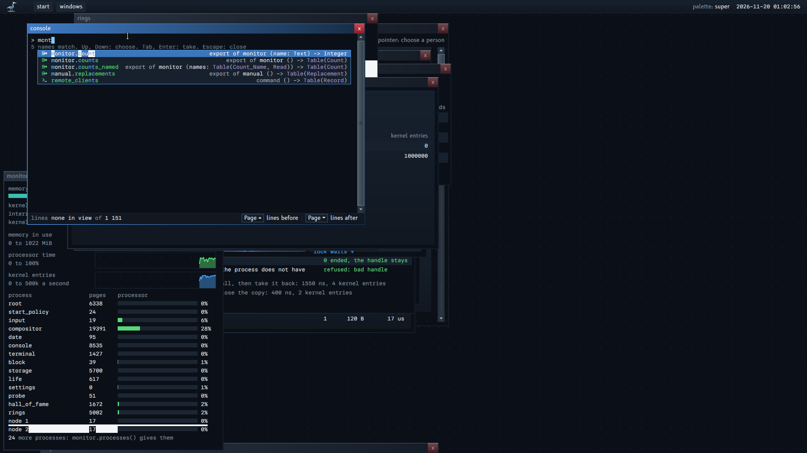
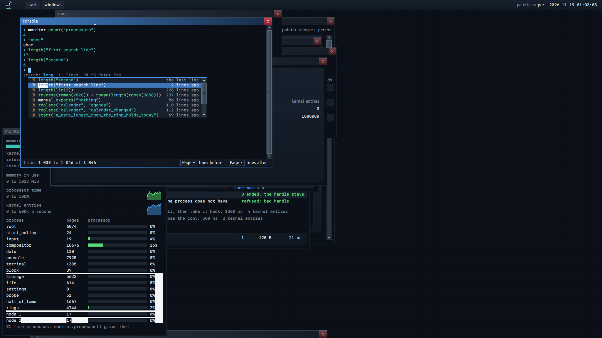
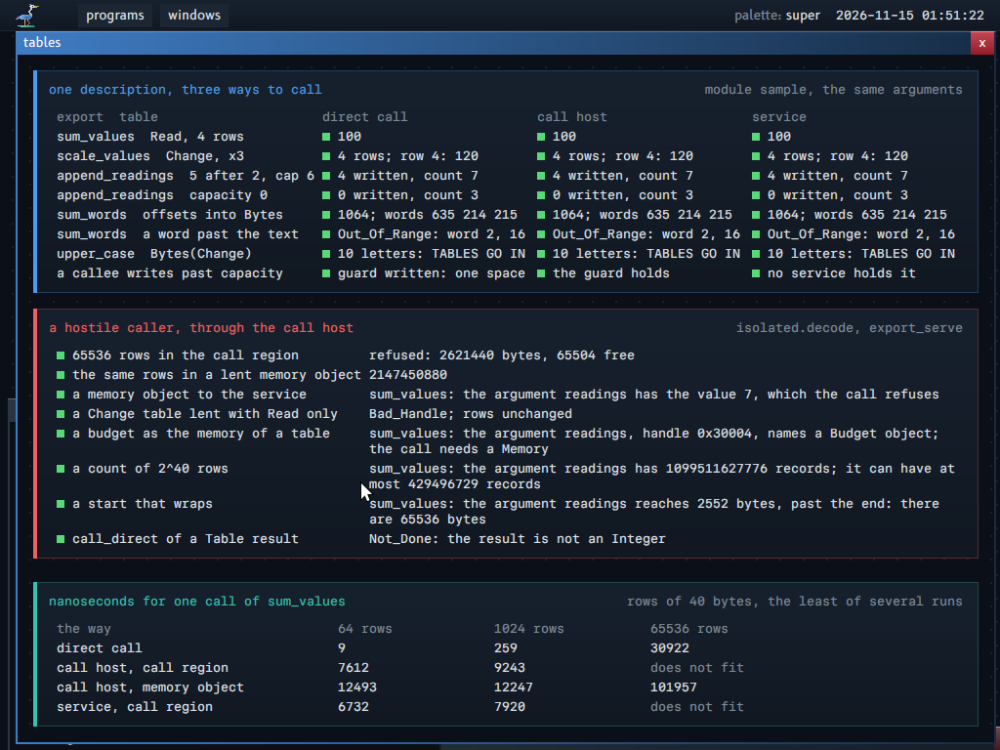
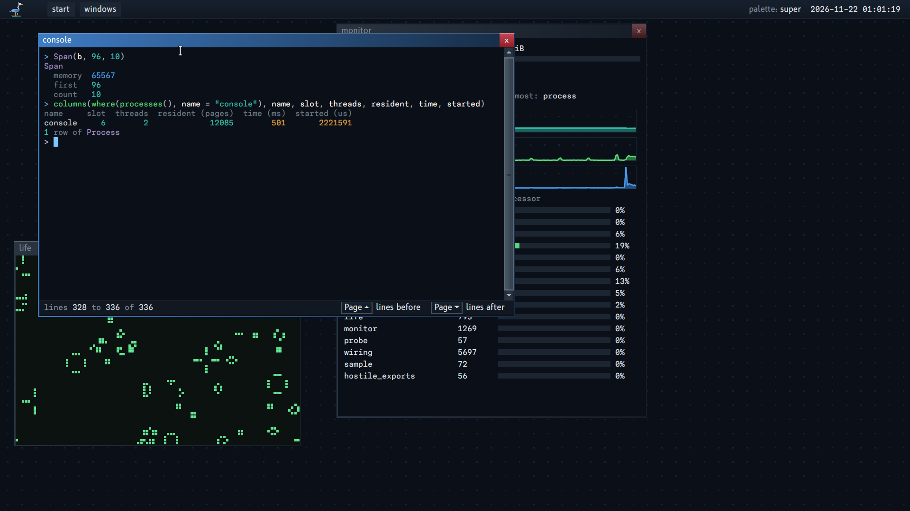

# The line of the console

This guide describes the line that is typed at the console: Lex, the language that the line is written in, the result that a line gives and how the console draws it, the log records that show under a line while it runs, the keys that edit the line, the completion list that opens while it is typed, the line history that survives a stop, and the colors of its code.

## About this guide

**The idea in plain words.** The console is the process in which the principal calls the functions of the system directly, with typed values, in place of a shell that passes text to processes. Each name that it can call comes from the description of a module, so the console can complete every name and show the signature of every call while the line is typed, with no code in the called process.

**For whom.** A reader who uses the console, and a reader who changes `src/modules/system/console`, `src/library/modus/line_editor` or `src/library/modus/terminal`.

**Read before.** `PROPERTIES.md`, "19. A command is a function: no text between processes". The terms edit line, line editor, hint line, free row, completion list, chosen row, fuzzy match, frecency, line history, history search, terminal, result drawer, short name of an export and pipe operator are in `glossary/communication.md`; log record and value run are in `glossary/running_code.md`.

**The map of this guide.**

| Section | What it says |
|---|---|
| "Lex" | What a line can say: values and their kinds, calls, variables, records, tables as values, how a line composes, the pipe operator, and its errors |
| "Results and their drawers" | The one result of a line, the drawer of each kind of result, and the result of each built-in command |
| "The log records of a line" | Which log records show under a line while it runs, and how the console reads them |
| "The built-in commands and the services" | Which built-in commands are exports of a service, and which stay in the console |
| "1. The keys" | What each key does, with the list closed, the completion list open, or the history search open |
| "2. What the console completes" | Which names come where the caret is, and from which table |
| "3. The fuzzy match" | How a query matches a name, and the score that orders the list |
| "8. The palette provider" | How the commands of the console show in the palette of the desktop, and how a chosen one runs |
| "4. The bounds, and the cost of one key" | The limits that keep one key fast against a hostile description |
| "5. Who draws the list, and the line under the edit line" | What the console sends and what the terminal lays out |
| "6. The line history across a stop" | The store of the history, its load, its save and who can read it |
| "7. The colors of the code" | The kinds of the parts of a line, their colors, and the records that carry them |

**An example.** Type `mcnt`: the completion list opens with `monitor.count` first, its matched characters in the accent color. Tab takes the name and adds `(`; the hint line under the edit line then shows `count(name: Text) -> Integer` with the parameter at the caret marked.





## What the console owns

The console owns the line that the input edits: its bytes, the caret, the line history, and the completion list. The terminal draws them and gives the keys. The terminal holds a surface, the two memory objects that it shares with its process (the terminal ring and the text region), and a handle that reads the state of the process. A line is UTF-8: a key of the layout of France types é in its two bytes, and each key moves the caret over a whole character, or removes a whole character (`docs/glossary/text.md`, "Text encoding"). The procedures that change the line are in `src/library/modus/line_editor`: they have no state of their own and make no kernel call, so host tests run each key (`src/library/modus/line_editor/line_editor_test.odin`). The console uses them in `src/modules/system/console/main.odin` and `src/modules/system/console/completion.odin`.

## Lex

A line of the console is one expression of Lex, the language of the console, or a variable that takes the value of one. The console evaluates a line once, from the left, and runs its commands. The evaluator of Lex is lazy and has two evaluation modes, with the same meaning for a line: the console runs it in mode `console`, which forces each line whole, and mode `declaration` will read a declaration with no effect (`src/md/features/declarations.md`). Each part of a line is computed at most once, and an evaluation takes at most 1048576 steps, one for each part computed; a line of the console takes a few hundred at most. The console reads the line, calls the functions that it names with typed values, and draws the one result that comes back: a value, or an error. No process receives the text of the line: the text stops at the console, and only typed values go to the functions (`PROPERTIES.md`, "19. A command is a function: no text between processes").

The code is `src/library/modus/lex_parser` (the parser: the syntax tree of a line), `src/library/modus/lex_evaluator` (the evaluator: the values, the thunks, the operators and the budget), `src/modules/system/console/language.odin` (the console as the host of the evaluator: the names, the calls and the sentences), `src/modules/system/console/commands.odin` (the commands and the calls), `src/modules/system/console/tables.odin` (the commands of tables), `src/modules/system/console/results.odin` (the result of a line and its drawing), `src/modules/system/console/line_records.odin` (the log records of a line), `src/modules/system/console/facts.odin` (the log facts), `src/library/modus/console_results` (the drawers), `src/library/modus/console_condition` (the conditions of `where`), `src/modules/system/console/streams.odin` and `src/library/internal/console/console_stream` (the streams).

### The form of a line

```
line       = name "=" pipeline | pipeline
pipeline   = expression { "|>" stage }
stage      = name | name "(" arguments ")"
expression = sum { "with" sum }
sum        = term { ("+" | "-") term }
term       = factor { ("*" | "/" | "%") factor }
factor     = "-" factor | integer | "text" | name | name "(" arguments ")" | "(" pipeline ")"
           | "{" [ name "=" pipeline { "," name "=" pipeline } ] "}"
           | "let" name "=" pipeline { "," name "=" pipeline } "in" pipeline
           | "(" [ name { "," name } ] ")" "=>" pipeline
           | "[" [ pipeline { "," pipeline } ] "]"
arguments  = argument { "," argument }
argument   = [ name "=" ] pipeline
comment    = "//" { a byte that is no line end }      (between two tokens: no token)
```

- **A name** starts with a letter or `_`, and goes on with letters, digits, `_` and `.`: `monitor.count` and `r.value` are one name each. `let`, `in`, `with` and `_` alone are words of Lex, never names: a variable, a field, a binding or a named argument with one of them is refused.
- **An integer** is decimal digits. It has 64 bits with a sign. A number that is larger than 9223372036854775807 is an error of the line. A result of `+`, `-`, `*` or `/` that does not fit is an error of the line too: no result wraps. The checks are `number_value`, `integer_add`, `integer_subtract`, `integer_multiply`, `integer_negate` and `integer_divide` of `src/library/modus/console_language`. The least integer has no literal: write `-9223372036854775807 - 1`.
- **A text** is the bytes between two quotes. A text has no escape, so it cannot hold a quote.
- **A comment** is `//` outside a text, to the end of the line: `area(r) // the area of r`. It adds nothing to the line, and a line of only a comment does nothing. `//` inside a text is a part of the text, and `a / / b` is two divisions, an error. Lex has no block comment.
- **The operators**: `+`, `-`, `*`, `/` and `%` on two integers, with the usual order; `-` before an integer; `+` on two texts joins them; `+` on two tables of equal record descriptions gives the rows of the left one, then the rows of the right one, and refuses two tables of different records. A division by zero is an error. So is the one division whose result does not fit: the least integer `/` `-1`. Its remainder fits: the least integer `%` `-1` is 0. The pipe operator `|>` has the lowest priority ("The pipe operator", below).

Examples:

```
> 6 * 7
42
> "abc" + "def"
abcdef
> length(repeat("ab", 3))
6
```

### Values and their kinds

Each value has one kind. The kinds are those of the module contract (`MODULE_CONTRACT.md`), so an export of a module takes and gives the same values as a command of the console.

| Kind | What it holds | How the console draws it |
|---|---|---|
| `Integer` | A whole number of 64 bits | `42` |
| `Text` | Bytes | The bytes, one line for each line of the text |
| `Record` | The bytes of one record, with the description of its record in a module | The name of the record, then one line for each field: its name and its value |
| `Handle` | A handle that the console holds | `Handle 65541: Memory (Give, Read, Write)`: the kind of the object and the rights, which the console asks of the kernel |
| `Table` | Records of one description, one after the other | A line of the names of the fields, a line for each row, then the count: `2 rows of Import` |
| `Bytes` | Bytes with no description | Rows of 16 bytes: the place of the row, the bytes in hexadecimal, their characters; then the count |
| `Stream` | A record output of a process, by its typed name: `output_counter.counts` | A line of the names of the fields, then a line for each record as it comes, until the end of the record stream or Escape ("Streams") |
| `Enum` | One member of an enum that a module file describes: its value, with the enum | The member as a line names it, in the color of a status: `.french` |
| `Function` | A function of Lex, `(x) => x * 2`, with the bindings that its body reads | Its text: `(x) => x * 2` |
| `List` | Values in order, `[1, 2, 3]` | `[2, 4, 6]` on one line when its items are integers, texts, members, functions or such lists; else each item in turn |

`Stream`, `Function` and `List` are kinds of the console only: no export takes or gives one. No variable keeps a `Stream` or a `Function`; a variable keeps a `List` ("Functions and lists").

**A member** of an enum is a name after a dot: `.french`. It has no enum of its own: the parameter that receives it, an Enum parameter of an export, gives it one, as a Record parameter types a record literal ("Records"). A line names a member, never its number: the console writes the value that the module file gives to that member. A name that the enum does not have, and a member where the parameter is no Enum, are refused at the place of the member, before any argument of the call runs. A member that nothing receives, as the value of a line or of a variable, is refused. An export that gives an Enum, a getter as `settings.font()`, gives a value of the kind `Enum`, which a variable keeps and an Enum parameter of the same enum takes:

```
> settings.set(keyboard_layout = .french)
1
> settings.keyboard_layout()
.french
> settings.set(font = .comic)
error: settings.set: Font has no member .comic; its members are .vector, .spleen
```

A parameter of the kind `Bytes` takes a `Text` value as its argument, or the `Bytes` of a memory object that `bytes(memory, first, count)` read: `assemble(bytes(t, 0, n), f)` gives the text that `compile` wrote to the assembler. A built-in command can have a parameter of the kind `Value`, which takes a value of any kind; the command checks it itself (the third parameter of `where`).

A command gives a result and never prints. A command that does something and has nothing to give has no result: `start`, `stop`, `clear`. `help()` shows this in each signature: a command with `->` gives a value of that kind, and a command with no `->` gives nothing. A last parameter that a call may leave out is in brackets, `start(Text, [Table])`, and the names of fields of `columns` are `Field...`: `columns(Table, Field...) -> Table`. The section "Results and their drawers" has the result of each built-in command.

### Calls

A call is `name(argument, ...)`, with at most 12 arguments: the arguments of an export at most (`module.PARAMETER_CAPACITY`). A command that makes a record takes one argument for each field, so a record of up to 12 fields is a command. Each argument is an expression: a number, a text, a variable, an operation, or another call.

**Where a command comes from.** A name can be called when the command table of the console has it. A command comes from one of three places:

- **The console itself**: the built-in commands. They exist before any module is loaded.
- **A module of the boot image**, after `load("sample")` or `isolate("sample")`: each export becomes a command with the name of the export, and each record of the description of the module becomes a command that makes a record from its fields. A log fact type is no command: `facts(...)` reads it from the log. A module from memory, after `isolate_memory(name, memory, size)`, adds its commands the same way.
- **A service that runs**, after `connect("monitor")`: each export becomes a command named `service.export`, as `monitor.count`.

When two commands have one name, the command added last runs.

**The check before the call.** The console checks the count of the arguments and the kind of each one against the description of the parameters, before the call. A record or a table argument must have a description equal to the description of the parameter: equal records of two modules agree. A wrong argument is refused with its number and the two types, and the call does not run:

```
> sum_values(columns(t, sensor, value))
error: sum_values: argument 1 is Table(Reading, Read), not Table(Reading)
```

Here `columns` made a table of another record, with fewer fields, so the export of `sample`, which reads the whole record, refuses it.

**How the call runs.** A built-in command runs in the console. An export of a module that `load` added is a direct call in the memory of the console. An export of a module that `isolate` added is an isolated call to a sandboxed process, and an export of a service is a call to that service; the arguments and the results go through the call region (`MODULE_CONTRACT.md`, section 4). A record argument is a copy: the export can write in it, and the variable that gave it does not change.

### Variables

`name = expression` keeps a value under a name for the lines after it. `let name = expression`, with no `in` after the value, is the same line. A name alone gives the value back; `name.field` gives one field of a record variable.

```
> t = readings(4)
> sum_values(where(t, sensor = 2))
210
> r = row(t, 1)
> r.value
```

The bounds:

- 64 variables. A new name takes a free slot; a name that exists takes its new value.
- A name of 64 bytes at most. The bytes of a value (a text, a record, a table and its description, the items of a list) go in a memory object of their size, which the budget of the console pays: a value that the budget cannot pay is refused, and the variable keeps its old value.
- A table of a line whole: the tables of a line share 1 MiB (`TABLE_ARENA`).
- No `Bytes` value: "error: a variable keeps no Bytes value".
- No `Stream`: a Stream is a wiring, and a variable outlives its line ("Streams").
- No `Function`: a function reads the values of its line, which end with the line ("Functions and lists").
- A `List` of 4096 items at most, the items of its nested lists included (each list that a line makes), and 1 MiB of their texts and records. A list past a bound is refused with an error record `Over_Limit`, and the variable keeps its old value. A list in a variable holds no function, no table and no hash ("Functions and lists").
- An expression with no value (a call of a command with no result) cannot be kept: "error: the expression has no value".

`variables()` gives them as a table: the name, the type and the value as a text. A variable lives in the memory of the console: it does not survive a stop of the console.

### Records

A record is a group of named fields, as a module describes it. The command with the name of a record makes one from its fields, in the order of its description. `variable.field` reads one field: an integer, a text or a handle.

**A record literal** writes a record by its fields, in any order: `{x = 0, y = 0, width = 3, height = 4}`. It has no type of its own: the parameter that receives it gives it one, a Record parameter of an export. A field that the record does not have, a field that the literal does not give, a field given twice, and a value of another kind than its field are refused, each with the field. The names are checked when the call starts, before its arguments run; the values when they are known, before the call runs. A field has no default: a literal gives each field. A literal that nothing receives, as the value of a line or of a variable, is refused: it has no type.

**A named argument** gives a parameter by its name: `grow(r, by = 2)`. The names are those of the description of an export, or the fields of a command that makes a record; a command of the console has none. After a named argument, each argument is named. A name that names no parameter, a parameter given twice, and a parameter that the call does not give are refused, but an optional parameter: an Enum parameter that its export lets a call leave out, as each setting of `settings.set(font = .spleen)`. The console gives such a parameter the absent word, which names no member (`MODULE_CONTRACT.md`, "Enum parameters"). Inside `where`, `=` stays the operator of a condition.

**`with`** gives a record with some of its fields changed: `r with {width = 10}`. On its right, a record literal of fields of that record, or a record of the same description. It composes two records only, and has the lowest priority but `|>`.

**`let`** names values for one expression: `let s = {x = 0, y = 0, width = 6, height = 7} in area(s) + area(s)`. A binding can name another binding, also a later one, and an inner `let` hides an outer one. The console computes each binding once, from the left, also a binding that the body does not read, then the body. A binding that needs its own value is refused. `s.width` reads a field of a binding.

```
> area({x = 0, y = 0, width = 11, height = 3})
33
> area(r with {width = 10})
40
> grow(r, by = 2)
> let s = {x = 0, y = 0, width = 6, height = 7} in area(s) + area(s)
84
```

### Functions and lists

**A function** is `(name, …) => expression`: its parameters, at most 12, then its body. A `(` starts a function when `=>` follows its `)`; else it holds an expression. The body runs to the `,` or the `)` around the function. A `let` names a function, and a call by that name runs its body with the arguments in the place of the parameters:

```
> let double = (x) => x * 2 in area({x = 0, y = 0, width = double(3), height = 4})
24
> (x) => x + 1
(x) => x + 1
```

- **The arguments** are forced from the left, then the body runs, as for an export. A call gives each parameter once, by its place or by its name: another count is refused before any argument runs.
- **A function reads the bindings around it**, where it is written, and never a copy: `let n = g() in map(l, (x) => x + n)` runs `g()` once. An inner parameter or binding hides an outer one.
- **A function with no call runs nothing**: its body runs only in a call.
- **A recursion** through a `let`, `let f = (n) => f(n - 1) in f(3)`, never ends, because Lex has no condition yet: the line stops when the evaluator has taken 512 KiB of stack, at about 90 calls, or at the evaluation budget.

**A list** is `[a, b, …]`: its items in order, of any kinds. **`map(list, function)`** calls the function on each item from the first, and gives the list of the results. `map` is a name of Lex, not a command: it takes a list and a function of one parameter, and it comes before an export named `map` of a loaded module. A list holds no Stream, no Record_Input and no item with no value. A literal or a member in a list stays untyped until a parameter receives it, as a literal does ("Records").

```
> map([1, 2, 3], (x) => x * 2)
[2, 4, 6]
> [1, 2] |> map((w) => area({x = 0, y = 0, width = w, height = 5}))
[5, 10]
```

**The border.** No export and no command of the console takes a function or a list: such an argument is refused before the call runs. A function is code of Lex, and its body reads the values of its line, which end with the line: no variable keeps one.

**A variable keeps a list.** The line copies the items into the memory of the variable, and a later line reads them as a list of its own:

```
> x = [1, 2, 3]
> map(x, (n) => n * n)
[1, 4, 9]
> x = map(x, (n) => n + 1)
> x
[2, 3, 4]
```

A list variable takes 4096 items at most, the items of its nested lists included, and 1 MiB of the texts and records of its items. Its items are integers, booleans, texts, members, handles, records and such lists. A line that reads list variables copies their items among the 4096 items of the line, once for each variable.

**The bounds of a line**: 4096 bytes of text, 256 levels of nesting, 4096 calls of functions, 8192 values of their bodies, 4096 items in all its lists, the items of the list variables that it reads included. The terminal flows a long edit line over its rows; a line taller than the view shows its rows down to the cursor.

### Tables as values

A table is the records of one description, one after the other. An export with a `Table` result gives one, and the console holds it as one value: it passes the table to the next call with no parsing. Eight built-in commands work on a table of any record, because each one reads only the description of the records. A table that a built-in command gives (`grants`, `modules`, `help`) is such a table: the console writes the description of its record in the format of the module contract.

| Command | Gives |
|---|---|
| `where(table, field = value)` | The rows whose field passes a condition ("Conditions") |
| `sort(table, field)` | The rows in the increasing order of a field: integers by value, texts byte by byte. Rows with one value keep their order, so two sorts give an order by two fields |
| `join(left, right, field)` | One row for each pair of rows with one value of the field. The new record has the fields of the left record, then the fields of the right one that the left one does not have, at most 40; its name is `<left>_<right>` |
| `columns(table, a, b, c)` | The rows with only the fields that the names choose, in their order: names of fields, never a variable or a text. The record keeps its name |
| `first(table, count)` | The first rows, at most the count |
| `skip(table, count)` | The rows after the first rows |
| `rows(table)` | The count of rows, as an `Integer` |
| `row(table, number)` | One row as a `Record`, from 1 |

`join` and `columns` make a new record description. The console writes it in the format of the module contract, so the next command reads it as it reads the description of a module. A command that gives a table gives a new table; the table of its argument does not change.

The tables of one line share 1 MiB (`TABLE_ARENA`). The console draws a table with no cut inside a value ("Results and their drawers").



### Conditions

The argument of `where` after the table is a condition: a field of the record of the table, an operator and a value. The parser reads it as a condition, not as an expression, so the field is a name of the record, never a variable.

```
> where(processes(), name = "console")
> where(compositor.windows(), pictures_drawn_again != 0)
> log.records(0) |> where(level = Warning)
> log.records(0) |> where(number >= 100) |> where(number < 200)
```

| Field | Value | Operators |
|---|---|---|
| Integer, hexadecimal Integer, handle | An `Integer` expression | `=`, `!=`, `<`, `<=`, `>`, `>=` |
| Text, module name | A `Text` expression | `=`, `!=` |
| Status of a contract enum (`level`) | The name of a member: `Info`, `Debug`, `Warning`, `Error` | `=`, `!=` |
| Hash, values of a fact | None: the console has no such value | None |

A status takes `=` and `!=` only: the numbers of the members are no order of weight (`Debug` is 1, `Warning` is 2). The name of a member is the name that the console draws in a cell, with its capital letter; a text (`"Warning"`) or a number (`2`) is no member. An unsigned field compares as unsigned: `where(key > 0)` keeps a key of 2^63 and the largest key. `where`, `sort` and `join` compare the values of fields so.

**What is refused before a row is read.** No field before the operator (`where(t, = 3)`), a field with no operator (`where(t, level)`), a `!` alone, `==`, no value after the operator, a field that the record does not have (the error lists the fields), a value of another kind than the field, a negative value for an unsigned field, a value that the bytes of the field cannot hold, a text, a number or a name of no member after the operator of a status (the error lists the members), an order on a Text or a status, and a hash. A table argument that is no table is refused with its kind (`where(5, a = 1)`). When the console knows the record of the table before the run, in a line with `|>`, it refuses these before any call, and the kind and the range of a value that is one literal too: the result of an export, the table of `facts(...)`, and the table of a `where`, `sort`, `first` or `skip` after one of them. The reading and the checks are the support package `src/library/modus/console_condition`, whose host tests give each refused input.

```
> log.records(0) |> where(levle = Warning)
error: where: the records Record have no field levle; their fields are number, time, process, slot, level, form, lost, continues, runs, text
> log.records(0) |> where(level = warning)
error: where: the field level holds a member of Log_Level: Info, Debug, Warning, Error; "warning" names none
> log.records(0) |> where(level >= Warning)
error: where: the field level is Status(Log_Level): it takes = and != only, because the order of the members is no order of weight
> log.records(0) |> where(level = "Warning")
error: where: the field level holds a member of Log_Level, and a member is a name, not a text or a number: "Warning" is none; the members are Info, Debug, Warning, Error
```

**The completion.** In a line with `|>`, inside `where(` after a table whose record the console knows, the completion list offers the fields, and after the operator of a status field the members of its enum.

### Log facts as a table

`facts(table, package.Type)` gives the facts of one fact type ([log fact](glossary/running_code.md)) among the rows of `log.records`: one row for each fact, with the number, the time, the process and the level of its record, then each field of the fact type, in the order of its record.

```
> connect("log")
> log.records(0) |> facts(log_reader.Fact_Probe)
> log.records(0) |> facts(log_reader.Fact_Probe) |> where(probe_number = 7)
```

- **The fact name is a name**, the package that declares the record type, a dot, and the record type, as the writer declares it. The console finds it in the fact tables of the module files of the boot image, and refuses before any call a name that none holds, with the fact names of the same package, or each fact name when the package has none. The completion list offers the fact names inside `facts(`, and the record types of a package after its dot.
- **The values** come from `log.fact_records`, which the console calls itself: a fact record has no text, and its row of `log.records` has an empty text.
- **One description.** Each module of the boot image that writes the fact type is read. The first one gives the description of the table; a row of another description of the same fact name is left out.
- **The table** is a table as any other: `where` takes its fields, and `columns`, `sort`, `first` and `rows` take it.
- **No field of a fact type has the name of a column of the head** (`number`, `time`, `process`, `level`): `where` would not know which of the two values a name means, so `facts` refuses such a fact type.

Errors: a name that names no fact type; a fact type with a field named as a column of the head; a table that is not rows of `log.records`; no connection to the service `log`.

### Streams

A record output of a process is a value of the line: its [typed name](glossary/communication.md), `owner.output`, gives a [record stream](glossary/communication.md) of the kind `Stream`, as `Stream(Counted)`. The owner is a process that the console started with `start`, or a service that it connected with `connect`. The console reads the record outputs and their record descriptions in the module file of the owner, so the completion list offers the record outputs after `owner.`, and the fields of a condition after a typed name are checked before the line runs.

```
> start("output_counter")
> record_outputs("output_counter")
output  record   about
counts  Counted  One record each time the writer counts, while a reader is wired.
1 row of Record_Output
> output_counter.counts |> where(status = 404) |> first(3)
serial  status
     2     404
     5     404
     8     404
3 rows of Counted
```

**When a record stream is wired.** A typed name holds no wiring. The first command that reads it sends `Wire` to the root service, with the console as the asker and the reader, and the console pays the ring from its budget. Each record stream that a line wired ends with the line: the console closes its end, and the writer reads the end word `Side_Closed`. A line that fails before its read wires nothing.

| Command | On a `Stream` |
|---|---|
| `where(stream, field = value)` | The same record stream with one more condition ("Conditions"), at most four. The console checks each condition on each record as it reads it |
| `first(stream, count)` | A `Table` of the first rows that pass the conditions, once the count came or the record stream ended |
| `table(stream)` | A `Table` of the rows that pass the conditions, at the end of the record stream; at most the 1 MiB of the tables of the line (`TABLE_ARENA`) |
| A `Stream` at the end of a line | The line of the names of the fields, then each row as it comes, until the end of the record stream or Escape |

`first` and `table` keep the rows only. Each other command that takes a table refuses a `Stream`, before any call, and so does a variable:

```
> sort(output_counter.counts, "serial")
error: sort takes a Table; a Stream has no end: first(s, n) or table(s) makes one
> kept = output_counter.counts
error: a variable keeps no Stream: a Stream is a wiring, and a variable outlives its line; first(s, n) or table(s) makes a Table
> output_counter.missing
error: output_counter declares no record output or record input missing; its record outputs are counts
```

**The draw of a record stream.** The width of each column is the widest text that its field can hold, from its record description: the digits of the largest value of an Integer of its size, the longest member of a status, the bytes of a Text. So a row never moves the rows above it. A row that is not a record is one dim line: "joined after 9 records" when the console joined the record stream after its start ([joined record](glossary/communication.md)), "3 records are missing here" for a [gap record](glossary/communication.md), and the end: the end record, or the end word of the wiring ("the stream ended: the writer stopped"). Escape ends the wait at once and closes the record stream, and the last line says "Escape closed the stream after 12 rows". `first` and `table` stop at Escape too, and the line fails with the count of the rows that came.

**The condition goes to the writer.** The first condition of a `Stream` goes with its wiring: the root service checks it against the record of the record output, and gives the writer the place of the field, so the writer writes into the ring of the console only the records that pass it. The console still checks each condition on each record, with the same test. A record that fails the first one is a fault of the writer: the line fails with an error record (`Bad_Value` of the unit `Wiring_Terms`, the serial of the record as its value) and the console closes the record stream; a record that fails another condition is only left out. A condition that the writer does not filter fails the line before any wiring: an order on a Text or a status, a field of a handle, a Text of more than 64 bytes.

**The fields that a row shows.** `columns(stream, a, b)` gives a `Stream` whose rows hold those fields; its conditions still read the whole record.

```
> output_counter.counts |> columns(status) |> first(2)
status
   404
   200
2 rows of Counted
```

**The counts of the writer.** `stream_counts(stream)` wires the record output, waits for the first compartment of the ring, the joined record, which the writer writes at its next write even when the condition leaves that record out, and gives the `Record` `Writer_Counts`: the records `written`, `discarded` (no reader, the condition of each reader left them out, or each reader's ring was full and counted them in its gap), `refused` as `Full`, the writes that a full ring `held` until it had room, and the readers whose ring the writer closed as their gap reached its largest count (`rings_past_gap`), as the writer published them at its last write before the read. `held` and `refused` overlap: a write that waited and then reached its deadline counts in both. They are the claim of the writer, not a fact that the console checks.

**The records of a service.** A service that the console connected to gives its record outputs by the same typed names. `server` writes the access record of each request into `requests`:

```
> connect("server")
> server.requests |> where(status = 404) |> first(5)
```

The rows come from the next request on: the console draws "joined after N records", where N counts the requests that `server` answered before the read. The condition goes to `server`, which writes into the ring of the console only the records of the status 404. `server` never waits for the console: a ring that the console does not read in time refuses the next records with `Full`, and `stream_counts(server.requests)` says how many.

**A record input, and a wiring list.** A typed name also names a record input: `output_count_reader.counts` is a value of the kind `Record_Input`, which only `wire` takes. A typed name may name a module that does not run yet: its module file in the boot image gives its record outputs and its record inputs, for the list of its own start. `wire(from, to)` gives a `Table` of one `Wiring`: `writer`, `output`, `reader`, `input`, the `condition` as a text, and its terms. `+` joins two of them, and `start(module, list)` starts the module with the wirings of the list, made before its first instruction:

```
> start("output_count_reader", wire(where(output_counter.counts, status = 404), output_count_reader.counts))
```

| Refused by | What |
|---|---|
| `wire` | a first argument that is no `Stream`, a second that is no `Record_Input`; two records that differ; one process at both ends; a `Stream` with more than one condition, or that `columns` cut |
| `start` with a list | a list that is no `Table` of `Wiring`; a row that names no end of the module, or names it at both ends; an end that does not run; a row that repeats an earlier row with the same condition, whose reader then takes each record twice; more than 32 rows or 16 lent handles; each check comes before the console lends a handle |
| the root service | each refusal of the list, with the row in its error record: a record input of the count `One` wired twice among them, and a second source of a generic record input of another record than the first |

**The log of a module, and the whole log as it comes.** Each process has the record output `log`, which only the list of its own start wires: its first record is then in the ring. `log.follow` is a record output of the log service: the records of the principal of the console, from the next one on.

```
> start("server", wire(server.log, collector.sources))
> log.follow |> where(level = Warning)
> log.follow |> where(process = "storage") |> first(5)
```

The module `collector` declares no record input `sources` yet, so the first line fails at that name until it does. `wire` refuses a condition on `log`, and `start` refuses the `log` of a process that already runs: its first records are gone. A typed name whose owner has more than 31 bytes names no process, and the line fails. `log.follow` in the console never shows the records of the console itself: the console writes each line that it draws to the log, so a draw of its own rows gives a new row at each line, without end. The rows of `log.follow` that the console draws do not go to the log either. `log.records` with `where(process = "console")` gives the past records of the console. Escape ends `log.follow`, as each record stream.

**A generic record input or output.** `merge.sources` is a generic record input: `wire` takes it with no check of the record, and the root service checks the record of each wiring against the one that the first fixed. `merge.merged` writes the record that a list of a `start` of this console fixed for `merge`; with none, the line fails and says so:

```
> start("merge", wire(where(output_counter.counts, status = 404), merge.sources))
> merge.merged |> first(2)
```

### How a line composes

A line composes by calls in calls. The console evaluates each argument before its call, from left to right, and the innermost call runs first. Each step takes a typed value and gives one:

```
> connect("manual")
> columns(where(manual.running(), module = "calendar_fixed"), process, slot, module, replaces)
> join(columns(manual.running(), process, hash), columns(manual.modules(), hash, name, code, exports), "hash")
> rows(manual.exports("")) - rows(manual.exporters("show"))
```

The first line lists the processes that run a module, keeps the rows of one module, and shows four of their fields. The second joins two tables of the service `manual` on the hash of a module. The third subtracts two counts.

**The built-in commands compose too.** A built-in command that lists things gives a table, so a line filters, sorts and counts it as it does the table of an export:

```
> where(grants("notes"), state = "held")
> sort(where(processes(), state = "waiting"), "name")
> rows(where(help(), name = "repeat"))
> columns(where(loaded(), call = "direct"), module, imported_by, in_place_of)
```

### The pipe operator

`a |> f(b, c)` is `f(a, b, c)`: the value on the left of `|>` is the first argument of the call on its right. `a |> f` is `f(a)`, and `a |> f()` too. So a line reads in the order in which its calls run:

```
> processes() |> where(name = "server")
> processes() |> where(name = "server") |> columns(name, slot)
> rows(help() |> first(3)) |> text
```

They are `where(processes(), name = "server")`, `columns(where(processes(), name = "server"), name, slot)` and `text(rows(first(help(), 3)))`.

- **The lowest priority.** The whole expression on the left is the value: `1 + 2 |> text` is `text(1 + 2)`. A `,` and the parentheses around it end it: `where(x |> f, a = 1)` is `where(f(x), a = 1)`, and `(x |> f) + 1` is `(f(x)) + 1`.
- **From the left.** `x |> h |> g(1) |> f` is `f(g(h(x), 1))`.
- **A variable** keeps the value of the whole line: `t = processes() |> rows` is `t = rows(processes())`.
- **On the right**: the name of a command, alone or with its arguments. The call takes one argument more than the arguments in its parentheses, at most 12 in all.
- **The placeholder `_`** puts the value on the left in another place: `3 |> grow(r, _)` is `grow(r, 3)`, and `x |> f(by = _)` is `f(by = x)`. The `_` is a whole argument of the call on the right, at most one in that call, and in no call nested in it; a `_` with no `|>` before its call is refused. The value on the left runs where the call reads it: in `g() |> f(h(), _)`, `h()` runs before `g()`.
- **In a named argument, a field and a `let`**: `f(n = x |> g)` is `f(n = g(x))`, `{a = x |> g}` is `{a = g(x)}`, and `let a = x |> g in a |> h` is `let a = g(x) in h(a)`.
- **In a function and a list**: the body of a function holds its own `|>`, `map(l, (x) => x |> g)` is `map(l, (x) => g(x))`, and so does each item of a list, `[a |> f, b]` is `[f(a), b]`. `l |> map((x) => x * 2)` is `map(l, (x) => x * 2)`. A `_` in the body of a function on the right of `|>` is refused.

**Sugar only.** The operator adds no meaning and no kind. Before any call, the console writes the line with calls in calls (`pipe_nested_form`, `src/library/modus/console_language/pipe.odin`), and its parser reads that line, which has no `|>`. So a line with `|>` checks and runs as the same line with calls in calls, with the same errors.

**What is refused before any call.** A line with a fault of the operator runs nothing: the console finds the fault in the text and in the command table, before the first call. These faults are the form of the operator; a name on the right that no command has; a command on the right that takes no argument, or 12 arguments already, or another count; and a first parameter that does not take the value on the left, when the console knows that value before the run. It knows the value of a literal, of a variable, and the result of an export, whose description gives its record. A built-in command makes the description of its table when it runs: the check of the call then refuses the value, after the left part ran, with the sentence of the same line with calls in calls.

`|` alone is no operator of Lex: a line with it fails before any call, and says so.

**Why `|>`, and not `|`.** `|>` has no other meaning in Lex, so a reader and the parser never take it for another operator, and `|` stays free for a union of sets. The arrow reads as "goes to". Elixir, Gleam and R give the same sign this meaning: the value on the left is the first argument of the call on the right. F#, where the sign comes from, gives the value to a function of one argument, so `x |> f a` there is `f a x`, with the value last.

### Errors

A line that fails has one result: its error. The first error ends the line: the rest of the line does not run. A command never prints its error: it makes the line fail, and the console draws the error after the line ("Results and their drawers", "The drawer of an error"). The first line of a drawn error starts with `error: ` and holds one sentence.

| When | The sentence |
|---|---|
| No command has the name | `error: no command has the name x; try help()` |
| No command has the name, and commands have names near it | `error: no command has the name proceses; did you mean processes?` |
| A command named with no parentheses | `error: help is a command: write help(...)` |
| No variable has the name | `error: no variable has the name x`, with `; did you mean ...?` when a variable has a name near it |
| A record variable has no such field | `error: Reading has no field x; its fields are ...` |
| The count of the arguments is wrong | `error: length takes 1 arguments, not 2` |
| An argument has the wrong kind | `error: sum_values: argument 1 is Table(Reading, Read), not Table(Reading)` |
| An operator on the wrong kinds | `error: "-" does not take Text and Text` |
| A division by zero | `error: division by zero` |
| A result that does not fit in an integer | `error: "+" of 9223372036854775807 and 1 does not fit in an Integer: an Integer has 64 bits with a sign` |
| A number that does not fit in an integer | `error: the number 9223372036854775808 does not fit in an Integer: the largest is 9223372036854775807` |
| A text with no end quote | `error: the text has no end quote` |
| `\|>` with no value on its left: at the start of the line, after `(`, `,` or `=` | `error: \|> has no value on its left: write a value, then \|> and a call` |
| The line ends after `\|>` | `error: the line ends after \|>: a call or the name of a command comes after it` |
| After `\|>`: an integer, a text, `(`, another `\|>`, or more after the call | `error: \|> takes a call or the name of a command on its right, not "12"` |
| A command after `\|>` that takes no argument | `error: help takes no argument, and \|> gives it the value on its left` |
| A command after `\|>` with 12 arguments in its parentheses | `error: f has 12 arguments already, and \|> gives it one more: a call takes at most 12` |
| A `\|` alone | `error: "\|" is no operator: the pipe operator is "\|>"` |
| A field that the records do not have | `error: where: the records ... have no field x; their fields are ...` |
| A field that the records do not have, with fields near it by their letters or by their unit | `error: where: the records Process have no field pages; did you mean resident or mapped? Their fields are ...` |
| A value of the wrong kind for a field | `error: where: the field code is Integer, the value is Text` |
| An export that fails | `error: manual.exports: the argument name names none of the modules`: the name of the export and the sentence of its error record (`MODULE_CONTRACT.md`, section 8), then `outcome`, `effect`, and the values of the record |
| The root service refuses | `error: root.Stop: the argument name names a process of the system: ...`: the sentence of the error record of the root ring, then its values |
| A call in an isolated process that faults | `error: the process agenda stopped: a fault, invalid instruction`, then the instruction and the frames of its stop report, each after `error: ` |
| A field that the record of a literal does not have | `error: Rectangle has no field widht; its fields are x, y, width, height` |
| A field that a literal does not give | `error: Rectangle needs the field height, which has no default` |
| A value of a literal of another kind than its field | `error: Rectangle: the field x is Integer, the value is Text` |
| A literal that nothing types | `error: a record literal takes the type of the parameter that receives it, and nothing receives this one` |
| A named argument that names no parameter | `error: grow has no parameter bye; its parameters are rectangle, by` |
| A parameter that a call with named arguments does not give | `error: grow needs the parameter rectangle, which has no default` |
| A member that the enum of its parameter does not have | `error: settings.set: Font has no member .comic; its members are .vector, .spleen` |
| A member where the parameter is no Enum | `error: length: argument 1 is Text, not a member: a member takes the enum of a parameter Enum` |
| A member that nothing types | `error: a member takes the enum of the parameter that receives it, and nothing receives this one` |
| A member of another enum, from a getter | `error: settings.set: argument 1 is Font, not Keyboard_Layout` |
| `with` on another value than a record | `error: "with" composes a record with a record literal or a record, not Integer with a record literal` |
| A binding of a `let` that needs its own value | `error: the binding a needs its own value: a let cannot read a binding in its own value` |
| A word of Lex as a name | `error: with is a word of Lex, not a name` |
| `->` where a function is expected: Lex has one form of a function, and no alias | `error: "->" is no operator: a function is written (n) => n * n`, with the parameters and the body of the line |
| A parameter of a function named twice | `error: the parameter x is named twice in one function` |
| A call of a function with another count of arguments | `error: f: the call gives 2 arguments, and the function takes 1 argument` |
| `map` with another count of arguments | `error: map takes 2 arguments, a list and a function; the call gives 1 argument` |
| An item of a list with no value, or a Stream | `error: a list holds no Stream: a Stream lives in the wiring of its line` |
| A call of a name whose value is no function | `error: f is Integer, not a function: a call of a binding needs a function` |
| A function or a list given to a command | `error: area: argument 1 is a function: a function and a list stay in their line, and no command takes one` |
| A function kept by a variable | `error: a variable keeps no function: a function reads the values of its line, which end with the line` |
| The lists of a line past 4096 items, list variables included | `error: the lists of the line hold more than 4096 items in all`, with an error record `Over_Limit` |
| A list past the bound of a variable | `error: a variable keeps a list of 4096 items at most, the items of its nested lists included; this one has 4097 or more`, with an error record `Over_Limit` |
| `map` on another value than a list | `error: map: argument 1 is Integer, not a list` |
| A recursion, or a line nested deeper than the stack of the evaluator | `error: the line nests deeper than the stack of the evaluator holds: 524288 bytes; it stopped at column 16` |
| A `_` that is no whole argument of the call on the right of `\|>` | `error: \|>: _ is a whole argument of f, not a part of an expression` |
| Two `_` in one call | `error: \|>: f has two _; the value on the left takes one place` |
| A `_` in a call nested in the call on the right | `error: \|>: _ names an argument of f, not of g inside it` |
| A `_` with no `\|>` before its call | `error: _ is a place of the call on the right of \|>; this call has no \|> before it` |
| A line past the evaluation budget, which no line of the console reaches | `error: the line needs more than 1048576 steps of the evaluator: it stopped at column 12`, with an error record `Over_Limit` |

An overflow has an error record of the kind `Over_Limit`: `value` is the left value, `found` the right value, and `limit` the largest integer.

A call that runs before the error keeps its effect: in `length(start("life"))`, `start` runs, then `length` refuses its argument. The line draws only its error. The calls run in the order of the data: the arguments of a call from the left, before the call, so `f(g(), h())` runs `g`, then `h`, then `f`.

## Results and their drawers

A line has one result, and the console draws it by its kind. No command writes to the terminal: a command gives a value, or makes the line fail. So each fact that a command gives is a value that the next call can take, and the look of a result is decided in one place.

### The drawers

One drawer exists for each kind of result. A drawer knows no command: it reads the value, and for a record or a table the description of its record. The drawers are in `src/library/modus/console_results`: they have no state, call no allocator and make no kernel call, and host tests draw each kind into a text (`src/library/modus/console_results/console_results_test.odin`). A drawer writes parts of a line to the console with what each part is; the console chooses the color.

| Kind | What the drawer writes |
|---|---|
| Integer | The decimal text |
| Text | The bytes, one line for each line of the text. An empty text is one empty line |
| Record | The name of the record, then one line for each field: two spaces, the name of the field, and its value. The values start at one column. A field that counts a size or a time has its unit after its value: `time  120 ms` |
| Table | A line with the names of the fields, a line for each row, a line with the count of rows and the name of the record. Each column has the least width that holds its head and its values, with two spaces between two columns. A number is at the right of its column, a text at the left. The head of a field that counts a size or a time has its unit in parentheses, one time for the column: `time (ms)` |
| Handle | `Handle`, its number, the kind of its object, and its rights in parentheses. A handle that names no object: `Handle 7: no object` |
| Bytes | Rows of 16 bytes: the place of the first byte of the row in 8 hexadecimal digits, the bytes in hexadecimal, their characters (a byte that is no character is `.`). The last line is the count of bytes |
| An error | "The drawer of an error", below |

```
> where(grants("notes"), state = "held")
process  grant  state  principal  principal_name
notes    log    held           0  machine
notes    store  held           0  machine
2 rows of Grant
> memory()
Memory
  memory                256 MiB
  free                  201 MiB
  ...
> columns(where(processes(), name = "console"), name, slot, threads, resident, time, started)
name     slot  threads  resident (pages)  time (ms)  started (us)
console     4        3               412         38       1830211
1 row of Process
```



**The colors.** A value has the color of its value kind, from the one table that the window of the log and the site read (`src/library/modus/graphics/value_colors.odin`; `docs/DESIGN.md`, "The colors of values"). The console sends the kind (`Style.value_kind`), and the terminal chooses its color in the appearance in force. The colors in the table below are those of the dark appearance. The kind of a field comes from the description of its record (`MODULE_CONTRACT.md`, "The unit of an Integer field" and "The kind of a field"):

| Value | Value kind | Color |
|---|---|---|
| An Integer field with no unit, an Integer | Number | Memory |
| An Integer field with a unit of size | Size | Memory, and its unit |
| An Integer field with a unit of time | Time | Boot program, and its unit |
| A hexadecimal Integer field: `0x1a2b` | Number | Memory |
| A status field: the name of its member, `Warning` | Status | Failed |
| A status field whose word names no member: the number | Number | Memory |
| A handle | Handle | Kernel |
| A Text field | none | The color of the text |
| A module name field | Module | Process |
| A hash field: two hexadecimal digits for each byte | Version | Boot program |
| The name of a record, the kind of an object | Type | Firmware |
| An error kind | Status | Failed |
| The operation of an error | Operation | Kernel |

The name of a field, the head of a column with its unit, and a line about the result (the count of rows) are dim. A plain text value is plain: no text is classified by its look, and only the description of a field says that it holds a module name. A color is never the only sign: a size and a number have one color, and the unit tells them apart; a hexadecimal number starts with `0x`; a status is a name where a number is digits. A status, a module name and a hash are at the left of their column, as a text. `where`, `sort` and `join` take an Integer or a Text field; a hash field is neither, and they refuse it with its type. `variable.field` of a hash field gives its bytes. A record with a hash field has no command that makes it. The design: `src/md/features/console_value_colors.md`.

**No value is cut.** The terminal draws no byte past its last column. A table wider than the window (`WINDOW_COLUMNS`, 96) narrows its columns of text, the widest first, to no less than 12 columns or the width of its head, and a text longer than its column goes on in the rows under it, in its own column, broken between two words; only a word longer than the column is cut between two characters. A long text of a record goes on under the start of its value in the same way. A line that cannot fit even so, because its numbers alone are wider than the window, goes on in the next row, under the start of its column when that column starts in the left half of the window. The log has each line that the drawer ends; a line that the window breaks only for want of room is whole in the log. A text that a command writes in a field of a fixed size, and that is longer than the field, ends with the cut mark and the count of the missing bytes (`glossary/running_code.md`, "Cut mark"): the help of a command in `help()`; `describe(name)` gives it whole.

**The bounds.** The console draws the first 20 rows of a table (`RESULT_ROW_LIMIT`), then one line that says how many rows it does not show, then the count of all the rows. The widths of the columns are those of the rows that it draws. `first(table, count)` and `skip(table, count)` choose other rows, and `where` chooses by a value. The console draws the first 256 bytes of a `Bytes` value (`RESULT_BYTE_LIMIT`), then how many it does not show. A cut is always between two rows, never inside a value.

### The drawer of an error

The first line is `error: ` and the sentence. When a call gave an error record (`MODULE_CONTRACT.md`, section 8), the lines after it give the record as values, so a reader sees what the sentence was made from:

```
> add(1, "a note of forty bytes, four more than 36")
error: add: the argument note has 40 bytes; it can have at most 36 bytes
  outcome    Argument_Refused
  effect     Nothing_Changed
  kind       Too_Long
  operation  add
  argument   2 note
  values     value 40, limit 36, found 0, unit bytes
```

- `outcome`: the call outcome, by its name in `src/library/modus/contract/call_outcome`. The line is present when a call gave an outcome.
- `effect`: the effect group of that outcome (`Nothing_Changed`, `Partial_Change_Stated`, or `Change_In_Doubt`).
- `kind`: the error kind, by its name in `src/library/modus/contract/errors`. A kind that the contract does not have, from another process: "an unknown kind" and its number.
- `operation`: the export, or `root.` and the command of the root ring.
- `argument`: the number of the argument that is wrong, from 1, and its name. The line is absent when the record names no argument.
- `values`: `value`, `limit` and `found` of the record, and its unit when it has one.

When the export has a table of error details and wrote more than one detail, one line for each detail follows, each after `error: `, then the count of the details that the table of the console did not hold (16 places). An error of the console itself (a wrong kind of argument, an unknown name) has no record: its sentence is all of it. A load that fails, and a process that stops on a fault, add their lines after the sentence, each after `error: `.

### The result of each built-in command

| Command | Result | What it gives |
|---|---|---|
| `help()` | Table of `Command` | One row for each command: `name`, `signature`, `about` |
| `describe(name)` | Text | The help on one name: the signature and the whole help of a command, or a short guide with an example to a word of Lex ("Help on one name") |
| `processes()` | Table of `Process` | The export `monitor.processes()` ("The built-in commands and the services"). A disk process has its nickname as its `name` and the hash of its file in `hash`: `columns(where(processes(), name = "visitor"), name, hash)` |
| `debug(process)`, `detach()` | Table | One row: the exports `debugger.attach()` and `debugger.detach()` ("The commands of the debugger") |
| `threads()`, `hold(thread)`, `resume(thread)`, `continue_all()`, `step(thread)`, `step_line(thread)`, `step_over(thread)` | Table of `Thread_Row` | The threads of the debugged process: `thread`, `state`, `instruction`, `module`, `procedure`, `offset`, `file`, `line` |
| `registers(thread)` | Table of `Register_Row` | `name`, `value`, `about` |
| `stack(thread)` | Table of `Frame_Row` | `frame`, `module`, `procedure`, `offset`, `file`, `line`, `frame_pointer`, `return_address` |
| `locals(thread, frame)` | Table of `Variable_Row` | `name`, `role`, `type`, `value`, `location` |
| `value(thread, frame, path)` | Table of `Value_Row` | `name`, `type`, `value`, `address` |
| `source(thread, frame)` | Table of `Source_Row` | `line`, `mark`, `text`, `path`, `hash` |
| `break_at(place)`, `watch(place, length)`, `breaks()`, `break_remove(number)` | Table of `Break_Row` | `number`, `kind`, `address`, `length`, `place` |
| `debug_memory(place, count)` | Table of `Memory_Row` | `address`, `bytes`, `text` |
| `watch_back(address, size)` | Table of `Watch_Back_Row` | The last input of the history that wrote a byte of the range: `point`, `offset`, `source`, `address`, `written`, `bytes`, `instruction`, `checkpoint`, `start`, `points` |
| `events()`, `wait_stop(milliseconds)` | Table of `Event_Row` | `thread`, `kind`, `instruction`, `module`, `procedure`, `offset`, `file`, `line` |
| `stop_report(process)` | Table of `Stop_Frame_Row` | The frames of a disk process that stopped on a fault, with no attach: `frame`, `module`, `procedure`, `offset`, `file`, `line`, `stop` |
| `process_modules()` | Table of `Process_Module` | One row for each module of each process: `slot`, `process`, `module`, `replaces`, `hash_head`, `writer` (`starter` or `process`: the module writer of the record) |
| `memory()` | Record `Memory` | The memory of the machine and the counters of the kernel: `memory` and `free` in MiB, `used`, `reserved`, `budgets` and `free_no_budget_holds` in pages, then counts. `free_no_budget_holds` is 0 pages when each page is free or paid |
| `locks()` | Table of `Lock` | One row for each kind of kernel lock: `lock`, `waits`, `takes` |
| `work(process)` | Table of `Service_Work` | One row for each connection of this console to a service: `service`, `state`, `pages` and `pages_limit` of its work budget, `processor` and `step_debt` in microseconds. No service charges a work budget yet, so each row is `unaccounted`, with no numbers. Another process than this console is refused: the root service does not report its connections yet (`src/md/features/work_accounting.md`) |
| `modules()` | Table of `Module` | One row for each module of the boot image: `name`, `size` in bytes, `hash_head` |
| `load(name)`, `isolate(name)`, `connect(name)` | Record `Loaded` | `module`, `commands`, `call` (`direct`, `isolated` or `service`), `hash_head` |
| `isolate_memory(name, memory, size)` | Record `Loaded` | A module from memory: the console copies `size` bytes of the memory object, checks them as a module file, and isolates them, with the call `isolated` (`MODULE_CONTRACT.md`, "The assembler") |
| `build(project, file)` | Text | The C source `file` of the store of the project, built by `recipes.build_c` and put in the store `module_files` under the name of the project: `<project>: module <the 64 hexadecimal digits of its hash>`. The same source again is substituted with no compile. A C error builds nothing: the error of `recipes.build_c` names its argument `source`, the byte and its offset |
| `run(project)`, `run(project, grant)` | Integer | The module of the project from the store `module_files`, isolated in a call host with no grant: the result of the export `main` of that module. A module whose hash is not the hash that the last `build` of the project in this console gave is refused: build it again. An empty name of a grant, and a grant that the project does not declare, are refused before any call host starts |
| `unload(name)` | Record `Unloaded` | `module`, `commands`, `memory`: what became of the memory of the module |
| `loaded()` | Table of `Loaded_Module` | The modules and the services whose exports are commands, and the imports of the modules: `module`, `call`, `imported_by`, `in_place_of`, `hash_head` |
| `start(name)`, `start(name, list)`, `stop(name)` | none | `start` takes a wiring list that `wire` gives, or none. When the module declares a record output, `start` keeps the handle of the process while it runs, for its typed names ("Streams") |
| `wire(from, to)` | Table of `Wiring` | One row of a wiring list: `writer`, `output`, `reader`, `input`, `condition`, and the terms `field`, `comparison`, `value_kind`, `integer`, `text` ("Streams") |
| `stream_counts(stream)` | Record `Writer_Counts` | `written`, `discarded`, `refused`, `held`, `rings_past_gap`, as the writer published them at its last write before the read, after the first compartment of the ring ("Streams") |
| `record_outputs(module)` | Table of `Record_Output` | One row for each record output of a module of the boot image: `output`, `record` (`any record` for a generic one), `about` |
| `table(stream)` | Table | The rows of a `Stream` until its end ("Streams") |
| `start_from_disk(name, hash)` | none | A disk process: its module file is an object of the store `module_files`, and `hash` is 64 hexadecimal digits, or empty for the file of the row of the nickname (`MODULE_CONTRACT.md`, "A module from a disk") |
| `allow(nickname, grant)`, `disallow(nickname, grant)` | none | A grant of the disk grant table to the file that a nickname names, from its next start: `store` only (`MODULE_CONTRACT.md`, "The grants of a disk process") |
| `nickname_move(nickname, hash)` | none | Points a nickname to another file; its grants and its store follow |
| `disk_persistence(nickname, setting)` | none | How long a row lasts across a restart: `persist`, `forget`, or `global`; an empty nickname sets the global setting, `persist` or `forget` |
| `remote_allow(key)` | none | Each call of the client of `remote` with this Ed25519 public key, 64 hexadecimal digits, acts for the principal of this console. The disk grant table of the principal keeps the key across a restart, as it keeps its other grants (`PRINCIPALS.md`, "The client keys of remote") |
| `remote_display_allow(key, use)` | none | The viewer of `remote_display` with this Ed25519 public key sees the screen (`use` is `"view"`), or sees it and types (`"view_and_input"`), for the principal of this console. A key that the principal holds gets the use added. The use lasts until the machine stops (`QUIC.md`, "8. The remote display") |
| `agent_allow(key, scopes, minutes)` | Integer | The trusted display shows the screen of a wide grant to the client key of `remote`: the agent sees the screen (`scopes` is `"view"`), or sees it and sends keys and the pointer to the windows that the principal picks (`"view_and_input"`), for at most `minutes` (1 to 1440). The principal picks there, then types the passphrase in `unlock`. The collector keeps the act records of each writer of the grant up to the room of the grant, a few thousand records; past it each act of the agent is refused, `remote` refuses each call with the kind `Full` of the unit `Act_Records`, and the card of the mark counts the refused acts. The number of the screen (`src/md/features/wide_grants.md`, "The path of a grant, end to end") |
| `agent_disallow(key)` | none | The wide grant of the key ends, or its screen or its proof on the way |
| `remote_disallow(key)` | Text | The grant of the key ends, and the key leaves the disk grant table: `remote` ends the open connection of the client and refuses the key in the next handshake. A sentence with the count of the connections to services that ended, which also says when the disk grant table did not take the revocation and the key can come back at the next start |
| `remote_clients()` | Table of `Remote_Client` | The client keys that the principal of this console allowed: `key`, `principal`, `state` (`holds`, `locked`, or `contested` when another principal allowed the key too: it acts for neither until one of them revokes it) |
| `grants(name)` | Table of `Grant` | One row for each grant that the process has or lost: `process`, `grant`, `state` (`held` or `lost`), `principal`, `principal_name` |
| `revoke(name, grant)` | Integer | The holdings that ended |
| `principal_create(name)` | none | The window of unlock opens; with a TPM and Secure Boot on, the TPM seals the keys with the passphrase, and the window shows the recovery key one time; the principal is created after Enter (`PRINCIPALS.md`, "The keys sealed by the TPM") |
| `machine_passphrase()` | none | The window of unlock opens and asks for the machine passphrase two times (`PRINCIPALS.md`, "Principal 0 and its machine passphrase") |
| `machine_seal()` | none | The TPM seals a new machine key to the measure of the system; the window of unlock shows its recovery key one time (`PRINCIPALS.md`, "The machine key sealed by the TPM") |
| `start_policy_choose(nickname, hash)` | none | In the console of principal 0, on a machine whose machine key opens with no passphrase: the next start runs this module of the store `module_files` as its start policy; an empty hash takes the hash of the row of the nickname (`PRINCIPALS.md`, "The start policy of principal 0") |
| `start_policy_default()` | none | Ends the choice: the next start runs the default start policy of the boot image |
| `passphrase_change()` | Text | In a console of the session of a named principal: the window of unlock asks for the current passphrase, then for a new one two times; the line gives the end of the change (`PRINCIPALS.md`, "A change of the passphrase") |
| `recovery_key_change()` | Text | In a console of the session of a named principal: the window of unlock asks for the current passphrase, then shows a new recovery key one time; the line gives the end of the change (`PRINCIPALS.md`, "A change of the passphrase") |
| `lock()` | Integer | The processes of the session that stopped |
| `principals()` | Table of `Principal` | `number`, `name`, `state` (`machine`, `locked`, `unlocked`, `creating`), `public_key_head`, `measure_head` |
| `replace(name, by)` | none | |
| `replacements()` | Table of `Replacement` | `module`, `by`, `module_hash_head`, `by_hash_head` |
| `time()` | Integer | Milliseconds since the machine started |
| `hash(text)` | Text | 64 hexadecimal digits |
| `length(text)` | Integer | The bytes of the text: a character outside ASCII is 2 to 4 bytes of UTF-8 |
| `text(integer)` | Text | |
| `language(tag)`, `language()` | Record `Locale` | A language tag of BCP 47 read once into its record: `language`, `script`, `region`, `variant_first`, `variant_second`, the keyword bytes `calendar`, `numbering_system`, `first_day`, `hour_cycle`, `measurement_system`, `collation`, then `region_override`. `settings.set_languages` takes a table of them. With no tag or `""`, the first language of the settings page, else `en`. A refused tag gives the byte of the subtag at fault and the reason (`src/md/features/interface_language.md`, "1. The identity of a language") |
| `character(code_point)` | Text | One character of Unicode: `character(233)` is the two bytes C3 A9. This command writes a character that no key gives. A control character, a surrogate and a number past 1114111 are refused: "N is no character of a text" |
| `repeat(text, count)` | Text | |
| `buffer(count)` | Handle | A new memory object of `count` pages |
| `byte(memory, place)` | Integer | |
| `bytes(memory, first, count)` | Bytes | At most 4096 bytes of a memory object |
| `release(memory)` | none | |
| `variables()` | Table of `Variable` | `name`, `type`, `value` |
| `clear()`, `shutdown()` | none | |
| `history_clear()` | Integer | The lines that the history forgot |
| `measure_completion()` | Table of `Completion_Measure` | Two rows: `names_of`, `names`, and the times `collect`, `rank`, `rows`, `colors` in nanoseconds; the same measure goes to the log in microseconds |
| `where`, `sort`, `join`, `columns`, `first`, `skip` | Table | "Tables as values" |
| `facts(table, package.Type)` | Table | "Log facts as a table" |
| `rows(table)` | Integer | |
| `row(table, number)` | Record | |

A `hash_head` is the head of a BLAKE3 hash: its first 8 bytes, as 16 hexadecimal digits. `manual.modules()` gives the whole hash of a module.

**How a built-in command makes a table.** It gives the name of its record and its columns (`made_table` in `src/modules/system/console/results.odin`), then adds rows. A column that counts a size or a time states its unit (`size_column`, `time_column`), so the drawer shows its kind. The console writes the description of the record in the format of the module contract (`console_results.description_write`), in the memory of the tables of the line: a table of a command and a table of an export are one kind of value.

## The log records of a line

While a line calls an export, the console shows under the line the log records that the called process writes, so the effect of a call is visible where the call was typed.

```
> server.put("hello.txt", "kept in the store of server")
  server
    server: the page /hello.txt is in the store: 27 bytes
27
```

- **Which records.** The records that a process called by the line wrote, from the first call of the line on: a service, a sandboxed process of `isolate`, and the console itself for a module that `load` put in it. A line follows 4 processes at most. A process that `start` starts is not followed: the line ends before the process writes.
- **By process.** The records of one process follow one head line: the name of the process, in the color of a module. A record of another process starts a new group.
- **The value runs.** Each value run of a record is in the color of its value kind, as in the window of the log (`docs/TOOLS.md`, "The log"). A record of the level `Error` is in the color of a failure.
- **A log fact** is the sentence of its fact template, each value in the color of its kind: the console finds the module file that the fact names by its hash in the boot image, and writes the sentence with the one render of the contract (`module.fact_sentence_write`), which the window of the log and the tool call too. A fact whose module the boot image does not hold, the module of a disk process among them, is its raw form, the line of the serial port: `#`, the module tag, `:`, the key tag, and the value bytes in hexadecimal, each run of zero bytes as a letter (`TOOLS.md`, "Log facts").
- **While the line runs.** During an isolated call or a call of a service, the console reads the new records each 100 ms (`STATUS_INTERVAL`), and once more when the line ends, before it draws the result. During a direct call the console waits in the module: the records show when the call returns.
- **To the terminal only.** These lines do not go to the log: the records are in the log already.

**How the console reads the records.** The console has no grant to read the memory of the log (the grant `log_records`), and gets none. It reads the records as any caller that acts for the principal: it calls the exports `records(after)`, `value_runs(after)` and `fact_records(after)` of the service `log`, through a connection that the root service gives. Its log scope is the records of its principal: the processes of its session, and for principal 0 the kernel and the root service too; after `revoke("console", "acts_for_principal")` it is the own records of the console, and a line shows no record of another process (`docs/TOOLS.md`, "Who reads which records"). The console asks for that connection itself, at the first line that calls a process; the connection adds no command, until `connect("log")` asks for the commands. The console reads the rows with the description of their record, by the names of the fields, and trusts no count of the service.

**When there is no record.** With no service `log`, or when the root service refuses the connection, a line shows no record; the console asks again after a line with `start` or `connect`. A service that does not answer in one second (`LINE_RECORD_ANSWER_LIMIT`) is not asked again in that line. A line that calls the service `log` itself shows no record: the console does not use a connection while a call runs on it.

**The bounds.** One read draws at most 32 records, and reads at most 8 answers: a process that writes faster keeps its records in the log, where `log.records(after)` gives them.

## The built-in commands and the services

A fact that a service holds is an export of that service, and the console calls it as any export. A built-in name can stay as a short name of such an export: the command connects to the service when the console has no connection to it yet, then calls the export through the connection (`bound_call` in `src/modules/system/console/commands.odin`).

| Built-in command | Where the fact comes from |
|---|---|
| `processes()` | The export `monitor.processes()`. The root service starts `monitor` at its first connection, in each start policy, the rescue included. When `monitor` cannot start, or lost its grant, the line fails with the error of the connection or of the export |
| `manual_page(name)`, `strategy(name)` | The exports `manual.show` and `scheduler.strategy_set`. The palette runs them ("8. The palette provider"). Each process must run: the command starts none. `strategy("eevdf")` sets the scheduling strategy of the machine, with `round_robin`, `fair` or `eevdf`: the console holds no right to change it, and the process `scheduler` holds it (`SCHEDULING.md`, "The change at run time") |
| `debug`, `detach`, `threads`, `hold`, `resume`, `continue_all`, `registers`, `stack`, `locals`, `value`, `source`, `break_at`, `watch`, `breaks`, `break_remove`, `step`, `step_line`, `step_over`, `debug_memory`, `events`, `wait_stop`, `stop_report`, `watch_back` | The exports of the service `debugger`, which the root service starts when the console connects to it ("The commands of the debugger") |
| `start`, `stop`, `grants`, `revoke`, `principal_create`, `lock`, `principals`, `machine_passphrase`, `machine_seal`, `replace`, `connect`, `remote_allow`, `remote_display_allow`, `remote_disallow`, `remote_clients`, `agent_allow`, `agent_disallow` | A command of the root ring, with typed values and an error record. The root service serves no exports: it has a ring of its own commands, and these built-in commands are its callers |
| `modules()` | The boot image that the root service granted to the console. `manual.modules()` gives the same modules with more fields, when the process `manual` runs |
| `replacements()` | The replacement table that the root service granted to the console, read-only. `manual.replacements()` gives it too, when `manual` runs |
| `process_modules()`, `memory()`, `locks()`, `work(process)` | The reports of the kernel, with the grant of the console to inspect the machine. `manual.running()` gives the modules of the processes, and `monitor.counts()` the counts, when those processes run |
| `load`, `isolate`, `isolate_memory`, `unload`, `loaded`, `buffer`, `byte`, `bytes`, `release` | The console itself: its command table, its modules, its handles |
| `build`, `run` | The exports `projects.pins`, `storage.size`, `storage.read_range`, `recipes.build_c`, `module_files.put` and `module_files.read`, which the console calls as its principal (`src/md/features/program_loop.md`) |
| `help`, `describe`, `variables`, `where`, `sort`, `join`, `columns`, `first`, `skip`, `rows`, `row`, `time`, `hash`, `length`, `text`, `repeat`, `language`, `clear`, `history_clear`, `measure_completion`, `shutdown` | The language and the console itself |

**A call of an export connects its service.** `monitor.processes()` before `connect("monitor")` connects the service first, as `connect("monitor")` does, then calls the export. The console asks for the connection only when a module of the boot image has the name before the period and its module file has the export after it: the signature comes from that file, the arguments are forced first, and the call then connects. A call that the line does not force, and the check of a `|>` before the line runs, connect nothing. The root service checks the connection as it checks `connect`, starts a service that starts at its first connection, and logs it. A module that is no service, or that the principal may not connect, fails the line with the refusal of `connect`, adds no command, and frees the slot of the connection. A name of an export that the file does not have gets the near names, `monitor.procesess()` gives `did you mean monitor.processes?`, and asks for no connection.

### Help on one name

`help()` is the table of the commands, and takes no argument: `help("let")` fails with `error: help takes no argument: use describe("let") for the help on one name, a command or a word of Lex`. `describe(name)` gives a text about one name:

- A command: its signature and its whole help.
- A word of Lex or a name of the evaluation: `let`, `in`, `with`, `|>`, `_`, `=>`, `function`, `[`, `list`, `if`, `map`, `filter`: a short guide with an example.
- `where` and `connect`: both.
- Any other name fails with the names near it: `error: describe: no command and no word of Lex has the name lte; did you mean let?`.

```
> describe("let")
let binds names for one expression: let a = 2, b = a * 3 in a + b gives 8. ...
```

**The names near a name.** A name that no command, variable, field or topic has gets the names that are one to three edits away: an insertion, a deletion, a change of one character, or two neighbour characters in the other order. A name of 0 to 2 characters gets no suggestion, because one edit of it is any short name. A name of 3 or 4 characters takes 1 edit, a name of up to 8 characters 2 edits, and a longer name 3. An error names 3 names at most, the nearest first. A field whose unit is the name comes first: `pages` gives `resident` and `mapped`, which count pages. The search runs only when a line fails, never at a key.

`modules`, `replacements`, `process_modules`, `memory` and `locks` stay in the console because the processes that serve the same facts (`manual`, `monitor`) do not run at each boot, and these commands must work with no other process. The stores are a fact of the storage service: the console has no built-in command for them, and calls `storage.stores()` and `storage.usage()`.

### The commands of the debugger

The debugger is the service `debugger` (`TOOLS.md`, "The debugger"). The console holds no state of a debugging and has no code that draws one: each command of the debugger is a short name of one export of the service, and the drawers draw the table that the export gives. So a table of the debugger composes as each other table: `columns(stack(0), frame, procedure, line)`, `where(locals(0, 1), name = "total")`.

| Command | Export of `debugger` |
|---|---|
| `debug(process)` | `attach` |
| `detach()` | `detach` |
| `threads()` | `threads` |
| `hold(thread)` | `hold` |
| `resume(thread)` | `release` |
| `continue_all()` | `continue_all` |
| `registers(thread)` | `registers` |
| `stack(thread)` | `stack` |
| `locals(thread, frame)` | `locals` |
| `value(thread, frame, path)` | `value` |
| `source(thread, frame)` | `source` |
| `break_at(place)` | `break_at` |
| `watch(place, length)` | `watch` |
| `breaks()` | `breaks` |
| `break_remove(number)` | `break_remove` |
| `step(thread)` | `step` |
| `step_line(thread)` | `step_line` |
| `step_over(thread)` | `step_over` |
| `debug_memory(place, count)` | `memory` |
| `events()` | `events` |
| `wait_stop(milliseconds)` | `wait_stop` |
| `stop_report(process)` | `stop_report` |
| `watch_back(address, size)` | `watch_back`, with the point 0: the whole history |

`stop_report` needs no `debug`: it names the frames of a disk process that stopped on a fault, from the stop report that the root service kept (`MODULE_CONTRACT.md`, "The debug object of a disk process").

Three short names are not the name of their export, because the console has a command with that name: `resume` (`release` closes a handle of the console), `debug_memory` (`memory` gives the memory of the machine), and `debug`, the word for the act. The command that holds one thread is `hold`: `stop` stops a whole process by its name. No command of the debugger takes the name of a command that the console had.

**A loaded module can take a short name.** When two commands have one name, the command added last runs ("Calls"). `load` and `isolate` add each export of a module under its own name, with no prefix: a module with an export `debug`, `threads` or `stack` takes that name from the debugger, as it takes `processes` or `time`, until `unload`. `help()` then has two rows with the name, and `describe` gives the one that runs. The full name is never taken: `connect` adds the exports of a service as `service.export`, and a module cannot export a name with a period, so `debugger.attach(...)` always calls the service.

After `connect("debugger")`, each export is also a command with its full name: `debugger.threads()`. Escape during `wait_stop` closes the connection to the service, which ends the debugging.

## 1. The keys

The keys edit one line, as in a text field. The same key does a different thing in three states: with no list open, with the completion list open, and with the history search open. The table gives each key in each state.

| Key | List closed | Completion list open | History search open |
|---|---|---|---|
| A character | Goes in at the caret; opens the list at the first character of a name | Goes in at the caret; the list follows | Goes in the search |
| Left, Right, Home, End | Move the caret over whole characters | Move the caret; the list follows | Nothing |
| Backspace, Delete | Remove the character before, after the caret | The same; the list follows | Backspace removes a character of the search |
| Tab | Opens the list (one name: it goes in at once) | Takes the chosen name | Takes the chosen line |
| Enter | Runs the line | Takes the chosen name; if the name is already the name at the caret, runs the line | Takes the chosen line: it goes in the input, and does not run |
| Up, Down | An older, a newer line of the history; after the newest, the line that was typed | The choice moves | The choice moves |
| Control-R | Opens the history search | The choice moves down (an older line in the search) | The choice moves down: the next older line of equal score |
| Control-S | Nothing: no line is newer than the line that is typed | The choice moves up | The choice moves up |
| Escape | Nothing | Closes the list; the next character opens it again | Closes the search; the line stays as it was typed |

Control-R and Control-S: the console tests the character of the key (`r`, `s`) with the modifier Control, not the code of the key. The input service gives the character of the US layout from the table of the Shift state, and gives it also when Control is held: the machine test sends `ctrl-r` and `ctrl-s` through QEMU and they work. With Shift also held the character is `R`, and the console takes the key as no search. The system has only the US layout today; with another layout, the input service gives the character of that layout, so Control-R follows the letter R wherever the layout puts it, as it is printed on the key. A test of the code follows the place of the key instead, and breaks with such a layout.

### When a line ends, and the keys typed during a line

A line ends when its result is drawn. The console then takes the keys again. What the console does after the result holds no key: the getters of the palette and the save of the line history (section 6) run after the end of the line, in the thread that runs the lines, and only when no line waits. A line that the principal entered never waits for them.

The console reads the state of the line once for each key that it takes: whether a line runs, whether it waits in a call that Escape can stop, and whether an Escape already asked that call to stop. The decision to take the key and what the key does both use that one read. A call that ends meanwhile then never makes the console take a key that only an Escape could justify, and drop it.

While a line runs, each key waits, in order, and the edit line shows them (`|` Enter, `<` Backspace, `>` Tab, `^` a key with no character; Escape is `^`). At the end of the line the console acts on them in their order, as if they came then: a key that waited means what it means when typed slowly.

128 keys wait in the console. The keys after them are not lost: the console takes no more key from the terminal ring, so they stay there, in order, and the console takes them when the line ends. The terminal ring holds 4096 keys; that number is the bound of the keys typed ahead during one line (`ARCHITECTURE.md`, "The path of a key").

One state loses a key. While Escape can stop a call of the line, the console must read each key to find that Escape. With 128 keys waiting, it then has no place for a key that is not Escape, and that key is lost. The console counts each such key. The log has `console: 128 keys wait for the end of the line, and the console reads on to find an Escape: a new key is lost` at the first one, and `console: the line ended: N keys were lost while it ran` when the line ends. After the Escape that stops the call, the console reads on only while a key has a place.

Escape has one more meaning, and only in one state: while the line waits in a call of a sandboxed process or of a service, or for the next record of a record stream ("Streams"), Escape stops that wait at once, also when keys wait. While the line is in no such call (a built-in command, a direct call, the drawing of the result), Escape waits as each key, and then closes the list that the keys before it opened. So `clear()`, then `mcnt`, Escape and Tab typed before `clear()` ended, give what they give when typed slowly: the list opens at `m`, Escape closes it, Tab opens it again.

The rules are `line_editor.running_key_action` and `line_editor.running_key_can_be_taken` (`src/library/modus/line_editor/running_keys.odin`), with their host tests. A direct call that does not return cannot be stopped: the module runs in the thread of the lines; `isolate` such a module.

A chosen name replaces the whole name at the caret, also its part after the caret, up to a dot. A command or an export gets its `(`, unless a `(` follows; a name in quotes gets its closing quote, unless one follows.

## 2. What the console completes

The console completes the name at the caret from what it knows at that moment: its command table, its variables, the modules of the boot image, and the processes that run. Which of these it offers depends on where the caret is. In a comment it offers nothing, and in a text only the names in quotes of the table below: a word typed there, and Enter, stay keys of the line.

| Where the caret is | The names | From |
|---|---|---|
| A name with no dot | Each command (with its full name: `monitor.count`), each connected service, each variable | The command table: the commands of the console, and the exports of the modules and services, from their descriptions |
| A name, with or without a dot, just after `\|>` | The commands that take an argument and whose first parameter takes the value on the left; all the commands that take an argument when the console does not know that value before the run | The command table, and what the console knows of the value on the left ("The pipe operator") |
| After the name of a service and a dot (`storage.`) | The exports of that service | The commands whose name starts with that name and a dot. If none does, the whole name is matched against all the names |
| Inside the quotes of the first argument of `load`, `isolate`, `start`, `replace` | The modules of the boot image | The image that the root service granted |
| Inside the quotes of `connect`, `stop`, `grants`, `revoke` | The processes that run | `Inspect` on the machine, with the grant that the console holds. The root service has no command that lists its services: the console asks for none, and gets no new grant. With no grant to inspect, the list names the services whose exports are commands of the console |
| Inside the quotes of `unload` | The modules that `load` and `isolate` added | The table of the console |
| The fact name of `facts(`, with or without `\|>` before it | The fact names, `package.Type`; after a package and a dot, its record types | The fact tables of the module files of the boot image, read once at the start of the console |
| A field of a condition of `where(`, just after `\|>` | The fields of the record on the left, when the console knows it before the run ("Conditions") | The description of an export, or of the table of `facts(...)` |
| After the operator of a condition on a status field | The members of its enum: `Info`, `Debug`, `Warning`, `Error` | The names of the contract enums |
| A field inside the braces of a record literal, an argument of an export | The fields of the record of its parameter, by its place or by the name before `= {` | The description of the export |
| The start of an argument of a call | The names of its parameters, for a named argument, with the other names | The description of an export, or the fields of a command that makes a record |
| A name in the body of a function | The parameters of each function whose body holds the caret, with the other names; `map` is among the names everywhere | The line |
| After a `.` that starts an argument of an Enum parameter, by its place or after its name and `=` (`settings.set(font = .sp`) | The members of its enum, each with its display text at the right, `.fourteen_eighths   1.75`, or the name of its enum when it has none; the list inserts the name | The module file of the export (`MODULE_CONTRACT.md`, "Enum parameters" and "The display text of a member") |
| With Tab, at the start of an argument of an Enum parameter | The members with their dot, `.vector`, and the names of the parameters | The module file of the export |

Not completed: the second argument of a call (the grant names of `revoke`), the fields of a record variable (`r.x`), the common start of several names (the list replaces it). After `|>`, the hint line marks the parameter by the count of the arguments in the parentheses: one place before the parameter that takes the argument at the caret.

When the call at the caret is open, the line under the edit line shows its signature, dim, from the description, and marks the parameter at the caret: `write(name: Text, data: Text) -> Integer`.

## 3. The fuzzy match

A few characters of a name are enough to find it: the console finds each name that holds the typed characters in their order, and puts first the names where they fall at the start of a word.

The characters of the query appear in the name in their order, with gaps allowed: `mcnt` matches `monitor.count`, `stwr` matches `storage.write`. Lower and upper case of ASCII are equal. The match compares whole characters: é matches é only, not e and not É, because the names are identifiers in ASCII and a fold of an accent is a rule of one language. The match finds the first place where the whole query has matched (a pass forward), then the latest start before it (a pass back): the shortest window that ends there. The places of that window give the score, and the list draws the same places in the accent color.

| Rule | Points | Why |
|---|---|---|
| Each matched character | +16 | A longer query that matches says more |
| A match at the first byte of the name | +32 | Names are typed from their start |
| A match right after `.` or `_` | +24 | The start of a part of the name |
| A match right after the match before | +16 | A run that was typed, held as one run |
| A gap between two matches | -3, and -1 for each byte of the gap after its first | A spread match is less likely what the typed text means |
| Frecency of a matched name | +0 to +8 | A name that the principal uses often and lately comes first among near equal matches, without passing a better structural match |
| A tie | The smaller tie order, then the shorter name, then the order of the bytes | The history gives the age as the tie order: the newest line first |

The tests pin these orders on real names of the system (the exports of `monitor`, `storage`, `manual`, `compositor`, `settings`, `date`):

| Query | Order |
|---|---|
| `mcnt` | monitor.count (123), monitor.counts (123), monitor.counts_named (123), manual.replacements (94) |
| `cnt` | monitor.count (84), monitor.counts, monitor.counts_named, compositor.pointer (81), manual.replacements (59) |
| `set` | settings.set (112), settings.font (112), storage.stores (69), storage.write (67), storage.restore (67), storage.objects (65), manual.segments (64) |
| `mod` | manual.modules (104), monitor.served (65), monitor.counts_named (59), compositor.windows (34) |
| `stwr` | storage.write (144) |

The pass back takes the latest place of each character: `set` in `manual.segments` takes the second `e`, not the `e` beside the `s`. A search of the best window costs more work for each name; the order above is the result of the bounded rule. For ASCII names and queries, a portable 128-bit vector form computes the exact same score and places (`docs/SIMD.md`, "10. The fuzzy match"); any byte past ASCII falls back to the scalar reference.

**Frecency.** A name that matches gains a bonus of `min(bit_length(score >> 7), 8)` points (`src/library/modus/line_editor/frecency.odin`; `src/md/features/fuzzy_match.md`). The table holds up to 64 keys (FNV-1a 64-bit hash of the name bytes, 0 mapped to 1). Each use decays every score by `ceil(score / 32)` (removing entries that reach 0) and adds 1024 to each distinct name in the use (up to 16 names, capped below 32 768). One use gives a bonus of 4; regular use gives at most 8, which stays below every structural bonus (a run is 16, a segment start is 24, the name start is 32). The bonus never makes an unmatched name match and never changes the drawn match places. In the console, each line added to the line history counts one use of its identifier names and the part after each last dot; the table is rebuilt from the kept lines at load and emptied by `history_clear()`. The history search adds no frecency bonus because its tie order is age.

The palette of the desktop ranks its entries with the same match, the same frecency bonus and the same order (`src/library/modus/line_editor`; `DESIGN.md`, "Palette"). Its tie order is: the entries chosen lately, the newest first; then the kind of the entry; then the order of its table.

## 4. The bounds, and the cost of one key

The names in the list come from descriptions that other processes wrote, and a hostile description can hold very many or very long names. Each bound below keeps the work of one key below a fixed count of steps, whatever the names are.

Each bound holds against a description that another process wrote:

- The match reads at most the first 128 bytes of a name (`NAME_SCAN_LIMIT`): one decode of the name and of the query (128 and 64 bytes), two passes of 128 characters and 64 places of score, at most 512 steps for a name. A longer name matches only in its start.
- A query of more than 64 bytes matches nothing.
- One ranking reads at most 4096 names (`CANDIDATE_SCAN_LIMIT`), and keeps the best 64 (`RANKED_CAPACITY`). The place of a name in the kept ones is a binary search: at most 7 orders of two names. An order reads at most 4096 bytes of the names (`NAME_COMPARE_LIMIT`, a whole line of the history); after them the shorter name comes first, and two names of one length are equal. An order stops at the first byte that differs. The search of the history skips a line equal to a kept one: at most 64 compares of 4096 bytes for each line. So one key costs at most 4096 x (512 + 28 672 + 64) steps, about 120 million, and one key of the search at most 1024 x (512 + 28 672 + 64 + 262 144), about 300 million; names that differ early cost far less. Before, an order read whole names: long names of one length with a long common start made a key cost names x 64 x their length. The console reads at most 512 names today (`CANDIDATE_CAPACITY`: 128 commands, 8 services, 64 variables, the modules of the boot image, 64 processes), so 10 000 exports of one service never reach the list: the console refuses a service whose commands do not fit in its table.
- The console measures each ranking with the cycle counter, and writes the longest one on the log when Tab opens a list ("one ranking takes N us at most, over K keys").
- When the names are more than the console reads (512), the line under the edit line says it: "N names match, and more names than the list reads: type more characters" (short form: "N names and more").
- A name of 0 bytes is not a name. A name is UTF-8 (`docs/glossary/text.md`, "Text encoding"): the terminal draws an invalid sequence, and a character that its font lacks, as the replacement glyph. A line takes only characters with no control character, so a name with a control character cannot go in a line.
- In the quotes of `connect`, `stop`, `grants` and `revoke`, the console reads the names of the processes that run once, when the quote opens (up to 64 `Inspect` calls), and keeps them while the caret stays in that quote and no line runs. A key in the quote makes no kernel call.

The measure: the command `measure_completion()` times the four parts of one key with the list open, for the query `mcnt`: the collect (the table of names), the rank (the match of each name, and the best 64), the rows (the text of the 8 rows that the terminal receives), the colors (the runs of code of an edit line of 4096 bytes, up to the 1024 runs that the edit line takes, and of the 8 rows: section 7). Each number is the least of 20 batches of 10 keys, in microseconds. It writes two lines: one for the names of the console as they are, one for the worst case, 512 names of 128 bytes whose matched characters are far apart, so that the two passes read each whole name:

```
console: one key with the completion list: the collect N us, the rank N us, the rows N us, the colors N us, over K names (the names of this console, the least of 20 batches of 10)
console: one key with the completion list: the collect N us, the rank N us, the rows N us, the colors N us, over 512 names (512 names of 128 bytes, the least of 20 batches of 10)
```

The main machine and `modustool measure` (the machine with only the desktop and `locks`) run it. The command runs in the second thread, with its own table of names: the list of the first thread stays as it is.

## 5. Who draws the list, and the line under the edit line

The console knows the names; the terminal owns the cells and the keys. The console sends the rows to show (`terminal.List_Row`: the name, what it is, the places that matched, and what kind of thing the name is, a `terminal.List_Icon`) and then the list (`terminal.List`: the count of rows, the chosen row, the place of the first row in all the names and their count, and the byte of the edit line where the name starts). The terminal lays it out: under the edit line and its hint line when the rows below hold it, above the edit line if not, at the column of the start of the name, as wide as the longest row and cut to the terminal. It has at most 8 rows, and a scroll bar at the right when there are more names (`DESIGN.md`, "The scroll bar"): it takes the last two cells of each row, shows the place of the rows in all the names, and takes the pointer. The console owns the list, so the terminal sends it the first row that the pointer asks for (`terminal.Input.List_First`); the console moves its view there, moves the chosen row to the nearest row of the new view, and sends the rows. The record means nothing while a line runs, when no list is open. Each row starts with the kind icon of its name (`glossary/desktop.md`, "Kind icon"), in three cells before the name: a command, an export, a command that makes a record, a module (a service and a process too), a variable, or a line of the history. The terminal chooses the form and the color, the same as a row of the palette has for the same kind; on the chosen row the icon is white, as the text. A list whose rows name no kind keeps no room for an icon.

So no record has a place on the screen, and the terminal stays a process with no knowledge of Lex. The rows go through the text region of the console and its terminal: no third process reads it, and the terminal already shows each name that `help()` gives.

The look follows `docs/DESIGN.md`: the cells of the list have the card color, the chosen row the chosen blue `colors.chosen` with its text in white, the matched characters the accent (on the chosen row: the chosen blue on a white cell), what a name is at the right of its row, in the colors of its code (section 7); a border of one pixel in the color of the kernel, as the menus of the bar; no shadow, no round corner. A cell of the text grid has a fill color for this (`interface.Text_Grid_Cell.filled` and `background`, draw record version 5): a cell is 12 bytes in place of 8, and the damage by difference redraws only the rows of the list that change. The border is four records after all the others, so the records before keep their places when the list opens or closes.

The line under the edit line (the hint line) and the list are drawn over the grid. The terminal keeps one free row under the edit line at all times, with or without a hint: the hint is drawn in that row. So the text never moves by one row when a hint comes or goes. When the view follows the text, the free row is the last row of the view, and the edit line the row above it. The list opens under the free row when the rows below hold it; when the edit line is near the bottom, it opens above the edit line, over the text.

A hint line has two forms: a long one, and a short one for a terminal that is too narrow (`terminal.hint_form_choose`): the long form when it has no more bytes than the columns; if not, the short form when the process gave one; the form chosen is cut to the columns. The console gives a short form for the list ("12 names. Tab: take. Esc: close") and for the search ("search: leng  2 lines. ^R ^S Enter Esc"); a signature has one form, cut at the right.

The status line of the terminal names the lines of the text that the view shows: "lines 709 to 736 of 737", or "lines none in view of 737" when the view shows no line of the text. The edit line and the free row are not lines of the text. After `clear()`, the terminal forgets its lines and the first row of the view is the edit line: a status that named the first row of the view would say "line 738 of 737".

## 6. The line history across a stop

The console remembers the lines that were entered, and keeps them in a small store of its own, so they come back after a stop of the console or of the machine. Up and Down walk through them; Control-R searches them.

The history lives in the memory of the console: 1024 lines at most in a ring of 256 KiB (`line_editor.History`), and fewer when the lines are long (64 lines of 4096 bytes). A line never wraps at the end of the ring, so each line is one slice of it. The same line two times in a row is kept one time. It also survives a stop of the console and a stop of the machine.

**Why a store of its own.** The history is the state of the console, not a file of the principal; a grant for one purpose with a small limit is what property 20 asks for; the store of the principal and its checks stay as they are.

**The history store.** The root service gives the console a second connection to the storage service, for its history only (`Root_Command.Connect_History`, the start grant `History_Store`, the grant `history`):

- The store is named after the console with `.history` (`console.history`): the storage service names the store of a connection by the name that the root service sends with it, and no module of the boot image has a dot in its name.
- Its limit is 24 blocks. The file has 32 KiB at most, 8 blocks of data: with its store block, the leaf of its tree and its object node it takes 11 blocks, and a change needs 8 blocks more for its new data and a node, in the commit that thins the version before. At its limit each commit thins the version before; the storage service says it once in a run.
- The connection has no grant to act for the principal: the store of the history and no other one. A hostile console can fill 24 blocks, as its private store lets it fill its own limit.
- The form: a connection that the console asks for through its root ring, at its start, as `connect("storage")` but with its own command. Not a boot pass: the console runs the whole time, it reads its history at its start. Not a connection in its context at the start: the places of the context of the store connection (7, 8, 9) are the places of the terminal of the console, and the storage service starts at boot after the console (the boot pass of `settings` starts it); a connection in the context needs the storage service before the console, which changes the order of the boot. The root service handles the root ring of the console only after the boot pass has started, so the storage service runs when the request comes: the order of the starts is the order of before.
- The root service keeps the connection apart: `Disconnect` of the service `storage` does not end it, a revocation of the grant `store` does not change it, and a revocation of `acts_for_principal` gives it its limit only. `revoke("console", "history")` ends it: the console keeps its history in its memory. A second connection of one process to one service is refused as before, for each kind.

**The load.** At its start, before it reads a key, the console asks for the connection (it waits 30 s at most: the storage service mounts the disk at boot) and reads the object `line_history`. The second thread runs no line yet, so the history has one user. One log line says what came: "console: the line history: N lines kept from before the stop", or "no line history kept", or that the file is damaged, cannot be read, has more than 32 KiB, or is refused by a check of `history_file_read` (with its name: "its hash is wrong", "a line is not a text of UTF-8", ...). Each of these gives an empty history and an empty completion frecency table; a valid history rebuilds the completion frecency table from the kept lines, oldest first. A line of the file goes through the bounds of a typed line (4096 bytes of valid UTF-8 with no control character, its length in two bytes), and nothing of the file runs: a line runs only when the input takes it (Up, or Enter in the search) and presses Enter.

**The save, and its bound.** The second thread writes the file for each line that the history added, after the line ended and when no other line waits: the save holds no key, and a line never waits for a commit. A line typed during a line runs before the save of the line before it. The first thread can add the next line meanwhile, so the save writes a copy of the history of now, made under a lock that is held for the copy only. One commit for each line added, whatever the order of the lines and the saves. A held Enter adds one line at most: an empty line and the newest line again add nothing. So the commits follow the lines that are typed, about 4 ms each (one commit of `notes` in the machine test). `shutdown()` and `stop("console")` save before they act: their save after the line never comes. A stop that the console does not see (a close of its window, a fault, a loss of power) loses the line that runs then and the line whose save is in flight, and no line before them. A save that fails writes one log line in a run, and the history stays in memory; the commits owed then wait for the next line, so a store that cannot be reached is not tried in a loop.

Why after each line and not at most one write in a second: a generation counts the commits of the whole disk, of each store, and the machine tests check generations. A rule of time makes the count of commits depend on the speed of the host; a rule of lines makes it a fact of the scenario. The steps of the tool now count the generations from a base near them (the step `Generation`, `{generation+N}`), so that a line of the console before them moves nothing.

**What the history holds, and who reads it.** Each line that was entered, as typed: a line with a secret in it (a text that was given to a command) is in it, in the memory of the console and in its store, with the versions that the storage service keeps of the object until the next commits thin them. Who can read it: the console; and a process that acts for the principal, through the exports of the storage service that name another store (`storage.stores()` lists the store; `place = storage.open_store("console.history")` gives a place on it, then `storage.versions(place, "line_history")` and `storage.version(...)` give its states). Today those are the console itself and `remote` (the host, through the principal). No other process reaches it. `history_clear()` empties the history in the memory of the console and removes its object from the store, with each of its versions; the line `history_clear()` goes too.

**The machine tests.** The main machine: the connection and "no line history kept" at its start; the steps of the storage service count from the generation of the first write of the principal. The persistence: the first machine types `length("kept across a stop")`, then `shutdown()`; the second one finds 4 lines ("storage: ok, generation 1027: 3 stores, 4 objects"), Up and Up give the line, Enter runs it (18), and Control-R `kept` finds it. A loss of power during the save: the settings case of `modustool test power` checks each object of each image after the loss, the line history with them, and gives the durable state or the state in flight, never a mix; the loss falls in the commits of `settings.repeat(1000)`, not in a commit of the history: a case that falls in a commit of the history is not built (one commit for each line makes such a case slow to reach).

## 7. The colors of the code

The console colors each part of a line by what it is: a function name, a type, a number or a text. The console decides the kind of each part; the terminal decides its color, so one table sets the colors of every terminal.

The edit line, the line that the console writes back when Enter is pressed, and the rows of the completion list are colored by what each part is in Lex. One scanner reads them: `src/library/modus/console_language`. The parser of Lex (`src/library/modus/lex_parser`) reads its names, numbers and texts with the same procedures (`space_end`, `name_end`, `number_end`, `text_end`), so the colors and the parser agree on where a token starts and ends. The scanner calls no allocator, keeps no state, and never stops at a fault: a byte that the language does not take is one token of the kind Unknown.

**The kinds.** The console sends kinds, not colors (`terminal.Code_Kind`). The terminal maps each kind to a class of the colors of code (`terminal.code_kind_classes`), and each class to a color of the design rules (`src/library/modus/graphics/code_colors.odin`, the table that the site reads too: `docs/DESIGN.md`, section 4). One table changes the colors of every terminal.

| Kind | What | Class | Color | On the background `0x0B1018` | On the card `0x17212E` |
|---|---|---|---|---|---|
| Function | The name of a command or an export, in a call or at the start of a row | Name | `0x58D878` | 10.45 | 8.90 |
| Module | A module or a service, before the dot of its export | none: the text color | | | |
| Type | `Integer`, `Text`, `Table`, `Bytes`, `Handle`, a record, and what the parentheses of a type hold | Type | `0x9E8FCB` | 6.58 | 5.60 |
| Parameter | The name of a parameter, before its `:`; a field of a condition and a member after its operator (`level = Warning`); a field of a record literal and a named argument, before its `=` | none | | | |
| Variable | A variable, also before `=` and before `.field`; a binding of a `let` and a parameter of a function, where it is bound and where it is read | none | | | |
| Number, Text, Text_Unfinished | A number; a text in quotes; a text with no end quote yet | Literal | `0x38C0B0` | 8.47 | 7.22 |
| Operator, Arrow | `+ - * / % = ( ) , : . { } [ ] < > !`, `\|>`, `->`, `=>`, and the words `let`, `in`, `with` and `_` | Punctuation | `0xB0B8C1` | 9.51 | 8.10 |
| Words | The words of a row that are not code: "export of", "command", "3 lines ago"; a comment of a line, `// …` | Comment | `0x9CA6B2` | 7.73 | 6.58 |
| Unknown | A name that is no command, module or variable; a byte that Lex does not take | Comment | `0x9CA6B2` | 7.73 | 6.58 |

A part with no class has the color of the text around it: the tone of the line, or the text color `0xDCE4EC` in a row of the list (14.84 and 12.64). A host test computes each contrast on the background and on both colors of the card; the bound is 4.5 (`src/library/modus/terminal/code_runs_test.odin`).

**A line that is typed.** The console makes the runs of the edit line at each key that changes it, before it sends the line:

- A name that is a command, an export, a record, a module or a variable has its kind at once, while it is typed.
- A name that the console does not know is Unknown only when a byte follows it. A name that ends at the caret or at the end of the line is still being typed: it has no run, and the color of the line. So a name does not change to the quiet mark and back at each key.
- A text with no end quote is Text_Unfinished. It has the color of a text, not the color of an error: it is still being typed. The error comes when the line runs ("the text has no end quote").
- `name = ...` at the start of a line names a variable: the name is a Variable before it exists.
- In a condition, a name that the console does not know before an operator (`=`, `!=`, `<`, `<=`, `>`, `>=`) is a field, and after it a member: both are Parameters. A name that the console knows keeps its kind.
- A fact name (`storage.Bad_Block`) is a Type, after its package and its dot.
- An Unknown part is quiet (the dim class), never red: the line is not run yet. A `|` alone is Unknown; `|>` is an Operator.

**The rows of the list.** The name has the kind of what it is: a command or an export is a Function, with its module and its dot when its name has one (`monitor.count`); a record is a Type; a service is a Module; a module or a process in quotes is a Text; a line of the history is read as a line of code. What the name is, at the right, is read as a signature: the words before the parentheses are Words, the word after "of" is the Module; in the parentheses a name before `:` is a Parameter; after `:` or `->` each name is a Type, also in the parentheses of the type (`Table(Count_Name, Read)`). The alignment of the rows does not change: the runs give colors, never places.

**The marks over the colors.** The caret of the edit line is drawn over its byte, as before. A matched character of the list, and of the search of the history, has the accent over the color of its kind: the match is what was typed. The line editor has no selection of text. The hint line stays dim, with its mark on the parameter at the caret.

**The chosen row.** The chosen row is on `colors.chosen` `0x3C76BB` (`docs/DESIGN.md`, section 10). White has 4.67 to 1 there, and no color of a kind keeps 4.5. The chosen row draws each part in white: the kinds show on the other rows. A matched character of the chosen row is the reverse, the chosen blue on a white cell: 4.67 to 1. The host test holds 4.5 for both.

**The records** (`src/library/modus/terminal`, record version 3):

- `Code_Runs` (kind 8): the runs of the next Edit record, or of the next List_Row record of one row. Its bytes are in the text region: 4 bytes for each run (the start in 2 bytes, little end first, the length, the kind), at most `CODE_RUN_LIMIT` (64) runs. The Edit record takes the runs of each `Code_Runs` record of the target Edit since the Edit record before, up to `EDIT_CODE_RUN_LIMIT` (1024) runs: their places are bytes of the whole line, so a run can cross the border of two `Edit_Part` records. The process sends it just before the record that it colors, so the terminal never shows a new text with the runs of the text before it. A record with no `Code_Runs` before it is plain.
- `Style.code`: the kind of a Text record. The echoed line is runs of text with a kind each: the lines that the terminal keeps have a style for each run, and each cell of its grid has its own color, so the echo needs no new form of the grid.
- `Style.value_kind`: the value kind of a run of a result or of a log record of a line (`modus:contract/value_kinds`), in the byte after `Style.code`. The terminal gives it the color of its kind in the appearance in force when it draws (`src/md/features/appearance.md`): a line written in the dark appearance takes the light colors after a change.
- The start of a run has 2 bytes, as an edit line has more bytes than one record. A part of one kind longer than 255 bytes is two runs.
- `Edit_Part` (kind 9): a part of the next edit line, of one record at most. An edit line longer than one record goes in `Edit_Part` records and one `Edit` record that ends it; the terminal shows the line only at that `Edit` record, up to `EDIT_TEXT_LIMIT` (8192) bytes, and flows it over its rows.

**The bound, and a hostile list.** A row of the list has at most 64 runs, and the edit line at most 1024: a line with more parts keeps its first runs, and the text after them is whole, in the plain color. The text is never cut by the runs: only the color stops. The terminal checks the runs against the row that takes them: each run inside the row, after the run before it, with at least one byte and a kind that exists. One run that fails, or bytes that are not a whole count of runs, or a target that takes no runs: the row is plain, its text whole, and the terminal counts it and writes once on the log "terminal: console sent runs of code that do not fit their row: the row is drawn plain, its text whole".

**The cost.** The runs of the edit line are made only when its text or its caret changes, on the whole line, at most 4096 bytes, with one look in the tables of names (256 commands, 64 variables, 12 services, the loaded modules) for each name. `measure_completion()` gives the time of the runs of one key in its fourth part (section 4). When Tab opens the list, the log line says the count of the runs of the first row ("...; its first row has 13 runs of code"), so that a test checks the colors with no pixel.

## 8. The palette provider

The console is the palette provider of the desktop: each of its commands is an entry of the palette (`DESIGN.md`, "Palette"), and the console runs the entry that the input chose there. The panel is in the compositor and holds no right; a command runs in the console, with the grants of the console.

**The grant.** The console has the grant `Palette`. At its start it sends `Palette_Provide` to the root service, which makes two memory objects and gives them to the console and to the compositor: the entry table, which the console writes and the compositor maps read-only, and one ring. `grants("console")` shows the grant as `palette`. `revoke("console", "palette")` ends the table and the ring in the console, and the compositor unmaps its side: the palette then lists the modules and the windows only, and its footer says "the console gives no commands". The console stops its use of the two objects before it asks for the revocation. No kernel operation is new.

**The entry table** (`src/library/modus/contract/palette_table`). A header (a magic number, a version, the change count, the count of entries), a result area of 2048 bytes, a candidate area that holds one page of 96 names, then the entries of 536 bytes, as many as the memory of the table holds (`table_pages_for`). Past that, the console moves the entries alone to a larger object of its own and gives it to the compositor with Read only (`Table_Replaced`); the header, the result and the candidates stay in the table that the root service made. The compositor copies that object by the kernel and never maps it, so a revocation by the console leaves the trusted display running. The version is 10. One entry is one command of the command table of now: a built-in command, a short name bound to an export, or an export of a module or of a service. A command that makes a record from its fields is not listed. A command with more parameters than an entry holds (6, `palette_table.PARAMETER_CAPACITY`: the fields of the form of the panel) is not listed: the console line calls it. A command whose call with one member is a choice has its rows of buttons in place of an entry ("The rows of the enum parameters", below). Of two commands with one name the table has the one that a call runs.

| Field of an entry | Content |
|---|---|
| `kind` | `Command` (a command of the console itself), `Export`, or `Provider_Setting` (one member of a row of an enum parameter, or one scheduling strategy) |
| `parameter_names` | The name of each parameter, 16 bytes at most each |
| `reserved_first`, `reserved` | 0 |
| `flags` | `Destroys` for `shutdown`, `stop`, `revoke`, `lock`, `history_clear`, `unload` and `replace`; `In_Use` for the `Provider_Setting` entry of the member or of the strategy that the machine uses now |
| `parameter_count`, `parameters` | The count of the parameters, and the kind of each one: `Integer`, `Text`, `Record`, `Handle`, `Table`, `Bytes`, or `Enum` |
| `parameter_units` | The integer unit of each Integer parameter that counts a size or a time: a value kind, `Size` or `Time`, and a unit of that kind. The built-in commands state it: `buffer` in pages, the count of `bytes` and of `debug_memory` in bytes, `wait_stop` in milliseconds. The table refuses a unit out of the contract, and a unit on a parameter that is no Integer. An export states it in its description, and the console copies it: `hkdf_sha256_expand` takes a length in bytes, `debugger.wait_stop` milliseconds (`MODULE_CONTRACT.md`, "The unit of an Integer parameter") |
| `result` | The kind of the result |
| `name` | At most 64 bytes |
| `signature` | The name, the parameters and the result, as `describe` gives them: `revoke(Text, Text) -> Integer`. One that passes 128 bytes shows `(...)` |
| `about` | The help sentence, its first 128 bytes |
| `act_name` | What the entry acts on, in the words that an element of a window uses for the same thing, 32 bytes at most: `settings.set:font` for each member of the font, `strategy` for each strategy. The palette offers to go to a window that names it (`INTERFACE.md`, "4.2 Act names") |
| `setting_name`, `value_name` | A `Provider_Setting` entry: the name of its setting row (the parameter, `font`, `subpixel_order`, or `strategy`) and the name of its button (the display text of the member, `spleen` or `1.75`), 24 bytes at most each |

The console writes the table again after each line, when the command table changed (`load`, `isolate`, `unload`, `connect`), the scheduling strategy changed, or a choice of the palette moved the member in use of a row, and when the panel opens with another strategy or another member in use than the one of the table (`Refresh`, below). It adds 1 to the change count before the change and 1 after it: an odd count says that the table changes now. The change count is the generation of the table.

**A choice.** The compositor sends `Choose` on the ring: the generation of the table that the panel showed, the index of the entry, the hash of its name (FNV-1a, 64 bits), and a mode. The console checks them against its own copy of the entries: an index past the table, and a hash that is not the hash of the entry at that index, are refused with "the commands changed: choose again". So the console never runs an entry that the panel did not show. It then finds the command by its name in its command table, and builds the line itself: no text of a line comes from the compositor.

- **An entry with no parameter** runs as a line that the input typed: the line is echoed, it goes in the line history, the log records show under it, and the drawers draw its result in the window of the console. A choice that comes while a line runs waits for the end of that line, as a key does.
- **An entry with parameters**, with the mode `Edit`, does not run: the console writes `name()` in its edit line, with the caret between the parentheses, and answers `Edit_Opened`. The compositor brings the window of the console to the front, and the input types the arguments there. With the mode `Run_With_Arguments` it runs with the typed values of the form (below).

**The answer** is one record: an outcome, the kind of the value, and the count of the bytes of the result area in use.

| Outcome | When | What the panel does |
|---|---|---|
| `Shown_In_Panel` | An Integer; a Text of one line; a Record; no value ("done"); each one in at most 12 lines of at most 76 cells | Shows the result |
| `Shown_In_Console` | A Table, a Handle, Bytes, a Text of several lines, a result that does not fit | Closes; the window of the console comes to the front |
| `Failed` | The line failed | Shows the error, in the color of a failure |
| `Refused` | The choice names no entry that the console can run | Shows the sentence |
| `Edit_Opened` | An entry with parameters | The window of the console comes to the front |

The result area holds what the drawer of the kind of the result wrote (`src/library/modus/console_results`), as runs: a byte that says what the run is (a label, a number, the name of a record, a failure), a byte of length, then the bytes. The panel draws each run in the color of what it is, the colors of the same parts in the console. It parses no text.

**What the compositor checks.** The console is another process for the compositor: its table and its answers are hostile input. The compositor copies the table, then checks the copy, and reads only the copy after that: the magic number and the version; a count of entries and a byte length that agree and fit the memory of the table; a change count that is even and the same before and after the copy, in at most 4 tries; for each entry, each kind and each flag in its range, each reserved byte 0, each length inside its field, a name of 1 byte at least, each text for a reader (the signature, the help sentence, the parameter names) valid UTF-8 with no control character (`src/library/modus/contract/text_encoding`), the name of a value and the name of a `Provider_Setting` entry a display text (UTF-8 with no control character, no hidden character or mark of direction, and one character at least that is not a space), the name of another entry, the act name and the name of a setting row in ASCII (they are identifiers), a signature that starts with the name, and the name of a setting row on a `Provider_Setting` entry with no parameter only, always with the name of a value. The compositor knows no setting of the machine: the provider marks the value in use. A table that fails gives a palette with the modules and the windows only, one line of the log with the problem and its entry, and "the commands of the console were refused" in the footer. An answer is checked the same way: the count of bytes inside the result area, each run inside the count, each part in its range, each run valid UTF-8, at most 12 lines. A line of a result has at most 76 characters, and a character outside ASCII takes more than one byte of the area.

**The log.** The console writes "console: the palette table has N entries, generation G" at each change of the table, "console: the palette runs memory()" or "console: the palette opens stop() in the edit line" for a choice, then "console: the palette gets Record, N lines" or "console: the result of the palette choice is in the console: Table".

**The form of a command with parameters.** An entry carries the name of each parameter (16 bytes at most; a longer name is absent) beside its kind. When each parameter is an Integer, a Text or an Enum, the palette shows one field for each one. The built-in commands that take the name of a process, of a module or of a grant have names for their parameters (`revoke(name: Text, grant: Text)`); `help()` and `describe()` show them too.

- **Candidates.** The compositor sends `Candidates` with the entry (generation, index, hash), the number of a parameter and a cursor: the place in the list where the page starts. When the field holds a text, an `Argument` of the same tag before it gives that text, and the list holds only the names that it matches. The console writes the page, at most 96 names of at most 31 bytes, in the candidate area of the table, and answers `Candidates_Ready` with what they are, the count of the page, the count of the whole list and the cursor; a list of any length goes by pages (`src/md/features/palette.md`, "The candidates of a field, by pages"). The candidates are: the processes that run (`stop`, `grants`, `connect`, `debug`, the first parameter of `revoke`), the modules of the boot image (`start`, `load`, `isolate`, `replace`, `manual_page`), the grants (the second parameter of `revoke`), the strategies of the kernel (`strategy`), the members of the enum of an Enum parameter of an export, with no dot. For each other parameter the count is 0. The answer also says whether the candidates are closed: the only values that the parameter takes. The strategies and the members are closed; the processes, the modules and the grants are suggestions, since a line can name another one. The palette shows a few closed values as a row of buttons. The compositor copies the area and checks the copy: the count, the page inside its list, each length from 1 to 31, each name valid UTF-8, and a fact that the contract knows.
- **Typed values.** The compositor sends one `Argument` record for each field, then `Choose` with the mode `Run_With_Arguments` and their count, all with one tag. An Integer is a number in one value of the record; a Text is its bytes, 48 at most, in six values; a member of an Enum field is the Text of its name. The console checks each one: the number of the parameter, the kind, the length, a text valid UTF-8, and no quote, which a line cannot hold in a text. It writes a member after a dot, `.spleen`, and refuses a text that is no name of a member: "a member is a name in lower case: a letter, then letters, digits and _". A Text that a line cannot hold is refused with "a line of the console holds no quote and no invalid sequence of UTF-8 in a text", and never changed. A Text with é is a text of a line, as the keys type it. It then checks that the count is the count of the parameters of the command and that each value has the kind of its parameter, as it checks a typed line, and builds the line itself: `revoke("plasma", "log")`. A choice whose values do not fit is refused: "the arguments do not fit the command: type the line in the console".

**The rows of the enum parameters.** An export whose call with one member is a choice gives one row for each of its Enum parameters: an export of one parameter, an Enum, or an export whose parameters are each an optional Enum, as `settings.set` (`MODULE_CONTRACT.md`, "Enum parameters"). The table has one entry of the kind `Provider_Setting` for each member: "settings.set font to spleen". The entries of one parameter follow each other, with one name of a row (the parameter, `font`), the name of their member and the act name of the command and the parameter, `settings.set:font`: the panel shows them as one setting row, and sends the entry of the member that the input chose. A choice runs the line of its help, `settings.set(font = .spleen)`.

- **The display text.** The name of an entry and of its button say the display text of the member, when its module file gives one (`MODULE_CONTRACT.md`, "The display text of a member"): "settings.set scale to 1.75", and the button "1.75". The line of the entry says the name: `settings.set(scale = .fourteen_eighths)`. A member with no display text shows its name. The rows of `settings` are there once the console is connected to it: `connect("settings")`, as each export of a service.

- **The member in use.** The parameter names its getter in the module file: `settings.font()` for `font`. At `Refresh` the thread that runs the lines calls the getter of each row and sets the flag `In_Use` of the entry of the member that it gave; the table written after a line keeps that mark, and after a line that the palette ran the console calls the getters again. The thread of the keys never waits for a getter: the panel opens at once, and the marks arrive when the getters answer. A line entered while a refresh runs starts after it, at most 1 s later. When a mark moves, the console logs "console: the palette marks .spleen for settings.set font" after it writes the table; at the end of each refresh it logs "console: the palette refreshed its marks: 7 getters sent, 0 getters in the process of the console not called". All the getters of one refresh take at most 1 s, and a service that missed one getter is asked nothing more in that refresh. A getter of a module that `load` placed in the process of the console is never called: a direct call has no bound. A row with no getter, or whose getter gave no answer, has no mark.
- **The names in a line.** A row runs a line made of the names of its export, of its service and of its parameter. The console makes no command of an export whose name, or the name of one of its parameters, is no name of Lex: a letter or `_`, then letters, digits and `_`, and not `let`, `in`, `with` or `_`.

**The scheduling strategy.** The table has one entry of the kind `Provider_Setting` for each strategy of the kernel: "set strategy to round_robin", "set strategy to fair", "set strategy to eevdf". The three have the name of a setting `strategy` and the act name `strategy`: the panel shows them as one setting row, as it shows the members of an enum parameter. A choice runs the line `strategy("eevdf")`: `strategy(name)` is a built-in command, the export `scheduler.strategy_set` under a short name, so the console connects to `scheduler` at the first use. The process `scheduler` must run, and it answers after its checks. The console gets no right over the machine for it: the process that holds the right Schedule changes the strategy (`SCHEDULING.md`, "The change at run time").

- **The value in use.** No page holds the strategy, and the compositor has no right to inspect the machine. The console reads the strategy in the system report, with its grant to inspect the machine, and sets the flag `In_Use` of the entry of that strategy. The compositor refuses a table with that flag on an entry of another kind.
- **`Refresh`.** The strategy and a setting can change with no line of the console: a key in the window of `scheduler` or of `settings`. The compositor sends `Refresh` on the ring at each open of the panel. The console then reads the strategy, calls the getter of each row on the thread that runs the lines, and writes its table again when a mark moved: the list of the panel follows, as after each new table. `Refresh` has no value and no answer, and the console takes it when no line runs.

**The manual.** With the prefix `?` the compositor sends `Manual` with the name of a process, as a typed value. The console checks the name and runs `manual_page("plasma")`: the export `manual.show` under a short name, which makes the window of the manual show the page of that module. The answer is `Manual_Opened`, and the compositor brings the window of the manual to the front. The process `manual` must run: the command starts no process, and its error shows in the panel.

**Not done.** The entries do not carry the age of their last use in the line history: the recent choices are those of the panel only. An export of a service that the console is not connected to is not listed.
