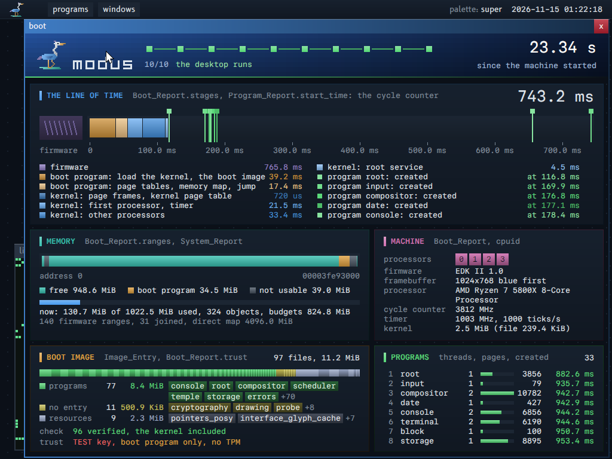
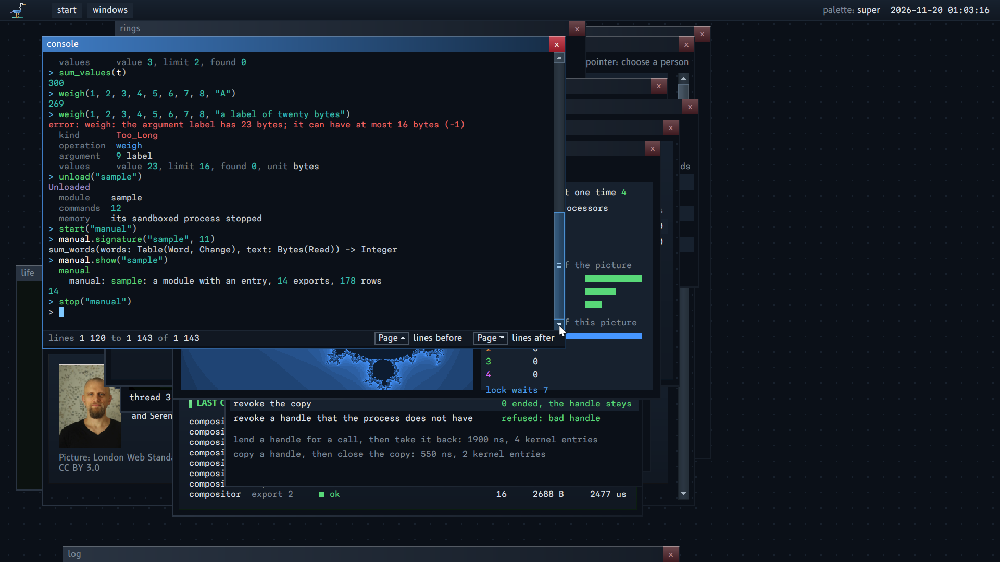
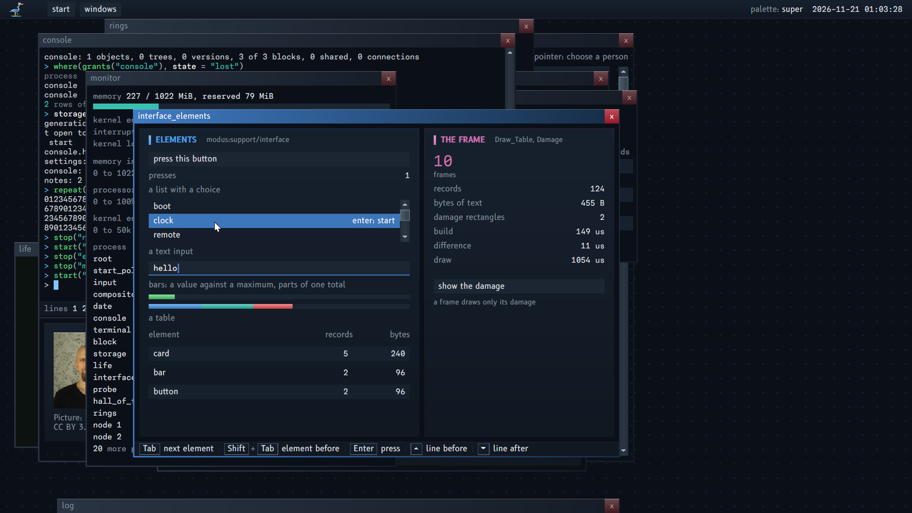
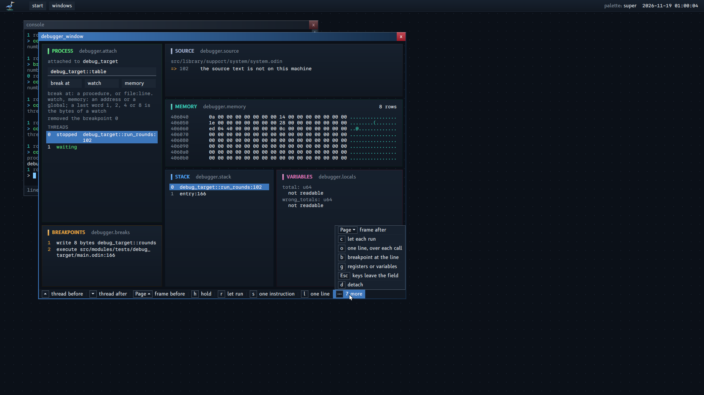

# The design rules

These rules say how a process of this system looks. They are taken from the boot display (`src/library/support/bootscreen/`). The boot display is the model.

A new graphical module follows these rules. The modules of the desktop that came before do not follow all of them yet: see "State" at the end.

**Why rules.** One look across the system lets a reader trust what a screen says: a value always has the font of the cells and the color of its kind, a concept always has its color, and each number on a screen names the record that it comes from. The rules live as one table of color tokens (`src/library/support/graphics/rules.odin`), with a value in the dark and in the light appearance, so a change of a color changes every process and the site at once.

**For whom.** A reader who writes a graphical module, and a reader who changes the desktop or the site.

**Read before.** Nothing. `INTERFACE.md` gives the package that draws the elements; `FONTS.md` the fonts.

**The map of this guide.** Sections 1 to 8: what is on the screen, forms, surfaces, color, text, spacing, cost, decoration. Section 9: the desktop. Section 10: the elements. Section 11: the mark. Section 12: the card of the boot image. "State": which modules follow the rules.

The rules live as one table in `src/library/support/graphics/rules.odin`: the spacing tokens, the text size tokens, and the color tokens (the surfaces, the colors of the concepts and the colors of the desktop) in the dark and the light appearance, with `mix`, `shade`, `block` and `gradient`. The compositor and the processes read a token through the appearance in force (`graphics.colors.text`); the boot display reads the dark values (`graphics.DARK_TEXT`). A process does not repeat a color of the rules as its own constant. The tables of this guide name a token `colors.text`.

## 1. What is on the screen

- Each thing on the screen is a fact of a record. A display invents nothing.
- Each card has a caption that names its record, for example `Boot_Report.stages`. A reader can find the source of each number.
- A record that is all zero is valid. Its card says "not known yet", in the dim color. A card never shows a zero as if it was a measure.
- A size on the screen carries a fact when it can: the width of a stage is its duration, the width of a part of a size strip is the size of its file. A form has a least width, so that it stays visible.
- A name is whole or absent: a form that is too narrow for its name shows no name, and the name is said elsewhere when a reader needs it. A name is never cut.
- A step is an interface, not a printed line: a list of steps shows each step with its state ("done", "now", "failed").

## 2. Forms

Forms are rectangles by preference, because a rectangle can carry a measure (its width or its height) and lines up with its neighbours. Other forms are allowed where they say more.

- Rectangular forms are the preference of the design, not an absolute rule. A form is a rectangle unless another form says more. Any geometry can be drawn, sparingly; a round form can be right in some cases. The look to avoid: everything is a rounded blob.
- A point or a mark is a square.
- A line is a rectangle that is 1 or 2 pixels thick.
- Lines at an angle are allowed. The boot display keeps its own use of them: a part that has no measure on this scale (the firmware before the line of time).
- The look is sober by choice. A shadow is sharp, with no blur. Transparency is used only where it informs, as a menu over the window that it acts on. An animation is short, and only says a change of state. A blur comes later, with the GPU.
- These rules are the look of the desktop of the system. They are not limits of the draw table: a process can draw any form, alpha, paths and effects (`PROPERTIES.md`, "18. One 2D interface: the draw table").

## 3. Surfaces

A surface is a level of depth: the background, a card on it, and a track inside a card. The sign of depth of these levels is a gradient from lighter at the top to darker at the bottom. A surface that lies over another one, as a menu or a window over the desktop, can also have a sharp shadow (section 2).

There are three levels. Each is a color token of the package, with a value in each appearance (section 4, "The appearances").

| Level | Token | Dark | Light | Use |
|---|---|---|---|---|
| Background | `colors.background` | `0x0B1018` | `0xF4F6F8` | Under all cards. A grid of points of 2 pixels, each 24 pixels, lies on it, in `colors.point` (`0x18212D`; `0xDDE2E8`) |
| Card | `colors.card_top`, `colors.card_bottom` | `0x17212E` at the top to `0x111822` at the bottom | `0xFFFFFF` to `0xF9FAFB` | The frame of one subject |
| Track | `colors.track` | `0x1C2633` | `0xD6DBE0` | The empty part of a bar, a band or a tube |

- A surface has a color that goes from lighter at the top to darker at the bottom. This is the sign of depth of the three levels.
- A card has a border of 1 pixel in its accent, at 28 % at the top and 14 % at the bottom.
- A full part of a bar goes from 120 to 130 % of its color at the top to 78 % at the bottom.

## 4. Color

Color carries meaning, so each color names one concept of the system: the kernel is always blue, a process always green, a failure always coral. The table is in `src/library/support/graphics/rules.odin`, and every process reads it.

One color is one concept, as one term is one concept.

| Concept | Token | Dark | Light |
|---|---|---|---|
| Firmware | `colors.firmware` | `0x8E7CC3` | `0x7566A1` |
| Boot program | `colors.boot_program` | `0xE0A040` | `0x906729` |
| Kernel | `colors.kernel` | `0x4A9CF0` | `0x3571AF` |
| Process | `colors.process` | `0x58D878` | `0x327C45` |
| Memory | `colors.memory` | `0x38C0B0` | `0x247C71` |
| Machine | `colors.machine` | `0xD070B0` | `0xA15688` |
| A module with no entry export | `colors.no_entry` | `0xC8C058` | `0x6D6930` |
| A resource of the boot image | `colors.resource` | `0x9AA8C8` | `0x5C6478` |
| Failed | `colors.failed` | `0xF06060` | `0xBA4A4A` |
| Stop a process | `colors.stop_process` | `0xB82232`: a rich red, the color of the close button of a window | `0xB82232` |
| Not usable | `colors.not_usable` | `0x4A5563` | `0xA9B2BD` |
| Text | `colors.text` | `0xDCE4EC` | `0x0B1018` |
| Dim text | `colors.dim` | `0x7C8A99` | `0x4A525B` |
| Strong text: the text that an input types, the outline of the focus | `colors.text_strong` | `0xFFFFFF` | `0x000000` |
| Warning: a state that asks for attention and is not a failure (a warning of the log, a full ring) | `colors.warning` | `0xF0C050` | `0x886D2D` |
| Near its limit: a measure near its limit, the very high intensity step of a gauge | `colors.near_limit` | `0xF2843C` | `0xA85C29` |
| Link | `colors.link` | `0x6CB4F0` | `0x3B6283` |

- The state of a thing has three colors: the color of the boot program while it starts, the color of a process when it runs, the color "failed" when it failed. A state that asks for attention is a warning; a thing that is stopped and cannot be used is "not usable".
- Two neighbours of one concept take two shades of its color, so that their limit is visible.
- If a thing has an identity (a hash), its color can come from the hash. A thing that changes takes a new color.
- **The series colors** (`colors.series`) tell apart the members of one series: several things of one kind that no concept tells apart, as the threads of a process, the processes of the log, the records of a ring, the protections of a page. A member takes the series color of its number; a ninth member takes the first color again. A member is never the only sign: a number or a word names it.

| Number | Dark | Light |
|---|---|---|
| 0 | `0x4696FF` | `0x3471C1` |
| 1 | `0xFF963C` | `0xA35F26` |
| 2 | `0x5AE66E` | `0x32803D` |
| 3 | `0xDC64FA` | `0xA44ABB` |
| 4 | `0xE06890` | `0xB05171` |
| 5 | `0x60D8D0` | `0x367A76` |
| 6 | `0xD8D860` | `0x747433` |
| 7 | `0x9CC040` | `0x617828` |

- A process takes each color from the tokens, by its meaning: no window holds a color value of its own. A picture that a process computes keeps its pixels: its legend takes the token.
- A color never stands alone for a fact: a text or a place says the same fact.

### The intensity of a gauge

A gauge is a bar on the track whose length is a share: the memory in use, the processor share of a process. A gauge takes the color of its intensity step (`glossary/text.md`), from `graphics.intensity_of` and `graphics.intensity_color`:

| Step | From | Color |
|---|---|---|
| Normal | 0 % | The concept that the gauge measures: `memory`, `process` |
| High | 60 % (`INTENSITY_HIGH_PERCENT`) | `warning` |
| Very high | 85 % (`INTENSITY_VERY_HIGH_PERCENT`) | `near_limit` |

- A share at a threshold is in the higher step. A share past 100 % is very high.
- Three steps, never a continuous hue: each color keeps one meaning, and the number beside the gauge says the value.
- Each color of each step keeps 3 to 1 as a graphic on the track and on the background, in both appearances; host tests compute each pair (`src/library/support/graphics/intensity_test.odin`).
- The design: `src/md/features/monitor_window.md`.

### The appearances

The desktop has two appearances: dark and light. The setting `appearance` chooses one: `auto`, the default, `dark` or `light` (`docs/FONTS.md`, "7. The setting"). With `auto` the light appearance holds from 07:00 to 19:00 of the local time, and the dark one at night; a system with no date is dark. The settings page holds the appearance in force, and each window draws once at a change. The design: `src/md/features/appearance.md`.

- **One table.** Each color of the rules is a color token, with one value in each appearance: the tables of sections 3 and 4. `graphics.colors` holds the tokens of the appearance in force of a process; `display` gives it the appearance of the settings page, and the interface package reads it at each frame.
- **The light appearance is the light form of the site.** The background is the light background of the mark, a card is white, the text is the dark background of the dark appearance. A concept is its accent at the shade that its value kind has on the light page of the site: the same color in a window and on a page.
- **What does not change.** The blue of the title bar, the chosen blue, the red of the close button, and white on them: white keeps its contrast on them in both. The pointer is black and white. The boot display is dark: the boot program draws before any setting is read, and the display is the model of the rules. A picture keeps its pixels; the mark of the bar takes the colors of the light background of the mark.
- **The colors of code, of values and of the scroll bar** have a value in each appearance: `code_class_color`, `value_kind_color` and `scroll_bar_colors_of` take the appearance.
- **The contrast.** Each pair that a rule of this guide names keeps its bound in both appearances: a text 4.5 to 1, a large text and a graphic 3 to 1. A series color is a text on the background and on a card, and a graphic on the track; a link keeps 4.5 to 1 on the track, the band of a link with the focus. Host tests compute each pair from the table (`src/library/support/graphics/appearance_test.odin`, `palette_colors_test.odin`, `value_colors_test.odin`). A concept is never a text on the track: in the light appearance it has about 3.6 to 1 there.
- **The windows of the processes** take each color from the tokens, so each follows the appearance. Two things stay dark: the boot display, and the stage of `heron`, a picture of the dark mark on its dark background.

### The colors of code

Code has one set of colors wherever it is shown: on the site, and in the console of the system. The table is `src/library/support/graphics/code_colors.odin` (`Code_Class`, `code_class_colors`); the site (`tools/modustool/site/site_code.odin`) and the terminal (`src/library/support/terminal/code_runs.odin`) read it. Each class is an accent of the concepts, moved toward white on a dark surface and toward black on the light page of the site.

| Class | What | Accent | Dark: shade, color | Light: shade |
|---|---|---|---|---|
| Keyword | A word of the language | Kernel | 115 %, `0x64AAF2` | 55 % |
| Type | A type, or a name in the place of a type | Firmware | 115 %, `0x9E8FCB` | 60 % |
| Literal | A number, a text, a constant, a member | Memory | 100 %, `0x38C0B0` | 50 % |
| Name | The name of a function or of a declaration | Process | 100 %, `0x58D878` | 45 % |
| Directive | A directive or an attribute | Machine | 115 %, `0xD785BB` | 55 % |
| Comment | A comment, or words that are not code: quiet | Dim | 125 %, `0x9CA6B2` | 60 % |
| Punctuation | An operator or punctuation: quiet | Dim | 140 %, `0xB0B8C1` | 50 % |

- A part with no class has the color of the text around it.
- Each class has at least 4.5 to 1 on each surface that shows code: the block of code of the site in both forms, and the background and the card in the terminal. Host tests compute each contrast.
- On a chosen row (`colors.chosen`, section 10), no class keeps that contrast: the row is white.

### The colors of values

A technical value has one color wherever it is shown: on the site, and in the processes of the system that show values of mixed kinds, as the log does. The kinds are the value kinds (`glossary/project.md`, `src/library/contract/value_kinds`), one enumeration for the site and the system. The colors are one table, `src/library/support/graphics/value_colors.odin` (`value_kind_colors`); the site (`tools/modustool/site/site_values.odin`), the process `log` and the drawers of the console read it. The console gives a field of a record the kind that its description states (`CONSOLE.md`, "The drawers"). The site keeps only what is its own: the title and the meaning of each kind (`docs/SITE.md`, "The kinds of values"). The icon of each kind is one table too ("The icons of the kinds"). No kind and no color is new: the log uses the kinds of the site, so no new decoration exists.

The kinds that the log writes, on a dark surface (contrast on the background `0x0B1018`, the top of a card `0x17212E`; a band of a row of the log is the top of a card):

| Kind | Accent | Color | Contrast |
|---|---|---|---|
| Number | Memory | `0x38C0B0` | 8.47 / 7.22 |
| Size | Memory | `0x38C0B0` | 8.47 / 7.22 |
| Time | Boot program | `0xE0A040` | 8.42 / 7.17 |
| Module | Process | `0x58D878` | 10.45 / 8.90 |
| Version | Boot program | `0xE0A040` | 8.42 / 7.17 |
| Status | Failed | `0xF06060` | 5.94 / 5.06 |

- A part with no kind has the color of the text around it.
- Each kind has at least 4.5 to 1 on the background and on both colors of a card, in both appearances (`src/library/support/graphics/value_colors_test.odin`), and on both surfaces of a table of the site in both forms (`tools/modustool/site/site_values_test.odin`).
- A color is never the only sign: the text of the value and its unit say the same fact.

### The icons of the kinds

A kind has one icon wherever it is shown: on the site, and in a list of the desktop whose rows are of several kinds. The kind icons (`glossary/desktop.md`) are one table of cells, `src/library/support/kind_icons`, as the heron of the mark is one table of cells (section 11). The site draws the cells as the rectangles of an SVG picture (`docs/SITE.md`, "The kinds of values"); the system draws them as rectangles of whole pixels (`interface.draw_kind_icon`). No second set of icons exists.

- **The grid** is 12 by 12 square cells (`kind_icons.ICON_SIZE`). A cell is one pixel in a row of a list: the icon is 12 pixels, in the middle of the 24 pixels of the row. A larger icon has cells of 2 or 3 pixels: 24 or 36 pixels. No icon is scaled by a filter, so each edge is on a whole pixel.
- **The form** is cells only: rectangles, and lines at an angle as steps of cells. An icon has no curve, no shade and no second color.
- **The color** is given by the display that draws the icon: the color of the value kind, or the color of one fact of the thing (the palette, section 9). The table of the icons holds no color.
- **The contrast** of an icon on its surface is at least 3 to 1, the bound of a graphic that carries a fact. On a chosen row an icon is white, as the text is.
- **An icon never stands alone**: the row says the kind in words too. A reader who sees an icon for the first time reads the word.
- **The cost**: an icon is at most 20 rectangles (`kind_icons.RECTANGLE_LIMIT`): a run of cells of a row is one rectangle, and a run that the rows under it repeat exactly is one rectangle with them. The icons of the palette take 3 to 16.

The icon of each value kind:

| Kind | Icon |
|---|---|
| Number | A hash sign |
| Size | Three stacked bars, each wider than the one above |
| Time | A square with two hands |
| Handle | A square ring on a stem |
| Value | One small square |
| Grant | A check mark in steps |
| Status | A flag on its pole |
| Type | Two angle brackets, `< >` |
| Operation | A line into a box |
| Command | The prompt of a console, `>_` |
| Module | A block with a notch in its top |
| File | A page with a corner of steps |
| Guide | A page with three lines of text |
| Term | The capital letter T |
| Version | A tag with a hole |
| Yes | A filled square |
| No | An empty square |
| Procedure | Two parentheses |
| Constant | A lock |
| Variable | A cross of two diagonals |

The desktop lists four kinds of things that are not values (`kind_icons.Desktop_Kind`):

| Kind | Icon |
|---|---|
| Window | A frame under a title bar of three rows |
| Setting | Two sliders: a line with a knob at the left, a line with a knob at the right |
| Export | An arrow out of a box: the reverse of the icon of an operation |
| Stop: an act that destroys | A full block with a cross cut out of it, as the close button of a window |

- **Where the icons show**: the site; the rows of the palette and the candidates of a field of its form (section 9).
- **Where they do not show**: a list whose rows are all of one kind and of one state (a menu of the bar), a heading of a group, a text grid of cells (the console and the completion list of the terminal: an icon is not a character of the font).
- A host test draws each icon as text in its log, and checks that each icon is 12 by 12 cells, has at least 12 cells, differs from each other icon, and that its rectangles cover each of its cells once (`src/library/support/kind_icons/kind_icons_test.odin`).

## 5. Text

- **Two fonts** (`docs/FONTS.md`, section 12.6):
  - **The interface font, B612** (proportional): each text that names or explains: the title and the caption of a card, a label, the name of a button, a line of a list or a menu, the title of a column, a sentence of help.
  - **The font of the cells, Paper Mono** (monospace): each value, and each text that a reader compares character by character or copies: a number in a column, a hash, an address, a text that is typed, code, the console, the terminal, a text grid.
  - Both draw at one text size: the height of a line. A label and its value at one text size share one line.
  - A text is measured in the font that draws it, and an element cuts a text to its box: no text passes its element in either font.
  - With no interface font (absent, refused, or the setting `font` is Spleen 8x16), each text is in the font of the cells, with the same layout rules.
  - The compositor follows the same rule: the buttons of the bar, the lines of its menus, the titles of the windows, the names, the sentences and the hints of the palette are in the interface font; the clock, the date, the text that is typed in the palette and the counts of the menus and of the palette are in the font of the cells. The mark and its name in square cells do not change. The places of the buttons and of the lines come from the widths of their texts in the font that draws them (the bar layout).
  - **The boot display, by design, in Spleen only**: the boot program holds no glyph cache, so the display is in Spleen, a bitmap font drawn for several sizes, as a text grid is, and the root service and the process `boot` draw the same pixels. Its titles, its names and its values are in that one font. It is laid out in logical pixels, a panel of 976 x 708, and its scale is one of the sizes of Spleen, as the console of Linux takes a font by the resolution: 1 (8x16), 1.5 (12x24), 2 (16x32) or 4 (32x64), the largest whose panel fits the screen with a margin of 8 pixels, in the middle of the screen; on the reference screen, 1.5. Each letter fills its cell (`src/md/features/boot_display_scale.md`).
- The font of the cells: the vector font by default, drawn with a coverage for each subpixel band; Spleen 8x16 as the fallback and as the other value of the setting `font` (`docs/FONTS.md`).
- **The text sizes of the desktop are tokens**, in logical pixels:

| Token | Text size | Use |
|---|---|---|
| `text_caption` | 14 | The caption of a card, the detail of a row of a list, the hash prefix after a nickname in the menu of the windows |
| `text_body` | 16 | Each other text |
| `text_heading` | 24 | A heading of a page of `manual`, the heading of a group of a list |
| `text_large` | 32 | The one number of a card |
| `text_largest` | 48 | The one number that a whole window is about |

- A process can draw a text at any size from 4 to 256 pixels (`src/md/features/text_rendering.md`). The desktop and the elements of the interface package use the tokens only, so the texts of two windows line up.
- 14 is the smallest size at which both fonts keep an x-height of 6 whole rows; 24 is a whole count of pixels at each scale factor.
- The font of the cells is monospace: its advance is half the text size, the width of a cell, so a layout in cells holds with the vector font and with Spleen. A glyph of the font of the cells stays inside its cell.
- The boot display takes no text size token and is not drawn by the text rendering module: its text is Spleen in cells of 8 x 16 logical pixels, at the size of Spleen of its scale (above).
- An enlarged picture of the screen shows colored edges on each letter: the subpixel bands, not a fault. The setting `subpixel_order` `none` gives gray edges.
- The title of a card is in capital letters, in the bold weight of the interface font, in the accent of the card, after a bar of 4 x 16 pixels in the same accent.
- The system has no italic face. Where a text has italics (the documentation of a module in `manual`), the words have a line of 1 pixel under them, in the dim color, and keep their color. A link in such a text is a name in the color of a link; a link that a click opens also has a line of 1 pixel under it, in its color.
- A name is in the dim color. A value is in the text color. A measure of a concept is in the color of that concept. Where values of mixed kinds follow one another, as in a line of the log or a table of the site, each value is in the color of its value kind (section 4, "The colors of values").
- A card has at most one number in the large size: the number that the card is about.
- Numbers of one column are aligned on the right, each with its unit.
- A sentence follows the language rules of the project: short, exact, one term for one concept.

## 6. Spacing

The spaces between the elements come from a few named lengths, the spacing tokens, so that the elements of different processes line up and a reader's eye can follow a column. A place and a size are any count of logical pixels; no grid binds them.

| Token | Length | Use |
|---|---|---|
| `gap` | 8 | The space between two cards, between two buttons, between a name and its value |
| `margin` | 16 | The space inside a card, from its border to its content |
| `title` | 40 | The height of the title of a card |

- The tokens are the constants `graphics.GAP`, `graphics.MARGIN` and `graphics.TITLE` of `src/library/support/graphics/rules.odin`, beside the text size tokens `graphics.TEXT_CAPTION` to `graphics.TEXT_LARGEST`.
- A space between two elements of the desktop is a token, or a sum of tokens. A size that a content gives (the width of a text, of a picture, of a column of values) is that size, with no round up.
- A line of text is its text size (section 5).
- The tokens are in logical pixels. At a scale factor in eighths, each token is a whole count of pixels of the screen (`docs/glossary/desktop.md`, "Scale factor").
- A window is placed where the principal puts it, to the pixel, and a drag of an edge gives the size that the pointer gives, to the pixel. The compositor places a new window at steps of tokens (section 9).
- The fixed sizes of an element are not tokens: the bar of 32 pixels, a button and a line of a list of 24, the scroll bar of 17.

## 7. Cost

Drawing must stay cheap and the same on every machine: integers, rectangles, and no image file to decode.

- Drawing is `fill` of rectangles with integer arithmetic. No floating point and no image file. The one drawn data is the glyph cache of the vector font: the modus tool makes it at build time from the outlines, in integers, and a text draw blends its words (`docs/FONTS.md`).
- A photograph is not a form of the design. The one place of photographs is the hall of fame: each portrait is pixels that the command `modustool portraits` made from a picture of `resources/hall_of_fame`, shown as one Picture record, with its credit under it. The process decodes no file.
- A display does not wait so that a reader can see it. A display that fails stays.
- Each display has a measured draw time.

## 8. Decoration

Four things carry no fact: the grid of points on the background, the blue of the head of the boot display, which goes darker toward the right, the same blue on the title bar of the window in front (section 9), and the look of the scroll bar (section 10, "The scroll bar"): its gradients across the bar, the inner line and the grip of its thumb, and its blue tones under the pointer. No other decoration exists.

## 9. The desktop

This section applies the rules of sections 1 to 8 to the screen that a principal sees first: its sizes, colors and behaviour, element by element.

The desktop is the screen of the compositor: the background, the bar, the windows, the two menus of the bar and the palette. It follows sections 1 to 8.

### The gradient and the palette

- **The gradient** of a title bar goes from the blue of the title bar, `0x3F7CC4`, at its left to a darker blue at its right. The background of the desktop is not that blue: it is the background of the rules.
- **The palette** is not the start menu. The menu is a list that the pointer opens from the bar. The palette is a panel in the upper third of the screen that a key opens: the input types a part of a name, and the list narrows at each key. It is the way of the keyboard to each operation: it starts a process and reaches a window. The desktop keeps the menus.

### Background and bar

- The background is `colors.background` with the grid of points of section 3. The compositor computes it at its start, and again at each change of the appearance.
- The bar is 32 pixels high, at the top of the screen. It has the surface of a card (`colors.card_top` to `colors.card_bottom`) and a line of 1 pixel in `colors.track` at its bottom.
- The bar holds, from the left: the mark of the system (the heron with cells of 1 pixel, 24 by 24, at (16, 4): section 11); the button `start`; the button `windows`; at the right, the key of the palette ("palette: super") and the clock: the local date and time of day, in the time zone of the setting `time_zone` (`src/library/contract/date`), or the time since the start of the machine while the system has no date.
- A button is 24 pixels high, in `colors.track`. The button of an open menu is in `colors.title`, with its label in white.
- **The mark of a viewer.** While a viewer of `remote_display` sees the screen, the bar shows a mark at the left of the key of the palette: a box of the height of a button with an edge of 2 pixels in `colors.warning`, and the word `viewer`, the first 8 hexadecimal digits of the key of each viewer, and `input` after a key with the input, in the interface font in `colors.text`. When the text does not fit the room between the button `windows` and the key of the palette, the mark shows the count of the viewers, then a square of 16 pixels in `colors.warning` alone: no text is cut. When even the square has no room there, the key of the palette is not drawn, and the mark takes its room: the mark is never left out. The compositor draws the mark while the capture face is open, whatever `remote_display` says (`src/md/features/remote_display.md`, "The authority").

### Menus

- A menu of the bar is a card under its button: a border of 1 pixel in the color of the kernel, a title in capital letters, the caption of its source and the count of its lines.
- The start menu has two columns of lines. Its caption is `bar.names`, the table of the names in `src/library/private/compositor/bar`.
- The menu of the windows has one line for each window, in the order of the client table. The window that has the focus has a square of 8 pixels before its title, and its title is white.
- The line of a disk process has its nickname in the interface font, then, 8 pixels after it, the hash prefix of its file in the font of the cells and in `colors.dim`: a value, faded, beside the name. The menu is as wide as the longest nickname with its hash prefix in the font of the cells, so a nickname needs no cut in that font.
- A line is 24 pixels high. The line under the pointer is a chosen row: `colors.chosen`, with its text in white (section 10).

### Windows

- A window is a title bar of 24 pixels over the surface of its process, with a border of 2 pixels at the left, the right and the bottom. There is no shadow.
- The title bar of the window that has the focus goes from `colors.title` (`0x3F7CC4`) at its left column to `colors.title_end` (`0x162C45`, the same blue at 36 %) at its right column. Its top line is 125 % of these colors: the sign of depth of section 3. The bottom border has the colors of the title bar; the left border is the start color, the right border the end color.
- The title bar of another window is quiet: it goes from `colors.title_quiet` (`0x2A3442`; light `0xE4E8ED`) to `colors.title_quiet_end` (`0x161D27`; light `0xD3D9E0`), and its title is in the dim color. So the gradient also says which window has the keyboard. Its title also says it: a title in white has the focus.
- The close button is a square of 24 x 24 pixels at the right end of the title bar, with the character `x` of the font in white. Its color is the concept "stop a process": a deep red `colors.stop_process` (`0xB82232`), not the coral of "failed", because to close a window is not a failure. It has the sign of depth of the rules: a block from 118 % of the red at the top to 82 % at the bottom, and a top line at 150 %. When the pointer is over it, the red is brighter (`0xE0343F`). On a window that is not in front, the red is quiet (`colors.stop_process_quiet`: `0x4E2229`; light `0xF2D5D9`) and the `x` is a dim pink (`colors.stop_process_quiet_mark`: `0xC09098`; light `0x8E3A47`). The button shows the character `x`, not a cross of squares of 2 pixels: the two lines of such a cross do not meet on one square at the centre, and the cross does not match the title.
- A window is fixed unless its process declares it resizable with its least and largest size (`display.resizable_set`). The edges of a resizable window are its border and a band of 6 pixels around its frame; the title bar is not an edge, but its left and right columns are, and the band above it is the top edge. The band takes the pointer only where no other window lies, and a window in front hides the edges of the windows behind it. Over an edge the pointer has the shape `resize_left_right` or `resize_up_down`, and over a corner a diagonal shape (`docs/POINTERS.md`). A drag moves the edges with the pointer, to the pixel, inside the limits of the window and inside the screen, and shows the outline of the new frame: 2 pixels in `colors.title`, over the windows. At the release the process gets the event `Resized` and draws its next frame at the new size; until that frame the window keeps its old size and picture. The process answers once, with a surface of the asked size or a refusal; until then the edges of the window take no new drag, and the compositor refuses a surface that the principal did not ask for. A process that ignores the event keeps its size. After the resize, a part of the title stays on the screen, under the bar (`src/md/features/window_resize.md`).
- The compositor places a new window at (64, 56), and each next one 40 pixels to the right and 32 pixels lower, for 8 windows (`PLACE_X`, `PLACE_Y`, `PLACE_STEP_X`, `PLACE_STEP_Y` in `src/modules/system/compositor/main.odin`). These places are sums of spacing tokens, so the new windows line up. `bar.new_window_place` then moves a window that does not fit up and left, to the pixel where it fits (`docs/INTERFACE.md`, section 2.6).
- A window that the pointer drags goes where the pointer puts it, to the pixel. Wherever it goes, a part of its title of one `gap` stays on the screen, under the bar, so the pointer can always take it again.
- Cost: the compositor computes the colors of one line of a title bar once, for the columns that the frame shows, with a fixed-point step for each channel (no division for each pixel), then copies them to the 24 lines. At its start it measures three forms of a title bar of 1024 pixels, 64 times each, and writes them on the log. On 10 machines of one check: one color takes 1.6 to 2.7 us, a mix for each pixel 65 to 87 us, one row of colors then copies 5.7 to 6.8 us. The gradient costs about 4 us for each window that a frame draws.
- At 8 bits for each channel, the gradient has 41 levels of red, 80 of green and 126 of blue over the width of a window. The picture shows no band, so there is no dithering.

### The clipboard

- **Control+C** copies the text of the element that has the focus in the window in front, and **Control+V** pastes the last copied text into the element that has the focus in the window in front. The compositor takes the two keys: a process never receives them as keys, and no process can send them.
- A copy takes the whole text of a text field: a field has no selection yet. A paste goes at the end of the text of a field, whole, or not at all when the field has no room for it. In the console, a paste goes into the line as typed characters, and never runs the line: a pasted text holds no Enter and no other control character.
- A text on the clipboard is UTF-8 of 1 to 4096 bytes. It stays until the next copy, or until the process that copied it ends.
- A process reads the clipboard only at a paste of the principal, through a handle that the compositor lends for that paste. The log of the compositor names each copy and each paste, with the two windows.
- The design: `src/md/features/clipboard.md`.

### Pointer

- The pointer is a slanted arrow with a large head and a short slim tail, 13 pixels wide and 18 high at the size 24: a fill inside an edge of 1 pixel. Its point is the top left corner; its left side is upright, its right side at 45 degrees to the wing, and its tail leaves the head along the axis of the arrow, 2 down for 1 across, ended square. This arrow is the shape `arrow` of the pointer theme of the system (`resources/pointers/system.manifest`). Each other pointer shape of that theme has the same style: a fill inside an edge of 1 pixel at every size, strokes of 1 pixel of fill at 24, the level and upright edges on whole pixels, the slanted sides and the curves smooth. The shapes are outlines that the tool draws at the build (`docs/POINTERS.md`, "4. The manifest").
- **Two forms.** On a dark desktop the pointer is white in an edge of `COLOR_INK`; on a light desktop it is `COLOR_INK` in a white edge. The fill is the large part, so it carries the contrast on the surfaces of the appearance in force: 19 to 1 on the dark desktop, 17 to 1 on the light background. The compositor takes the form of the appearance in force.
- **Accents.** A pointer has an accent only on a part that means something: the blue of the focus (the token `title`) on the arc that turns in `wait` and `busy_with_arrow` and on the question mark of `help`, the red of "stop a process" on the slash of `forbidden`, the amber of a match on the dot at the hot spot of `crosshair`. The arrow, the hands, the I-beam and the resize arrows have none. An accent takes the value of its token for the color around it: its value of the light appearance on white, of the dark appearance on the dark (`docs/POINTERS.md`, "4. The manifest").
- A compositor with no valid pointer theme draws an arrow of squares of 2 pixels from its own code, black at the edge and white inside, so that the pointer never disappears.
- **Not a rectangle.** The pointer pictures of both themes have smooth edges, curves and transparency: they are not rectangles. The theme "Posy's Cursor" (`docs/POINTERS.md`) is a build input of the development shell; when the build has it, it is the default pointer theme. A release image holds the theme of the system only. The pointer picture is the one picture resource of the desktop that does not follow sections 2 and 7. It is drawn with a blend of premultiplied alpha. The windows, the bar, the menus, the palette and each process keep rectangular forms and no transparency.

### Palette

- **One panel, one key.** The key super (the left key with the logo, `display.KEY_SUPER`) opens and closes the palette. No process uses this key: the compositor keeps it, and the process that has the focus never receives it. While the palette is open, it takes each key and the pointer: no window and no menu receives them.
- **The panel holds no right.** It is a part of the compositor, which already owns each key and each pixel. An entry of the compositor itself does what the desktop already does: a process starts through the root service as the start menu starts it (`Start` with the name), a window comes to the front as a press brings it, a close stops the process as the close button does (`Stop`). A provider entry runs in the process that gave it: the compositor sends the index of the entry, never a text of a line, and makes no call.
- **The place.** The panel is 640 pixels wide and 400 high. Its top is at y = 96, fixed, in the upper third of the screen, so the input band never moves when the list changes. It is in the middle of the width of the screen, to the pixel: x = 640 on the reference screen of 1920 (`palette.panel_place`). It opens with no animation, in the next frame, and its height never changes: a short list leaves empty rows.
- **The parts, from the top**:

| Part | Height | Content |
|---|---|---|
| Input band | 48 | The typed part at scale 2 (cells of 16 x 32), 16 pixels from the left edge. Its last 2 pixels are a line in `colors.title` |
| List | 12 rows of 24 = 288 | The entries |
| Gap | 8 | |
| Detail line | 24 | One sentence in the dim color: what the choice of the chosen entry does |
| Footer | 24 | At the left, in the search only: the count of the entries that match, of all the entries, with the word for what is counted ("13 of 58 entries"; "entries, no commands" when the console gives none). At the right: the keys of the state, with what Enter does on the chosen entry ("enter: to the front   esc: close"); while nothing is typed, the prefixes ("> commands  @ windows  : settings  ? manual"). On a result and while a command runs, the footer has the keys only |
| Margin | 8 | |

- **The input band is flush.** It is the top of the panel. Its fill (`colors.track`) touches the top, the left and the right edge of the panel. Nothing is around it: no title over it, no margin, no border on those three sides. A reader tells it from the list by four signs: the step of surface (the track over the surface of a card); the line of 2 pixels in `colors.title` under the band, from edge to edge; the caret of 4 x 32 pixels in `colors.title`; the size of the typed part, at scale 2 where each row is at scale 1.
- **The edge of the rest.** The list, the detail line and the footer have the surface of a card and a border of 1 pixel in the color of the kernel (28 % to 14 %) at the left, the right and the bottom, as a menu of the bar has. They have no border at the top: the line of the band is the edge there. The palette is not a card: it has no title and no caption. Each row says what it is in words, and the footer counts the entries in a plain word: a name of the code is not a word for a reader of the panel.
- **The typed part.** It is the strong text (`colors.text_strong`: white in the dark appearance, black in the light one), in the font of the cells. Left, Right, Home, End, Delete and Backspace edit it at the caret (`src/library/support/line_editor`). It holds at most 64 bytes of UTF-8. When it is empty, the band says "type a part of a name" in the dim color, at scale 2.
- **Two kinds of entries** come from the compositor itself and need no other process: the modules (the table `bar.names`, what the start menu lists) and the windows (the client table, what the menu of the windows lists). Each window also gives the entry of its close, named "close" and its title. The palette provider, the console, adds one entry for each of its commands (`CONSOLE.md`, "8. The palette provider").
- **A row** is 24 pixels: 16 pixels, the icon of 12 pixels, 8 pixels, the name, then at the right the kind in words, 16 pixels from the edge.
  - **The icon** is the kind icon of the entry (section 4, "The icons of the kinds"), with cells of 1 pixel. Its form says what the entry is, so a reader who does not tell two colors apart still tells a window from a module and a command from a setting. Its color says one fact of the entry: the color of the kind when the thing is there or in use, the dim color when it is not. An entry that destroys has the icon of that act, whatever its kind:

| Entry | Icon | Color |
|---|---|---|
| A module that has a window now | Module | The color of a module, `colors.process` |
| A module that has no window now | Module | The dim color |
| The window that has the focus | Window | `colors.title` |
| Another window | Window | The dim color |
| A command with no parameter | Command | The color of a command, `colors.process` |
| A command with parameters | Command | The dim color, as the whole row |
| An export | Export | The color of a module; the dim color with parameters |
| The value of a setting, or the scheduling strategy, that the machine uses now | Setting | The text color |
| Another value of a setting; another scheduling strategy | Setting | The dim color |
| An entry that destroys: the close of a window, a command such as `shutdown` | Stop | The red of the close button under the pointer, `colors.stop_process_pointer_over` |
| A candidate of a field of a form: a process or a module | Module | The color of a module |
| A candidate of a field of a form: a grant | Grant | The color of a grant |

  - **The colors of the icons**: each one has at least 3 to 1 on both colors of a card (3.66 for the red, 3.78 for the blue of the title bar, 4.60 for the dim color). The deep red `colors.stop_process` has 2.56 there: it is the fill of the row that asks for a second Enter, not the color of an icon. `colors.not_usable` has 2.14: a module with no window has the dim color. On the chosen row and on the row that asks, each icon is white: no color of a kind keeps 3 to 1 on `colors.chosen`. The fact that the color said is then in the words at the right and in the detail line. A host test computes each pair (`src/library/support/graphics/palette_colors_test.odin`).
  - **The kind** is said in words at the right, in the dim color: `window`, `module`, `close a window`, `command`, `export`; `setting` for a setting row, and for a value alone `setting`, or `setting, in use` for the value that the machine uses now; a command with parameters says `command, needs arguments`. A color never stands alone for a fact (section 4).
  - **The name** of a module or of a window is in the interface font. A command is code: its name is in the font of the cells, in the color of a name of the colors of code, and its parameters and its result follow it in the dim color. A signature longer than its room is cut at the end of a parameter, with `, ...)`, or shows `(...)`: it is never cut inside a parameter, and it never reaches the words at the right. A command with parameters is dim as a whole.
  - **The matched characters**: a line of 2 pixels in the color of the kernel is under each matched character of a name.
- **The chosen row** is a chosen row of section 10: `colors.chosen`, its name and its kind in white, the line under each matched character in white. The kind stays on the chosen row: "plasma" the window and "plasma" the module are then two things in words, on each row. What Enter does on the chosen entry is in the footer: "enter: to the front", "enter: start", "enter: close", "enter: run", "enter: arguments", "enter: set". The icon of the chosen row is white.
- **The detail line** says what the choice does, with the facts of now. A window: "The window of the process console. It has the focus.", or "Brings the window of the process life to the front and gives it the focus." A module: "Starts the module plasma. It has no window now.", or "Starts the module plasma one more time. It has 1 window now." A close: "Stops the process plasma: its window closes. Asks for a second Enter." A command: its help sentence.
- **With a typed part: one list, ranked**, with no group: the best match is the first row. The match is the fuzzy match of the console (`src/library/support/line_editor`): the characters of the typed part appear in the name in their order, not always side by side, without the case of the letters ("closepla" matches "close plasma"). Among entries of one score, the order is: the entries chosen lately, the newest first; then the kind (a window, a module, a command, an export, the close of a window); then the order of the table. A better match always comes before a recent choice.
- **With no typed part: groups**, each under a dim line of text: "recent" (at most 5 entries, the newest first), "windows" (each window, the front one first), "modules" (the order of `bar.names`). A group with no entry is absent. To reach a window is the most frequent act, so the windows show before any letter. The entries that destroy and the commands show only for a typed part, or as a recent choice.
- **The recent choices**: the panel remembers the last 16 chosen entries, by kind and name, in the memory of the compositor. A restart of the machine loses them.
- **More than 12 rows**: a scroll bar at the right (section 10, "The scroll bar") says which part of the list the panel shows, and takes the pointer: a press on an arrow button moves the rows by one, a press on the track by 12, and the thumb follows the pointer. The view moves, and the choice follows it: when the view no longer shows the chosen entry, the choice goes to the nearest entry that the view shows, so Enter always runs a row that is drawn. The candidates of a form have the same scroll bar, with the same rule. The scroll bar of the row that asks for a second Enter shows the place only. A point on the scroll bar is on no row.
- **No match**: one dim line, `nothing has "xyz" in its name`, and Enter runs nothing.
- **An entry that destroys asks for a second Enter**: the close of a window, and the commands `shutdown`, `lock` and `history_clear`. Enter on it changes the chosen row: its fill is `colors.stop_process` and its text says the act in full ("stop plasma: its window closes", "shutdown(): stop the machine"); the footer says "enter: confirm   another key: back". A second Enter runs it. Each other key goes back to the search, with the typed part kept, and does nothing else. The compositor draws this question: a provider cannot skip it.
- **A command with no parameter runs from the panel.** Enter sends the choice to the console, and the panel waits: the list makes room for the call, in the color of a name, and "runs in the console". The panel still takes its keys: Escape closes it, and the line goes on in the console. The panel sets no bound on a line: the console has none.
- **A result** shows in the place of the list, under the call: an Integer as the one large number of the panel (scale 3), a Text of one line, the lines of a Record, "done" for a command with no value, an error in `colors.failed`. Each part has the color of what it is, as in the console. A Table, and each result of more than 12 lines or 76 cells, is not drawn in the panel: the panel closes and the window of the console comes to the front, with the line and its result. Escape closes the panel; each other key goes back to the search.
- **A command with parameters has a form.** Enter turns the input band into the call, as code, at the scale of the typed part: the name of the command in the color of a name, then one field for each parameter, with its name: `revoke(name: plasma, grant: |)`. The caret is in one field; the name of that parameter is in the text color, the others are quiet. A call wider than the band shows the part that holds the caret.
  - **A field has the kind of its parameter.** An Integer field takes digits, and one `-` at its start. A Text field takes each character but a quote, 48 bytes of UTF-8 at most. A refused key changes nothing, and the detail line says why, in the color of a failure: "an Integer takes digits, and one - at its start".
  - **A number with its unit.** When the command, or the description of the export, says that an Integer counts a size or a time, its integer unit, the band shows the unit after the number, in the color of a size or of a time, also while the field is empty: `buffer(count: 4 pages)`, `wait_stop(milliseconds: 3000 ms)`. The prompt under the band says it: "type the value of count: an Integer, in pages". The input types the number in that unit, and the panel sends the number as it is. The text of each unit is the one of the log: `bytes`, `KiB`, `MiB`, `pages`, `blocks`, `ns`, `us`, `ms`, `s`.
  - **The list is the candidates of the field** that has the caret, when the console can give them: the modules of the boot image for `start`, `load`, `isolate` and `replace`; the processes that run for `stop`, `grants`, `connect`, `debug` and the first field of `revoke`; the grants for its second field; the strategies for `strategy`; the names of the settings for the first field of `setting`. The text of the field narrows them by the fuzzy match. The panel asks for them once when the caret enters the field, and no key waits for them.
  - **A field of a few closed values is a row of buttons.** When the console says that the candidates are the only values of the parameter, and they are 6 at most, the field shows them as buttons: in the input band at the right of the call when they fit there, else on the first row under the band, with the keys under them ("left, right: choose a value   tab: take it"). The chosen value is filled in white. Left and Right choose, Tab takes the chosen value, and Enter takes it, then goes on: `strategy`, Enter, Right, Enter sets `fair`. A press and a release on one button take its value, as Tab does. A row that does not fit under the band either is the list. The control of each field is in one table of the code (`palette.field_control`).
  - **The keys**: Tab takes the chosen candidate, or goes to the next field; Shift with Tab goes to the field before; up and down move in the candidates; Enter goes to the next field, and runs from the last one; Control with Enter runs from any field; Escape, and Backspace in the first field when it is empty, go back to the search with the typed part kept.
  - **The pointer**: a press in a field puts the caret there, at the place between two characters that is nearest to the pointer; the keys that follow edit that field. A press on the name of a parameter puts the caret at the start of its field, and a press on the comma or the parenthesis after a field at its end. A press on the unit after a number puts the caret at the end of the number. A press on the name of the command, or after the call, does nothing; a press on a button of the field takes its value. A move over a candidate chooses it; a press and a release on one candidate take it, as Tab does.
  - **Before it runs**, each field must hold a value of its kind: the caret goes to the first field that does not, and the detail line says why ("grant: empty"). An entry that destroys then asks for its second Enter, on a row that says the call with its values; another key goes back to the form, with its fields.
  - **What goes to the console** is one typed value for each field, an Integer as a number and a Text as its bytes, then the choice. The console builds the line. The panel sends no text of a line.
  - **A parameter that no field can give** (a Table, a Record, a Handle, Bytes, a value of any kind): the entry has no form. Enter closes the panel; the console writes the call in its edit line, with the caret between the parentheses, and its window comes to the front. Control with Enter does the same for each command.
- **A setting is one row**, a setting row: the icon of a setting, the name of the setting (`font`, `subpixel order`), which the typed part matches, then one button for each value, and the word `setting` at the right. A button is 20 pixels high, 8 pixels of padding at each side of its name, 8 pixels from the next one, the first one a `margin` (16 pixels) after the name; a button that does not fit leaves the count of the values left ("+2"). The value in use has a line of 2 pixels under its name, in the color of its name: a form, so the fact does not stand on a color alone. On the chosen row, the value that Enter sets is filled in white, with its name in the color of the background; the row starts at the value in use. Left and Right choose a value; Home and End still move the caret. Enter sets it through the console, the desktop shows the change behind the panel, and the panel shows its list again with the value on its row, so the next value is one key away. A press on a button sets that value. The detail line says the line that the chosen value runs: `setting("font", "spleen")`. The compositor gets no right for it: it knows the value in use from the settings page that it reads as each process does. A setting of more than 6 values has one entry for each value, "set font to spleen".
- **The scheduling strategy is a setting row**, `strategy`, with one button for each strategy of the kernel: `round_robin`, `fair`, `eevdf`, the line under the strategy that the machine uses now. Enter sets the chosen one through the console, which calls the process `scheduler`: that process holds the right to change the strategy, and must run. The panel then shows its list again, with the line under the new strategy. The compositor cannot read the strategy: the console says which one is in use (`CONSOLE.md`, "8. The palette provider"), and reads it again at each open of the panel.
- **The mode** of the chosen entry is at the right of the input band, in the dim color: "enter: run" for each entry that runs, "enter enter: destroy" for an entry that asks for a second Enter, then "shift enter: go to" when an open window names what the entry acts on. The word of a prefix is before it ("settings   enter: run"). Each text is measured against the room that the typed part leaves: the word of the prefix leaves first, then the mode. The footer keeps what Enter does on the entry ("enter: close").
- **Go to.** An element of a window can name what it acts on, its act name (`INTERFACE.md`, "4.2 Act names"), and a palette entry has the act name of its act: the value buttons of the window `settings` and the rows of its values, the tile of the strategy in use in `scheduler` and the row of the strategies. When an open window names the act name of the chosen entry, Shift with Enter closes the panel, brings the front one of those windows to the front, and its element takes the focus: the next frame of the window shows it. With no such window, Shift with Enter does nothing, and the log says why.
- **A prefix restricts the kinds.** The first character of the typed part: `>` the commands and the exports; `@` the windows and their closes; `:` the settings and the scheduling strategies; `?` the modules, and Enter then asks the console for the page of the manual of the chosen module (the process `manual` must run; its window comes to the front). The names match the part after the prefix. A prefix alone lists each entry of its kinds. The word of the prefix shows at the right of the input band, in the dim color, and each row keeps its kind in words.
- **With no provider** (the console does not run, or its grant `palette` ended), the palette lists the modules and the windows, and the footer says "entries, no commands". A table of the console that fails a check gives the same list, and "entries, commands refused". The footer then keeps the hint of Enter in the place of the prefixes, so the words have their room.
- **The keys**:

The keys of a form are in its bullet above.

| Key | In the search | In the question of an entry that destroys | While a command runs | On a result |
|---|---|---|---|---|
| Super | Closes the panel | Closes the panel | Closes the panel | Closes the panel |
| Escape | Closes the panel | Back to the search | Closes the panel; the line goes on | Closes the panel |
| A character | Goes in at the caret; the list follows | Back to the search | Nothing | Back to the search |
| Left, Right, Home, End, Delete, Backspace | Edit the typed part | Back to the search | Nothing | Back to the search |
| Up, Down | Move the choice, from the last entry to the first and back | Back to the search | Nothing | Back to the search |
| Page Up, Page Down | Move the choice by 11 rows, with no wrap | Back to the search | Nothing | Back to the search |
| Enter | Runs the chosen entry: starts the module, brings the window to the front, sends the command, opens it in the console, or asks the question | Runs the entry | Nothing | Back to the search |
| Tab | Nothing | Back to the search | Nothing | Back to the search |
| Control with Enter | Opens the chosen command in the edit line of the console | Back to the search | Nothing | Back to the search |
| Shift with Enter | Goes to the window that names the act name of the chosen entry | Back to the search | Nothing | Back to the search |

On a setting row, Left and Right choose a value in place of a move of the caret.

- **The pointer**: a move of the pointer over an entry chooses it (only a move: a list that changes under a still pointer keeps its choice). A press and a release on one row run it, as Enter does. A press outside the panel closes it. A press inside the panel that is on no row does nothing. In a form, the pointer is in the bullet of the form above. The pointer shape is `text` over the input band, `pointing_hand` over an entry and over a candidate, and `arrow` over the scroll bar and the rest of the panel.
- **After a choice** that starts a process or brings a window to the front, the panel closes at once: what it started shows on the desktop.
- **The states** of the panel are one enumeration (`palette.State`): closed, the search, the question, running, the result, the arguments. Two pure procedures hold each transition of a key (`palette.key_action`, `palette.state_after`), a third one the answer of the provider (`palette.result_set`), and host tests run each state with each key.
- **The palette runs the row that is drawn.** The lists come from another thread and the entries from other processes, so a list can come at any moment behind an open panel: a window appears, the console gets new commands, a choice becomes a recent one. No such arrival changes what a key that follows will do, unless the screen showed it first:
  - **The choice is an entry, not a row.** When a list comes for the typed part that the list before answered, the chosen entry stays chosen, at whatever row it has now, and the rows shown follow it. An entry is the same entry when it has the same kind and the same name.
  - **An entry that leaves.** Only when the chosen entry is no longer in the list does the choice go to the first entry. That is a change that the input did not make: Enter, and each other action that runs an entry, then does nothing until a frame showed the new choice. A question for a second Enter ends with its entry.
  - **A key that changes the typed part ends that wait.** The choice that no frame showed was of the list before; the typed part asks for a new list, and Enter waits for that list. The list that answers keys of the input chooses its first entry, also when the keys left the same text (a character, then Backspace, in one batch): Enter then runs the best match of what was typed. The rule is in `src/library/private/compositor/palette` (`typed_edit`, `panel_adopt_after`), so each owner of a panel has it.
  - **A list for a new typed part** chooses its first entry. It is the answer to the keys of the input: Enter that was typed before that list was made waits for it, and runs its best match; an entry that destroys still asks for its second Enter, on a row that is drawn.
  - **A list that shows what the list before showed** changes nothing: no new choice, no frame, no line of the log.
  - **A form** holds its own copy of its entry, so a new table of the console does not change the form; the console still refuses a choice whose entry is not the one that the panel named.
  - **Tab and the candidates.** Tab that comes before the candidates of its field waits for them, then takes the chosen one or goes to the next field: it never goes to the next field while a candidate is on its way. Another key ends the wait. When the text of a field narrows the candidates, the chosen candidate stays chosen while it is shown.
  - **A window that left.** A choice of a window or of its close acts only on the window that has the title of the row: another window that took its place in the client table is not touched.
  - The compositor writes at each close how many lists it adopted while the panel was open, and how many of them were the same.
- **The cost.** The loop of the compositor never makes a list. A second thread of the compositor collects the entries, copies and checks the table of the provider, and ranks; the loop gives it the typed part, the windows and the recent choices, and adopts the list that it publishes: one address changes. Two lists take turns, and the thread writes only the one that the loop does not read. The key super only sets the state and builds the draw records of the 12 rows shown: the list of an empty typed part is made at each close, and when a window appears, leaves or comes to the front. A typed key shows at once in the input band; its list comes a moment later. Enter that comes before the list of the typed part waits for that list, so it never runs an entry of the list before. The compositor writes on the log at each key the count and the first rows, "compositor: the palette lists 3 of 61 for "mon": monitor (window), monitor (module), close monitor (close a window)", and at each close the frames, the mean time of a frame and the longest making of a list by the ranking thread.
- The code: the state, the entries, the ranking, the keys and the draw records are `src/library/private/compositor/palette`; the keys, the pointer, the acts, the ranking thread and the side of the provider are `src/modules/system/compositor/palette.odin`; the table and the ring are `src/library/contract/palette_table`; the provider is `src/modules/system/console/palette_provider.odin`.

## 10. Elements

The interface package (`src/library/support/interface`, `docs/INTERFACE.md`) draws these elements. A process that uses them follows the rules of this file with no number of its own.

| Element | The rule |
|---|---|
| Background | `colors.background` and the grid of points of section 3, at 12 + 24 n of the surface |
| Card | A border of 1 pixel in its accent (28 % to 14 %), the surface of a card, a bar of 4 x 16 pixels and the title in the accent, the caption of its record in the dim color, a count at the right in the text color. Its content starts 40 pixels under its top and 16 pixels inside its sides |
| Line of a label and a value | The label in the dim color; the value in the text color (or in the color of its concept), at the right of its area for a number |
| Table | The titles of the columns in the dim color; lines of 24 pixels; every second line, from the first, on a band of `colors.card_top`; numbers at the right of their column |
| Bar | The track in `colors.track`; the full part from 125 % of its color at the top to 78 % at the bottom; 2 pixels at least for a value above 0 |
| Button | A rectangle of the track with its label in the text color; blue (`colors.title`) at 60 % when it has the focus or the pointer is over it, full blue with a white label when it is open or both |
| List with a choice | Lines of 24 pixels; the chosen line in `colors.chosen` with its name and its hint in white; a line of 2 pixels under a searched part of each name; a scroll bar at the right when the lines do not fit, which moves the choice |
| List of rows | Rows of 24 pixels: the kind icon of the row, 12 pixels, in a color that says one fact (white on the chosen row), the name (in the font of the cells with a quiet detail after it when it is code), and at the right what the row is, in words, in the dim color; a line of 2 pixels under each matched character of a name; the chosen row filled, with its text in white, and at its right its hint or the same words as the other rows; a dim line of text as the heading of a group; a scroll bar at the right when the rows do not fit, which shows the place, and takes the pointer when the caller of the list names it: the caller then moves its view |
| Scroll bar | 17 pixels thick: an arrow button at each end, the track, and the thumb with its border, its gradient across, its inner line and its grip. See "The scroll bar" |
| Text input | A field of the track with a line of 2 pixels at its bottom (`colors.title` with the focus, `colors.not_usable` without); the text in the strong text color (`colors.text_strong`), at scale 1 or 2; a caret of 2 x 16 pixels in `colors.title` with the focus (4 x 32 at scale 2), at any place of the text; the placeholder in the dim color |
| Panel with a flush input | The input is the top band of the panel, from edge to edge, with no border on its three outer sides: its fill and the line of 2 pixels under it are its edge. The rest of the panel has a border of 1 pixel at the left, the right and the bottom |
| Large number | The font at 3 times its size, drawn from its outline at 24 x 48: the one number of a card (section 5) |
| Action bar | A band of 24 pixels at the bottom of a window: the keycaps of each key combination, then the name of its action; a divider between two items; a button `more` and a list for the items that do not fit. See "The action bar" |

### The chosen row

A chosen row is the chosen line of a list, of a menu of the bar, of the palette, and of the completion list of the terminal.

- Its color is `colors.chosen`, `0x3C76BB`: the blue of the title bar at 96 % (`shade(colors.title, 96)`). It is not the title blue itself: white has 4.29 to 1 on `0x3F7CC4`, under the 4.5 that a text needs.
- Its text is white: 4.67 to 1. No other color of the rules keeps 4.5 on it: the text color has 3.63, the accent of a match under 3.3.
- A matched character of a chosen row in a grid of cells is the reverse: the chosen blue on a white cell, 4.67 to 1. In a list of the interface font, the line of 2 pixels under the searched part, or under each matched character, is white.
- A title bar is not a chosen row: it keeps its gradient from `colors.title`. An open button draws its white label on `colors.chosen` too (4.67).
- The row of the palette that asks for a second Enter is not in `colors.chosen`: its fill is `colors.stop_process`, the concept of what it does, and its text is white: 6.3 to 1.
- A host test computes the contrast of the text and of a matched character on the chosen row (`src/library/support/terminal/code_runs_test.odin`). A second host test computes the pairs of the palette: white on the chosen row, white on `colors.stop_process`, white and each color of code on the track of the input band, the dim color on the surface of a card, the dim placeholder of the input band as a large text, at 3 to 1, and each color of an icon of a row on the surface of a card, at 3 to 1 (`src/library/support/graphics/palette_colors_test.odin`).

- An element that takes input can take the focus, and the keyboard reaches it: Tab, Enter, Space, the arrows (`docs/INTERFACE.md`, section 4).

### The scroll bar

A view that shows a part of a longer content has a scroll bar at its right (or under it, for a content that is wider): the lines of a terminal, the text of `manual`, a list, the palette. Each one is the same element (`docs/INTERFACE.md`, "4.1 The scroll bar"), and the scroll bars of the site are the same form (`docs/SITE.md`, "The scroll bars"). The sizes, the stops and the colors are one table, `src/library/support/graphics/scroll_bar.odin`: the interface package draws from it, and the modus tool writes the style sheet of the site from it.

**The parts**, along the bar:

| Part | Size | Look |
|---|---|---|
| Arrow button, at each end | 17 by 17 pixels | A solid triangle of four rows (1, 3, 5 and 7 pixels), its point toward its end of the bar. At rest it has no border and no fill: the track shows under it |
| Track | The bar less the two buttons | A border of 1 pixel, and a gradient across it of three stops, at 0, 50 and 100 % |
| Thumb, on the track | The share of the track that the view has of the content; at least 8 % of the track and 8 pixels | A border of 1 pixel; a gradient across it of four stops, at 0, 45, 55 and 100 %, lighter at the left; an inner line of 1 pixel inside the border, the fill moved toward white; a grip in its middle |
| Grip | 4 lines of 7 by 1 pixels, 1 pixel apart | Only on a thumb longer than 20 pixels |

- A gradient goes across the bar: from the left to the right of a vertical bar, from the top to the bottom of a horizontal one.
- A bar too short for two buttons and a least thumb (under 42 pixels) has no arrow button: the track takes it whole.
- A view that shows its whole content has a thumb as long as the track.
- Each corner is square.

**The states:**

| State | When | What changes |
|---|---|---|
| At rest | The pointer is not over the bar | Nothing is lit |
| Lit | The pointer is over the bar, or the thumb is held | Each arrow button has a border and a fill; the thumb has the blue border, the blue fill and the light grip |
| Hot | The pointer is over an arrow button | That button has the blue border, a blue fill and a light triangle |
| Pressed | The button of the pointer is down on an arrow button or on the thumb | A stronger blue fill |

**The colors** of the dark form, the form of the dark appearance and of the dark page of the site, and of the light form, the form of the light appearance and of the light page (`graphics.scroll_bar_colors_of`).

| Color | Dark | Light |
|---|---|---|
| Track, three stops | `0x26303A`, `0x2C3743`, `0x26303A` | `0xE3E3E3`, `0xF1F1F1`, `0xE3E3E3` |
| Border of the track | `0x1B232B` | `0xD7D7D7` |
| Border of an arrow button of a lit bar | `0x56687A` | `0x9DA8B2` |
| Border of the thumb at rest | `0x56687A` | `0x9B9B9B` |
| Border of a hot button, and of the thumb of a lit bar | `0x4B8FD0` | `0x3C7FB1` |
| Fill of an arrow button: lit | `0x3A4855` to `0x313E4A` | `0xF3F3F3` to `0xDCDCDC` |
| Fill of an arrow button: hot | `0x2A4660` to `0x223C53` | `0xE3F4FC` to `0xC6E8FA` |
| Fill of an arrow button: pressed | `0x2D5578` to `0x244A6B` | `0xC2E4F6` to `0xA9D9F2` |
| Triangle; triangle of a hot button | `0xA7B4C0`; `0xCFE6FA` | `0x606060`; `0x1C5180` |
| Thumb at rest, four stops | `0x4A5967`, `0x43515E`, `0x3C4955`, `0x36424D` | `0xF3F3F3`, `0xE8E8E8`, `0xD9D9D9`, `0xCDCDCD` |
| Thumb of a lit bar | `0x365B7D`, `0x305273`, `0x2A4968`, `0x25415D` | `0xE3F4FC`, `0xD0ECFA`, `0xBDE4F8`, `0xA9DCF6` |
| Thumb held | `0x3C6890`, `0x355F85`, `0x2E5579`, `0x284D6F` | `0xCDE9F8`, `0xB4DEF4`, `0x9FD4F0`, `0x8CCAEC` |
| Inner line of the thumb | The fill moved toward white by 31 of 255 | By 102 of 255 |
| Grip; grip of a lit bar | `0x22303C`; `0x9CC8EE` | `0x8E8E8E`; `0x3C7FB1` |

**The pointer:**

- A press on an arrow button moves the view by one line. While the button is held and the pointer stays on it, the view moves again after 400 ms, then each 60 ms.
- A press on the track moves the view by one page, toward the pointer.
- A press on the thumb holds it: the thumb follows the pointer until the button goes up, also when the pointer leaves the bar.
- A scroll bar takes no key: the keys of a view (Page Up, Page Down, the arrows) belong to the element that owns the view.
- The pointer shape over a scroll bar is the arrow, also in a window whose surface has another shape: over the text of a terminal the shape is `text`, and over its scroll bars, and while one of them holds the press, it is `arrow` (`docs/POINTERS.md`, "The request of a process").
- A list that has a choice keeps its choice in its view: when the scroll bar moves the view of the palette or of the completion list of the console, the choice goes to the nearest row that the view shows.

**Where the scroll bar leaves the other rules**, each on purpose:

- **Section 3**: its gradients go across the bar, not from the top down. They are the look of the control, not a level of depth.
- **Section 4**: its colors are its own, and name no concept. No fact is said by them alone: the place of the thumb says where the view is.
- **Section 6**: its thickness is 17 pixels, an odd number, so that the grip and the point of a triangle are on its middle line. It is a fixed size of the element, not a token: a window puts a `gap` before it (8 in the terminal; in `manual`, 12, the gap after the band of an example, which passes the text by 4 pixels).
- **Section 2**: the inner line of the thumb is drawn as an opaque color, the fill moved toward white: nothing is blended.
- **Contrast**: at rest the bar is quiet. The border of the thumb has 2.1 to 1 on the track (2.5 in the light form) and the grip 1.7 to 1 on the thumb (2.7). Each part that the pointer lights has at least 3 to 1: the blue border on the track, a triangle on the track and on its button, the light grip on the blue thumb (a host test of the site computes them).

The source of the form, and the forms that were refused: `src/md/features/scroll_bar.md`.

### The action bar

A window that the keyboard drives names its keys in an action bar at its bottom (`docs/INTERFACE.md`, "4.4 The action bar"). An item is a key combination, drawn as keycaps, then the name of its action. The bar says no "keys:": the keycaps say it.

**The parts:**

| Part | Size | Look |
|---|---|---|
| Band | 24 pixels high (a line of a table); two rows for a bar that wraps | `colors.card_bottom`, a line of 1 pixel of `colors.track` at its top |
| Box of an item | The row high; 8 pixels of room at its left and its right | No fill at rest |
| Keycap | 20 pixels high, 2 pixels under the top of the row; 6 pixels from each side to its label; at least 20 pixels wide | A border of 1 pixel in `colors.not_usable`; inside it the gradient of a card, from `colors.card_top` to `colors.card_bottom`: the one sign of depth of section 3. Its label in the text color, in the interface font |
| Arrow of a face | 7 by 4 pixels | A solid triangle of rows of 1, 3, 5 and 7 pixels, in the text color, as the arrow of the scroll bar. `Page Up` is the word `Page` and the triangle, 4 pixels apart |
| Combination | 3 pixels on each side of a `+` | The `+` in the dim color, between two keycaps |
| Name of the action | 6 pixels after the last keycap | The text color, in the interface font |
| Divider | 1 by 12 pixels, in the middle of the row | `colors.track`, between two boxes |
| Button `more` | As an item | A keycap with three points of 2 by 2 pixels, 2 pixels apart, then the count of the items of its list and the word `more` |
| List | As wide as its widest row, at most as wide as the bar; its right edge on the right edge of the bar, its bottom on the top of the bar | `colors.card_top` with a border of 1 pixel of `colors.not_usable`; rows of 24 pixels as the items, with a line of 1 pixel of `colors.track` between two rows, inside their margins |

**The states:**

| State | When | What changes |
|---|---|---|
| At rest | The pointer is not over the item | Nothing |
| Under the pointer | The pointer is over an item that takes a press, or over a row of the list | The box in `colors.track` |
| Pressed | The button of the pointer is down on the item and the pointer is over it | The box in `colors.chosen`, the name and the `+` in white, as an open button |
| Open | The list of the button `more` is open | The button in `colors.chosen`, its text in white |
| Chosen | Up or Down chose a row of the list | The row in `colors.chosen`, its name in white |

- **Overflow.** The items of the lowest priority go into the list first; the items in the row keep their order. A bar that wraps uses two rows first.
- **Each corner is square.** A keycap is a rectangle, not a rounded blob (section 2).
- **A name is whole or absent** (section 1). An item is in the row whole, or in the list; a row of a list narrower than the item, in a bar narrower than one item, shows its keycaps only.
- **One fact once.** An item names an action that no button and no title of the window names. A fact that is no key (the counts of a service, what the pointer does on a square) sits at the left of the band, in the dim color, and the items stand from the right edge.
- **Both appearances.** Each color is a token. White on `colors.chosen` has 4.67 to 1 in both (see "The chosen row").

## 11. The mark

The mark is drawn from data, not from a file: one table of cells in `src/library/support/mark` gives the icons of the repository, the head of the boot display and the mark in the bar.

The mark is the picture that stands for the system: a heron in pixel cells, and the name "modus".

- The form: a heron on a grid of 24 by 24 square cells. It stands on one leg in water. Its parts: the crest and the tail (one part, in the color of the firmware), the head and the neck (the text color), the eye, the beak and the legs (two parts, in the color of the boot program), the body (the kernel), the wing (`0x2F6FC0`), the water (memory). No line goes around it.
- The data: `src/library/support/mark` holds the rows of the cells, the table of the parts with their colors and their boxes, and the letters of the name of the mark. Its procedures are pure: `mark_pixel(cell_size, x, y, variant, on_light)` gives the color of one pixel of the heron, `name_pixel` one pixel of the name, `heron_size` and `name_size` their sizes. `mark_draw(canvas, x, y, cell_size, variant, on_light)` and `name_draw` draw into a canvas of `src/library/support/graphics`: the covered pixels only, cut to the canvas. Each procedure that draws the heron takes the variant: see "The variants of the mark".
- The cell size: 1 to `CELL_SIZE_LIMIT` (65 536). Another cell size draws nothing and has a size of 0. A pixel outside the heron or the name is not covered.
- The gradient: each part is filled with one linear gradient, from the top left corner of the box of the part (the color moved 30 % toward white) to its bottom right corner (the color moved 30 % toward black). In the smooth variant a pixel takes the gradient at its centre; in the cells variant each pixel of a cell takes the gradient at the centre of the cell. The eye is one flat color. The arithmetic is in integers, rounded to the nearest value, so that every machine gives the same pixels.
- The two backgrounds: the background of the system `0x0B1018`, and the light background `0xF4F6F8` of a page of another process. On the light background the neck is darker (`0x9FB2C8`), and the name is in `0x0B1018` instead of the text color.
- The name of the mark: "modus" in letters of 5 by 7 cells, 2 empty columns between two letters, one flat color. The same letters are a font file, for a page that writes the name as text: see "The font of the name".
- A picture holds the name only where one file must carry the heron and the name. Elsewhere the picture is the heron alone, and the name is drawn or written beside it.
- The files: `modustool logo` writes them, each a row of the table of the uses of the mark (see "The variants of the mark"), and `modustool check` fails with "run modustool logo" when a picture does not have the pixels of the data, or when the font does not have the bytes that the data gives.

| File | Size | What it shows |
|---|---|---|
| `resources/logo/modus.png` | 1024 x 1024 | The heron (cells of 24) and the name under it (cells of 20), on the dark background |
| `resources/logo/modus_light.png` | 1024 x 1024 | The same on the light background |
| `resources/logo/modus_transparent.png` | 1024 x 1024 | The heron and the name in the colors of the dark background, on a transparent background |
| `resources/logo/modus_light_transparent.png` | 1024 x 1024 | The heron and the name in the colors of the light background (the darker neck, the dark name), on a transparent background |
| `resources/logo/heron_768.png` | 768 x 768 | The heron alone, cells of 32, on a transparent background |
| `resources/logo/heron_24.png`, `heron_48.png`, `heron_96.png`, `heron_192.png` | 24 to 192 | The heron alone with cells of 1, 2, 4 and 8 pixels, on a transparent background |
| `.project/image.png` | 512 x 512 | The heron alone, cells of 16, centred on the dark background |
| `resources/logo/modus_mark.ttf` | A font file | The font of the name of the mark: the letters of the name as glyphs |

- A transparent file keeps the colors of the dark background: its pale neck shows little on a white page. Use `modus_light.png` there.
- The PNG writer of these files is the one of the Odin standard library: it compresses, and it writes an alpha channel. The writer of the pictures of the screen has neither.
- Where the system draws the mark, always with the colors of the dark background:

| Where | Who draws | What | When the gradients are computed |
|---|---|---|---|
| The bar of the desktop | the compositor | the heron, the cells variant, cells of 1 pixel, at (16, 4) | once, at the start, into a picture of 24 x 24 pixels over the pixels of the bar; each frame copies that picture (a Picture record that never changes) |
| The head of the boot display | `src/library/support/bootscreen`: the boot program, the root service, the process `boot` | the heron, the smooth variant, in a box of 48 x 48 logical pixels at (20, 12), and the name of the mark at its right: cells of 2 and 3 pixels at scale 1, and at a larger scale the largest whole cells inside the scaled boxes (3 and 4 pixels at 1.5) | at each draw of the display: one call for each pixel of the box of the heron and of the box of the name (2 304 and 2 079 at scale 1), a few integer divisions each |

- No file of the mark is in the boot image: each place draws from the data.

### The variants of the mark

The heron has two variants. A request for a picture of the mark names one: nothing chooses it from the cell size.

| Variant | What a pixel takes | Where |
|---|---|---|
| Smooth | The gradient of its part at the centre of the pixel: a cell of 8 pixels holds up to 64 colors, and the gradient of a part goes from pixel to pixel | A picture: the head of the home of the site, its tile maps, the files of `resources/logo`, the card for other sites, the large icons, the boot display, the window of the process `heron` (12, 8 or 4 pixels for a cell) |
| Cells | The gradient of its part at the centre of its cell: a cell is one color at every cell size | A small icon, one pixel for a cell: the bar of the site, the bar of the desktop, the icon of 32 pixels of a tab |

- The rule of the choice: a picture is smooth; a small icon is cells.
- For an icon of the site the cell size says which it is. An icon of one pixel for a cell is a small icon: cells. An icon of two pixels or more for a cell is a picture: smooth. So the entry of 32 pixels of `favicon.ico` is cells, and its entry of 48 pixels and the icons of 180, 192 and 512 pixels are smooth, at 2, 7, 8, 21 and 12 pixels for a cell. The vector icon has no pixel of its own: it is the cells, one rectangle for each run of cells of one color.
- The smooth variant needs at least 2 pixels for a cell (`SMOOTH_CELL_SIZE_LEAST`). With one pixel for a cell the centre of the pixel is the centre of the cell: that picture is the cells variant, and its request must say so. A procedure of `src/library/support/mark` draws nothing for the smooth variant at one pixel, and the generator of the tool refuses it with a sentence.
- The cells variant is allowed at each cell size: it gives the look of one color for a cell at a size where a picture has more pixels.
- One generator in the tool makes each file of the mark (`tools/modustool/resources/mark_pictures.odin`; `TOOLS.md`, "The pictures of the mark"). `modustool logo` and `modustool site` hold no number of a picture: each asks the generator for its rows of the table of the uses, below. `modustool mark uses` prints the table.

The table of the uses (`mark_uses`) is the one table of the files of the mark. Each row is one file; an icon file has one row for each of its entries. "Cell" is the pixels of a side of a cell of the heron.

| File | Written by | Variant | Cell | What |
|---|---|---|---|---|
| `resources/logo/modus.png`, `modus_light.png` | `logo` | Smooth | 24 | The heron and the name (cells of 20, 44 pixels under the heron), centred in 1024 x 1024, on the background of its color scheme |
| `resources/logo/modus_transparent.png`, `modus_light_transparent.png` | `logo` | Smooth | 24 | The same on nothing |
| `resources/logo/heron_768.png` | `logo` | Smooth | 32 | The heron alone |
| `resources/logo/heron_24.png` | `logo` | Cells | 1 | The heron alone |
| `resources/logo/heron_48.png`, `heron_96.png`, `heron_192.png` | `logo` | Smooth | 2, 4, 8 | The heron alone |
| `.project/image.png` | `logo` | Smooth | 16 | The heron alone, centred in 512 x 512 on the dark background |
| `pictures/mark_home.png`, `mark_home_light.png` | `site` | Smooth | 8 | The still picture of the head of the home, 192 x 192, one for each color scheme |
| `pictures/mark_bar.png`, `mark_bar_light.png` | `site` | Cells | 1 | The heron of the bar, 24 x 24, one for each color scheme |
| `pictures/mark_card.png` | `site` | Smooth | 16 | The heron and the name (cells of 12, 32 pixels under the heron), centred in 1200 x 630 on the dark background |
| `pictures/mark_animation_home.png`, `mark_animation_home_light.png` | `site` | Smooth | 8 | The tile maps of the home: the frames and the drawn forms of the moves, 3072 x 992 |
| `pictures/mark_animation_icon.png` | `site` | Cells | 1 | The tile map of the icon of the tab: the frames only, in the light scheme, 384 x 72 |
| `favicon.ico`, the entry of 32 pixels | `site` | Cells | 1 | The heron alone, centred in 32 x 32 on nothing, in the light scheme: a small icon |
| `favicon.ico`, the entry of 48 pixels | `site` | Smooth | 2 | The heron alone, 48 x 48, on nothing, in the light scheme |
| `pictures/icon.svg` | `site` | Cells | 1 | The vector icon: the cells as rectangles, 24 x 24 units, in the light scheme, with the rule of the dark scheme |
| `pictures/icon_180.png` | `site` | Smooth | 7 | The icon of a phone: the heron alone, centred in 180 x 180 on the dark background |
| `pictures/icon_192.png` | `site` | Smooth | 8 | An icon of the manifest: the heron alone, 192 x 192, on nothing, in the light scheme |
| `pictures/icon_512.png` | `site` | Smooth | 21 | An icon of the manifest: the heron alone, centred in 512 x 512 on nothing, in the light scheme |
| `pictures/icon_512_maskable.png` | `site` | Smooth | 12 | The maskable icon of the manifest: the heron alone, centred in 512 x 512 on the dark background |

`SITE.md`, "The icons", says what names each icon and why it has its size and its background.

What the system draws is not a file, and follows the same rule. The process `heron`: smooth, at each of its cell sizes, because its window is a picture where the gradient matters. The boot display: smooth. The bar of the desktop: cells, one pixel for a cell.

### The font of the name

The font of the name of the mark (`glossary/project.md`) is the letters of `mark.name_letters` as a TrueType file. A page that writes "modus" in it shows the letters of the files of the mark, and the text stays text.

- The file: `resources/logo/modus_mark.ttf`, written by `modustool logo` (`tools/modustool/resources/mark_font.odin`). The tool writes each table itself: `OS/2`, `cmap`, `glyf`, `head`, `hhea`, `hmtx`, `loca`, `maxp`, `name` and `post`. The file holds no date: the same letters and the same license give the same bytes. `modustool check` compares the bytes of the file with the bytes that the data gives.
- The glyphs, 7: the glyph of a character that the font does not have (no contour), the space, and `m`, `o`, `d`, `u`, `s`. The capitals `M`, `O`, `D`, `U`, `S` have the glyphs of the small letters: the name of the mark has small letters only, so a text "Modus" still shows the mark. No other character has a glyph: a browser takes it from the next font.
- The outline of a glyph is the union of its cells: it goes around the whole letter, with a second contour for the hole of the `o` and of the `d`. It is not one square for each cell: two squares that share a side can show a thin line between them when a browser smooths the edges. Each point is a corner of a cell. An outer contour turns clockwise and a hole the other way. The font has no curve and no instruction.
- The units: a cell is 128 units and the em is 1024 units, 8 cells. The 7 rows of the name are above the baseline (the ascent, 896 units) and one empty row is under it (the descent, 128 units): the letters stand on the baseline of a text beside them. The letters with no stem are 5 rows high (640 units).
- The advance of each glyph is 896 units: the 5 columns of a letter and the gap of 2 columns. So "modus" in the font has the proportions of `name_draw`: 33 columns from the left of the `m` to the right of the `s`, and the gap after the `s` is empty.
- The sizes: a font size of 8 pixels gives cells of one pixel. A font size that is a multiple of 8 pixels draws whole cells; another size blurs the squares. A text in this font starts on a whole pixel.
- The names in the file: the family "modus mark", the style "Regular", the line of the copyright and the text of the license of the repository (`LICENSE`).
- The test (`tools/modustool/resources/mark_font_test.odin`): the reader of fonts of the system (`src/library/support/vector_font`), which did not write the file, opens it. For each letter, the outline sampled at the centre of each cell, with the rule of the winding that is not zero, is the cells of `mark.name_letters`, and the area of the outline is the area of those cells. The test also checks the checksum of each table and of the file, the glyph of each character, the advances, and that two builds give the same bytes.
- Where it is used: the site (`SITE.md`, "The name of the mark"). The system draws the name from the cells with `name_draw`, with no font.

### The animations

The mark has idle animations: 15 of them. They play in three places: on the large mark of the home of the site, on the icon of its tab, and in the window of the process `heron` of the system. On the site they respect the choice of the visitor about motion. No mark that stands beside a text or a control moves: not the mark of the bar of the site, not the mark of the bar of the desktop.

- An animation of the mark moves a few cells of the still heron. It does not draw the bird again. The data is in `src/library/support/mark/animation.odin`, beside the table of the still heron, in the same cells and letters. A cell that moves takes the gradient of its part over the box of that part in the still heron.
- The data of an animation says what the heron does, not when. Which animation plays next, and how long the heron is still between two, is one rule for each place that plays them: `src/library/support/mark/play.odin` (`next_animation`, `still_time`). The site states it in `SITE.md`, "The rhythm of the animations"; the process `heron` calls it.

| Animation | Frames (duration, cells changed from the still heron) | Time |
|---|---|---|
| blink | the eye closes (150 ms, 1) | 150 ms |
| look | the head and the beak one cell forward (800 ms, 11); still (250 ms, 0); one cell back (800 ms, 12) | 1850 ms |
| leg | the knee of the raised leg half in (200 ms, 2); in (500 ms, 6); half in (200 ms, 2) | 900 ms |
| ripple | one cell of water above the line at each side of the legs, two columns farther at each frame (4 frames of 180 ms, 2 each) | 720 ms |
| dip | the head one row lower (300 ms, 23); the eye closed (250 ms, 22); open (350 ms, 23); a swallow down the front of the neck (3 frames of 220 ms, 1 each) | 1560 ms |
| preen | the head three rows lower, the neck curved (250 ms, 43); the head turned back, the beak above the body (250 ms, 43); the head folded on the back, the tip of the beak on the body (300 ms, 47); two strokes: the tip leaves the body and a feather lifts (180 ms, 47), back in the feathers (180 ms, 47); then the same poses up (250 ms each) | 2090 ms |
| scratch | the knee in, the pose of the leg animation (200 ms, 6); three strokes on the ground: the foot forward on the row of the ground (220 or 200 ms, 8), pulled back one column with one cell of water lifted behind it (220 ms, 9); the knee in again (200 ms, 6) | 1680 ms |
| dash | the wind-up, the knee in (380 ms, 6); fourteen steps of a run of 70 ms in two poses: the legs apart with six and five cells of lines of speed behind the head and the neck (32), the legs together with the lines two cells back (24); the stop, the legs together and water lifted in front of them (220 ms, 15); the heron stands, one wave at each side (200 ms, 2). On the site the heron leaves the window by its right edge during the run and comes back by its left edge | 1780 ms |
| hop | the knee half in (180 ms, 2); in the air, the foot tucked one row higher and the water closed under it (320 ms, 5); the two waves of the ripple (200 and 180 ms, 2 each). On the site the heron lifts 4 cells | 880 ms |
| fish | a fish of two cells in the color of the crest comes out of the water in front of the legs (220 ms, 1), jumps to row 17 and comes down (200, 250 and 200 ms, 13 each: the head looks forward, as in the look), enters the water with a splash at each side (200 ms, 3), and the splash goes out (180 ms, 2) | 1250 ms |
| doze | the eye closed in each frame (500 ms, 1); one cell behind the head (400 ms, 2); a letter z of three by three cells above it (600 ms, 9); the letter higher and farther back, one cell under it (600 ms, 9); the eye still closed (300 ms, 1) | 2400 ms |
| stretch | the eye closed (700 ms, 1); the eye open and the crest one cell longer at the back (400 ms, 1). On the site the heron is taller and thinner, then shakes | 1100 ms |
| ruffle | the wind from the front: the crest one cell back (180 ms, 2), then one cell longer with one cell of the tail lifted (180 ms, 4), five frames in turn | 900 ms |
| wade | the other leg stands in the water and the first one is raised, its knee behind it (350 ms, 18); still (350 ms, 0); the other leg again (350 ms, 18) | 1050 ms |
| flap | the wing above the back, seven cells, its place on the body in the color of the body (200 ms, 17); four beats of 150 ms with the foot out of the water: the wing under the body (21), above the back (22); the wing above the back, the foot in the water (200 ms, 17). On the site the heron lifts 3 cells | 1000 ms |

- The preen and the scratch: in the preen the bird bends and scratches its body; in the scratch it scrapes the ground with its front foot. In the scratch the body does not dip: the body, the wing and the tail one row lower change 46 cells (counted on the table), five times the cells of a stroke of the leg, and the leg reads alone.
- The bounds, which the host tests hold: each animation has its limit of changed cells in the data (`animation_change_limits`): a frame differs from the still heron and from the frame before it by at most 24 cells, 48 for the preen, which moves the whole head onto the back, and 40 for the dash, which moves both legs and draws the lines of speed. A frame lasts 150 to 1000 ms, so the picture changes at most about 6 times each second; the steps of the run of the dash last 70 ms, and only the dash has such frames (`animation_frame_duration_least`). An animation lasts at most 3 s.
- A frame in which the heron leaves the water (the run and the stop of the dash, the air of the hop, the beats of the flap) has no foot in the two rows of the water, and the water is whole there. A place that moves the heron can then cut the picture at the line of the water: the water stays, and the heron moves.
- The moves. The frames are the whole animation where the picture cannot move: the icon of a tab, a later mark in the bar of the desktop. During the dash, the hop, the stretch and the flap the heron also takes other forms and other places, on the home of the site and in the process `heron`: see "The moves".
- The tile maps of the site hold 43 sprites: the still heron and 42 distinct frames, in rows of 16. A tile map of the home is the smooth variant, 192 pixels for each sprite, with the 19 drawn forms of the moves under the sprites: 3072 x 992 pixels, one for each color scheme. No side is longer than the 8192 pixels that a browser decodes. The tile map of the icon of the tab is the cells variant, 24 pixels for each sprite, with no form: 384 x 72 pixels. See "The variants of the mark" and `SITE.md`, "The mark on the site".
- Where it plays: the large heron of the head of the home of the site, the icon of the tab of the home, and the window of the process `heron`. Not the small mark of the bar of the site: a page of the documentation is read, and a picture that moves at the top of a text takes the eye from it. Not the mark of the bar of the desktop, for the same reason. A reader starts the process `heron` to see the heron move: its window shows nothing else.
- How often: on the home and in the process `heron` the heron is still for 40 % of the time and moves for 60 %. Each animation plays once before one plays again, in an order of chance, and none follows itself.
- The process `heron` (`src/modules/demonstrations/heron`): the heron stands in its water on a stage of 640 by 384 pixels, drawn from the cells at 12, 8 or 4 pixels for a cell, in the smooth variant: its window is a picture ("The variants of the mark"). The numbers of chance come from the random generator of the process.
  - The moves are real: in the dash the part of the heron above the water leaves the stage by the right and comes in by the left. The process plays the moves of `src/library/support/mark` ("The moves"): the same keys and the same drawn forms as the home of the site.
  - On the grid, the way of the process at its start, and the rule of the system. At each picture the process asks `mark.move_pose` for the form and the place of the heron, in whole cells, and draws the form of that frame (`mark.form_cells`, `mark.form_cells_draw`) at that place. The drawing is kept in a picture of the process: a picture of a travel copies it, and only a new frame or a new form draws it again. The process draws cells: it does not draw the free heron first, and nothing rounds a smooth move to the grid.
  - Free, to compare: the key `g` changes the way, and the band says "on the grid" or "free". The free way reads the same keys (`src/modules/demonstrations/heron/free_way.odin`). It does not draw the form: it stretches the frame of the heron, as it is, to the box of the form of the key, and the box goes from a key to the next one pixel by pixel. So each cell is a rectangle, the eye, the beak and the legs change their form with the box, and the heron stands between two cells. No color is mixed. It shows what the drawn forms are for: the pictures `heron` and `heron_free` show one held frame of the run of the dash in each way.
  - The play goes forward by 40 ms at most from one picture to the next. A picture that comes late slows the animation and never skips a part of a move: each frame is in one picture at least.
  - The damage: the stage is 240 tiles of 32 by 32 pixels, each one Picture record with a generation of its own. A picture of the heron clears and draws the rectangle where the part above the water was and the rectangle where it is, and raises the generation of the tiles that these touch. The interface package then draws again only those tiles. A travel changes the tiles under the two rectangles only.
  - The band under the stage, 104 pixels: the name of the animation, its frame and its progress, then the keys. `1` to `9` and `a` to `f` play one animation at once; Space pauses; `.` shows the next frame while the play is paused; `s` plays four times slower; `l` shows the lines between the cells and a white outline around each cell that the frame changed in the still heron; `z` changes the cell size; `g` changes the way of a move.
  - Its exports: `heron.play("dash")` plays one animation, `heron.animations()` gives a table of the names, the frames, the times and the moves, and `heron.grid(1)` or `heron.grid(0)` chooses the way of a move.
  - A picture of the window is shown whole or not at all, as for each window of the system. The surface of a window has two pictures: the process draws one while the compositor reads the other, and it draws only when the compositor took the picture before (`display.canvas_free`). The compositor never reads a damage rectangle after the process painted it with the background and before the process drew the heron in it. Each picture of the surface is drawn from its own older frame, so a picture of a travel draws the tiles of two steps: the damage stays a few tiles.
  - Each key writes one line on the log, after the process presented the state of the key: `heron: paused` and `heron: plays again`; `heron: slow` and `heron: full speed`; `heron: cells of 8 pixels`; and, for the lines, the way, a step of a frame and an animation key during a pause, the line of what the window shows. An animation of the own order writes `heron: blink played in its own order: 1 frames`; only the first 32 have a line, so a heron that plays for hours does not fill the log.
  - Its log: `heron: dash played: 17 frames, the heron left the window and came back, on the grid` when an animation that a key or a call asked for ends, and once the mean time and the mean damage of its pictures. Both numbers are measures. A change of the lines or of the way writes what the window shows: `heron: shows dash at frame 3 of 17, held, on the grid: the form run, 4 cells to the right and 0 up; the lines of the cells shown; ...`, or `..., held, free: the frame stretched to ... by ... pixels; ...`.
  - The texts of the band are in the font of the cells, 8 pixels for a character in both settings of the font. Each text has a box for its longest value, and the process does not compile when a box is too small.
- Reduced motion: when the browser says that the visitor asks for reduced motion, nothing moves, and the still picture stays. A change of that choice while the page is open stops or starts the play.
- A hidden tab: the play stops, no timer runs, and the icon is the still icon again.
- `modustool logo` writes `build/mark_animations.png`: each animation as a row of its frames at cells of 8 pixels, with the durations, for a reader to look at.
- The bar of the desktop does not play the animations. The data is ready for it: `animation_frame_cells` gives the cells of a frame, and `cells_draw` draws them. To play them, the compositor needs one picture of 24 x 24 pixels for each distinct frame, drawn at the start as the still heron is, and one timer that changes the generation of the Picture record of the bar. The rule of the choice and of the still times is the rule of `src/library/support/mark/play.odin`.

### The moves

During four animations the heron squashes, stretches, lifts, or crosses the window. The data is in `src/library/support/mark/motion.odin`; the home of the site and the process `heron` of the system play it.

The rule: a cell of the heron never changes its form. It is a square of one size at a place of the grid. So a squashed heron is not the picture of the heron made wider: it is another drawing of the heron, in the same cells, with more columns and fewer rows. And the heron travels by whole cells: its place is a whole count of cells from its place of rest. No transform changes the size of a picture of the heron, and nothing rounds a smooth move to the grid: the drawings and the places are cells from the start.

- Only the part of the heron above the water takes a form and a place: 24 columns by 22 rows. The two rows of the water stay.
- A form is one drawing of that part. It is made in two steps, both by hand. First its lines: the columns and the rows of the frame that the form draws two times, and those that it leaves out (`form_lines`). Then its corrections: cells that are set or cleared where the lines alone give a poor drawing (`form_corrections`). A form is not a sampling of the grid at regular places: such a sampling of 22 rows into 19 leaves out the row under the eye.
- What the lines never change: the columns from 13 to the right and the rows 0 to 3. So the eye is one cell, the beak has its cells and its tip, and the crest its two cells, in every form. The column 9 of the standing leg is never repeated and never left out, and it keeps its place in every form: the leg stays above its foot, which is in the water. The last row of a form is on the line of the water.
- Where the lines are taken: a wide form repeats columns of the body at each side of the standing leg (4 to 7 behind it, 10 and 11 in front), never a column of a leg. A low form leaves out a row of the neck that repeats its neighbour (5, 8) and a row of the straight part of the legs (17). A high form repeats rows of the neck. The forms of the run and of the stop leave out rows under the feet of a heron that runs: the body comes down to the water.

| Form | Cells | Columns two times | Columns out | Rows two times | Rows out | Corrections | Drawn |
|---|---|---|---|---|---|---|---|
| natural | 24 x 22 | | | | | | the frame itself |
| gather | 26 x 21 | 5, 10 | | | 5 | | lines |
| crouch | 28 x 19 | 4, 5, 10, 11 | | | 5, 8, 17 | 1: one cell of body closes the gap between the tail and the body, which the repeated columns made 3 cells wide | lines, corrected |
| run | 32 x 20 | 1, 2, 4, 5, 6, 7, 10, 11 | | | 20, 21 | 8: the same gap (1); the back leg, 2 cells thick with a foot of 4 cells across the repeated columns, is 1 cell wide with a foot of 2 (5); the two feet of the legs together, joined in a bar of 4 cells, are 1 cell each (2) | lines, corrected |
| brake | 20 x 23 | | 3, 5, 6, 7 | 5, 7, 9 | 19, 20 | | lines |
| slide | 22 x 21 | | 5, 6 | 7 | 19, 20 | | lines |
| rebound | 26 x 20 | 5, 10 | | | 5, 17 | | lines |
| tall | 22 x 24 | | 5, 6 | 6, 9 | | | lines |
| thin | 22 x 23 | | 5, 6 | 7 | | | lines |
| neck | 24 x 24 | | | 6, 9 | | | lines |
| long neck | 24 x 26 | | | 4, 6, 7, 9 | | | lines |

- No form is drawn cell by cell from nothing: the lines and 9 corrections give each drawing. A form that needs more is written as corrections.
- A correction names its form, and a frame or every frame. A frame that repeats a pose with no change of its own (the steps of the run of the dash) takes the corrections of that pose.
- A cell of a form takes the color of its part at its place, as a cell of a frame does: the gradient over the box of the part in the still heron, and past that box the color of the nearer end.
- The bounds: a form has at most 32 columns and 26 rows, and passes the place of the natural heron by at most 6 cells at its left, 2 at its right and 4 above.
- A move is a list of keys (`move_keys`). A key has a time, the form that the heron takes from that time to the next key, a place in whole cells to the right and upward, an edge of the window or none, and a pace. No form exists between two keys: the form changes at a key. The place goes from a key to the next one cell by cell, the cells spread evenly over the time (`move_pose`); with the pace "hold" it stays, then is at the next key at once.
- The type of a key holds no part of a cell. The table is refused (`move_keys_fault`) when the keys of an animation do not go from the natural heron in its place at 0 to the same at its end; when a way goes to the right and upward at once (its steps are then not whole cells); when a key past the right edge is not followed at once by a key past the left edge; when a key moves the heron while a frame has a foot in the water; or when such a frame is drawn in a form that leaves out its last row.

| Move | Keys: the time in ms, the form, the place |
|---|---|
| dash | 0 natural; 90 gather; 180 crouch; 380 run; 450 run, 4 cells to the right; 520 run, 14 cells; 730 run, past the right edge, hold; 1010 run, past the left edge; 1360 brake, 3 cells; 1460 slide, 3 cells; 1580 rebound, in its place; 1680 natural; 1780 natural |
| hop | 0 natural; 60 gather; 120 crouch; 180 tall; 340 tall, 4 cells up; 500 crouch, on the water; 600 rebound; 700 gather; 790 natural; 880 natural |
| stretch | 0 natural; 100 neck; 200 long neck; 620 gather; 700 thin; 780 gather; 860 thin; 940 natural; 1100 natural |
| flap | 0 natural; 200 natural; 420 natural, 3 cells up; 650 natural, 3 cells up; 800 rebound, on the water; 900 natural; 1000 natural |

- The times of the animations and of their frames did not change with the forms.
- `modustool logo` draws, in `build/mark_animations.png`, under the frames of each animation that moves, each drawing that its move shows, at the cells of the frames, with the water of its frame, its time, its name, its size, and how it was drawn. The host test `drawn_forms_keep_the_eye_the_beak_and_the_legs` writes each drawing as text on its log, and checks the eye, the beak, the head cell for cell, the width of the legs and the standing leg.

## 12. The card of the boot image

The card "BOOT IMAGE" of the boot display says which files the boot image holds, by kind, and what the check of their hashes found. It has 536 x 130 pixels of content, whatever the count of files. Package `src/library/support/bootscreen/image_card` computes its places; the boot program, the root service and the process `boot` draw them. It uses integers only and allocates nothing.

- **The kinds**: "entry" are the modules with an entry export; "no entry" are the modules with no entry export, which other modules import; "resources" are the files of the resource table. The kernel is not in the boot image: the card of the machine gives its size, and the line of the check counts it.
- **The size strip**, 12 pixels high, at the top: one size strip for all the files, by kind, then from the largest file to the smallest. A part is at least 2 pixels wide, 4 for the failed file. The parts fill the width exactly. If the files need more than the width at their least, the smallest files have no part; the failed file always has one. Two parts that touch take two shades of the color of their kind. The strip has no names.
- **The rows of names**, 4 rows of 18 pixels under the strip. Each kind has one row at least: the color of the kind, its name, its count and its bytes. Then the tiles: the names of its largest files, from the largest. A tile is as wide as its whole name. The first name that does not fit ends the kind, so a smaller file never takes the place of a larger one. The count of the files with no tile ("+55") follows the last tile, in the dim color. The rows that are left go, one at a time, to the kind with the most files with no tile.
- **The line of the check**: the count of the files that have the hash of the system description, the kernel included ("85 verified, the kernel included"); or, after a failure, "failed: " and the whole name of the file, in the color of a failure; or "no file verified" when the check failed before the files (a wrong signature). The part and the tile of the failed file are in the color of a failure.
- **The line of the trust** is the last line (`docs/TRUSTED_BOOT.md`, section 4).

With the boot image of the last build (77 modules and 9 resources), the card names 12 files: 7 modules with an entry in two rows (`console`, `root`, `hall_of_fame`, `remote`, `vector_glyphs`, `errors`, `address_space`), 3 modules with no entry and 2 resources. A host test holds this count.

## State

- The boot display follows all rules.
- The desktop (the compositor: background, bar, menus, windows, pointer, palette) follows all rules. The pointer pictures of both pointer themes are the one exception of their own (section 9, "Pointer").
- Section 5 is not built yet: the text draws at the three sizes 16, 32 and 48 only, with no caption and no heading size. The text size tokens are constants of `src/library/support/graphics/rules.odin` that no element reads yet. The steps that build it are in `ROADMAP.md`.
- `clock`, the window of `remote`, the palette of the compositor, `interface_elements`, `vector_glyphs`, `settings` and `hall_of_fame` are built with the interface package (section 10). `errors`, `locks` and `net` take all their colors from `src/library/support/graphics`.
- Each other process takes each of its colors from `src/library/support/graphics`, by its meaning (`src/md/features/appearance.md`, "The colors of the processes"): an expected answer and a failure, the kernel entries in the kernel blue, the pages in the color of memory, the levels of the log, the states of `rings` and `threads`, the members of a series. The terminal has its tones in both appearances.
- The appearances (section 4, "The appearances"): the desktop, the palette, each window of a process, the terminal with its tones, the console and its results follow the light appearance. The paper of `paint` is light in both. The boot display, the process `boot` that shows it, and the stage of `heron` are dark in both.
- The windows below the level of the boot display, `remote` and `scheduler`, from the farthest: `paint` (a light paper), `manual` (headings in the dim color, no cards), `monitor` (one list and three sample graphs, no cards), the tables of `budget`, `rights`, `origin`, `limits`, `frames`, `imports`, `processors` (one size of text, bands but no cards and no captions), the measures of `clock`, `crowd`, `flow`, `disk`, then `rings`, `threads`, `workers`, `tally`, `notes`, `life`, and the text of `console` and `terminal`.
