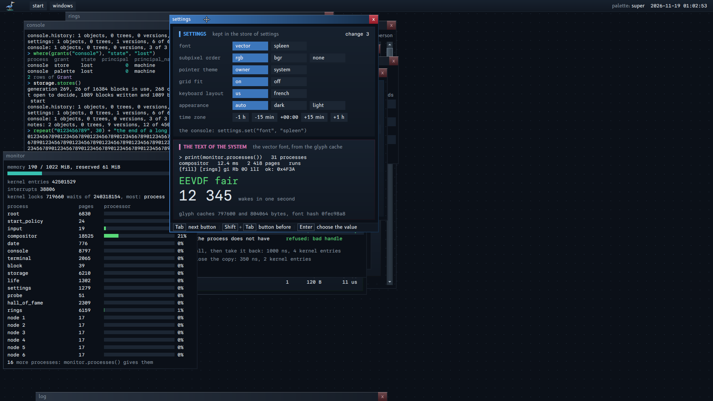

# The text of the system: a vector font with subpixel bands

The system draws its text with a vector font by default, with a coverage for each subpixel band. Spleen 8x16 is the fallback, and the other value of the setting `font`. The renderer adapts the ideas of a GPU font renderer to the design rules of this system: integers, a grid, and no work at run time that the build can do.

The terms are in `glossary/text.md`: font, glyph, outline, coverage, subpixel band, glyph cache, grid fit, setting, settings page.

**The idea in plain words.** The tool draws every glyph once, at build time, into a glyph cache: a table of the coverage of each subpixel band of each glyph, in integers. A process only copies and blends from that cache, so drawing text costs a few table reads per glyph and no outline is read at run time. The principal changes the font in the process `settings`, and every window changes at once.

**For whom.** A reader who draws text in a process, and a reader who changes a font, the glyph cache or the setting.

**The map of this guide.** Sections 1 to 5: what a process does, the grid, the subpixel bands, fixed point, the glyph cache. Section 6: the font file and the candidates. Sections 7 and 8: the setting and the fallback. Sections 9 to 11: measures, gaps, open decisions. Section 12: the interface font and the text shaping module. Section 13: the glyphs past the glyph cache: the font outlines, the demand cache, the private glyph cache and the fallback chains. Section 14: the text rendering at any text size: the text size, the frame of a face, the rasterizer, the private glyph cache and its bounds.

## 1. What a process does

Nothing in its code. A process calls `graphics.text`, `graphics.character`, `graphics.unsigned` or the elements of `src/library/support/interface`, `src/library/support/display` gives the setting of the principal and the glyph cache to `src/library/support/graphics` when the process opens its window, and again at each change. Each window of the machine test draws with the vector font with no line of its own changed.

Two places draw large text directly: `write_large` in `server`, and `text_draw` in `src/library/support/interface`. Each one calls `graphics.text_scaled`, one line. The boot display (`src/library/support/bootscreen`) draws every text in Spleen at the size of its scale, and reads no glyph cache (`src/md/features/boot_display_scale.md`). The `large` of `scheduler` writes a text record with a scale through `interface.draw_text`, so the package draws it; `terminal` has no large text of its own. They do not read the bitmap of Spleen directly: a process that uses the interface of the text needs no change for the vector font.

## 2. The grid

The font must fit the grid of the system: every layout was made for cells of 8 x 16 pixels. So the font of the cells is scaled until its advance is exactly 8 pixels, and each glyph stays inside its cell.

A text grid is laid out in cells of 8 x 16 pixels, and the spacing tokens of the design rules are multiples of 8 (`DESIGN.md`, sections 5 and 6). The vector font lives on these cells:

- **The default font is monospace.** Its advance maps to exactly 8 pixels at scale 1: the scale of the outline is 8 / advance, the same on both axes. A line is 16 pixels. Each existing layout holds; no window changes its size.
- **The scales 2 and 3 are real sizes**: 16 x 32 and 24 x 48 pixels, each drawn from the outline at that size, not enlarged pixels. The large numbers of `scheduler`, `remote`, `terminal` and `server` gain the most.
- **Spleen as the fallback is enlarged**: the rule "no enlarged low-resolution font" holds for the default font. When a process has no valid glyph cache, or when the principal chooses Spleen in the settings, Spleen draws each of its pixels as a square at the scales 2 and 3: the other choice at that moment is no large text.
- **The glyph cache is built ahead; the glyphs past it are drawn on demand.** The cache is filled whole at build time: one read-only copy for the whole system, and no draw of its characters in a process. A character past it comes from its fallback chain: from the demand cache that the font service drew, or drawn by the process itself from the font outlines of the boot image into its private glyph cache (section 13).
- **A glyph is cut to its cell.** The ink and the color fringe of a glyph stay inside its cell of 8 x 16 (or 16 x 32, 24 x 48). A cell never draws into its neighbour: the terminal fills one cell and draws its character, and the damage by difference of `src/library/support/interface` takes the rectangle of a text record as all that it draws. A glyph that passes its advance (rare in a monospace font) loses that part.
- **The baseline** puts the middle of the ink of the characters 33 to 126 at the middle of the cell (`vector_font.glyph_style_of`). For JetBrains Mono at scale 1 it is row 12, the baseline of Spleen.

### Grid fit (the hinting of this system)

No TrueType bytecode interpreter: the subsets have no instructions. In place of it, a light grid fit of the vertical metrics, with the flag `FLAG_GRID_FIT` of the cache:

- the baseline is on a whole pixel (the origin of the cell);
- the x-height (the top of `x`) and the cap height (the top of `H`) go to the nearest whole pixel; the points between 0 and the x-height scale to it, the points between the x-height and the cap height scale between the two, the points above the cap height and below the baseline keep the plain scale (`vector_font.place_y`).

Why: at 13 to 14 pixels to the em, the tops of the lowercase letters and of the capitals fall between two rows without it, and a row of half coverage under each top makes the text soft. The fit moves the tops onto rows, so the horizontal stems of `n`, `e`, `t`, `E`, `H` are sharp. The vertical stems need no fit across: the subpixel bands place them in thirds of a pixel. Not done: a fit of each stem (it needs the stems of each glyph: an outline analysis or the instructions of the font).

The picture `build/fonts/candidates.png` (`modustool vector_fonts`) has the default font with and without the fit; the default is with it. The default value is an open decision (section 11).

## 3. Subpixel bands

A pixel of a usual screen is three thin stripes: red, green and blue. Drawing each stripe on its own triples the resolution across, so the stems of the letters can sit at a third of a pixel. The cost is a faint color at the edges, which a filter keeps small.

- **Coverage at 3 samples for each pixel across**, one for each color stripe of the screen: the outline is drawn into an accumulation three times wider than the cell, with a margin of 6 thirds on each side.
- **The filter**: each third spreads over its neighbours with the weights 8, 77, 86, 77, 8 of 256 (the default filter of the usual LCD rendering), so that a side of a stem does not show one color alone. Measured on a stem of one pixel at its three places of a third (host test `filters_measured`): the five taps give a fringe of at most 162 of 255 and a peak of 239; three taps (85, 86, 85) give 170 and 255; no filter gives 255 and 255. The five taps are chosen: the least fringe for a loss of 16 levels at the peak.
- **The words of the cache**: for each pixel one word 0xGGRRGGBB: the coverage of the red, green and blue stripe after the filter, red at the left, and in the high byte the coverage of the whole pixel (the mean of its three thirds before the filter) for grayscale.
- **The order of the stripes** is a setting: `rgb` (the default), `bgr` (the same words with red and blue swapped at the blend: exact, the same thirds), `none` (grayscale, the high byte). Under QEMU the screen of the host decides: the pixels of the machine go to a window of the host, whose own panel has its own order; most panels are RGB.
- **Text over a gradient or a picture**: the blend reads the pixel under each covered pixel; nothing assumes a plain background.
- **Colored text**: the coverage of each channel times the color of the text, in linear light.

### The blend in linear light

`graphics.blend_coverage_row` (in `src/library/support/graphics/blend.odin`, beside `blend_premultiplied_alpha` of the pointer pictures: one family, one head comment): for each channel, with d the pixel under, c the color of the text and a the coverage of that channel,

    result = sqrt((d * d * (255 - a) + c * c * a) / 255)

A gamma of 2 in place of the curve of sRGB, in integers: the sum is under 2^24, shifted right by 12 bits it indexes a table of 4096 square roots that each process makes once (4 KiB). A channel with coverage 0 keeps the pixel, 255 gives the color.

The error against the exact curve of sRGB (host test `blend_error_against_srgb`, each coverage 0 to 255):

| Text over | Gamma of 2 | No gamma (a blend of the encoded values) |
|---|---|---|
| `colors.text` over `colors.card_bottom` | 8.5 levels at most | 51.0 levels |
| `colors.dim` over `colors.background` | 4.2 | 27.2 |
| `colors.process` over `colors.card_top` | 7.4 | 40.3 |
| `colors.background` over `colors.text` | 8.9 | 54.9 |

Light text on a dark surface is the case of this system: a blend with no gamma makes each edge pixel up to 51 levels too dark, and the text looks thin.

### What a screenshot shows

A picture of the screen holds the colored edges of each glyph: enlarged, each letter has orange and blue sides. This is the subpixel band at work, not a fault: on an RGB panel at its native size the three stripes of a pixel make the edge. The pictures of `docs/screenshots` are taken with the order `rgb`. The setting `none` gives gray edges, for a picture to read enlarged or a screen with no stripes in rows (a turned screen, many OLED panels).

## 4. Fixed point

The renderer uses integers only, so the same font gives the same bytes on every build and every host. This section says how the coverage stays exact with integers, and why no sum can overflow.

`src/library/support/vector_font/raster.odin` has no floating point, and neither has the text path of a display (`src/library/support/graphics`, `src/library/support/display`):

- **Coordinates** in subunits: 256 to a pixel on each axis (24.8). The points of an outline are integers in units of the font; the placement maps them with rational numbers rounded to the nearest subunit (`divide_rounded`).
- **Accumulation** in `i32`: a piece of a segment of height h with ends at ra and rb subunits from the left of its column adds h (512 - ra - rb) to its cell and h (ra + rb) to the next; a full pixel is 256 x 512 = 131 072. **The overflow argument**: a segment adds at most one full pixel to a cell of a row, and a glyph has at most 8192 segments (a segment past that is dropped), so a cell and a prefix sum stay under 2^30.
- **Cuts**: a segment is cut at each row and each column; the place of a cut is a function of the segment and of the line of the cut only, so two pieces that meet share their point. The sum of the coverage of a closed outline is exactly the area of the polygon of its cut points.
- **Exactness** (host test `coverage_is_the_area`): a rectangle at positions that are not on a pixel, triangles at 45 degrees and the whole accumulation give a sum of coverage equal to their area, to the unit. Twelve convex polygons with edges at other angles: at most 0.000029 of their area apart (the rounding of the cut points).
- **The edges of the accumulation**: what is left of it lies on its left side, what is right of it on its right side, so the coverage inside stays exact; a row has one cell more for a piece on the right side of the last column. Host test `the_last_column`: a vertical edge exactly on the right side of the last column with widths 1, 2 and 3, and an outline that passes all four sides.
- **Quadratic curves** are cut into 1 to 16 segments, so that each is at most 1/8 of a pixel from the curve; each point is computed from the ends and the control point, rounded: no error adds up along a curve.
- **The result does not depend on the build**: integers only; the host test `golden_glyph_cache` builds the cache of JetBrains Mono two times, compares the bytes, and compares the hash of the words of each scale with a constant. A change of the renderer changes these hashes: it needs a new `RENDERER_VERSION` and new constants.

## 5. The glyph cache

The glyph cache is the font already drawn: the tool renders each character at each scale at build time, and the processes only copy from it. It is a resource of the boot image, checked by its hash and mapped read-only into each process with a window.

A table of drawn glyphs: for each scale (1, 2, 3) and each character of two ranges and a list: ASCII 32 to 126, the Latin-1 Supplement U+00A0 to U+00FF, and the added characters (`docs/glossary/text.md`, "Added character"), today the euro sign U+20AC. Each table keys a character by its character index (`docs/glossary/text.md`, "Character index"): 0 to 94 for ASCII, 95 to 190 for the Latin-1 Supplement, 191 for the euro sign. Format: `src/library/contract/glyph_cache`, version 4: a header of 128 bytes, a size entry of 16 bytes for each scale, a glyph entry of 12 bytes for each character, position and scale, the advance of each character and scale, the pairs of each scale by character index, then the words; a glyph keeps only its rows with ink. Fixed capacity: 3 sizes, 192 characters, 3 positions, 36 864 pairs. A cache holds the 192 characters, no fewer: the build refuses a font that lacks one. A text is UTF-8; each character outside the cache, and each invalid sequence, draws the replacement glyph, which code draws and no cache holds (`docs/glossary/text.md`, "Replacement glyph"). All zero is valid: a process with no cache draws Spleen.

**One format for the two kinds of font** (section 12.4). The tool writes every cache again at each build, so no reader keeps an older version:

| | A monospace cache (Paper Mono) | A proportional cache (B612) |
|---|---|---|
| Positions of each scale | 1 | 3 at scale 1, 1 at the scales 2 and 3; 3 for the bold weight at scale 1 |
| A glyph | its full cell: `left` 0, `width` the width of the cell | the box of its ink: `left` from the origin (it can be negative), `width` its columns |
| The advance of each character | the width of the cell, in 1/64 of a pixel | the advance of the font, in 1/64 of a pixel |
| Pairs | none | the pairs of `kern` between two characters of the cache, in 1/64 of a pixel, sorted |

`validate` checks each new part as hostile input, as the rest: the positions (1 to 3), the first glyph of each scale (after the glyphs of the scale before), the width (at most 64) and the left side (-16 to 64) of each glyph with its words inside the file, each advance (0 to 64 pixels), and each pair (two characters of the cache, sorted with no pair twice, at most 64 pixels). The draw of a cell (`graphics.character_vector_with`) reads `left` and `width` of the glyph in place of the width of the cell: the same pixels for a monospace cache. The header says which kind of cache it is: `FLAG_PROPORTIONAL`. A cache with no such flag is monospace, and `validate` requires its form: one position, no pair, each glyph with `left` 0 and `width` at most the width of the cell, each advance the width of the cell; the damage of a grid of text cells depends on a glyph that stays in its cell. `validate` also refuses a flag that it does not know, a filter past the three of `src/library/support/vector_font`, and a font name that is not printable bytes with a zero byte at its end. The modus tool validates each cache that it writes, monospace or proportional.

### Who can write a cache

Each process validates its glyph caches once, then the drawing code reads the counts and the offsets of a cache again at each glyph, with no bounds check. So the bytes of a cache must not change after `validate`, and the place of a cache must not be a choice of another process. Both hold:

- **The address** of each cache is a fixed range (`src/library/contract/fixed_addresses`), a constant of the process. It is not read from the settings page.
- **Mapped or not**: the value 20 of the context (`CONTEXT_VALUE_FIXED_RANGES_MAPPED`) is a set of bits, one for each fixed range. The root service sets the bit of each cache that it maps, and only then. A process reads nothing at a range whose bit is clear (`settings.glyph_cache_open` gives `Not_Mapped`), so a process never reads a range where nothing is mapped.
- **The size** of each cache is in its own header: `file_size`. `glyph_cache.validate_at` reads the header at the fixed address, refuses a size under the header or over the span of the range, then validates the whole file, which checks `file_size` again. The header is always mapped: a mapping has whole pages, and the root service gives a cache only when `validate` accepts the bytes of the resource, so the resource is never shorter than its header and its header states the size of the resource. The modus tool validates each cache that it writes. No size goes through the context. The address and the size are not fields of the settings page. The process `settings` writes that page: with them, it could point every later process at memory that it controls, and change that memory after the validation.
- **The bytes**: the root service maps each cache from the boot image with no flag, so with the right Read only, for every process that receives it, the process `settings` and the compositor included (`text_settings_give`). The one handle of the boot image, which the kernel gives the root service, has the rights Read and Give and no right Write (`src/kernel/main.odin`). So no process, the root service included, writes the bytes of a cache after the root service checked their hash. The limit of this rule: a process trusts its starter. A starter writes the values of the context of its child and chooses its mappings, so a starter that maps memory that it keeps with Write at a fixed range of a cache could change it after the validation. It gains nothing that it does not have already: it chooses the grants, the display ring and the budget of its child. A starter can also lie about a range: a set bit with no mapping, or a mapping shorter than the size that the header states, makes its child fault at its first read there. The root service is the starter of each process with a surface, and it gives each cache read-only from the boot image, with its bit, after `validate` accepted it; the other starters (the console, `errors`, `locks`, ...) give no settings page and no cache.
- **The font outlines follow the same rule.** The root service maps them read-only from the boot image after it checked their hash and their format, and a process validates their header once (section 13).
- **The demand cache is the other rule.** The font service writes it while the processes read it (section 13). So a process validates no demand cache once: it copies each entry and checks it against the constants of its contract before it draws a word of it.
- **What `settings` still chooses through the page**, and the worst that each field does to another process:

| Field | Its worst value | What it does to another process |
|---|---|---|
| `values[font]` | any number | a value that the setting does not have refuses the whole page (`settings.choice_of_values`): each reader takes the defaults, as for a page that never stays stable, and the root service and the process `date` act on nothing. Else the vector font or Spleen, a look |
| `values[subpixel_order]` | any number | the same refusal; else one of three orders of the stripes, a look |
| `values[pointer_theme]` | any number | the same refusal; else one of the two theme files that the compositor validated, a look |
| `values[grid_fit]` | any number | the same refusal; else one of the two caches that the process validated, a look |
| `values[keyboard_layout]` | any number | the same refusal, which gives the layout of the United States; else the input service gives each key the character of one of its two layouts |
| `values[appearance]` | any number | the same refusal; else one of the three values, a look |
| `appearance_in_force` | any number | a word that names no appearance in force refuses the whole page, as above |
| `values[6..7]` | any number | no reader |
| `zone_offset_minutes` | any number | a zone that is not from -720 to +840 by 15 reads as 0, UTC (`settings.zone_offset_minutes_valid`). The process `date` copies the zone into the date page: the bar shows another local time, and `auto` takes the other appearance. A look, and the hour that the bar shows |
| `change_count` | odd for ever, or changed with no end | a reader gives up after 64 reads and takes the defaults (`settings.read`). The compositor tells the windows only when the values differ from the values that it told last (`settings.values_differ`): a new count with the same values sends no record into the ring of a window, which also carries its keys. Values that change with no end make the windows draw again: a cost of time, which the process `settings` also pays |
| `reserved` | any number | no reader |

### Where it lives: three places weighed

| | In each process, at run time | Shared, filled at run time by a font service | Built by the modus tool, a resource of the boot image |
|---|---|---|---|
| The time to fill ASCII 32 to 126 at 3 scales | 3.7 to 4.0 ms for each process (measured by `vector_glyphs` for each candidate) | The same, once | 0 at run time; the same work once in the build |
| Memory | 390 624 bytes in each process (JetBrains Mono) | One copy, shared read-only | One copy: the pages of the boot image, mapped read-only |
| The font file at run time | In each process (14 to 21 KB) | In the service | None: the system draws from the cache only |
| Property 11 | The cache is not a fact of the system description | The same | The cache is a function of the font file (its BLAKE3 in the header) and of the renderer version; the boot image names it by its hash |
| Hostile input | Each process reads the font file | One service reads it | The modus tool reads it at build time; each process validates the cache once (one pass over its tables, 7 us in root) |

**Chosen: built at build time, a resource of the boot image.** The root service checks its hash once at start (796 to 966 us for 390 624 bytes) and maps it read-only into each process with a surface, each terminal and the compositor (property 6: shared memory; property 20: a read-only grant that the root service gives). The tool makes it at each build from the subset in `resources/fonts`; the same font and the same renderer give the same bytes (the host test compares two builds). The resource mechanism is the one of the pointer pictures (`docs/ARCHITECTURE.md`, U2b): the glyph cache is a second resource of the same table, given through the same `resource_mapping` of the root service.

The other two forms stay possible: `vector_glyphs` builds the cache of each candidate in its own memory with the same function (`vector_font.glyph_cache_build`), which is the form of a process that draws another font.

### The cost of a text draw

| Measure (machine test, the least of 50 batches) | The fixed-point renderer | The floating-point prototype |
|---|---|---|
| One glyph of Spleen 8x16 | 35 ns | 30 ns |
| One glyph from the glyph cache, scale 1 | 309 ns | |
| One glyph from its outline, in fixed point, with the stripes: scale 1 / 2 / 3 | 3 874 / 10 607 / 20 613 ns | 5 373 ns at 13 px |

On the host (`glyph_draw_cost`): 333 to 362 ns from the cache against 33 to 44 ns for Spleen. The target was "the same order as Spleen": a glyph from the cache costs 9 times a glyph of Spleen. Four changes brought it from 921 ns: a loop for each order of the stripes (a constant), no bounds check after the one validation of the cache, the squares of the pixel under kept from one pixel to the next, a shift in place of a division. What stays: about 40 pixels of a glyph have a partial coverage, and each needs three blends in linear light. Section 9 has the effect on whole frames, which is small.

### Where the time goes, and the fast blend

Measured on the host, where the same code runs, with `-o:speed`, pinned to one core with `taskset`, each number the least of 3 000 batches of the line `compositor  12.4 ms  2 418 pages {fill} [rings] gi Rb 0O 1lI` (60 glyphs), and the least over four cores (host test `text_speed_parts`, `src/library/support/graphics/text_speed_test.odin`). Each batch draws over a fresh background, outside the time.

- **The words of one cell** (128 pixels at scale 1), on the mean: 64.4 pixels in rows with no ink (never read), 19.2 words of zero coverage (skipped), 1.0 word of full coverage (a store), **43.4 words of partial coverage**. So the time is in the partial pixels: each needs three blends in linear light (two squares, a sum, a shift and a load of the table of square roots for each channel). A walk over the words alone costs 11.2 ns a glyph.
- **The fast blend** (`graphics.blend_glyph_rows`, in `blend.odin`): for one text color over one pixel color, each channel of the result is a function of its coverage only. A **blend table** keeps the 3 x 256 results for one pair, in the memory of the process (`Blend_Tables`: 8 tables, 24 KiB, replaced in turn; a value is computed on first use with the formula of the reference, and a new table clears nothing: it takes a new generation in the high byte of each value). The choice is made for each row of a glyph: a row whose two end pixels have one color takes the table of that color, each pixel of that color in the row is three loads and a store; any other pixel takes the reference blend. Bit for bit: the host test `fast_blend_is_the_reference` draws each character at each scale, each order of the stripes, five colors, over a flat color, the gradient of a card, a gradient across and noise, two passes (the second over the first), and compares with the reference: 0 pixels differ. A row that no table holds (its two ends differ: a gradient across, a picture) takes the form of the target, `blend_coverage_row_in_form_of_target` (SSE2 on amd64), not the scalar form; a lone pixel of another color inside a row stays scalar (the SSE2 form gives a lone pixel to the scalar form anyway). The host test `three_blends_give_the_same_bytes_for_each_cache` compares the table blend, the SSE2 form alone and the scalar form alone, byte for byte, with the caches of Paper Mono (three scales), Paper Mono SemiBold (scale 1) and B612 (each scale and each position, glyphs that overlap), over the four backgrounds. The host test `text_speed_of_each_blend` gives the time of one glyph in each of the three, over a flat color, a gradient across and noise, for the choice of one path for the flat case; it has not run on a quiet host yet. The expectation: the table blend stays faster over a flat color, because a partial pixel there is three loads from a table where the SSE2 form still takes the square roots one channel at a time; if the SSE2 form comes within about 10 % of it, one path (the SSE2 form) is better than two, and the blend tables (24 KiB for each process) go.
- **Not taken**: a run-length or a mask for each row in the cache (the zero words are skipped already, and the walk is 11 ns of 109); 16 bytes at a time (the partial pixels need three table loads each, which the processor does not gather); the tables filled whole when made (89 to 93 ns against 103 to 110 ns, but 768 square roots for each new pair of colors, which a gradient across pays at each row).

| One glyph, the least on the host | Scale 1 | Scale 2 | Scale 3 |
|---|---|---|---|
| Spleen 8x16 (at scale 2 and 3: its pixels enlarged) | 33.8 ns | 253 ns | 286 ns |
| The reference blend, over a flat color | 181 ns | 424 ns | 712 ns |
| The fast blend, over a flat color (the console, the cards) | **109 ns** | 285 ns | 497 ns |
| The fast blend, over the gradient of a card (top to bottom) | 110 ns | | |
| The fast blend, over a gradient across (a title bar) | 178 ns (the reference: 188 ns) | | |
| The fast blend, over noise (a picture) | 188 ns (the reference: 193 ns) | | |

At scale 1, a glyph from the cache over a flat color or a card costs 3.2 times a glyph of Spleen (5.4 times with the reference blend). At the scales 2 and 3 the vector font costs 1.1 and 1.7 times the enlarged Spleen, for a glyph drawn from its outline at that size. The rest of the time is the 43 partial pixels: a cell has 43 blends that Spleen does not do. The target "the same order as Spleen" is near at scale 1 and met at the scales 2 and 3; the machine measures of this part were taken at a load of 28 to 31 and are not valid.

The blend of a glyph now has an SSE2 form beside this scalar form, with the same bytes: `docs/SIMD.md`, sections 3 and 6, says what it computes in vectors and how to measure it against the numbers above.

## 6. The font file

The font of the cells must be monospace, have clear forms at 8 x 16 pixels, and have a license that allows a subset inside the system. Six candidates were read and compared; Paper Mono is the font of the system.

Six candidates, each read from the build input of `flake.nix` (the packages of nixpkgs, pinned by `flake.lock`). Their license texts were read at the source on 2026-11-11.

| Candidate | License, as read | Outlines | Source | ASCII subset | Glyphs made of glyphs |
|---|---|---|---|---|---|
| JetBrains Mono 2.304 | SIL OFL 1.1, no Reserved Font Name: "Copyright 2020 The JetBrains Mono Project Authors [...] This Font Software is licensed under the SIL Open Font License, Version 1.1." (`github.com/JetBrains/JetBrainsMono/OFL.txt`) | `glyf` | 268 544 bytes | 14 164 bytes | 4 |
| DejaVu Sans Mono 2.37 | Bitstream Vera license, DejaVu changes in the public domain: "The Font Software may be modified [...] only if the fonts are renamed to names not containing either the words "Bitstream" or the word "Vera"." (`github.com/dejavu-fonts/dejavu-fonts/LICENSE`) | `glyf` | 343 096 | 17 688 | 0 |
| IBM Plex Mono 1.1.0 | SIL OFL 1.1 "with Reserved Font Name "Plex"" (`github.com/IBM/plex/LICENSE.txt`): the subset is named "IBM Mono ASCII" | `glyf` | 155 940 | 15 224 | 3 |
| Fira Mono 3.2 | SIL OFL 1.1: "Digitized data copyright (c) 2012-2015, The Mozilla Foundation and Telefonica S.A." (`github.com/mozilla/Fira/LICENSE`); the name table of the file: "Licensed under the Open Font License, version 1.1 or later" | `glyf` | 174 632 | 13 424 | 0 |
| Commit Mono 1.143 | The name table of the font file: "This Font Software is licensed under the SIL Open Font License, Version 1.1"; the repository (`github.com/eigilnikolajsen/commit-mono/LICENSE`): MIT. The two differ; the subset keeps the text of the file | `glyf` | 377 980 | 13 024 | 0 |
| Iosevka 34.3.0 | SIL OFL 1.1, no Reserved Font Name: "Copyright (c) 2015-2026, Renzhi Li" (`github.com/be5invis/Iosevka/LICENSE.md`) | `glyf`, a collection of 18 faces (the first is read) | 50 041 356 | 20 944 | 5 |
| Source Code Pro 2.042 | SIL OFL 1.1 "with Reserved Font Name 'Source'" (`github.com/adobe-fonts/source-code-pro/LICENSE.md`) | CFF only in nixpkgs | | not made | |

- **A glyph made of glyphs** is read with two limits: at most 4 levels (`COMPOSITE_DEPTH`) and at most 64 parts in all its levels together (`COMPOSITE_PART_LIMIT`). A part can be an empty glyph, which adds no point, so the limit of points does not bound the work: with no limit of parts, a glyph of 21 000 parts in four levels gives 21 000 to the power 4 calls. The host test `a_composite_of_many_empty_parts_ends_at_once` builds that glyph. The composites of the candidates have 2 parts. A face number past the faces of a collection is the problem `No_Face`.
- **CFF** (Source Code Pro): its outlines are Type 2 charstrings, a small stack machine with cubic curves. The reader needs that interpreter (about 40 operators, subroutines, hints to skip) and the cut of cubic curves. Not built: five candidates have `glyf`.
- **A subset is a Modified Version** of the font under the OFL (OFL FAQ 2.6: "Removing any parts of the font [...] is considered modification. This is permitted by the OFL but would not normally allow the use of RFNs."). So a font with a Reserved Font Name is renamed in its subset ("IBM Mono ASCII"). Each subset keeps the copyright and the license text of its source in its name table and in a `.license` file beside it; `resources/fonts/OFL.txt` and `BITSTREAM_VERA_LICENSE.txt` have the full texts.
- **The subset command**: `modustool vector_fonts` reads `VECTOR_FONT_SOURCES` (the development shell sets it), writes for each candidate `.notdef`, the characters 32 to 126, the characters U+00A0 to U+00FF and the added characters as simple glyphs with no instructions (a glyph made of glyphs, as é, is made simple with its offsets and its scale in integers), in the order of their character index. A font that lacks U+00A0 (the space with no break) or U+00AD (the soft hyphen) draws it with the glyph of U+0020 or U+002D, its standard equivalent, and the command writes one line for each such character ("paper_mono has no glyph for U+00AD: its subset draws it with the glyph of U+002D"); Paper Mono has no soft hyphen. Each other character that a font lacks stops the command, the euro sign too: a glyph of E or C would show a wrong currency. Each source font of the system has its own glyph for U+20AC. The command writes the tables `OS/2` (of the source), `cmap` (two segments of characters, one segment for each added character, and the last segment of the format), `glyf`, `head`, `hhea`, `hmtx`, `loca`, `maxp`, `name`, `post`, with their checksums. It uses no time and no random value: the same input gives the same bytes. The subsets are in the repository, as the output of `modustool font` is: a build needs no build input.
- **A wider range** costs at most 4 bytes for each pixel of a cell, at three scales: 4 x (8 x 16 + 16 x 32 + 24 x 48) = 7 168 bytes for each character with ink in each row; about 4 100 bytes for each character on the mean with only the rows with ink. The 96 characters of the Latin-1 Supplement are in each cache: an estimate of about 390 KB more for each cache of three scales before the build; the coordinator of the build measures the sizes in `build/fonts`.

**JetBrains Mono** is the reference font of the host tests of the renderer. The default font is one line, `DEFAULT_VECTOR_FONT` in `tools/modustool/resources/vector_fonts.odin`. The qualities of JetBrains Mono: at 8 x 16 its zero has a dot and its `O` does not, `1`, `l` and `I` differ, its x-height (550 of 1000) gives 7 rows like Spleen, its stems are even at the three scales, and the OFL with no Reserved Font Name lets the subset keep its name. DejaVu Sans Mono is close; Iosevka has the largest letters (its advance is half its em, so its em is 16 pixels) and the most condensed forms; Fira Mono is the heaviest; IBM Plex Mono needs a new name.

### Paper Mono, the font of the system

Paper Mono (<https://github.com/paper-design/paper-mono>, SIL OFL 1.1, no Reserved Font Name: "Copyright 2025 The Paper-Mono.Git Project Authors [...] This Font Software is licensed under the SIL Open Font License, Version 1.1", read in `OFL.txt` of the repository; its name table says the same) is the default vector font: the font of the cells, for the console, the terminal and the values of every window (section 12.6). Its SemiBold is the bold weight of the titles in the font of the cells. `DEFAULT_VECTOR_FONT` is `paper_mono`, `EMPHASIS_VECTOR_FONT` is `paper_mono_semibold`. JetBrains Mono stays a candidate; the host tests of the renderer keep it, so that a change of the default changes no golden hash.

The cap height and the x-height of Paper Mono (the pinned files, both weights): `OS/2` gives 710 and 509 units, and the tops of the outlines of H, E, F, T, Z, I are all 710, of x, z, v, w all 509. So the path of the monospace fonts, which takes them from the tops of `H` and `x`, gives the values that the font states.

The source: Paper Mono is not in nixpkgs. `flake.nix` fetches `fonts/ttf/PaperMono-Regular.ttf` and `PaperMono-SemiBold.ttf` at the commit `74fc5537cc1f7b39aa8cccfa7dd3822e17143cca`, each with its hash (106 088 and 106 900 bytes).

**The zero of Paper Mono: the slashed zero.** The default zero of Paper Mono looks like its capital O, so the system draws the slashed zero. What the pinned files hold, read in their tables:

| | Paper Mono Regular | Paper Mono SemiBold |
|---|---|---|
| The glyph of '0' in `cmap` | 294: 2 contours, 24 points (the capital O, glyph 78: 2 contours, 24 points) | 294: 2 contours, 26 points |
| The feature `zero` of `GSUB` | lookup 158: type 1 (a single substitution), one subtable of format 1 (a delta of 10), a coverage of format 1 with one glyph, 294 | the same |
| Its substitute | 304, named `zero.zero` in `post`: 3 contours, 32 points, the advance 606 of every glyph | 304: 3 contours, 32 points |
| The other forms of the zero | `numr` 335, `dnom` 325, `sinf` and `subs` 356, `sups` 366; the stylistic set `ss01` reaches the zero through a contextual lookup (type 6) only | the same |

The script DFLT and the script latn each have the feature `zero` in their default language system. So the slashed zero is the feature `zero`, a single substitution, and no stylistic set and no name of `post` is needed to find it.

- **The subset**: the table of the fonts of the tool (`vector_fonts.odin`) gives each font a form of the zero, `.Of_The_Font` or `.Slashed`. For `.Slashed` the tool reads the feature `zero` with `vector_font.single_substitution` and draws its substitute for the character '0' in the subset; the subset holds no `GSUB`. A font with no such feature keeps its zero, and the tool prints a line that says so. Paper Mono Regular and SemiBold are `.Slashed`; the `.license` file of a subset says which glyph is its zero.
- **The reader of `GSUB`** (`src/library/support/vector_font/substitution.odin`) reads the version (1.0 or 1.1), the script list (DFLT, else latn, its default language system), the feature list, the lookup list, a lookup of type 1 or 7 (an extension that holds a type 1), a subtable of format 1 or 2, and a coverage of format 1 or 2. It is hostile input: each offset is checked against the table, the work is bounded (16 features of one tag, 64 lookups, 64 subtables, a binary search in each coverage), and the substitute must be a glyph of the font.
- **The tests**: `the_zero_feature_of_paper_mono` (the modus tool) reads both pinned files through `VECTOR_FONT_SOURCES`, which the check of the flake also sets; `the_zero_of_the_paper_mono_subsets` reads the subsets; `a_single_substitution_in_each_form` and `a_damaged_substitution_table` build a table `GSUB` in memory.
- **The effect**: every picture with a 0 in the text of the system shows the slashed zero. The golden hashes of the renderer are of JetBrains Mono, which keeps its zero: they do not change.

What its tables say, read on its files, against JetBrains Mono:

| | Paper Mono Regular and SemiBold | JetBrains Mono |
|---|---|---|
| Outlines | `glyf` (TrueType), 800 glyphs | `glyf` |
| Units for one em | 1000 | 1000 |
| Advance of each ASCII character | 606: one for all, monospace | 600 |
| The scale on the grid of 8 | 8 / 606: an em of 13.2 pixels | 8 / 600: 13.3 pixels |
| Ascender, descender (`hhea`, also the typo values of `OS/2`) | 955, -245 | 1020, -300 |
| Ink of ASCII 33 to 126, top and bottom | 803, -194: 13.2 pixels of height, in 16 rows | |
| Baseline (`glyph_style_of`) | row 12: the ink from about row 1.4 to row 14.6 | row 12 |
| x-height, cap height | 509, 710: 6.7 and 9.4 pixels; the grid fit gives 7 and 9 rows | 550, 730: 7 and 10 rows |
| Glyphs of ASCII made of glyphs | `i` and `j` (a stem and the dot glyph 559, placed by x and y offsets, flags `ROUND_XY_TO_GRID` and `USE_MY_METRICS`): the reader takes them, and the subset makes them simple | 4 |
| Pair spacing | `GPOS` only (3.9 KB), no `kern`: a monospace font on the grid uses none | `GPOS` |
| Box drawing U+2500 to 257F, block elements U+2580 to 259F | all 128 and all 32 | |

- Its capitals are one row shorter than those of JetBrains Mono at scale 1 (9 rows against 10) and its letters are 1 % narrower in the em. Its line is the same 16 rows.
- **Not built: the box-drawing characters.** The glyph cache holds ASCII 32 to 126, the Latin-1 Supplement and the euro sign; the terminal draws each other character as the replacement glyph. Paper Mono has each box-drawing and block character, so a wider cache (section 6, "a wider range") can take them later: about 4 100 bytes for each character with ink at the three scales.
- Not measured yet: the size of its glyph cache and of its SemiBold cache, and its look on the screen. `modustool vector_fonts` measures them; `build/fonts/candidates.png` and the picture `font_candidates` show it beside the others.

The picture of the choice: `font_candidates` (the process `vector_glyphs`: the same line in Spleen and in the six fonts, the large number at scale 2, a word enlarged 4 times; each candidate from a cache that the process builds), and `build/fonts/candidates.png` (`modustool vector_fonts`: the same lines at scales 1, 2 and 3 in each candidate and in Spleen, the default with and without the grid fit, a word of each enlarged 5 times; drawn on the host by the same `src/library/support/graphics`).

### A bold weight for the titles

The titles of the cards (the card of `src/library/support/interface`) are drawn in the emphasis weight of the font of the system: Paper Mono SemiBold (`resources/fonts/paper_mono_semibold.ttf`; Paper Mono has no Bold). JetBrains Mono Bold has an ASCII subset of 14 212 bytes and a glyph cache of 30 720 bytes at scale 1 only (all three scales: 391 936 bytes); the SemiBold has the same cells. The cache is a resource of the boot image mapped like the others. In the draw record of the interface package, the field `weight` of a text record is the weight of a text (0 regular, 1 bold). Bold at another scale, with Spleen, or with no bold cache, is the regular weight; the width of a text does not change.

## 7. The setting

The principal chooses the font, the order of the stripes, the pointer theme, the grid fit, the layout of the keyboard, the appearance and the time zone in the process `settings`. The choice is one shared page whose values only `settings` writes; every window reads it and draws again when it changes, and the choice survives a stop of the machine.

The settings are the smallest form that keeps the properties:

- **Where it lives**: one page, the settings page (`src/library/contract/settings`). The root service creates it at start. The page holds the choices only (the change count and one value for each setting): it holds no address, no size and no hash of a glyph cache, because the process `settings` writes it (below, "Who can write a cache"). The process `settings` receives it with Write (the role `Settings` of the root service: the one writer). Each process with a surface, each terminal and the compositor receive it read-only at the fixed range `Settings_Page` (`settings.PAGE_ADDRESS`), with its bit in the value 20 of their context, as the glyph caches (P20: a grant of the root service, read-only; P9: no shared file). All zero is valid: the vector font, `rgb`.
- **A change while processes run**: `settings` writes the page (the change count is odd during the write) and wakes the threads that wait on the change count. The compositor waits on it: it gives the new choice to its own text, draws its whole screen again, and sends the display event `Settings_Changed` to each window. `src/library/support/display` gives the new font to `src/library/support/graphics` when the process reads the event, between two frames; `src/library/support/interface` draws the whole window at the next frame (each draw record is the same, each pixel of text is not). A process draws again as it does for any event.
- **The settings** (one value of the page and one row of `settings.descriptions` each; the window, the exports and the kept record read the same table): `font` (`vector`, `spleen`), `subpixel_order` (`rgb`, `bgr`, `none`), `pointer_theme` (`owner`, `system`), `grid_fit` (`on`, `off`), `keyboard_layout` (`us`, `french`) and `appearance` (`auto`, `dark`, `light`). Value 0 of each is its default.
  - **The pointer theme**: the root service gives the compositor both pointer theme files of the boot image (`pointer_theme_choice` in `src/modules/system/root/resources.odin` is the one place of their order: the values 6 and 7, then 18 and 19); the compositor validates each once and the setting chooses one live (`pointer_theme_choose`, a log line "the pointer theme in use").
  - **The grid fit**: two glyph caches of the default font are resources of the boot image (390 624 bytes with the fit, 397 344 without: +397 344 bytes in the image); each process validates both once and the setting chooses one. The picture `font_without_grid_fit`.
  - **The layout of the keyboard**: the root service maps the settings page, read-only, in the input service, which reads the value at each key: a change holds from the next key. The two layouts are the United States (QWERTY) and France (AZERTY). A key record carries its character as a code point: the layout of France gives é, è, ç, à and ù from their keys, and â, ê, î, ô, û, ë, ï, ü and ÿ from its two dead keys, `^` and `¨` (`docs/glossary/text.md`, "Dead key"; the rules are in `src/md/features/keyboard_layout.md`). AltGr, the right Alt key, gives its third level: `#`, `{`, `[`, `|`, `\`, `^`, `@`, `]`, `}`, `¤` and `€` from the keys of the row of the digits, of `$` and of `e`, and the dead keys of the tilde and of the grave accent, which give ã, ñ, õ, à, è, ì, ò, ù and their capitals (`docs/glossary/text.md`, "AltGr"). AltGr with `e` gives the euro sign €, which each font draws. The tables are in `src/library/private/input/keyboard_layout`. The input service holds no other right for it: the page is the one thing that it reads.
  - **The appearance**: `appearance` (`auto`, `dark`, `light`) chooses the colors of the whole desktop (`docs/DESIGN.md`, "The appearances"; the design is `src/md/features/appearance.md`). The page holds, beside the values, the appearance in force: `dark` or `light`. With `auto`, the light appearance holds from 07:00 to 19:00 of the local time and the dark one at night, by the date page and its time zone; a system with no date is dark. The process `settings` writes the appearance in force with each change of the values; the root service writes it alone at 07:00 and at 19:00, the edges of the rule, with no wake between them. A process reads it at each frame, and the compositor sends `Settings_Changed` to each window when it changes. The log says why: "settings: the appearance in force is light: the setting light".
  - **The time zone**: `time_zone` is not a row of `settings.descriptions`, because its value is a number and not a name of a list: a fixed offset from UTC, from `-12:00` to `+14:00` by quarters of an hour, with no summer time; `+00:00`, UTC, is the default (`settings.set("time_zone", "+08:00")`). The page holds it beside the values (`zone_offset_minutes`). The process `date` copies it into the date page and wakes the root service, which then moves the appearance in force of `auto` when the local time asks for it; the bar shows the local time. The design is `src/md/features/time_zone.md`. The log: "settings: time zone +08:00; kept in the store", then "date: the time zone of the date page is +08:00, from the setting time_zone".
  - **The scheduling strategy is not a setting.** The right `Schedule` belongs to `scheduler`. The settings service must not get a kernel right to pass it on (property 20: a service does not combine its own access with the request of a caller), and asking `scheduler` needs `scheduler` to run as a service at boot with that right. The principal changes the strategy through `scheduler`, the process that holds the right: in its window, or with its export `strategy_set`, which the console runs as `strategy(name)` and the palette as an entry, and which serves only a caller that acts for the principal (`SCHEDULING.md`, "The change at run time"). The process does not run at boot: it must be started. A strategy that survives a stop needs the root service, which holds the machine with each right, to read a record at boot. This is not built: it needs its own grant decision.
- **The process `settings`**: a window of the interface package: each setting as a row of buttons (the pointer and the keyboard: Tab, then Enter), the time zone as a row of four buttons (`-1 h`, `-15 min`, `+15 min`, `+1 h`) around its value, the text of the system at its three sizes, the facts of the glyph cache (size, hash, valid or not used). Exports with descriptions (P19): `settings.set(name, value)` (1, or an error record: `No_Grant` -1 for a caller that does not act for the principal, `Absent` -2 for a name, `Bad_Value` -3 for a value) and `settings.get(name)` (a text, or an error record: `Absent` -2 for a name, `Too_Long` -3 for a name of more than 32 bytes), and `settings.repeat(count)` (count records kept, one commit each: the case of the loss of power). The console calls them after `connect("settings")`; `modustool call` calls them through `remote`.
- **The settings survive a stop.** `settings` keeps the values as one record of 56 bytes (`Kept_Settings`: a magic, the version 2, a count, 8 values, the time zone and a zero word) in one object of its private store (P9): a change writes the record (one commit) first, then the page. At boot the root service starts `settings` for a **boot pass** (the context value 17): it reads the record, writes the page, wakes the compositor and stops, with no window. The log has one line of it, `settings: the boot pass: ...; in N us`. The storage service and the block service of the data disk start at boot for it. A record of another version, or none, gives the defaults. The boot pass writes the defaults in place of a record of another version, so a disk of an older system loses its settings once, and the next boot reads a valid record.
- **The boot display reads no setting**: its text is Spleen in each drawer (`src/md/features/boot_display_scale.md`). The first frames of the windows use the defaults (the vector font, `rgb`) until the boot pass, as the root service reads no store; then the compositor sees the change of the page and each window draws again with the kept settings (its first loop compares with a change count of 0, so a window that read the page before the boot pass is told too). The boot pass takes 23 ms in the machine test with a new disk.
- **A loss of power** (`modustool test power`, the case `power_loss_settings_run`): `settings.repeat(1000)` writes 1000 records, and the disk loses its power at the write of a root. Each of 306 images that a loss can leave (72 with a torn write) gives the durable record or the record in flight, never a mix, and each record is valid; the second machine starts on the hard image and its boot pass writes the durable record on the page.

## 8. Fallback

- **No cache, or a cache that its validation refuses**: the process draws Spleen 8x16, and its log has one line ("display: no glyph cache" or "display: the glyph cache is refused: <sentence>, value, limit"). The validation (`glyph_cache.validate`) checks the magic, the version, the size of the file, the counts, each cell size and baseline, the place of the words and the rows and words of each glyph (host test `damaged_glyph_cache`: ten fields damaged one at a time, each refused with its kind; the file cut at each 977 bytes, each refused, no fault).
- **A cache whose hash is wrong**: the root service does not map it (one line on the log), and no process has it.
- **A damaged font file** at build time: the tool stops the build with the problem (`vector_font.Font_Problem`). The reader checks each read (host test `hostile_files`: the file cut at each 211 bytes, 48 files with 64 changed bytes, each glyph drawn at the three scales: no fault).
- **The boot display uses no glyph cache**: the boot program has none before it checked the boot image, so the boot program, the root service and the process `boot` draw it in Spleen at the size of its scale, the same pixels in each (`src/md/features/boot_display_scale.md`).
- **A character that the font lacks**: the glyph caches hold ASCII 32 to 126, the Latin-1 Supplement and the euro sign only, and each candidate has all of them (the subset command refuses a font without one). Spleen 2.1.0 has them too (`modustool font`). A text is UTF-8: the drawing decodes it, gives each character one cell, and draws each other character, and each invalid sequence, as the replacement glyph, the outline of a box (`graphics.character_replacement`), in both fonts and at each scale. A text of the interface font with a demand cache draws the Greek letters too, after the font service drew them, and a cell of the vector font with a demand cache draws the box-drawing characters, the block elements and the five Greek letters of Paper Mono (section 13).

## 9. Measures

Each pair was measured in the same hour with the same tool: Spleen at the commit `c909390`, the vector font rebased on `cacaf48` (the frame caches are between: they do not draw). The load of the host was 15 to 37 during each run (`uptime` in the log of the run): above 8, so by the rule of the project these numbers are not valid measures of speed. They show the order; a run on a quiet host is needed.

| Measure | Spleen (`c909390`) | The vector font |
|---|---|---|
| `flood`: lines in one second (the terminal draws a full window at each picture) | 3 925 316 | 4 302 808 (other runs: 1 594 054 and 2 629 205 at load 30 to 45) |
| The terminal: pictures in one second | 62 | 62 |
| A full frame of the desktop with 16 windows, measured on a screen of 1024 x 768 (the reference screen is 1920 x 1080) | 1 683 to 3 424 us | 1 523 to 2 653 us |
| `interface_elements`: the whole frame / the next frame in its damage | 402 / 119 us | 637 / 158 us (875 / 209 us at load 45) |
| `clock`: one picture, the mean of 10 | 19.9 us | 31.5 to 46.3 us (211.7 us in one run) |
| The boot image | 3 566 097 bytes (`cacaf48`) | 3 778 016 bytes: +390 624 the glyph cache, +64 193 `settings`, -231 953 `vector_glyphs` (the 343 KB file of DejaVu out, six subsets in) |
| The glyph cache | | 390 624 bytes; its hash checked by the root service in 796 to 966 us |

The console stays fast: the producer writes into the terminal ring, and the terminal draws at most 62 pictures in one second whatever the font; a picture of the window of `flood` (about 2 500 characters that are not spaces) costs about 0.7 ms more with the vector font (2 500 times 274 ns), under 5 % of a processor at 62 pictures in one second. The full frame of the compositor copies surfaces: the font does not enter it.

## 10. Gaps

- One glyph from the cache costs 3.2 times a glyph of Spleen at scale 1 over a flat color, and 5.3 to 5.6 times over a gradient across or a picture, where the blend tables do not apply (section 5).
- No grid fit of each stem; no stem darkening (`gui_toolkit` thickens the stripes by 0.2 pixel; not tried here).
- The first frames use the default settings until the boot pass of `settings` (section 7).
- The scheduling strategy is not a setting and does not survive a stop (section 7).
- The glyph caches hold no character past the Latin-1 Supplement but the euro sign. Past them, each window draws the Greek letters of B612 and the box-drawing characters, the block elements and the five Greek letters of Paper Mono, in its labels, its titles and its cells (section 13). ā, Π, ρ and the Cyrillic letters draw the replacement glyph: no font of the system has them. A character joins the list of the added characters when each font draws it (`src/md/data/text_encoding.md`). A monospace cache has no subpixel position; the proportional font and its pairs are in section 12.
- The order of the stripes of the screen is not detected: under QEMU it is the panel of the host, which the system cannot read.
- The measures of section 9 were taken on a host with a load above 8.

## 11. Open decisions

1. **The font file**: Paper Mono (section 6). Another candidate is one line, `DEFAULT_VECTOR_FONT`.
2. **The grid fit by default**: on (now) or off. It is now a setting of the principal (both caches are in the boot image); the decision is only which value is 0.
3. **The order of the stripes by default**: `rgb` (now), or `none` until the system can know the panel.
4. **The interface font**: the size of B612 (an em of 13.33 pixels: capitals of 10 rows), and the positions of its cache (3 at scale 1 and 1 at the scales 2 and 3: 509 340 bytes measured with the Bold titles; or 3 everywhere: about 2.45 MB, estimated), section 12.
5. **The scheduling strategy across a stop**: a record that the root service reads at boot, or none (section 7).

## 12. The interface font and the text shaping module

Words that name things (titles, labels, buttons, menus) read better in a proportional font, where each letter has its own width. The system has one, B612, beside the font of the cells. A proportional font needs shaping: the place of each glyph comes from its advance and from the pair that it forms with the next one.

B612 (<https://github.com/polarsys/b612>, version 1.008, the package `b612` of nixpkgs; SIL OFL 1.1 with no Reserved Font Name: "Copyright 2012 The B612 Project Authors [...] This Font Software is licensed under the SIL Open Font License, Version 1.1", read in `OFL.txt` of its repository) is the font of the interface: the titles, the bar, the menus, the labels, the cards. It is proportional. Paper Mono stays the font of the text that is monospace (section 6). The system needs a module of text shaping and pair spacing for it. This section is the design; 12.8 says which parts are written.

### 12.1 What B612 has, read in its files

| | B612 Regular | B612 Bold |
|---|---|---|
| Outlines | `glyf` (TrueType), 593 glyphs; no glyph of ASCII is made of glyphs | the same |
| Units for one em | 2000 | 2000 |
| Advances of ASCII 32 to 126 | 19 different values from 400 to 2000 units, the mean 1148; the space 700; `i` and `I` 600; `m`, `M` 1800; `W` 1900 | the same advances |
| Digits | each 1300: digits are tabular, a column of numbers aligns | the same |
| Ascender, descender (`hhea`, typo of `OS/2`) | 1930, -500; the ink of ASCII from -517 to 1720 | 1930, -500 |
| x-height, cap height (`OS/2` sxHeight, sCapHeight) | 1100, 1500. The flat tops of E, T, Z are at 1500; the stems of H, I, L end with an angle at 1520, and `x` reaches 1117 | 1100, 1500; the top of H is 1527 |
| Ink beyond the advance box | at most 61 units left of the origin (`j`), none past the advance | 126 left (`j`), 52 past the advance (`K`) |
| Pair adjustment | `kern` version 0, one subtable of format 0: 1017 pairs; `GPOS` with one lookup of type 2 (pair adjustment, subtables of format 1 and 2), feature `kern` | `kern`: 1061 pairs; `GPOS` the same form |
| Substitution | `GSUB` with no feature: no ligature, no contextual form | the same |
| Box drawing | none | none |

- **For ASCII, `kern` and `GPOS` give the same pairs**: 232 pairs in Regular and 239 in Bold whose two glyphs are ASCII, each with the same value in both tables, none in one table only (read on the files with a script outside the system, not with code of the system). The values are -200, -150, -100 and +100 units in Regular, and also -50 and +50 in Bold: at the size below, -1.33 to +0.67 pixel. Examples: "To", "LT", "Ty" -100; "LV" -150; "Wa" -100 in Bold only. **"AV" has no pair** in either weight: B612 spaces "A" and "V" by their advances alone.
- So the first version reads `hmtx` and `kern` format 0 only. It reads no `GPOS` and no `GSUB`, and has no ligature and no other script. A font whose pairs are only in `GPOS` needs the `GPOS` reader later, behind the same contract.

### 12.2 The size on the grid

- The line stays 16 pixels at scale 1 (32, 48 at the scales 2 and 3), so a label sits in a line of the grid as text does now.
- The em of B612 at scale 1 is 13.33 pixels (2000 units to 13.33 pixels, one unit is 1/150 of a pixel): its cap height is then 10 pixels and its x-height 7.33 (the grid fit of section 2 gives 7). The cap height and the x-height are the values that the font states in `OS/2` (1500 and 1100), not the tops of the outlines of `H` and `x` (1520 and 1117 in Regular, 1527 and 1124 in Bold), which the monospace path uses (section 2): the flat tops of the capitals must sit on whole rows, and both weights get one scale. A host test checks that E, T and Z have ink on rows 2 to 11 exactly. Its ink, from -517 to 1720 units, is 14.9 pixels: inside 16 rows, with the baseline on row 12.
- Its mean advance in ASCII is 7.65 pixels: a label in B612 is about as wide as in Paper Mono (8 pixels), narrower for lowercase text, wider for capitals (`M` 12 pixels).

### 12.3 The text shaping module

A module (property 10: shared code with exports), with batch exports whose parameters are tables (`MODULE_CONTRACT.md`, "Tables and bytes as parameters"). Its name: `text_shaping`. Written (part 3 of 12.8): the shaping of the package `src/library/support/text_rendering` for a direct call (section 14), and the module `src/modules/libraries/text_shaping` over it, as `src/library/support/interface` and `interface_module`.

**As written:**

| Export | Parameters | Result |
|---|---|---|
| `shape_text` | the advances (Read, 192 records of an `i32`, by character index), the pairs (Read, `glyph_cache.Pair_Entry`), the text (Bytes, Read), the placed glyphs (Append), the error record | the count of placed glyphs of the full answer, or -1 |
| `measure_texts` | the advances, the pairs, one table of bytes (Read), the ranges (Change: `start`, `count`, and `width` that the export writes) | the count of ranges, or -1 |

- **The spacing is two tables of the caller**, the advances and the pairs of one scale of its glyph cache (`text_shaping.spacing_of`). So the module holds no font and no state: an isolated call receives them in the call region like the text.
- **Hostile tables**: the counts are checked (192 advances, at most 36 864 pairs, a text of at most 65 536 bytes, a table of at most 2^40 records). The caller can change its tables during the call, so no value is checked once and used later: each advance, pair, byte and range is read once, and kept in its limits at that read (an advance 0 to 64 pixels, an adjustment -64 to 64 pixels). Pairs out of order give wrong numbers, never a read out of the table. The x of each glyph then holds in an `i32`.
- **A character outside the cache** (a character above 126, a control character, an invalid sequence of UTF-8) is placed as `REPLACEMENT_GLYPH`, with the advance of `0` and no pair, and the reader draws the replacement glyph there, so a reader sees that the font does not draw it. Each placed glyph has the first byte of its character as its cluster.
- **The widths in a table of ranges**: the width is a field of each range record, which the export writes (the direction Change), as `sum` in the records of `sample.sum_words`. So `measure_texts` has five parameters, and a sixth (the table of error details of `master`, `MODULE_CONTRACT.md` section 8) fits after the merge.

**The design before the code:**

- **Input**: the font (a record: its kind, its scale, its weight) and a table of characters: the bytes of a text of UTF-8, with glyphs for ASCII 32 to 126, the Latin-1 Supplement and the euro sign.
- **Output**: a table of placed glyphs, one for each character, in memory of the caller. A placed glyph is 16 bytes: the glyph (its index in the glyph cache), x (its origin from the origin of the run, in 1/64 of a pixel), the advance in 1/64 of a pixel (with the pair adjustment that follows it), and 4 bytes that are zero (a cluster number for a full shaper later).
- **The measure of a text** is the sum of its advances: one export `text_width` that gives it with no output table, for the layout.
- **Many texts in one call**: a second form takes a table of runs (each a start and a count in one table of bytes) and fills one table of placed glyphs and one table of widths: a window measures all its labels in one call.
- **What it reads**: not the font file. The modus tool writes the advances and the pairs into the glyph cache of the font (section 5): for each scale, the advance of each character in 1/64 of a pixel, and the pairs of the characters of the cache with their adjustment in 1/64 of a pixel (878 pairs in B612 Regular and 914 in Bold: the 232 and 239 pairs between two characters of ASCII, and the pairs with a character of the Latin-1 Supplement, sorted by character index, 8 bytes each). The module works over a cache that the process already validated: no parse at run time, the same rule as the glyph cache.
- **The work for one character**: one load of its advance, one search of the pair with the next character in a sorted table of 878 in B612 Regular, 914 in Bold (10 compares), or one load of a table of 192 x 192 adjustments (36 864 bytes for each scale, which the tool can write in place of the list).
- **The same contract takes a full shaper later**: characters in, placed glyphs out. A shaper with ligatures gives fewer glyphs than characters and uses the cluster number; the callers already read the count of the output.

### 12.4 The glyph cache with subpixel positions

- **Positions**: a glyph of a proportional font does not start on a whole pixel. With the subpixel bands, the finest step that the screen shows is one third of a pixel: the cache keeps each glyph at 3 positions, 0, 1/3 and 2/3 of a pixel. The draw rounds the x of a placed glyph (in 1/64) to the nearest third, so the error is at most 1/6 of a pixel; the shaper keeps the exact sum, so errors do not add up along a run.
- **The cell of a glyph** is its ink box, not the cell of the grid: its width is the ink width plus the spread of the filter (two thirds of a pixel on each side) plus the position, its left side at a stated bearing from the origin. The glyph entry gains this width and this bearing (`left`, `width`). Written: one format of `src/library/contract/glyph_cache`, for the monospace caches too (section 5): fewer paths than two formats, and the tool writes every cache again.
- **The renderer** (`vector_font.glyph_render_placed`): the glyph is drawn in a work row of 64 pixels with its origin at column 4 plus the position (one third of a pixel for each step), then cut to the box of its ink. A glyph whose ink reaches a side of the work row is refused. The size on the grid: the cap height is 10 rows at scale 1 (`PROPORTIONAL_CAP_HEIGHT_ROWS`), so 1 200 units of B612 are the 8 pixels of a cell (the stated cap height of 1 500 units times 8 / 10). The advances and the pairs are scaled the same way and rounded to 1/64 of a pixel, each on its own, to the nearest integer, a half toward plus infinity, the same rule for a negative value: "A" 1 300 units is 554.67, so 555/64 of a pixel at scale 1; "To" -100 units is -42.67, so -43/64; "LV" -150 units is -64/64 exactly.
- **The rule of the sum**: the cache keeps the rounded advance and the rounded adjustment, and the shaper adds these integers. So the advance of a glyph followed by a pair is round(advance) + round(adjustment), not round(advance + adjustment): "T" before "o" is 512 - 43 = 469. The two rules can differ by 1/64 of a pixel for one pair; the x of each glyph is the exact sum of the integers before it, so no error adds up along a text beyond the rounding of each term (at most 1/128 of a pixel each).
- **Size, measured** (`modustool vector_fonts`, 2026-11-11): B612 Regular with 3 positions at scale 1 and 1 at the scales 2 and 3, **408 524 bytes**; B612 Bold at scale 1 with 3 positions, **100 816 bytes**; together **509 340 bytes**. These two were measured with the cap height taken from `H` (1 520 units), before the correction above: with 1 500 the glyphs are 1.3 % larger on each axis, so a new run gives a few percent more. The table below is the estimate from the boxes of the glyphs, made before the build; it was 10 % (Regular) and 18 % (Bold) above the measures:

| Cache | 1 position | 3 positions at each scale | 3 positions at scale 1, 1 at the scales 2 and 3 |
|---|---|---|---|
| B612 Regular, scales 1 to 3 | 376 KB | 1 165 KB | 452 KB |
| B612 Bold, scales 1 to 3 | 415 KB | 1 288 KB | 497 KB |
| B612 Bold, scale 1 only (the titles) | 39 KB | 123 KB | 123 KB |
| Today: the cache of the monospace font | 390 624 bytes | | |

- **Built**: B612 Regular with 3 positions at scale 1 and 1 position at the scales 2 and 3, and B612 Bold at scale 1 with 3 positions: 509 340 bytes measured (575 KB estimated) more in the boot image. At the scales 2 and 3 a glyph on a whole pixel is at most half a pixel from its place in a glyph of 26 to 40 pixels. With 3 positions everywhere, 2.45 MB.

### 12.5 What changes in `src/library/support/interface`

- **A font kind**: `Font_Kind` gains `Interface` (B612), beside `Cells_8x16` (the monospace font). The weight is the field `weight` of a text record.
- **The text record**: the kind `Text` with the font `Interface`. Its box is the measured box widened by the ink margin of the font on each side: 2 pixels for B612 (its ink passes the box by at most 126 units, 0.84 pixel, and the filter by two thirds of a pixel). Its origin is a place in 1/64 pixel on a third of a pixel, the margin right of the left edge of its box, because the cache has 3 positions only (`docs/INTERFACE.md`, "2.1 Draw record"). So the damage stays exact.
- **The draw**: `execute` asks the module for the placed glyphs of the run, then draws each glyph from the cache at its third of a pixel. The glyphs of one run can overlap by their margins: the blend reads the pixel under, so an overlap is drawn right.
- **The spacing tokens place the elements**, not the letters: the space between a card, a button and a line of a table is a token or a sum of tokens (`DESIGN.md`, "6. Spacing"); the text inside starts at the inner place of the element, and its width is what it is. A size of a column that came from a count of characters (`characters(n)`) stays n times 8 for the monospace font; `measured_size(text)` gives the width of a text in the interface font, with no round up.
- **Elements that change**: the title and the caption of a card, a label of `label_value_line`, a button, a line of a list, the bar and the menus of the compositor, the title bar of a window. The values of `label_value_line` that are numbers stay monospace (the rule below).

### 12.6 Which text stays monospace

A rule that a process can follow:

- **Monospace (Paper Mono)**: each text that is a grid of cells (the terminal, the console, `Text_Grid` records); each text that a reader compares character by character or copies (hashes, addresses, names of exports, code, the text of a log record); the columns of a table whose values align by character.
- **Interface (B612)**: each text that names or explains: titles, captions, labels, buttons, menus, the bar, the title of a window, sentences of help.
- **Numbers**: in either. The digits of B612 are tabular (1300 units each), so a column of numbers aligns in B612 too, at the right of its column (`DESIGN.md`, section 5).

### 12.7 The cost for each glyph, against today (estimated, not measured)

- **Shaping**: one advance and one pair for each character: a few nanoseconds, against 0 today (the advance of a monospace font is a constant).
- **Drawing**: the box of a glyph at scale 1 holds about 100 words with 3 positions, against about 64 words in the rows with ink of a cell today; the partial pixels are about the same (the ink is the same). Expected about 1.2 times the fast blend of today (109 ns on the host at scale 1 over a flat color).
- **The measure of a label**: one call of the module for all the labels of a frame; today `text_width` is a multiplication.

### 12.8 The parts, each one working

Each part below is written. Part 2 also writes the two caches of B612 in `build/fonts` at each `modustool vector_fonts`. Parts 4 and 5 come with the process `interface_font`.

1. **The shaping data in the tool**: `modustool vector_fonts` subsets B612 Regular and Bold (ASCII, simple glyphs, `kern` format 0 kept as a sorted pair table) to `resources/fonts`; host tests: the advances and the pairs of the subset against the font file, and the pairs of `kern` against those of `GPOS` (the check of 12.1, as code).
2. **The glyph cache version 2**: a glyph entry with its box width, its bearing and its positions; the advances and the pair table of each scale; its validation; the builder in `src/library/support/vector_font`; host tests: the bit-for-bit test of each position against a render at that offset, the golden hashes, damaged fields.
3. **The shaping module** `text_shaping` with its exports over a validated cache; host tests: a run of each pair of ASCII gives the advances plus the pairs; the measure is the sum; many runs in one call give the same as one run at a time.
4. **`graphics.text_proportional`**: draw a table of placed glyphs with the fast blend at thirds of a pixel; host tests bit for bit against the reference blend; the measure of section 5 for B612. Written:
   - `graphics.text_proportional(canvas, place, y, placed, cache, scale, color)`: `place` is the x of the origin of the text in 1/64 of a pixel. Each glyph goes to the nearest position of its scale (`glyph_cache.position_of`), through the blend of the text of cells (`glyph_entry_draw`: the table blend, with the form of the target as its fallback), cut to the canvas. The glyph `REPLACEMENT_GLYPH` draws the replacement glyph at its place. Another glyph past the characters of the cache, or a glyph far outside the canvas, draws nothing.
   - The ink margin: the ink of a text passes the box that its measure gives by at most `PROPORTIONAL_INK_MARGIN` (2 pixels at scale 1) on each side. The host test `the_ink_lies_inside_the_measured_box` draws 200 texts at places with a fraction of a pixel and counts the pixels of ink outside the box and its margin.
   - The host test `proportional_text_gives_the_same_bytes_in_each_blend` compares the table blend, the SSE2 form and the scalar form for three texts, three places, each order of the stripes and four backgrounds.
   - The text of cells refuses a proportional cache (`graphics.cell_cache_problem`, the problem `Proportional`): its glyphs pass their cells, so the damage of a grid of text cells would leave stale pixels.
   - The process `interface_font` (picture `interface_font`): a paragraph in B612 Regular, a line in B612 Bold, "To", "LT", "Ty" at scale 3 with and without the pair adjustment, one word at 0, 1/3 and 2/3 of a pixel enlarged 4 times, numbers at the right of two columns, and the time of one line (shaping and drawing, the least of 50 batches, on its log and in its window). It takes its two caches from the boot image (part 5).
5. **The resources and the settings page**: the two B612 caches as resources of the boot image, mapped like the others; a fallback to the monospace font when they are absent or refused. Written. No size of a cache goes through the context (section 5, "Who can write a cache"). The two caches are the resources `interface_glyph_cache` and `interface_glyph_cache_bold`, at the fixed ranges `Interface_Glyph_Cache` and `Interface_Glyph_Cache_Bold`, mapped read-only for each process with a surface, each terminal and the compositor, with their bits in the value 20 of the context. `display.interface_font_open` validates the two and requires `FLAG_PROPORTIONAL`; `interface_font` uses them and builds no cache of its own. When they are absent or refused, the process `interface_font` says so and stops. The fallback to the font of the cells is in `src/library/support/interface` (part 6).
6. **`src/library/support/interface`**: the font kind `Interface`, the text record with its origin fraction and its margin, `measured(text)`; the card, the label, the button, the list in B612; the damage tests with overlapping glyphs. Written:
   - The font kind `Interface` beside `Cells_8x16`, and the text record in that font (a `Text` whose font field is `Interface`): its box is the measured box grown by the ink margin, its origin in 1/64 pixel on a third of a pixel. The execution shapes the text and draws it with `graphics.text_proportional`.
   - The font is the font of the table: `Draw_Table.interface_font`, which `window_frame_begin` takes from `display` (validated once at `open`). A text is measured in the font that draws it (`font_in_use`): with no interface font, or with the setting Spleen 8x16, each element draws in the font of the cells with the same rules.
   - `text_measured_width`, `texts_measure` (the lines of a list, in one call), `measured_size` (a column as wide as its text) and `text_fit` (the longest start that fits): each element cuts each text to its box, in either font.
   - The elements: names, titles, labels, buttons, lists, headers in the interface font; values in the font of the cells (`docs/INTERFACE.md`, section 5).
   - Host tests: `damage_of_interface_text_equals_the_whole_frame` (200 pairs of frames, byte for byte against a whole frame), `no_element_passes_its_box_in_either_font`, `the_font_of_a_text_is_the_font_of_its_measure`, `hostile_interface_text_records_draw_nothing`; in the drawing module (`src/modules/libraries/drawing`), `hostile_interface_text_records`.
   - The module `interface_module` finds the interface font of the process that runs it: in a direct call the caller's (its fixed ranges), in an isolated call none (the call host has no caches), so its elements draw in the font of the cells there.
   - The drawing module (`docs/INTERFACE.md`, section 7) draws the text of each process that imports it. It loads the text settings and the interface font of the process at its first draw, from the context of the process, into its own data: the same caches at the same fixed ranges, validated a second time by the copy of the code in the module. It reads the choice of the settings page again at each draw. The process keeps its own validated caches for the measure of a text.
   - The measure: `interface_elements` logs the time of one whole frame, built and drawn, in each font (the least of 20). Not measured yet.
7. **The compositor**: the bar, the menus, the title bars, the palette in B612. Written:
   - The compositor loads the interface font as each process does (`display.interface_font_load`): the root service gives it the two caches and their bits with the settings page, before it starts. No change of the start order.
   - Names in B612: the buttons `start` and `windows`, the lines of the two menus, the titles of the windows (cut in their font before the close button), the names, the hints, the headings and the sentences of the palette, the hint `palette: super` of the bar. Values in the font of the cells: the clock and the date, the text that is typed, the counts of the menus and of the palette. The cross of the close button stays a cell.
   - The bar layout (`bar.Layout`): the widths of `start`, `windows` and the widest name, measured in the font that draws the bar. Each place of `src/library/private/compositor/bar` takes it: a button is its label and a padding; a column of the start menu is the widest name and a padding, with no round up; the menu of the windows keeps a room of 256 pixels for a title, the room of its 32 cells, so it has one width in both fonts. `bar.button_at`, `bar.line_at` and `bar.windows_line_at` map a point to an entry; host tests check each entry in four layouts, B612 among them.
   - The compositor writes `compositor: the bar is in the interface font: start N pixels, windows N, the widest name N` (or `... in the font of the cells`) at its start and at each change. The modus tool reads the last such line, measures the layout from `build/fonts/interface_glyph_cache.bin`, and refuses a step when its numbers differ from the line.
   - Damage: a title is written once, when its surface is created, and is in the damage of its window. A change of the bar layout damages the bar and the places of the old and of the new menus.
   - The measure: `compositor: the bar and the start menu, built and drawn (the least of 20)`, in each font, once at the start.
   - The boot display: not in B612. The boot program holds no glyph cache, so the display is in Spleen in each drawer, the root service too, at the size of its scale (`src/md/features/boot_display_scale.md`). `DESIGN.md`, section 5, writes the rule.
8. **`DESIGN.md`, section 5**: the rule of the two fonts of 12.6 is a design rule. Written.

### 12.9 Where this design is least sure

- The interface font is a choice of each table: a process that builds its own tables (the compositor, the measures) keeps the font of the cells unless it names the font. A record of the interface font drawn by a process with no interface font is drawn in the font of the cells, cut to its rectangle: a module in an isolated call never meets this, because it measures in the font that it has.
- The ink margin of 2 pixels at scale 1 is the bound that the test of 200 texts of `graphics` measured for B612; another interface font needs its own margin.

- The sizes of 12.4 of the two caches that are built are measured; the other columns of its table are estimates from the glyph boxes, which were 10 % to 18 % above the measures.
- The cost of 12.7 is an estimate; the fast blend tables need two pixel colors at the two ends of a row of a glyph, which holds for a label on a card, not for a title bar with a gradient across (the reference blend there, as today).
- `kern` and `GPOS` agree for ASCII in B612 1.008; a later version of the font, or another interface font, can have pairs in `GPOS` only.
- 3 positions and not 4: the step of the stripes is a third; a finer step is invisible with the subpixel bands and costs one more copy of each glyph.

## 13. Glyphs past the glyph cache

A glyph cache holds 192 characters of one font, drawn at each size. A character past them takes the glyph of the first font of its fallback chain that has it. The fixed subsets that many processes draw (the Greek letters of B612, the box-drawing characters of Paper Mono) are in the demand cache, which the font service draws once at its start. Each process draws each other glyph itself, from the font outlines of the boot image, into its private glyph cache. No process asks another for a glyph, and no shared memory changes with what a process draws. The boot image carries the outline of a character, not its drawn words at each size. The intent of this design is `src/md/features/glyphs_on_demand.md`.

### 13.1 The parts

| Part | Where | What it does |
|---|---|---|
| The font outlines | the resource `font_outlines`, `src/library/contract/font_outlines`, the fixed range `Font_Outlines` | The font files of the four glyph caches (B612 Regular and Bold, Paper Mono, Paper Mono SemiBold), each with its name and its BLAKE3 hash. The root service maps it read-only beside the glyph caches; a process validates its header once. |
| The text rendering | `src/library/support/text_rendering` | In each process and in the drawing module: the fonts of the outlines opened once, the faces, the chains by script, the advance of a character from its font file at a text size, the shaping, the breaks of the lines, the rasterizer at any size, and the glyph of a character from the demand cache or from the private glyph cache (section 14). |
| The faces | `text_rendering.Face` | `Interface` (B612 Regular), `Interface_Bold` (B612 Bold), `Cells` and `Cells_Without_Grid_Fit` (Paper Mono with and without the grid fit), `Cells_Bold` (Paper Mono SemiBold). A process finds the face of a glyph cache by the hash of its font file and its flags (`face_of_cache`). |
| The private glyph cache | `text_rendering.Private_Cache` | 262 144 words (1 MiB) in runs of 32 to 16 384 words, and 4 096 entries by face, font, glyph index, text size and position, in the memory of the process. A new glyph that finds no room evicts the glyphs used the longest time ago, counted in frames (`text_rendering.frame_begin`), never a glyph of the frame in progress. |
| The demand cache | `src/library/contract/demand_cache`, the fixed range `Demand_Cache` | One memory object of 4 395 008 bytes: a header, a hash table of 2048 entries by face and code point, 4 MiB of words. The font service writes it; each process that gets the glyph caches maps it read-only. |
| The font service | the process `glyphs` | Draws each character of the subset of each demand face from the font outlines with the renderer of the build (`vector_font.demand_glyph_draw`), writes what each fallback chain lacks, and ends with the code 0. |
| The root service | `src/modules/system/root/font_service.odin`, `text_settings.odin` | Checks the font outlines, creates the demand cache before the compositor, starts the font service, and maps the outlines and the demand cache with the glyph caches in each process that gets them (each process with a surface, each terminal, the compositor, a process from a disk). It keeps no handle for each process. |
| The shaper and the draw | `text_rendering.Spacing.face`, `graphics.text_proportional`, `text_scaled`, `text_bold`, `character` | A character past the glyph cache that the chain has is the placed glyph `FALLBACK_GLYPH_FIRST` plus its code point, with the advance of its font file and no pair; the draw takes its glyph from `text_rendering.glyph`. |

### 13.2 What a process does

1. At its start, `display.text_settings_load` opens the font outlines and the demand cache that the starter mapped (`text_rendering.open`), before the glyph caches. The drawing module does the same in its own copy at its first draw.
2. Each spacing of a glyph cache (`text_rendering.spacing_of`) finds the face of the cache. The shaper places a character past the glyph cache that the chain has as a fallback glyph, with the advance of its font file. Another one is the replacement glyph, with the advance of `0`. The advance never depends on a cache, so the measure and the draw of a frame agree.
3. Each frame starts with `display.text_frame_begin`: `interface.window_frame_begin` and the drawing module call it, and a process that draws text by hand calls it at its frame.
4. The draw takes the glyph of a fallback glyph from the demand cache when its font is the first font of the face and the cache holds it, else from the private glyph cache, where it draws it at its first use: 3 to 46 µs, in the frame.

The process never waits for another process. A process whose frame comes before the end of the font service draws the same glyph itself, with the same bytes. With the setting `font` at `spleen`, a cell past the glyph cache draws the replacement glyph: a glyph of Paper Mono does not stand beside the glyphs of Spleen 8x16.

### 13.2.1 What a terminal does

A terminal draws its cells through the drawing module. A cell of a box-drawing character, a block element or one of the Greek letters Λ, Ω, λ, μ and π draws its glyph of Paper Mono from the demand cache, in the weight and the grid fit of the cells beside it. A Greek letter that Paper Mono lacks draws its glyph of B612, the second font of the chain of the cells, in the frame of Paper Mono: in its cell, on the baseline of the cells. Its log has one line for each kind of the first such characters of its view:

- `terminal: console shows the character 9472 in its cells from the demand cache`, which the main machine test waits for after `character(9472) + character(955)` in the console;
- `terminal: console shows the character 945 in its cells, drawn by this process from the font b612 of its fallback chain`, after `character(945) + character(1046)`;
- `terminal: console shows the character 1046 in its cells as the replacement glyph: no font of its fallback chain has it`, after the same.

### 13.2.2 What the caches tell a process

The demand cache holds the same entries whatever the processes draw: the font service draws its subsets at its start and no other character. The private glyph cache of a process is in its own memory, and its evictions are inside the process. So a process learns from no cache what another draws (`docs/PROPERTIES.md`, "20. No ambient access: the other holes to close", row 17). No process sends a request, so the time of an answer tells nothing either.

### 13.2.3 The fallback chains, and what they lack

The chains are data (`text_rendering.scripts`): one row for each script, with the fonts of each face in order. A character takes the first font of its chain that has its glyph; a character of no row takes the default chain of its face.

| Script | Interface | Cells |
|---|---|---|
| Greek (U+0391 to U+03C9, 49 letters) | B612, Paper Mono | Paper Mono, B612 |
| Cyrillic (U+0400 to U+045F, 96 letters) | B612, Paper Mono | Paper Mono, B612 |
| Box drawing and block elements (U+2500 to U+259F) | Paper Mono | Paper Mono |
| Each other character | B612, Paper Mono | Paper Mono, B612 |

The bold weights follow the same rows with B612 Bold and Paper Mono SemiBold first. A glyph of a font that is not the first of its face is drawn in the frame of the first font: its outlines are scaled so that its cap height is the cap height of the first font, on the baseline of the first font; in a face of cells it is cut to its cell.

The font service writes one line for each script at its start, with what the chains draw:

- `glyphs: the script greek: the chain of the interface draws 47 of its 49 characters, the chain of the cells 47; no font of the system has the others` (Π, U+03A0, and ρ, U+03C1);
- `glyphs: the script cyrillic: the chain of the interface draws 0 of its 96 characters, the chain of the cells 0; no font of the system has the others`;
- `glyphs: the script box drawing: the chain of the interface draws 160 of its 160 characters, the chain of the cells 160`.

The process `interface_font` shows the Greek letters of B612, box-drawing characters from Paper Mono in the interface font, and writes `interface_font: each Greek letter of B612 is drawn: 47 letters, <d> from the demand cache`, `interface_font: the box-drawing characters come from paper_mono, the second font of the chain of the interface: 7 characters: as it must` and `interface_font: 3 characters that no font of the chain has draw the replacement glyph: as it must`.

### 13.3 What stays built at build time

Each glyph cache of the boot image, Spleen 8x16 and the boot display stay as they are. A text of the 192 characters never meets the fallback glyphs, and the first frame of the compositor, of the terminal and of each window needs no service. The demand cache and the private glyph cache are only for the characters that no glyph cache holds.

### 13.4 The subsets

The subset of B612 Regular holds the Greek letters that its character map has, after the characters of the glyph cache (`demand_cache.interface_subset_ranges`, `modustool vector_fonts`): 47 characters, U+0391 to U+039F, U+03A1, U+03A3 to U+03A9, U+03B1 to U+03C0 and U+03C2 to U+03C9. B612 1.008 has no capital pi (U+03A0), no small rho (U+03C1) and no Latin Extended-A. The window `interface_font` shows each letter of the subset, and its line `interface_font: each Greek letter of B612 is drawn: 47 letters, ...` is a line of the machine test.

The subsets of Paper Mono and of Paper Mono SemiBold hold the cell subset, after the characters of the glyph cache (`demand_cache.cell_subset_ranges`): 165 characters, the box-drawing characters U+2500 to U+257F, the block elements U+2580 to U+259F, and the five Greek letters of Paper Mono, U+039B, U+03A9, U+03BB, U+03BC and U+03C0. Paper Mono has no other Greek letter: a cell of α draws the α of B612, the second font of the chain of the cells. The box-drawing characters of Paper Mono pass their advance by 5 units on each side; the cell cuts them, as it cuts each glyph of the cache of cells. The service draws the cell subset three times: the faces `Cells`, `Cells_Without_Grid_Fit` and `Cells_Bold`. Its line `glyphs: the face cells of the demand cache holds each of the 165 characters of its subset of paper_mono` is a line of the main machine test.

The glyphs of the glyph caches do not change: the build draws the 192 characters only. The hash of the font file in the header of each cache changes with the subset file, and a face is matched by it.

### 13.5 Who can write the demand cache and the font outlines

- The root service creates the demand cache, and gives it with Write to the font service only. Each other process maps it with the right Read only.
- The font service writes an entry, then its key with release, then the generation of the header. An entry never changes after that.
- A process copies each entry that it finds and checks it against the constants of `demand_cache` (`entry_valid`): the rows inside the line, the width and the left side inside the limits of a glyph, the words inside the words of the cache, each advance inside its limits. A glyph of a cell face must also start at the left of its cell, be at most as wide as the cell, and have the width of the cell as its advance. A wrong entry is never a read outside the cache: the process draws that glyph itself.
- A process uses a face of the demand cache only for the font file and the flags of its face: the header names the hash of the font file and the flags of each face, and `reader_frame_begin` compares them at each frame.
- The font service publishes no entry for a character outside the subset of its face. The table then holds at most the characters of the subsets: no process fills it.
- The font outlines are pages of the boot image, whose one handle has no right Write, mapped with the right Read only, after the root service checked their hash and their format (`font_outlines.validate`), as a glyph cache is. Each record names the hash of its font file, which is the hash that its glyph cache and its demand face name.
- The private glyph cache is memory of the process: only the process writes it, and only the process reads it.

### 13.6 The pixels

A glyph past the glyph cache has the bytes that the build gives to the same character from the same font file: the same style, the same renderer, the same positions. The host test `a_glyph_on_demand_is_the_glyph_of_the_build` (`src/library/support/vector_font`) compares the box, the words and the advance of characters of the glyph cache drawn both ways; `a_cell_glyph_on_demand_is_the_glyph_of_the_build` does the same for the three cell faces against the caches of cells of Paper Mono. The host test `a_private_glyph_of_the_first_font_is_the_glyph_of_the_demand_cache` (`src/library/support/text_rendering`) compares each word of a glyph of the private glyph cache with the glyph that the font service draws, for each face. The host test `a_text_on_demand_draws_the_pixels_of_the_glyph_cache` (`src/library/support/graphics`) draws a text from the glyph cache, from the demand cache and from the private glyph cache, and compares the pixels at each third of a pixel; `a_cell_on_demand_draws_the_pixels_of_the_glyph_cache` draws a cell from each at each scale, and checks that the ink of a Greek letter of B612 stays in its cell. The service draws the faces in their order and each subset in the order of the code points, so each start gives the same places and the same generations.

### 13.7 Measures

Host: AMD Ryzen 7 5800X, one core (`taskset`), `-o:speed`, each time the least of 200 batches (host test `private_glyph_measure`, `src/library/support/vector_font`; the ideographs with `MODUS_MEASURE_DENSE_FONT` naming WenQuanYi Micro Hei, a TrueType font of the host, as no font of `resources/fonts` has a dense script).

| One glyph drawn by a process | Scale 1 | Scale 2 | Scale 3 | Words at scale 1, mean and most |
|---|---|---|---|---|
| Latin of B612, placed | 16.2 µs | 32.4 µs | 40.2 µs | 83, 182 |
| Greek of B612, placed | 16.5 µs | 31.8 µs | 46.3 µs | 97, 135 |
| Latin of Paper Mono, in cells | 4.1 µs | 10.3 µs | 21.1 µs | 74, 104 |
| Box drawing of Paper Mono, in cells | 3.3 µs | 9.7 µs | 19.7 µs | 90, 128 |
| 500 ideographs, placed | 18.0 µs | 29.5 µs | 43.1 µs | 198, 224 |

| A working set, with 48 bytes of entry for each glyph | 300 glyphs | 3 000 glyphs | 10 000 glyphs |
|---|---|---|---|
| Latin of B612, scale 1 | 112 KiB | 1 117 KiB | 3 723 KiB |
| Ideographs, scale 1 | 247 KiB | 2 466 KiB | 8 222 KiB |
| Ideographs, scale 3 | 1 743 KiB | 17 430 KiB | 58 101 KiB |

| Measure | Value |
|---|---|
| The private glyph cache, in each copy of `text_rendering` that draws a glyph past its glyph caches | 1 MiB of words, 4 096 entries of 48 bytes, a table of 8 192 places and the blocks, and about 150 KiB of render memory: about 1.4 MiB, one memory object that the process takes from its budget at the frame after its first such glyph (section 14.4) |
| The globals of each copy of `text_rendering` | about 25 KiB: the memory of one outline (13 KiB), which the measure needs too, a band of one row (11 KiB), and the state; a copy that only measures carries the outline and the state |
| The demand cache | 4 395 008 bytes: 1 073 pages that the root service pays once |
| The words of the four faces | at most 997 504 of the 1 048 576 words within the limits that a reader checks (`demand_cache.WORD_BOUND`, checked by an `#assert`); at most 678 016 for the subsets of today, computed for a cell full at each scale (host test `each_face_of_the_subset_fits_the_demand_cache`, which checks that no character is refused) |
| The font outlines | the four subsets: about 195 KB in the boot image |

These measures are of the rasterizer of the glyph caches, which the build still uses: there a placed glyph costs about four times a glyph of cells, because `glyph_render_placed` clears and filters a work row of 64 pixels whatever the width of the glyph. The rasterizer of each process has a work row as wide as the glyph (section 14.3); its measures are in section 14.6.

### 13.8 What is left

A font for the Greek letters that B612 lacks, Cyrillic and Latin Extended-A; a TrueType font for the CJK ideographs, with a cell of two columns; the shaping of complex scripts in the process: `ROADMAP.md`.

## 14. Text at any size

The package `src/library/support/text_rendering` draws each glyph of a face at any text size, into the private glyph cache of the copy that draws. The callers give the sizes of the three scales of the glyph caches; the glyph caches of the boot image still draw the 192 characters, and the demand cache its subsets. The intent of this design is `src/md/features/text_rendering.md`.

### 14.1 The text size

The text size is the height of the line of a face, in 1/64 of a pixel: a line of 16 pixels is the size 1 024, and the scales 1, 2 and 3 are the sizes 1 024, 2 048 and 3 072 (`size_of_scale`). A size from 256 (a line of 4 pixels) to 16 384 (a line of 256 pixels) is valid. `size_check` refuses 0 (`Zero`), a size below 256 (`Too_Small`) and a size past 16 384 (`Too_Large`); it never clamps. A refused size gives no advance and no glyph.

### 14.2 The frame of a face

| Face | Its frame | At the size 1 024 |
|---|---|---|
| A face of cells (Paper Mono, Paper Mono SemiBold) | The advance of the font is half the line | 606 units are 8 pixels |
| A face of the interface (B612, B612 Bold) | The cap height of the font is 10/16 of the line | 1 500 units are 10 rows |

A length of the font at a size is `units * size / (2 * units of a cell)` in 1/64 of a pixel, rounded to the nearest integer, a half up (`units_at_size`): at the sizes of the glyph caches it is the advance of the glyph caches. A cell of a face of cells is half the line, rounded to whole pixels, a half up (`cell_columns`). The baseline puts the middle of the ink of the first font at the middle of the line (`baseline_of`).

### 14.3 The rasterizer

The exact area in integers of section 4, with the filter of five taps, the words `0xGGRRGGBB` and the grid fit of section 2 at each size. Two changes from the rasterizer of the glyph caches, which change no word:

- **The work row is as wide as the glyph.** The points of the outline give the columns that the ink can touch, with the spread of the filter and one pixel more on each side. The box is computed in 64 bits from the placement. A glyph is refused as hostile when it is wider than 512 pixels, when a point is placed past 2^29 subunits from its origin, or when its columns pass an i16 from its origin, the bound of the left side of a glyph entry.
- **The rows are drawn in bands of 8 rows.** Each band adds the whole outline, moved up by whole rows, so the memory has a bound at any size.

The outline keeps the placement of the glyph caches; each move is added to the ends of each segment after the points are computed (`vector_font.Accumulation`, `move_x` and `move_y`), because the point between two points off the curve rounds toward zero and would round the other way at a negative coordinate.

A proportional glyph is at the nearest third of a pixel at each size: three positions. A glyph of cells is at a whole pixel, cut to its cell. The ink of a glyph is cut to its line.

### 14.4 The private glyph cache

| Bound | Value |
|---|---|
| The words | 262 144 words (1 MiB), in runs of 32 to 16 384 words that split and join by halves |
| The entries | 4 096, in a table of 8 192 places |
| The key | 64 bits: the face (4 bits), the font of the chain (4), the glyph index in that font (16), the text size (16), the position (2); a glyph index past 0xFFFF has no key and no glyph |
| The memory | The glyph memory: the cache and the render memory, about 1.4 MiB, no global. The first glyph of a copy that needs it is drawn band by band through a band of one row (`Glyph_Source.Banded`); the next `display.text_frame_begin` takes one memory object of those pages from the budget of the process and gives it (`text_rendering.memory_give`). A refused reservation is not tried again: each glyph is then drawn band by band, and a process writes one line on its log |

A new glyph that finds no room evicts the glyphs of the oldest frames. A glyph of the frame in progress is never evicted: when the glyphs of one frame fill the cache, each other new glyph of that frame is drawn into the render memory, blended, and not kept (`Glyph_Source.Not_Kept`). Its pixels are right; the frame costs more time. The first such frame of a copy in a process writes one line on the log of the process, at the start of the next frame (`display.text_not_kept_tell`, which `interface.window_frame_begin` and the terminal call). The line:

`text_rendering: the glyphs of one frame fill the private glyph cache: <n> glyphs drawn and not kept`

The copy in the drawing module counts its glyphs and writes no line: the parts of a line of the log hold the addresses of their texts, and a library module holds no table of addresses.

A glyph larger than 16 384 words (a glyph of 128 by 128 pixels) is never kept (`Glyph_Source.Banded`): the draw takes its rows band by band (`glyph_bands`, `band_next`) and blends each band.

### 14.5 The proof of the pixels

The host test `the_words_are_the_words_of_the_glyph_caches` (`src/library/support/text_rendering`) draws the 192 characters of each face at the sizes of its glyph cache (1 024, 2 048 and 3 072; 1 024 for the bold weights), at each position, and compares the box and each word with the glyph that the build of the glyph caches draws from the same font file (`vector_font.glyph_cache_build`, `glyph_cache_build_proportional`): the code of the tool that makes the caches of the boot image. The faces of the interface are compared at three positions at each size: at 2 048 and 3 072 the position 0 is the glyph of today's cache, and the positions 1 and 2 are the two new ones.

The host test `the_measure_is_the_draw` checks, for each face at six sizes, that the x of each placed glyph is the sum of the advances of the font file before it, and that the fit of a room is the start whose measure is that room.

### 14.6 Measures

Each one is a measure, never a test.

| Measure | Command |
|---|---|
| The raster of one glyph of each face at the lines of 16, 20, 24 and 32 pixels, the least of 200 | `nix develop -c taskset -c 2 odin test src/library/support/text_rendering -vet -collection:modus=src/library -o:speed -define:ODIN_TEST_NAMES=text_rendering.the_raster_time_of_one_glyph` |
| The glyphs of the frame that fills the cache | the same, with `ODIN_TEST_NAMES=text_rendering.a_frame_larger_than_the_cache` |
