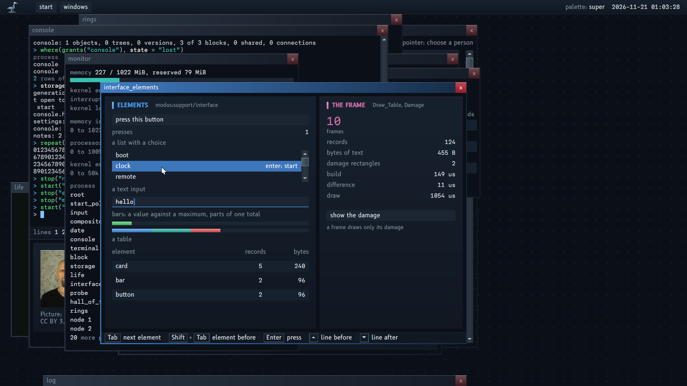

# The interface of the programs

The interface package (`src/library/support/interface`) is the shared logic of the interface of the programs: the draw records, the damage, the layout, the input and focus, and the text. The system draws in software, and this logic is still a foundation of its own. The package takes ideas from `gui_toolkit` and none of its code (section 11).

The terms of this document are in `glossary/desktop.md`: interface package, draw record, draw table, element, element identity, damage by difference, interface state, action bar, keycap.

**The idea in plain words.** A program describes its window again at each frame, as a table of draw records of one size. The package compares that table with the table of the frame before, record by record, and draws only the rectangles that changed. So a program keeps no tree of widgets, and a tool can read, compare or record the table of any frame.

**For whom.** A reader who writes a window, and a reader who changes `src/library/support/interface` or the compositor.

**Read before.** `DESIGN.md` for the look; `FONTS.md` for the text.

**The map of this document.** Section 1: what the programs drew before. Section 2: the model, the draw records and the damage. Sections 3 to 6: layout, input and focus, text, the output. Sections 7 and 8: where the package lives, and property 20 in the compositor. Section 9: the vector font. Sections 10 to 12: decisions, what came from `gui_toolkit`, and the state of the conversions.



## 1. What the programs drew before the package

Before the package, each program drew its window by hand with `src/library/support/graphics`, and repeated the same cards, bars and tables. This section counts that repetition: it is the reason for the package. The counts are those of the day before the package; section 12 gives the state after the conversions.

Counted on 2026-11-11 (`master` `cbe3c0e`) with `grep` over the folders of the programs (then one folder, now in the module groups of `src/modules/`) and `src/library/support/`:

| Fact | Count |
|---|---|
| Programs that draw with `src/library/support/graphics` | 34, with 13 995 lines in all |
| Lines that call a drawing function (`fill`, `text`, `block`, `unsigned`, `character`, ...) | 591 |
| Programs that draw a card or a band of a card by hand | 21 |
| Private copies of the procedure `card` (frame, accent bar, title, caption) | 5: the boot display, the compositor, `remote`, `scheduler`, `server` |
| Private copies of large text (each pixel of the font as a square) | 5: `large` in `remote`, `scheduler`, `terminal`; `write_large` in the boot display and `server` |
| Programs that draw a bar on a track | 15 |
| Programs that draw a table (a header, columns, bands) | 8 |
| Lists with a choice | 3: the menus and the palette of the compositor, `manual`, `errors` |
| Text inputs with a caret | 2: the palette, `terminal` (`console` draws through the terminal) |
| Programs that react to the pointer | 7; to the keys: 9. Each one tests rectangles by hand |
| Programs that track damage | 1: the compositor. Each other program draws its whole surface for each change, and `Present` damages the whole surface |

The developer tool `inspect` is not in this count. It drew a list with a filter and a choice, a band, tables and a hex view, all by hand (section 12 has its conversion).

Without the package, each card, bar, table and list is drawn again in each program, with its own numbers of pixels. A change of the rules (for example the close button, or the colors of the rules) then touches each program.

## 2. The model: an immediate pass over flat tables

**Choice: immediate mode.** Each frame, the program describes its whole window again, in code: `card`, `label_value_line`, `bar`, `button`. Each call appends fixed-size draw records to a draw table that the program owns, and gives back what the input did to that element ("pressed", "has the focus", "the text changed"). There is no tree of objects that lives between frames, no callback, no allocation.

Why, against a retained tree of widgets:

- The state of a window is the state of the program. A retained tree is a second copy of it that must be kept in step, which is the source of most interface faults. In immediate mode, a window cannot show a value that the program does not have.
- The output is data: a table of records of one size, in the memory of the caller (P14). A table can be compared, measured, sent to another rasterizer, or written to a file to test it.
- A retained tree gives damage for free: a node that changed knows its rectangle. Immediate mode loses that. Section 2.2 gives it back without a tree.

### 2.1 Draw record

The draw table is the one 2D interface of the system (`PROPERTIES.md`, "18. One 2D interface: the draw table"). The form of a record is the contract package `src/library/contract/draw_record`: the interface package writes the records, and the drawing module and the compositor read them. The design and the forms that come next are in `src/md/api/draw_table.md`.

A draw record is 48 bytes, little-endian: a header of 24 bytes, then 24 bytes that belong to its kind. The header holds the word of the kind, three reserved bytes, the element identity and the box. The box is four edges in 1/64 pixel (`draw_record.UNITS_PER_PIXEL`): left, top, right and bottom, where the right column and the bottom line are not in the box. The record draws no pixel outside its box, and the box is its damage. The 24 bytes of the fields are one of the layouts below; each byte that the kind does not name is 0.

| Kind | Value | Fields |
|---|---|---|
| `None` | 0 | None: the record draws nothing. The record of zeros is a `None` |
| `Rectangle` | 1 | The color of the box; or a pattern of that color: one cell placed on the surface, its size and the steps across and down, cut to the box |
| `Vertical_Gradient` | 2 | The color of the top line and of the bottom line |
| `Horizontal_Gradient` | 3 | The color of the left column and of the right column |
| `Text` | 4 | A text in the font of the cells, at the top left corner of the box: its range in the text table, its color, its scale (1 to 3) and its weight |
| `Clip` | 5 | None: the next records are cut to the box; a box of no width ends the cut |
| `Picture` | 8 | Its picture memory, its first pixel, its stride and its generation; its size is the size of the box |
| `Text_Grid` | 9 | The range of its cells in the text table and its columns |
| `Line` | 10 | Its two ends on whole pixels, its color, and its thickness (1 to 32) |
| `Interface_Text` | 11 | A text in the interface font: its range in the text table (at most 256 bytes), its color, its origin in 1/64 pixel, its scale and its weight |

```byte-layout draw_record.Draw_Record draw_record.Rectangle_Fields draw_record.Vertical_Gradient_Fields draw_record.Horizontal_Gradient_Fields draw_record.Text_Fields draw_record.Picture_Fields draw_record.Text_Grid_Fields draw_record.Line_Fields draw_record.Interface_Text_Fields
draw_record.Draw_Record, 48 bytes: one record of a draw table
offset  size  field     type
     0     1  kind      u8
     1     3  reserved  [3]u8
     4     4  element   u32
     8     4  left      i32
    12     4  top       i32
    16     4  right     i32
    20     4  bottom    i32
    24    24  fields    [24]u8

draw_record.Rectangle_Fields, 24 bytes: the fields of a Rectangle
offset  size  field        type
     0     4  color        u32
     4     4  cell_x       i32
     8     4  cell_y       i32
    12     2  cell_width   u16
    14     2  cell_height  u16
    16     2  step_x       u16
    18     2  step_y       u16
    20     4  reserved     [4]u8

draw_record.Vertical_Gradient_Fields, 24 bytes: the fields of a Vertical_Gradient
offset  size  field         type
     0     4  top_color     u32
     4     4  bottom_color  u32
     8    16  reserved      [16]u8

draw_record.Horizontal_Gradient_Fields, 24 bytes: the fields of a Horizontal_Gradient
offset  size  field        type
     0     4  left_color   u32
     4     4  right_color  u32
     8    16  reserved     [16]u8

draw_record.Text_Fields, 24 bytes: the fields of a Text
offset  size  field     type
     0     4  first     u32
     4     4  count     u32
     8     4  color     u32
    12     1  scale     u8
    13     1  weight    u8
    14    10  reserved  [10]u8

draw_record.Picture_Fields, 24 bytes: the fields of a Picture
offset  size  field            type
     0     1  memory           u8
     1     3  memory_reserved  [3]u8
     4     4  first            u32
     8     4  stride           u32
    12     4  generation       u32
    16     8  reserved         [8]u8

draw_record.Text_Grid_Fields, 24 bytes: the fields of a Text_Grid
offset  size  field     type
     0     4  first     u32
     4     4  count     u32
     8     4  columns   u32
    12    12  reserved  [12]u8

draw_record.Line_Fields, 24 bytes: the fields of a Line
offset  size  field      type
     0     4  start_x    i32
     4     4  start_y    i32
     8     4  end_x      i32
    12     4  end_y      i32
    16     4  color      u32
    20     1  thickness  u8
    21     3  reserved   [3]u8

draw_record.Interface_Text_Fields, 24 bytes: the fields of an Interface_Text
offset  size  field     type
     0     4  first     u32
     4     4  count     u32
     8     4  color     u32
    12     4  origin_x  i32
    16     1  scale     u8
    17     1  weight    u8
    18     6  reserved  [6]u8
```

- **One border.** `draw_record.read` takes the one copy of a record that the reader made, and gives a `Draw_Primitive`, a union with one record type for each kind, or the problem that refuses the record. Past it, each reader switches on the primitive, whole. `draw_record.record_of` writes the record of a primitive, so the kind of a record always matches its fields. The execution and the difference read each record through the border.
- **What the border refuses**, with its `Problem`: a word of a kind that names no member (`Unknown_Kind`); a reserved byte, or a byte that the kind does not name, that is not 0 (`Reserved_Not_Zero`); a box whose right is left of its left or whose bottom is above its top (`Box_Inverted`); an edge past `COORDINATE_LIMIT` (`Box_Past_Coordinate_Limit`); an edge that is not a whole pixel (`Box_Not_On_Whole_Pixels`); and a field out of its range (`Field_Past_Bound`): a color whose high byte is not 0, a scale out of 1 to 3, a weight that names no member, a thickness out of 1 to 32, an end of a line that is not a whole pixel or is past 32 768 pixels (`LINE_COORDINATE_LIMIT`), a text in the interface font of more than 256 bytes (`INTERFACE_TEXT_LIMIT`), or with an origin off a third of a pixel, left of its box or more than `INK_MARGIN_LIMIT` (16) pixels inside it, and a pattern of a rectangle out of its bounds (below). The words 6 and 7, of the grid of points and the folded gap that left the format, name no kind. The checks run in that order: a record with two faults gives the problem of the first. A refused record draws nothing, and a refused `Clip` leaves the cut as it was. A record that the border reads is canonical: each unused byte and the high byte of each color are 0.
- **What the border does not check**: what a record names in the tables of its frame. The range of a text and of a grid in the text table, and the pixels of a picture in its picture memory, are checked where the table is (`text_of_record`, `grid_of`, `picture_of`), in 64 bits with each factor below 2^32.
- **Whole pixels in this version.** Places are in 1/64 pixel, and no kind of this version draws inside a pixel: the edges of a box and the ends of a line are whole pixels. The one place inside a pixel is the origin of a text in the interface font, on a third of a pixel, the positions of the glyph cache.
- **A rectangle that repeats.** A `Rectangle` with both steps at 0 is its box, and its other fields are 0. With both steps above 0 it is a pattern: a cell of `cell_width` by `cell_height` at (`cell_x` + n × `step_x`, `cell_y` + m × `step_y`) of the surface for each integers n and m, cut to the box. The border refuses one step at 0 and not the other, a size or a place that is not a whole pixel, a cell of no size or larger than its step, a place past `COORDINATE_LIMIT`, and fields of a pattern with both steps at 0. So a pattern reaches each pixel of its box at most once. The pattern is placed on the surface and not on the box: two boxes of one surface, and two damage rectangles, show one pattern, and an element needs no clip to draw a part of it.
- **The look of the system is elements.** The format holds primitives only. `draw_point_grid` (and `background`) writes one `Rectangle` with the pattern `POINT_GRID_PATTERN`: a point of 2 pixels at 12 + 24 n of the surface (`DESIGN.md`, "3. Surfaces"), cut to the area. `draw_folded_gap` writes three records, each with the box of the gap: the track as a `Rectangle`, then two `Line` records of 1 pixel, from the bottom left up to the right, cut to the box as the lines of the gap always were. A gap with an end of a line past `LINE_COORDINATE_LIMIT` has its track and not that line.
- `Clip` sets the rectangle that the next records are cut to, until the next `Clip`; a `Clip` whose box has no width ends the cut.
- **No stack of clips**: a `Clip` replaces the cut, and a `Clip` of no width removes each cut. An element that clips inside an area that is already clipped removes the outer clip. A caller that nests clips writes the intersection itself, and ends with the outer clip again.
- **Places and sizes**: each edge of a record is cut to 2^23 pixels from the corner of the surface (`COORDINATE_LIMIT`), then the size is the difference of the two edges. In 1/64 pixel an edge is then inside 2^29, so the difference of two edges, at most 2^30, fits an `i32`, and so does an edge plus the largest ink margin. A rectangle that covers the surface with places past the `i32` still covers it. A text in the interface font whose box would start past the limit has no record: no surface reaches it.
- **`full` and `refused`**: `full` says that a record, a text or the cells of a grid did not fit in the table. The table is not the frame, so the next frame of that picture is drawn whole. `refused` says that a record could not be made: a picture with a pixel outside each picture memory of the table, a grid whose cells are fewer than its rows, a grid of more than 2^24 cells, or a grid in a text table that does not start at an address that is a multiple of 4. That record is missing, and each other record is in the table, so the difference stays exact.
- **Grids with large numbers**: `grid_valid` divides in place of a product, so a count of rows or a stride near the largest `int` cannot wrap and pass the check.
- **The version** (`DRAW_RECORD_VERSION`, 12) is in the contract, and in the names of the exports of the drawing module. A change of a kind, of a field, or of a bound that changes what a record draws is a new version. The format changes in place: the package, the drawing module and each writer move together.
- The text of a run is in the text table of the draw table, not in the record: a record keeps its size, and two runs with the same bytes compare equal.
- A `Picture` record shows the pixels of a picture of the caller. The program raises its generation when its pixels change; with the same generation the record compares equal and damages nothing. `life`, `paint`, `plasma`, the portraits of `hall_of_fame` and the surfaces of the windows in the compositor are pictures.
- **A picture names its pixels by values.** The draw table holds a list of picture memories (`Draw_Table.picture_memories`): each is one run of pixels of the program. `draw_picture(table, x, y, canvas, generation)` finds the first picture memory that holds each pixel of the canvas, and writes its number, the index of its first pixel and its stride in the record. A canvas with a pixel outside each picture memory is refused. The execution checks a record against its memory (`picture_of`), in 64 bits with each factor below 2^32: a first pixel, a stride or a size that a hostile caller wrote draws nothing when a pixel is past the memory. A record holds no address, so the drawing module draws it (section 7; the design: `src/md/api/picture.md`).
- **A picture in tiles**: a Picture record damages its whole rectangle when its generation changes. A program whose picture changes in one part cuts it in tiles: each tile is a picture of its own over the same pixels (`graphics.view`), with its own record and its own generation, and the program raises the generation of the tiles that it drew in. The difference then damages those tiles only. The program `heron` cuts its stage of 640 by 384 pixels in 240 tiles of 32 by 32, and writes the mean damage of a picture on its log.
- **A frame is shown whole or not at all.** Every surface has two pictures. The program draws the picture that the compositor does not read, `Present` names the picture that is complete, and the next frame is drawn in the other one. A damage rectangle is painted with the background, then its records are drawn: the compositor never reads between the two. The window layer does this for each program, with no code in the program:
  - `window_frame_end` waits until the compositor took the picture before (`display.canvas_wait`), then draws. The wait is on the count of the records that the compositor read from the ring of the window. Its bound is the hang bound, 60 s: after it the frame is left out, with one line on the log, and the window waits no more until the compositor reads again.
  - A program that serves other programs in the thread of its window asks `display.canvas_free` before it builds a frame, and never waits. After a no, `display.wait_events` also ends when the compositor has read. `heron`, `terminal`, `manual`, `remote`, `server`, `log` and `quic_echo` do.
  - A program that draws by hand calls `display.canvas_wait`, draws the whole canvas, then calls `display.present`. A program that draws over the frame of the window layer ends the frame with `window_frame_end_without_present`, draws, then presents.
  - The compositor shows a surface after its first `Present`, and refuses a surface with memory for less than two pictures. It counts the `Present` records that named the picture that it already read: `pictures_drawn_again` in `compositor.windows()`, 0 for each program of the system. It refuses and counts a `Present` whose picture number is not 0 or 1 (`presents_refused`).
  - A program that paces its pictures sends `Picture_Due` with 1 before it waits with a change that it did not draw, and the window layer sends it with 0 after a frame that changed nothing; a `Present` ends it too (`display.picture_due_set`). The compositor gives it as `due` in `compositor.windows()`. A machine test takes no picture while a window has `due` 1 (`TOOLS.md`, "When the tool takes a picture"). The terminal sends it: it draws at most one picture in each 16 ms, and it sends the due state before each wait of its loop, also for a record that came while it drew its last picture.
  - In one turn of its loop the compositor takes from the ring of a window the records that the ring holds at the start of the turn, at most the capacity of the ring (`system.records_of_turn`): a program that writes records with no end does not hold the compositor.
  - One thread of a program owns a window: `display.canvas_wait` and `display.wait_events` of one window are called from one thread.
- A `Text_Grid` record shows a grid of text cells of the caller (`Text_Grid_Cell`: a character, as a code point, reverse, a color; or filled: a character in its color on a cell of a fill color, for a list drawn over text, 16 bytes for each cell). `draw_text_grid` copies the cells into the text table. Its 48 bytes do not change when its cells change: the difference compares the cells (section 2.4).

### 2.2 Damage by difference

The program keeps the draw table of the last frame that it presented (a second table, its own memory). After it builds the table of this frame, `damage_by_difference` compares the two tables, record by record, at the same index:

- Two records at one index are equal if their 48 bytes are equal, except the first byte of the range of a text or a grid, and the bytes of their texts are equal. Nothing is damaged. The equal case is one comparison of the 48 bytes, and of the bytes of a text, with no read through the border: two records with the same bytes draw the same thing, also two refused records, which draw nothing in both frames. Two records whose bytes differ are read through the border: as it keeps each other byte canonical, two records that it reads are then equal only when the first byte of a range moved. A refused record is equal to no record whose bytes differ: both boxes are damaged. A refused line damages its box; in version 10 it damaged nothing.
- If they differ, the rectangle of the old record and the rectangle of the new one are damaged: the old one must be painted over, the new one painted.
- The records after the end of the shorter table are damaged.
- The rectangles merge as in the compositor: rectangles that touch become one; with no room left (`DAMAGE_CAPACITY` 8), a new rectangle joins the first one.

Then `execute_in_rectangles` draws again, in each damage rectangle, each record of the new table that touches it, cut to the rectangle. The program never tracks damage by hand.

- **The limit of the index rule**: a record added in the middle of the table moves all the records after it, and they all compare as different: the damage is too large, never too small. It is right, and it costs only time. An element identity in each record (offset 4) allows a later rule that matches records by identity; the package does not use it.
- **Two pictures**: the picture that the program draws now holds the frame of two frames before. The window layer keeps one table, the table of the last frame that it presented, and for each picture its debt: the rectangles where the picture differs from that table (`Picture_Debts`). A frame draws the changed rectangles and the debt of its picture, and presents the changed rectangles and the debt of the picture on the screen (`damage_of_picture`). After the `Present`, the drawn picture has no debt, and the changed rectangles join the debt of the other one (`picture_debts_after`). The caller gives no table for the second picture. A frame equal to the last table draws and presents nothing. Host test `two_pictures_screen_is_each_frame`: 400 frames of a terminal, with frames that repeat, lost presents and new fonts; after each one the screen is the frame drawn whole.
- **A picture that is not known** (the first frame of each picture, no last table, a last table that was full) is drawn whole. When the picture on the screen is not known, the screen can show records of an older frame where the frame now draws nothing: the present is the whole surface (host test `two_pictures_unknown_shown_picture_presents_all`).
- **A new font**: on `Settings_Changed`, each record stays the same and each pixel of text changes. `window_events` calls `draw_whole_window_next`, which makes the next frame of each picture whole. The terminal and the manual read their events by themselves and call it.
- **A present that is lost**: `display.present_rectangle` gives false when the command ring is full. The canvas stays the same picture, which is then not the last table: its next frame is whole.
- **A frame that is left out**: the compositor did not take the picture before within the bound. Nothing is drawn and no state changes: the next frame is compared with the last frame that was presented. `window_events` then says that an event came when the canvas is free again.
- **Present with a rectangle**: `display.present_rectangle` gives the compositor the union of the damage: the compositor draws again only that part of the window. A full rectangle stays the default of `display.present`.
- **The cost**, measured by the program `interface_elements` on its window of 121 records, the mean of 100 rounds, on a test machine whose host was loaded: nothing changed, 0 rectangles in 2.4 us; one number changed, 3 rectangles in 2.9 us; everything moved, 1 rectangle in 4.4 us. On the host, on one core, with a table of 121 records, the difference takes 1.7 us when nothing changed and 3.6 us when everything moved, against 2.2 us and 4.4 us with the record of version 10: the one copy of a record is six loads of 64 bits (`draw_record.copy_once`), and two records are compared as words. The whole frame is drawn in about 500 us on the same loaded machine. `clock` draws one picture in 93.6 us there.

### 2.3 Memory of the caller, errors as values

- The caller gives the draw table (`records: []Draw_Record`, `text: []u8`) and the interface state. The package never allocates. Its core files make no kernel call; `window_drawing.odin` reads the events of a window and presents its surface.
- **The window memory** (`Window_Memory(RECORDS, TEXT)`, a record of the program) holds the drawing of one window and the memory of its two draw tables: `RECORDS` records and `TEXT` bytes of text in each. `TEXT` is a multiple of 4, so each text table can hold a grid. A frame starts with `window_frame_start(&window_memory, window)`: it gives the drawing its tables, then calls `window_frame_begin`. It draws no background, because the draw of each rectangle starts from the background color; a window with the grid of points calls `background`. The drawing is `window_memory.drawing`: the events, the end of the frame and the measures take it.

```odin
window_memory: interface.Window_Memory(512, 8192)

frame := interface.window_frame_start(&window_memory, window)
// ... the elements of the window ...
interface.window_frame_end(&window_memory.drawing, &frame, window)
```
- On the surface of a program, each damage rectangle is painted with the background before the records draw again (`draw_damage_on_surface`), and a whole frame starts from the background: a record that a frame no longer has leaves no pixel, with no rule for the caller. The compositor draws its panels over other windows, so it draws the records only.
- A table that is full stops taking records and keeps the flag `full`: the frame is drawn without the records that did not fit, the program can test the flag and write it on its log. No element fails in silence.
- An element gives its result as a value (`Element_Result`): pressed, has the focus, changed. Nothing is hidden in a context.

### 2.4 Text grid

A text grid is the element of the terminal: up to 104 x 32 cells, which a program changes many times in one second.

- `draw_text_grid(table, x, y, grid)` copies the cells of the caller into the text table of the frame, row after row with no gap, at a place that is a multiple of 4 bytes. The record holds the place, the bytes and the columns: values only, so the drawing module draws a grid (section 7). The table before keeps the cells in its copy of the text table (`draw_table_copy`). A full grid of the terminal is 104 x 32 cells of 16 bytes, 53,248 bytes, in each text table.
- A text table with a grid starts at an address that is a multiple of 4, as the colors of a cell: the terminal declares its text tables as arrays of 32-bit words. `grid_of` checks a record against its text table, and a record whose cells are not there draws nothing and is damaged whole.
- The difference compares two grid records whose bytes are equal except their places in the text tables, then damages, in each row, the span from the first changed cell to the last one; the rectangles merge as in section 2.2. A grid that changes its size is damaged whole.
- A frame shows the cells at the moment of `draw_text_grid`: a thread that changes the cells after it changes the next frame only.
- The execution draws the cells of one color that follow each other as one text, so the text goes through `graphics.text_scaled` (and the glyph cache of the vector font) once for each run.
- The console draws no pixels: it writes records into its terminal, so the text grid of the terminal is the drawing of the console too.

### 2.5 Line

A `Line` record draws a straight line between two points, with a thickness, in one color: `draw_line(table, from_x, from_y, to_x, to_y, thickness, color)`.

- **The pixels**: the path of `graphics.line` (the line of Bresenham, integers only), with a square of the thickness at each point of the path. An even thickness starts one pixel before the point. The pixels are the same at each build and on each part of the surface: the execution in a damage rectangle walks the same path and cuts the squares.
- **One order**: `draw_line` writes the left end first, or the top end when the two ends have one x. A line and its reverse are one record, so they draw the same pixels and compare equal.
- **The damage**: the box of the record, which `draw_line` makes the rectangle that holds each square of the path (`line_rectangle`). The execution cuts the line to its box, as each record. Pieces of the path would be tighter on a diagonal, but the damage list joins rectangles that touch (section 2.2), and the pieces of one line touch: the list would make them one rectangle again. A diagonal across a window damages its whole bounding rectangle.
- **Hostile values**:
  - A thickness of 0 or less gives no record. A thickness past 32 (`LINE_THICKNESS_LIMIT`) is cut to 32.
  - An end past 32 768 pixels from the corner (`LINE_COORDINATE_LIMIT`) gives no record. A cut end would change the slope, so the record would be another line. The bound exists because the execution walks each point of the path.
  - A record written by hand with a thickness of 0, a thickness past 32, or an end past the bound or inside a pixel is refused by the border: no pixel, and its box is its damage.
  - A line of length 0 is one square of its thickness. A line fully outside the area is cut away like each record.
- **The cost bound**: one execution walks at most 65 537 points and fills at most 32 x 32 pixels for each point inside the area.
- **Limits**: no rounded ends, no antialiasing, no dashes. Lines at an angle are allowed, sparingly (`DESIGN.md`, section 2).
- `draw_outline` appends the border of a rectangle as four rectangles, the same pixels as `graphics.outline`.
- `draw_kind_icon` appends a kind icon (`src/library/support/kind_icons`; `DESIGN.md`, "The icons of the kinds") as rectangles: each cell is a square of the cell size given, 1 pixel in a row of a list, and an icon is at most 20 records. `list_of_rows` draws the icon of each row with it.

### 2.6 Window places

The compositor puts each window on the grid of 8 pixels (`src/library/private/compositor/bar/window_place.odin`, procedures with no state and their host test).

- A window that the pointer drags goes to the nearest point of the grid, then stays where 8 pixels of its title are on the screen, under the bar. At the left, the end of the title is at 8 or more, so the close button is on the screen too. Without that bound, a window dragged past an edge could not come back: the menu of the windows only brings a window to the front.
- A new window that fits stays at the place that the compositor chose, moved up and left until it fits. A window wider than the screen puts its close button at the right of the screen; a drag shows its left part. A window higher than the screen starts under the bar.

## 3. Layout

Layout places the elements of a window. The package has no solver: a program takes rows from a column and splits a row into columns, in one pass, with sizes that it states before it draws. The windows of the system have fixed sizes, so this one pass covers them.

- The unit is the grid of 8 pixels (`DESIGN.md`, section 6). An `Area` is a rectangle of the surface.
- **A column** gives areas from the top of its area to the bottom: `column_take(&column, height)`. The height of a line of text is 16, a line of a table 24.
- **A row** splits an area into columns in one pass: the caller gives the sizes of all the columns before it draws in them, so the row knows each width at once. A size is `Pixels` (a fixed width), `Characters` (a count of characters of the font: the width that the text measure gives) or `Share` (a part of what the fixed sizes leave, in proportion to its value). A gap is between two columns.
- **Alignment**: text is at the left, or at the right of its area (numbers: `DESIGN.md`, section 5), and in the middle of the height of a line.
- **A bar in a table**: `bar_with_value(frame, cell, bar_width, value, maximum, color)` draws the bar of the rules, 10 pixels high in the middle of the line, at the left of a cell, and the value after it in the rest of the cell, cut to it. `crowd`, `disk`, `flow` and `budget` draw their bars with it.
- **One pass.** There is no tree and no constraint solver: what is not known before the row (the width of a text that the program has not made yet) is measured by the caller with `text_width` first. `gui_toolkit` solves sizes in five passes over a tree of boxes (standalone, upward, downward, violations, positions): the windows of this system have fixed sizes, and one pass with sizes declared before content covers each window of section 1.

## 4. Input and focus

The package gives each element its input with no callback: the program passes the events of the frame, and each element returns what happened to it. Only the focus, the element under the pointer and the pressed element live from frame to frame, by the identity of the element.

An example from `interface_elements`: `identity("list")` names its list in each frame, so the list keeps the focus while its rows change.

- The program gives each frame an `Input` record, filled from the `display.Event` records of the frame: the place of the pointer, a press and a release of the left button, and the keys pressed in this frame (at most 16).
- **Element identity**: an element that takes input has an identity, a u64 that the caller makes from a text with `identity("list")` (the 64-bit FNV-1a hash of the text). The identity must stay the same from one frame to the next for one element. Two elements with one text have one identity: `identity_with(base, row)` and `identity_in(parent, name)` make them two, and `Frame.identity_collisions` counts the elements of a frame that repeat an identity (a host test).
- The order of Tab holds 64 elements (`FOCUS_ORDER_CAPACITY`); an element after them takes a press but not Tab, and `Frame.focus_overflow` counts them.
- **The interface state** (`Interface_State`, memory of the caller, 920 bytes: three identities, the order of 64 identities and its count, four fields of the scroll bar that holds the press, and the act names of the last frame, section 4.2) keeps between frames: the element that has the focus, the element under the pointer, the element pressed and not yet released, the order of the elements that can take the focus in the last frame, for a held scroll bar its held part, the place of the pointer on its thumb and the time of its next step, and the element of each act name.
- **The place of a press**: the input keeps where the left button went down (`Input.press_x`, `press_y`) beside the place of the pointer. One frame can hold a press and the moves after it; an element that follows a drag reads the press at its own place.
- **The clock of a frame**: `frame_begin` takes the time of the system in milliseconds (`Frame.time`), and `window_frame_begin` gives it. A held arrow button of a scroll bar repeats by it. A frame with the time 0 has no clock: nothing repeats.
- **The keyboard is a first path**: Tab and Shift+Tab move the focus in the order of the elements of the last frame; Enter and Space press the button that has the focus; up and down move the choice of a list that has the focus; a text input that has the focus takes the characters and Backspace. The palette of the compositor is the model: each thing that the pointer does, a key does.
- **Elements that take no input**: `list_of_rows` and `text_input_line` only draw. Their caller owns the choice, the typed text and the caret, and decides what each key does in a pure procedure of its own (`src/library/private/compositor/palette`, `key_action`): a host test then runs each state with each key, with no frame. `list_of_rows` gets only the rows that its area shows, with the place of the first one in the whole list, so its work is the rows on the screen. A row can have a mark that is the outline of a square, a name in the font of the cells with its own color, and a quiet detail after the name. `text_input_line` draws a line that `src/library/support/line_editor` edits: a caret at any place, at a scale of 1 to 3, and a field with no border, whose fill reaches each edge of its area.
- **The pointer**: an element under the pointer is "under the pointer" (the close button of a window is brighter); a press and a release on one element press it. A press on an element gives it the focus.

### 4.1 The scroll bar

The scroll bar is one element, `scroll_bar` (`src/library/support/interface/scroll_bar.odin`). Each scroll bar of the system is this element, so a change of its look or of its input is one change. Its look is in `DESIGN.md`, "The scroll bar"; its sizes and its colors are the table `src/library/support/graphics/scroll_bar.odin`.

```odin
moved := interface.scroll_bar(&frame, area, interface.identity("lines"), .Vertical, {total = line_count, visible = rows, first = first_line}, {page = rows - 1})
if moved.changed {
	first_line = moved.first
}
```

- **The range** (`Scroll_Range`) is in units of the caller: the units of the whole content, the units that the view shows, and the first unit of the view. The element gives the first unit after the input (`Scroll_Bar_Result.first`); the caller shows it in its next frame.
- **The direction** is `Vertical` or `Horizontal`. A horizontal bar is the vertical one turned: its gradients go from the top down.
- **The area** is 17 pixels thick (`SCROLL_BAR_THICKNESS`) and as long as the view.
- **The steps** (`Scroll_Bar_Steps`): a press on an arrow button moves the view by `line` units (1 by default), a press on the track by `page` units (the units in view by default).
- **The geometry** is a pure procedure, `scroll_bar_geometry(length, thickness, range)`: the places of the arrow buttons, of the track and of the thumb, in pixels along the bar. `scroll_bar_part_at` gives the part at a place, and `scroll_bar_first_at` the first unit for a place of the thumb. Host tests run them with no frame.
- **The gradients** are draw records of the two kinds that exist, `Horizontal_Gradient` and `Vertical_Gradient`, each with two colors. A gradient of three or four stops is one record for each pair of stops; the draw record did not change.
- **The pointer**: the element holds the press on its own. The interface state keeps the held part, so a program keeps no state for its scroll bars. A held thumb follows the pointer outside the bar: the compositor sends the pointer to a window while a button is down.
- **A held arrow button** repeats after 400 ms, then each 60 ms, by the clock of the frame, while the pointer stays on the button.
- **The wheel**: the caller gives the area of its view, the last argument of `scroll_bar` (`view`). When the pointer is over the view or over the bar, each notch of the frame (`Input.wheel`) moves the view by `SCROLL_WHEEL_LINES_PER_NOTCH` (3) lines, and by its height for a view of fewer lines. The first bar of a frame whose view is under the pointer takes the notches (`Scroll_Bar_Result.wheel_taken`): a list over the lines calls its bar before the bar of the lines. A horizontal bar takes no notch. A bar with a name and a view gives its view the element name "<name> view". `list_with_choice` and `list_of_rows` give their whole area as the view.
- **No key and no focus**: a scroll bar is not in the order of Tab. The keys of a view belong to the element that owns the view.
- **A bar that only shows a place**: `scroll_bar_draw(table, area, direction, geometry)` appends the records with no input. `list_of_rows` uses it for a caller that does not name the scroll bar.
- **The scroll bar of `list_of_rows`**: the caller owns the choice and the view, and gives only the rows that the area shows. With `List_Rows_Options.scroll_bar` (an identity) the scroll bar of the list is the element, and `List_Rows_Options.scrolled` gets its result; the caller gives the rows from `scrolled.first` in its next frame. The palette does this, and moves its choice into the new view.
- **A list that another program owns**: the completion list of a terminal is the list of the program that writes in it. Its scroll bar is the element in the terminal; the terminal sends the first row that the pointer asks for to the program (`terminal.Input.List_First`), one time for each row, and the program sends the rows of its new view.
- **The pointer shape** over a scroll bar is the arrow. The element has no window, so a program whose surface has another shape asks for the arrow while the pointer is over a scroll bar or holds one, and for its shape again after (`POINTERS.md`, "The request of a program").
- **A program that draws only after a change** has two procedures. `scroll_bar_wants_frame(state, input, area, element, view)` says if a pointer event needs a frame: the pointer is over the bar, the bar holds the press, the last frame drew the bar lit, or the wheel turned over the view. When it says no for an event with notches, the program removes them from the input: a notch over no view moves nothing at a later frame. `window_scroll_bar_wake(drawing)` gives the time of the next step of a held arrow button: the program ends its wait there.
- **The pointer that leaves**: the compositor sends a window one pointer event more when the pointer leaves its surface, with a place outside it, and one when another window takes the front. The bar then draws at rest. Without that event a bar at the edge of a window stays lit.
- **The record count**: 24 records at rest, 28 when the whole bar is lit.

| Where | Range | Pointer |
|---|---|---|
| The lines of a terminal | The lines kept, the rows of the window | Yes: the view stays where the bar puts it, as after Page Up |
| The completion list of a terminal | The names of the program, the rows shown | Yes: the terminal asks the program that owns the list for the first row, and the choice of the program follows its view |
| The text of `manual` | The rows of the page, the rows of the window | Yes |
| `list_with_choice` | The lines, the lines in view | Yes: the bar moves the choice, which the view follows |
| `list_of_rows` | The rows, the rows in view | When the caller names the scroll bar: the caller moves its view |
| The palette: the entries, and the candidates of a form | The rows, the 12 rows of the panel | Yes: the view moves, and the choice goes to the nearest row that the view shows |

### 4.2 Act names

An element can name what it acts on: its act name (`glossary/desktop.md`), a text of at most 32 bytes such as `settings.set:font`. A palette entry that does the same thing has the same act name, so the palette offers to go to the element (`DESIGN.md`, "Palette"). A program writes no code for go to: it names an element when it builds it.

- **The call**: `element_act_name(frame, element, "settings.set:font")`, in each frame that draws the element, with its element identity. The first element of a frame with one act name keeps it: the program names the element that go to must reach. `settings` names the button of the value in use of each setting, `scheduler` the tile of the strategy in use (`strategy`).
- **The bounds**: a frame keeps 6 act names (`display.ACT_NAME_SET_CAPACITY`). An empty name, a name of more than 32 bytes and a name past the six are counted in `Frame.act_names_dropped`; the window layer writes one line for the life of the window.
- **The set to the compositor**: at the end of each frame the window layer compares the hashes of the act names of the frame (`display.act_name_hash`, FNV-1a of 64 bits, never 0) with the set that the compositor has. When they differ, it sends one record `display.Command.Act_Names` on the ring of the window: a count, then at most 6 hashes. A record holds 7 values, so the set travels as hashes. A full ring sends nothing, and the next frame tries again. The compositor checks the record, keeps the set with the window, and drops it with the window.
- **Go to**: the compositor raises the window and sends it the event `display.Event_Kind.Go_To` with the hash. `window_events` gives the focus to the element of the last frame that named it (`focus_by_act_name`), and writes "interface: settings: the focus is on the element of settings.set:grid_fit". The event counts as an event: the program draws the next frame, which shows the focus.
- **What a window cannot do**: it names an act, never a rectangle. A window that names an act that it does not have gets the palette to raise it, and its window layer finds no element; it cannot point at another window.

### 4.3 Element names

An element can have an element name (`glossary/desktop.md`), a text of at most 32 bytes such as `frame 0`: a machine test presses the element by it, not at a place that the scenario computes (`TOOLS.md`, "How a step presses an element").

- **The names that come alone**: a button is named by its label, a text input by its placeholder. A scroll bar that the caller names (the last argument of `scroll_bar`, or `List_Rows_Options.scroll_bar_name`) names its arrow buttons "<name> arrow up" and "<name> arrow down", or "arrow left" and "arrow right"; its thumb has no name, because it moves each time the content grows.
- **The call**: `element_name(frame, area, "frame 0")`, in each frame that draws the element, with the area where it takes a press. The first element of a frame with a name keeps it.
- **The bounds**: a frame keeps 64 element names (`ELEMENT_PLACE_CAPACITY`). An empty name, a name of more than 32 bytes (`ELEMENT_NAME_CAPACITY`) and a name past the 64 are counted in `Frame.element_places.dropped`; the window layer writes one line for the life of the window.
- **The element lines**: after each frame that it draws, the window layer compares the names and the rectangles of the frame with the set that the log has from the window. A new name or a moved rectangle writes "interface: debugger_window: the element watch at x,y,width,height", in pixels of the surface; a name that left the frame writes "interface: debugger_window: the element watch is gone". A frame with no change writes no line. The compositor writes the lines of the palette the same way, in pixels of the screen (`element_places_publish`).
- **What an element name is not**: it travels to no other program and gives no access. The palette does not read it; an act name stays the name that go to reads.

### 4.4 The action bar

The action bar (`glossary/desktop.md`) is the band at the bottom of a window that names its keys: `action_bar` (`src/library/support/interface/action_bar.odin`). Each window that lists its keys uses it. Its look is in `DESIGN.md`, "The action bar"; the design and the refused forms are in `src/md/features/action_bar.md`.

```odin
// A procedure: an item is made by a call, and a freestanding program runs
// no call before its entry.
bar_items :: proc "contextless" () -> [2]interface.Action_Bar_Item {
	return {interface.action_bar_item("back", 4, "Backspace"), interface.action_bar_item("link before", 2, "Shift", "Tab")}
}
bar: interface.Action_Bar_State

frame := interface.window_frame_start(&window_memory, window)
interface.action_bar_input_take(&frame, &bar) // First: the keys of the list, and a press on the bar.
// ... the elements of the window ...
items := bar_items()
result := interface.action_bar(&frame, {0, HEIGHT - interface.ACTION_BAR_ROW_HEIGHT, WIDTH, interface.ACTION_BAR_ROW_HEIGHT}, items[:], &bar) // Last: the list opens over them.
interface.window_frame_end(&window_memory.drawing, &frame, window)
if result.ran {
	interface.input_key_add(&window_memory.drawing.input, result.run) // The key goes the way of a typed key.
}
```

- **An item** (`Action_Bar_Item`): the faces of the keycaps of one combination (at most 3), the name of the action, and a priority. `action_bar_item(name, priority, faces..)` makes one: it copies the faces into the fixed array of the item, and drops a face past the third. A program writes its items in a procedure that returns them, and calls it where it draws the bar: a global array of items would need a call before the entry. A face is a key name (`Enter`, `Tab`, `Esc`, `Backspace`, `Delete`, `Space`, `Home`, `End`, `Up`, `Down`, `Left`, `Right`, `Page Up`, `Page Down`), a modifier before it (`Shift`, `Ctrl`), or one printable ASCII character. The name of the action is the element name of the item (section 4.3).
- **A press gives the key.** `action_bar_key_of` derives the key of an item from its faces: the code, the character that the keyboard layout gives (`'\n'` for Enter, `'\t'` for Tab, 8 for Backspace), and the modifiers. A face of one character gives the character with the code 0: compare the character. A face that names no key (`1-6`) gives an item that takes no press. `Action_Bar_Result.run` holds the key that a press, or Enter in the list, ran. A program with `window_events` adds it to the input of its next frame (`input_key_add`) and builds that frame; a program that reads its keys runs it through its own procedure for a key.
- **The overflow** (`Action_Bar_Options.overflow`). `More`, the default: one row; when the items do not fit, a button `more` ends the row and items leave it, the lowest priority first and, of two with one priority, the later one first. `Wrap`: two rows in the order of the items, then the list for the rest; the caller gives the bar two rows (`ACTION_BAR_WRAP_ROWS`) always. `notes` wraps.
- **The alignment** (`Action_Bar_Options.alignment`). `Right` puts the items against the right edge: a bar at the right of a text that changes keeps its items in place, so their element lines do not change at each frame (the terminal, `tally`, `rings`, `unlock`, `paint`).
- **The list** opens upward over the content, its right edge on the right edge of the bar, never above `Action_Bar_Options.top`. The rows that the room does not hold are not shown: `Action_Bar_Result.list_rows_not_shown` counts them. While it is open: Up and Down choose a row, Enter runs it, Escape closes the list, another key closes it and stays for the program, a press on a row runs it, and a press outside it closes it and does nothing else.
- **The state** (`Action_Bar_State`) is memory of the program, one for each bar: the list, its chosen row, the keys of its rows, the places of the last frame, the held press. The interface state does not hold it.
- **The order of a frame.** `action_bar_input_take` comes right after the frame begins: it takes the keys of an open list, and hides from the elements the press while the list is open or on the bar, the release of a press that the bar holds, and the pointer over the bar or the list. `action_bar` comes last, so that its list is over the content.
- **A program that reads its keys** (`manual`, the terminal, `notes`, `unlock`, `tally`, `rings`, `paint`) gives each key to `action_bar_key` first, and acts on it when the result says that the bar did not take it. It does not act on a press for which `action_bar_takes_pointer` says yes. When it draws only after a change, `action_bar_wants_frame` says if a pointer event needs a frame.
- **The measure** is a pure procedure, `action_bar_layout(table, area, items, options)`: the box of each item, the items of the list, the box of the button. `action_bar_list_place` gives the place of the list. Host tests run them with no frame (`action_bar_test.odin`).

| Window | Items | Overflow |
|---|---|---|
| `interface_elements` | Tab, Shift+Tab, Enter, Up, Down | All in one row |
| The debugger window | 14 with a program attached; 2 with none | The list: detach has the lowest priority |
| `manual` | 10 | The list: the keys that move the text, which the scroll bar moves too, go first |
| `notes` | 5 | Wrap |
| The terminal | Page Up, Page Down | At the right of the line count |
| `settings` | Tab, Shift+Tab, Enter | All in one row |
| `unlock` | Enter, and Escape in the modes that clear | At the right of a fact of the mode |
| `tally`, `rings`, `paint` | Space; a and 1-6; c | At the right of the counts, of what the pointer does, of the calls |

## 5. Text

A program asks for a font and a scale, measures a text, and writes a text record; the package and `src/library/support/graphics` draw it. Two fonts exist: the font of the cells (monospace, 8 x 16) for values, and the interface font (proportional) for the words that name and explain (`docs/FONTS.md`).

- **The interface of the text** is two functions and one record: `Font` (`kind`, `scale`), `text_width(font, text) -> pixels` and the records `Text` and `Interface_Text` of section 2.1, with a scale (1, 2 or 3) and, for an `Interface_Text`, an origin in 1/64 pixel on a third of a pixel.
- **The font of the system** (`docs/FONTS.md`): the vector font by default, from the glyph cache that the root service maps, with a coverage for each subpixel band; Spleen 8x16 as the fallback and as the other value of the setting `font`. Both are monospace on cells of 8 x 16, so `text_width` and the layout do not change with the setting, and a `Text` record of the cells stays on whole pixels. `execute` draws a text record with `graphics.text_scaled`: the package does not know which font draws.
- **A change of the setting** comes as the display event `Settings_Changed`: `window_events` marks the window as not drawn, and the next frame draws it whole (each draw record is the same, each pixel of text is not).
- **The interface font** (`docs/FONTS.md`, section 12): the second `kind`, `Interface`, beside `Cells_8x16`. A `Draw_Table` names the interface font of its program (`interface_font`: the caches that `display` validated at `open`; `nil`: none); `window_frame_begin` sets it, so a program that draws its window with the package takes it with no change of its code. A table that a program builds itself (the compositor, the measures) has none unless the program names it.
- **A text is measured in the font that draws it**: `font_in_use` gives the font of a text of a table: the interface font only when the table has it, the setting is the vector font, and the text has at most 256 bytes; else the font of the cells. `text_measured_width`, `texts_measure` (many texts in one call: the lines of a list), `measured_size` (a column of a row, rounded up to the grid of 8) and `text_fit` (the longest start of a text that fits a room) all go through it.
- **Which element takes which font** (the rule of `DESIGN.md`, section 5): a text that names or explains takes the interface font: the title (bold) and the caption of a card, the label of `label_value_line`, the name of a button, the lines, the hint and the empty text of a list, the titles of a table, the placeholder of a text input. A value keeps the font of the cells: the count of a card, the value of `label_value_line`, `cell_text` unless the caller names a font, the typed text of a text input, `large_number`, the text grid. Each element of one line cuts each text to its box with `text_fit`, in either font; a text that the reader has at no other place takes more lines ("The text in a box").
- **The damage of an interface text**: its record rectangle is its measured box grown by its ink margin, so the difference damages every pixel that it drew, and the execution of a damage rectangle draws again each record that touches it, in order, so an overlap of two neighbours is drawn as in the whole frame. The host test `damage_of_interface_text_equals_the_whole_frame` compares 200 pairs of frames, byte for byte.

### The text in a box

A text of a window has a box: a place and a width. No text passes its box, no text is drawn over another text, and no text loses a part in silence.

- **A text that is wider than its box goes on more lines.** `text_wrap_line(table, font, text, room)` gives the first line of a text in a box of `room` pixels, and the text after it. `text_wrapped_line_count` gives the count of the lines. `draw_text_wrapped(table, x, y, room, text, color, font)` appends each line, one line height under the line before, and gives the count.
- **Where a line ends**, in this order:
  1. at the last space that fits; the spaces at the break are in neither line;
  2. when the last word of the line is wider than the whole box (a path, a place in a source, a long name), after its last `/`, `:` or `_` that fits: the word starts on the line of the word before it;
  3. when the word has no such character, after its last character that fits.
- **No byte is lost.** The lines of a text, joined, are the text without the spaces at the breaks. A line has at least one character, so a box narrower than a character still shows the text, one character on each line.
- **The box grows, or the list scrolls.** The caller gives the box the height of its lines: a row of a list has the height of the lines of its name, a case has the height of its sentence. When the rows are higher than the window, the window shows them on pages or scrolls, and a card that cannot show each row ends with a line that counts the rows that it does not show and names where the reader finds them. A row is never drawn in part.
- **`label_value_lines(frame, column, label, value, value_x)`** is the element of a name and a value that both take the lines that they need: it takes its height from the column, and the next row starts under it. `label_value_line` stays the element of one line.
- **`case_lines(frame, column, index, text, answer, answer_x, ...)`** is the row of a table of cases: what a program asked and the answer that it got, both in the font of the cells, over a band on every second case. Both elements give `drawn`: false for a row that is past the bottom of its column, of which nothing is drawn. **`cases_rest_line`** then writes the count of the cases that the window does not show, and where the reader finds them.
- **A window that draws with `src/library/support/graphics`** (`tables`, `server`, `log`, `pages`, the boot display) uses the same rule: `text_wrap_line` needs no draw table for a text in the font of the cells, and the window draws each line itself.
- **A cut is allowed only where the whole text is at another place of the same window or in the answer of a command that the window names**: the title and the caption of a card, the name of a button, the start of a hash. A sentence of an error record, a path and a measure are never cut.
- **A text from a place of a fixed size** ends with the cut mark of the writer (`docs/ARCHITECTURE.md`, "A text is never cut in silence") when the place is too small: the window shows the mark, on the lines that it needs.
- The host tests of `src/library/support/interface` check the rule: `a_line_ends_at_the_last_space_that_fits`, `a_path_longer_than_the_box_breaks_after_a_separator`, `no_line_passes_its_box_and_no_byte_is_lost` (seven texts at each width from 1 to 130 characters), `a_box_narrower_than_a_character_ends`, `draw_text_wrapped_places_each_line_under_the_line_before`, `label_value_lines_takes_the_lines_of_its_longest_text`, `a_row_past_the_bottom_of_its_column_is_not_drawn_in_part`, `case_lines_has_a_band_as_high_as_its_answer` and `cases_rest_line_counts_the_cases_with_no_room`.

The windows that follow the rule:

- `manual`: the names of the list of the modules, each fact and each signature of a page, the name column of the table of all the modules.
- `errors`: each sentence, and pages made from the heights of the cases.
- `inspect`: the names of the list, the modules, the threads and each frame of a stop report.
- `fetch`, `net`, `imports`: a table of cases with `case_lines`; the answer starts after the longest text of a case.
- `tables`: each answer in the box of its column; the card of the hostile cases takes the room over the card of the measures and counts the cases that it cannot show.
- `log`: each text whole, the records of one text joined; the name of the program and the channel in their columns.
- `server`: the target of a request in its column, on the lines that it needs; a target longer than its record ends with the cut mark.
- `pages`: each column as wide as its longest text.
- The boot display and the window of `boot`: a fact of the card of the machine on the lines that it needs (the name of the processor).
- `notes`, `quic_echo`, `return_fault`, `fault_ring`, `extended_state`, `interface_font`.

A window with its borders fits the screen of 1024 by 768 pixels: at most 1000 pixels wide, and at most 708 high under the bar and its title.

## 6. The output and its execution

The draw table is the whole output of a frame. Execution turns it into pixels in the canvas of the program, either whole or only in the damage rectangles; both give the same pixels.

- `execute(table, canvas)` draws each record into a canvas of the program (its surface), in order: `Rectangle` is a `fill`, `Vertical_Gradient` is the `block` of the rules, `Horizontal_Gradient` is the `gradient` row of the title bar, `Text` is the font of the system.
- `execute_in_rectangles(table, canvas, rectangles)` draws, for each rectangle, the records that touch it, cut to it.
- **The one 2D interface** (`PROPERTIES.md`, "18. One 2D interface: the draw table"): the draw table is the 2D interface of the system, for the windows and the compositor. Its rationalised form (a header and the fields of one kind, 1/64 pixel, colors with alpha and one blending rule, paths, a clip stack) is designed in `src/md/api/draw_table.md`, and its steps are in `ROADMAP.md`.
- **A later back end** (WebGPU, when a GPU exists): the same table is the input of a GPU pass: one instance for each record, the text from the glyph caches, the clip as a scissor rectangle (`src/md/api/draw_table.md`, "The execution"). The format has no pointer and no field that only the processor can read.

## 7. Where it lives: the elements in each program, the drawing in a module

Shared code in this system is a module, loaded once and named by its hash. The interface package is cut in two parts. The part that a window calls a few times for each frame, the difference and the draw of each damage rectangle, is the drawing module, which the programs import. The part that a window calls 30 to 200 times for each frame, the elements, the layout and the input, stays compiled into each program. This section weighs the two forms, gives the reason of the cut, and states the border of the drawing module.

Two forms were weighed:

| | A module with exports (P10) | A package of `support` |
|---|---|---|
| Code pages | One copy, shared by hash by each program that imports it (P11) | One copy in each program; the hash of each program changes with the package |
| The cost of a call | 3.9 ns through an import slot (measured by the program `imports`); about 200 element calls for one frame: under 1 us | 0: a direct call, often inlined |
| What the call passes | Must be described by the module contract (section 5 of `MODULE_CONTRACT.md`) | Any Odin type |
| A replacement of the module | Each program takes a new version with no new build (Replacement of an import) | Each program is built again |

The module is the right form: the interface is shared code, as P10 and P11 say. The calls of the interface pass tables of the caller (the draw table, the rows of a list, the columns of a row), so the description of an export must describe a table as a parameter (`MODULE_CONTRACT.md`, "Tables and bytes as parameters"). Passing an address as an Integer works in a direct call and means nothing in an isolated call: it breaks the contract.

**The choice**: a cut, not "one package, one module". `src/library/support/interface` is written as a module would be: each function takes the tables of the caller and fixed-size records, no global state, no callback. The cut follows the count of the calls and the size of the code:

| Part | Calls for one frame | Where it is | Why |
|---|---|---|---|
| The difference of two draw tables, the execution of a draw table, the pictures, the text of the cells and of the interface font, the blends | 1 for the difference, then 1 for the draw of all the damage rectangles: 2 | The drawing module, `src/modules/libraries/drawing` | Three procedures hold most of the bytes (the execution with the blends and the glyphs inlined in it, the draw of a glyph, the difference): about 20 KiB in each program. A border crossed 2 times for a frame costs nothing that a frame can show |
| The elements, the layout, the input, the measure of a text, the draw table | 30 to 200 | Each program, compiled in | They take a `^Frame` (three addresses) and slices, which a description cannot carry, and they are small and often inlined. One element call through an adapter costs about 100 ns more (below) |

**The drawing module** (`glossary/desktop.md`, "Drawing module"; `MODULE_CONTRACT.md`, "A library as a module"). Two exports, each with an error record:

| Export | Parameters | Result |
|---|---|---|
| `damage_of_draw_table_12` | `before: Table(Draw_Record, Read)`, `before_text: Bytes(Read)`, `now: Table(Draw_Record, Read)`, `now_text: Bytes(Read)` | `Table(Damage_Rectangle)`: at most 8 rectangles |
| `execute_draw_table_in_rectangles_12` | `now: Table(Draw_Record, Read)`, `now_text: Bytes(Read)`, `picture_memory: Bytes(Read)`, `pixels: Bytes(Change)`, `canvas: Canvas_Shape`, `rectangles: Table(Damage_Rectangle, Read)` | Integer: 0 |

- **No copy.** In a direct call each parameter is one word of the call form (a register, or a word of the stack past the sixth) with an address of memory of the program. The two draw tables and their texts are table places over the memory that the program gave to its `Window_Drawing`. The rectangles of the damage are written by the module into the `Damage` of the program: a `Rectangle` of the package and a `Damage_Rectangle` of the module have one layout, four integers of 64 bits. The pixels are `Bytes(Change)` over the surface memory of the window, which the compositor maps too: the module writes them in place. The picture memory is `Bytes(Read)` over the one picture memory of the draw table, empty when the table has none: a Picture record of memory 0 reads its pixels there, in place.
- **The rectangles of a frame in one call.** `Canvas_Shape` is a record of five integers: the width, the height and the stride of the canvas, whether each rectangle is painted with a background first, and the color of that background. `rectangles` is a table of at most 8 rectangles, the most that the damage of a frame has: the module copies the count and the rectangles before it draws, and refuses more with `Too_Long`. For each rectangle in the order of the table, the module paints the background when the shape asks for it, then draws the records that touch the rectangle, cut to it: the pixels are those of one call for each rectangle, also where two rectangles overlap. The window layer calls the draw one time for a frame, with its damage rectangles; with no rectangle, the call draws nothing (the design: `src/md/api/picture.md`).
- **Why bytes and not a handle for the surface.** A lent handle makes the callee map the memory object at each call. The program has the surface mapped already, and a direct call runs in its address space: the address is enough. An isolated caller still has a form: `Bytes(Change)` in a lent memory object (`MODULE_CONTRACT.md`, "Tables and bytes as parameters", form (iii)).
- **The frame before** is the table `before` of the window, which the window layer keeps and copies after each present. The module keeps nothing from one call to the next.
- **The version in the names.** The 12 is `DRAW_RECORD_VERSION`. The name of the draw export also says its form, "in rectangles": a change of the parameters changes the name, so a module with the old form fails the load by name, before the check of the descriptions. The check of a replacement compares descriptions, and two versions of the draw record can have the same fields with another meaning of a value. With the version in the name of each export, a module for another version has no export with the name that the importer binds, and the load fails. A constant check in the module and in the package stops the build when the version changes and the names do not.
- **The errors.** An export fails with -1 and its error record: `Too_Long` of a table over 2^40 records or bytes, `Too_Long` of a table of more than 8 rectangles, `Bad_Value` of a canvas shape with a width or a height below 1 or a stride below the width, `Too_Small` of pixels that do not hold the shape of the canvas, `Bad_Address` of pixels or of a picture memory at an address that is not a multiple of 4. A refused draw draws nothing. A record that is wrong draws nothing and makes no fault, as in the package. The window layer draws the next frame whole after a refused call, and keeps the record in `Window_Drawing.module_error`.
- **Memory (property 14).** The module allocates nothing and keeps no address of the caller after a call. Its own data is a cache of a fixed size, 29 KiB, one copy for each program (the loader gives each program its own copy of the writable data of a module): the choice of the font, the glyph caches of the program as validated records, the interface font, the table of square roots and the blend tables. The glyph caches themselves are resources of the boot image that the starter maps read-only: the module holds their validated headers, not their bytes.
- **The settings.** The module loads the text settings at its first draw, from the context of the program, with the code of `src/library/support/display` (`text_settings_load`), and writes no line on the log: the program validated the same caches when it opened its window. It reads the choice of the settings page again at each draw, so a change of the font or of the order of the stripes reaches the next frame with no message. The program still draws that frame whole (`Settings_Changed`). A draw reads the choice one time for all its rectangles, so a window draws all the rectangles of one frame in one font. The compositor makes one call for each part of its screen, so a change between two calls can draw two parts of one frame in two fonts; the next frame is whole.
- **One thread of a program draws at a time.** One thread at a time calls `execute_draw_table_in_rectangles_12`: it is the rule of the text state of `src/library/support/graphics`, which changes between two frames, and each window has one loop that draws. The module takes no lock and waits for no thread: the load at the first draw, the choice of the settings at each draw, and the blend tables are written with no guard. A program that draws from two threads at once can show a text in the wrong font or with wrong colors, and can fault when a setting changes at that moment; all of it stays inside that program, which has its own copy of the data of the module. `damage_of_draw_table_12` reads no text state: any thread can call it. The threads of `processors`, `threads` and `workers` write the pixels of their pictures with the graphics package compiled in, and only the thread of the window calls the module.
- **A refused call is on the log one time.** When the module refuses a difference or a draw, the window layer writes one line for the life of the window, in the channel `programs`, as a warning: the export, the cause in words and the kind and the argument of the error record, for example "interface: the drawing module refused execute_draw_table_in_rectangles_12: the frame has pictures in more than one picture memory, and one call of the module draws one". A refused difference draws each frame whole; a refused draw presents nothing.
- **The first frame of a new appearance is on the log.** When the window layer presents a frame in another appearance than the frame before, it writes one line in the channel `programs`, for example "interface: monitor: a frame in the light appearance". The first frame of a window writes none. A machine test waits for this line before it takes a picture of the window in the new appearance (`src/md/features/appearance.md`).
- **A direct call is not a border of trust.** The checks of the module and of the package protect a correct caller from a wrong count or a wrong record: no fault and no write outside the pixels. The area, the counts and the rectangles are read one time. A draw record and a pixel of a picture are plain reads. A caller that changes its tables during the call reaches only its own memory: the module runs in its address space, with the rights of that program.
- **Grids.** A Text_Grid record names its cells by values in the text table, so the two exports read them in the text that they take already: no new parameter (section 2.4; the design: `src/md/api/text_grid.md`). A full terminal is 3,328 cells and up to 3,328 runs of one color in one frame; through the text table it crosses the border 2 times for a frame, whatever the count of runs.
- **One picture memory for each call.** A Picture record of another memory than 0 draws nothing. The window layer refuses a frame with more than one picture memory in a program that draws through the module.

**The window layer** (`src/library/support/interface/window_drawing.odin`). `window_frame_end` has one path. It calls `frame_difference`, then `frame_draw`, which are the package or the two exports: the build setting `DRAWING_THROUGH_MODULE` chooses, and the module table of the modus tool sets it for each program that imports the module. A whole frame and a frame with damage draw the same way: each rectangle is painted with the background, then the records that touch it are drawn. `Window_Drawing.module_calls` counts the calls of an export: for a frame with damage, 1 for the difference and 1 for the draw of all the rectangles that the picture draws; 1 for a whole frame or a frame with no change. With the setting, the package has two procedures over the exports for a program with no window layer: `difference_through_module`, one call for the damage of two tables, and `draw_part_through_module`, one call that draws a run of records of a table in up to 8 rectangles, with one picture memory, with or without the fill of the background.

**The compositor.** Each surface is a memory object of another program, mapped at its own address: a picture memory of its own. The screen table is in parts: one for each window (its frame, then its surface), then one for the bar and its menus (with the heron). A Picture record of a part names memory 0 of the list of its part. A frame is one call of `draw_part_through_module` for each window whose outer rectangle meets a damage rectangle, from the back to the front, with the damage rectangles that it meets, then one for the bar and one for the palette when it is open. The compositor copies its background into each rectangle first, so the calls do not fill it; it draws the pointer after the last call, then copies each rectangle, with the debt of the hidden screen page, into the screen page that the display does not show, and flips (`src/md/infrastructure/whole_frame.md`, "The screen: two screen pages and a page flip"). The damage rectangles of the compositor never touch, so these phases give the pixels of one rectangle after the other. The canvas of each call is the whole frame, so the records stay in the coordinates of the screen. With 17 windows, a frame of 8 damage rectangles makes at most 18 calls, where one call for each rectangle made 144. The difference of the palette is `difference_through_module`. The design: `src/md/api/picture.md`, "The compositor: one call for each part".

**Which programs import it.** 34 programs with the setting: `budget`, `clock`, `compositor`, `crowd`, `cryptography_vectors`, `debugger_window`, `disk`, `extended_state`, `flow`, `frames`, `hall_of_fame`, `heron`, `inspect`, `life`, `limits`, `locks`, `manual`, `monitor`, `net`, `notes`, `origin`, `paint`, `plasma`, `processors`, `quic_echo`, `randomness`, `remote`, `rights`, `rings`, `scheduler`, `terminal`, `threads`, `unlock` and `workers`. `interface_through_module` imports it too, and calls the exports itself. The programs that keep the package compiled in, and why:

| Programs | Why |
|---|---|
| `interface_elements`, `pointers` | They call the execution of the package themselves |
| `interface_font`, `settings`, `vector_glyphs` | They draw text with `src/library/support/graphics` themselves: they keep the text code and its state |
| `address_space`, `errors`, `fault_ring`, `kernel_events`, `return_fault` | Each starts a child of its own file with no load source: the loader of the child would not find the import |
| `imports`, `tally` | `imports` is the test of the loader and counts its own imports; other programs load `tally` as a library |
| `root`, the boot program, `host` | They import nothing: the kernel starts the root service with no loader for imports, the boot program is not a module, and the call host loads the module of a call |

**The proof of the same pixels.** A picture of the whole screen cannot prove it: the hash of each converted program changes, and the screen shows hashes and times. The proof compares the bytes of a canvas:

- The host test `the_exports_draw_the_same_bytes_as_the_package` (`src/modules/libraries/drawing`) builds 24 pairs of frames with a record of each kind that the module draws, two pictures of one picture memory among them, in 7 font states (Spleen, the vector font and the interface font, each order of the stripes). It draws each frame with the package as a window drew it before the module (the clear and the execution of the whole frame, then the difference and the draw of the damage) and through the two exports with the argument forms of a caller. The damage rectangles are equal, and the two canvases are the same bytes after the whole frame and after the damage. In a host test the two ways share one text state: the test proves the border, the fill and the rectangles.
- The host test `the_exports_draw_a_text_grid_as_the_package` builds 24 pairs of frames of a terminal of 40 x 12 cells, in the font of the cells and in the vector font: runs of one color, empty cells at the end of a line, reverse cells, a completion list of filled cells with its border drawn after the grid. The frame now changes some cells, and a status of another length moves the cells in the text table. The damage rectangles and the bytes are equal, as above.
- The host test `a_scrolling_grid_in_two_pictures_is_each_frame` draws 600 frames of a terminal that scrolls by no line, a few lines, more than its rows and many thousand lines, through the two exports into the two pictures of a surface, as the window layer does: the difference with the last table that was presented, the draw of the changed rectangles and of the debt of the picture, a screen that takes each presented rectangle. One Present in 16 is lost, one frame in 50 has a new font, the bars of the head move the grid record in the table, and a thumb moves at places that are not on the rows. After each frame the picture and the screen are the frame drawn whole.
- The host test `the_parts_of_a_screen_draw_the_same_bytes_as_the_package` builds 24 screens of 4 windows that overlap, each with its surface in a memory of its own, and a bar with a heron in one more memory, over a background. The package draws the whole table with the list of all the memories in each of 6 rectangles; the export draws one part for each call, with the one memory of the part, as the compositor does. The two canvases are the same bytes after each rectangle.
- The program `interface_through_module` draws one frame two times in the machine: with the package compiled in, which draws with the text state that the program loaded, and through the drawing module, which draws with the text state that the module loaded. It compares the bytes and writes "the same bytes: as it must". This proves that the two copies of the code chose the same fonts from the same context.

**The elements as a module: the test of the claim** (`MODULE_CONTRACT.md`, "Tables and bytes as parameters"): the module `interface_module` has six exports that call the element functions of the package with no change to the package: the draw table is a `Table(Draw_Record, Append)`, the text table `Bytes(Append)`, an area a Record, the area of the content of a card a `Table(Area, Change)` of one row. The program `interface_through_module` imports it, builds one frame through it and the same frame with the package compiled in: the two draw tables are equal, record for record. Where the claim does not hold exactly: (1) the calls are not the same calls: a function of the package takes a `^Frame` (three addresses: the table, the state, the input), which a description cannot carry; an export takes the two tables and the records of its element, and makes a frame over them for one call. (2) The record `Draw_Record` has fields of 1 and 4 bytes: the description has Integer fields of 1, 2 and 4 bytes for them. (3) The elements that take input (a button, a list, a text input) keep the interface state of the program between frames: as exports they need the state as a `Table(Interface_State, Change)` of one row; this is not done. Measured (the program `interface_through_module`, QEMU with KVM, one run, the least of 200 builds): one frame of 31 draw records in 25 element calls took 6 556 ns through the module and 4 055 ns with the package compiled in: about 100 ns more for each element call. A call through an import slot costs 2.4 ns (the program `imports`): the rest is the adapter, which builds each element into a frame of its own and appends it to the tables of the caller. This cost is the reason why the elements stay in the program.

**Measures of the cut.** Two programs, `clock` and `monitor`, built two times, with the package and with the two calls through a module (QEMU with KVM, one run each, other work on the host):

| | Package compiled in | Through the module |
|---|---|---|
| The file of `clock` | 92 112 bytes | 72 864 bytes (-21 %) |
| The file of `monitor` | 114 688 bytes | 94 208 bytes (-18 %) |
| `clock`, one picture, the mean of 10 | 29.1 us | 34.1 us |
| `clock`, the draw of 34 records in 1 damage rectangle | 16.3 us | 17.7 us |

Two runs of the same code differed by 30 % on the draw time (12.6 and 16.3 us): the difference between the two columns is inside that spread. The sizes of this build are a line of the modus tool at each build ("the library module drawing has ... bytes; the files of the ... modules that import it have ... bytes in all"), with the size of each importer. The window of `clock` prints its build, difference and draw times, and `heron` writes the mean draw time of a picture of an asked animation on its log: each is a measure, and no test asserts them. The files of seven programs that show a picture, with the package compiled in: `heron` 147 456 bytes, `life` 100 924, `paint` 106 496, `plasma` 77 824, `processors` 90 112, `threads` 81 920, `workers` 86 016; the drawing module had 49 152 bytes.

## 8. Property 20 and the compositor

- The package draws only into the canvas that the caller gives: a program draws only into its own surface. The package has no handle and makes no kernel call (P20: no ambient access).
- The compositor is a user of the same package: its palette is built as a draw table, executed into its frame, and damaged by difference as each program's window is.

## 9. Text: a vector font, research note and prototype

This section is the research behind the vector font. The system draws a vector font by default, with subpixel bands, and Spleen 8x16 as the fallback. The built design is in `docs/FONTS.md`: a rasterizer in fixed point and a glyph cache made at build time. The prototype below (floating point, no cache) is replaced.

### What Slug does

Slug (Eric Lengyel, JCGT 6(2), 2017, <https://jcgt.org/published/0006/02/02/>) draws a glyph from its quadratic Bézier curves in the pixel shader, with no bitmap. For each pixel, it casts a horizontal and a vertical ray, finds where each ray crosses each curve of the glyph (the roots of a quadratic, with a robust classification of the end points so that no pixel drops or sparkles), and takes the coverage of the pixel from the signed distances of the crossings: an antialiased edge that is exact at any scale and under any transform. To keep the work small, the glyph is cut into horizontal and vertical bands, and each band lists only the curves that touch it, sorted so that the shader stops early. Since 2019, "dynamic dilation" grows the box of each glyph by half a pixel on the screen in the vertex shader.

### Its state today (verified on 2026-11-11)

- **Patent**: US 10,373,352 (granted 2019, to 2038). On 2026-03-17 its author filed USPTO form SB/43 and paid the fee to disclaim the rest of its term, "permanently and irrevocably dedicating the Slug patent to the public domain" (<https://terathon.com/blog/decade-slug.html>, "Patent Announcement"; also <https://blog.adafruit.com/2026/03/22/slugs-out-the-algorithm-that-made-text-look-perfect-is-now-free-or-how-to-give-away-a-patent/>). Google Patents still shows the patent as "Active": that site does not show the disclaimer of 2026; this is the state of an aggregator, not a contrary fact. The USPTO record itself was not read.
- **Reference code**: <https://github.com/EricLengyel/Slug>, shaders "freely used by anyone for any purpose"; a distributed program must give credit. One reader names the license MIT or Apache-2.0 (<https://luv.swa.sh/slug-bezier.html>); GitHub shows "Other". The system copies no code: the ideas are free to use.
- `gui_toolkit` has a Slug path on the GPU (`docs/text.md`, "Slug"), with stem darkening, hinting for small sizes and coverage per color stripe; its note `slug-small-text.md` says that Slug text at 11 to 16 pixels looks softer than hinted bitmaps, and that closer to the reference is not the same as sharper.

### What it means for this system

- This system draws with the processor (property 18: the draw table, drawn on the processor). Slug is a GPU method: the bands and the root solvers save work for thousands of pixels in parallel. On the processor, the same exact coverage comes cheaper from a scanline rasterizer: each line segment of the outline adds its signed area to an accumulation row, and one prefix sum gives the coverage of each pixel (the method of font-rs and of stb_truetype 2). The quadratic curves are cut into line segments within a tolerance.
- **The prototype** (`src/library/support/vector_font`, the program `vector_glyphs`): a parser of a subset of TrueType (`head`, `hhea`, `maxp`, `cmap` format 4, `hmtx`, `loca`, `glyf` with simple glyphs) that checks each offset and each count against the length of the file (a font is hostile input); a rasterizer with exact area coverage, a horizontal position in 1/64 of a pixel, and an option of coverage per color stripe (three samples per pixel, then the 5-tap filter 8, 77, 86, 77, 8 / 256 against color fringes).
- **The measures**: one glyph of Spleen 8x16, 32 ns; one glyph of 13 pixels from its outline, 2939 ns in grayscale, 2396 ns on a whole pixel, 5502 ns with color stripes: about 90 times more, with no cache of the coverage of a glyph. The program `vector_glyphs` showed the same text in the two fonts, and one glyph enlarged 8 times in grayscale and with color stripes; it draws the candidate fonts now (the picture `font_candidates`).
- **What the picture shows**: at 13 pixels the outline font has the shapes of its design and even spaces (an advance of 7.8 pixels), and its stems are softer than the stems of Spleen, which sit on whole pixels; the color stripes give sharper sides with faint colors at the edges. Spleen is sharper at its one size.
- **The font**: a font needs a license that allows embedding in a program of the system. Candidates: DejaVu Sans Mono (Bitstream Vera license, DejaVu changes in the public domain; TrueType outlines), Noto Sans and Noto Sans Mono, Inter, IBM Plex, JetBrains Mono, Source Code Pro (SIL Open Font License 1.1: embedding allowed, no sale of the font alone). The prototype uses DejaVu Sans Mono, a monospace font like Spleen, with its license beside it.
- **The rules**: a vector font keeps the grid: one size for the text of the interface (a cap height that is a whole number of pixels, as the reference of Slug advises), a large size for the one number of a card; the line height stays 16 or 24.

## 10. The decisions of this design

1. The model: immediate mode over draw tables, damage by difference (sections 2 and 2.2).
2. The form: a `support` package, and a module when the contract describes a table as a parameter (section 7).
3. The font: a vector font by default, subpixel bands, Spleen as the fallback. The open decisions (the font file, the grid fit) are in `docs/FONTS.md`, section 11.
4. The memory of a window: one record of the program, `Window_Memory`, in `interface` and not in `display`, because `display` does not import `interface` (section 2.3). A global record cannot hold slices of itself before the program runs, so `window_frame_start` gives the drawing its tables at each frame: the same slices each time, with no state that says whether they were given. A first form gave them once, at the first frame, when the tables were empty; it was refused, because it was a second state of the start in each program, and it replaced the whole drawing, so an event that came before the first frame was lost. The start draws no background: the draw of each rectangle starts from the background color, so a rectangle of that color over the window draws no pixel.

## 11. What was taken from `gui_toolkit`, and what was not

`gui_toolkit` (MIT license, 2026) was read for ideas. No code was copied.

Taken as ideas:

- **Immediate mode with a state kept by identity** (its `Box` with a `Key`, from the RAD Debugger): elements are described again at each frame, and only the focus, the element under the pointer and the pressed element live between frames, by identity.
- **Signals as a value** (its `Signal`: pressed, clicked, focused, ...): here `Element_Result`.
- **Damage is never negotiable for correctness** (its `damage.odin`: "a partial frame must be byte-for-byte identical to the full frame", with a verify mode that draws both): here the host tests compare a frame drawn in its damage rectangles with the same frame drawn whole.
- **A bounded list of damage rectangles that merge** (its `MAX_DAMAGE_RECTS` 16): here 8, as the compositor.
- **The keyboard is a first path** (Enter and Space press, as its `clicked`).
- **Text measured by the font, drawn from runs** (its `draw.glyph_run`): here the text record with a subpixel position, ready for a vector font.

Refused:

- **The damage given by the application** (its `damage_add` that the program calls): here the package computes it by difference, so a program cannot forget a rectangle.
- **The layout solver of five passes over a tree** (sizes by text, percent, sum of children, violations): one pass with sizes declared before content (section 3).
- **Floating point, transforms, round corners, shadows, themes** (its `draw` layer): the rules of this system are integer rectangles on a grid.
- **Allocation by the toolkit** (its frame allocator and maps): the caller gives each table.
- **A font stack of a host system** (DirectWrite, Fontations, HarfRust): the system has its own font.

## 12. State of the conversions

Most programs now draw their window with the package. This section lists the invariants that the host tests hold, each converted program with its counts before and after, what the pictures showed, and the programs that are not converted.

### Invariants and what holds them

| Invariant | Where | What holds it |
|---|---|---|
| `line_add` of the vector font writes no cell past its row, also for a vertical segment on the last column and a coverage of width 1 | `src/library/support/vector_font/raster.odin:34`: `if start_y == end_y \|\| target.width < 2 { return }`; line 60: `if left_index < 0 \|\| left_index + 1 >= target.width \|\| right_index >= target.width` before the clamp | Host test `segments_at_the_edges_stay_in_their_rows` |
| A `Present` for the whole surface with a place of its own damages nothing past the window | `src/modules/system/compositor/main.odin:317-318`: `changed_width, changed_height := client.surface.width - left, client.surface.height - top` | The compositor does not run on the host: no host test. The rectangle stays inside the surface in each case by its two lines; the machine test draws each window |
| A text input takes Enter in the order of its keys, not before the characters of the same frame, and stops there | `element_interact` takes no Enter for a text input | Host test `text_input_keys_in_their_order` (keys `l s Enter x` give "ls", activated, `x` not taken) |
| A key past 16 in one frame is not dropped | `window_events` stops when the input has 16 keys; the other events wait in the ring | Host test `a_full_input_says_so` (the reading itself needs a ring: no host test of it) |
| A frame drawn in its damage rectangles equals the same frame drawn whole, for each kind | The partial-frame test covers a clip that changes, horizontal gradients, text at the scales 1 to 3, records outside the surface, records of one line, more than 8 rectangles (the merge), a full table, pictures | Host tests `damage_is_never_too_small_for_each_kind`, `picture_and_folded_gap`, `the_grid_of_points_is_a_pattern_with_the_same_pixels`, `the_folded_gap_is_three_records_with_the_same_pixels` |
| A number with more than 20 digits indexes no place before `digits` | `min(minimum_digits, 20)` | Host test `number_with_many_digits` |
| A negative height of a column does not make `used` smaller | `top + max(height, 0)` | Host test `column_negative_height` |
| `row_split` checks its sizes | Negative sizes are 0, fixed sizes are cut, each column stays in the row, no overflow | Host test `row_split_checks_its_sizes` |
| A press under the last line or on the bar of a list chooses no line; a cut choice is reported | The list | Host test `list_press_and_cut_choice` |
| Tab in the palette does not move the focus | `palette.key_action` gives no action for Tab | Host test `each_key_in_each_state` of `src/library/private/compositor/palette` |
| Two elements with one text get two identities; elements past 64 are counted | `identity_in` and `identity_with`; `Frame.identity_collisions` and `Frame.focus_overflow` count them; section 4 says the limit | Host test `identity_collision` |
| `draw_text_right` keeps the element; an `int` is not cut to `i32` with no check | The element passes; each place and size is clamped to `i32` | Host test `coordinates_are_cut_to_i32` |
| The core files make no kernel call | `draw_table.odin` and the other core files; `window_drawing.odin` reads events and presents (section 2.3) | Read |
| A table that does not cover its surface leaves no stale pixel | Each damage rectangle of a surface is painted with the background first (`draw_damage_on_surface`), a whole frame starts from the background, with no rule for the caller | Host test `a_gone_record_leaves_no_pixel` |
| Names are complete words | `raster.odin`: `start_x`, `signed_height`, `width_inverse`, `first_x`, ...; `parse.odin`: `start_read`, `end_read`, `glyph_bytes`; `vector_glyphs`: `pixel_x`, `pixel_y`; `bar`: `full_width`; the palette: `first_row`, `matched_count`. The TrueType tags stay | Read |

The package has 49 host tests (45 in `src/library/support/interface/interface_test.odin`, 4 in `interface_font_test.odin`), and `src/library/support/vector_font` has 27.

### The converted windows

"Calls" are the direct drawing calls of `src/library/support/graphics` (`fill`, `text`, `block`, `unsigned`, `character`, `clear`, `line`, `outline`) in the program before the conversion (`859f078`) and after. "Module" is the size of the module file, in bytes, on `master` `c909390` and after the conversions: the package is compiled in each program.

| Program | Calls before | Calls after | Module before | Module after |
|---|---|---|---|---|
| inspect | 58 | 0 | 81 920 | 90 112 |
| scheduler | 50 | 0 | 61 440 | 73 728 |
| monitor | 29 | 0 | 49 152 | 61 440 |
| locks | 20 | 0 | 86 016 | 98 304 |
| disk | 19 | 0 | 35 284 | 45 124 |
| limits | 17 | 0 | 28 129 | 42 225 |
| crowd | 15 | 0 | 28 672 | 45 056 |
| tally | 15 | 0 | 36 864 | 49 152 |
| flow | 13 | 0 | 28 672 | 40 960 |
| budget | 12 | 0 | 28 672 | 40 960 |
| notes | 12 | 0 | 53 248 | 65 536 |
| errors | 11 | 0 | 134 113 | 144 609 |
| rights | 11 | 0 | 24 576 | 40 960 |
| frames | 11 | 0 | 73 728 | 90 112 |
| imports | 11 | 0 | 81 920 | 94 208 |
| net | 10 | 0 | 50 179 | 64 515 |
| origin | 10 | 0 | 24 576 | 40 960 |
| manual | 10 | 0 | 114 688 | 126 976 |
| life | 2 | 2 (its own board picture, by design: the Picture record) | 32 768 | 51 148 |
| clock, remote, the palette | 32, 31, 48 lines | 0 | | |
| Sum of the 19 programs above | 346 | 2 | | |

- Each converted module grows by 8 to 16 KiB (2 to 4 pages): the package is in each one. `processors`, which is not converted, grows by 4 KiB from the measure of pictures of `display`. This is the measured argument for the package as one shared module (section 7): about 230 KiB in all for these programs, today paid once for each.
- The boot image: 3 284 753 bytes on `master` `c909390`, 3 566 097 bytes with the conversions (+281 344).
- Lines: in the 19 programs, 865 lines added and 494 removed (+371), against 1 242 lines of the package (and 537 of its host tests). A conversion replaces each drawing call by one record and adds the tables of the program and the frame: it does not make the programs shorter. It removes the five private copies of `card` and of large text in the converted programs, it gives each window the damage by difference and the keyboard, and one change of the rules now changes every converted window.
- The times of the pictures are not published: the host had a load of 17 to 62 during each run of the conversions, and a measure above a load of 8 is not valid. `modustool measure windows` (in the form of `modustool measure scheduler N`) starts each converted window alone in a measure build and prints one table of the time of the first picture and of the mean of 3 and of 10, with the load of the host. It needs a quiet host. To measure "before", run the same command on the commit "display measures the time of a picture" (the programs before the conversion with the marks of the measure).

### What the pictures of the conversions show

- `inspect`: a card cuts its caption to the room between its title and its count (host test `card_caption_stays_inside`), so the caption "Program_Report" of the narrow SLOTS card does not touch its right border. The columns "weight" and "req us" of the threads have room, so they do not read as one.
- `scheduler`, `locks`, `manual`, `life`: no fault seen.
- `limits`, `crowd`, `origin`, `rights`, `disk`, `notes`: no clipped text and no column out of place. `crowd`: its header "kernel entries, one million records" ends 8 pixels from the right edge of the window. `notes`: an empty band between its status line and its keys.

### The layers of the conversion

Each layer is a commit that passed the main scenario; the last one passed the full check (789 checks).

| Layer | Direct drawing calls before / after | Module before / after (bytes) | What holds it |
|---|---|---|---|
| The compositor: its windows (frame records and the surface as a Picture record), its bar and its two menus (cards) in one draw table for each frame | 42 / 7 (the pointer, the points of the background, the copy to the screen) | 125 723 / 121 979 | The main scenario (menus, moves, close buttons); one measure run: the frame of a window of 800 x 600 by hand 8.5 us, as 9 records 8.9 us (load 39 to 63: an indication only) |
| The boot display: its five cards are the card of the package | the card by hand / `interface.card` | `boot` 69 632 / 77 824, `root` 172 032 / 180 224 | The pictures `boot`, `boot_fails`; the UEFI loader builds with the package (no kernel call in the core files) |
| `paint`, `plasma`: Picture records (`interface.show_picture` for one picture) | paint 13 / 5, plasma 0 / 0: the remaining calls draw into the picture of the program, by design | paint 45 056 / 61 440, plasma 24 576 / 45 056 | The picture `desktop_moved` |
| The text grid (section 2.4) and `terminal` | terminal 29 / 0 | 49 152 / 65 536 | Host tests `text_grid_damage_for_each_cell`, `text_grid_records_of_a_hostile_caller`, `text_grid_draws_its_cells`, `the_exports_draw_a_text_grid_as_the_package`, `two_pictures_present_what_the_screen_shows`, `two_pictures_screen_is_each_frame`; the pictures `terminal`, `terminal_held`, `terminal_keys`, `terminal_stopped` |
| Window places on the grid of 8 | | | The compositor places each new window and each moved window with its corner on the grid; the scenarios move windows with steps `Move`; the tool reads places from `compositor.windows()` once it has the grant acts_for_principal; the full check |

- Sizes are on `master` `b97fb08` against the layers; the boot image is 5 338 592 bytes against 5 531 104 (+192 512).
- With these layers, the package grew by 401 lines (with 3 host tests and 1 simulation); the 16 changed files gained 844 lines and lost 273.
- `flood`, lines in one second, as the terminal logs them: 3 492 315 before the text grid (load about 50), 4 651 133, 3 567 351 and 2 429 679 after (loads 15 to 23). Each is above a load of 8, so none is a valid measure; the text grid did not make the console slower in these runs. A frame of the terminal now draws only the rows that changed.
- With two pictures, a frame presents its difference with its own picture and its difference with the picture that the screen shows. The screen shows the other picture: with the first difference alone, rows of two frames mix on the screen (in `terminal.png`, a row half of one line and half of another). The rule and a simulation of the screen are in section 2.2.
- The pictures of these layers: `desktop_moved` (plasma, paint, life, monitor on the grid), `boot`, `rings`, `terminal`, `terminal_held`, `terminal_stopped`, `menu`, `windows`. A fact of the boot display, such as the processor name, is cut after its last whole word, not in the middle of a word. The keys hint of the terminal is left out when the text at its left takes its room, so it does not run over "older than the lines kept". The pictures show no other clipped text and no misaligned column.

### Lines and shared pictures

- `rings` draws its rings with `Line` records and its nodes with `draw_outline`: 0 direct drawing calls (19 before).
- `threads`, `workers` and `processors` keep the pixels that their threads compute in a picture of the program, in the memory that the threads share. The window shows it with a `Picture` record. For `threads`, the generation of a square is the frame count of its thread. For `workers` and `processors`, the generation is the number of the picture times 1024, plus its complete tiles or rows. Direct drawing calls after the change:
  - `threads`: 1 (9 before), the clear of each square picture to the background at the start.
  - `workers`: 1 (21 before), the clear of its picture at the start.
  - `processors`: 2 (22 before), the clear of its picture at the start and at each new picture.
  - Each of these calls draws into a picture of the program, not into the surface. The threads write the pixels of the picture directly: that is the subject of these programs.
- A frame of these windows copies the picture only when its generation changed. A picture can be copied while a thread writes it, as before when the threads wrote into the surface. The next generation copies it again.
- `crowd`: the window ends 12 pixels after its widest header, the same margin as at the left, and the header stays in its column.
- `notes`: its keys are an action bar that wraps on two rows at the bottom (section 4.4). The window is 324 pixels high.

### Not converted, and why

- `server`, `tables`: they draw with `src/library/support/graphics` and take the rule of the text box from the package ("The text in a box"). `fetch` is converted: its window is a table of cases.
- `console`: it draws no pixels; its terminal draws it (section 2.4).
- `log`, `pages`: a layout of their own; they draw with `src/library/support/graphics`, in its tokens. `twin` and `fault` have no window.
- The pointer of the compositor.
