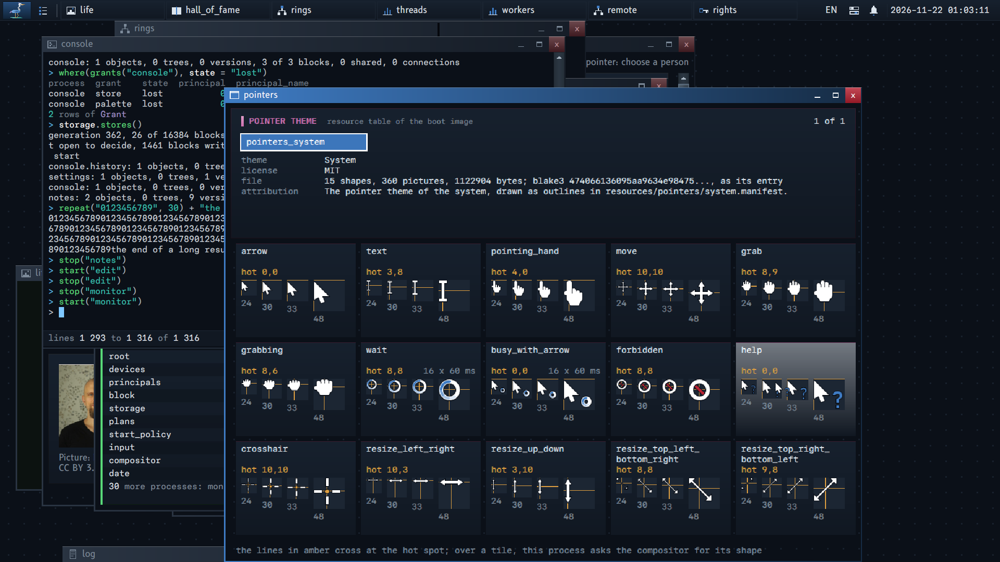

# Pointer pictures

The system has its own format for the pictures of the pointer, simple to manage and to package. A text manifest describes each theme, and the modus tool packages it into one binary file. The tool imports, converts and adjusts the pointer theme "Posy's Cursor" from its Xcursor files.

The terms are in `glossary/desktop.md`: pointer, pointer shape, pointer picture, hot spot, nominal size, pointer theme, pointer theme file, pointer manifest, resource, caret. The system says "pointer", never "cursor". The caret of a text input is another thing.

**The idea in plain words.** The pointer is the small picture that follows the mouse. It changes with what is under it: an arrow over the desktop, a hand over a button, a text bar over a text. Each of these is a **pointer shape**. A **pointer theme** gives one **pointer picture** for each shape, at one or more sizes, with a **hot spot**: the pixel of the picture that points. The whole path is short:

1. A **pointer manifest** in the repository names the shapes of a theme and where their pictures come from.
2. At each build, the modus tool reads the manifest and writes one **pointer theme file**.
3. The boot image holds the file as a resource. The root service checks its hash and maps it read-only into the compositor.
4. The compositor validates the file once, chooses the shape from what is under the pointer, and blends its picture at the place of the pointer.

**What this is not.** A process never sends a picture of a pointer: it names a shape, and the compositor draws its own theme. A pointer theme file is not parsed at run time: the compositor reads it in place.

**For whom.** A reader who makes or changes a pointer theme, and a reader who wants to know how the compositor chooses and draws the pointer.

**The map of this guide.** "1. What exists" compares Xcursor, hyprcursor and the others. "2. What this system needs" gives the pointer shapes, the request of a process, and how the compositor chooses and draws the pointer. "3. The format of the system: one pointer theme file" and "4. The manifest" give the two formats. "5. The two themes", "6. The license of the Posy theme" and "7. The place of the Posy theme" say what the system carries. "8. Measures" closes.

**An example.** The compositor chooses the shape `move` while the pointer drags a window by its title bar, and blends its picture at its hot spot. The process `pointers` shows each shape of each theme.



## 1. What exists

### The Xcursor format (X11, and Wayland compositors that read X themes)

Source: the manual page `Xcursor(3)` of libXcursor (x.org, read on 2026-11-11), and the files of `posy-cursors` 1.6 read by the tool. All numbers are 32-bit little-endian.

- **File header**: `magic` "Xcur", `header` (16), `version` (0x10000), `ntoc`, then `ntoc` entries of the table of contents: `type`, `subtype`, `position` (an absolute byte offset).
- **Image chunk** (type 0xFFFD0002): `header` (36), `type`, `subtype` (the nominal size), `version` (1), `width`, `height` (each at most 0x7FFF), `xhot` and `yhot` (at most the width and the height), `delay` (milliseconds to the next frame), then `width * height` pixels, each 0xAARRGGBB with premultiplied alpha.
- **Comment chunk** (type 0xFFFE0001): subtype 1 copyright, 2 license, 3 other; a length and UTF-8 bytes. The Posy files have none.
- **Several sizes** in one file: one image chunk for each nominal size. **An animation**: several image chunks of one nominal size, in order, each with its delay.
- **Names and aliases**: a theme is a folder `cursors/` with one file for each name. Aliases are symbolic links. In `posy-cursors` 1.6, `Posy_Cursor/cursors` has 122 names: 17 files and 105 links, some through another link (`no-drop` to `cross` to `precise`). Each file has the nominal sizes 32, 48, 64, 96 and 128 (`watch` and `background`: 77 frames of 33 ms at 32, 48, 64 and 96: 5 MB each).
- **The names**: the freedesktop "cursor naming" draft lists the CSS names (`default`, `pointer`, `text`, `wait`, `progress`, `not-allowed`, `ew-resize`, ...) and the old X names (`left_ptr`, `xterm`, `watch`, `fleur`, ...) and hashes of X bitmaps (`9d800788f1b08800ae810202380a0822`). A theme gives each name as a link to its few real files.

### Windows `.cur` and `.ani`

- `.cur` is the `.ico` container with type 2: a directory of images, each a BMP or a PNG, and the two fields that `.ico` uses for the planes and the bits per pixel hold the hot spot.
- `.ani` is a RIFF file "ACON": an `anih` header (the count of frames and steps, a default rate in 1/60 s), an optional `rate` and `seq ` table, and a `LIST fram` of `.cur` images. Posy made the theme for Windows first; the Linux port converted it with `win2xcur`.

### hyprcursor (Hyprland)

Read on 2026-11-11 (`hyprwm/hyprcursor`, `README.md` and `docs/MAKING_THEMES.md`):

- A theme is a folder with `manifest.hl` (`name`, `description`, `version`, `cursors_directory`) and one folder for each shape, packed as a zip file (`.hlc`). Each shape has `meta.hl`: `resize_algorithm` (bilinear, nearest, none), `hotspot_x` and `hotspot_y` as fractions from 0 to 1 of the size, `define_override` (the other names of the shape, as the links of Xcursor), and `define_size = 32, image32.png` (one line for each size; several lines of one size with a delay in ms make an animation). The pictures are PNG or SVG, square. The `.hl` files are hyprlang; TOML is the other form.
- The library needs hyprlang, cairo, libzip, librsvg and tomlplusplus. Its gain over Xcursor is size (PNG compression: 44.1 MB to 6.6 MB for one theme) and scaling (SVG).

What this system takes from it, and what not:

- **Not as the format that the compositor reads.** At run time it needs a zip reader, an inflate and PNG decoder, an SVG rasterizer and a hyprlang parser in the compositor: four parsers of input that the compositor must not trust, against the rule of this format "no parse at run time" and against section 7 of `DESIGN.md`. The pointer theme file of section 3 is read in place after one validation. Its size is not a problem here: the Posy theme at 32 and 64 is 883 008 bytes, the boot image holds it once.
- **As the model of the manifest.** The manifest of section 4 is the same idea as `meta.hl`, in one file for the theme: the sizes, the names that a shape takes from other names (the sources, in order), the frames with a delay, the hot spot. It differs in two places: the hot spot is in pixels of the smallest size (a fraction of the size gives a pixel only after a rounding), and an outline in the manifest is a source of its own, in place of an SVG file.
- **Not as a source of the tool.** Posy's Cursor exists as Xcursor files and as Windows files, not as hyprcursor. A reader of `.hlc` files in the tool needs zip and PNG (the Odin library has an inflate and a PNG reader, no zip reader). That reader is not built: the tool reads Xcursor files and outlines only.

### The Wayland cursor shape protocol (`cursor-shape-v1`, wayland-protocols 1.48)

- A client does not send pictures. It names a shape from an enum of 34 CSS names (36 in version 2: `dnd_ask`, `all_resize`), and the compositor draws its own theme.
- The request carries the serial of the latest `wl_pointer.enter`: a client sets the shape only while the pointer is over its surface. This system takes the same rule (property 20).

## 2. What this system needs

### The pointer shapes

One enum of the system, `Pointer_Shape` in `src/library/modus/contract/pointer_pictures`, with one long name for each. Zero is the arrow: a zero record asks for the default (ZII). The CSS names are the sources in the manifest of the Posy theme. The name of a shape in a manifest and on the log is the name of this table (`SHAPE_NAMES`).

| Number | Name | CSS name | Where the system uses it today |
|---|---|---|---|
| 0 | `arrow` | `default` | the desktop, the bar, the frame of a window, a surface by default; a scroll bar, also in the window of a terminal and in the palette |
| 1 | `text` | `text` | the input band of the palette; the text of the terminal (a request of the process `terminal`) |
| 2 | `pointing_hand` | `pointer` | the close button of a window, the buttons of the bar, a line of an open menu, an entry of the palette and a candidate of its form |
| 3 | `move` | `move` | a title bar, and a window while the pointer moves it |
| 4 | `grab` | `grab` | a request of a process |
| 5 | `grabbing` | `grabbing` | a request of a process |
| 6 | `wait` | `wait` | a request of a process; animated |
| 7 | `busy_with_arrow` | `progress` | a request of a process; animated |
| 8 | `forbidden` | `not-allowed` | a request of a process |
| 9 | `help` | `help` | a request of a process |
| 10 | `crosshair` | `crosshair` | a request of a process |
| 11 | `resize_left_right` | `ew-resize` | the left or right edge of a resizable window; a request of a process |
| 12 | `resize_up_down` | `ns-resize` | the top or bottom edge of a resizable window; a request of a process |
| 13 | `resize_top_left_bottom_right` | `nwse-resize` | the top left or bottom right corner of a resizable window; a request of a process |
| 14 | `resize_top_right_bottom_left` | `nesw-resize` | the top right or bottom left corner of a resizable window; a request of a process |

Not taken: the CSS names that no part of the system has a use for (`context-menu`, `cell`, `vertical-text`, `alias`, `copy`, `no-drop`, the eight single-side resizes, `all-scroll`, `zoom-in`, `zoom-out`). A new name is a new number at the end of the enum.

### The request of a process

A process asks for a pointer shape with the display command `Pointer_Shape` (`src/library/modus/display`, `display.pointer_shape_set`):

```odin
display.pointer_shape_set(&window, .Text)
```

- The compositor keeps one shape for each surface. The shape of a new surface is the arrow, and a shape stays until the next request.
- It shows that shape only while the pointer is over that surface and the surface is the one in front at that place. A process does not change the pointer over another process, the bar or a frame: the pointer tells the principal what a press does, so a process that sets it elsewhere can lie about another process.
- A number out of the enum is ignored.
- The compositor writes one line on the log for each request: `compositor: <title> asks for the pointer shape text over its surface`.

Two processes ask today: `terminal` and `pointers` (the shape of the tile under the pointer).

**A surface with two shapes.** A surface has one shape at a time, and its process changes it when the pointer crosses a part that needs another one. The process `terminal` asks for `text` over its text, and for `arrow` while the pointer is over one of its scroll bars (the lines, the completion list) or while a scroll bar holds the press: a scroll bar is a control, not text. It asks only when the shape changes, so the log has one line for each crossing. The compositor shows the new shape after it read the request: for one frame the pointer can have the shape of before.

### How the compositor chooses the shape

`pointer_shape_under` (`src/modules/system/compositor/pointer_picture.odin`) gives the shape for the place of the pointer. The first rule that holds wins:

1. While the pointer drags a window: `move`.
2. While the palette is open: `text` over its input band, `pointing_hand` over an entry of its list and over a candidate of its form, `arrow` elsewhere, also over the scroll bar of the list.
3. Over a line of an open menu, or over a button of the bar: `pointing_hand`.
4. Over the rest of the bar: `arrow`.
5. Over the window in front at that place: `pointing_hand` over its close button, `move` over its title bar, the shape that its process asked for over its surface, `arrow` over its border.
6. Over the desktop: `arrow`.

### How the compositor draws the pointer

- **The size.** The compositor asks for 24 logical pixels (`POINTER_NOMINAL_SIZE`) at the scale of the desktop, in pixels of the screen: 30 at 1.25, 33 at 1.375. `pointer_pictures.choose` gives the smallest size of the shape that is at least the size asked, else its largest size: 30 or 33 for the theme of the system, 32 or 48 for the Posy theme. The hot spot is drawn at the pixel of the screen of the logical place of the pointer.
- **The form.** A theme can hold a dark form, for a dark desktop, and a light form, for a light desktop (section 3). The compositor takes the form of the appearance in force (`pointer_form_in_force` in `src/modules/system/compositor/pointer_picture.odin`), and writes `compositor: the pointer form in use: light` on the log at each change. It reads the appearance in force from the settings page (`appearance_in_force`), so the pointer changes its form at the next frame, also when the rule of the day changes the appearance with no new setting. `compositor.pointer()` gives the form on the screen in its field `form`. A theme with one form gives it for both.
- **A shape that the theme does not have** is drawn as the arrow. Every valid theme has the arrow.
- **The place.** The picture is drawn with its hot spot at the place of the pointer: its top left corner is the place less the hot spot. A press acts at the place of the pointer.
- **The blend.** `graphics.blend_premultiplied_alpha` blends the picture over the frame (`docs/SIMD.md`, "4. The compositor").
- **An animation.** `choose` gives the frame for the time now and the time of the next frame. The compositor wakes at that time, and only while the animated shape shows.
- **The damage.** When the picture or its place changes, the compositor damages the old rectangle and the new one, so only these pixels are drawn again.
- **No valid theme.** A compositor with no valid pointer theme file draws an arrow of squares that its own code holds (`pointer_arrow_without_theme`), and writes `compositor: no pointer theme: the arrow of squares` on the log. The pointer never disappears.

## 3. The format of the system: one pointer theme file

`src/library/modus/contract/pointer_pictures`. One file for a whole theme, mapped read-only and read in place: no parse at run time, one validation at the start. All numbers are little-endian; each header is of fixed size; no field depends on a language.

```
Header           512 bytes  at 0
Shape_Entry      16 bytes   x shape_count x form_count, at 512
Picture_Entry    32 bytes   x picture_count, after the shapes
(zero bytes to a multiple of 64)
pixels           u32 each   at pixel_offset, pixel_size bytes
```

- **Header**: `magic` (the bytes "POINTERS"), `version` (2), `shape_count` (the shapes of one form), `picture_count`, `form_count` (1 or 2), `pixel_offset`, `pixel_size`, `file_size`, `theme_name` (32 bytes), `license` (32 bytes, an SPDX identifier), `attribution` (400 bytes). The texts are ASCII 32 to 126 followed by zero bytes, so that the font of the system shows them. The name and the license are not empty; the attribution can be.
- **Shape_Entry**: `shape` (the number of the enum), `first_picture`, `size_count`, `frame_count`. The pictures of a shape are `size_count * frame_count` entries from `first_picture`: the frames of the smallest size, then of the next. Two shapes can name the same pictures (two names, one file, as the links of an Xcursor theme).
- **Forms**: the shape table holds `shape_count` entries for each form, the dark form first (`Pointer_Form`: `Dark` 0, `Light` 1). Each form has its own entries and can name its own pictures; two forms can also name the same pictures. `choose`, `shape_entries` and `shape_entry_of` take the form; a theme with one form gives that form for both.
- **Picture_Entry**: `nominal_size`, `width`, `height`, `hot_spot_x`, `hot_spot_y`, `delay_milliseconds` (0 for a shape with one frame), `pixel_offset` (from the start of the pixels).
- **Pixels**: 0xAARRGGBB with premultiplied alpha, the form of an Xcursor file and the form of a canvas of `src/library/modus/graphics` (0x00RRGGBB) plus alpha in the high byte. The blend reads the alpha from the same word and adds the source to the destination with no conversion. Straight alpha needs three more multiplications for each pixel.

**The limits of the format** (constants of `src/library/modus/contract/pointer_pictures`):

| Limit | Value |
|---|---|
| Shapes of one form | 1 to 256 (`SHAPE_COUNT_LIMIT`); the enum has 15 today |
| Forms of one file | 1 to 2 (`FORM_COUNT_LIMIT`) |
| Pictures of one file | 1 to 65 536 (`PICTURE_COUNT_LIMIT`) |
| Nominal sizes of one shape | 1 to 8 (`SIZE_COUNT_LIMIT`) |
| Frames of one shape | 1 to 256 (`FRAME_COUNT_LIMIT`) |
| Width, height and nominal size of a picture | 1 to 256 (`PICTURE_SIDE_LIMIT`) |
| Delay of a frame of an animation | 1 to 60 000 ms (`DELAY_LIMIT`); 0 for a shape with one frame |

**The validation** (`pointer_pictures.validate`) is one function that the tool and the compositor run. The tool runs it on each file that it makes, before it writes it. The compositor does not trust the file, also from the root service: it runs the validation once at its start, and it uses a file only after that. The validation checks:

- **The file**: at least the size of the header, and its address on a multiple of 8 bytes.
- **The header**: the magic, the version, `file_size` equal to the size of the file, the three counts in their limits, `pixel_offset` exactly at the first multiple of 64 after the tables, `pixel_size` to the end of the file and a multiple of 4, and the three texts.
- **The shapes**: in each form, each number in the enum, the numbers in increasing order with no repeat, the arrow present; 1 to 8 sizes and 1 to 256 frames, and the range of the pictures inside the picture table.
- **The sizes and the frames of a shape**: the same nominal size for the frames of one size, an increasing nominal size from one size to the next, a delay of 1 to 60 000 ms for each frame of an animation and 0 for a shape with one frame.
- **Each picture**: its nominal size, its width and its height from 1 to 256, its hot spot inside it, its pixels inside the pixel area and at an offset that is a multiple of 4.
- **The pixels**: each pixel premultiplied (no channel above its alpha).

After the validation, the readers (`choose`, `shape_entries`, `picture_entries`, `pixels_of`) check nothing again: every offset of the file is inside it.

A failure gives a `Problem`: its kind, the part of the file, the field, the index of the entry, the value and its limit. `pointer_pictures.sentence` writes it as one line, for example `the picture table, entry 3: hot_spot_x is not a pixel of the picture (value 40, limit 31)`. The compositor writes that line on the log and does not use the file. The host tests damage each field.

## 4. The manifest

A text file in the repository (`resources/pointers/`). One grammar for the two sources of pictures: the files of an Xcursor theme, and outlines in the manifest itself.

```
manifest  = { line }                        lines end with "\n"; ASCII 32 to 126 only
line      = [ statement ] [ "#" comment ]   blank lines and comments are skipped
statement = "theme" text                    the name of the theme: 1 to 31 characters; once, first
          | "license" word                  an SPDX identifier: 1 to 31 characters; once
          | "attribution" text              to the end of the line; more lines add to it (399 characters at most)
          | "sizes" number { number }       the nominal sizes of each shape, increasing; once, before the shapes
          | "shape" name { source } { option }    one line for each shape of the theme
          | "layer" paint                   a new layer of the outline of the shape above
          | contour { contour }             contours of the last layer, one or more on a line
          | "frame" number                  a new frame of the outline above, with its delay in ms
option    = "hot" number number             the hot spot: in pixels of the smallest size
          | "sizes" number { number }       the sizes of this shape, in place of the default
source    = file name                       a file of the Xcursor folder; the first one that exists is used
paint     = "fill" [ "inside" ]             the fill color of each form; "inside": no edge
          | "accent" token [ "inside" ] [ "fade" percent ]   an accent: "title", "stop_process" or "boot_program";
                                            "fade": that percent of the token over the color around it (1 to 100)
          | "edge"                          the edge color of each form, with no edge of its own
          | "clear"                         transparent, with an edge around the hole
contour   = "contour" point { "line" point | "curve" point point }   a closed contour: a line or a quadratic
                                            curve (control point, then end) to each point, then back to its start
          | "circle" point coordinate       a circle: its centre and its radius
point     = coordinate coordinate           x to the right, y down
coordinate = digits [ "." digits ]          units: 1 to 3 digits, then at most 3 decimals
```

- The words are separated by spaces. `hot` and `sizes` are reserved: they cannot be a file name.
- A shape has sources or an outline, not both.
- A source is followed through its links (8 at most) inside the folder. The Xcursor file is hostile input: each offset and count is checked before a read.
- For a source, a size of the list must be a nominal size of the file: the tool does not scale pixels. A `hot` adjustment is in pixels of the smallest size; the tool multiplies it for the other sizes.
- Two shapes that take the same file with the same options share their pictures in the theme file: the file holds them once.

**An outline** is closed contours of lines and quadratic curves, in layers (the design: `src/md/features/vector_pointers.md`).

- **The unit** is a pixel of the first size of the shape. Each point and each circle is inside the square of that size, from 0 to the size. An integer coordinate is the corner of a pixel: a level or upright edge on it is sharp at that size and at each multiple of it.
- **A layer** paints its contours over the layers before it, by role: a paint names a role, and each form gives the role its color. The contours of one layer are a union: the tool adds each contour in one direction, so two contours that overlap never cancel. A layer has a contour at least, and a contour two segments at least.
- **The edge is 1 pixel at every size, inside the contours.** For `fill` and `accent`, the tool paints the contours in the edge color, then the contours moved in by 1 pixel in the color of the layer: the contours are the whole shape, and a larger size has a finer edge, not a thicker one. `inside` paints the contours with no edge, for a part on the fill. `edge` paints the edge color as drawn: the line between two parts. `clear` paints the edge color on its contours moved out by 1 pixel, then makes its contours transparent: a hole has an edge too.
- **Joins.** Two contours of one layer that must join overlap by 2 units: their moved contours meet. A part thinner than 2 units has no fill: its moved contour is inside out, and the tool drops it.
- **The forms.** A manifest with an outline makes two forms: the dark form (fill white, edge `COLOR_INK`, the darkest color of the rules) and the light form (fill `COLOR_INK`, edge white). A shape from a source keeps its pictures in both forms.
- **The accents** are color tokens of the design rules, by the name of their field in `graphics.Color_Tokens` (`src/library/modus/graphics`). An accent takes the value of its token for the color around it: the fill for `inside`, else the edge. Around the dark, it takes the value of the token in the dark appearance (`DARK_COLOR_TOKENS`); around white, its value in the light appearance (`LIGHT_COLOR_TOKENS`), whose surfaces are light. No manifest holds a color value. The tokens that a manifest can name: `title` (the blue of the focus), `stop_process` (the red of "stop a process") and `boot_program` (the amber of "starts" and of a match).

- **Frames.** The layers before the first `frame` are in every frame. Each `frame` adds the layers after it, over those. An animation has two frames at least.
- **The option `hot`** is required, and inside the square.
- **The drawing.** At each size and in each form, the tool draws each layer with the rasterizer of the vector font (`src/library/modus/vector_font`): the exact coverage of each pixel, from 0 to 255, then the paint over the pixel with that weight, in premultiplied integers. The pictures of one size have one box: the pixels that some frame draws, and the hot spot.
- An error gives the file, the line, the column, and what was expected: `resources/pointers/posy.manifest:12:7: expected a pointer shape name such as "arrow"; found "arow"`.
- No JSON, no TOML: the system has no general parser and needs none.

**An example with sources**, from `resources/pointers/posy.manifest`. The first source that the Xcursor folder has is used: the CSS name, then the old X name. The two animated shapes keep one size:

```
theme Posy's Cursor
license CC-BY-NC-4.0
sizes 32 48 64

shape arrow                         default left_ptr
shape text                          text xterm
shape wait                          wait watch sizes 32
```

**An example with an outline**, the arrow of `resources/pointers/system.manifest`. The contour is the whole arrow; the tool draws the edge of 1 pixel inside it. The head is large: the left side is upright on the integer 1 for 18 pixels, the right side goes at an eighth of a turn to the wing at 14,14, and the bottom of the wing is level on the integer 14; the notch is level with the wing, so the head reads as one triangle. The tail is short and slim: a parallelogram along the axis of the arrow, 2 down for 1 across, so that its sides step regularly, with 1.6 pixels of fill and 4.5 pixels long; its end is square to the axis. The point is the corner 1,1, and the hot spot is the pixel 1,1:

```
shape arrow hot 1 1
layer fill
contour 1 1 line 1 19 line 6 14 line 8 18 line 11.2 16.4 line 10 14 line 14 14
```

**An example with frames and a faded accent**, the first frame of `wait`: a thin ring with a hole; on its fill, three arcs of an eighth of a turn at 20, 45 and 70 percent of the blue of the focus, then a bright arc of a quarter turn with a round head. Each of the 16 frames turns the sweep by a sixteenth of a turn. The arcs are the result of a computation of the arcs, written in the manifest.

```
shape wait hot 11 11
layer fill
circle 11.5 11.5 8.5
layer clear
circle 11.5 11.5 4.5
frame 60
layer accent title inside fade 20
contour 16.803 16.803 curve 14.607 19 11.5 19 line 11.5 17 curve 13.778 17 15.389 15.389
layer accent title inside fade 45
contour 11.5 19 curve 8.393 19 6.197 16.803 line 7.611 15.389 curve 9.222 17 11.5 17
layer accent title inside fade 70
contour 6.197 16.803 curve 4 14.607 4 11.5 line 6 11.5 curve 6 13.778 7.611 15.389
layer accent title inside
contour 4 11.5 curve 4 8.393 6.197 6.197 curve 8.393 4 11.5 4 line 11.5 6 curve 9.222 6 7.611 7.611 curve 6 9.222 6 11.5
circle 11.5 5 1
```

**The command.** `modustool pointers` converts each manifest of `resources/pointers` to a pointer theme file in `build/pointers`, and prints a table of each theme: the shape, its source, its sizes, its frames and its bytes. It takes the Xcursor folder from the variable `POINTER_THEME_SOURCE` or from the path after the command. `modustool build` runs the same code.

**The preview.** `modustool pointers preview <file.png>` draws the theme of the system on the host, with no machine, into one PNG file: a row for each shape with its name and its hot spot, then for each form two blocks: on the surface of its appearance (the background of the desktop, the light background of the site), and on a mid grey, where the edge shows as well as the fill. In each block each size is at 1:1 and magnified (24 at 8 times, 48 at 4 times) with a grid of its pixels and a frame of amber on the hot spot; a magnified square on the grey is a checkerboard of two greys. An animated shape has a second row for its second frame. It is the way to see a drawing while it changes.

## 5. The two themes

- **The theme of the system** (`resources/pointers/system.manifest`, under the license of the repository, MIT): the 15 shapes as outlines (section 4), drawn for this system, at the sizes 24, 30, 33 and 48 (24 at scale 1, 30 and 33 at the scales 1.25 and 1.375 of the desktop, 48 at the scale 2), in two forms. Each shape has an edge of 1 pixel at each size. `wait` and `busy_with_arrow` have 16 frames of 60 ms: a sweep of the blue of the focus, a bright arc with a round head and a tail that fades into the ring, goes once around a thin ring in 960 ms. 16 steps of a sixteenth of a turn move the head by 2.6 pixels at 24; 12 steps of 80 ms move it by 3.4 pixels and look less smooth. The accents: the blue of the focus on the sweep of `wait` and `busy_with_arrow` and on the question mark of `help`, the red of "stop a process" on the slash of `forbidden`, the amber of a match on the dot at the hot spot of `crosshair`; the other shapes are neutral. Its file has more pictures than the 180 of two sizes: each size adds one picture for each frame of each shape in each form. It is always in the boot image, as the resource `pointers_system`.
  - **Why the fill carries the contrast.** The fill is the large part of a pointer. In the dark form it is white on the dark desktop, cards and windows: 19 to 1 on the background of the desktop. In the light form it is the dark of the desktop on the light surfaces: 17 to 1 on the light background of the site. The edge carries the contrast over a surface of the other kind: a light picture under the dark form, a dark picture under the light form.
  - **Why these sizes.** The compositor asks for 24 logical pixels at the scale: 30 at 1.25 and 33 at 1.375, the scales that the setting takes; 48 is the scale 2. A size between them helps only a compositor that asks for it; the details are drawn for 24. A size of an outline is one number of the statement `sizes`, added when the system has its scale.
- **The Posy theme** (`resources/pointers/posy.manifest`): "Posy's Cursor" from the build input `posy-cursors` of `flake.nix` (the package of nixpkgs, pinned by `flake.lock`). The default development shell of the flake gives its folder to the tool as `POINTER_THEME_SOURCE`. The checks of the flake and the shell `release` do not: they build the theme of the system only. The pictures of the documents come from the check of the flake, so they show the theme of the system. The tool converts it at each build into `build/pointers/posy.pointers`, which the boot image holds as the resource `pointers_posy`. No file of that theme and no file made from its pixels is in the repository (section 6). Sizes: 32 (the smallest size of the theme) and 64 for the later screen; the two animated shapes keep 32 only (77 frames: 315 KiB at 32, 1.26 MiB more at 64). Its file has 178 pictures: `grab` and `grabbing` come from one file of the theme and share their pictures.
- **The choice of the compositor**: the Posy theme is the default when the build has its input; the theme of the system is the fallback.
  - The root service gives the compositor the themes of the boot image in order: `pointers_posy` when the boot image has it, then `pointers_system` (`pointer_theme_choice` in `src/modules/system/root/resources.odin`: the one place of this order).
  - For each one, the root service checks the hash of the resource and maps it read-only in the compositor. It writes the address and the size of the first in the values 6 and 7 of the context of the compositor, and those of the second in the values 18 and 19 (`MODULE_CONTRACT.md`, "6. The context").
  - The compositor validates each file once. The setting `pointer_theme` of the principal chooses one of them while the compositor runs: `owner` is the first theme that the boot image has, `system` is the theme of the system (`docs/FONTS.md`, "7. The setting"). The compositor writes `compositor: the pointer theme in use: <name>` on the log at each change.
  - With no build input, the tool prints that `POINTER_THEME_SOURCE` is not set and makes the theme of the system only. The system works the same.
  - `modustool release image` makes the theme of the system only, whatever `POINTER_THEME_SOURCE` names, and refuses to package a boot image with a pointer theme under another license than the license of the repository (section 7).
- **How a resource enters the boot image and reaches a process**: `docs/ARCHITECTURE.md`, U2b.

## 6. The license of the Posy theme

Read on 2026-11-11:

- nixpkgs (the pinned input of `flake.nix`), `pkgs/by-name/po/posy-cursors/package.nix`: version 1.6, source `github:simtrami/posy-improved-cursor-linux` tag 1.6, `license = lib.licenses.cc-by-nc-40`. That license has `free = false` and `redistributable = false` in nixpkgs: the flake must allow this one unfree package by name (`allowUnfreePredicate`), and the binary cache of NixOS does not hold it (the build fetches it from GitHub).
- The upstream repository, README: "This is a Linux port of Michiel de Boer's amazing cursor design." and "This work and the original work are licensed under a Creative Commons Attribution-NonCommercial 4.0 International License (free to use, change and distribute for non-commercial use)." The `LICENSE` file is the full text of CC BY-NC 4.0.
- The author, http://www.michieldb.nl/other/cursors/: "Posy's improved cursors for Windows 10 (and older)", "A project from 2018", and "License: \"Attribution-NonCommercial\" (free to use, change and distribute for non-commercial use)" (the license note was added on 2024-10-16; version 1.5 of the Windows sets is of 2026-10-06).
- CC BY-NC 4.0, section 2(a)(1): the right to reproduce and share, and to make and share adapted material, "for NonCommercial purposes only". Section 3(a): a share keeps the name of the creator, a notice of the license with its URI, and says if the material was modified.

What follows for this repository: property 2 of the objective of `PROPERTIES.md` reuses what is "permissively licensed"; a NonCommercial license is not. So the repository holds the manifest and the tool, and the build makes the theme file from the input. The theme file carries the license `CC-BY-NC-4.0` and the attribution, which the tool joins from the `attribution` lines of the manifest: "Posy's Cursor by Michiel de Boer (Posy), michieldb.nl/other/cursors. Linux port 1.6 by simtrami, github.com/simtrami/posy-improved-cursor-linux. License CC BY-NC 4.0, creativecommons.org/licenses/by-nc/4.0 (non-commercial use). Converted by modustool: the sizes 32, 48 and 64 (32 only for wait and busy_with_arrow), no pixel changed." The process `pointers` shows it with the theme.

## 7. The place of the Posy theme

1. **Posy's Cursor is a build input.** The flake fetches it, the tool converts it at build time, and no file of the theme and no file made from its pixels enters the repository.
2. **It is the default pointer theme when the build input is there.** The theme of the system is the fallback.
3. The pointer picture is the one picture of the desktop with smooth edges and transparency (`DESIGN.md`, section 9, "Pointer"), in the Posy theme and in the theme of the system alike.
4. **No release image holds it.** A release image is a public download, and the publisher of the system cannot keep its use non-commercial. Its pointer theme is the theme of the system, under the license of the repository. Three parts keep the Posy theme out:
   - `modustool release image` makes the theme of the system only;
   - the packaging of a release refuses a boot image with the resource `pointers_posy`, or with a pointer theme file whose header names another license than the license of `LICENSE`;
   - the release workflow runs in the shell `release` of the flake, which does not name the package `posy-cursors`, and the checks of the flake do not name it either. So the workflow never fetches the theme, and the checks boot the resources that a release ships.

   The design is in `src/md/infrastructure/release_image.md`.

A build of a developer, in the default development shell, keeps the Posy theme. A commercial use of such a build needs another default theme (CC BY-NC 4.0, section 2(a)(1)), or a license from Michiel de Boer.

## 8. Measures

From one full check (one run, with a load of about 30 on the host; a measure is valid only under a load of 8, so these numbers are an order of size):

| What | Time |
|---|---|
| `modustool pointers`: the Posy theme (122 names, 17 files read, 178 pictures, 883 008 bytes) | 34 to 87 ms |
| the root service: the hash of the Posy theme | 1.4 to 1.8 ms |
| the compositor: `validate` of the Posy theme, once | 427 to 653 us |
| the blend of the arrow of Posy, 32x32, 860 pixels transparent | 824 to 1008 ns |
| a copy of 32x32, for comparison | 151 to 153 ns |
| the pointer in one frame, the mean of 256 frames | 1926 to 2040 ns |
| `pointers`: the hash and the validation of the Posy theme | 2.3 ms |
| `pointers`: the first frame of its window | 886 us |
