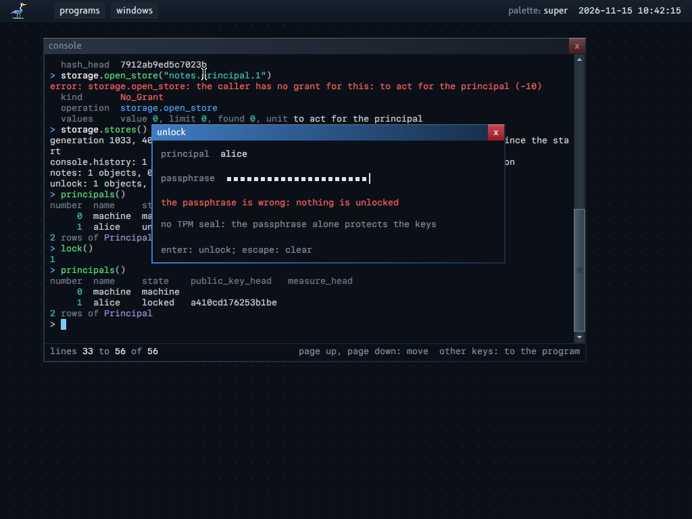

# Principals

A principal is a key pair and the root handles that the key unlocks (`PROPERTIES.md`, property 21; `glossary/access.md`, "Principal"). The kernel has no concept of who executes: a process acts with the handles that it holds. The root service holds the records of the principals, and names the principal of each process that it starts. Storage holds the data of a principal.

This guide says what is built, how it works, and what is not built.

## About this guide

**The idea in plain words.** Current systems ask "which user runs this process?" and give the process every right of that user. This system asks two other questions. *Who executes?* Always a process, with the handles that it holds: the kernel knows nothing more. *For whom does it run?* A principal: a key pair, and the stores and grants that its key unlocks. A process does not inherit a principal; it only runs in the session of one, and that fact is recorded, visible and limited to what the root service grants.

**For whom.** A reader who wants to know how the system separates the data of the machine from the data of a named principal, how the unlock works, and which process can see which store.

**Read before.** `PROPERTIES.md`, "21. Principals: who acts, without users" (the rule and its layers) and "20. No ambient access: the other holes to close". The terms principal, named principal, session, unlock, lock of a session, passphrase and acts for the principal are in `glossary/access.md`.

**The map of this guide.**

| Section | What it says |
|---|---|
| "1. The layers, and what is built" | The five layers of the design, and the state of each |
| "2. Principal 0: the machine" | The principal that the system processes belong to |
| "3. A named principal" | Its keys, its file, the key derivation and the passphrase |
| "4. The unlock and the lock" | How a session starts and ends |
| "5. The session" | Which principal each process runs for, and the grant of a connection |
| "6. The store of a principal" | How storage names and separates the stores of each principal |
| "7. The commands" | The commands of the root ring and of the console |
| "8. The tests", "9. Not built" | What the tests prove, and what remains |

**An example.** At the console, `principal_create("alice")` starts the process `unlock`, whose window asks for the passphrase two times. After it, `notes` started from the menu of the desktop runs in the session of alice, and the log says "root: started notes, in the session of principal 1 "alice"". Its store is `notes.principal.1`, which the console, acting for principal 0, cannot open.



## 1. The layers, and what is built

The design grows in five layers, from a machine with no principal to one principal on several machines. Each layer works alone, and each adds one capability to the layer below it. Layers 1 to 3 are built, in part; layers 4 and 5 are designs.

| Layer | What it is | State |
|---|---|---|
| 1 | No principal: the root service is the only source of grants. A caller acts for the principal or not (`acts_for_principal`) | Built |
| 2 | Principal 0 is the machine: its record holds the measure of the system | Built in part: the record, the measure, the machine key sealed by the TPM with its recovery key, and the machine passphrase with the TPM. Its attestation key in the TPM is not built |
| 3 | One named principal: a passphrase unlocks its session, and the lock ends it | Built in part: the record, the unlock, the session, the stores, the lock, the seal of its keys by the TPM with its passphrase, with a recovery key, and the change of the passphrase and of the recovery key. Not built: the encryption of its stores, a recovery key on a machine with no TPM |
| 4 | Several named principals on one machine | Not built: design in section 9 |
| 5 | One principal on several machines; signed grants between principals | Not built: design in section 9 |

With no named principal, the system runs as principal 0 only, with no unlock: the behavior of layer 2.

## 2. Principal 0: the machine

The machine itself is a principal, number 0. The processes of the system run for it, and its data are the data of the system, such as the settings. It needs no unlock, and it is not an administrator: it cannot see the data of a named principal.

The root service makes the record of principal 0 at each boot, before the first process starts, from the trust record of the boot program (`TRUSTED_BOOT.md`). The record holds:

- the name `machine`;
- the measure of the system: the value of PCR 11, when the boot program measured the system description into the TPM;
- no key. The key of principal 0 is the attestation key of the TPM. It is not built.

Principal 0 can have a machine key, which signs the disk grant table of principal 0. A machine passphrase guards it (section 5, "Principal 0 and its machine passphrase"), with the TPM when the machine has one ("The machine passphrase with the TPM"), or the TPM seals it to the measure of the system with no passphrase (section 5, "The machine key sealed by the TPM"). Neither makes principal 0 a person.

The log says which: "root: principal 0 is the machine: the system is measured, PCR 11 = ..." or "root: principal 0 is the machine: the system is not measured; its key, the attestation key of the TPM, is not built".

The processes of the system belong to principal 0: the services, the console, and each process that the console starts. The stores of the system (the settings, the line history of the console) are stores of principal 0, and keep their names.

The key that signs the system description is the key of a principal like any other: the principal that signs the system. It is not principal 0, and it is not in the TPM.

## 3. A named principal

A named principal is a principal with a name and keys of its own: two key pairs, kept on the disk sealed under a key that only its passphrase gives, and, on a machine with a TPM and Secure Boot on, that the TPM of this machine releases only to this system ("The keys sealed by the TPM"). Nothing of the passphrase is stored: a wrong passphrase simply fails to open the seal.

A named principal has the number 1. The root service holds two records: principal 0 and one named principal.

### The keys

| Key | Algorithm | Use |
|---|---|---|
| The signing key | Ed25519 | Signs the grants of the principal. No signed grant is built yet |
| The unlock key | X25519 | Unlocks the documents of the principal. No store is encrypted yet |

The process `unlock` makes the two secret keys from its random generator, which the root service seeded from the sources of the processor (`RANDOMNESS.md`). A seed weaker than the generator of the processor is refused, and no principal is made.

### The file of the principal

The process `unlock` keeps the record in its private store (a store of principal 0), as the object `principal`. Its format is in `src/library/support/principals`. Each number is little-endian. The object has one of two forms, by its first 8 bytes: `PRINCIPL`, under the passphrase alone, below, or `PRINCIPT`, sealed by the TPM ("The keys sealed by the TPM").

| Offset | Bytes | Field |
|---|---|---|
| 0 | 8 | `PRINCIPL` |
| 8 | 4 | The format: 1 |
| 12 | 4 | The KiB of Argon2id: 19456 |
| 16 | 4 | The passes of Argon2id: 2 |
| 20 | 1 | The bytes of the name: 1 to 23 |
| 21 | 23 | The name: letters, digits, `-`, `_`, `.`; zero bytes after it |
| 44 | 32 | The public signing key |
| 76 | 32 | The public unlock key |
| 108 | 16 | The salt of Argon2id |
| 124 | 12 | The nonce of the seal |
| 136 | 80 | The two secret keys (64 bytes) sealed with ChaCha20-Poly1305, and the tag |

The additional data of the seal is each byte before the sealed keys. So a change of the name, of a public key, of the salt or of a parameter makes the open fail.

The file is data from the disk. `file_decode` copies it once and checks the copy: the size, the magic, the format, the name, and the zero bytes after it. A file with other parameters of Argon2id is refused: a file cannot ask for a cheaper derivation, or for more memory than the process has.

### The key derivation

The key of the seal is Argon2id (RFC 9106) of the passphrase and the salt: 19456 KiB (19 MiB) of blocks, 2 passes, 1 lane, a key of 32 bytes. These are the first parameters of the OWASP password storage cheat sheet. The code is the Argon2id of Odin's `core:crypto`, taken by the rule of the cryptography (`CRYPTOGRAPHY.md`), and the module `cryptography` exports it as `argon2id`. The caller supplies the blocks: `unlock` holds them in one memory object of 4864 pages.

A wrong passphrase gives another key, and the open of the seal fails with `Not_Authentic`. No passphrase and no hash of a passphrase is kept or compared.

**The strength.** In the form `PRINCIPL`, the strength of the record is the strength of the passphrase against Argon2id with 19 MiB and 2 passes, for an attacker with a copy of the disk. A passphrase of 8 bytes is the least that `unlock` accepts; it is not a strong passphrase. In the form `PRINCIPT`, a copy of the disk allows no try away from the TPM of the machine, and the TPM counts each wrong passphrase; the count limits the rate of the tries only while the lockout hierarchy of the TPM has an authorization value that the attacker does not know ("The keys sealed by the TPM").

### The passphrase

A passphrase has 8 to 128 bytes of UTF-8 with no control character: é of the layout of France is two bytes. Its bytes are not normalized: the keys give one form of each character, so the same keys give the same passphrase (`src/md/data/text_encoding.md`). The same keys under another layout give another passphrase. It is typed in the window of `unlock` only, and shows as dots. It is never a text of the console: the console keeps each line in its history and in its store.

### The keys sealed by the TPM

On a machine with the TPM service and Secure Boot on, the TPM seals the keys of a new named principal to the measure of the system and to its passphrase together. A copy of the disk allows no try away from the TPM of the machine. The TPM counts each wrong passphrase and then limits the rate of the tries, but only while its lockout hierarchy has an authorization value that the attacker does not know: the TPM service sets a random one, which nobody keeps, when it finds an empty one ("The lockout authorization value"). A recovery key, shown one time at the creation, opens a copy of the keys when the TPM refuses or when the passphrase is lost. The design is `src/md/features/tpm_sealed_principal_keys.md`.

**How the keys are sealed.** The TPM seals a TPM secret, 32 random bytes, to PCR 7 and PCR 11 ("The machine key sealed by the TPM"), with an authorization value: keyed BLAKE2b of the key that Argon2id derives from the passphrase. The two secret keys are sealed with ChaCha20-Poly1305 under keyed BLAKE2b of the TPM secret over the key of the passphrase. So the keys need the TPM of this machine, this system and the passphrase. A reader of the bus of a hardware TPM, which sees the TPM secret and the value in clear, still runs Argon2id for each guess.

**The count of the TPM.** The sealed object has the attribute `noDA` clear: each wrong passphrase is a failure that the TPM counts. After too many (three on the software TPM of the test machines), the TPM refuses each try for a time (1000 seconds of the time of the TPM there), even the right passphrase; the recovery key still opens the keys. After the lockout the TPM forgives one failure for each 1000 seconds there: about 86 tries a day while the machine runs. The TPM service sends `TPM2_Shutdown` after each use of the passphrase that is not a counted failure: the system has no orderly stop, and with no `TPM2_Shutdown` the TPM counts one failure at each start that follows an unlock. After a counted failure it sends none, so a cut of the power cannot lose a failure that the TPM kept in its RAM; a stop of the machine after a wrong passphrase then counts one more failure at the next start.

**The lockout authorization value.** The count of the TPM and its limits are set by its lockout hierarchy: `TPM2_DictionaryAttackLockReset` and `TPM2_DictionaryAttackParameters` need only the lockout authorization value, not the PCRs. A new or cleared TPM has an empty one. At each start, before it serves its ring, the TPM service reads the count limits of the TPM and writes them on the log; this read changes nothing. Once in a run, just before the first seal or unseal with a passphrase, it reads the bit `lockoutAuthSet`. When the bit is clear, it sets a random value of 32 bytes with `TPM2_HierarchyChangeAuth` and erases it: no process, file or store keeps it. So no system resets the count of the wrong passphrases or changes its limits, this one included. When the bit is set, the service changes nothing: an earlier start of this system set the value, or another system did, and the bit does not say which. A start that uses no passphrase with the TPM (a trial boot, a machine with the machine key only) leaves the lockout hierarchy as it found it. On the test machines, each start writes:

```
tpm: the count limits of the TPM: a lockout after 3 wrong authorization values, one forgiven each 1000 seconds; 0 counted now; the lockout hierarchy waits 1000 seconds after a wrong value of its own
```

The first passphrase on a TPM with an empty value:

```
tpm: the lockout hierarchy had an empty authorization value: this service set a random one and kept no copy, so no system resets the count of the TPM or changes its limits
```

The first passphrase of each later start:

```
tpm: the lockout hierarchy has an authorization value: an earlier start of this system set it, or another system did; this service keeps no copy of it and leaves it
```

The cost to a principal: a principal locked out by the count waits for the recovery time of the TPM, or types the recovery key, which opens the keys during the lockout. The count limits stay those of the TPM. A clear of the TPM needs the menu of the firmware or the physical presence interface (the platform hierarchy); it destroys each seal, the recovery keys open the keys, and the next passphrase sets a new lockout value. An update that resets a firmware TPM is a clear.

The cost to another system on the machine: the TPM has one count for all the systems of the machine. The failures of another system count against a principal of modus, and a lockout locks the objects of each system. The first system that sets the lockout value owns the reset of that count for all. After modus sets it, another system can no longer reset its own lockout or set the count limits, and can report the TPM as not ready and propose a clear. A clear that another system asks for, such as "Clear TPM" in Windows, destroys each seal of modus; the recovery keys of the machine key and of each named principal then open the keys. If another system set the value first, modus leaves it, and the count of a principal of modus does not hold against that system or against whoever reads what it keeps. The design is `src/md/features/tpm_sealed_principal_keys.md`, "The lockout authorization value".

**The creation.** `principal_create("alice")` asks for the passphrase two times. With the TPM service and Secure Boot on, the window then shows the recovery key until Enter. The file is written, and the session starts, only after Enter: a stop before it, such as a close of the window, creates no principal, so no file holds a recovery key that nobody wrote down:

```
tpm: sealed 32 bytes to PCR 7 and PCR 11 and an authorization value, whose wrong tries the TPM counts: a public area of ... bytes and a private area of ... bytes, with its creation data and its ticket
unlock: the keys of the new principal "alice" are sealed by the TPM with its passphrase, with a copy under a recovery key; the window shows the recovery key one time, and the principal is created when it is written down
unlock: Enter on the recovery key: it is written down, and the record or the file that holds its copy is written now
unlock: principal 1 "alice" is created: its keys are sealed by the TPM with its passphrase, with a copy under a recovery key
```

When the store does not answer the write at Enter, `unlock` reads the file back. A file that the store did not keep ends on a screen of the window with "the store did not keep it: nothing is set; ask again", and no principal exists. When the read back fails too, the file may be on the disk: the window keeps the recovery key on the screen with "the file may be on the disk: keep this recovery key" until Enter, no session starts, and the next start of `unlock` reads what the disk holds. The same holds for the records of the machine key below, with "the record may be on the disk: keep this recovery key".

With no TPM service, or with Secure Boot off, the file has the form `PRINCIPL`, under the passphrase alone, and no recovery key: "unlock: no TPM service: the keys of the new principal are sealed under its passphrase alone, with no recovery key".

**The unlock.** The passphrase opens the keys with no other step. A wrong one is refused and counted:

```
tpm: the TPM refuses the unseal: the authorization value is wrong, and the TPM counted the failure (response code 0x98E)
unlock: the passphrase of principal 1 "alice" is wrong: the TPM refuses it and counts it, nothing is unlocked (1 in all)
unlock: the TPM releases the keys of principal 1 "alice" to its passphrase: the system is the system of the seal; the root service receives the key of its disk grant table only, and the secret keys are erased
```

**A lost passphrase.** Ctrl+R, the item "recovery key" of the action bar, asks for the recovery key at once, with no try that the TPM counts. Each wrong try would count against the machine passphrase and each named principal together. The item shows while the TPM service runs; the prompt of a change has none. Enter with nothing goes back to the passphrase:

```
unlock: the recovery key of principal 1 "alice" is asked in the window: the TPM counts no try of its passphrase
unlock: the recovery key of principal 1 is not typed: the window asks for its passphrase again
```

**When the TPM refuses.** On another system, on another machine, with no TPM service, after a lockout, or with a sealed object that this TPM did not make, the window asks for the recovery key of the principal. On another system the TPM checks the PCRs before the passphrase: it counts nothing, and does not say whether the passphrase was right. Enter with nothing goes back to the passphrase while the TPM service runs. The recovery key opens the copy; with Secure Boot on, the window then asks for a passphrase two times, new or the same, and the TPM seals the keys again to it and to the system that runs. So the recovery key also replaces a lost passphrase:

```
unlock: the keys of principal 1 "alice" wait for their recovery key: the TPM does not release them
unlock: the recovery key of principal 1 "alice" opens its keys
unlock: the keys of principal 1 "alice" are sealed again to PCR 7 and PCR 11 of the system that runs and to the new passphrase: its next unlock needs no recovery key
```

**The file `PRINCIPT`.** Each number is little-endian.

| Offset | Bytes | Field |
|---|---|---|
| 0 | 124 | As the form `PRINCIPL`, to the salt, with `PRINCIPT` and the format 1 |
| 124 | 4 | The PCRs of the policy: `0x880`, PCR 7 and PCR 11 |
| 128 | 8 | The bytes of the public area, of the private area, of the creation data and of the creation ticket, 2 bytes each |
| 136 | 128 | The public area of the sealed object |
| 264 | 256 | The private area |
| 520 | 256 | The creation data |
| 776 | 72 | The creation ticket |
| 848 | 12 | The nonce of the seal under the seal key |
| 860 | 80 | The two secret keys sealed under the seal key, and the tag |
| 940 | 12 | The nonce of the recovery seal |
| 952 | 80 | The two secret keys sealed under keyed BLAKE2b of the recovery key, and the tag |

Each part of the sealed object has zero bytes after it. The additional data of the seal under the seal key is the first 124 bytes. The additional data of the recovery seal is the first 108 bytes, before the salt, so a new passphrase keeps the copy valid. `principal_tpm_file_decode` refuses other parameters of Argon2id, other PCRs, a name that is not a name, and a part of the sealed object that is not whole.

**What it protects, and what it does not.**

- A copy of the disk opens nothing on another machine or another system without the recovery key.
- The TPM counts the tries on this machine, and limits their rate, only while its lockout hierarchy has an authorization value that the attacker does not know. With an empty one, an attacker with the machine starts another system, changes the count limits of the TPM or resets the count (`TPM2_DictionaryAttackParameters`, `TPM2_DictionaryAttackLockReset`, which do not depend on the PCRs), and starts this system again: each guess in the window of `unlock` then costs one derivation of Argon2id only, as for the form `PRINCIPL`. The TPM service sets a value before the first use of a passphrase on a TPM with an empty one, so the count holds from that use. It does not hold against a system that set the value before: the service leaves such a value, and only a clear from the firmware gives the hierarchy back. The value crosses the bus of the TPM in clear at that first use. The window of the creation does not show the state of the lockout hierarchy: only the log says it. On the test TPM the rate is three tries, then one for each 1000 seconds of the time of the TPM.
- A new passphrase, after a recovery or a change, does not revoke the old one: a writer of the disk who kept the old file puts it back, and the old passphrase opens the keys again. Nothing pins the current file.
- Who holds the recovery key holds the principal, on this disk or any copy of it, with no TPM. A new recovery key ("A change of the passphrase") opens the files written after it; the old one still opens the version from before that the store keeps on the same disk.
- The TPM secret and the authorization value cross the bus of the TPM in clear: no session encrypts them. A reader of the bus still runs Argon2id for each guess of the passphrase.
- The machine passphrase on a machine with the TPM service and Secure Boot on has the same form ("The machine passphrase with the TPM"), and the same count of the TPM: a wrong machine passphrase counts against the principal too.
- With no TPM, the file `PRINCIPL` has no recovery key.

### A change of the passphrase

A named principal changes its passphrase, or gets a new recovery key, from its own session. The design is `src/md/features/tpm_sealed_principal_keys.md`, "A change of the passphrase, and a new recovery key".

**Who asks.** A console that the desktop starts during the session acts for the principal (section 5). Its `passphrase_change()` or `recovery_key_change()` sends `Principal_Change` to the root service, which starts `unlock`. The console of the machine acts for principal 0, so it cannot ask: "root: refused a change of the passphrase: the caller runs in no session of a named principal".

**The proof.** The window of `unlock` asks for the current passphrase first, and opens the keys with it as an unlock does. In the form `PRINCIPT` the TPM counts a wrong one; a lockout or another system changes nothing. Enter with nothing ends the change, and the session goes on.

**A new passphrase.** After the proof, the window asks for the new passphrase two times; Enter with nothing there ends the change too. In the form `PRINCIPT` the TPM seals the keys again, with a new salt and a new TPM secret; the copy under the recovery key stays. In the form `PRINCIPL` the keys are sealed again under the new passphrase alone, with a new salt. The session goes on:

```
root: the passphrase of principal 1 "alice" changes in the window of unlock
unlock: principal 1 "alice" asks for a change: its current passphrase comes first
unlock: the current passphrase of principal 1 "alice" opens its keys
unlock: the passphrase of principal 1 "alice" is changed: the TPM seals its keys to PCR 7 and PCR 11 and to the new passphrase
storage: the versions of principal in the store unlock are erased: 1 version ended, 5 blocks written with zeros, 0 blocks kept that another state names, generation 412
unlock: the versions of the object "principal" are erased: 1 ended, 5 blocks written with zeros, 0 blocks kept that another state names, 0 damaged parts with no zeros
root: the change in the window of unlock ends: the passphrase is changed
```

**A new recovery key.** After the proof, `unlock` makes a new recovery key and seals the copy of the keys under it, and the window shows the key one time. The file is written after Enter, when the key is written down: a stop before Enter leaves the old key the key of the file. The passphrase and the seal by the TPM stay:

```
unlock: principal 1 "alice" has a new recovery key, and the window shows it one time; the file is written when it is written down
unlock: the new recovery key of principal 1 "alice" is kept: a file written from now opens with it only
unlock: the versions of the object "principal" are erased: 1 ended, 5 blocks written with zeros, 0 blocks kept that another state names, 0 damaged parts with no zeros
root: the change in the window of unlock ends: the new recovery key is kept; the old one opens no new file
```

**The end.** Each change ends on a screen of the window with its sentence, until Enter: what changed, or why nothing changed. The line of the console that asked waits for the same end and gives it, with the cause of a refusal; Escape ends the wait of the console, and the window goes on. When the store does not answer a write, `unlock` reads the file back, and says that the new secret is kept, that nothing changed, or that the old or the new one opens the keys.

**When a change is refused.** `unlock` writes why and stops before its window opens, and the console gives the cause: a new recovery key for the form `PRINCIPL`, which has none; the form `PRINCIPT` with no TPM service; a new passphrase for the form `PRINCIPT` with Secure Boot off, as a seal then trusts a boot program that nothing verified. A new recovery key needs no seal by the TPM, so Secure Boot off allows it.

**What an old copy of the file still opens.** The keys never change: they are the principal. So a change replaces the file and revokes no copy of it. The write makes the file from before a version, and `unlock` then asks the store to erase the versions of the file: the store ends them and writes zeros over their blocks (`STORAGE.md`, "4.8 The erase of versions"). Only `unlock` holds the grant for it, `Versions_Erase`. Each unlock whose current file opens the keys asks again, so a stop between the write and the erase is repaired at the next unlock; the erase waits for that, so a current file that does not open never loses the version before it. In the form `PRINCIPL`, which has no copy under a recovery key, `unlock` opens the new file with the new passphrase before it erases, and keeps the versions when it does not open. The creation of a principal erases nothing. The new seal after a recovery erases the same way, and so does the new seal of the machine key. After the erase, the old passphrase and the old recovery key open nothing that the storage service reads on this disk, under the limits of the erase (`src/md/features/version_erase.md`, "Limits"). A copy of the old file still opens with the old secret: the old passphrase on this TPM and system, and the old recovery key anywhere. Such a copy is a copy of the disk made before the change, a sector that the device or the host kept under the block (a flash disk, a snapshot of the image), a free block whose zeros a loss of power or a failed write cut, a damaged version that the erase ended with no zeros, or a clone or a restore that a process acting for principal 0 made of the version before the erase.

**A lock during a change.** `lock()` stops the `unlock` of a change with the session, as each window of `unlock` that a session asked for (section 4). After each stop of a process, the root service starts `unlock` when a named principal is locked and no `unlock` runs, so a close of its window gives it back at once. A stop that the root service asked (a close of the window, a stop at a lock) never counts. After 3 other stops while a principal is locked, whatever their code, or failed starts other than a full table, since the last lock or session, it starts it no more until the machine starts again: "root: unlock stopped 3 times while a principal is locked, with no stop that the root service asked: it starts no more until the machine starts again". A lock during the write of a change ends it with "unlock stopped before the end: the old or the new secret opens": the file can be the old or the new one.

## 4. The unlock and the lock

A session of a named principal starts when its passphrase opens its file, and ends with a lock. One process, `unlock`, handles the passphrase and the keys; it tells the root service the result and stops.

The root service starts `unlock` at boot, after the boot pass of `settings`.

- With no file, `unlock` stops at once: "unlock: no named principal: the machine runs as principal 0, with no unlock".
- With a file, `unlock` gives the public part of the record to the root service (`Principal_Record`), opens its window, and asks for the passphrase.
- When the seal opens, `unlock` checks that the two secret keys give the two public keys of the file, erases them, tells the root service (`Principal_Unlock`), and stops. The root service starts the session.
- On a machine with no screen, `unlock` gets no window. A machine key that the TPM releases needs none. When a key must be typed, `unlock` writes one line that starts with "unlock: no screen: ", names what cannot be typed and what stays absent, and stops with the code 0; the root service does not start it again while the screen is absent (`ARCHITECTURE.md`, "U4. Device services").

**The keys are not kept after the unlock.** `unlock` gives the root service one key, derived from the unlock key: the key of the tag of the disk grant table of the principal (section 5, "The disk grant table of a named principal"). Then it erases the secret keys: no store is encrypted, and no grant is signed. A key that is held with no use is only a target. When storage encrypts the stores of a principal, the unlock gives the unlock key to the storage service, and the lock erases it there.

**The lock** (`lock()` in the console): the root service stops each process of the session and its terminals, marks the principal locked, and starts `unlock` again. The processes stop; they are not frozen: a frozen process needs a kernel operation that does not exist. A process that keeps its state in its store at each change (`notes`) loses nothing.

**No window of `unlock` outlives a lock.** A console of the session can start `unlock` for a change of the passphrase, a new recovery key, the machine passphrase or the seal of the machine key. The lock stops that `unlock`, whatever it shows: anyone at the keyboard of the locked machine then reads no recovery key and sets no machine passphrase. Each window that shows a new recovery key writes its file or its record only after Enter, so the stop loses no key that nobody wrote down: the disk stays as it was, and the owner asks again. The log says what the stopped window ran for:

```
root: the session of principal 1 "alice" ends: 2 processes stopped
root: the lock stops the window of unlock, which ran for the machine passphrase that is set; unlock asks for the passphrase when it stopped
root: unlock stopped with code ...
unlock: principal 1 "alice" is locked: its passphrase opens its session
```

The design is `src/md/features/tpm_sealed_principal_keys.md`, "No window of `unlock` outlives a lock".

**The creation** (`principal_create("name")` in the console): the root service checks the name, and starts `unlock` with it. The passphrase is typed two times. `unlock` makes the keys, derives the key of the seal, seals the secret keys, writes the file, gives the record to the root service, and starts the session. With the TPM service and Secure Boot on, the TPM seals the keys with the passphrase, and the window shows the recovery key before the file is written ("The keys sealed by the TPM").

The root service trusts `unlock` for the record and for the unlock, as the one process with the grant `Principals`, as it trusts `settings` as the one writer of the settings page. No other process can send these two commands.

## 5. The session

Each process runs for one principal, and the root service decides which when it starts the process. A service learns the principal of each caller from the grant of its connection, never from the caller itself.

The root service records, for each process that it starts, the principal whose session the process belongs to:

| Who asks for the start | The principal of the process |
|---|---|
| The root service itself (the services, the console, the boot passes) | 0, the machine |
| A service that starts on demand (`storage`, `sample`) | 0 |
| The desktop: the menu or the palette of the compositor | The named principal that is unlocked, else 0 |
| A process, through its ring to the root service (`start("name")` in the console) | The principal of the process that asks |
| The terminal of a process | The principal of that process |

So a process that the console starts belongs to principal 0, and a process that the desktop starts during a session belongs to the named principal. The log says it: "root: started notes, in the session of principal 1 "alice"".

**The grant of a connection.** The root service gives each caller of a service a grant, in the Connect and Grant commands of the service ring (`src/library/contract/isolated`, values[6]):

| Bits | Field |
|---|---|
| 0 to 45 (`CALLER_AMOUNT_MASK`) | An amount: the limit of blocks of a store |
| 46 (`CALLER_ERASES_VERSIONS`) | The storage service lets the caller erase the versions of the objects of its private store: the start grant `Versions_Erase`, which only `unlock` has (`STORAGE.md`, "4.8 The erase of versions") |
| 47 (`CALLER_READS_ONLY`) | The connection reads only: the storage service refuses each change on it (`MODULE_CONTRACT.md`, "The debug object of a disk process") |
| 48 to 62 (`CALLER_PRINCIPAL_MASK`) | The number of the principal of the session of the caller |
| 63 (`CALLER_ACTS_FOR_PRINCIPAL`) | The caller acts for that principal |

A caller acts for the principal when its role has the grant `acts_for_principal` (the console, `remote`) and the grant was not revoked. It acts for the principal of its own session only, but for `remote`, whose connections act for the principal of a client key ("The client keys of remote"). So the console, started at boot, acts for principal 0, never for principal 1: "root: connected console to the service storage, acting for principal 0". A console that the desktop starts during the session of alice belongs to that session: it acts for principal 1, never for principal 0.

**The grant records name the principal.** `grants("notes")` in the console gives the grants of a process, then "notes runs for principal 1 "alice"". `revoke` works on a process of a session as on any other process.

### The client keys of remote

A call from another machine acts for the principal that allowed its client, and for no other. The design is `src/md/features/remote_client_keys.md`.

**The key of a client.** A client of the process `remote` proves an Ed25519 key of its own in the QUIC handshake: a raw public key and its signature, in mutual TLS 1.3 (`QUIC.md`, section 4, "The key of the client"). The tool prints the key of its client.

**The grant.** A principal allows a key from a console that acts for it: `remote_allow("<64 hexadecimal digits>")`. The root service keeps the grant as a row of the client table: the key, the principal, and a serial that names the grant. `remote` maps the table with the right Read only, by its start grant `Remote_Clients`; it cannot give a key a row. One key belongs to one principal: a key that another principal allowed is refused (`Exists`). The table holds 8 rows (`remote.CLIENT_CAPACITY`), 4 of them for one principal at most (`remote.CLIENT_ROWS_OF_ONE_PRINCIPAL`; one more is refused with `Full`). A row allowed while the session of its principal is locked holds no grant until the unlock. `remote_clients()` gives the keys of the principal of the console, each with its state: `holds`, `locked`, or `contested` (see "Across a restart").

```
root: principal 0 allowed the client key 6a1f0c2d9e8b7a65 of remote: each call of that client acts for it; the disk grant table of the principal keeps the key across a restart
remote: 10.0.2.2 port 43000 proved the client key 6a1f0c2d9e8b7a65: its calls act for principal 0
root: connected remote to the service monitor, acting for principal 0, for the client key 6a1f0c2d9e8b7a65
```

**A call.** `remote` binds each QUIC connection to the row of the key that its client proved, and asks the root service for each connection to a service for that row (`Connect` with the row and its serial). The root service gives that connection the principal of the row, with the flag to act for it. So two clients of two principals see each one the stores and the processes of its own principal.

**A key with no row.** The handshake ends with access_denied, before any stream, and `remote` writes one line: "remote: refused the client key ...: no principal allowed it; the handshake ends before any call". The check comes after the signature of the client verified: a peer that does not hold the private key learns nothing.

**The end of a grant.** `remote_disallow("<key>")` frees the row. A lock of the session of the principal gives each row of that principal a new serial and marks it locked; the unlock gives it a new serial again. At each end of a grant the root service ends each connection to a service that it made for the row, and wakes `remote`, which ends the open QUIC connection of the client with the application code Revoked:

```
root: principal 0 revoked the client key 6a1f0c2d9e8b7a65 of remote: connections to services ended: 4
remote: the grant of the client key 6a1f0c2d9e8b7a65 of principal 0 ended (a revocation, or a lock of its session): the connection from 10.0.2.2 port 43000 ends with the code Revoked
remote: the grants of 4 connections to services ended (a revocation, or a lock or an unlock of a session): their slots are free; 0 of 24 slots in use
```

`remote` frees the slots of the connections of an ended grant at each pass, also when no client of the key is connected.

**Across a restart.** Each allowed key is also a client key of the disk grant table of its principal, under the tag of that table (`MODULE_CONTRACT.md`, "The grants of a disk process"). The table keeps 4 keys at most. So a key lasts as the other grants of its principal do: across a restart for a named principal, and for principal 0 with a machine passphrase or a machine key sealed by the TPM; until the machine stops for principal 0 with neither, and when the global setting of the table is to forget (`disk_persistence("", "forget")`). The end of the line of an allow says which. After the read of the table, at the first unlock of a named principal or when principal 0 gets its machine key, each key holds again with a new serial:

```
root: read the disk grant table of principal 1 from the store module_files: 1 rows, with the tag of the key of the principal; 1 client keys of remote
root: the client key 6a1f0c2d9e8b7a65 of remote holds again for principal 1, from its disk grant table: each call of that client acts for it
```

- An allow is refused while the table takes no change (the machine passphrase is not typed, the read runs, or the table is refused, unread or unwritten), with the line of that refusal.
- A revocation is never refused: it ends the grant at once. A table whose writes failed is written again. A key revoked before the read of the table in this run is taken out of the table that the read gives, and the table is written again. When the disk can still give the key back at the next start, `remote_disallow` says it: "1 connections to services ended; the disk grant table of this principal did not take the revocation, so the key can come back at the next start of the machine: revoke it again then".
- A key of the table that another principal allowed since the start is contested: it acts for neither of them, and `remote` refuses it in the handshake. One line names both principals. The first revocation by either one ends the contest, and the key holds again for the other one:

```
root: the client key 6a1f0c2d9e8b7a65 of remote is contested: principal 0 allowed it since the machine started, and the disk grant table of principal 1 holds it; it acts for neither until one of them revokes it; connections to services ended: 2
remote: refused the client key 6a1f...: it is contested: principal 0 and principal 1 both allowed it, and it acts for neither until one of them revokes it; the handshake ends before any call
root: the client key 6a1f0c2d9e8b7a65 of remote holds again for principal 0: principal 1 revoked it, so it is no longer contested
```

- A key that a principal allowed before its table was read, and that the table does not hold, ends at the read, as each change made before the key of the table came.
- A table of 1008 bytes is a table of the format 1, from a build before the client keys. It is refused as an older format that this system does not read, and no version of it can be restored to verify: the disk grants of that principal stay absent on that disk.
- A writer of the disk who kept an older table can restore it, and a revoked key comes back. A counter of the TPM that only grows ends it; it is not built (`ROADMAP.md`).

**What it does not do.** A row is a grant of this machine; a grant signed by the key of a principal for another machine is layer 5 (section 9). `remote` holds the table: a fault of `remote` could use each row whose grant holds, never a principal with no row.

### Principal 0 and its machine passphrase

Principal 0 stays the machine. A machine passphrase is optional: it guards the machine key, and it opens no session. With no machine passphrase, nothing is typed, and the disk grant table of principal 0 lasts until the machine stops (`MODULE_CONTRACT.md`, "The grants of a disk process").

**The record.** `unlock` keeps it in its store, as the object `machine`. Its format is in `src/library/support/principals`. Each number is little-endian. This is the form under the machine passphrase alone: a machine with no TPM service, or with Secure Boot off, gets it. A machine with the TPM service and Secure Boot on gets the form `MACHINEP` ("The machine passphrase with the TPM").

| Offset | Bytes | Field |
|---|---|---|
| 0 | 8 | `MACHINEK` |
| 8 | 4 | The format: 1 |
| 12 | 4 | The KiB of Argon2id: 19456 |
| 16 | 4 | The passes of Argon2id: 2 |
| 20 | 16 | The salt of Argon2id |
| 36 | 12 | The nonce of the seal |
| 48 | 48 | The machine key (32 random bytes) sealed with ChaCha20-Poly1305, and the tag |

The additional data of the seal is each byte before the sealed key. The key derivation and the passphrase have the rules of a named principal (section 3).

**The setting.** `machine_passphrase()` in the console starts `unlock`, whose window asks for the passphrase two times. `unlock` makes the machine key from its generator, seals it, writes the record, and gives the root service the key of the tag of the table. The log says why the TPM does not seal it: "unlock: no TPM service: the machine key is sealed under the machine passphrase alone, with no recovery key". A machine with a machine passphrase refuses a second one. `unlock` writes one record in a run at most: when the root service does not take the key in time, `unlock` stops, and the passphrase opens that record at the next start.

**A record that cannot be read.** `unlock` reads the record as absent, present, or unreadable: the store gave an error, or the record does not decode. Only an absent record lets a passphrase be set. An unreadable record gives no key: the disk processes of principal 0 start with no grant, and a change of the table and `machine_passphrase()` are refused, each with a line of the log:

```
root: refused a machine passphrase: the record of the machine passphrase cannot be read, and a new one would replace a key that can be good
```

**The keys.** `unlock` gives the root service one key: the key of the tag of the disk grant table, keyed BLAKE2b of the machine key over a fixed text. It erases the key of the seal and the machine key, and stops. The root service holds the key of the tag until the machine stops; it cannot open the record with it.

**At the start.** The root service starts `unlock` at boot, as before. With a record of the machine, `unlock` asks for the machine passphrase first, then for the passphrase of a named principal if a file of one exists. The window says which one it asks for. Until the machine passphrase is typed, the machine runs, the disk processes of principal 0 start with no grant, and a change of the table of principal 0 is refused. Enter with no passphrase skips it until the next start of `unlock`. After a lock, the root service tells `unlock` that it holds the key, and `unlock` does not ask again.

The log says each step: "unlock: the machine has a passphrase: the disk grants of principal 0 come when it is typed", "unlock: the machine passphrase opens the machine key; the root service receives the key of the disk grant table only", "root: read the disk grant table of principal 0 from the store module_files: 1 rows, with the tag of the machine key".

### The machine passphrase with the TPM

On a machine with the TPM service and Secure Boot on, `machine_passphrase()` gives the machine key the form of the keys of a named principal ("The keys sealed by the TPM"). The TPM seals a TPM secret to PCR 7, PCR 11 and an authorization value that the machine passphrase gives. So the TPM counts each wrong machine passphrase, and another system opens nothing, even with the right passphrase. A recovery key, shown one time, opens a copy of the machine key. The design is `src/md/features/tpm_sealed_machine_passphrase.md`.

**The setting.** The window asks for the passphrase two times. `unlock` makes the machine key and a recovery key, and has the TPM seal a new TPM secret with the authorization value. The window then shows the recovery key until Enter. After Enter, `unlock` writes the record and gives the root service the key of the tag of the table. A stop before Enter, a lock of the session whose console asked included, sets no machine passphrase. A write that the store does not answer is read back, as at the creation of a principal ("The keys sealed by the TPM"):

```
tpm: sealed 32 bytes to PCR 7 and PCR 11 and an authorization value, whose wrong tries the TPM counts: a public area of ... bytes and a private area of ... bytes, with its creation data and its ticket
unlock: the window shows the recovery key of the new machine passphrase one time; the record is written when it is written down
unlock: Enter on the recovery key: it is written down, and the record or the file that holds its copy is written now
unlock: the machine passphrase is set: the TPM seals the machine key with it, with a copy under a recovery key, in the store of unlock
```

With Secure Boot off, the record has the form under the passphrase alone, and the log says why: "unlock: the firmware did not verify the boot program (Secure Boot is off): the machine key is sealed under the machine passphrase alone, as a seal by the TPM would trust a boot program that nothing verified". A record keeps its form: a record under the passphrase alone does not move to this form.

**The keys.** The key of the passphrase is Argon2id of the passphrase and the salt of the record. The authorization value is keyed BLAKE2b of that key over `modus authorization value of the machine key`. The seal key is keyed BLAKE2b of the TPM secret over the key of the passphrase and `modus seal by the TPM of the machine key under the machine passphrase`. The texts differ from the texts of a named principal.

**At the start.** `unlock` asks for the machine passphrase, as for the form under the passphrase alone; Enter with nothing skips it. The TPM releases the TPM secret to the right passphrase on the system of the seal, and the TPM service then sends `TPM2_Shutdown`:

```
tpm: unsealed 32 bytes: PCR 7 and PCR 11 hold the values of the seal, and the authorization value is right
unlock: the TPM releases the machine key to the machine passphrase: the system is the system of the seal; the root service receives the key of the disk grant table only
```

A wrong passphrase on this system: "unlock: the machine passphrase is wrong: the TPM refuses it and counts it, the disk grants of principal 0 stay absent (1 in all)". The TPM has one count for each object whose wrong values it counts: a wrong machine passphrase counts against a named principal too. A wrong passphrase followed by Enter with nothing, with no right passphrase in the run, counts one more failure at the next start: the TPM service sends no `TPM2_Shutdown` after a counted failure.

**A lost passphrase.** Ctrl+R, the item "recovery key" of the action bar, asks for the recovery key at once, with no try that the TPM counts: "unlock: the recovery key of the machine key is asked in the window: the TPM counts no try of the machine passphrase".

**When the TPM refuses.** On another system, with another state of Secure Boot, on another machine, after a lockout, or with no TPM service, the window asks for the recovery key. The TPM checks the PCRs before the passphrase, so the right passphrase on another system opens nothing and counts nothing. Enter with nothing at the recovery key goes back to the machine passphrase while the TPM service runs, so after a lockout the owner can wait for the TPM. The recovery key opens the copy and gives the key of the table at once. With Secure Boot on, the window then asks for a new machine passphrase two times, and the TPM seals the key again to it and to the system that runs; so the recovery also replaces a lost machine passphrase. Enter with nothing skips the new seal, and the recovery key opens the key at the next start too. A new seal that fails, or that the store does not keep, ends on a screen of the window with its sentence until Enter. After the new seal, `unlock` erases the versions of the record:

```
unlock: the machine key waits for a new machine passphrase: the TPM seals it again to it and to the system that runs
unlock: the machine key is sealed again to PCR 7 and PCR 11 of the system that runs and to the new machine passphrase: its next start needs no recovery key
```

**The record.** The object `machine` of the store of `unlock`. Each number is little-endian.

| Offset | Bytes | Field |
|---|---|---|
| 0 | 8 | `MACHINEP` |
| 8 | 4 | The format: 1 |
| 12 | 4 | The KiB of Argon2id: 19456 |
| 16 | 4 | The passes of Argon2id: 2 |
| 20 | 16 | The salt of Argon2id |
| 36 | 4 | The PCRs of the policy, bit n for PCR n: `0x880`, PCR 7 and PCR 11 |
| 40 | 720 | The four parts of the sealed object, in the form of the record `MACHINET` from its offset 16: four sizes, the public area at 48, the private area at 176, the creation data at 432, the creation ticket at 688 |
| 760 | 12 | The nonce of the seal under the seal key |
| 772 | 48 | The machine key sealed with ChaCha20-Poly1305 under the seal key, and the tag |
| 820 | 12 | The nonce of the recovery seal |
| 832 | 48 | The machine key sealed under keyed BLAKE2b of the recovery key, and the tag |

The additional data of the seal under the seal key is each byte before the PCRs. The additional data of the recovery seal is each byte before the salt, so a new passphrase keeps the copy valid. The record has no key check: each copy opens only under its authenticated seal. `machine_tpm_passphrase_file_decode` refuses a record with other parameters of Argon2id, other PCRs, or a part of the sealed object that is not whole.

**What it protects, and what it does not.**

- A copy of the disk allows no try of the machine passphrase away from the TPM of this machine, and another system opens nothing with it.
- The count of the TPM limits the rate of the tries only while the lockout hierarchy has an authorization value that the attacker does not know ("The keys sealed by the TPM"). The first use of the machine passphrase in a run sets one on a TPM with an empty one.
- A new machine passphrase does not revoke the old one: a copy of the disk made before still opens with the old passphrase on this TPM and system. Who holds the recovery key holds the machine key, on any copy of the disk.
- The TPM secret and the authorization value cross the bus of the TPM in clear. A reader of the bus still runs Argon2id for each guess.
- A record under the machine passphrase alone stays in that form on a machine with a TPM.

### The machine key sealed by the TPM

A machine with no machine passphrase can keep its disk grants across a restart with no typing: the TPM releases the machine key at each start, but only to the system whose measure it holds. A recovery key, shown one time, opens the key when the TPM refuses. The design is `src/md/features/tpm_sealed_machine_key.md`.

**The TPM service.** The process `tpm` is the device service of the TPM. The root service starts it at boot when the trust record says `Measured` (`TRUSTED_BOOT.md`, "6. The measure"); with no TPM, or with a refused measure, it does not run. It seals 32 bytes to the values of PCR 7 (the state of Secure Boot) and PCR 11 (the measure of the system description), and unseals them only while those registers hold the same values. `unlock` is its one client. Before the first use of a passphrase in a run, it also sets a lockout authorization value when the TPM has an empty one ("The lockout authorization value").

**The setting.** `machine_seal()` in the console asks the root service (`Machine_Seal`), which starts `unlock`. It needs Secure Boot on: the trust record says that the firmware verified the boot program. With Secure Boot off, a replaced boot program can extend PCR 11 with the hash of a correct description, so the root service refuses: "root: refused a machine key sealed by the TPM: the firmware did not verify the boot program (Secure Boot is off), so a seal would trust a boot program that nothing verified". `unlock` makes the machine key and a recovery key from its generator, asks the TPM service for the seal, and seals a copy of the key under the recovery key. Its window then shows the recovery key until Enter; only then does `unlock` write the record and give the root service the key of the tag of the table, so a stop before Enter leaves no record ("4. The unlock and the lock"):

```
recovery key  MZXW-6YTB-MZXW-6YTB-MZXW-6YTB-MZXW-6YTB
```

Write it down: it is shown one time, and it is never on the disk or on the log. A machine with a record of its machine key, in any form, refuses `machine_seal()` and `machine_passphrase()`: a change is not built. A machine with no TPM service refuses `machine_seal()`.

**The record.** The object `machine` of the store of `unlock`, as the record of the machine passphrase. Its first 8 bytes say its form. Each number is little-endian.

| Offset | Bytes | Field |
|---|---|---|
| 0 | 8 | `MACHINET` |
| 8 | 4 | The format: 2 |
| 12 | 4 | The PCRs of the policy, bit n for PCR n: `0x880`, PCR 7 and PCR 11 |
| 16 | 2 | The bytes of the public area |
| 18 | 2 | The bytes of the private area |
| 20 | 2 | The bytes of the creation data |
| 22 | 2 | The bytes of the creation ticket |
| 24 | 128 | The public area of the sealed object, with its size field; zero bytes after it |
| 152 | 256 | The private area of the sealed object, with its size field; zero bytes after it |
| 408 | 256 | The creation data of the sealed object, with its size field: the digest of PCR 7 and PCR 11 when the TPM made it; zero bytes after it |
| 664 | 72 | The creation ticket of the sealed object: its tag, its hierarchy, and a digest of up to 64 bytes (swtpm gives one of SHA-512); zero bytes after it |
| 736 | 12 | The nonce of the recovery seal |
| 748 | 48 | The machine key sealed with ChaCha20-Poly1305 under keyed BLAKE2b of the recovery key, and the tag |
| 796 | 32 | The key check: keyed BLAKE2b of the machine key |

The additional data of the recovery seal is the first 12 bytes only, so a new seal by the TPM keeps the copy valid. `machine_tpm_file_decode` refuses a record with other PCRs, a part that is not whole within its limit, a creation data that does not name PCR 7 and PCR 11, or a byte after a part that is not zero.

**The proof of the creation.** Before each unseal, the TPM service has the TPM check the creation ticket (`TPM2_CertifyCreation`), and checks that the policy of the object is the policy of the PCR values of its creation data, with the attributes of a sealed object. So the TPM releases a key only from an object that it made itself while PCR 7 and PCR 11 held the values of the policy. A record that another system on this machine wrote, with an object that it made with the policy of this system, is refused:

```
tpm: refused the unseal: the policy of the object is not the policy of the PCR values of its creation, or its attributes are not the attributes of a sealed object
unlock: the TPM service refuses the unseal: this TPM did not make the sealed object of the record under the PCR values of its policy; the record was written by another system, and only its recovery key opens it
```

**At the start.** `unlock` reads the record and asks the TPM service to unseal. When the key passes its key check, `unlock` gives the root service the key of the table, and nothing is typed:

```
tpm: unsealed 32 bytes: PCR 7 and PCR 11 hold the values of the seal
unlock: the TPM releases the machine key: the system is the system of the seal; the root service receives the key of the disk grant table only
root: read the disk grant table of principal 0 from the store module_files: 0 rows, with the tag of the machine key
```

**When the TPM refuses.** After an update of the system, on another machine, after a change of Secure Boot, or with no TPM service, the TPM does not release the key. The window of `unlock` asks for the recovery key; it takes upper or lower case, with or without `-`. Enter with nothing skips it: the machine runs, and the disk grants of principal 0 stay absent. A wrong recovery key opens nothing. The right one gives the key, and with Secure Boot on `unlock` seals it again to the system that runs, so the next start of this system needs no recovery key. With Secure Boot off it does not seal it again: an attacker who turns Secure Boot off makes the TPM refuse as an update does, and a new seal would bind the key to a boot program that nothing verified:

```
unlock: the TPM refuses the unseal: PCR 7 and PCR 11 do not hold the values of the seal: another system, another state of Secure Boot, or another machine
unlock: the recovery key opens the machine key; the root service receives the key of the disk grant table only
unlock: the machine key is sealed again to PCR 7 and PCR 11 of the system that runs: its next start needs no recovery key
```

**What it protects, and what it does not.**

- A copy of the disk opens no table on another machine, and an older or a changed system opens none on this machine, without the recovery key.
- Another system on this machine that writes the disk cannot make this system take a table of its own key: the proof of the creation refuses its object.
- The form of the record is not pinned: the disk alone says whether the machine key is sealed by the TPM or under a passphrase. A system that writes the disk can replace or remove the record. This system then takes no table of another key, but the disk grants of principal 0 stay absent, and the window asks for a recovery key or a passphrase that the owner does not have. A pin in the TPM is not built (`ROADMAP.md`).
- A replaced boot program that extends PCR 11 with a correct hash could open a key sealed with Secure Boot off; so no key is sealed with Secure Boot off.
- The key crosses the interface of the TPM in clear at each seal and unseal: no session encrypts it. A reader of the bus of a hardware TPM gets it.
- Each update of the system asks for the recovery key one time: no process of the system knows the measure of the next system before the update.

### The disk grant table of a named principal

A named principal grants a disk process from its own session, and its grants last across a restart of the machine (`MODULE_CONTRACT.md`, "The grants of a disk process").

**Who changes it.** A process of the session that acts for the principal: a console that the desktop starts during the session, from the start menu. Its `allow`, `disallow`, `nickname_move` and `disk_persistence` change the table of principal 1. The console that the machine starts at boot changes the table of principal 0 only.

**Where it is.** The object `grant_table` of the store `module_files.principal.1`: the store of the module files of the principal, which the disk processes of its session start from.

**Its key.** When the passphrase opens the seal, `unlock` derives the key of the tag from the secret unlock key: keyed BLAKE2b over the text `modus disk grant table of a named principal`. It gives this key with `Principal_Unlock`, and erases the secret keys. The root service keeps the key until the machine stops; after a lock, the next unlock must give the same key.

**The read and the write.** The first unlock of a run reads the table, before any process of the session can change it. Then each change writes it. The rules are the rules of the table of principal 0:

- A table whose tag verifies gives its rows.
- A table that does not verify gives no grant. At the creation of the principal it is written over: no key of this principal signed it. The root service takes a key "of a new principal" only for a record that a creation made since the machine started. At any other unlock the table is kept, and each change is refused until the machine starts again.
- A read that failed starts again at the next unlock.
- A write that fails is tried again at once, 3 tries at most.
- While the read runs, or while the session is locked, a change is refused.

The log says each step: "root: read the disk grant table of principal 1 from the store module_files: 1 rows, with the tag of the key of the principal", "root: the disk grant table of principal 1 is written in the store module_files: 1 rows, with the tag of the key of the principal".

## 6. The store of a principal

One module that runs for two principals has two stores, so the data of each principal stay apart. The name of a store carries its principal, and one procedure of the storage service decides from it which stores a caller is allowed to name.

The storage service names a store by the name that the root service gives to the connection. The root service builds that name in one procedure, `principals.store_name_write`, from the principal and the name of the process:

| Principal | Process | Store |
|---|---|---|
| 0 | `notes` | `notes` |
| 0 | `console`, its line history | `console.history` |
| 1 | `notes` | `notes.principal.1` |
| 1 | `console`, its line history | `console.history.principal.1` |
| 0 | The disk process of the nickname `visitor`, with the grant `store` | `disk-visitor` |
| 1 | The disk process of the nickname `visitor`, with the grant `store` | `disk-visitor.principal.1` |
| 1 | The module files of its disk processes, and its disk grant table | `module_files.principal.1` |

So two principals that run one module have two stores, and the stores of the system keep their names. The inverse, `principals.store_name_principal`, gives the principal of a store from its name.

**Which stores a caller names.** The storage service applies one rule, in one procedure (`may_name_store`; `STORAGE.md`, "4.2 No way up"), from bits 48 to 62 of the grant of each connection:

- A caller that acts for principal N sees the stores of principal N only: `stores()` lists them, and `open_store` gives a place on one of them; another store is refused with `No_Grant`, unit `Acts_For_Principal`.
- Principal 0 sees the stores of principal 0 only. It does not see the stores of a named principal: the machine is not an administrator.
- A caller that does not act for a principal, and a share of a store, see their own store only. A name that does not fit in 31 bytes is refused, never cut: a cut name can be the name of another store. The identity of the package of a process (the key of the principal that signs the package, and its name) enters in the same procedure when storage attaches data to it.

## 7. The commands

**The root ring** (`src/library/contract/root_ring`, `Root_Command`; who sends each command: `ROOT_COMMAND_SENDERS`):

| Command | Who sends it | What it does |
|---|---|---|
| `Principal_Create` | A process with the grant `Root_Ring` | Starts `unlock` to create the principal with the name of values[0..4] |
| `Principal_Lock` | A process with the grant `Root_Ring` | Ends the session that runs; values[0] of the completion is the count of the processes stopped |
| `Principals` | A process with the grant `Root_Ring` | Reads the record of the principal values[4]: its state, its name, the first 8 bytes of its public key; for principal 0 the first 8 bytes of the measure |
| `Principal_Record` | `unlock` only | Gives the public key (values[0..3]) and the name (values[4..6]) of the named principal; the completion has its number |
| `Principal_Unlock` | `unlock` only | Starts the session of the principal values[4]; values[0..3] is the key of the tag of its disk grant table, values[5] its origin, a `Principal_Key_Origin`: `Opened` from the open of the file, `New` from the creation; another value is refused |
| `Grants` | A process with the grant `Root_Ring` | Also gives the number (values[2]) and the name (values[3..6]) of the principal of the process |
| `Machine_Passphrase` | A process with the grant `Root_Ring` | Starts `unlock` to set the machine passphrase; with the TPM service and Secure Boot on, the TPM seals the machine key with it |
| `Machine_Key` | `unlock` only | values[4] a `Machine_Key_State`. `Awaited`: the machine has a record of its machine key, not opened yet (values[5] a `Machine_Key_Form`: `Sealed_By_The_Tpm` or `Passphrase`). `Unreadable`: its record cannot be read. `Opened` or `New`: values[0..3] is the key of the tag of the disk grant table of principal 0, from the open of the record or from a new record. A value that names no member is refused with `Bad_Operation` |
| `Machine_Seal` | A process with the grant `Root_Ring` | Starts `unlock` to make a machine key sealed by the TPM, with a recovery key; refused with Secure Boot off (`Refused`) |
| `Principal_Change` | A process with the grant `Root_Ring` that acts for a named principal whose session runs | Starts `unlock` to change the passphrase of that principal (values[4] `Principal_Change.Passphrase`) or to make it a new recovery key (`Principal_Change.Recovery_Key`); another value is refused with `Bad_Value`; the completion comes at the end of the change, values[0] the end and values[1] the cause of a refusal; refused at once with `No_Grant` (unit `Acts_For_Principal`) to a caller that does not act for its principal, `Absent` (unit `Principals`) to a caller of principal 0 or of a locked session, `Busy` while `unlock` runs |
| `Principal_Change_End` | `unlock` only | The end of the change (values[4]) and the cause of a refusal (values[5]); the root service gives them to the caller of `Principal_Change` |
| `Remote_Client` | A process with the grant `Root_Ring` that acts for its principal | values[0..3] a client key of `remote`, values[4] the action, a `Remote_Client_Action`: `Allow` allows it for the principal of the caller, `Revoke` revokes it, each one in the disk grant table of that principal too, `Read` reads the place values[5]: a row of the client table, then a contested key of the disk grant table (the key, the principal, 1 for a key of the principal of the caller, and its `Remote_Client_State` in values[6]: `Holds`, `Locked` or `Contested`); another action is refused with `Bad_Value`; the completion of a revocation has the count of the connections that ended in values[0], and 1 in values[1] when the key can come back from the disk ("The client keys of remote"). Refused with `No_Grant` (unit `Acts_For_Principal`), `Exists` (another principal allowed the key), `Full`, `Absent` (a revocation of a key that the principal did not allow), each with the unit `Grants`, and `Refused` (an allow while the disk grant table of the principal takes no change) |

A refusal is an error record with the unit `Principals`: a second named principal ("no free place: the table has its 1 named principals"), a lock with no session, a number with no record, a second record of the machine key (`Exists`), a machine key sealed by the TPM on a machine with no TPM service (`Unsupported`).

**The console:** `principal_create("name")`, `lock()`, `principals()`, `grants("name")`, `machine_passphrase()`, `machine_seal()`, `remote_allow("key")`, `remote_disallow("key")`, `remote_clients()`, and, in a console of the session of a named principal, `passphrase_change()` and `recovery_key_change()`.

## 8. The tests

- `odin test src/library/support/principals`: the names of the stores, a name that does not fit, the names and the passphrases, a round trip of the file, and ten hostile files; a round trip of the record of the machine, and its hostile forms; a round trip of the record sealed by the TPM, its offsets and its hostile forms; a round trip of the file `PRINCIPT`, its offsets, its two additional data and its hostile forms; the recovery key in base32 (the vector "fooba" of RFC 4648) and its parse; the key of the recovery seal and the key check; the authorization value, the seal key and the recovery seal key of a named principal, each with its own text; which change each form of the file takes, with and without the TPM service and Secure Boot; the words of each mode of `unlock` that the line of a lock names; which prompt of an unlock offers the recovery key with Ctrl+R; a new recovery key that keeps the two additional data, and a new salt that keeps the one of the copy under the recovery key; a round trip of the record `MACHINEP`, its offsets, its two additional data and its hostile forms, the authorization value and the seal key of the machine passphrase, each with its own text and not the one of a named principal, and a new machine passphrase that keeps the copy under the recovery key.
- `odin test src/library/support/tpm2`: each command of TPM 2.0 that the TPM service sends, byte for byte, with and without an authorization value, `TPM2_PolicyPassword` and `TPM2_Shutdown`, and the read of the answers with their checks; the policy of PCR 7 and PCR 11, the same policy followed by `TPM2_PolicyPassword`, and the creation hash against digests of SHA-256 computed outside; a forged sealed object (the policy of this system, the creation data of another one), other attributes, a creation data and a ticket of another form, each refused; an object of a named principal with `noDA` set, or with the policy of the PCRs alone, refused; the codes of a counted failure, of a failure that is not counted, of the lockout and of a retry; `TPM2_GetCapability` of the properties, `TPM2_HierarchyChangeAuth` of the lockout hierarchy and `TPM2_DictionaryAttackLockReset`, byte for byte; the answer of the count limits and the bit `lockoutAuthSet`, and the hostile forms of that answer, each refused with no value: a property missing, one more, two in the wrong order, one twice, another capability, a count past the bytes, a cut answer, a byte after the list, a bad bit `moreData`, the tag of an answer with sessions.
- `modustool test principals`, after its two machines below: twelve machines with one software TPM, then four with another. Each one but the sixth runs the firmware with Secure Boot on and starts a signed volume, whose root service is the root service of a release, so the rule of the seal holds in each test (`TRUSTED_BOOT.md`, "The machines of the TPM"). The first one, the signed main system: `machine_seal()` seals the machine key, and the tool reads the recovery key off the screen; a second `machine_seal()` is refused. The second one, the same system: the TPM proves the creation and releases the key with no typing, and the table that the first one wrote verifies. The third one, another system (another PCR 11): the TPM refuses, a wrong recovery key opens nothing, the recovery key opens the key, and `unlock` seals it again. The fourth one, that other system again: the TPM releases the key with no typing. The fifth one, that other system on a disk that the tool writes with the record of the fourth one and one byte of its creation ticket changed: the TPM refuses the ticket (`TPM_RC_TICKET`), nothing is unsealed, and the window asks for the recovery key. The sixth one, on the disk of the first four, starts that other system on the firmware with no Secure Boot: only PCR 7 differs from the seal of the third one, and the TPM refuses; the recovery key opens the key, `unlock` does not seal it again, and `machine_seal()` is refused. No machine test makes a forged object with the policy of this system: it needs a second system that makes objects on the same TPM; the host tests of `tpm2` refuse one. Then six machines on a disk of their own and the same TPM, for the keys of a named principal: the seventh, on the signed main system, creates alice, the TPM seals her keys with her passphrase, and the tool reads her recovery key off the screen; the eighth, the same system: a wrong passphrase, refused and counted by the TPM (`TPM_RC_AUTH_FAIL`), then the right one opens the session; the ninth, the other system: the TPM refuses the passphrase, a wrong recovery key opens nothing, the recovery key opens the keys, and a new passphrase seals them again; the tenth, the other system again: the passphrase opens the session, a console of the session changes the passphrase (the current one first, where Ctrl+R does nothing), then makes a new recovery key, which the tool reads off the screen, then asks for the machine passphrase and types it two times; `lock()` while the window shows its recovery key stops `unlock`, and the `unlock` of the lock finds no record of the machine; the passphrase before the change is refused and counted, and the changed one opens the keys; then the tool searches the image of the disk on the host for the salt, the keys under the seal key and the keys under the recovery key of the file that it read before the tenth machine, and finds none of them; the eleventh, the signed main system, where the TPM would refuse: Ctrl+R asks for the recovery key with no request to the TPM, Enter with nothing goes back to the passphrase, Ctrl+R asks again, the recovery key of the seventh machine opens nothing, and the new one opens the keys; the twelfth, the same system: one wrong passphrase, counted, makes three with the ones of the eighth and the tenth machines, the TPM refuses the right passphrase (`TPM_RC_LOCKOUT`), and the recovery key opens the keys. Each machine writes the count limits. The first six use no passphrase and leave the lockout hierarchy empty; the seventh sets the lockout authorization value at the creation of alice, the eighth, the ninth, the tenth and the twelfth find it at their first passphrase, and the eleventh at its new seal. After the twelfth, the tool starts the software TPM alone, as another system on the machine, and sends `TPM2_DictionaryAttackLockReset` with the empty value: a new TPM takes it, and the TPM of the twelve machines refuses it (`TPM_RC_AUTH_FAIL`). Then four machines with Secure Boot on, on a disk of their own and a new state of the software TPM, for the machine passphrase with the TPM: the thirteenth, the signed main system: `machine_passphrase()`, the TPM seals the machine key with the machine passphrase, sets the lockout authorization value, and the tool reads the recovery key off the screen; the fourteenth, the same system: a wrong machine passphrase, refused and counted by the TPM, then the right one gives the key, and the table of the thirteenth verifies; the fifteenth, the other system: the right machine passphrase, refused as PCR 11 differs, a wrong recovery key that opens nothing, the recovery key that opens the key, and a new machine passphrase that the TPM seals it again with, then the erase of the record of before; the sixteenth, the other system again: Ctrl+R asks for the recovery key with no try, Enter with nothing goes back to the passphrase, the passphrase before the new seal is refused and counted, and the new one gives the key, and the table verifies.
- `modustool test disk_processes`: the machine passphrase is set in the window of `unlock`, a table that another key signed is refused, and at the next start the passphrase gives back the grants of principal 0; a table that does not verify under the opened key is refused and kept, with no write. Then the principal alice is created: the table in her store that another key signed is refused and written over; a console of her session grants the store to the nickname `visitor`; at the next start her passphrase gives the grant back, and `visitor` finds its visit in the store of its nickname; the client key of the peer that she allowed holds again, and a call of the peer acts for her (`TOOLS.md`, "The disk of the disk processes").
- The client keys of remote: `odin test src/library/support/quic` proves the key of a client in the handshake, allowed and refused (`QUIC.md`, section 4); `odin test src/library/contract/remote` reads the client table back. The machine test `main` allows the key of the client of the peer from the console, checks that each call acts for principal 0, revokes the key while its connection is open (`remote` ends it with the code Revoked and refuses the key in the next handshake), and refuses a key that no principal allowed (`QUIC.md`, section 7, "The tests of `remote`"). `odin test src/library/support/disk_process` keeps the client keys in the disk grant table: the bound of 4 keys, a removal, a round trip under the tag, the global setting to forget, and a key of zero bytes, a key two times and a byte after the last key, each refused; a table of the format 1 is named as an older format. `odin test src/library/contract/remote` decides each key of a table after its read: its own row, a free row, a contest with the row of another principal, a contested row, and no free row. The machine test `disk_processes` allows the key for alice; at the next start the key holds again after her unlock with no new allow, a call of the peer acts for her, and her revocation writes the table with no key and ends the open connection.
- `odin test src/library/support/cryptography/vectors`: BLAKE2b of RFC 7693 and Argon2id of RFC 9106, section 5.3; the blocks are erased after the derivation, and a supply of blocks that is too small gives `Out_Of_Memory`.
- `modustool test principals`: two machines on one data disk, then the sixteen machines of the TPM above. The first one: no named principal; a note of `notes` started by the console belongs to principal 0; the creation of `alice` in the window of `unlock`; `notes` from the menu has a new store, `notes.principal.1`; the grants name the principal; the console connects acting for principal 0: `storage.open_store("notes.principal.1")` is refused with `No_Grant`, and `storage.stores()` does not list that store; the lock stops `notes`; a wrong passphrase opens nothing; the right one starts the session again and `notes` finds the note and the count of alice; a revocation of the store of `notes`. The second machine, on the same disk: the passphrase starts the session, and the note of alice is there. Picture: `principals_unlock`.

## 9. Not built

- **A recovery key for a named principal on a machine with no TPM.** The file `PRINCIPL` has no copy under a recovery key: there a lost passphrase is a lost principal. Property 21 asks for recovery from the first version of layer 3.
- **The file of a named principal pinned in the TPM**, so a kept old file, with its old passphrase, is refused.
- **The key of principal 0**: the attestation key of the TPM.
- **A seal to the measure of the next system.** A signed policy of the publisher of the system, with the version floor of the TPM (`TRUSTED_BOOT.md`, "10. The TPM floors") so that an older system opens nothing: an update then needs no recovery key.
- **A change and a removal of the machine passphrase, and a change of the recovery key.**
- **The encryption of the stores of a principal** with its unlock key. Today the data of a principal is on the disk in clear, as each store.
- **The desktop while locked.** The desktop stays: processes of principal 0 run and can be started. A desktop that shows only `unlock` while a named principal is locked is not built.
- **Several named principals (layer 4).** The design: one record for each principal in the root service; one file for each in the store of `unlock`; one session at a time on the desktop, or one desktop for each session. Each principal has disjoint stores by the name of the store, and disjoint grants by the principal of each process. No kernel change.
- **One principal on several machines (layer 5).** The design: the signing key of the principal signs the key of each machine (principal 0 of that machine, its attestation key); a grant to another principal is a record that names its public key and that the signing key signs, with a short lifetime or a revocation list; a store of the principal on another machine is opened with its unlock key, given to that machine through a grant.
