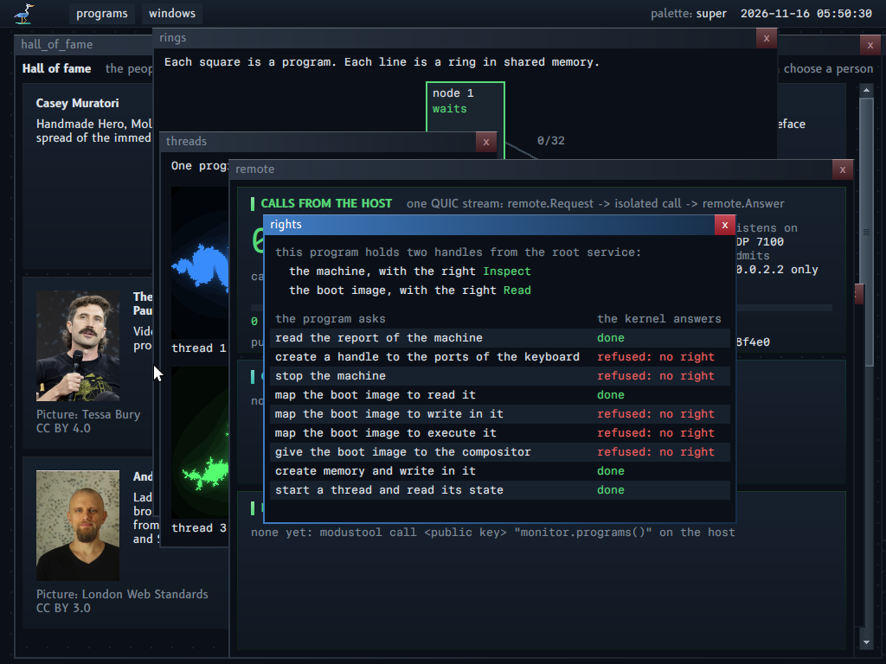

# Kernel properties

This document gives the 23 properties on which `modus` is built: the rules that every part of the system obeys, what each rule forbids, and what it costs. They are the fundamental concepts of the system: a design that breaks one is wrong until the property itself changes.

## How to read this document

**For whom.** A reader who wants to know why the system is the way it is, before they read how a part works. A reader who proposes a change compares it with these properties first.

**Read before.** Nothing. Each term is in `glossary/README.md`; on the site, the first use of a term on the page links to it. After this document, `ARCHITECTURE.md` shows the systems that apply these rules.

**The map of this document.**

| Section | What it says |
|---|---|
| "Objective", "Assumptions" | What the system aims at, and the three rules of every decision |
| "Summary" | The 23 properties in one table, with their status |
| "1. Small kernel with a small, counted interface" to "23. A role is a contract; its implementation is replaceable" | One section for each property |
| "Tensions between properties" | Where two properties pull against each other, and the answer |
| "Reuse list", "Open decisions", "First milestone" | What the system takes from others, what is still open, and the first end-to-end system |

**An example of how a property reads.** Property 2 says that a new process starts with no access. Its **Rule** is that a process holds only the handles that it received. Its **Forbids** is a global name that any process can open. Its **Cost** is that the desktop must give access through actions of the principal, such as a picker. The process `rights` shows the rule at work: the kernel refuses each operation for which the process lacks a right.

Each property has a status:

- **Decided**: it is a rule of the system.
- **Proposed**: it comes from the research or from design reasoning. It is a direction, not a rule of the system.

Each property gives the same fields:

- **Rule**: what the system does.
- **Forbids**: what the system must never contain.
- **Cost**: what the rule makes harder.
- **Reuse**: existing work that fits.
- **Open**: what is not decided.

Sources are marked as follows:

- `[Blow …]`: a statement of Jonathan Blow, with its reference in
  `research/blow_verified_statements.md`.
- `[Notes …]`: a file in `research/`.
- No mark: design reasoning written for this document.

## Objective

Build a kernel, then a desktop environment and user modules, that keep the functions of a current system with a small fraction of its code.

The measure of success is the amount of code and of mechanisms that the system does not need.
Adoption is not the objective. [Blow §1]

Three rules apply to every decision:

1. **One mechanism for one concept.** If two mechanisms do the same work, delete one.
2. **Reuse proven software where it fits.** Do not write again what is small, correct and permissively licensed.
3. **No foreign interface in the system.** The system does not implement POSIX, Win32, or the Linux system call interface: no process of the system and no kernel operation has their concepts. A foreign system can run whole inside a guest: a machine that a process of the system runs, and that holds only what that process was granted. The properties hold at the boundary of the guest; inside it, the foreign system keeps its own concepts.

## Assumptions

- **64 bits only.** An address is 64 bits on every machine of the system. The system has no 32-bit target and runs no 32-bit process. The targets are x86-64 first, and ARM64 at best.
- **Result**: an address, a count, a handle and a register value have one size: 8 bytes. A record has one layout on all machines. The call form passes each scalar in one word of 8 bytes: a register, or a word of the stack past the sixth integer argument. No contract has a second form for a smaller machine.
- **Forbids**: a type whose size depends on the machine, a 32-bit variant of a record, a compatibility mode for 32-bit code.

## Summary

| # | Property | Status |
|---|---|---|
| 1 | Small kernel with a small, counted interface | Decided |
| 2 | Sandbox by default: a process reaches only what it was given | Decided |
| 3 | No "everything is a file": each resource type has its own interface | Decided |
| 4 | Base interface is a non-blocking command buffer in shared memory | Decided |
| 5 | Kernel off the data path | Decided |
| 6 | One communication mechanism between processes: shared memory | Decided |
| 7 | No drivers in the kernel, and fixed hardware first | Decided |
| 8 | No global, mutable, shared file system | Decided |
| 9 | A storage engine with one private store per process | Decided: new engine under MIT |
| 10 | One code module: position-independent, static and dynamic are the same | Decided |
| 11 | Reproducible system: modules identified by content hash | Decided |
| 12 | Module metadata in flat tables, read through functions | Decided |
| 13 | Data-oriented kernel internals | Decided |
| 14 | Memory is supplied by the caller | Decided |
| 15 | Isolation inside a process for untrusted code | Decided |
| 16 | Removed concepts | Decided |
| 17 | Trusted boot: UEFI program, Secure Boot, TPM | Decided (detail proposed) |
| 18 | One 2D interface: the draw table; WebGPU later for the GPU | Decided (record form designed) |
| 19 | A command is a function: no text between processes | Decided (detail proposed) |
| 20 | No ambient access: the other holes to close | Decided |
| 21 | Principals: who acts, without users | Decided (layers 1 and 2); direction for the rest |
| 22 | General mechanisms, and a plain expression for each frequent task | Decided |
| 23 | A role is a contract; its implementation is replaceable | Decided (designed, not built) |

## 1. Small kernel with a small, counted interface

Status: Decided.

**In short.** The kernel does only what a process cannot do safely for itself, and the list of things that a process can ask it is short and counted. Each operation added to it is a cost that must be justified.

- **Rule**: The kernel does four things: it isolates address spaces, it schedules processors, it owns the table of handles, and it grants access to memory and devices. All other work runs in user space. [Blow §2]
- **Rule**: The kernel interface has a budget. The proposal is a hard limit on the number of kernel operations, written in this document, and changed only by a change of this document.
- **Forbids**: file systems, network protocols, device drivers, window management and text formats in the kernel.
- **Cost**: Each service that leaves the kernel needs a user-space home and a fast path to reach it. Properties 4, 5 and 6 pay this cost.
- **Reuse**: seL4 and Zircon show that a kernel of this scope ships. NT shows that one handle table for every kernel resource scales to a full system. [Notes `existing_kernels_good_ideas.md` §1, §3]
- **Open**: the limit itself. The first target was 32 operations or fewer. The kernel has 35 operations: each operation past 32 has its reason written in its guide (`Thread_Control`, 33: `ARCHITECTURE.md`, "The control of a thread"; `Guest_Run`, 34: `ARCHITECTURE.md`, "A guest"; `Log_Read`, 35: `ARCHITECTURE.md`, "The own log ring of a process").

## 2. Sandbox by default

Status: Decided.

**In short.** A process starts with nothing. It can reach only the objects whose handles it was given, with the rights that came with each handle, and every gift can be taken back.

- **Rule**: A new process starts with no access. It holds only the handles that its parent, or the principal through a grant, gave to it. [Blow §7]
- **Rule**: A handle is an index and a generation into a table that belongs to the process: one value of 32 bits, 16 bits of slot and 16 bits of generation (`op.Handle`). Each entry holds an object index and a set of rights. A process can reduce rights and pass a handle. It cannot create rights.
- **Rule**: The sandbox is the base model. No operation exists that works without a handle.
- **Forbids**: global names that any process can open, user identifiers as the access model, access control lists on a shared namespace, a "root" user.
- **Cost**: The desktop must give access through user actions. A file picker that runs outside the process and returns a handle is the standard solution. Processes that need broad access, such as a backup tool or a file manager, need an explicit grant model.
- **Reuse**: Zircon handles with rights. Capsicum. The "powerbox" file picker pattern. [Notes `existing_kernels_good_ideas.md` §3, §4]
- **Revocation**: the kernel keeps the origin of each handle and each mapping. `Handle_Revoke` ends what came from a handle, through each chain of gifts.
- **Open**: how the principal sees and revokes grants on the desktop. The console has `grants` and `revoke`. No window shows the grants. Blow gives no design for the desktop part. [Blow §7]

## 3. No "everything is a file"

Status: Decided.

**In short.** A document, a connection, a device and a memory region are different things, and each has its own operations. One table of handles names them all, but no single read and write interface pretends that they are the same.

- **Rule**: A stored object, a network connection, a device queue, a timer and a memory region are different types. Each type has its own small set of operations. [Blow §4]
- **Rule**: The handle table is uniform. The operations are not. A handle has a type, and the kernel rejects an operation that does not belong to the type.
- **Forbids**: a universal `read`/`write`/`ioctl` interface, a `/dev` tree, a `/proc` tree, pipes as the composition mechanism, sockets as the network interface, text as the format of system state.
- **Cost**: Generic tools that work on "any stream" do not exist. Composition between processes uses typed data in shared memory (property 6) and callable modules (property 10).
- **Reuse**: NT object types. Zircon object types.
- **Note**: This rule does not conflict with one handle table. NT keeps uniform naming and lifetime with typed operations. Unix makes the operations uniform, and that is the part that is rejected.

## 4. Base interface: non-blocking command buffers

Status: Decided. It is the interface that Blow describes. [Blow §3]

**In short.** A process asks for work by writing records into a ring in shared memory, and reads the answers from the same ring. Many requests travel in one kernel entry, and a process waits only when it chooses to.

- **Rule**: A process asks for work by writing command records into a submission ring in memory that it shares with the receiver. It reads results from a completion ring. The receiver is the kernel or another process.
- **Rule**: No operation blocks at this level. One kernel operation exists to wait: "sleep until one of these rings has entries". As built, the wait is the one entry point of the kernel with a deadline, and `Word_Wait` names the words of the rings that end it (property 6, "Wake-up").
- **Rule**: A blocking call is a library function above the rings.
- **Rule**: Data is not copied through the kernel. A command refers to memory that both sides map.
- **Forbids**: one kernel entry per operation as the normal path, blocking kernel operations, hidden copies.
- **Cost**: Asynchronous code is harder to write than blocking code. The base library must make the blocking form one call. Ring formats become a stable binary contract, and they need a version rule.
- **Reuse**: The io_uring ring layout is proven and documented. Virtio queues and NVMe queue pairs use the same pattern. FlexSC measured the gain of batched kernel entry. [Notes `data_oriented_kernel.md` §3]
- **Why it matters**: The dominant cost of a kernel entry is cache pollution and not the mode switch. Batches reduce the number of entries. [Notes `data_oriented_kernel.md` §2]
- **Open**: one ring format for kernel, devices and processes, or one format per use. The proposal is one format.

## 5. Kernel off the data path

Status: Decided.

**In short.** The kernel sets up access once, then gets out of the way: the bytes of a disk or a network go between the process and the device, or the service, with no kernel entry for each one.

- **Rule**: The kernel is the control plane. It checks the right one time and maps the device queue or the shared ring into the process. After that, data moves without a kernel entry. [Blow §5]
- **Rule**: The network stack is a library in the process that uses the network. [Blow §5]
- **As built**: the network device of the first machine has one pair of queues, so the network service is the user-space multiplexer of the cost line below. It reads the headers of each frame that arrives, checks them against the grant of an endpoint, and copies the datagram or the segment one time into the region of the process. For a datagram or a segment that leaves, it copies the first 8 bytes of the transport header, checks them in its own copy, and writes the headers of IPv4 and Ethernet; the device reads the data from the region of the process, which the frame service holds with the right Read only. It computes no checksum of data, writes no transport header and keeps no state of a connection: TCP, QUIC, and the header and the checksum of UDP are libraries in the process. The kernel carries no data. With a device that gives each endpoint its own receive queue and steers by port, the copy on receive leaves too (`docs/NETWORK.md`, "Property 5 as it is built").
- **As built, the devices**: when the firmware lists an IOMMU of Intel or of AMD, the kernel lets each device reach only the memory that its service declared with `Memory_Physical`, and a device sends only the message interrupts that `Device_Create` made for it. A refused access is a line of the log. A machine with no IOMMU does not hold this isolation: a device there reaches all memory. The mechanism is in `docs/ARCHITECTURE.md`, "K5. Device grant and interrupts"; the design is `src/md/infrastructure/iommu.md`.
- **Forbids**: a kernel network stack, a kernel block layer, a kernel entry per packet or per block.
- **Cost**: Two processes that use one device need the device to give separate queues, or they need a user-space multiplexer. Direct device access is safe only with an IOMMU, or with a device that the hypervisor isolates. A process can no longer rely on the kernel to keep a connection alive when the process stops.
- **Reuse**: Arrakis and IX prove the model. DPDK and SPDK are production examples of user-space network and NVMe access. A small permissive TCP library such as lwIP or smoltcp can be the first stack. [Notes `existing_kernels_good_ideas.md` §3] [Notes `bcachefs_storage.md` §5]
- **Open**: the multiplexer for devices with one queue. The rule for a shared network identity, because several processes share one address and one port space.

## 6. One communication mechanism between processes

Status: Decided.

**In short.** Processes talk through memory that both map, with records of a fixed layout and one way to wait. The system has no pipes, signals or local sockets beside it.

- **Rule**: Two processes communicate through memory that both map. The kernel creates the mapping and transfers handles. It does not carry the data. [Blow §8]
- **Rule**: The mapping uses the ring format of property 4. A call to a service and a call to the kernel look the same.
- **Rule**: Data in the mapping is binary structures with a fixed layout. It is not serialized text.
- **Forbids**: pipes, signals, message queues, sockets between local processes, a second mechanism "for small messages".
- **Cost**: A receiver must treat shared memory as hostile: the sender can change it during the read. The rule is "copy, then validate". Layouts must be versioned. A process that waits on a dead peer needs a kernel notification.
- **Reuse**: L4 and seL4 show how few cache lines a fast path needs. [Notes `data_oriented_kernel.md` §3]
- **Wake-up**: the wake-up primitive is the word wait (`Word_Wait`, `Word_Wake`). Each ring waits on it: the system has one wait.
- **Open**: How a handle moves through a ring.

## 7. No drivers in the kernel, and fixed hardware first

Status: Decided. The rules follow Blow. [Blow §5, §6]

**In short.** The code that drives a device is an ordinary process, so a fault in it stops that process and not the machine. The system targets one fixed machine at a time, starting with a virtual one.

- **Rule**: The kernel contains no device driver. The code that knows a device is a library or a user-space process.
- **Rule**: The IOMMU is what makes a driver outside the kernel safe. A device service reaches only the memory that it was given, and the device that it drives reaches only the windows that the kernel opens for it in the IOMMU (`src/md/infrastructure/iommu.md`). Without the IOMMU, a device that a process drives could write any memory by DMA, and the process would hold the whole machine. The machine tests check it on QEMU, with the IOMMU of Intel and of AMD.
- **Rule**: The system targets one fixed machine at a time. The first machine is virtual: QEMU on x86-64 with virtio devices, UEFI firmware (OVMF) and a TPM 2.0 (property 17).
- **Position**: Hardware support is not the main problem of the project. The design of the system is.
- **Rule**: Each device class has one standard queue protocol. Virtio is that protocol for the first machine. Real hardware that differs gets a user-space translator, with no kernel access.
- **Rule**: The translator is a device service: a process that holds the handles of its device only (its registers, its interrupts, a budget of memory declared to the IOMMU) and serves the class protocol of its device. A device service of the boot image is trusted by the signed system description. A device service from the disk runs only with a grant of a principal for one device, and only with an IOMMU (`src/md/features/device_services.md`).
- **Why virtio**: It is a published standard for network, block, console, input and display. Each device is a set of queues in shared memory. This is the "standard packet format over DMA" that Blow asks for, and it exists today. [Blow §5]
- **Forbids**: loadable kernel modules, vendor code in the kernel, support in the boot image for hardware that nobody on the project owns. This forbid binds the boot image: a device service that a principal grants from the disk is not support of the system.
- **Cost**: The system runs on few real machines for a long time. This is accepted. [Blow §6]
- **Graphics**: See property 18.
- **Reuse**: Virtio specification. UEFI firmware for boot (property 17).
- **Open**: the second machine. A single-board computer with documented hardware is the usual choice. The processor architecture after x86-64.

## 8. No global, mutable, shared file system

Status: Decided.

**In short.** No tree of names exists that every process can read and write. A process sees its own store, and the objects that it was handed.

- **Why**: This is a security requirement, not a preference. A shared tree that every process can read and write is a source of many security defects. A security model that fits the present time cannot keep it.
- **Rule**: No tree of names exists that all processes see and can change. A process sees its own store and the objects that it received by handle. [Blow §7]
- **Rule**: System code and system data are immutable and identified by content hash (property 11).
- **Forbids**: `PATH`, a registry, installers, shared configuration directories that processes write, hidden files in a home directory. [Blow §9]
- **Cost**: Sharing a document between two processes is an explicit act. The user needs one place to see "my documents" that is not owned by one process. The proposal is a document store service that the desktop owns and that grants objects by handle.
- **Open**: the user-visible model of documents. Blow allows read access to common configuration and to a user folder; the proposal here is stricter. [Blow §7]

## 9. A storage engine with one private store per process

Status: Decided. The engine is new, under MIT, and reuses ideas of bcachefs. It is not a fork of bcachefs.

**In short.** Each process keeps its data in its own store, through a storage service in user space. Every change is committed when it happens, and the earlier versions are kept.

The engine is the storage service in Odin: about 4 200 lines in `src/modules/system/storage`, and about 3 100 more in the libraries that it shares with the tool (`src/library/private/storage/storage_mount`, `src/library/private/storage/storage_tree`, `src/library/private/storage/storage_object`, `src/library/private/storage/storage_retention`), tests not counted. It writes by copy on write, keeps two places for the root block, and checks each block in the pointer that names it. The system holds no SQLite. One rule below is not done: objects have names in a store, not identifiers. Each commit keeps the state before it as a version, with a retention rule and thinning at the limit of the store. Clones share their blocks. A snapshot is the versions of a store at one generation.

- **Rule**: Storage is a transactional object store in user space. Objects have identifiers, not paths. A directory is an optional index, not the base structure.
- **Rule**: Each process gets a private store. A copy-on-write clone is the way to give a copy of an object. A snapshot gives versions of a store.
- **Rule**: The storage service reaches the disk through the queues of property 5.
- **Recommendation**: Do not fork bcachefs. It is GPL-2.0, more than 100,000 lines of Linux-specific code, and it has one maintainer. Write a small engine that takes its best ideas: the cache-line-aware search inside a B-tree node, and buckets with generation numbers. [Notes `bcachefs_storage.md` §3, §7]
- **Recommendation**: Take the structure from Fuchsia Fxfs: user-space, object identifiers, directories optional. [Notes `bcachefs_storage.md` §5]
- **Cost**: A new storage engine is the largest reliability risk in the project. The answer is its tests of a stop in the machine test, not a borrowed engine.
- **Licence**: the engine is under MIT and reimplements the ideas. The other option, upstream bcachefs as a separate GPL user-space service, is not taken.

### Persistence: no save action, and versions for all processes

Status: Decided.

- **Rule**: A process sends each change of a document to the storage service when the change occurs. The document in storage is always current. The system has no "save" action.
- **Rule**: The storage service keeps the earlier versions of each object until its retention rule, the limit of the store or the remove of the object ends them; a version whose index or leaf has a wrong check is dropped at the next commit of its object. A process, or the principal through a process, can read an object as it was at an earlier time. One more end exists: the root service gives the grant to erase versions only to a process that keeps a secret that an earlier version must not keep (today `unlock`), and that process ends the versions of the objects of its own store and has their blocks written with zeros.
- **Guarantee**: A document is never lost and never half written. A power loss or a process failure loses at most the change that was in progress.
- **Interface that this requires from storage**: "apply this change atomically" and "give me this object at time T". Not "replace the whole object".
- **Why it is cheap**: A copy-on-write store writes new blocks and keeps the old ones. The earlier versions exist already. The system exposes them, and discards them only by the ends that the rule above names.
- **Result**: Protection against lost work and a history are supplied one time, by the system, to all processes. A process writes no code for them.
- **Cost**: Disk space. A retention rule deletes old versions, for example: keep all versions for one day, then one per hour, then one per day; the limit of a store thins the oldest. A process with the grant to erase versions ends the versions of a secret, and the history of that object is then gone (`src/md/features/version_erase.md`).
- **Open**: who sets the retention rule (the service applies one fixed rule: each version for 10 minutes, then one an hour for a day, then one a day). How a process groups small changes into one step that the principal can undo. A later option above this model is a process whose full state returns after a restart.

## 10. One code module

Status: Decided.

**In short.** A library and the code that a process runs are one thing: a module. The same module can be linked in or loaded, and called directly or from another process.

- **Rule**: All code is position-independent. One module format exists. [Blow §9]
- **Rule**: "Static" and "dynamic" are link-time choices on the same module. A module that was bundled keeps its identity inside the bundle, so a tool can find and replace it. [Blow §9]
- **Rule**: A library and the module of a process are the same thing. A module exports functions. A module that exports an entry function can start as a process. The `grep` command is the `grep` module with an entry function. [Blow §9]
- **Forbids**: separate archive and shared-object formats, a global library directory, symbol lookup by search order, a C library that the system imposes.
- **Cost**: Inlining across modules removes the ability to replace a module. Patching calls at load time makes pages private to a process.
- **Reuse**: The object formats of today already contain position-independent code. The project can use an existing compiler back end and define only the container and the loader.
- **Open**:
  1. Where inlining across modules is allowed. Proposal: only inside a bundle, and the bundle records it.
  2. If the loader patches calls between modules. Proposal: no; calls go through a table per module, so code pages stay shared and identical to the file.
  3. The calling convention between modules. It is a permanent contract. [Blow, `6zQzNpjgbAY` 15:15]

## 11. Reproducible system

Status: Decided. The detail below is proposed.

**In short.** A module is named by the hash of its bytes, and a system is a list of such hashes. Two machines with the same list run the same code.

- **Rule**: The identity of a module is the hash of its content. A module refers to another module by hash, never by path or by name.
- **Rule**: A system is a list of hashes. Two machines with the same list run the same code.
- **Rule**: When a process compiles code at run time (a compiler of WebAssembly, of a script), that code is not a module and has no hash. It is confined to the process that wrote it, in its own memory, and is never shared with another process or kept as a module. The compiler is a module, named by its hash, so the hash of the compiler names what the process can run. A page of such code is never writable and executable at once.
- **Rule**: An upgrade writes a new list. A rollback selects an old list. Both are atomic. A rollback below the security version of the version floor of the TPM is refused: the publisher raises the security version only for a flaw that the old list would bring back (property 17).
- **Why property 10 makes this cheaper**: Nix reaches the same goal on Linux, and it must fix the store at one absolute path, because binaries contain absolute paths. Modules that are relocatable and that refer by hash contain no path. The store can be at any location, and a module needs no patch after a copy.
- **Consequence**: "Install" becomes "the store contains the hash". This matches "no installs". [Blow §9] Identical modules are stored one time and their pages are shared, with no global library directory.
- **Consequence**: A security fix is a query: "which bundles contain the hash of the bad module". [Blow §9]
- **Cost**: A build must be deterministic for the hash to mean something. The compiler and the linker must not write times, host names or random identifiers. Old modules need garbage collection.
- **Reuse**: The Nix store model and its closure concept. Content-addressed derivations in Nix.
- **Open**: whether the first engine of WebAssembly compiles at run time, under the rule above, or interprets, which needs no such rule (`src/md/features/desktop_to_browser.md`, "I. WebAssembly as a code format"). The hash function. BLAKE3 is the proposal. How names for people map to hashes; the proposal is a signed table in the system description.
- **State**: the build is deterministic for the compiler of the flake: a fork of the release `dev-2026-11a` of Odin that adds one option for the debug information and is the release without it, on all its threads (`docs/REPRODUCIBLE_BUILD.md`). Measured on 2026-11-11: with the release `dev-2026-05` and a patch that gives it one thread, 100 builds of each of the 61 modules and of the boot program, under a host load of 9.5 to 62, gave one module, one LLVM IR file and one object each; with `dev-2026-11a` and no patch, 20 builds of each of 64 modules gave the same. The stock `dev-2026-05` with `-thread-count:1` runs two threads, and a rare build with it gives other code. Each full check builds everything two times and compares the three.

## 12. Module metadata in flat tables, read through functions

Status: Decided. The system holds no SQLite: no base library and no index over the tables of the modules.

**In short.** What a module contains and exports is written in flat tables inside the module. Processes ask questions about modules by calling functions that read those tables, never through a database.

- **Rule**: The metadata of a module is a set of flat tables inside the module: arrays of fixed-size records at known offsets, valid when zero. They hold the symbols, the interfaces, the dependencies, the origin of each bundled module and the debug information. The flat tables are the source of truth, and the only format.
- **Rule**: The loader reads the flat tables directly.
- **Rule**: A rich and descriptive set of functions gives the information of the modules: clear functions with documentation, that a process and the console call. A question across many modules is a function that reads the tables in a line. The results are tables of records, so that the functions combine. A table also goes into a function as a parameter (property 19, "State"). No query language exists in the system.
- **Why**: A language and an engine to maintain cost far more than good functions. The tables of a machine are small, and a linear read of flat tables is the data-oriented way (P13). One format has no copy to keep equal to its source.
- **Cost**: A new kind of question needs a new function, or a combination of functions in the console.
- **Not forbidden**: a process can bring SQLite as its own module. The system does not need it and does not serve it.

## 13. Data-oriented kernel internals

Status: Decided.

**In short.** The kernel keeps its state in flat tables of fixed size, laid out for the processor caches. It names objects by index, not by pointer, and processes work in batches.

- **Rule**: Kernel state is flat tables. A reference is an index with a generation, not a pointer.
- **Rule**: Each table is split by access: fields that the fast path reads are together, cold fields are in a second table.
- **Rule**: State that a processor changes often is per processor. No cache line is written by two processors on a fast path.
- **Rule**: Each fast path has a budget in cache lines, written in the code and checked by a test.
- **Rule**: The kernel processes batches. A function takes an array of work, not one item.
- **Rule**: The cache line size is a build parameter. It is 64 bytes on x86-64 and can be 128 bytes on other machines. [Notes `data_oriented_kernel.md` §2]
- **Forbids**: linked lists and pointer trees on fast paths, a reference count per object that every reader writes, tables of function pointers on fast paths.
- **Cost**: Fixed tables need sizes. A table that grows needs a reserve of address space (property 14).
- **Reuse**: The research found no kernel that applies these rules to its whole object model. Linux, seL4 and others apply them to single paths. This part is new work. [Notes `data_oriented_kernel.md` §3, §5]

### Zero is initialization (ZII)

Status: Decided as a principle. The detail below is proposed. The name comes from Casey Muratori.

- **Rule**: A record that is all zero bytes is a valid record with a defined meaning. No record needs a constructor.
- **Rule**: This applies to every contract of the system: the context of property 19, ring records, module metadata, kernel tables.
- **Consequences**:
  1. Memory from the kernel is zero pages, so new memory is already initialized (property 14).
  2. Handle 0 is the "no object" handle. An operation on it fails in a defined way and does no damage. Index 0 of each table is a reserved empty entry, so a zero index never points to a live object.
  3. A zero field in a command record means "default". A caller fills only the fields that it needs.
  4. A new field at the end of a record is zero for old callers. This gives a rule for the growth of contracts with no version number per record.
  5. Lookups return the empty entry and not an error path. Code has fewer branches.
- **Fits**: the rule that no contract depends on a language feature (property 19). Zero bytes mean the same thing in every language.
- **Cost**: Each enumeration must reserve 0 for "none" or "default". A real value that is 0 (an offset, a count) cannot also mean "absent"; such fields need a separate flag.

## 14. Memory is supplied by the caller

Status: Decided.

**In short.** Whoever asks for work gives the memory for its result, and whoever creates an object pays for it. The kernel keeps no hidden memory that a process can fill.

- **Rule**: A kernel operation writes its result into memory that the caller gives. The kernel does not allocate hidden state per call.
- **Rule**: "Reserve address space" and "commit pages" are two cheap operations. Processes build arenas on them.
- **Rule**: The memory that a kernel object uses is charged to the process that created it.
- **Rule**: A process that holds data with no known bound holds it in arenas: memory objects of its budget that grow by an explicit commit and end whole. A refused growth is the status `No_Budget`, which the process reads; it never stops the process.
- **Forbids**: a kernel heap that a process can fill, a global user-space heap that the system imposes [Blow §12]; a growth of memory that a process does not ask for at a call: a commit that the kernel makes on a fault, an allocator of the language in the code of the system.
- **Reuse**: The arena conventions of Odin, Zig and Jai. The seL4 model, where user space supplies the memory of kernel objects. [Notes `handmade_sphere_os.md` §4]
- **Open**: the reservation size of each arena and the rule of the scratch arena (`src/md/features/memory_without_a_bound.md`, "The decision points").

## 15. Isolation inside a process

Status: Decided. Blow names it as an unsolved problem. [Blow §11]

**In short.** A process can want to run code that it does not trust. Today such code runs as its own process; a lighter form inside one address space is a direction, not a design.

- **Problem**: A process wants to run a plugin that it does not trust, share data structures with it, and survive its crash. Today this needs a second process and serialization.
- **Proposal**: A process can contain several protection domains. A domain is a set of page rights inside one address space. A switch between domains costs less than a process switch. A domain can be destroyed alone.
- **Cost**: The hardware support differs by processor. The x86-64 memory protection keys give 16 domains and do not stop all attacks by themselves. Shared lock-free state stays the problem that Blow describes.
- **Alternative**: A standard sandboxed bytecode for untrusted code, in the role of WebAssembly. [Blow §11]
- **Direction**: WebAssembly becomes a portable and confined code format, after the port of `gui_toolkit`. A WebAssembly file is data named by its hash; an engine module of the system, named by its hash, runs it inside one process, with only the imports that the process gives. The engine compiles at run time under the rule of property 11, or interprets: that choice is open (`src/md/features/desktop_to_browser.md`, "I. WebAssembly as a code format").
- **Recommendation**: Do not design this now. Keep the handle table and the module format free of assumptions that prevent it. Decide after the first desktop module exists.

## 16. Removed concepts

Status: Decided.

**In short.** Many concepts of current systems have no place here. The table names each one and what takes its role.

| Concept | Replacement |
|---|---|
| Everything is a file (Decided) | Typed handles (property 3) |
| Global file system (Decided) | Private stores and grants (properties 8, 9) |
| `fork` | Create an empty process, then give it modules and handles |
| Signals | Completion records in a ring |
| Pipes and terminals | Shared memory with typed data; a terminal is a normal process |
| Sockets | A network library with connect, send, receive, disconnect [Blow §4] |
| `ioctl` | Typed commands per resource type |
| Users, groups, root | Handles and grants |
| Installers, package scripts | The store contains the hash (property 11) |
| `PATH`, registry, environment as configuration | The system description and per-process stores |
| Shell scripts as system glue | Processes that call modules [Blow §9] |
| Kernel modules | User-space device code (property 7) |
| Hundreds of background processes | Services start when a process asks for them [Blow §2] |

## 17. Trusted boot: UEFI program, Secure Boot, TPM

Status: Decided. The detail below is proposed.

**In short.** Before the kernel starts, the boot program checks a signed list of the hashes of the whole system, and the TPM records which list started. With Secure Boot, the firmware checks the boot program too.

- **Rule**: The boot stage is a UEFI program. It uses the firmware services before it gives control to the kernel: it reads the modules from the boot volume, gets the memory map, gets the framebuffer, gets random numbers, and talks to the TPM. The project writes no boot loader and no boot-time disk or display code.
- **Rule**: Secure Boot verifies the boot program. The key of the principal that signs the system signs it. The firmware refuses a boot program that is not signed.
- **Rule**: The boot is measured. The boot program extends a TPM register with the hash of the system description of property 11, before the kernel starts.
- **Why property 11 makes this cheap**: A system is one list of hashes. One measurement of that list covers every module of the system. Current systems must measure a kernel, an initial disk image, a command line and many files separately.
- **Uses of the TPM**:
  1. Seal the storage encryption key to the measured state. A changed system cannot read the disk.
  2. Hold the key that signs the name table of property 11, or the key that verifies it.
  3. Prove to a remote party which system list runs (attestation).
  4. Give a hardware source of random numbers at boot.
- **Rule**: After boot, the TPM is a device like the others. A user-space service owns its queue. Processes reach it by handle (properties 2 and 7). Built: the TPM service, a process with the registers of the TPM, whose clients are `unlock`, which seals and unseals, and the root service, which has it extend PCR 12 with each start policy on a ring of its own, the measure ring; it sends no raw command for a client.
- **Forbids**: an unsigned code path from firmware to kernel, a boot loader with a configuration language, kernel arguments as free text.
- **Cost**: A key that is sealed to exact measurements becomes unreadable after each upgrade. The standard solution is to seal to a signed policy in place of exact values: the TPM releases the key to any system list that the key of the principal that signs the system signed. A rollback to an old signed list with a known defect must be prevented by a counter in the TPM.
- **Cost**: The system needs a key management story for the principal that signs the system: creation, enrolment in the firmware, backup, loss.
- **Reuse**: UEFI firmware services. OVMF and a software TPM under QEMU give Secure Boot and a TPM 2.0 on the first machine. The TCG TPM 2.0 specification. A small permissive TPM command library, to be selected.
- **Open**: the exact meaning of "rich boot". This text reads it as "do as much boot work as possible with UEFI services in a UEFI program". How much the boot program does before it leaves firmware services. Which registers hold which measurements.
- **State**: built: the signed system description, the measure into PCR 11 and Secure Boot (`docs/TRUSTED_BOOT.md`); the seal of the machine key and of the keys of a named principal by the TPM service (`docs/PRINCIPALS.md`, "The machine key sealed by the TPM" and "The keys sealed by the TPM"); the TPM floors, which refuse an older signed system and a revoked key (`docs/TRUSTED_BOOT.md`, "10. The TPM floors"). The work that is left is in `ROADMAP.md`.

## 18. One 2D interface: the draw table

Status: Decided. The rationalised form of the record is designed, not built (`src/md/api/draw_table.md`).

**In short.** Processes draw in 2D through one interface: a table of fixed draw records in their own memory, which the drawing module draws into the surface and which the compositor draws into the screen. WebGPU is the later interface of the GPU; when a GPU exists, the draw table is drawn through it.

- **Rule**: A process draws in 2D through one interface: the draw table. A frame is a table of draw records of one fixed size, in the memory of the process (property 14). The system exposes no other 2D interface.
- **Rule**: The records are a closed set of primitives: a rectangle, a gradient along a line, a path with a fill and a stroke, a text run, a picture, a clip that is pushed and popped. An element that is pushed and popped draws nothing: it gives the records inside it an element role, its states and an accessible name, so the semantic tree of a frame comes from the table that draws it (designed, not built: `src/md/features/accessibility.md`). Each record has a kind and the fields of that kind only. A color has an alpha, and one blending rule serves every kind. The look of the system (the grid of points, the folded gap) is elements of the interface package, drawn with the primitives, never a kind of the format.
- **Rule**: The interface puts no limit of look on what a process draws: any form, alpha, paths, and effects as they come. The closed set grows when a process needs a primitive. Its only limits are the bounds of cost that refuse a hostile record. The sober look (rectangles, sharp shadows, transparency only where it informs, short animations that inform) is a rule of the desktop of the system (`DESIGN.md`, "2. Forms"), never of the format.
- **Rule**: A record names its bytes and its pixels by values, never by an address. The execution refuses a hostile record within stated bounds. The damage of a frame is the difference of two tables, and a frame drawn in its damage gives the same pixels as the frame drawn whole.
- **Rule**: The compositor draws its screen with the same records as the processes.
- **Why it fits**:
  1. The output of a frame is data: a table can be compared, drawn again in a part, measured, tested, and drawn by another back end. This is the shape of property 4, with no queue to a device.
  2. A record holds values only and the execution checks each one, so a process cannot reach the memory of another process through it. This matches the sandbox of property 2.
  3. The drawing is code that runs on the processor in the address space of the process, through one library module (property 10). It needs no device and no driver (property 7).
  4. Its size is the size of the 2D drawing: a rasterizer in integers that the vector font already has, the blends, the text from the glyph caches.
- **Rule**: WebGPU, with shaders in WGSL, is the later interface of the GPU. When a GPU exists, the drawing module has a back end that draws the draw table through WebGPU. The draw table is never drawn through a software WebGPU.
- **Rule**: The WebGPU of the system is its own subset: only what the draw table, the compositor and 3D need. WGSL is compiled to SPIR-V before the run, by the build; the system holds no compiler of shaders.
- **Rule**: A process that draws 3D with no GPU uses the processor back end of the same subset: the same buffers, pipelines, command lists and draw calls, so only the back end changes. Its shaders are a small fixed set written in Odin with SIMD, not WGSL. It is not a separate drawer of 3D.
- **Refused**: a software adapter of WebGPU as the 2D interface, and a compiler of WGSL for the processor. Such a compiler is larger than the whole 2D drawing, and the adapter draws a rectangle through a shader.
- **Layers of the GPU** (grow in this order, each after the draw table works on the processor):
  1. virtio-gpu under QEMU: the 2D scanout, then Vulkan to the host through Venus, then the WebGPU subset on it (`src/md/features/gpu_access.md`).
  2. A real GPU through the Linux driver domain, with the same serialization.
- **Rule**: The standard of quality of the desktop has two quality profiles. The GPU profile is 120 Hz at 1920 × 1080: a frame in less than 8.3 ms, a key to the screen in less than 20 ms, and a window shown less than 100 ms after its start. The processor profile, for a machine with no GPU, can lower the resolution, the rate or the effects; its thresholds come from a measure of a frame at 1920 × 1080 on the processor, not from a guess. The first measure keeps 1920 × 1080 at 120 Hz and leaves out the blur (`src/md/features/desktop_to_browser.md`, "The thresholds of the processor profile"). The system chooses its profile at its start, from what the machine has, and writes it on the log.
- **Rule**: The tool records the three measures of each profile and follows them over the releases; they are measures, never tests. A change that makes one worse is a regression that a developer reads to its cause.
- **Why this property**: the three measures are the path from an input to drawn pixels, which the draw table, the drawing module and the compositor own. A new property would hold one rule.
- **Forbids**: a second 2D interface beside the draw table, OpenGL, vendor shader languages as a process-facing format, a window system protocol that carries drawing commands to another process. [Blow §10]
- **Cost**: A record is 48 bytes, and alpha, antialiased edges and paths cost more on the processor than the fills of today; each cost is an estimate to measure (`src/md/api/draw_table.md`, "What costs more than version 10").
- **Cost**: A process that needs 3D has the processor back end only until the GPU layers exist, and compute waits for them. This is accepted: the first machine has no GPU.
- **Cost of the GPU layers**: A WebGPU implementation is large. The existing ones, wgpu and Dawn, sit on Vulkan, Metal or Direct3D, which this system does not have. The subset of the system is smaller, and it sits on Vulkan through Venus. This is the largest piece of device work in the plan.
- **Tension with property 7**: Blow wants a very thin graphics driver. A WebGPU back end for a real device is not thin. The draw table on the processor delays this problem; it does not remove it.
- **Reuse**: the exact-area rasterizer of font-rs and stb_truetype 2, as ideas. The WebGPU and WGSL specifications, SPIR-V, and the Venus protocol of virtio-gpu for the GPU layers. HarfBuzz, planned, for the shaping of complex scripts in a library module: shaping gives glyph indices and positions and draws no pixel, so it is not a part of the drawing that this property keeps written from nothing (`src/md/features/interface_language.md`, "Why HarfBuzz keeps property 18").
- **Rule**: The code of the system writes its drawing and its WebGPU subset from nothing. It does not port wgpu, Dawn, Skia or another 2D library, and it uses no existing toolkit. The code of the system is the kernel, the boot program, `src/library` and the modules of `src/modules`.
- **Rule**: A rich module and a ported module can use `gui_toolkit`, the toolkit of rich modules. Each is an outside module, not a source of `src/`, and it still draws through the draw table, and later through the WebGPU subset (`src/md/features/desktop_to_browser.md`, "The toolkit of rich modules").
- **Open**: The role of the kernel for a GPU: the proposal is none beyond the mapping of device queues (property 5). A port of wgpu or Dawn as a module of a third party, over the WebGPU of the system.
- **State**: built: a surface is shared memory of pixels, the compositor copies the changed rectangles to the framebuffer, and processes draw on the processor through the draw table, version 17, and the drawing module (`src/library/support/graphics`, `src/library/support/interface`, `INTERFACE.md`). Of the rationalised form of the record, the first seven steps are built: each record is a header with its kind, its element and its box in 1/64 pixel, then the fields of its kind only, read through one border that refuses a byte past its bound (`src/library/contract/draw_record`); the grid of points and the folded gap are elements of the interface package, drawn with a rectangle that repeats, rectangles and a stroked path; a text is one kind, with its font as a field; a color holds an alpha that blends by one rule in linear light, in a rectangle, a gradient, a text, a picture and a path; a rectangle and a gradient, one kind along any line, can have edges inside a pixel; a path of lines and quadratic curves is filled and stroked with antialiased edges, and a line is its stroke; and a clip is pushed and popped, so a clip inside a clip keeps the outer one. On the standard VGA of the test machine, the compositor writes the screen page that the display does not show and flips (`src/md/infrastructure/whole_frame.md`). Left: the other steps of `ROADMAP.md` (the measure of the text grid); no virtio-gpu and no real GPU are built.

## 19. A command is a function: no text between processes

Status: Decided. The detail below is proposed.

**In short.** A command is a function that a module exports, with typed parameters that its description gives. Processes pass typed values to each other and never parse each other's text.

- **Rule**: Processes do not exchange text that the receiver must parse. The system has no command line arguments as strings, no text pipes, no standard input and output streams, and no environment variables.
- **Rule**: A command line program and a library are the same thing. Both are a module that exports functions (property 10). A command is one exported function.
- **Rule**: The metadata of a module (property 12) describes each exported function completely: its name, the name and type of each parameter, the type of each result, and a text for a reader. This description is sufficient to call the function with no other knowledge of the module.
- **Rule**: A started process receives no `argc` and no `argv`. At the minimum, it receives one structured context: a typed record with a fixed layout.
- **Content of the context** (proposed): the typed arguments of the called function, the handles that the caller grants (property 2), and the rings to the caller and to the kernel (property 4). The context holds no strings that the process must parse.
- **State of the context**: built as 20 handles and 24 values of 64 bits, whose index is their role; the kernel ring is not in it, because each thread finds its own (`MODULE_CONTRACT.md`, "6. The context").
- **Rule**: No contract of the system depends on a feature of one programming language. The context, the module format, the calling convention, the type description and the ring layouts are defined as memory layouts and numbers. A process in any language that can read and write memory at fixed offsets can use them.
- **Consequence**: The context is a plain record of the system. It is not the implicit `context` of Odin or Jai. A language binding can copy its fields into a language feature; the system does not know about it.
- **Consequences**:
  1. The console reads the metadata and calls the function directly, with typed values. Completion, help and argument checks come from the metadata, not from code in each process.
  2. A process calls the same function as a library call. The principal at the console and the process use one interface.
  3. The output of a function is typed data: records and tables. The console displays it. The next function receives it with no parsing.
  4. Other front ends can be generated from the same metadata: a form in the desktop, a remote call, a test.
- **Why**: Text between processes forces each process to write a parser and a printer, and each pair of processes to agree on a format that no tool checks. Errors appear at run time and in the data. Blow's "a program is a library" gives the mechanism. [Blow §3]
- **Forbids**: `argv`, `stdin`, `stdout`, exit codes as the only result, a shell script language, formats that are defined only by the output of a tool.
- **Depends on**: the contract between modules (property 10). The type description must be independent of the implementation language, so that a module in one language can call a module in another.
- **Isolation**: A call from the console to an untrusted module starts the module as a sandboxed process, and the arguments travel as records in a ring (properties 2 and 4). A call to a trusted module can be a direct call in the same address space. The metadata is the same in both cases.
- **Cost**: The type description becomes a permanent contract of the system. Its design must come before the first modules.
- **Cost**: Streams of data with no known end (logs, audio, large results) need a typed stream form above rings, not one return value.
- **Prior art to study**: PowerShell (objects in pipelines), Nushell (typed tables), Lisp machines and Oberon (commands are exported procedures), COM and WinRT metadata, the WebAssembly component model (language-independent interface types).
- **State**: a table of records and a range of bytes are parameters, each with a direction (Read, Change, Append), in memory of the caller (P14). One description serves a direct call with no copy, a call host and a service. A table too large for the call region goes in a lent memory object whose rights are the direction (P20). The process `tables` shows the same answers in the three ways; `MODULE_CONTRACT.md`, "Tables and bytes as parameters".
- **Open**: the set of base types (no float, no record in a record). How a function declares the handles that it needs (property 2), so that the console can ask the principal before the call. Versioning of a function whose description changes.

## 20. No ambient access: the other holes to close

Status: Decided.

**In short.** Nothing is open to a process just because it runs: no list of other processes, no network, no screen, no clipboard. Each of these is reached through a handle that someone granted.

Ambient access is access that a process has because it runs, and not because it received a handle.
The shared file system (property 8) is one case. This property lists the other cases. Each one gets the same answer: the resource is reached only by a handle that the principal or a parent granted.

| # | Hole in current systems | Rule in this system |
|---|---|---|
| 1 | A process lists and inspects all other processes | A process sees no other process. It sees only the processes that it started |
| 2 | A process debugs or reads the memory of another process of the same user | Debug access is a handle to one process. The process that created a process holds it for that process: it built the address space of that process and can already write its memory. For each other process, the principal grants it |
| 3 | Any process opens network connections to any host | No network at start. A grant names the hosts or the ports. Name resolution is a part of the grant |
| 4 | Any process listens on the local machine, and local services trust local callers | No shared "localhost". Two processes talk only through a ring that someone gave to both |
| 5 | Any process reads the clipboard | The clipboard belongs to the compositor. A process receives the content only at a paste action of the principal |
| 6 | Any process reads the screen or the windows of other processes | A process sees only its own surfaces. Screen capture is a grant, with a visible indicator |
| 7 | Any process reads all keyboard input, or sends false input | Input goes only to the process that has focus. Synthetic input is a grant |
| 8 | A process draws a false system dialog (picker, password prompt) | The compositor marks trusted surfaces in a way that a process cannot copy. One key combination always goes to the system |
| 9 | Camera, microphone, location, USB devices are open to every process | Each one is a device queue behind a grant, with a visible indicator while in use |
| 10 | A child process inherits everything from its parent: open objects, environment, working directory | A child receives only the context of property 19. Nothing is inherited by default |
| 11 | Global names: named pipes, shared memory names, temporary directories, ports | No global name exists. Names are local to a handle |
| 12 | A process with access acts for a process without access (confused deputy) | A service acts only on handles that the caller sends with the request. It does not combine its own access with a name from the caller |
| 13 | Access is for ever once given | Each grant is recorded, visible, and can be revoked. A grant can have an end time |
| 14 | A library or plugin gets all the access of its host program | Isolation inside a process (property 15). An untrusted module runs as its own process |
| 15 | An update or an installer runs code with full access | No installer. A module is data identified by hash. It runs only in the sandbox (properties 8, 11) |
| 16 | A process consumes all memory, processor time or storage | Each resource is a handle with a limit. A process divides its limit among its children |
| 17 | Precise clocks and shared caches leak data between processes (side channels) | Not solved by handles. Reduce: a precise clock is a grant; the counters of the processor are a grant (the right `Counters`), and count only the user code of the thread that asks; the scheduler can keep two processes off the same core |
| 18 | One administrator account can do everything | No root. The root service holds all handles at boot and gives them out. The principal, present at the machine, is the only source of new grants |

- **Test for every new interface**: "Can a process with zero handles use it?" If yes, the interface is a defect.
- **Cost**: The principal receives more requests for access. Too many requests train the principal to accept all of them. The design must prefer grants that follow from an action (the principal chooses a document, the principal pastes) over questions.
- **Cost**: Processes that manage the system (task manager, backup, debugger, screen reader) need broad grants. These grants must be rare, visible and revocable.
- **Open**: line 17. Blow says that isolation of untrusted code inside one process is not solved. [Blow §7] Side channels between processes are a similar limit.

## 21. Principals: who acts, without users

Status: Decided for layers 1 and 2: they are the design. Layers 3 to 5 are a direction, not a design. Built: layer 1; layer 2 in part (the record of the machine and its measure, the machine key sealed by the TPM with a recovery key, not its attestation key in the TPM); layer 3 in part (one named principal, its unlock by a passphrase, its keys sealed by the TPM with the passphrase and a recovery key on a machine with a TPM and Secure Boot on, its session, its stores, the lock; not its encrypted stores, and no recovery on a machine with no TPM). Layers 4 and 5: not built (`PRINCIPALS.md`).

**In short.** The system has no users. A process acts with the handles that it holds, and a principal, a key pair, is the one for whom it acts. Data belong to a principal, and an unlock of its key opens them.

- **Rule**: The kernel has no concept of "who executes". The answer is always: a process, with the handles that it holds.
- **Rule**: A principal is a key pair and the root handles that the key unlocks: documents, grant records, settings. A principal exists in the root service and in storage. The kernel does not know it.
- **Rule**: A session is the tree of processes that started from the root handles of one principal. "Who did this" is a fact that the grant records give. It is not a check.
- **Rule**: A human, a scheduled job, a remote caller and an automation agent are the same thing: a process tree that received handles from a principal. No separate concept exists for each.

The "user" of current systems does six jobs. This system splits them:

| Job of the user in current systems | In this system |
|---|---|
| Subject of access checks | Removed. Handles do this (property 2) |
| Owner of data | A root handle to a set of documents |
| Proof that a human is present | Unlock of a key |
| Identity across machines | A public key |
| Accounting and limits | Limits on the handle tree (property 20, line 16) |
| Audit | The grant records |

- **Defects of current systems that this removes**:
  1. Every process that a user starts has all the rights of that user. Here a process does not inherit the principal. The desktop shell holds the root handles and gives narrow ones.
  2. `root`, `sudo` and setuid change identity to gain access. Here no identity exists to change to. More access is always a received handle.
  3. Privileged code compares a password with a database. Here the unlock is cryptographic: the TPM seals the key of the principal behind a PIN or a hardware key (property 17). Without the key, the documents cannot be read.
  4. An administrator role. Here the principal that holds the handle to the system description can change the system. This is one handle. It can be delegated.
  5. Groups, access lists, and identifiers that differ between machines. Here sharing is a grant. A grant to another principal is a signed record that names its public key.
  6. Removal of a user leaves data behind. Here the root handle is dropped and the whole tree goes with it.
- **Layers** (grow in this order; the zero case follows ZII):
  1. No principal. The root service is the only source of grants.
  2. Principal 0 is the machine. Its key is in the TPM and never leaves it: it proves to another machine which system runs. The TPM measures the system and seals the keys of storage to that measure. The principal that signs the system signs the system description, with a key that is not in the TPM (property 17). A dedicated machine stops here: no login, and the TPM unlocks storage at boot.
  3. One human principal. The unlock decrypts its documents. The lock discards the key.
  4. Several principals on one machine: disjoint handle trees, no kernel change.
  5. One principal on several machines, and sharing between principals: the principal key signs each machine key; signed grants carry access between machines.
- **Usability**: A desktop that ordinary people can use needs concessions on security. This is accepted. It must not ruin the security model.
- **Proposed rule for concessions**: A concession is made in the desktop shell, as a default grant that is data: visible, recorded, and revocable. A concession is never made in the kernel, in a contract, or as a new form of ambient access. The base system stays strict; the desktop chooses how much it grants without a question.
- **Forms of concession** (proposed; some doors can stay open so that the system is not painful to use):
  1. A remembered grant: the system asks one time, then renews the grant with no question.
  2. A grant that follows from an action: the principal opens, drops or pastes a document. No question is shown.
  3. A default set of grants for a kind of process, given at first start.
  4. A broad grant for a trusted process, such as a document manager or a backup process.
  In each form, the grant is still a record that the principal can see and revoke.
- **Cost**: No administrator can reset a key. A lost key is lost data. Layer 3 needs recovery from its first version: a second device or a printed recovery key.
- **Cost**: A signed grant that left the machine cannot be revoked at once. It needs a short lifetime or a revocation list.
- **Cost**: Work that runs while the principal is locked needs a key that stays available. This must be a narrow and visible grant.
- **Prior art to study**: SPKI/SDSI, object-capability systems (KeyKOS, seL4, Fuchsia), macaroons and UCAN for signed delegation, passkeys for the unlock.

## 22. General mechanisms, and a plain expression for each frequent task

Status: Decided.

**In short.** One general mechanism serves each need, and each frequent task is one expression that says what it does. A frequent task never needs a trick, a hidden encoding or a combination that a reader must decode; a named short form gives it its words, and adds no mechanism.

- **Rule**: Each need has one general mechanism. No second mechanism runs beside it for a special case.
- **Rule**: Each frequent task is one expression that reads as its intent. When a task needs a combination that a reader must decode, that combination gets a name.
- **Rule**: An alias or a wrapper is welcome: a short, named form, built on the general mechanism, for a frequent use. It adds no mechanism.
- **Rule**: A specific tool that only copies what the general mechanism does, and makes no use clearer, is refused.
- **Rule**: No useful task needs knowledge of a detail of an implementation: a number, an encoding, a hidden order, a magic option.
- **Rule**: Each design lists its frequent tasks and shows the expression of each. A review checks that no expression is an incantation.
- **Why**: A general concept serves many uses, but a frequent use that needs a trick is a fault of the concept: each reader decodes it again, and a wrong decoding is a wrong result. A specific tool makes one use explicit, but many specific tools that half overlap are a fault too: two ways to do one thing, which drift apart (Objective, rule 1). The balance is one mechanism, with a name for each frequent use.
- **Examples**:
  1. `log.records(0) |> facts(storage.Bad_Block)` finds the bad blocks of a disk. A filter on the record form and on the fact key gives the same rows, and a reader must decode it (`src/md/features/log_facts.md`).
  2. `server.requests |> where(status >= 500)` follows the failed requests of a server, with the names of its record (`src/md/features/module_outputs.md`).
  3. A record output copies each record to each of its readers. A `tee` module, which only copies records to two places, is refused.
- **Forbids**: an incantation in the manner of `find -print0 | xargs -0` as the way to do a frequent task; an option that changes the meaning of a tool; a second mechanism beside a general one.
- **Cost**: Each design writes the list of its frequent tasks, and a review reads each expression. Each alias is one more name in a description, which the console completes and the manual shows; an alias that nobody uses is a name to remove.
- **Reuse**: The aliases and the functions of a shell, as the form of a named short form. PowerShell and Nushell, where typed records in a pipeline make a frequent filter one call. The `tee` and `xargs` of Unix, as specific tools and encodings that this property refuses.
- **Open**: what makes a task frequent: the proposal is a task that a guide, a machine test or the console shows, or that a principal does each day. No check of the tool finds an incantation; a review finds it.

## 23. A role is a contract; its implementation is replaceable

Status: Decided. The mechanism is designed, not built.

**In short.** The display, the console, the storage and each other role of the system is a typed contract. The root service gives each role to a process, and every other process depends on the contract, never on the module that fills it. A principal can put another module in the place of a role, or a module between a role and its clients.

- **Rule**: The roles of the system are a closed set: the display and the input, the console, the terminal, the start policy, the storage, the network, each device class, the remote display, and the services `plans`, `projects` and `recipes`. A role name is a member of an enum, never a text.
- **Rule**: A role contract is a description in the module format: exports, record types, record outputs and record inputs. Its identity is the hash of that description, and it has a version. A module declares the role contracts that it fills.
- **Rule**: The root service gives a role to a process, the role holder. Before it gives the role, it compares the descriptions of the module with the role contract, by the rule of the check of a replacement. A module that does not fill the contract does not get the role.
- **Rule**: A process gets a connection to the holder of a role, and never finds one. It gets the connection in a context slot at its start, or with `connect(role.display)` when its process role holds that right. The root service makes the connection, then leaves the data path.
- **Rule**: The plan says which module holds each role: `plan { roles = { display = catalog.compositor } }`. A change of a holder shows its difference, and takes effect only when the principal accepts it. The signed boot image gives the default holder of each role, so the system starts before any plan exists. No process looks up a role by a name at run time.
- **Rule**: A process that fills a role contract can stand between a holder and its clients: a filter, an auditor, a nested compositor, the remote display. A client sees no difference, because it holds a connection to the contract only.
- **Rule**: An event of a role is a record output of its contract. Each subscriber has its own typed ring, with no loss, which a revocation ends. The system has no broadcast, and no broker that sees the traffic.
- **Rule**: Each role contract has a conformance suite. A holder must pass it, so a role that is replaceable is a checked fact.
- **Rule**: The trust of a process comes from the role that the root service gave it, never from the name of its module.
- **Forbids**: a message bus with a global namespace of text names; a registry of services by text name; the discovery of a service at run time; broadcast signals; a broker that sees the traffic between two processes; a client that names the module of a holder, compiles in a private part of it, or waits for a fact that only one holder writes; a trust that the name of a module gives.
- **Cost**: Each role needs a contract with a version and a conformance suite. A contract that is too narrow makes a holder add a side path; a contract that is too wide makes each holder large. An interposed holder adds one hop to each call and each record, which is a cost to measure. A holder of a role in the trusted path (the display, the input, the console) sees the keys and draws the trusted surfaces: a module from the disk gets such a role only by a choice of principal 0, measured as the choice of a start policy is.
- **Reuse**: The interfaces of Wayland, as typed contracts with a version that a compositor fills. The protocols of Fuchsia FIDL and its capability routing, as a contract named by its type and given by a parent. The membranes of the capability systems (Mark S. Miller, "Robust Composition", 2006), as the form of an interposed holder. The portals of xdg-desktop-portal, as a role that a desktop fills with its own module. D-Bus, as the form that this property refuses (`src/md/features/roles_and_contracts.md`).
- **Open**: the description of a face that is a ring and not a call: the window ring of the display, the terminal ring and the class rings of the devices carry handles, which a description of the module format cannot carry today. Whether each service that a process connects to is a role. The holder of a role in the trusted path that a principal chooses from the disk.
- **State**: designed, not built (`src/md/features/roles_and_contracts.md`). The root service gives each role to a module by its name, and many clients depend on the private protocol of the holder of today; the work that removes each dependency is in `ROADMAP.md`. The root service itself is split by this property into a core and delegated services (`src/md/api/root_service_split.md`).

## Tensions between properties

- **Sandbox (2) against direct device access (5)**: Direct access is safe only when the hardware isolates queues. On the first machine the hypervisor does this. On real hardware an IOMMU is a requirement. The kernel programs the IOMMU of Intel and the IOMMU of AMD (property 5, "As built, the devices").
- **Per-process network stack (5) against shared network identity**: Several processes share one address. A small user-space service must assign ports and steer packets to queues. It stays off the data path.
- **Replaceable modules (10) against speed**: Calls through a table cost one indirect call. The bundle is the place where a developer trades replaceability for inlining.
- **No global file system (8) against the desktop**: The principal thinks in documents, not in processes. The document store service must exist before the first real desktop module.
- **Small interface (1) against typed resources (3)**: Types multiply operations. The ring of property 4 solves this: the kernel has few entry operations, and the typed commands are records in a ring.
- **Named forms (22) against a small, counted interface (1) and permanent descriptions (19)**: Each named form of a frequent task is one more name to learn and to keep, and a name in the description of an export is a permanent contract. The answer: a named form lives in a library or in the console, never as a kernel operation, and it adds no mechanism. A named form whose task is no longer frequent is removed, as each name of the system is (no backward compatibility).
- **New storage engine (9) against reliability**: The engine is small and each commit is tested against a stop of the machine. SQLite is not used.
- **Role names (23) against no global name (2, 20 line 11)**: A role name is a name that every process knows. The answer: the set is closed and typed, and a role name opens nothing by itself. A process reaches a holder only through a connection in its context, or with the right of its process role; a name with no right gives a refusal that says nothing of the holder.
- **Replaceable holders (23) against the trusted path (17, 20 line 8)**: The holder of the display draws the trusted surfaces and receives every key, so a hostile holder can draw a false dialog. The answer: a role in the trusted path takes the holder of the signed image, or a holder that principal 0 chose, measured into PCR 12 before it runs. No other principal chooses it.
- **Interposed holders (23) against one mechanism and no copy tool (22)**: A holder that only passes each call to the next holder adds a hop and no function, as `tee` adds no function to a record output. The answer: an interposed holder must add a function (a filter, an audit, a nesting, a view from another machine); one that adds none is refused.
- **Replaceable holders (23) against speed**: An interposed holder adds one hop to each call and each record. The answer: the root service connects a client to the holder directly when no holder stands between them, and the cost of each hop is measured, never assumed.

## Reuse list

Each work of others that the system ships in a module or in the boot image, or that the repository holds as a copy. The license is the SPDX identifier of what was read at the source of the work; the repository records that reading in the license file or beside the work. `NONE` is a work with no license. `modustool check` compares this table with the repository (`TOOLS.md`, "The reuse list"): a reused work with no row, a row that names nothing that the repository holds or uses, a license that is not the recorded one, and a license file that is missing are faults.

The table does not name the tools of the host that build and test the system (the compiler, LLVM, QEMU, OVMF, swtpm, OpenSSL): the page of the licenses of the site lists them (`SITE.md`, "The licenses"). It does not name a design or a standard (io_uring, Nix, UEFI, the TPM, WebGPU, the BLAKE3 specification): the field **Reuse** of each property names them, and no code of them is in the system.

| Work | Place | License | License file |
|---|---|---|---|
| Paper Mono, as the subset "Paper Mono ASCII" | `resources/fonts/paper_mono.ttf` | OFL-1.1 | `resources/fonts/OFL.txt` |
| Paper Mono SemiBold, as the subset "Paper Mono ASCII SemiBold" | `resources/fonts/paper_mono_semibold.ttf` | OFL-1.1 | `resources/fonts/OFL.txt` |
| DejaVu Sans Mono, as the subset "DejaVu Sans Mono ASCII" | `resources/fonts/dejavu_sans_mono.ttf` | Bitstream-Vera | `resources/fonts/BITSTREAM_VERA_LICENSE.txt` |
| JetBrains Mono, as the subset "JetBrains Mono ASCII" | `resources/fonts/jetbrains_mono.ttf` | OFL-1.1 | `resources/fonts/OFL.txt` |
| IBM Plex Mono, as the subset "IBM Mono ASCII" | `resources/fonts/ibm_mono.ttf` | OFL-1.1 | `resources/fonts/OFL.txt` |
| Fira Mono, as the subset "Fira Mono ASCII" | `resources/fonts/fira_mono.ttf` | OFL-1.1 | `resources/fonts/OFL.txt` |
| Commit Mono, as the subset "CommitMono ASCII" | `resources/fonts/commit_mono.ttf` | OFL-1.1 | `resources/fonts/OFL.txt` |
| Iosevka, as the subset "Iosevka ASCII" | `resources/fonts/iosevka.ttf` | OFL-1.1 | `resources/fonts/OFL.txt` |
| B612, as the subset "B612 ASCII" | `resources/fonts/b612.ttf` | OFL-1.1 | `resources/fonts/OFL.txt` |
| B612 Bold, as the subset "B612 ASCII Bold" | `resources/fonts/b612_bold.ttf` | OFL-1.1 | `resources/fonts/OFL.txt` |
| Spleen 8x16, the fallback font | `src/library/support/graphics/font.odin` | BSD-2-Clause | `src/library/support/graphics/FONT_LICENSE` |
| Spleen 12x24, 16x32 and 32x64, the text of the boot display at 12, 16 and 32 eighths | `src/library/support/bootscreen/spleen_sizes.odin` | BSD-2-Clause | `src/library/support/graphics/FONT_LICENSE` |
| The pointer theme "Posy's Cursor", in the boot image of a development build that has it, never in a release image | `resources/pointers/posy.manifest` | CC-BY-NC-4.0 | `resources/pointers/posy.manifest` |
| The cryptography of Odin's `core:crypto`, the files of `origin.manifest` | `src/library/support/cryptography` | Zlib | `src/library/support/cryptography/LICENSE.odin.txt` |
| The field arithmetic of fiat-crypto, in Odin's port | `src/library/support/cryptography/_fiat` | BSD-1-Clause | `src/library/support/cryptography/LICENSE.fiat-crypto.txt` |
| The runtime of the Odin compiler, in each module and in the boot program | `base:runtime` | Zlib | `src/library/support/cryptography/LICENSE.odin.txt` |
| The package `reflect` of the core library of Odin, in the module `cryptography` | `core:reflect` | Zlib | `src/library/support/cryptography/LICENSE.odin.txt` |
| The C compiler `chibicc`, at a pinned commit with four patches, in the module `c_compiler` | `src/outside/chibicc` | MIT | `src/outside/chibicc/LICENSE` |
| The portrait of Jonathan Blow: a credited frame of a video | `resources/hall_of_fame/jonathan_blow.png` | NONE | `resources/hall_of_fame/CREDITS.md` |
| The portrait of Andreas Kling | `resources/hall_of_fame/andreas_kling.png` | CC-BY-3.0 | `resources/hall_of_fame/CREDITS.md` |
| The portrait of Michael Paulson | `resources/hall_of_fame/theprimeagen.png` | CC-BY-4.0 | `resources/hall_of_fame/CREDITS.md` |
| The portrait of Linus Torvalds | `resources/hall_of_fame/linus_torvalds.png` | CC-BY-SA-4.0 | `resources/hall_of_fame/CREDITS.md` |
| The portrait of John Carmack | `resources/hall_of_fame/john_carmack.png` | CC0-1.0 | `resources/hall_of_fame/CREDITS.md` |

## Open decisions

1. **Module contract**: the open questions of `MODULE_CONTRACT.md`.

Fixed choices: implementation language (Odin), storage licence (new engine under MIT), properties 4, 7, 14, 15 and 16 (decided), kernel entry (kernel ring only), threads (several threads per process), call form (registers, then the stack past the sixth integer, `MODULE_CONTRACT.md` section 4), graphics implementation (the drawing and the WebGPU subset of the system written from nothing, no port of wgpu or Dawn in the code of the system; property 18).

Open: the limit of the kernel operations. The modus tool counts them against property 1; the limit itself is open there.

## First milestone

The first milestone is the smallest end-to-end system that shows the model:

1. A UEFI program starts under QEMU with OVMF, loads the kernel and two modules, and starts the kernel. The kernel prints on the serial port.
2. The kernel loads two modules from a boot image, each in its own address space, with an empty handle table.
3. The kernel gives both processes one shared ring.
4. Process A sends a typed record to process B through the ring. Process B prints it through a console ring.

This milestone uses properties 1, 2, 4, 6, 10, 13 and 17 in their smallest form. It needs no storage, no network and no graphics.
Secure Boot and the TPM measurement come after it, because they need only the boot program.
Each later step adds one capability to a system that already works.

**State**: reached. The system has since grown past it; the planned work is in `ROADMAP.md`.
