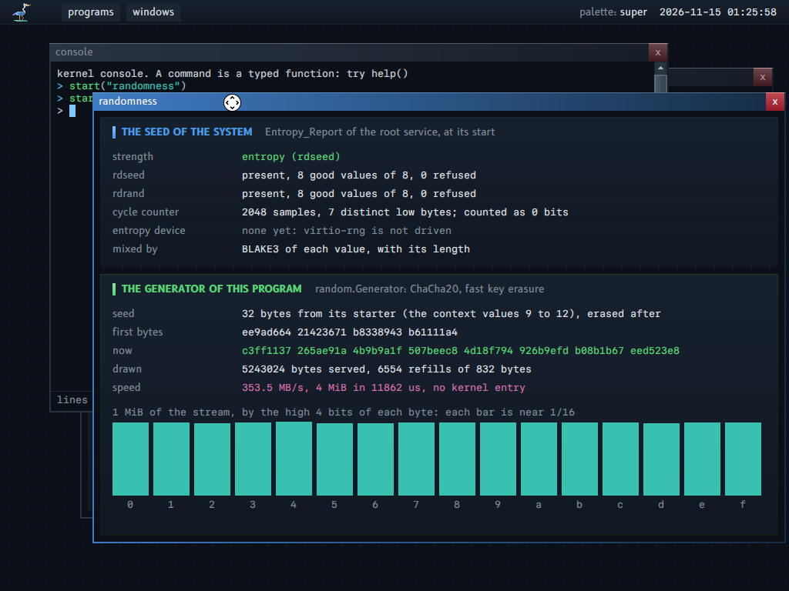

# Randomness

This guide says where a program gets random bytes, how the generator works, where the seed of the system comes from, and how strong the system claims it is.

The terms are in `glossary/randomness.md`: random seed, random generator, entropy report, seed strength.

**The idea in plain words.** A program asks no service and no kernel for random bytes: its starter gives it a seed of 32 bytes in its context, and it draws from its own generator in its own memory. The root service gathers the seed of the system from the processor at boot, mixes in the bytes of the entropy device when the machine has one, and the system says how strong that seed is, so a program that makes a key can refuse a weak one. While a program runs, the root service writes new bytes in its fresh bytes page every 30 seconds, and the generator of the program mixes them into its key.

**For whom.** A reader who needs random bytes in a program, and a reader who must know how far to trust them.

**Read before.** `MODULE_CONTRACT.md`, "6. The context" (the values of the seed).

**The map of this guide.** Section 1: where a program gets random bytes. Section 2: the generator. Section 3: the seed of the system, and what is claimed. Section 4: the tests. Section 5: what is not built. The fresh bytes of a running program are in section 3, "Fresh bytes for a running program".



## 1. Where a program gets random bytes

A program draws random bytes from its own random generator, a record of fixed size in its own memory (property 14). A draw makes no kernel entry and no call. The generator starts from the random seed of the program: 32 bytes that its starter writes in the context values 9 to 12 (`op.CONTEXT_VALUE_SEED`).

- **The root service** has no starter. At its start, before it starts any program, it gathers its own seed from the sources of the processor (section 3).
- **Each starter** (root, `console`, `errors`, `imports`, `frames`, `locks`, `rings`, `address_space`, `debugged`, `fault_ring`, `kernel_events`, `return_fault`) gives each child 32 bytes of its own stream (`random.values_with_seed`). `system.program_start` refuses a start whose seed is 32 zero bytes: a starter cannot forget it.
- **The program** reads its seed once (`random.generator_from_context`), which erases it in the context, and attaches the fresh bytes page of the program when the root service mapped one (section 3).

The forms that the system can take, weighed against the properties:

| Option | Against the properties | Chosen |
|---|---|---|
| A kernel operation that gives random bytes | Property 1: the kernel has 34 counted operations; this one needs no kernel: a program runs `rdrand` with no handle, and the root service can give a seed. A kernel entry for each draw is also a cost on a hot path (QUIC draws a connection ID and a nonce for each handshake) | No |
| A service `random` that answers each request | Property 5: a call for each draw. The pool of a service is one shared state for all programs | No |
| A seed for each program at its start, and a generator in the program | Property 14 (the state is memory of the program), property 20 (no ambient access: the seed is a value of the context, which only the starter writes), property 5 (no call and no kernel entry for a draw) | Yes |

**What a starter knows.** The starter of a program knows its seed. A child has no secret from its starter, which already chooses its code and its grants. Two programs that one starter starts do not know the streams of each other.

**The fault program reads value 14.** `fault` reads its "zero" address from the value 14 of its context, which no starter writes: the seed is in the values 9 to 12.

## 2. The generator

`src/library/support/random/generator.odin`: ChaCha20 with fast key erasure (D. J. Bernstein, "Fast-key-erasure random-number generators", 2017).

- Each refill runs ChaCha20 with the key of the generator and the nonce 0 for 13 blocks (832 bytes). The first 32 bytes are the next key; the next 800 bytes are served in order.
- The key that made a refill is overwritten at once. Each byte is erased (`erase_secret_bytes`) when it is served. So a copy of the state after a draw does not give the bytes before it.
- `reseed` mixes new bytes into the key: the next key is BLAKE3 of a domain text, the old key and the new bytes.
- **The fresh bytes page.** At each refill, and before the bytes of a key (`fill_for_a_key`) or of a child seed (`seed_for_a_child`), the generator reads the change count of the fresh bytes page of the program. When the page has a change that the key does not have, the next key is BLAKE3 of the domain text `kernel random: the fresh bytes of a program, version 1`, the old key and the 32 bytes of the page, and the buffer is dropped. One change is mixed once. A draw from the buffer reads no page. `generator_from_context` attaches the page of the context; `random.fresh_bytes_attach` attaches it to the generator of another thread.
- A zero generator is not seeded: a draw from it stops the program, so that no program draws from a known key.
- **One generator belongs to one thread.** Two threads that draw from one generator at once would get the same bytes (two equal nonces, two equal child seeds). A second thread gets its own generator, seeded with `seed_for_a_child` of the first. A draw or a reseed sets a flag of the generator with an atomic exchange; a second draw that finds it set stops the program with the sentence "random: two threads drew from one generator at once ...", instead of a bounds check later. The check costs one atomic exchange for each draw. It finds two draws that overlap, not a generator that two threads use one after the other (which gives no equal bytes).
- **The stack is erased after a refill and after a hash of a key.** The frames of ChaCha20 under `refill` hold the words of the key that made the refill, and the frames of BLAKE3 under `key_derive` hold the old key and the chaining values. `fill` calls `erase_stack_below_the_caller` after each refill, and `reseed` and `entropy_gather` after `key_derive` (the same 16 KiB as in `docs/CRYPTOGRAPHY.md`, section 6). So "the key that made a refill is overwritten at once" holds for the record of the generator and for the stack below the draw.
- The ChaCha20 is the code of Odin's `core:crypto` that the system took (`docs/CRYPTOGRAPHY.md`), checked against RFC 8439.

**Speed**: 4 MiB in 12.4 to 38.7 ms in the program `randomness` (108 to 339 MB/s, host load 19 to 22). A draw of 32 bytes for a TCP secret costs about 0.1 to 0.3 us.

## 3. The seed of the system, and what is claimed

The root service hashes, with BLAKE3, each value of each source, each with its length (`random.entropy_gather`, `key_derive`):

| Source | How it is read | Its checks | What it can claim |
|---|---|---|---|
| `rdseed` | 8 values of 64 bits, when CPUID 7 says the processor has it | A value with the carry clear (empty), all ones (a known fault of some processors of AMD), or equal to a value before it, is refused and read again, 32 times for each value at most | The entropy source of the processor, by its specification: strength `entropy` |
| `rdrand` | 8 values, when CPUID 1 says the processor has it | The same | The generator of the processor, which the processor reseeds: strength `processor` |
| The cycle counter | 2048 deltas of `rdtsc` around a short loop | None: its count of distinct low bytes is shown, as a sign of life only | 0 bits: this system does not measure its entropy. A seed from it alone has strength `weak` |
| The entropy device | 2 reads of 32 bytes through the entropy service, after the gathering, when the machine has the device, then 1 read every 30 seconds; mixed with `reseed` | A read with no byte, with one value only, or equal to the read before is refused, and the key stays as it was | No change of the strength: the bytes add to the key, below |

The strength of the seed is the strongest source that gave all its values. The root service writes it on the log: "root: the random seed of the system, strength ...". It gives the facts of the gathering, never the seed, to the program `randomness` (its context values 0 to 7).

**The reads are not merged.** The reads of `rdrand` and `rdseed` through a procedure value (`processor_values` in `src/library/support/random`) carry `#side_effects`: without it, LLVM keeps one value for all the reads (a machine test then shows "rdrand present, 1 good, 255 refused").

**No claim beyond the sources.** The system does not test the output of `rdseed` or `rdrand` for quality. A processor whose generator is wrong or hostile gives a wrong seed, with no sign; the jitter of the cycle counter is mixed in so that such a processor alone does not fix the seed, but this system claims no bits from it.

**A machine with no `rdrand` and no `rdseed`.** The seed comes from the cycle counter only. Each program still starts and draws. The log and the window say "weak (the cycle counter only)" in the color of a failure. `modustool test random` runs such a machine (`-cpu max,-rdrand,-rdseed`).

**Each program knows the strength of its seed.** The starter writes the strength of the seed of the system in the context value `op.CONTEXT_VALUE_SEED_STRENGTH` with the seed: a member of `op.Seed_Strength` (`Weak`, `Processor`, `Entropy`). A child's seed comes from its starter's stream, so it has the same strength. `random.seed_strength(generator)` gives it. A value that names no member refuses the seed: `random.generator_from_context` gives false, and the program has no generator, so each key that it asks for is refused. A reader never takes such a value for the strongest strength.

**Each program chooses the least strength that it accepts.** The functions let the program state what it tolerates; a seed below that is an error of the call, not a stop.
- `random.fill_for_a_key(generator, output, least_strength, error)` gives bytes for a key, a nonce or another secret only when the seed of the program has `least_strength` at least.
- If the seed is weaker, the call gives the error kind `Seed_Too_Weak` (value: the strength of the seed; limit: the strength asked), with the sentence "the random seed of this program has the strength weak (the cycle counter only), and the call asks for processor (rdrand) at least: it made nothing". It writes no byte.
- The system does not refuse for the program, and a plain draw with no requirement (`random.fill`) stays as it is.
- QUIC and TLS ask for `processor` at least (`Tls_Configuration.least_seed_strength`): on a machine with no `rdrand` and no `rdseed`, a handshake does not start, and the caller gets the error.
- The exports of the module `cryptography` take each key as an argument and draw no random byte, so they have no such parameter.

**The boot-time problem: who seeds root.** No program runs before the root service, so it cannot get a seed from a device program. It takes one from the processor at its start; the entropy service adds bytes later, below.

**The entropy device.** When the machine has the entropy device of virtio (`virtio-rng-pci` in QEMU) at the place 19 of bus 0, the root service starts the entropy service, the program `entropy`, after the compositor. It asks for two reads of 32 bytes and does not wait for them. Its loop mixes each read into its generator with `random.device_bytes_mix`, which calls `reseed`: the next key is BLAKE3 of a domain text, the old key and the bytes. When both reads are in, the log has:

```
root: the entropy device gave 64 bytes in 2 reads: 64 bytes mixed into the random generator of the system; refused reads: 0
```

- **One more source, never the only one.** The bytes add to the key and do not replace it. A device that lies cannot remove what the processor gave.
- **A read that adds nothing is refused.** A read with no byte, a read whose bytes all have one value (zeros, all ones), and a read equal to the read before it leave the key as it was. Each one counts in "refused reads", as does a read that the entropy service answered with an error. These checks find a broken device. They are not a protection against a hostile one, which passes them with ease: the protection is the mix, whose key always has the bytes of the processor in it.
- **The strength does not change.** The seed strength stays the claim of the processor: the system cannot check the bytes of the device, and the programs that start before the reads have no bytes of the device.
- **Which seeds have the bytes.** Each program that the root service starts after the line. `input`, the compositor and the programs that start while the device answers have the seed of the processor only.
- **The entropy service and its ring.** The service holds the registers of the device, one message interrupt, the memory of its queue, the machine with the right Physical and a copy of the configuration of the device. The root service makes the entropy ring, of 32 records (`RING_CAPACITY` of `src/library/contract/entropy_service`), and gives it to the service as the role 0 of its context. The completion of a `Read` carries the count that the device gave, at most the count asked whatever length the device says, then the bytes, 8 in each of its six other values. Its status is `Ok`, `Bad_Command` or `Device_Error`; when it is not `Ok`, the values are an error record. The service answers one command at a time, in order, and erases its buffer after each answer. At its start its log has `entropy: ok, a queue of <size>`.
- **A machine with no device** starts as before, with one line: `root: no entropy device at the place 19 of the bus: the random seed of the system has the sources of the processor only`.

The entropy report carries the facts of the device to the program `randomness`: present or absent, the bytes mixed, the refused reads. It counts the two reads of the start only. The design is in `src/md/features/entropy_device.md`.

**Fresh bytes for a running program.** A seed is given once, at the start. So a program that starts before the reads of the device has no byte of the device, and a reader who copied the state of a generator once could compute each byte that it gives after the copy. The fresh bytes refresh closes both:

- **The source and the rate.** 30 seconds after the reads of the start, and then every 30 seconds, the root service asks the entropy service for one read of 32 bytes, and mixes it into its generator with `random.device_bytes_mix`, with the same refusals.
- **The bytes of each program.** After a read that it mixed, the root service draws 32 bytes of its stream for each program that has a fresh bytes page, and writes them there. Each program has its own bytes, and no program reads the bytes of another.
- **The page.** One page for each place of the table of the programs of the root service, in one memory object. The root service maps the page, read-only, at the fixed range `Fresh_Bytes_Page`, into each program that it starts by its name, into the compositor and into each disk program. It writes the page to zero when a new program takes the place. The form is `modus:contract/fresh_bytes`.
- **The mix in the program.** At a refill and before a key, never at each draw (section 2). The page changes once in 30 seconds, and the same bytes mixed again add nothing; a mix costs a BLAKE3 hash and the 800 bytes of the buffer.
- **No device, no refresh.** A machine with no entropy device writes no fresh bytes, and each page keeps the change count 0.
- **The cost of a refresh**, counted: one read of 32 bytes of the device, two BLAKE3 hashes (the hash of the read that finds a repeat, and the new key) and at most 1024 bytes of the stream in the root service, one write of a page for each program, and one BLAKE3 hash in each program at its next refill or key.

The root service writes one line at the first refresh, and none after it:

```
root: the first fresh bytes: 32 bytes of the entropy device mixed into the random generator of the system, then 32 bytes of its stream in the fresh bytes page of each of 9 programs; a read every 30 seconds after this one, with no line
```

A refused read writes one warning. After 3 refused reads in a row, the root service asks for no more, with `root: the entropy device gave 3 refused reads in a row: no more fresh bytes for the running programs`. An entropy service that stops writes `root: the entropy service stopped: no more fresh bytes for the running programs`.

The design is in `src/md/features/fresh_bytes.md`.

## 4. The tests

- Host tests (`odin test src/library/support/random`):
  - the generator gives the ChaCha20 stream of its key after its first 32 bytes, then the stream of the next key;
  - each served byte is erased;
  - two seeds give two streams, a zero seed is refused, and a child seed is not part of the later stream of its starter;
  - a statistical smoke test on 1 MiB: the count of one bits within 6 standard deviations, and a chi-square of the 256 byte values between 150 and 400. **It finds a gross fault, and proves nothing about the quality**;
  - each fallback with sources of the test: none, `rdrand` of all ones, `rdrand` that repeats one value, `rdrand` alone, and `rdseed`;
  - a read of the entropy device of zeros, of all ones, of one byte, with no byte, or equal to the read before leaves the key as it was and counts as refused; a good read changes the key and counts its bytes; the strength does not change;
  - the report goes through the context values and back, with the facts of the device;
  - a change of the fresh bytes page is mixed at the next refill and once, not at a draw from the buffer; a key and a child seed mix it at once, and the bytes of the key are the stream of BLAKE3 of the domain text, the old key and the page; a page in the middle of a change and a key refused for its strength mix nothing; `generator_from_context` attaches the page only when its range is mapped.
- `odin test src/library/contract/entropy_service`: the bytes of a read go through the values of a completion and back, and a count above the limit gives the limit.
- `odin test src/library/contract/fresh_bytes`: a write is read once, a change in progress and a cleared page give no bytes, and the page of a program is at its fixed range only with the bit of its range.
- `modustool test random`, three machines:
  - two with the processor of the host (strength `entropy`), with two programs `randomness` in the first;
  - the first with the entropy device: the root service writes the line of the two reads, and `randomness` logs "randomness: the entropy device: 64 bytes mixed after the gathering; refused reads: 0"; then the root service writes the line of the first fresh bytes, and each of the two programs `randomness` logs "randomness: the fresh bytes of the root service are mixed into the generator of this program, at the change N of its page" before the picture of its window;
  - the second with no entropy device: it starts with the sources of the processor, and `randomness` logs "randomness: the entropy device: absent";
  - one with no `rdrand` and no `rdseed` (strength `weak`).
  - The first 16 bytes of the stream of the 4 programs all differ: two programs give different streams, and a restart gives different streams.
- `server` and `fetch` take the secret of the initial sequence numbers of TCP from their generator (`modustool test tcp`).

## 5. What is not built

- **Fresh bytes for every program.** The device services, the TPM service, `input`, a terminal and each program that another program starts get no fresh bytes page.
- **A strength of the entropy device.** The device adds bytes and no claim.
- **The TPM** (property 17) as a source.
- **A measure of the jitter of the cycle counter** (as `jitterentropy` does). Without it, the claim stays 0 bits.
