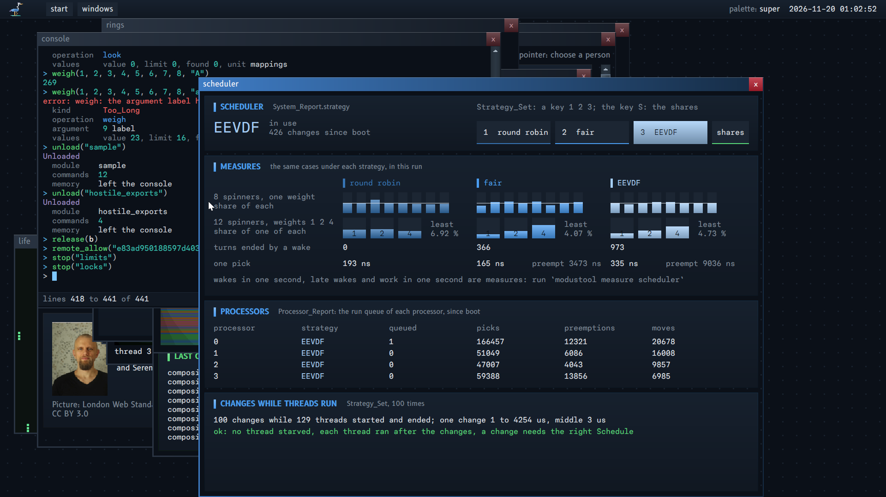
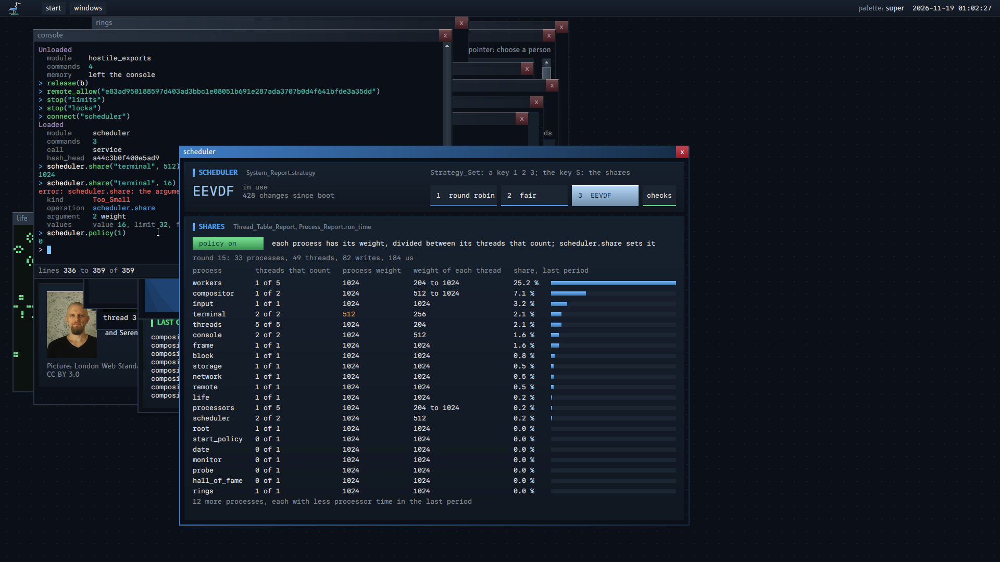

# Scheduling strategies

Status: built. The kernel runs three strategies (`src/modulus/strategy.odin`), and this guide is their design, with the research behind it. The system takes ideas from CFS, EEVDF and `sched_ext`, and it can change from one strategy to another while it runs.

**The idea in plain words.** A scheduling strategy decides which ready thread runs next on a processor. This system has three (round robin, fair, EEVDF), each as six procedures of the kernel, and a process with the right **Schedule** on the machine changes the strategy of the whole machine while it runs, with no stop.

**For whom.** A reader who wants to know how the system shares the processors, and a reader who changes `src/modulus/strategy.odin`.

**Read before.** `ARCHITECTURE.md`, "K3. Scheduler" and, for the locks, "Rules that keep each path correct". After this guide, the picture of the process `scheduler`.

**The map of this note.** "1. What Linux does" describes CFS, EEVDF and `sched_ext`. "2. What this system takes" gives the six procedures of a strategy, the weight and the request that a process sets for a thread, the placement of a thread on the processors, and a share of the processors for each process. "3. Design details" gives the virtual time, the queue clock and the lag. "4. Measured" and "5. What this system refuses, and why" close.

This note says what the three Linux designs do, which ideas this system takes, which it refuses, and why. The terms are in `glossary/running_code.md`: strategy, weight, virtual time, lag, eligible, virtual deadline, request, thread schedule, thread placement, machine number, wake preemption.

Sources. The EEVDF and `sched_ext` paragraphs were checked against the kernel documentation (`docs.kernel.org/scheduler/sched-eevdf.html` and `sched-ext.html`, read on 2026-11-11). The constants of CFS and the details of the Linux code (the names of fields, the clamp of the lag) are from memory of the Linux sources: they are not checked against a source.

## 1. What Linux does

Linux has had three answers to the question "which thread runs next": CFS shares the processor by weight, EEVDF adds a deadline so that a thread can ask for a short delay, and `sched_ext` lets a loaded program be the strategy. This system takes ideas from each; this section says what each one does.

### CFS: virtual run time and weights

CFS ("Completely Fair Scheduler", Linux 2.6.23 to 6.5) gives each runnable task a share of a processor in proportion to its weight. The weight comes from the nice value: 1024 at nice 0, about 1.25 times more or less for each step of nice.

Each task has a virtual run time. When a task runs for a time `t`, its virtual run time grows by `t * 1024 / weight`. A heavy task ages slowly; a light task ages fast. The run queue of a processor keeps its tasks in a red-black tree ordered by virtual run time, and the processor runs the task with the least virtual run time. So over time the virtual run times stay close, and the real run times follow the weights.

The queue keeps `min_vruntime`, a clock that never goes back: the least virtual run time of the queue and of the task that runs. A task that wakes after a sleep gets at least `min_vruntime - latency/2`: a sleeper gets a small credit, not the whole time that it slept. A task that moves to another processor keeps its distance to `min_vruntime`, not its absolute value.

The length of a stint is not fixed: the target latency (6 ms) is divided among the runnable tasks by weight, with a least stint (0.75 ms). A woken task preempts the task that runs if its virtual run time is less by more than a wake granularity (1 ms, scaled by weight).

The known weakness: CFS has one number per task. A task that needs a short delay (audio, input) and a task that needs a large share have the same knob, the nice value. The rules for a woken task are heuristics.

### EEVDF: eligible time, virtual deadline, lag

EEVDF ("Earliest Eligible Virtual Deadline First", Stoica and Abdel-Wahab, 1995) replaced CFS in Linux 6.6 (2023, Peter Zijlstra). It keeps the virtual run time and the weights of CFS, and adds three concepts.

- **Lag.** The queue has an average virtual time `V`: the average of the virtual run times of its tasks, weighted by their weights, with the task that runs. The lag of a task is `V - v` (scaled by the weight): what the task is owed. A positive lag means the task received less than its share; a negative lag means it received more.
- **Eligible.** A task is eligible when its lag is zero or more (`v <= V`). Only an eligible task can run.
- **Virtual deadline.** A task asks for a request: a run of `r` of processor time (Linux: the base slice, 0.75 ms by default, and a value that a task sets with `sched_setattr()` since 6.12). Its virtual deadline is `v + r * 1024 / weight`. Among the eligible tasks, the processor runs the one with the earliest virtual deadline. When a task used its request, it gets a new deadline.

The request size is the latency knob. It does not change the share of a task: the weight sets the share. A short request gives an early deadline, so the task runs soon after it becomes eligible, in short stints. A long request gives fewer switches. CFS had no such separate knob.

A woken task preempts the task that runs when the woken task is eligible and has an earlier deadline. This rule replaces the heuristics of CFS.

The lag of a task is kept when it sleeps, within a bound (Linux clamps it to about two requests), and the task is placed at `V - lag` when it wakes, with a correction for the change of `V` that its own weight makes. So a task cannot gain by a short sleep: a negative lag stays. Linux also keeps a sleeping task in the queue for a time ("deferred dequeue") so that a negative lag decays and a long sleeper starts at zero.

Linux keeps the tree ordered by virtual run time, with the least deadline of each subtree in the node: a pick is `O(log n)`.

### `sched_ext`: a strategy as a replaceable program

`sched_ext` (Linux 6.12, 2024) is a scheduler class whose behavior is a set of BPF programs: a `struct sched_ext_ops` with callbacks. The main ones: `select_cpu` (where a waking task goes), `enqueue` (a task becomes runnable), `dequeue`, `dispatch` (a processor has nothing in its local queue), `runnable`, `running`, `tick`, `stopping`, `quiescent` (the task waits), `set_weight`, `init_task`, `exit_task`, `init`, `exit`. All callbacks are optional.

The tasks wait in dispatch queues (DSQs): one global FIFO, one local queue for each processor, and queues that the BPF scheduler makes. A queue is a FIFO or ordered by a virtual time. A processor always runs from its local queue; it moves a task from the global queue, or calls `dispatch`, when its local queue is empty.

The BPF verifier proves that each callback is memory safe and ends. The kernel keeps the integrity of the system whatever the BPF scheduler does: if a runnable task is not scheduled for a time (a watchdog, 30 s by default), if the scheduler reports an error, or at the key SysRq-S, the kernel aborts the BPF scheduler and gives all its tasks back to the fair class. During the load, the unload and the recovery, a bypass mode schedules all tasks with a plain FIFO and a slice of 5 ms.

## 2. What this system takes

### A strategy is six procedures over the data of a run queue

From `sched_ext`: a strategy is a small set of callbacks. Here it is six procedures of the kernel (`src/modulus/strategy.odin`):

| Procedure | When | It decides |
|---|---|---|
| `ready` | a thread becomes runnable: new, woken, or back after its stint | its virtual time and deadline |
| `pick` | a processor needs a thread | the next thread of a queue, among the threads that a budget lets run |
| `tick` | the tick, on the processor that runs a thread | the charge of the time; if the stint ends |
| `stopping` | a thread leaves its processor | the charge of the last time; the lag of a thread that waits |
| `wake_preempts` | a thread woke and each processor is busy | if the woken thread preempts the thread that runs on its home |
| `move` | a processor takes a thread from the queue of another processor | the virtual time of the thread in the new queue |

The kernel calls a procedure of a strategy through a `switch` on the strategy of the queue, with a direct call in each case (`queue_strategy_ready`, `queue_strategy_pick`, `queue_strategy_tick`, `queue_strategy_stopping`, `queue_strategy_wake_preempts`, `queue_strategy_move`). The kernel has no table of procedure addresses for its strategies. The reasons:

- The set of strategies is closed: the kernel contains each one, and no process supplies a procedure.
- Each call is direct: the processor reads no address of a procedure from memory at a pick, a wake or a tick.
- The compiler sees the procedure that each case calls, and can put it in the place of the call.
- Property 13 forbids tables of function pointers on fast paths, and it holds here with no exception.
- A `switch` names each strategy and has no default case: a new strategy does not build until each of the six procedures has its call.

The strategy of a queue is one word of the run queue (`Run_Queue.strategy`), which the `switch` reads under the run lock of the queue. The change of strategy while the machine runs writes that word ("The change at run time").

The data stays in the kernel tables, in fixed fields (property 13, property 14: no allocation). A strategy owns no memory: its state is the fields of the thread record and of the run queue that the table of `ARCHITECTURE.md` names. All strategies share one list per queue; only `pick` decides the order.

The run queue, the run lock, the balance between processors and the budgets stay as they are: a strategy chooses among the threads that a budget lets run (`budget_spent`). The limit of a budget is not a strategy: it holds under each strategy.

### Three strategies

1. **Round robin**: the reference strategy: a queue in order, a time slice of 10 ms, no wake preemption.
2. **Fair**: the idea of CFS. Virtual time and weights; the least virtual time runs; a target latency of 6 ms divided by weight with a least stint of 0.75 ms; a sleeper credit of 3 ms; wake preemption with a granularity of 1 ms; a move keeps the distance to the queue clock. A new thread, and each thread that a change of strategy places again, starts one least stint (weighted) after the queue clock, not at it: a process that creates threads all the time does not get a stint before each other thread.
3. **EEVDF**: average virtual time, eligible, virtual deadline from a request, the earliest eligible deadline runs, lag kept across a sleep within two requests (at least one tick), wake preemption by deadline, a move keeps the lag. A new thread has the lag 0: it starts at the average `V`, not at the least virtual time, and its deadline is one whole request after it; so it is owed nothing, and runs before another thread only if that thread is owed less. A process that creates threads all the time gets no stint that its threads did not have before.

### Weights and requests: a field at thread creation

`Thread_Create` has two more values: the weight (1 to the smaller of the new-thread weight limit of the calling thread and the one of its process, each 8192, the full weight, unless it was lowered; 0 is that limit) and the request in microseconds (1 to 100 000; 0 is 3000). Zero is the default, so a process that gives neither value gets the most weight that it can have and the default request (property 13).

Property 20, as an exact rule: a process only lowers the weight of its threads. A new thread gets a weight from 1 to the new-thread weight limit of the thread that creates it; after that, a write of the process gives the thread a weight at or under the weight that it has, never above. Only the holder of the right **Schedule** on the machine raises a weight ("The schedule of a live thread", below). So a process can give one thread less than another, and cannot take more than a thread with no weight, or more than its limit. The processor limit of the budget stays above any weight: a strategy only orders the time that the budget gives. The request does not change the share: it moves the deadline. A short request can cost more switches; the cost is in the time of the thread itself, which its budget pays.

A weight is for a thread, not for a process or a budget: a process with many threads still has more share than a process with one thread, as with round robin. The share policy of the process `scheduler` gives each process one process weight ("A share for each process"). A share for each budget (the groups of Linux) is not built in the kernel: see section 5.

### The schedule of a live thread

The policy of scheduling is outside the kernel, and the mechanism is inside. A process chooses the weight and the request of threads, at a slow rate. The kernel applies them at each tick with its own strategy. No code of a process runs when the kernel picks a thread, charges a stint or wakes a thread.

The values of one thread are its thread schedule (`op.Thread_Schedule`: `weight`, `request`, `weight_limit`, `new_thread_weight_limit`). `Thread_Create` gives the first one. `Thread_Control` has two commands for a thread that lives:

| Command | What it does |
|---|---|
| `Read_Schedule` | Writes the thread schedule at the address of the caller: the values in use, never 0 |
| `Write_Schedule` | Reads a thread schedule at the address of the caller: the thread has these values from now on |

The thread is not held: its schedule changes while it runs, while it is in a run queue, and while it waits.

**The rule.** Who writes decides what a write can do.

| Who writes | The weight | The request | The two weight limits | What happens to the place of the thread |
|---|---|---|---|---|
| The process, for its own thread (`thread` 0), or the holder of a thread handle | Only lower, or the same. 0: the same | Only lower, or the same. 0: the same | Not read | Nothing: the strategy fields stay |
| The holder of the machine handle | Any weight up to the limit. 0: the limit | Any request. 0: the default | Written. 0: the full weight for the weight limit, the weight limit for the new-thread weight limit. A value above the full weight is refused. A weight or a new-thread weight limit above the new limit becomes the limit | A raised weight: the thread starts again as a new thread. Else nothing |

- A write of a process with a weight above the weight of the thread, or a request above its request, gives `Bad_Operation`, and nothing changes. The error record names the refused value and the value that the thread has.
- A value above the most of the contract (`op.thread_schedule_accepted`: the full weight, 100 000 us) gives `Bad_Operation` for each writer.
- A write through the machine handle always gives the four values: a holder that changes one value reads the schedule first.

**Why a process only lowers.** A process chooses the moment of each write: while the thread runs, while it is in the list, while it waits, while a stop holds it. A process also has helpers that write for it. Each form of a rule that let a process raise a weight had a sequence of writes, down at one moment and up at another, that left the process better than a thread that never writes: a thread that owed less time, or a thread whose place moved the average of its queue. With one direction, no sequence gets back what a write gave up.

The place of a thread in a queue is a history under its weight. A light thread can be far from the other threads in virtual time, and that is harmless: its weight is its pull on the average virtual time of the queue, so a far and light thread moves the average little. A weight written up on that thread keeps the far place and gives it a large pull: the average moves by seconds, and the other threads of the queue wait that long. A weight written down only makes the pull smaller.

The request has the same rule for one reason. Under EEVDF the kernel keeps what a thread owes across a wait within two requests. A thread that runs a long stint under a long request, writes a short request, and waits, owes two short requests. With a request that a process can raise again, the thread does this at each stint. With a request that only goes down, it does it one time.

**Why a raise starts the thread again.** Only the holder of the machine raises a weight, and the raised thread gets the zero values of its strategy fields (`strategy_weight_raised`). If the thread is in the list, its strategy places it again as a new thread; a thread on a processor is placed at its next tick, and a thread that waits or that a stop holds when it enters the list again. This is what a change of strategy does to each thread, for the same reason: the place of the thread is a history under the old weight, and it has no meaning under the new one. A thread placed as new is at the average of its queue, so a raise moves the average by nothing. What the thread owed is gone, and what it was owed too. No process gets this for its own thread: the holder decides it, and the holder already orders every thread of the machine.

A write of the holder that lowers a weight, or keeps it, changes no strategy field, as a write of a process.

**What a write that lowers can give.** The strategy fields stay, and the kernel converts nothing. Two bounded effects exist under EEVDF. Each needs a lower value, and the process cannot write the value up again: a weight lowered in steps has the first effect at each step, and the sum over the life of a thread is about 13 requests at most.

- A weight lowered while the thread waits. The kept lag was taken with the old weight, and the wake scales it with the new one. With `W` the weights of the other threads, the thread comes back at its place times `(W + new) / (W + old)`: nearer to the average. A thread that owed time owes less: at most the whole of one kept lag, which is at most two requests.
- A request lowered before a wait. What the thread owes is then kept within two requests of the new value, so a part of one long stint is not kept: at most two requests of the old value.

Each is less than what the end of the thread and a new thread give, which is a place at the average, and each costs the process a lower weight or a shorter request for the rest of the life of the thread. A thread that never writes its schedule has the same computation as before the schedule could be written.

**Who can read and write.** No process reaches the schedule of a thread because it runs (property 20). Three ways name a thread:

| The argument `thread` | The argument `number` | `Read_Schedule` needs | `Write_Schedule` needs |
|---|---|---|---|
| 0 | The number of a live thread of the calling process | Nothing: its own thread | Nothing: its own share, which it only lowers |
| A thread handle | Not read | **Inspect** | **Control** |
| The machine handle | The machine number of any thread | **Schedule** and **Inspect** | **Schedule** and **Inspect** |

- **Control** is the right to end the thread. A holder that can end a thread can also give it a smaller share, which is less. **Write**, the right to write the registers, is not needed: a weight chooses no code.
- **Schedule** on the machine is the right of `Strategy_Set`. Its holder already changes the order of every thread of the machine, so the same right lets it set the weight and the request of any thread. The root service gives it to the process `scheduler` only.
- The machine handle needs **Inspect** too, for both commands (`op.thread_control_machine_rights`). Each report of the machine needs **Inspect**, and a read by machine number is one: it gives values of any thread, and its status says which machine numbers name a thread. A write gives the four values of the record, so its holder must read the schedule first to keep the values that it does not change; and the machine numbers come from a report. So **Schedule** with no **Inspect** names no thread.
- The machine handle names a thread for these two commands only. Each other command of `Thread_Control` with the machine handle gives `Bad_Handle`: **Schedule** holds no thread and reads no register.
- A weight is at most the weight limit of the thread, and a limit is at most the full weight. So no holder, also the holder of **Schedule**, gives a thread more than a thread that asked for nothing.

**The weight limit.** Each thread has a weight limit, from 1 to the full weight: the most that its weight can be. The third field of the thread schedule is the limit (`Thread_Schedule.weight_limit`), and `Read_Schedule` gives it.

- Only a write through the machine handle sets the limit; 0 is the full weight. A weight above the new limit becomes the limit in the same write, so one write lowers both. A write through the machine handle always writes the four values: a holder that changes one value reads the schedule first.
- A write of a process for its own thread, and a write through a thread handle, do not read the limits of the record. They only lower the weight, so they never pass the limit.
- The first thread of the root service has the full weight and the two full limits.

**The new-thread weight limit.** The fourth field of the thread schedule (`Thread_Schedule.new_thread_weight_limit`) is the weight limit that the thread gives to the threads that it creates. `Read_Schedule` gives it.

- A process has a new-thread weight limit too, in the schedule of a process (`op.Process_Schedule`). A new process has the full value.
- A new thread gets the smaller of the new-thread weight limit of the thread that creates it and the one of its process (`op.new_thread_weight_limit_of_creation`), as its weight limit and as its own new-thread weight limit (`op.thread_schedule_of_new_thread`). `Thread_Create` refuses a weight above it, and the weight 0 gives it. The first thread of a new process gets the same value of the thread that starts the process.
- Only a write through the machine handle sets the value of a thread. 0 is the weight limit of the same write. A value above the full weight is refused (`Thread_Write_Refusal.New_Thread_Weight_Limit`), as a weight limit above it is. A value up to the full weight and above the weight limit becomes the weight limit (`op.thread_schedule_after_machine_write`). So a thread under a limit never gives a higher limit to a new thread.
- A thread that the holder never wrote, or wrote with 0 in this field, has a new-thread weight limit equal to its weight limit: a new thread then gets the limit of its creator.
- Two commands of `Thread_Control` read and write the schedule of a process: `Read_Process_Schedule` and `Write_Process_Schedule`. They take the machine handle with **Schedule** and **Inspect** only, and `number` is the slot of the process in the low 32 bits and its serial in the high 32 bits (`op.process_slot_and_serial`). 0 in a write is the full weight; a value above the full weight is refused. A write and a creation both hold the control lock, so a creation comes wholly before a write or wholly after it.

Why. A write of a process never raises the weight of a thread that lives. The limit carries the same rule across the creation of threads: with the full weight for each new thread, a process leaves a limit by a new thread that does the same work. The limit follows the creation of threads, so a process under a limit stays under it, also through a process that it starts. The second limit is a separate value because a thread can need more than its new threads: the share policy gives a thread that counts its part of the process weight, and the threads that the process creates before the next round a smaller value that does not depend on when they are created ("A share for each process"). Each limit is one word of the thread record, outside its first 64 bytes: only a write of a schedule and a creation read them.

Two limits of the weight limit, which a limit for each budget closes:

- The limit is a value of each thread. A thread that a process created just before the write of the limit of its creator keeps the limit that the creator had then, and it gives its new-thread weight limit to the threads that it creates; the two values are equal unless a holder writes them apart. So "a process under a limit stays under it" holds when each thread of the process has the limit. The holder of **Schedule** writes the limit of each thread of the process, reads the thread report again, and repeats until no thread has the old limit.
- The limit follows the thread that starts a process. A process that starts processes on request, and that has a higher limit, gives that higher limit to the processes that it starts, also when a process under a lower limit asked for them.

What the limit is not: a share for a process. A process under a limit that creates more threads has more threads of that weight, as a process with the full weight has. A share for each process is a policy of the process `scheduler`, with these weights ("A share for each process").

**The machine number.** A thread number names a thread inside its process. The machine handle needs a name for any thread: the thread report of `Inspect` (`Inspect_Kind.Threads`) gives the machine number of each thread (`Thread_Report.machine_number`). Its low 32 bits are the place of the thread in the thread table of the kernel. Its high 32 bits are the serial of the thread in that place, which changes for each new thread there. The kernel compares the serial under the control lock, where no place gets a new thread. So the machine number of a thread that ended gives `Bad_State`, and never names a later thread.

**What a write does in the kernel.** The write is one section of the run lock of the home of the thread (`thread_schedule_write`). If the thread is in the list of the queue, the sum of the weights of the queue loses the old weight and gets the new one, so it stays exact. The thread keeps its state, its home, its processor and its place in the list. The time that a running thread used since its last charge is charged at the new weight, at its next tick or when it leaves its processor: at most one tick.

**A stop of `Thread_Control`** keeps what a thread owes. A thread that a `Stop` takes out of the list leaves it as a thread that starts to wait (`strategy_leaves_list`): its strategy keeps its lag or its difference to the queue clock, and the `Resume` places it as a woken thread. Zero values there let a `Stop` and a `Resume` from another thread of the process put a thread that ran more than its share before the threads that waited. Under EEVDF the lag is taken from the average of the other threads, so the budget of the thread itself is never read.

A kept lag is exact only while the other threads of the queue stay the same. A thread that starts to wait while no other thread is in its queue keeps the lag 0. The balance moves threads between the queues all the time, so the kept lag is an estimate; no process commands the moves.

The interleavings with a pick, a move, a wake, the end of a thread and a change of strategy are in `ARCHITECTURE.md`, "Locks of the kernel", "The schedule of a live thread".

**The tests.** The process `scheduler` checks: a thread reads its own schedule and lowers it, and its writes of the values of its creation are refused; the weights 1, 2 and 4 written through the machine handle to 12 spinners that run order their shares under the fair strategy and EEVDF; each refusal has its status; the schedule of a thread of another process is read and written through the machine handle; under a weight limit, 1000 rounds of writes of the thread raise no weight, and a new thread has the limit as its weight, its weight limit and its new-thread weight limit; writes through the machine handle, which raise and lower, during 100 changes of strategy lose no thread. The host tests of `src/library/modus/contract/operation` check the defaults of a write through the machine handle and the schedule of a new thread (`thread_schedule_after_machine_write`, `thread_schedule_of_new_thread`).

One test reads the place of a held thread. The thread report gives the kept lag of a held thread (`Thread_Report.lag`). In at least 100 rounds a spinner lowers to the weight 1, runs one tick (a count of the kernel), and a `Stop` holds it. In the hold its write of the full weight must be refused, its write of the request 1 us accepted, and the lag must be the same number after each; then the machine handle writes the full weight, and the lag must be 0. The rounds go on until one round had a lag below 0, so the test cannot pass with nothing to compare; if that state never comes, the test fails and says so. The conditions are numbers of the kernel, with no time in them. The test does not measure processor time, and no machine test asserts a share or a longest wait after writes: such a condition depends on the load of the host.

**Not built in the kernel.** A share for each budget: section 5 says why, and "A share for each process" is the policy of the process `scheduler`. The placement of a thread on the processors is the next subsection.

### The placement of a thread

The placement of a thread is the set of the processors that can run it. It is the second layer of the policy that a process holds, after the thread schedule: a process chooses the set, at a slow rate, and the kernel applies it at each pick. A thread that never gets a placement can run on each processor, and is scheduled as before.

The values of one thread are its thread placement (`op.Thread_Placement`: `processors`, `processors_limit`). A set of processors is a `u64`: bit `n` is the processor `n` of the processor report. `Thread_Control` has two commands for a thread that lives:

| Command | What it does |
|---|---|
| `Read_Placement` | Writes the thread placement at the address of the caller. Each set holds only processors that the machine has, and is never 0 |
| `Write_Placement` | Reads a thread placement at the address of the caller: only the processors of the set run the thread from now on |

The thread is not held: its placement changes while it runs, while it is in a run queue, while it waits, and while a stop holds it.

**The rule.** Who writes decides what a write can do, as for the schedule (`op.thread_placement_after_write`).

| Who writes | The set | The limit | What happens |
|---|---|---|---|
| The process, for its own thread (`thread` 0), or the holder of a thread handle with **Control** | Only a part of the set that the thread has, or the same. 0: the same | Not read | If the home of the thread left the set, the thread moves |
| The holder of the machine handle with **Schedule** and **Inspect** | Any set. 0: the limit. The part outside the new limit is dropped | Written. 0: every processor | The same |

- The bits of processors that the machine does not have are dropped, so a writer can give all ones.
- A write through the machine handle always gives the two sets, as its write of a schedule always gives the four values: 0 is a default, never "the value that the thread has". The set 0 is the whole limit, as the weight 0 is the weight limit. So a write of the holder with the set 0 undoes a narrowing that the process made, also one that the process made between the read and the write of the holder. A holder that changes the limit and keeps the set reads the placement first and writes the set that it read; a narrowing of the process between the two is then lost, and the process can narrow again. Only for a process is 0 "the set that the thread has", because a process cannot name a wider set.
- A write of a process with a processor that the set of the thread does not have gives `Bad_Operation`, and nothing changes. The error record names the refused set and the set that the thread has (`Thread_Write_Refusal.Processors`).
- A set with no processor of the machine, and a set with no processor inside its limit, give `Bad_Operation` for each writer. A thread with no processor never runs: that is `Stop`, which has its own right. The kernel does not change a set that it cannot take into another one: that hides a mistake of the writer.
- A limit with no processor of the machine gives `Bad_Operation` (`Thread_Write_Refusal.Processors_Limit`).
- A thread that ended, or that ends, gives `Bad_State`.
- The three ways to name a thread and their rights are the ones of the schedule: its own thread by number; a thread handle, with **Inspect** to read and **Control** to write; the machine handle with **Schedule** and **Inspect** and the machine number of any thread. A holder that can end a thread can also give it fewer processors, which is less.

**The limit.** Each thread has a limit: the most that its set can be. It works as the weight limit.

- Only a write through the machine handle sets the limit. A write of a process does not read the limit of the record: it only narrows, so it never passes the limit.
- A new thread gets the limit of the thread that creates it, as its set and as its limit. The first thread of a new process gets the limit of the thread that starts the process. The first thread of the root service has every processor.
- `Thread_Create` has no argument for a set. A process that wants a narrow new thread writes its placement after the creation. The thread can run one stint on the wider set first; the set is the choice of the process, so nothing depends on that stint.
- The set and the limit are two values because they are two things. A set that a thread chose for itself is a choice of speed; a limit is a policy. With one value, a service that keeps its own thread on one processor gives that one processor to each process that it starts.

**Where a thread goes.** The home of a thread is in its set, or the thread is on the processor of its home. Each path keeps this:

| The state of the thread at the write | What the write does |
|---|---|
| In the list of its home, and the home left the set | The thread moves at once to the list of a processor of the set, under the run locks of the two processors |
| In a wait, or held by a stop | The thread is in no list. It gets a home in the set at once. The wake or the `Resume` puts it in that queue |
| On a processor that left the set | The write stores the set. The thread moves when it leaves that processor: at the end of its stint at the latest, which is one time slice. If the writer is the thread itself, its stint ends at the end of that kernel entry |

- The target is the processor of the set with the least load (the threads in its queue, plus 1 if it runs a thread), the lowest number among equals. The kernel reads the loads with no lock: the choice is a hint, on a path that is not hot.
- A processor that takes a thread from the queue of another processor takes the best thread among those that it can run. A waker that looks for an idle processor passes over a processor that cannot run the woken thread.
- A write that gives a processor to a thread that stays in the list of its home makes the processors look at that list: an idle processor that the set has now takes the thread. Without this the thread shares its old processor while the new one is idle, because the end of a stint wakes no processor. Only the holder of the machine widens a set, so no process commands these wakes. A thread that runs when its set gets a processor is not helped by that look: it stays on its processor.
- The write sends no interrupt to a processor that runs a thread. An interrupt ends the stint of the thread that runs on its processor when it arrives, and that thread can be a thread of another process, which then pays for it. A holder that must know when the thread left its old processor reads the thread report (`Thread_Report.processor`, `home`).
- The allowed processors can all be busy while others are idle. The thread then waits in the queue of its home. The processor of the home picks in its own queue when no other queue has a load above the count of its own queue, and the thread then gets its stint by the strategy of that queue, as each thread of that queue. The wait has no bound: while another queue has a higher load at each pick of that processor, the processor takes a thread from that queue and not from its own. A stream of threads that are created, run and end can keep it so, and the thread then never runs. This rule of the balance exists without the placement, and a thread with no placement has the same wait when no other processor takes it; a placement takes away the processors that can take the thread, so the thread that pays is the thread with the placement. The rule of the balance is not changed here. Who can cause the placement: the process for its own thread; the holder of a thread handle with **Control**, which can also end the thread; the holder of **Schedule**, which already orders every thread. No process with no handle causes it to a thread of another process.

**Why no history is converted.** A place of a thread in its queue is a history, and the rule of the schedule exists because a process must not choose the moment and the direction of a change that the strategy converts. A placement converts nothing. No strategy code is new, and each procedure that runs for a thread that changes its queue keeps what the thread owes: the fair strategy keeps the distance of the thread to the queue clock, and EEVDF keeps its lag. A thread that leaves its processor is moved by `move`, the procedure that the balance runs for each thread at each pick from another queue. A thread that a write takes from a list leaves that list as a thread that a `Stop` takes out of it (`strategy_leaves_list`), and enters the new list as a woken thread, as after the `Resume`. The reason for the second form: `move` under EEVDF takes the average of the queue with the thread, and a thread of a list whose budget has no time in this period is not in that average. The balance never takes such a thread; a write can. The lag of that thread, taken by `move`, is its distance to the average of the other threads, which is too large by the factor `(W + w) / W` (`W` the weights of the others, `w` its own), and is the distance to the queue clock, not 0, when the queue has no other thread. `strategy_leaves_list` takes the lag from the average of the other threads times `W / (W + w)`, and 0 with no other thread: the exact value, with no read of the budget. For a thread whose budget has time the two forms give the same lag. A thread that waits, or that a stop holds, keeps the one relative value that it has already, which has its meaning in each queue of the same strategy. Between two queues of two strategies, during a change of strategy, the fields of the thread are cleared, as the balance clears them. So nothing that a thread owes is forgiven by a move: a thread that owes time owes it in its new queue.

A process only narrows the set, so the direction of its writes is one. One thread commands fewer moves in its life than the machine has processors. Each of these moves is the move that the balance makes for each thread, many times a second, or the pair of a `Stop` and a `Resume`. A process cannot narrow, widen and narrow again to choose a queue at each moment: only the holder of the machine widens.

**What an honest thread can lose.** An honest thread here is a thread with no placement. Its cost, path by path:

| Path | What changes for a thread with no placement | Bound |
|---|---|---|
| The pick in its own queue | Nothing: the processor of a queue takes each thread of its list with no test of a set | |
| A pick from another queue | One test of one byte of the hot line of each thread passed over. A thread with a placement passed over costs one more line | The thread table has 256 places |
| The balance | A processor that finds no thread that it can take in the busiest other queue tries the next busiest one, while its load is above the own count | At most one pair of run locks for each other processor in one pick, where it was one pair. Each queue is tried one time in a pick, the queue of a hint too, and each thread is in one list: one pick passes over each list one time at most (a pick of EEVDF reads a list in three passes) |
| A wake | A waker that looks for an idle processor tests one byte of the hot line of the woken thread | No lock, no other line |
| The end of a stint | One test of one byte of the hot line, under the run lock that the path holds | No second lock |
| The share in a queue | A thread with a placement takes a place in the queues of its set only, and gives up the other processors | Below |

The balance tries more than one queue because of a fault that exists without any placement: a queue of threads whose budget has no processor time is the busiest queue for ever, and each other processor that tried only that queue took nothing, and went idle while threads waited in a third queue. The same happens with a queue of threads that the processor cannot run. The loop closes both.

The share, case by case:

- **Threads with a placement in the queue of an honest thread.** Another processor with less load takes from that queue the best thread that it can run. The threads that it cannot run are not candidates, so the honest thread is taken first.
- **A thread with a placement alone on its processor.** It has no exclusive use of that processor: at each pick the processor compares the load of the other queues with its own count and takes a thread from another queue.
- **A process that keeps all its threads in one queue.** A process does the same with no placement: each new thread starts in the queue of its creator. The honest thread of that queue is taken by the other processors as above.
- **An honest thread that the holder of Schedule restricted.** It shares its processors with each thread that can run there. That is the policy of the holder, not a gain of a process.

No sequence of writes gives processor time: a placement changes no weight, no budget, and no strategy field but through `move`. The balance is a rule of counts and not an optimum, so this is an argument on each path, not a proof of an optimal share.

**Side channels.** Two processes that run on the same processor share its caches and its predictors, and one can learn from the timing what the other does. The holder of **Schedule** writes limits with no common processor to the threads of two processes. After the writes, and after one time slice for a thread that ran, no thread of one process runs on a processor of the other. A new thread and a started process get the limit of their creator, so each process stays inside its limit.

Two limits of the balance, which the placement does not change:

- A processor counts each thread of its own queue as its own load, also the threads that it cannot run now because their budget has no time in this period. A processor whose queue holds 5 such threads takes no thread from a queue with a load of 5 or less, and can be idle while threads wait there. The loop over the other queues does not close this.
- The end of a stint wakes no processor. A thread that goes back to its list while another processor is idle waits there until a wake, a write that widens its set, or the pick of a processor that runs a thread.

What the placement does not give:

- **The processors of one core.** The kernel does not know which processors are siblings of one core: it reads the processor numbers from the tables of the machine, and no topology. `Processor_Report.apic_id` gives the number of each processor. The holder can find the siblings itself: it places its own thread on each processor in turn and reads the topology there with the instruction `cpuid`, which is not privileged. The topology stays in the policy, outside the kernel.
- **The cache that all the cores share.** The last-level cache stays shared: a set of processors does not divide it.
- **A thread created just before the write of a limit.** The limit is a value of each thread. A thread that a process created just before the write of the limit of its creator keeps the limit that the creator had then. The holder writes each thread of the process, reads the thread report again, and repeats until no thread has the old limit.
- **A starter with a wider limit.** A service that starts processes gives its own limit to them. To start a process inside a limit, the service starts it from a thread that has that limit.
- **One time slice.** A thread that runs when its set changes can run up to one time slice more on its old processor.
- **The work of the kernel.** The interrupts and the tick run on each processor for all the processes.

A process can keep its own thread on one processor where a thread of another process also runs. This is not a new capability: a process with one thread for each processor is on each processor already. The limit that the holder writes is the control.

**What a write does in the kernel.** The operation holds the process lock of the thread, so two writes of one thread never run together. It computes the new set, reads the home of the thread, chooses the target, and takes the run locks of the home and of the target in the order of the processors (`thread_placement_write`). If another processor took the thread from its list in between, the home changed: the locks are freed and the choice starts again. Under the locks it writes the set, the limit and one byte of the hot line of the thread (`placement_restricted`: the set does not hold every processor), and moves a thread that is on no processor. After the locks are free, a thread that entered another list, or that stays in its list with a set that got a processor, makes the processors look at that list (`kick`). A thread on a processor is moved by its own processor (`schedule`), under the same two locks. The interleavings are in `ARCHITECTURE.md`, "Locks of the kernel", "The placement of a thread".

**The tests.** The process `scheduler` checks, with values that the kernel gives and no time: a thread reads its placement, keeps one processor, and each report of it then has that processor as its home and as its processor; each refusal has its status and its error record, and a refused write changes nothing; under a limit, 1000 rounds of writes of the thread never give a set outside the limit, and a new thread has the limit as its set, as its limit and for its first queue; a set without the home of a thread that waits, that a stop holds, that is in a list and that runs: a report shows the thread inside the set, and no later report shows it outside; two groups of spinners whose limits share no processor: no report shows a spinner on a processor of the other group, and each processor ran a spinner of its group; a queue of spinners that only one processor can run, and then a queue of threads of a budget with no processor time, is the busiest queue, and a spinner that waits in another queue is still taken by another processor; a spinner in the list of a busy processor whose set gets one more processor is then reported on that processor; writes of placements during 100 changes of strategy lose no thread. The test build of the kernel stops the machine if a thread enters the list of a processor that is not in its set (`TEST_BUILD_CHECKS_PLACEMENT`: off in the source, and the modus tool turns it on in the test build only). The host tests of `src/library/modus/contract/operation` check the rights of the two commands and each rule of `thread_placement_after_write`. The machine of the test has 4 processors; a case that needs more processors than the machine has says so and checks nothing.

What the machine tests do not cover:

- The inheritance at `Process_Start` has no machine test: the process `scheduler` starts no process. The case of the two groups uses threads of one process, each group created under its limit. The code of the two inheritances is one argument of the same procedure.
- A thread handle that another process holds has no machine test. The case of the refusals gives a copy of a thread handle with **Inspect** only to its own process; the path in the kernel is the same for a holder in another process, but for the control lock.
- The refusal of the process handle with **Debug** (`Bad_Handle`) for the two commands has a host test of the rights only. A machine test of it belongs to the process `debugged`, which holds such a handle.
- The case of the balance fails when the balance tries the busiest queue only, unless a thread of another process wakes with the processor 1 as its home while a processor of the case is idle: that wake names the queue of the processor 1 as a hint. In the case no processor of this process is idle: each processor from 2 runs a spinner of its own, whose end of stint is the pick that must pass the busiest queue.
- The case of the widened set passes without the look that the write asks for when a thread of another process makes the processor 1 pick: the case cannot keep the other processes of the machine still.

### A share for each process

A weight is for a thread. Without a policy, a process with 8 threads that compute has 8 times the weight of a process with one such thread. The share policy of the process `scheduler` gives each process one process weight, whatever its count of threads. The kernel has no part of it: the process reads the reports and writes the thread schedule of each thread through the machine handle, with the rights **Schedule** and **Inspect**.

**The two commands.** The principal calls them from the console, after `connect("scheduler")`, or from the palette. The process refuses a caller that does not act for the principal (`No_Grant`).

| Command | What it does |
|---|---|
| `scheduler.policy(1)`, `scheduler.policy(0)` | Turns the share policy on or off. The result is 1 when it was on. The key P and the button of the view of the shares do the same |
| `scheduler.share("paint", 256)` | Gives the processes with the name `paint` the process weight 256. The result is the process weight that the name had |

- The policy is off when `scheduler` starts. With the policy on, the process writes each thread of the machine, so the principal decides it.
- A process weight is from 256 to 8192, the full weight: from 1/32 of the full weight to all of it. A process with no setting has 8192. The value 8192 removes a setting. 16 names can have a setting.
- A setting holds for each process with that name, also one that starts later, until `scheduler` stops.
- The weights have an effect under the fair strategy and EEVDF. The round robin reads no weight.

**One round.** The process runs one round each 100 ms, by the clock of the system. A round reads each process slot and the thread report of each process.

- A thread counts when the round sees it for the first time, when it is ready, or when its run time or its virtual time changed since the last round. A thread that waited during the whole period does not count.
- A thread that counts gets the process weight divided by the count of the threads of its process that count. Another thread gets the process weight divided by the count of all the threads of its process.
- The division drops the rest. A process has at most 256 threads (`op.THREAD_CAPACITY`), and the least process weight is 256, so each thread has a weight of 1 or more, and the weights of the threads that count never sum to more than the process weight. They sum to less by under one unit for each thread: under 3.2 % of the full weight for 256 threads. The unit of a weight is fine for this reason: with a full weight of 1024, 256 threads made the least process weight a quarter of the full weight.
- The weight limit of the thread gets the same quotient.
- The new-thread weight limit of each process, and of each of its threads, is the process weight divided by 256, the most threads of a process. The round writes the value of the process before it reads the thread report of the process. A thread that the process creates before the next round gets the value as its weight and as its two limits.
- A round writes a thread only when its weight or one of its limits changes. A machine where no thread starts, ends or blocks gets no write.

Example: on a machine with four processes of 1, 2, 4 and 8 threads that compute, the threads have the weights 8192, 4096, 2048 and 1024, and each process has 8192 in all. Each thread has the new-thread weight limit 32.

**A process keeps what it asked.** The policy never gives a thread more than its process asked.

- A thread whose weight is under its weight limit, when the policy writes it for the first time, chose that weight: it is the most that the policy gives it.
- A thread that lowers its weight under the weight that the policy wrote keeps the lower weight.
- A thread whose weight is equal to its limit asked for the most that it can have, which is what the weight 0 gives at its creation.

**When the policy goes off.** Each process gets the full new-thread weight limit, and each thread the weight that its process asked and the two full weight limits. A raised thread starts again as a new thread for its strategy. A process `scheduler` that is stopped with the policy on leaves the weights and the limits as they are; the next start of `scheduler` gives the full limit back to each thread.

**What a process can gain.** A process chooses when its threads wake and when it creates threads.

- **Threads that wake together.** A thread that waited a whole period has the process weight divided by all the threads of its process. When such threads wake, the process has under two process weights, until the next round: one period at most. That round gives each thread the smaller quotient. The threads that ran all the time then have that smaller quotient for one period, so the process has less than its weight by the same amount. Over the two periods the process has its weight.
- **Threads that are created and end between two rounds.** No round sees them. Each one has the new-thread weight limit of its process, the process weight divided by 256, which the kernel gives it at its creation. The round writes the value of the process before it reads the thread report, and a creation and that write both hold the control lock: a thread created before the write is in the report, and a thread created after it has the small value. So a chain of short threads, each of which creates the next one, is cut by the first round. A process has at most 256 threads, so the threads that no round saw sum to under one process weight, and the threads that the last round counted sum to one process weight at most. So after the first round of a process, the process has under two process weights, plus the part of the wake above (under one more) for one period, also when it knows the moments of the rounds: a thread reads its own schedule, so it can.
- **Processes that a process starts.** Each process has its own process weight from its first round. Until that round, the first thread of a started process has the value of a new thread of its starter, so the bound of the started process is the process weight of its starter, not its own. The count of the processes of a budget is the limit, and the starter of the process chose it.

**What an honest process can lose.**

- A thread that wakes after a wait of a whole period has the smaller quotient until the next round. With an idle processor it loses nothing. With each processor busy, its process gets less than its weight for one period at most.
- A thread whose weight is raised starts again as a new thread: what it was owed is gone, and what it owed too.
- The policy reads the schedule of a thread just before it writes it. A process that lowers its weight or its request between the read and the write loses that change, and can make it again.
- A new thread has the process weight divided by 256 until the next round, which then raises it to its part. With an idle processor it loses nothing. A raise starts a thread again as a new thread, and a new thread has no history to lose.
- With the policy on, `Thread_Create` refuses a weight above the process weight divided by 256. A process reads its own schedule to know that value, or gives the weight 0.

**The cost.** A round is one kernel entry for each process slot, one for the thread report of each process, one for each process whose new-thread weight limit changes, and two for each thread whose weight changes. The process runs the rounds on a thread of its own. The measure run prints the time of one round.

**The window.** The key S, or the button after the tiles of the strategies, opens the view of the shares. It has one row for each process, the processes with the most processor time first: the threads that count of all its threads, its process weight, the weight of each thread (the least and the most when they differ), and its share of the processors in the last period, with a bar. A share is the run time of the process in the period, from its process report, against the time of all the processors.

**The tests.** The process `scheduler` starts four processes with 1, 2, 4 and 8 threads that compute, under EEVDF, and checks values that the kernel gives back, with no time:

- after three rounds, each thread of the four processes has the weight and the weight limit 8192, 4096, 2048 and 1024 and the new-thread weight limit 32, the weights of each process sum to 8192, and the third round wrote none of their threads;
- a thread of `scheduler` created with the weight 30 has the weight 30 after a round, and the weight 15 after it lowered itself to 15;
- after `scheduler` started 7 threads more, its 9 threads have the weights 15 to 910, which sum to 7295 of 8192;
- after the policy went off, each of these threads has its weight and the two full weight limits again, the thread that lowered itself has the weight 15, and no write of the policy was refused.

One condition is an order of two counts, as for the weights 1, 2 and 4: the part of the process with 8 threads against the process with 1 thread is smaller with the policy than without it. Each part is a count of ticks of the kernel over one interval. An interval ends when each process ran 30 ticks, not after a time: a slow host makes the interval longer and leaves the counts.

A second case starts a process that keeps 6 short threads alive, each of which ends after a count of iterations, and a process with one thread that computes with no end. The case runs the rounds itself, so it knows which threads no round saw. After one round it reads the schedules of 24 such threads through the machine handle: each one has the weight, the weight limit and the new-thread weight limit 32, and those of one read sum to under 8192. After the same round, the machine handle gives the first thread of `scheduler` its full new-thread weight limit, which the kernel lowers to the weight limit of that thread, above 33, while the process keeps the value 32. Then the creation by that thread of a thread with the weight 33 is refused with the limit 32 in the error record, a thread with the weight 0 has the weight and the two limits 32, and the first thread of a process that it starts has the weight and the two limits 32. These hold only when a creation takes the value of the process: the condition that breaks a kernel that ignores it is a creation by a thread whose own value is full. The parts of the two processes over the two intervals are printed as a measure and not checked: a weight orders the share only between threads of one queue, and the balance places the threads.

The share of each process is a measure, and no test asserts it. The balance between the queues counts threads and not weights. A thread of the weight 8192 in a queue of four threads has between 44 % and 100 % of its processor, by which threads share its queue. So no bound of a share follows from the weights.

What the machine tests do not cover: a process weight other than 8192 has no test of its effect on the weights (the scenario sets one, and reads the answer of the command); the threads that wake together; a process `scheduler` that is stopped with the policy on; a process that creates its threads just after each round, or a chain of threads that each create the next one, which the state of the second case bounds but no case runs.

### The change of strategy is a kernel operation with a right

`Strategy_Set` (operation 27) takes the machine handle with the right `Schedule`, and a strategy. The root service gives the machine with this right only to the process `scheduler`, as it gives Inspect to the processes that read reports (property 20: no ambient access; the strategy of the machine is a fact of all processes). The operation gives the strategy that was in use. `System_Report` gives the strategy in use and the count of changes; `Processor_Report` gives, for each processor, the strategy of its queue, the threads in the queue, and the counts of picks, preemptions and moves, and the cycles spent in picks.

The change does not stop the machine and loses no thread: each run queue changes under its run lock, one queue at a time; see section 3.

## 3. Design details

This section says how the strategies keep their data small and their arithmetic safe, how the strategy changes while the machine runs, and how a woken thread gets a processor.

### The hot data

The fields that a pick and a wake read are in the first 64 bytes of the thread record: state, home, the links of the queue, processor, budget, weight, request, virtual time, virtual deadline, lag, queued, placed. `Thread` is aligned on 64 bytes, so the line is one cache line. The run queue is one line too: the lock, the head, the tail, the counts, the strategy of the queue, the sum of the weights, the queue clock.

A pick touches: the line of the queue, and one line for each thread of the queue (round robin: the first thread whose budget has time), plus the lines of the budgets of these threads (`budget_spent` walks the chain of budgets). A pick of EEVDF reads each thread of the queue three times: one pass keeps each thread within its bound, one computes `V`, one finds the deadline. The second and the third pass read lines that the first pass brought into the cache.

### A scan, not a tree

The thread table has 256 places, and a queue holds the ready threads of one processor: in the machine test, 0 to 12. A scan of 12 records of 64 bytes reads 768 bytes in order. A tree needs a node per thread, pointers, and a rebalance at each insert; for these sizes it reads more lines than the scan. The process `scheduler` measures the cycles of each pick for each strategy (`Processor_Report.pick_cycles`), with up to 12 threads in a queue: section 4 gives the numbers.

### Integer arithmetic and the overflow argument

The kernel counts time in cycles of the cycle counter (about 3e9 in one second here). A virtual time is in weighted cycles: a run of `c` cycles adds `c * 8192 / w`, with `1 <= w <= 8192` (`op.WEIGHT_FULL`). One charge is the time since the last charge: one tick, or the time between two passes of the kernel, less the time that the host stole from the processor under KVM (`ARCHITECTURE.md`, "Processor time"). A thread whose processor the host took away is not charged for that time, so its virtual time and its budget count only its own run. The kernel clamps one charge to 2^32 cycles (about 1 s at 4 GHz), so one charge adds at most 2^45.

A virtual time is a `u64` that can wrap. Two virtual times are compared by the sign of their difference as an `i64` (as Linux does): this is right while the two are less than 2^63 apart.

Each queue has a queue clock (`Run_Queue.virtual`), which never goes back. The kernel keeps each queued thread within a bound under the clock: a pick that sees a thread more than the bound behind sets it to the bound. So a thread whose budget had no time for a while stays at a bounded distance. The bound is the sleeper credit (3 ms of weighted cycles) for the fair strategy, and the lag bound of the thread for EEVDF: two requests, at least one tick. A request is at most 100 ms, about 2^29 cycles at 5 GHz; at the least weight it is 2^42 weighted cycles, so the lag bound is at most 2^43. A thread ahead of the clock ran at most one stint ahead of it. A thread that waits is in no list, and the clock can move by any amount during its wait, so it keeps no absolute virtual time: under the fair strategy it keeps its distance to the queue clock (`lag`, clamped to the credit below and 2^44 above) and wakes at the clock plus that distance; under EEVDF it keeps its lag, clamped to its bound, and wakes at `V` minus the lag. A thread does not move while it waits: a move takes a thread from a list. A thread that goes back to the list after its stint is kept within the bound by the next pick. This correction is by argument: the case that it closes needs about 4 days of one thread of weight 1 alone in a queue, and the kernel code does not run on the host, so no test reaches it.

The average of EEVDF is `V = clock + sum(w * key) / sum(w)`, with `key = v - clock`. The kernel clamps each key to `±2^44` before the product. The clamp changes nothing unless a thread of weight 1 ran about 0.6 s with no tick that ended its stint. One product is at most `2^13 * 2^44 = 2^57`, but a queue can hold each of the 4096 threads of the largest table, and their sum reaches `2^69`: the kernel keeps it in two words, and divides it by the weights in steps of 64 bits (`modulus:weighted_average`, with host tests against a sum of 128 bits at the edges). The weights of a queue sum to at most `2^25`, inside 32 bits. The placement of a woken thread scales its lag by `(W + w) / W`, as Linux does, so that `V` does not move when the thread joins; it computes `lag + lag * w / W`, whose product is at most `2^43 * 2^13 = 2^56`, where `lag * (W + w)` would pass 64 bits. The lag of a thread that leaves its list is `d - d * w / (W + w)` for the same reason.

### The change at run time

`Strategy_Set` writes the new strategy in one word, then visits the run queue of each processor, one at a time, under its run lock. For each queue it reads the word again, and if the queue has another strategy it rebuilds it: each thread whose home is this queue, and that is in the queue, on the processor, or waiting, gets the zero values of the strategy fields; then the strategy of the queue changes; then each queued thread is placed by `ready`. The order of the list stays.

Why the zero values are fair enough: the state of a strategy is a history of shares inside one queue. Under a new rule, the old history has no meaning (a round robin queue has no virtual time; the virtual time of the fair strategy is not a lag of EEVDF). The zero values place each thread at the clock of its queue with a lag of zero: each thread starts equal, which is the definition of fair at one moment. The cost: a thread that was owed time loses at most one bound (3 ms for the fair strategy, two requests for EEVDF); a thread that was ahead gains at most as much. A thread that waits starts at zero when it wakes.

The interleavings are in `ARCHITECTURE.md`, "Locks of the kernel", "The change of strategy".

**Who changes the strategy.** One process holds the right Schedule: `scheduler`. The principal changes the strategy in three ways, each through that process, which must run:

- in its window: the keys 1, 2 and 3, or a press on the tile of a strategy;
- in the console: `strategy("eevdf")`, with `round_robin`, `fair` or `eevdf`;
- in the palette: the entry "set strategy to eevdf" (`DESIGN.md`, "Palette").

The command of the console is the export `scheduler.strategy_set(name)` under a short name. The export gives the number of the strategy that the machine used before. The process serves its calls after its checks, in the loop of its window: the checks change the strategy themselves, and a call during them changes what they measure. The export serves only a caller that acts for the principal (the grant `Acts_For_Principal`, which the console has): the process uses its own right for that caller, so the request must be the request of the principal. No other process gets the right Schedule, and the remote service has no connection to `scheduler`.

### The time slice is the longest stint

Each strategy ends a stint after the time slice of 10 ticks at most, as round robin does. At the end of a stint the processor passes through the balance (`schedule_pick`), where it takes a thread from a queue with more load. Without this rule, a thread alone in its queue under EEVDF keeps its processor while threads wait in another queue (the check "processors" then sees at most 3 of 4 processors run the process at the same time).

### Wake preemption, also on another processor

A woken thread goes to the queue of its home. If the processor of the home is idle, the waker sends it an interrupt; else, if another processor is idle, the waker sends one to it, and that processor takes the thread. If no processor is idle, the waker asks the strategy of the home queue, under its run lock, if the woken thread preempts the thread that runs there. If yes, the waker sets `preempt` in the processor record of the home and sends an interrupt; when the home processor receives it from a process, it ends the stint of its thread. If the home is the processor of the waker, the waker ends the stint itself, with no interrupt. The tick of the first processor wakes threads at their deadlines through the same path.

The round robin has no wake preemption. The fair strategy and EEVDF have it.

Two rules limit wake preemption:

- **A hint for the idle processor.** When the home of the woken thread is busy and the waker wakes another idle processor, it stores the home queue in that processor record (`look_first`) before the interrupt; the processor takes from that queue first. Without the hint it takes from the busiest queue, which can be another one, and the woken thread waits up to 10 ms.
- **At most one wake preemption of a processor in each millisecond by a thread of another process** (property 20). The interrupt and the pass through `schedule` cost time to the thread that runs there, and its budget pays: a process with a request of 1 us and threads that wake each other could make the threads of other processes pay. A thread of the same process preempts with no limit: its own process pays. A woken thread that the limit stops waits at most for the next tick, where its strategy ends the stint when it says so. Measured in the kernel part of one preemption by an interrupt, from its handler to the next thread: 1 883 ns (fair) and 1 964 ns (EEVDF), with no count of the entry and the exit of the interrupt.

`Strategy_Set` measured with its kernel entry, over 100 changes: 1 335 ns at least, 2 122 ns in the middle, 16 360 ns at worst. The conversion scans the 255 slots of the thread table under each run lock, with interrupts off.

## 4. Measured

The numbers below are measures printed by the process `scheduler`; no test asserts them (`docs/TOOLS.md`, "The bounds of the tests").

The process `scheduler` runs the same cases under each strategy. The numbers below are measures over a fixed time: the process writes them in a measure run (`modustool measure scheduler`; `docs/TOOLS.md`, "A check by count, a measure by time"). In the machine test it checks the same cases by count, with no rate: the two threads until the kernel counted their stints, the spinners until each one ran 30 ticks. The runs below are of the machine test before that separation (QEMU with KVM, 4 processors, a host loaded by other tests). Three runs: two threads that wake each other while a spinner runs on each processor make 80 to 84 wakes in one second under round robin, 461 732 to 498 800 under the fair strategy and 313 601 to 332 954 under EEVDF. A thread that sleeps 2 ms among 8 spinners runs 18.5 to 19.3 ms late in the middle under round robin, 0.3 to 0.9 ms under the two others. With the weights 1, 2 and 4, one spinner of each weight gets about 4, 7.5 and 13.5 % under the fair strategy and EEVDF, and about 8 % each under round robin. One pick takes 43 ns (fair), 81 to 86 ns (EEVDF) and 77 to 117 ns (round robin, with more picks from another queue). The spinners did 10 to 20 % less work under the fair strategy than under the two others in each of these three runs. One run with the limit of preemptions, the hint, and the placement of new threads under the fair strategy: two threads that wake each other made 65 (round robin), 458 431 (fair) and 114 643 (EEVDF) wakes in one second; the sleeper was late by 202 us (fair) and 1 005 us (EEVDF) in the middle, 3 031 and 7 275 us at worst. The fall of EEVDF from about 320 000 is between two runs of the full machine test on two trees of the source: with only the desktop (`modustool measure scheduler N`), EEVDF made 127 559 to 178 706 wakes in one second in 5 runs with these three rules, and 147 666 to 173 462 in 3 runs without them, so the rules are not its cause. EEVDF stays below the fair strategy in each run: its wake path and its pick read the queue three times each.

The share policy has two lines of measures, in the machine test and in the measure run. The first gives the share of each of four processes with 1, 2, 4 and 8 threads that compute, without the policy and with it, and the part of the process with 8 threads against the process with 1 thread in each case. The second gives the time of one round, the count of the writes of a schedule and how many of them raised a weight. By the weights alone, the part is 800 % without the policy and 100 % with it. The balance between the queues counts threads, so the measured part with the policy is above 100 %.

## 5. What this system refuses, and why

Each item is an idea of Linux that the system does not take, or does not take yet, with the property or the measure that decides.

- **A tree for the queue** (CFS, EEVDF): refused for now. A scan of a small queue in one table is fewer lines (property 13); a measure decides when a queue becomes large.
- **The nice value**: refused. A weight is a number from 1 to 8192 that a process can only lower (property 20), not a level that a privileged process raises.
- **A process of the principal as the strategy** (`sched_ext`): not built. The kernel must stay off the hot path (property 5) and must not run code that it did not verify; a process that answers each pick through a ring puts a round trip between processes on each switch. What it needs: (1) a form of strategy code that the kernel can check before it runs it: a small language of callbacks over the fixed fields (a verifier, as BPF), or a module that the kernel runs only after a proof of bounded time and of the fields that it reads and writes; (2) the six callbacks, which are already the whole interface; (3) a watchdog: a thread that is ready and does not run for a time ends the strategy, as the kernel of Linux does; (4) the fallback: `Strategy_Set` to round robin, which already works without a stop; (5) a right: the same right `Schedule` on the machine. What exists for it: the six callbacks, the state in fixed fields that a strategy owns and that a change resets to zero, the change at run time without a stop, and the counts that a watchdog reads.
- **Groups** (the CFS groups, the cgroups of Linux): not built in the kernel. A share for each budget is a policy of the process `scheduler`: it reads the thread report of each process and writes the weight of each thread through the machine handle (`Write_Schedule`), so that the weights of the threads of one process sum to the share of the process. The kernel needs no change for it. The form in the kernel that gives as much divides the weight of a group between the queues by the load of the group in each one: a sum that each processor writes at each entry of a thread in a queue, which property 13 forbids, and a weight that changes while the strategy keeps a history, which the rule of the schedule removed. The smaller form in the kernel, one fixed weight of a group in each queue, gives a process with one thread less than the policy of the process gives (by arithmetic on the rules of the code, 4 processors, one thread against a process of 32 threads: 0.50 of a processor against 0.80; not measured). The policy is written: "A share for each process".
- **The deferred dequeue of Linux** (a sleeping thread stays in the queue so that its lag decays): refused. It keeps a thread that waits in a structure of threads that are ready; here the lag is clamped at the sleep and the change of strategy resets it.
- **Per-thread affinity as a hint of speed that a process raises and lowers at will**: refused. The placement of a thread is built ("The placement of a thread"): a set of processors for each thread, which a process only narrows and which the holder of **Schedule** writes with a limit. A move between two queues keeps the virtual time or the lag, as the balance does.
