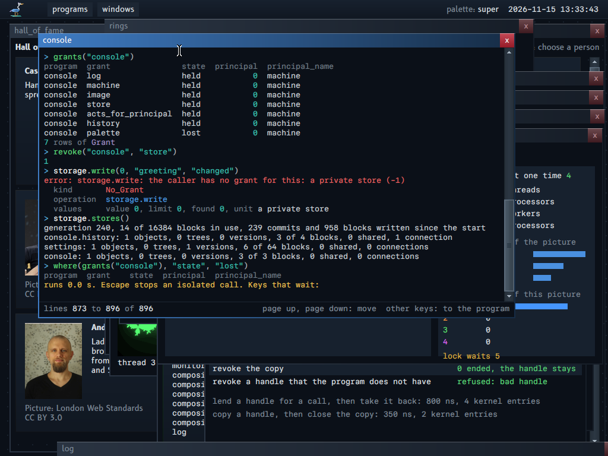
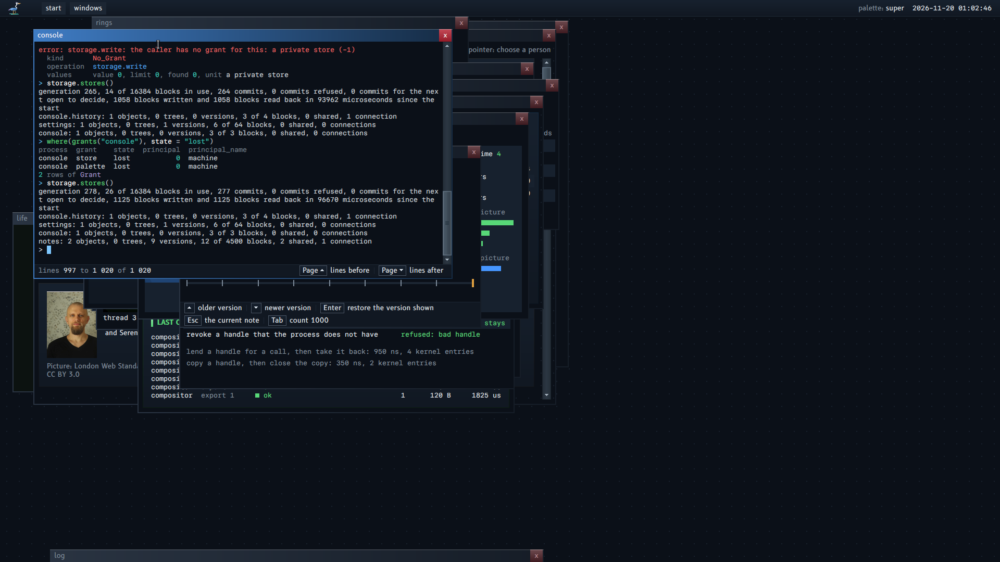

# Storage

This guide gives the model of the stored data of the system: what a process, a package and a principal keep, and how a process reaches only what it was granted. It also gives the format on the disk, the interface of the storage service, the limits, and the order of construction. Each part says if it is **built** or **not built**.

The terms are in `glossary/storage.md`. The versions and the date are in `ARCHITECTURE.md`, "U5. Storage service", and `ARCHITECTURE.md`, "The date".

## About this guide

**The idea in plain words.** A process never sees a disk, a path or a folder that other processes share. It holds a connection to its own store, granted by the root service with a limit of blocks. In it, it keeps objects (bytes) and trees (named entries that hold objects and other trees). Each change is a commit that a loss of power cannot cut in half, and each commit keeps the state before it as a version, so no process needs a save action or an undo file. To give a part of its data to another process, a process shares one tree, read-only or not, and can revoke the share.

**For whom.** A reader who writes a process that keeps data, a reader who wants to know what another process can reach of it, and a reader who changes the storage service.

**Read before.** `PROPERTIES.md`, "8. No global, mutable, shared file system" and "9. A storage engine with one private store per process". `PRINCIPALS.md`, "6. The store of a principal", for the names of the stores.

**The map of this guide.**

| Section | What it says |
|---|---|
| "1. The model" | Objects, trees and stores; installation and packages; the hard points; where the model changed |
| "2. What exists, and how it maps on the model" | What the system had first, and where each part stands in the model |
| "3. The format on the disk" | The blocks, an entry, the commit and the open, the limits, and the count tree |
| "4. The interface of the service" | Places, the confinement, read-only shares and revocation, the removal of a tree, budgets, large objects, the same object one time, the erase of versions |
| "5. Not built: the next steps" | The order of the next capabilities |
| "6. The tests" | What the host tests and the machine tests check |

**An example.** The console holds its line history in the store `console.history`, with a limit of 24 blocks: `storage.usage()` gives the counts of a store, and from a process that acts for the principal, `place = storage.open_store("console.history")` then `storage.versions(place, "line_history")` lists the earlier states of the object. The picture shows the private store of the console, its limit of blocks, the stores that the principal sees, and a grant that the principal revokes.





## 1. The model

The model has three things, and two concepts that the system has already.

| Thing | What it is | Does it change? |
|---|---|---|
| Object | Bytes, named by their hash (BLAKE3, 32 bytes). A module, a font, a picture, the text of a note: the same thing | Never. A new content is a new object |
| Tree | An object that names other objects and trees: each entry is a name and a hash. A tree holds trees, so the hash of a tree fixes each byte under it | Never |
| Store | A cell that names one tree now. A commit moves it to another tree in one atomic step. The versions of a store are its history | Yes: it is the only thing that changes |

| Concept that exists | Its part |
|---|---|
| Principal | A key pair. It signs trees (a package is a signed tree), and its key encrypts its data (not built) |
| Grant, handle | Access: a handle on a tree or on a store reaches what is under it and nothing above it, with or without the right to change, and its grant can be revoked |

The four needs, in the model:

| Need | Answer |
|---|---|
| Reproducibility | A system is the hash of one tree. Two machines with the same hash run the same bytes |
| Providers of packages | A package is a tree that the key of a principal signs. A provider is a principal: no other concept |
| Data of an application | A store held for a principal, attached to the identity of the package: the key of its signer and its name. Not its hash: an update would lose the data. Not its name alone: any signer could take it |
| Delegated access | A handle on a tree or on a store: what is under it, nothing above; read only or not; revocable |

What the model removes as a concept:

- **The system description is a package.** The system is the tree that holds the trees of its parts.
- **To install is to grant.** A principal adds the tree of a provider to its own tree, and grants it.
- **A folder is a tree.** The system has no other kind of folder, and no path that a process can name from nothing.
- **The boot image is a transport, not a concept.** It carries the objects that the machine needs before the storage service runs, one after the other. An image for a machine with no disk is the same transport with every object. An object can come by any channel: its hash proves it.
- **A package has no format of its own.** It is a signed tree with six facts beside its entries:
  1. its stable identity: the key of its signer and a name;
  2. the module that starts it, and the name that the desktop shows;
  3. the grants that it asks for;
  4. a version number that never goes back: an old signed tree cannot replace a newer one;
  5. where it comes from: the hash of its sources and of the recipe of its build, so that a third party can build it again and compare;
  6. its license.

### 1.1 Installation

Not built. These are rules of the model.

- **An installation runs no code of the package.** It has no script, no hook, and no step that changes the machine. It gets the objects that the tree of the package names and that the machine does not have, verifies each one by its hash, and keeps them. Nothing else changes until a principal adds the tree to what it holds: a grant, one atomic move of a store.
- **So an installation can be prepared before, cached, mirrored, shared between machines, stopped and continued, and undone** by a move of the store back to the tree before it.
- **A third party can build the same package.** The hash of a tree fixes each byte under it, and the build of a module gives the same bytes from the same source (`REPRODUCIBLE_BUILD.md`). A party that builds the package from its sources and its recipe gets the same hash: an object built before and an object built on the machine are the same object.
- **A cache of objects needs no trust.** The hash verifies each object. The signature of the tree says who vouches for the whole set.
- **What an application needs at its first start happens when it runs, inside its own grants:** it makes its data, or converts the data of an older version. Never at installation.

What these rules forbid, so that nobody adds it later:

- A package writes nothing outside its own data.
- A package does not register itself in a table of the machine by code that runs. What the system shows of a package (the module that starts it, the name that the desktop shows, the grants that it asks for) comes from the facts of its tree, read as data.
- A package does not depend on the order of the installations.

### 1.2 The hard points

**A large object that changes.** Built: section 4.6. An object is a tree of blocks. A commit of range writes makes new blocks for the changed blocks, and new object nodes on the paths from them to the root: copy on write, as the store does. The value of a block (its BLAKE3 chaining value at its place) is its check, and the hash of the object comes from the values: a commit hashes the changed blocks, the nodes above them and the path of the last block, never the whole object. One change of the model: a hole has the value zero, so the hash of an object with a hole is not the BLAKE3 hash of its bytes (section 4.6, "The hash of an object").

**Removal.** Two trees can name one object. A remove takes a name out of a tree: it does not erase the bytes while another tree, or a version, names them. What a remove guarantees: the name is gone from the tree at the commit, and the blocks that nothing else names are free after the removal finishes (section 4.4). A free block keeps its bytes until a commit takes it. To erase the old states of an object, `erase_versions` ends each version that names them, then writes zero bytes over their blocks (section 4.8). The device under the disk can still keep a copy.

**Collection.** An object that no store reaches, through any tree or any version, can go. The disk counts the names of each block, so each block becomes free at the commit that drops its last name: no walk. Two names of one object in one store (section 4.7) are two names of its root, counted the same way. A walk would be needed only for an object that several stores share by its hash, which the system refuses (the secrecy, below). The start of the service walks every block already to check it and count it (section 3.3).

**Secrecy.** The data of a principal are encrypted under a key of that principal. Then two principals with the same bytes have two different objects: the store does not share them across principals. This is intended: a shared object tells one principal what another one has. Not built. The free blocks of the disk are one count for all the stores: a store that fills the disk sees, by its own refusal `Full`, that a commit of another store took no block. It learns only that the other store wrote a copy of its own bytes (section 4.7), not what they are.

### 1.3 Where the model does not hold as it was first stated

- **The hash of a tree is not fixed by its entries alone.** A tree on the disk is a B+ tree of nodes, and the form of a B+ tree depends on the order of the changes. Two trees with the same entries can have two different forms. Rule: the hash of a tree is defined on its entries in the order of their names, not on its nodes; a tree that a build writes whole (a system, a package) is written in that one form. A tree in a store that changes has no hash until it is sealed. Not built: no tree has a hash today.
- **A writable handle on a part of a store is a place, not a hash.** A tree never changes, so a handle on a tree is read only by nature. To let another process change a part of a store, the handle names the store and the names of the path from the root of the store to that part. Such a handle reaches what is under that path. If a process with a wider handle renames a tree above the path, the handle names what is at the path now: the handle follows the names, not the bytes.
- **The versions are still kept for each named object, not for the store.** In the model, the versions of a named object are found in the history of its store. The first step keeps the versions of each object of a tree, as the store keeps them now; the history of a store is a later step (section 5).

## 2. What exists, and how it maps on the model

The model of section 1 is the direction; the service of today builds a part of it. The table gives each thing that exists, the concept of the model that it becomes, and how far it is built.

| What the system had first | In the model | State |
|---|---|---|
| A private store as one table of 39 named objects (the first format; not read any more) | A store of one process: it names one tree, with trees inside it | Built: section 3 |
| The name of an object (1 to 39 bytes, the first format) | A name of an entry of a tree (1 to 255 bytes) | Built |
| An object of a store, as a list of blocks | An entry of a tree that names an object: its hash and the root of its block tree | Built: the hash is kept, and a commit finds the current object of the store with the same hash (section 4.7) |
| The versions of an object, their thinning | The history of a store | Kept for each object; the history of a store is not built |
| The system description (a signed list of hashes) | The tree of the system, signed by the principal that signs the system | Not built |
| The boot image | The transport of the first objects | Built in part: the first module of a disk process is an object of the store `module_files`, which the root service starts when its bytes have the hash that the principal named (`MODULE_CONTRACT.md`, "A module from a disk"). The image is still the source of each other module and of each import |
| The resources of the boot image (pointer themes, font outlines) that the root service gives | Objects of the tree of the system, granted by handle | Not built |
| The hash of a module (P11) | The name of an object | The same BLAKE3 hash. A module file of a disk process is in the store `module_files`; its reader computes the hash on the bytes, because the hash of an object with a hole is not the BLAKE3 hash of its bytes (section 4.6) |
| A grant of the root service: the store of a connection and its limit | A handle on the store of a process, with its budget of blocks | Built: the connection is the handle |

## 3. The format on the disk

Built. The disk is blocks of 4096 bytes. A root block names each store; a store names one tree; a tree is a B+ tree of entries; an entry names an object, whose bytes are a tree of blocks. Nothing on the disk is written in place: a commit writes new blocks, then switches the root block, so a loss of power leaves the state before or after the commit, never a mix.

The format is the contract `src/library/modus/contract/store`, `STORAGE7`. A disk of an earlier format is not read, and never formatted: the open refuses it whole with the fact `Disk_Of_An_Older_Format`. `STORAGE6` had no record of the leaves to recount, `STORAGE5` had no count tree, and `STORAGE4` had the stores in 60 cells of the root block and names of 64 bytes.

### 3.1 The blocks

- **Root block** (`Root` of `src/library/modus/contract/store`): the mark `STORAGE7`, the generation, the count of blocks of the disk, the time since the format, the date, the pointer of the top directory of the count tree and whether that tree holds each count (`counts_complete`), and the pointers of the pages of the store table. Blocks 0 and 1 are its two places. The root block has its own check, over the bytes before it.
- **Store table page** (`Store_Table_Page`): 63 cells, each one store: its name, its limit of blocks, the blocks that it uses, and the pointer of its store block. The root names up to 251 pages, so a disk holds up to 15 813 stores (`STORE_CAPACITY`). A store keeps its cell, and so its number, for the life of the disk; a commit of a store writes its page again, with copy on write. A page with a wrong check damages its stores only: the service serves none of them and makes no new store in that page.
- **Store block**: one for each store: the root node of its tree, the root node of its removal queue, and its counts (objects, trees, the blocks of the current objects, the nodes of its trees, the trees that the removal queue holds).
- **Node**: a node of the B+ tree of one tree. A leaf holds up to 11 records of a name (256 bytes) and its entry (104 bytes); a branch up to 14 records of a name and the pointer of a child. Each node starts with a header with its level, its count and the mark "TREE", so a block of another kind is damage. Each tree of a store is its own B+ tree: a tree inside a tree is an entry whose pointer names the root node of the inner tree.
- **Object node**: a node of the block tree of one state of an object: 64 children, each an object node of the level below, a block of data, or a hole (section 4.6). It starts with the mark "BLOB".
- **Data**: 4096 bytes of an object, at one place of it. The block service reads and writes blocks of data through a data region that its client shares with it: the storage service makes a region of 64 blocks (`REGION_BLOCKS`), the process `disk` one of 1 MiB.
- **Version index, version leaf**: the versions of an object, as before; a version names the root of the block tree of its state.
- **Count tree** (`Count_Page`, `Count_Directory`): the count of names and the owner of each block of the disk (section 3.5). A leaf holds 512 blocks; a directory holds 128 children, each with the count of the free blocks under it. Each page of the tree is a block of count 1 with the owner `COUNT_TREE_OWNER`, in the tree itself.

A pointer is a block number and a check. The check of a block of data is the first 8 bytes of its value (section 4.6); the check of each other block is the first 8 bytes of the BLAKE3 hash of its 4096 bytes.

The bytes of each block, and of the records inside a block, in the order of a walk from the root block:

```byte-layout store.Root store.Store_Table_Page store.Store_Entry store.Pointer store.Store_Block store.Tree_Header store.Object_Node store.Object_Child store.Version_Index store.Version_Leaf store.Version_Entry
store.Root, 4096 bytes: the root block, at block 0 or block 1
offset  size  field             type
     0     8  magic             u64
     8     8  generation        u64
    16     8  disk_blocks       u64
    24     8  time              u64
    32     8  date              u64
    40     8  store_page_count  u64
    48    16  counts            Pointer
    64  4016  store_pages       [STORE_PAGE_CAPACITY]Pointer
  4080     8  counts_complete   u64
  4088     8  check             u64

store.Store_Table_Page, 4096 bytes: one page of the store table
offset  size  field     type
     0     4  magic     u32
     4     4  reserved  u32
     8     8  unused    u64
    16  4032  cells     [STORES_OF_A_PAGE]Store_Entry
  4048    48  padding   [BLOCK_SIZE - 16 - STORES_OF_A_PAGE * size_of(Store_Entry)]u8

store.Store_Entry, 64 bytes: the cell of one store in a page of the store table
offset  size  field  type
     0    32  name   [NAME_CAPACITY]u8
    32     8  limit  u64
    40     8  used   u64
    48    16  store  Pointer

store.Pointer, 16 bytes: how a block names another block
offset  size  field  type
     0     8  block  u64
     8     8  check  u64

store.Store_Block, 4096 bytes: the block of one store
offset  size  field           type
     0    16  tree            Pointer
    16    16  removals        Pointer
    32     8  next_removal    u64
    40     8  objects         u64
    48     8  trees           u64
    56     8  current_blocks  u64
    64     8  node_blocks     u64
    72     8  removing        u64
    80    32  reserved        [4]u64
   112  3984  padding         [BLOCK_SIZE - 112]u8

store.Tree_Header, 32 bytes: the start of a node and of an object node
offset  size  field     type
     0     4  level     u32
     4     4  count     u32
     8     4  magic     u32
    12     4  reserved  u32
    16    16  unused    [2]u64

store.Object_Node, 4096 bytes: one node of the block tree of an object
offset  size  field     type
     0    32  header    Tree_Header
    32  3584  children  [OBJECT_FANOUT]Object_Child
  3616   480  padding   [BLOCK_SIZE - TREE_HEADER_SIZE - OBJECT_FANOUT * size_of(Object_Child)]u8

store.Object_Child, 56 bytes: one child of an object node
offset  size  field   type
     0     8  block   u64
     8     8  check   u64
    16     8  blocks  u64
    24    32  value   Block_Value

store.Version_Index, 4096 bytes: the block that names the version leaves of one object
offset  size  field           type
     0     8  leaf_count      u64
     8     8  version_count   u64
    16     8  retention_time  u64
    24     8  reserved        u64
    32  4064  leaves          [VERSION_INDEX_CAPACITY]Pointer

store.Version_Leaf, 4096 bytes: one block of version entries of one object
offset  size  field     type
     0     8  count     u64
     8     8  reserved  u64
    16  4080  entries   [VERSION_LEAF_CAPACITY]Version_Entry

store.Version_Entry, 48 bytes: one version of an object
offset  size  field       type
     0     8  generation  u64
     8     8  size        u64
    16     8  time        u64
    24     8  date        u64
    32    16  root        Pointer
```

### 3.2 An entry

An entry is 104 bytes (`Entry` of `src/library/modus/contract/store`):

| Field | An object | A tree |
|---|---|---|
| Name | 1 to 255 bytes of UTF-8 with no control character (`docs/glossary/text.md`, "Text encoding"), then zero bytes. No byte `/`, not `.` or `..` | the same |
| Kind | object | tree |
| Size | its bytes | its entries |
| Generation, time, date | of its last change | of its last change |
| Hash | the hash of the object (section 4.6) | zero (not built) |
| Pointer | the root of its block tree: an object node, or its one block of data when it has one block; none when each of its bytes is zero | its root node; none when it is empty |
| Versions | its version index | none |

The removal queue of a store holds one more kind: a release (`Entry_Kind.Release`, 3), states of objects that steps free (section 4.4). Its pointer is the first of a chain of release lists (`Release_List`): each one block of up to 127 states, each state its root, its size and the first block of data that no step has freed (its cursor), and the pointer of the next list, or none (no block, check 0) for the last; the other fields of the entry are zero. A list is a block of its store. A list with another magic, a count of 0 or past 127, bytes in the places of no state or in its padding, or a next list in block 1 or of no block with a check is wrong: the open counts the lists before it and none of its states or of the lists after it, and a step drops the entry; the store stays whole. The commit of that step starts a recount of the count tree (section 3.5), which frees the blocks that only those states named. No tree of a store holds a release.

```byte-layout store.Entry
store.Entry, 104 bytes: the record of a leaf after its name of 256 bytes
offset  size  field       type
     0     8  kind        u64
     8     8  size        u64
    16     8  generation  u64
    24     8  time        u64
    32     8  date        u64
    40    32  hash        [32]u8
    72    16  pointer     Pointer
    88    16  versions    Pointer
```

A name is one step: it has no separator, and it never names the tree above. So a name that a process looks up under a place never reaches a node outside it.

In a branch, the name of the record 0 is a bound that the search never reads. It can be larger than the name of the record 1: a smaller name that goes into the child 0 splits it, and the new separator goes to the record 1. So the order of a branch is checked from its record 1.

Each child of a branch names a block. A child with no block, or a root of a tree with no block and a check that is not zero, is damage: the service refuses that tree and writes nothing.

### 3.3 The commit and the open

A commit is one change of one store. It plans its work in memory first (the blocks to write, the counts to change, the versions to thin); a refusal drops the plan and changes nothing on the disk. It changes the entries of the trees on one or two paths from the root of the store. Each changed node of each tree is written to a free block, then the node above it, up to the root node of the store, then the store block, then the root block: copy on write, as before. A loss of power leaves the disk with the last commit or the one in flight, never a mix: the tool checks each image that a loss can leave (section 6).

The open of the disk at the start walks each node of each tree once, checks each block, and counts the names of each block. A block of data is checked by its value at its place; an object node by its check, by the rules of its format, and by the counts and the values of its children. A block that an earlier state named is not read again. A node that breaks a rule (its count, its level, the block of each child, the order of its keys) is damage, as a wrong check. A wrong node damages its store: the service gives nothing of that store and changes nothing in it. A wrong object node or a wrong block of data damages the state of the object that names it only: a read of it gives Damaged, and a write or a remove replaces it.

A dropped write (`docs/glossary/storage.md`, "Dropped write") is a write that the disk answers with Ok and does not keep. The root before a commit is whole whatever happened to the writes of that commit, because a commit writes only blocks that are free in the state of the last commit, and a block becomes free only after the root that stops naming it is on the disk. The next commit ends that: it can write over the blocks that the root before names, and it writes its root over that root.

So each commit has a commit read back (`docs/glossary/storage.md`, "Commit read back"), in two steps. After the `Flush` of its blocks, and before its root, the commit reads back each block that it wrote and compares the bytes with the bytes that it wrote. After the `Flush` of its root, it reads back its root. If one differs, the disk did not keep a write. The service refuses the commit: the call gives `Device` with the unit `Dropped_Writes` and the count of the blocks that differ. The service keeps the state of the root before, which is the state of the disk, and writes one line:

```
storage: the read back of the commit of generation 14 found 1 block with other bytes: the disk did not keep it; the commit is refused before its root, and the service goes on from generation 13
storage: the read back of the root of the commit of generation 14 found other bytes: the disk did not keep it; the commit is refused, and the service goes on from generation 13
```

The objects read at once as they were before the commit, with no restart. A commit with a dropped block never has a root on the disk. The next commit takes the same generation, and writes only to blocks that are free in the state of the root before. If the read of the blocks fails, the service refuses the commit and goes on. If the write of the root or its read fails on the device, the root can be on the disk or not: the commit is not taken, the service makes no change until its next start, and the open of that start decides. The line is:

```
storage: the root of the commit of generation 14: its read back failed on the device; the commit is not taken, the open of the next start decides, and the service makes no change until then
```

The two places of the root are fixed. After 3 roots in a row that the disk did not keep, the service makes no change until its next start, and writes "storage: the disk did not keep the root of 3 commits in a row: a place of the root drops its writes; the service makes no change until its next start, and its objects can still be read".

Each of these lines is a log fact of the storage service, with the generation as a field: `storage_service.Commit_Block_Dropped` and `Commit_Blocks_Dropped`, `Commit_Read_Back_Failed`, `Commit_Root_Dropped`, `Root_Write_Failed` and `Root_Read_Back_Failed`, `Root_Place_Drops_Writes`. So `log.records(0) |> facts(storage_service.Commit_Root_Dropped)` gives each root that the disk did not keep (`docs/TOOLS.md`, "The log").

The cost is one read for each block that a commit wrote, up to 64 in flight at once, and one for its root. `stores()` gives the commits refused, the commits for the next open to decide, the blocks read back and the time of those reads since the start of the service, as a measure.

The open still checks each block at the start, for a drop that the read back did not see. If the newest root names a block with a wrong check and the root before it names none, the open uses the root before it, with the line "storage: the newest root names a block with a wrong check, and the root before it names none: the root before it is used". The commit with the dropped write is then lost whole.

The limit: a device that answers the read from the cache that lost the write passes the read back. The next commit then names the same wrong block, so both roots are damaged, and the open takes the newest one with its damage. The design: `src/md/features/dropped_write.md`.

### 3.4 The limits

| Limit | Value | Reason |
|---|---|---|
| A name | 1 to 255 bytes | The limit of the names of the other file systems. A key of 256 bytes gives 11 entries in a leaf: a store of a million objects has its entries in about 180 000 blocks |
| The levels of one B+ tree | 10 | With each node at its least (3 entries in a leaf, 4 children in a branch), 10 levels hold about 800 000 entries; with full nodes, more than a disk names. The open takes a deeper tree for damage |
| The trees on a path | 32 | A place holds the names of its path; a commit rewrites one tree on each level. 32 bounds both |
| The entries that one call adds | 256 | One commit writes at most 4096 blocks |
| An object | 4 TiB: five levels of object nodes of 64 children, 64^5 blocks | A commit copies one node of each level for each changed block, and the open takes a deeper tree for damage. 4 TiB is more than the disk, and a sixth level costs one more node on each path |
| A write of a whole object | The call region: 64 KiB | The data comes in the call region. A larger object is written by ranges |
| The pending changes of a connection | The limit of blocks of its store, in a pool of its own | A pending change past the limit could never commit: it is refused (`Over_Limit`, unit `Pending`). The memory of the pool is memory of the service; a pool that the budget refuses gives `Full` with the record of the budget. One connection takes no room of another |
| The changes of one commit | The counts of one commit in one memory object: about 64 GiB of changed blocks | A commit of pending changes takes tables of the room of its changes from its pool; the fixed tables of a commit hold one call region |
| The blocks that one commit releases | Up to the room of its counts; a larger state is freed in steps of 65 536 blocks | Section 4.4 |
| The stores of a disk | 15 813: 251 pages of 63 cells | A page is one block, and the root names each page |
| The disk | Each block of the device | When the budget of the service pays a table of each block (6 bytes and 3 bits: a disk of 64 GiB costs 114 MiB), the open walks and checks each block; past it, the service opens the disk from its count tree (section 3.5), and the log says so |
| The entries of a tree | No limit but the disk | |
| A frozen folder | 4096 entries in a node; a larger folder is nodes of 4096 entries under nodes of 64 parts, up to 2^36 entries | A node stays near 1 MB; one folder has one form and one tree hash |
| The pages of the count tree that one commit writes | 1024, more for a commit of pending changes from its pool | A commit whose counts change more leaves is refused (`Full`, unit `Commit_Blocks`); a step of a release stops at a quarter of them |

### 3.5 The count tree

The count tree holds, on the disk, the count of names and the owner of each block: the store that names it plus 1, `STORE_TABLE_OWNER` for a page of the store table, `COUNT_TREE_OWNER` for a page of the count tree, 0 for a free block. The root names its top directory, a directory of the least level whose 512 * 128^level blocks hold the disk. A child with no block is a part of the disk where each count is 0: a new disk has no page.

A commit, when its plan is final, makes the new version of each leaf whose counts it changes, and of each directory above them, each to a new block. Those new blocks, and the blocks of the pages that they replace, change counts too, in leaves that the commit adds, until no leaf is added; a new block is taken near the blocks of the commit. The pages are written with the other blocks of the commit and read back before the root: a loss of power leaves the counts of one commit.

The open has two forms. When the memory of the service holds a table of each block (6 bytes and 3 bits for each), the open walks each store and checks each block, as before, and compares each leaf with the counts that it found: a leaf that differs is written by the next commits, with the fact `Count_Leaves_Differ`; a tree with a wrong page is no tree (`Count_Tree_Damaged`), and the next commits write a new one. A disk that the tool wrote has no tree yet: its first commits write it, and `counts_complete` is 1 when each leaf is written. When the memory does not hold a table of each block, a root whose tree is complete opens with no walk of the blocks of the objects: the counts come from the leaves, through a cache of up to 4096 pages in the memory of the service; the open walks the trees of the stores for their entries, reading each node once, so a disk whose trees name one node again and again ends its open with its store faulty; a wrong block is found when it is read, and the service keeps up to 32 768 wrong blocks (with the largest cache) before it stops its changes (`Damage_Set_Full`). A leaf with a wrong check is passed by the search of a free block, and the service enters the repair state (`Count_Repair_Started`): it serves reads, and refuses each change with `Busy` (-14), unit `Count_Repair`, value the stores that the repair walked, limit the stores in all; the client of the storage service makes the call again every 100 ms, up to 60 s (`REPAIR_WAIT_BOUND_MILLISECONDS`), and past it gives the refusal. The repair walks each store of the last commit again, in steps of at most 4096 reads and writes, one after each round of calls, and counts the names of the blocks of the wrong leaves, at most 128 in one run. It reads each node of a tree once, and records each node that it walked in a scratch, one bit for each block, so a node of several names is walked once: in memory on a disk of up to about a million blocks, else on free blocks of the disk, which no root names. A loss of power loses the scratch, and the next open starts the repair again. A wrong directory of level 1 makes each leaf under it wrong; the commit of the repair makes it again from them. A wrong directory above level 1 stops the changes (`Damage_Set_Full`). A wrong node of a tree of a store ends the walk of that store, which takes no change (`Count_Repair_Store_Damaged`); a failed read or write starts the walk again after the next call (`Count_Repair_Device`); a disk with no free block for the scratch takes changes again until the next commit (`Count_Repair_No_Room`). At the end, one commit writes the counted leaves, and the service takes changes again (`Count_Leaves_Repaired`).

A release that meets a wrong block leaves names that no state holds (dead names): a wrong release list, a wrong node of a state of a release, a wrong block under the root of a released version, or a version index or leaf with a wrong check that a commit drops. The commit that leaves them writes in the top directory of the count tree that each leaf waits for a recount (`leaves_to_recount`, the count of the last leaves of the disk that wait), and the log says the blocks that it keeps, at least (`Dead_Names_Kept`; a wrong list or a dropped index gives no count). A dead name keeps its block in use, the safe side, so nothing starts at once: the recount starts when the free blocks of the disk, as the top directory counts them, fall under a sixteenth of the disk (`RECOUNT_FREE_SHARE`), or when a process with the start grant `Recount` (the console) calls `recount()`; then it waits until no call and no removal waits, and until the disk has a free block for each page of its tally (one for each leaf in use). The open says the leaves that wait (`Count_Recount_Waits`). With less room the recount does not start (`Count_Recount_No_Room`); a walk or a commit of its write that finds no free block stops it (`Count_Recount_Stopped_For_Room`), with the changes back. After either, none starts until the free blocks grow. A request ends with a failure of its recount. A walk that meets a wrong block when the set of damage holds no more stops (`Count_Recount_Damage_Full`), and the changes go on. A recount is one walk of each store (`Count_Recount_Started`): each name of a block of the leaves to recount adds one to a tally, one page for each leaf, on free blocks of the disk as the scratch of the repair. The names of a step are sorted by leaf before they go to the tally, so each page is read and written once for a sort. During the walk the service serves reads and refuses each change with `Busy` (-14), unit `Count_Recount`, value the stores walked, limit the stores in all; the client makes the call again as for a repair, and past 60 s gives the refusal, whose sentence names the recount. Then the service compares each leaf with its tally, one directory of 128 leaves at a time, with the changes still refused: the leaves of a directory that differ go in one commit, with the leaves still to recount after it, and a directory where no leaf differs makes no commit. No free count of a directory is trusted. At the end the service takes changes again (`Count_Recount_Ended`, with the blocks freed). A loss of power during a recount loses its tally only: the next recount goes on from the first leaf that no commit wrote. The walk keeps each wrong node that it meets wrong, so a later step of a release never trusts it. The open of the form Tables counts by its walk, so its next commit after it wrote each leaf that differs sets the leaves to recount to 0, unless a commit of its own left dead names since. A top directory that names more leaves than the disk holds is wrong; the repair makes it again with each leaf to recount.

A root whose tree is not complete is refused whole, as before (`Root_Larger_Than_Tables`), and so is a disk whose newest root a form refuses: an older root would lose the commits after it. A budget that pays neither form refuses the open whole.

```byte-layout store.Count_Page store.Count_Directory store.Count_Child store.Release_List store.Release_State
store.Count_Page, 4096 bytes: a leaf of the count tree: the counts of names and the owners of 512 blocks
offset  size  field    type
     0     4  magic    u32
     4     4  level    u32
     8     8  first    u64
    16  2048  counts   [COUNTS_OF_A_PAGE]u32
  2064  1024  owners   [COUNTS_OF_A_PAGE]u16
  3088  1008  padding  [BLOCK_SIZE - 16 - COUNTS_OF_A_PAGE * 6]u8

store.Count_Directory, 4096 bytes: a directory of the count tree: 128 children
offset  size  field              type
     0     4  magic              u32
     4     4  level              u32
     8     8  first              u64
    16  3072  children           [COUNT_DIRECTORY_FANOUT]Count_Child
  3088     8  leaves_to_recount  u64
  3096  1000  padding            [BLOCK_SIZE - 24 - COUNT_DIRECTORY_FANOUT * size_of(Count_Child)]u8

store.Count_Child, 24 bytes: one child of a directory of the count tree
offset  size  field  type
     0     8  block  u64
     8     8  check  u64
    16     8  free   u64

store.Release_List, 4096 bytes: a list of the states of a release in the removal queue, which names the next list
offset  size  field    type
     0     4  magic    u32
     4     4  count    u32
     8    16  next     Pointer
    24  4064  states   [RELEASES_OF_A_LIST]Release_State
  4088     8  padding  [BLOCK_SIZE - 24 - RELEASES_OF_A_LIST * size_of(Release_State)]u8

store.Release_State, 32 bytes: one state of a release list
offset  size  field   type
     0    16  root    Pointer
    16     8  size    u64
    24     8  cursor  u64
```

## 4. The interface of the service

Built. A process reaches its data only through the exports of the storage service, over the connection that the root service gave it. Each export names an entry by a place and a name, never by a path: a process can reach what is under its connection and nothing above it. Each change is one commit, so it is on the disk when the call returns, and the state before it is kept as a version.

An example, in the console of the machine test, whose store has a limit of 3 blocks:

```
> connect("storage")
> storage.write(0, "greeting", "kept on the disk")
G
> storage.read(0, "greeting")
kept on the disk
> storage.write(0, "second", "one block more")
error: storage.write: the call needs 4 blocks in all, with no earlier version kept; the limit is 3 blocks
> storage.write(0, "", "x")
error: storage.write: the argument name is empty; it must have 1 to 255 bytes
> storage.stores()
console: 1 objects, 0 trees, 0 versions, 3 of 3 blocks, 0 shared, 1 connection
```

The place 0 is the root of the store of the connection. `write` gives the generation `G` of its commit. The refused write changed nothing: a change that does not fit even with every earlier version thinned is refused before any thinning (the paragraph on thinning in `ARCHITECTURE.md`, section U5). After a stop of the machine, `storage.read(0, "greeting")` gives the same bytes.

### 4.1 Places

A connection to the storage service is a handle on a store or on a part of it. A **place** is a number that a connection holds: the names of a path from the root of the connection, and the right to change or read only. The place 0 is the root of the connection: no call is needed to have it. Every export that names an entry takes a place and a name. A place is valid on its connection only; a call refuses a place of another connection (Absent, unit Places).

| Export | What it does |
|---|---|
| `open(place, name)` | The place of the tree `name` under `place` |
| `close(place)` | Frees the place |
| `add(place, rows, names)` | Adds up to 256 entries in one commit: each one an empty object or an empty tree. All or none |
| `write(place, name, data)` | Makes the object `name` the bytes of data, in one commit: the same mechanism as a commit of ranges (a cut or an extension to the size of data, and a change of each of its blocks). The state before is a version |
| `read(place, name, result)`, `size(place, name)` | The bytes (the range from 0 to the end), the size; with the pending changes of the connection |
| `read_range(place, name, offset, result)` | The bytes from `offset` up to the end, with the pending changes of the connection; a hole reads as zero bytes |
| `write_range(place, name, offset, data)`, `set_size(place, name, size)` | A pending change of the connection: no commit, no hash (section 4.6, "Ranges") |
| `commit(place, name)` | Puts the pending changes of the connection on the object in one commit, and gives a row: the generation and the measure of the commit |
| `drop_pending(place, name)` | Drops the pending changes of the connection on one object; the other pending objects of the connection stay |
| `list(place, after, rows, names)` | A page of the entries after the name `after`, in the order of the names: a table of rows (the place of the name in `names`, its count of bytes, the kind, the size, the generation) and the bytes of the names. A tree of a million entries is never given whole |
| `rename(place, name, to_place, to_name)` | Moves an entry, in one commit, inside one store. Refused when `to_name` exists, or when a tree moves into itself |
| `remove(place, name)` | Removes an object, or a tree and all under it (section 4.4) |
| `share(place, read_only)` | A new connection whose root is the tree of the place: two handles (its call ring and its call region) for the caller, with the right Give, to give to another process |
| `unshare(share)` | Ends a connection that `share` made |
| `usage()` | The counts of the store of the connection; through a share of a tree, the counts of that tree only (section 4.3) |
| `stores()` | A first line with the generation of the disk, its blocks in use, and the commits, the commits refused by their read back, the commits whose root write or read failed on the device (for the next open to decide), the blocks written and the blocks read back with the time of those reads since the start of the service (section 3.3: a measure of the cost of the commit read back). Then one line for each store that the caller is allowed to name (section 4.2): its objects, its trees, its versions, its blocks (a shared block counted one time), the blocks that two names share, its limit, the count of connections that hold its grant now, and its damage. A caller that does not act for a principal gets the outcome `Grant_Or_Right_Missing` and the error record `No_Grant`, unit `Acts_For_Principal` |
| `recount()` | Asks for a recount of the count tree, for a process with the start grant `Recount` (the console): it frees the blocks that only dead names hold (section 3.5). Gives the leaves that wait for it; 0 when none waits, and nothing starts |
| `open_store(store)` | A place on the root of another store, for a caller that may name that store (section 4.2). Such a place reads, restores and clones; `write`, `add`, `remove`, `rename` and `share` refuse it |
| `versions`, `restore`, `clone`, `compare` | As before, on an object `name` under a place; no argument names a store |
| `version(place, name, generation, offset, result)` | The bytes of the object at a generation from `offset`, up to the end of the state or of the call region: a version larger than the call region reads in pieces |
| `erase_versions(place, name)` | Ends each version of the object, and writes zero bytes over each block that no other state names (section 4.8). A process with the grant `Versions_Erase`, on its own store, only |

### 4.2 No way up

- A name is one step (section 3.2): `..`, `.`, a name with `/`, and a name that starts with `/` are refused with the byte that breaks the rule.
- The store of a connection comes from the grant of the root service, or from the share that made the connection. One procedure of the service (`may_name_store`) decides if a caller may name another store, for `open_store` and for the lines of `stores`: a caller that acts for principal N names the stores of principal N only (the principal of a store is in its name: `principals.store_name_principal`); principal 0 names no store of a named principal; a caller that does not act for a principal names its own store only; a share names no store, not even the store of its maker, because a place on the root of that store would reach and change the whole store.
- A place of another connection is refused.

### 4.3 Read only, and revocation

- A connection that `share` made with `read_only` refuses each change (No_Grant, unit Changes).
- The two handles of a share carry the right Give: the maker makes a share to give it to another process, as the service `recipes` gives the stores of a builder.
- A share makes no share: `share` through a share is refused (No_Grant, unit Connections). The holder of a share is the process that its maker chose, and the 16 shares of the service are for the makers: a share that made shares could hold each of them, and a process that stopped never calls again to free them.
- A share of a tree sees the counts of its tree only. `usage()` through it gives the objects, the trees and the versions under the tree, and its blocks: the nodes of its trees, the blocks of the current state of each object (a block that two states share counted once for each), and the index and the leaves of the versions of each object. It gives the limit of the store, and no removal. The count is a walk of the tree: one read of each node, of the root of each object and of each version index, at most 4096 reads for one call; a larger tree, or a tree with a wrong block, gives `USAGE_NOT_COUNTED` (-1). A count of the whole store would tell the holder what the rest of the store holds (section 4.7).
- `unshare` revokes the two handles of the connection: the kernel ends each holding that came from them, in each process (`Handle_Revoke`), and the service frees the connection and its places. A call on it gives Gone.
- When the grant of the store of a connection ends (the root service revokes it, or the connection closes), each connection that it shared ends too, at its next call.
- A share has the limit of blocks of the store of its maker: a share that can change can fill that store. A limit of its own for each share is left (`ROADMAP.md`).

### 4.4 The removal of a tree

A remove of a tree is one commit: its entry leaves its tree, and the tree goes into the removal queue of the store. The name is gone at that commit. The blocks under it stay counted in the store until the service frees them, in steps: each step is one commit that removes up to 64 entries of the first tree of the queue (an inner tree goes into the queue in its turn). The service runs a step when no call waits. So the cost of the call is one commit, whatever the size of the tree; the work after it is bounded for each commit, and a loss of power loses no step: the queue is on the disk. `usage` gives the trees in the queue.

**A large state goes the same way.** The release of the last name of a state counts each block that it frees, in the table of the counts of its commit. The commit first counts, with no change, the names that the release changes: the root, each child of a node that loses its last name, and the children under it. A version that shares most of its nodes with the state that stays changes a few names, whatever its size, and is released in its commit. When those names pass the room left in that table, or half of the pages of the count tree that the commit can write less the leaves that it touches already, the state goes to the removal queue: the commit gathers such states in release lists of 127, chained, under one entry of the queue, so a commit that releases any count of large versions puts one entry. The remove of an object of any size is one commit. Each step then frees the states of the first list in their order, several in one step, up to 65 536 names and at most a quarter of the pages of the count tree of its commit, in the order of the blocks of data, and writes the list again with what is left, each state with its cursor. A node that another state names too loses one name, whatever its size; the last step of a state frees its root; after the last state of a list, the entry names the next list, and after the last list the queue drops the entry. The open counts a queued state from that block. The blocks of the state stay counted in the store until their step.

### 4.5 Budgets

The limit of blocks of a store holds as before: it counts the nodes of its trees, its object nodes, its blocks of data and its versions. A hole costs nothing: an object of 8 GiB with three blocks of data counts 13 blocks. A limit for a part of a store is not built.

### 4.6 Large objects

Built. An object can be far larger than one call: its bytes are a tree of blocks, and a process changes a few blocks of it and commits, with no copy of the rest. A part of zero bytes costs no block. The cost of a commit follows the blocks that it changed, never the size of the object.

#### The block tree

An object is a tree of blocks. The block n of an object holds its bytes from n × 4096. A block whose bytes are all zero is a hole: nothing names it, it costs no block, and it reads as zero bytes. The service never writes a block of zero bytes: a write that leaves one makes a hole, so the blocks of a state come from its bytes alone. The open takes a block of data of zero bytes for damage.

The object nodes are above the blocks. A node has 64 children: 64 is a power of two, so a node covers a whole subtree of the BLAKE3 tree of the bytes. A child holds its block number, its check, the count of blocks under it (itself included), and its value of 32 bytes (`Block_Value` of `src/library/modus/contract/store`). The level of the root comes from the size: level 0 when the object has at most one block (the root is that block), else the least level whose node covers each block. A child whose blocks start at or past the size is a hole. A node with no child is a hole too.

The value of a part of an object is the BLAKE3 chaining value of its bytes as a subtree of the BLAKE3 tree of the object, with zero bytes past the size. The value of a block is the chaining value of its 4 chunks of 1 KiB at its place: it is the check of the block. The value of a node is the parent of the values of its children, two by two; a whole part with no block (a hole) has the value zero, and two halves of value zero give zero.

#### The hash of an object

The hash of an object of at most 4096 bytes is the BLAKE3 hash of its bytes. For a larger object, it is the root of the BLAKE3 tree of its chunks, where each whole part before the last block takes its value from the block tree, and the parts of the last block come from its bytes, up to the size.

- When no block before the last one is a hole, the hash is the BLAKE3 hash of the bytes. The host test computes the official vectors of BLAKE3 through the block tree.
- When a block before the last one is a hole, the hash counts the value zero for that whole part, in place of the chaining value of its zero bytes. So the hash differs from the BLAKE3 hash of the bytes.

The reason: BLAKE3 puts the place of each chunk in its compression, so zero bytes at two places have two chaining values. The BLAKE3 hash of an object of 8 GiB with three blocks costs the hash of 8 GiB of zero bytes, and the hash of a write in a hole costs the hash of the hole around it. With the value zero, a hole costs nothing.

The hash is still a function of the bytes only: a block of zero bytes is always a hole, so two objects with the same bytes have the same hash. The size is in the hash: the last chunk carries its length and its place.

The hash of a module (P11) is the BLAKE3 hash of its file. A module with an aligned block of 4096 zero bytes before its last block has another hash as an object. The root service computes the BLAKE3 hash on the bytes of the module file of a disk process, which `disk_processes` read into memory that the root service lent: it does not read the hash of the entry, so a disk process is named by the hash of its file. The work on objects by their hash (section 5) must name the module by one of the two: it is not decided here.

#### Ranges

A connection changes an object by ranges in two steps:

1. `write_range` and `set_size` are pending changes of the connection. The service keeps a copy of each changed block, as the connection sees it: the block of the last commit, read and checked at the first change of a part of it (a whole block that a write covers is not read), with the change on it. Nothing is written and nothing is hashed. A read of the connection sees its pending changes; another connection sees the last commit.
2. `commit` makes the pending changes one commit, on the disk at its return. The state before becomes a version.

A pending change starts from the state of the object at the first pending change. Another change of the object before the commit (a write, a restore, a remove, a rename, or a commit of another connection) comes first: the commit is refused (Absent, unit Pending, found 1), and the pending changes are dropped. A loss of power before the commit loses the pending changes and nothing else: the disk has the last commit. `drop_pending` drops the pending changes of one object; the end of a connection drops all of its pending changes.

**The pool of a connection.** The pending changes of a connection are a pool of its own: memory of the service that the connection takes at its first change and gives back at its commit, at the drop of its last object, or at its end. A pool holds at most the limit of blocks of the store of the connection: a change past it is refused with `Over_Limit`, unit `Pending`, and the blocks before it stay pending. The memory grows with the changes, one memory object after another: when the budget of the service refuses it, the change is refused with `Full` and the record of the budget. A commit of pending changes takes, from the same pool, the tables of the room of its changes (the object nodes that its blocks can copy, their writes and their counts), and gives them back at its end: a commit of the pending changes of a large text is one commit.

**The exports, as the service declares them** (`src/modules/system/storage/ranges.odin`, `main.odin`):

```odin
write_range  :: proc "c" (place: i64, name: ^string, offset: i64, data: ^string, error: ^errors.Error_Record) -> i64
set_size     :: proc "c" (place: i64, name: ^string, size: value_kinds.Size_In_Bytes, error: ^errors.Error_Record) -> i64
commit       :: proc "c" (place: i64, name: ^string, result: ^[]Commit_Measure, error: ^errors.Error_Record) -> i64
drop_pending :: proc "c" (place: i64, name: ^string, error: ^errors.Error_Record) -> i64
read_range   :: proc "c" (place: i64, name: ^string, offset: i64, result: ^[]u8, error: ^errors.Error_Record) -> i64
version      :: proc "c" (place: i64, name: ^string, generation: i64, offset: i64, result: ^[]u8, error: ^errors.Error_Record) -> i64
```

`drop_pending` gives 0, or Absent (-13, unit Pending) when the object has no pending change on the connection. `version` gives the count of bytes from `offset` (0 at the end), Bad_Value (-3, argument 4) for a negative offset, and Out_Of_Range (-3, argument 4) for an offset past the end of the state.

**The procedures of the client** (`modus:storage`):

```odin
write_range   :: proc "contextless" (client: ^Client, place: Place, name: string, offset: u64, data: []u8, error: ^errors.Error_Record = nil) -> (size: i64, status: storage_status.Status)
set_size      :: proc "contextless" (client: ^Client, place: Place, name: string, size: u64, error: ^errors.Error_Record = nil) -> storage_status.Status
commit        :: proc "contextless" (client: ^Client, place: Place, name: string, error: ^errors.Error_Record = nil) -> (measure: Commit_Measure, status: storage_status.Status)
drop_pending  :: proc "contextless" (client: ^Client, place: Place, name: string, error: ^errors.Error_Record = nil) -> storage_status.Status
version       :: proc "contextless" (client: ^Client, place: Place, name: string, generation: i64, result: []u8, error: ^errors.Error_Record = nil) -> (bytes: []u8, status: storage_status.Status)
version_range :: proc "contextless" (client: ^Client, place: Place, name: string, generation: i64, offset: u64, result: []u8, error: ^errors.Error_Record = nil) -> (bytes: []u8, status: storage_status.Status)
clone         :: proc "contextless" (client: ^Client, place: Place, name: string, new_name: string, error: ^errors.Error_Record = nil) -> (commit: i64, status: storage_status.Status)
```

`version` calls the export piece by piece until `result` holds the whole state, and gives `Too_Small` when the state does not fit `result`. `version_range` is one piece.

This is the grouping of property 9: a process sends each change when it happens, and says which changes are one step. A whole write is the same mechanism: one call that cuts or extends the object to the size of its data, changes each of its blocks, and commits. A block that keeps its bytes keeps its block: its value is the value of the old block.

#### The cost of a commit

A commit of K changed blocks in an object of N blocks, with L levels of object nodes (L is the least level with 64^L at least N, at most 5):

| Work | Count |
|---|---|
| Blocks of data hashed | K, and the last block of the object: K + 1 at most; one more when an object of one block grows past it (its block becomes a child, with its value). Each one is 64 compressions of its chunks and 3 of their parents |
| Object nodes hashed | The nodes on the paths of the K blocks: at most K × L, and at most N / 64^l at the level l. Each one is 63 parent compressions for its value and one BLAKE3 hash of its block for its check |
| The hash of the object | The nodes on the path of the last block: at most 64 × L parent compressions from their values, and the bytes of the last block |
| Blocks read | A block that a range changes in part: at most K, each one read once; a hole and a whole block are not read. The nodes on the paths, through the cache |
| Blocks written | K blocks of data and the object nodes hashed; then the nodes of the trees of the store on the path of the entry, the version leaf and index, the store block and the root |

No count depends on N but through L. A write of a range computes nothing: a copy of the bytes in the service. The service writes one line for each commit of ranges: the blocks changed, the blocks and the object nodes hashed, the blocks written, and the time, as a measure. The export `commit` gives the same counts to the caller.

The test of section 6 makes 1000 writes of 16 bytes at scrambled places of an object of 8 GiB (2097152 blocks), each one in its own object node of level 1, then one commit. The commit hashes 1000 blocks and the last block, and about 1018 object nodes (1000 of level 1, 16 of level 2, one of level 3 and the root): it checks that the counts are bounded by the blocks changed (at most K + 1 blocks, at most 4K nodes), and prints the time as a measure.

#### Versions, thinning and the limit

A version names the root of the block tree of its state. A commit copies the nodes on the paths that it changes; the new state names each other node and block of the state before. Each block counts its names: the nodes that name it, and the entries and the versions that name a root. A release of a state takes one name of its root; a node with no name left gives one name less to each of its children. So the thinning of a version frees only the blocks that no kept state reaches: after the 1000 writes, the version before them holds 4 blocks of its own (the root and the path of the first block), and its other blocks are shared. `versions` gives the blocks of its own of each state.

The count of a store counts the blocks that its objects hold: each node and each block of data of the current state, and each block of the versions once. A hole counts nothing.

#### A loss of power

A commit of ranges is a commit as any other: its new blocks first, then a Flush, then the root. The tool checks each image that a loss of power can leave during a loop of commits of range writes (`modustool test power`): each image gives the durable commit or the commit of range writes in flight, never a mix; each object byte for byte when it has at most 1 MiB, else block for block by the values of its blocks, and the hash of each entry against its block tree.

### 4.7 The same object one time

Built. Two entries of one store with the same bytes name one block tree: the bytes take their blocks one time. The design is in `src/md/data/hash_index.md`.

- **The hash index.** The service keeps, in its memory, the root of the current state of each object of each store, found by the hash of that state. The open of the disk makes the index from the entries, with the reference counts. A commit changes it after its root is on the disk. Nothing of it is on the disk, so a loss of power leaves nothing of it to repair.
- **A commit looks up the hash first.** A write, a commit of ranges, a restore and a clone compute the hash of the new state before they write a block. When the store has a current object with that hash and that size, the new entry names its root: one more name of that block, as for a clone. No block of the object is written, and `commit` gives 0 blocks of the block tree written.
- **Each candidate is confirmed.** The hash of an entry comes from the disk. Before an entry names a root, the service computes the hash of that state again from its block tree, read and checked: the object nodes on the path of its last block and the last block. A root that the service knows as damaged, or whose path fails its check, is never named. The other blocks of the state were checked by the open or by the commit that wrote them: a block that goes wrong later damages each entry that names it, as for a clone. A root whose blocks give another hash takes the key of that hash; one lookup confirms at most 4 roots.
- **The cost is bounded.** The first slot of a hash comes from a key that the service draws at each start, one hash has at most one slot, and a search reads at most 32 slots. A process that chooses its bytes, or a disk that another party wrote, cannot make a long run of slots.
- **A change of one name copies.** The change is copy on write, as for any state: the new state copies the nodes on the paths that it changes, and the other entry keeps its root. A removal of one name takes one name of the root; the other entry keeps the blocks.
- **One store only.** A block is named from one store, and the limit of a store counts its own blocks. Two stores with the same bytes keep two copies (section 1.2, the secrecy).
- **A share of a tree.** A count of the whole store would tell the holder of a share whether the rest of the store holds bytes: a write that takes no block, or a removal that frees none. So `usage()` through a share of a tree gives the counts of its own tree only (section 4.3), a commit looks up a hash only when the connection of the caller reaches the whole store (the process of the store, or a share of its root), and while the store has a writable share of a tree open, no commit of the store looks up a hash and each root that a commit adds is hidden: never a candidate, after `unshare` too. What is left, for a writable share only: the limit of the store counts the blocks of the whole store, so a holder that writes until its write is refused with `Over_Limit` measures the room left in the store, and can learn from it whether its removal freed blocks or whether a write of the maker took any. Each measure costs it writes up to the limit. A read-only share has no channel.
- **The versions are not in the index.** A version keeps no hash; it shares its blocks with the state that follows it already. A restore of a version whose bytes another entry holds names the root of that entry.

The cost of a commit: a few slots of the index in memory, and for each candidate the read of the path of its last block, through the cache. A found root saves each write of the block tree. The index holds up to 131 072 roots in 6 MiB of the memory of the service; a root past them is not found by its hash, and its commit writes its blocks.

The count of the current objects of a store (`current_blocks`) counts a block that two names share two times, as for a clone; the blocks in use of the store (`usage().blocks`) count it one time. Example: the process `ranges` writes an object of 1 MiB under two names, and the store holds 261 blocks for both: 256 blocks of data, 4 object nodes of level 1 and the root.

The open counts the roots of current objects whose store has another root with the same hash and the same size (a commit while a writable share of a tree was open, or a root that was damaged at the commit): the tool checks that each image of a loss of power has none.

### 4.8 The erase of versions

Built. A version keeps an old state on the disk, and a thinning or a remove frees its blocks with their bytes in them. For the file of a principal, an old state opens with an old passphrase or an old recovery key (`PRINCIPALS.md`, "A change of the passphrase"). `erase_versions(place, name)` ends each version of one object, and writes zero bytes over each block that no other state names. The design is in `src/md/features/version_erase.md`.

The steps, in this order:

1. One commit ends each version of the object, with its version index and its leaves. The current version stays, with its hash and its generation.
2. The commit read back of that commit (section 3.3). If a block or the root differs, the disk did not keep a write: the commit is refused, the versions stay, and the service writes no second root and no zeros.
3. The service writes the root of that commit again, with the next generation, in the other place of the root, then a `Flush`, and reads it back. The two roots on the disk then name none of the freed blocks. If the disk did not keep that root, the root before the commit is still on the disk and names the freed blocks: the service writes no zeros, keeps the commit of step 1 as its state, and gives `Device`.
4. The service writes zero bytes over each block that the commit of step 1 freed, then a `Flush`, and reads them back. A block that reads back with other bytes keeps its old bytes: the log gives the count, and the row does not count it as zeroed.

The row of the export gives the generation of the last root, the versions ended, the blocks that read back as zeros, the blocks kept because another state names them, and the damaged parts of the versions that were ended with no zeros. The service writes one line:

```
storage: the versions of principal in the store unlock are erased: 1 version ended, 5 blocks written with zeros, 0 blocks kept that another state names, generation 412
```

- **Who may call it.** A process with the grant to erase versions (the start grant `Versions_Erase`; today `unlock` only), through its own connection, on its own store. Another process gets `No_Grant`, unit `Versions_Erase`. A share, a place of another store (`open_store`) and a connection that reads only are refused with `No_Grant`. Versions protect the principal against a fault of the process that writes an object, so a process does not end them by itself (`PROPERTIES.md`, "Persistence: no save action, and versions for all processes").
- **A loss of power.** Before the root of step 1, the open finds the versions, and no block holds zeros. After it, the open finds no version. No root that the open can take names a block of zeros. A loss during step 4 leaves old bytes in free blocks.
- **A shared block keeps its bytes.** A block that the current version, another entry or a clone still names is not written: its bytes are the bytes of a state that stays, and the row counts it. The hash index shares a block only between objects of one store with the same bytes (section 4.7). A process that acts for the principal of a store can clone or restore a version before the erase; the erase then keeps that block.
- **Damaged versions.** A version index or a leaf with a wrong check, and a state with a wrong block, are ended with no zeros: their blocks keep their bytes. The row counts them, and the service writes a warning.
- **A failed or dropped write.** When the second root or a write of zeros fails, or the disk does not keep it, the versions are already ended: the old bytes stay in free blocks, the log says it, and a later erase finds no version to end.
- **An object with no version.** No commit: the row gives 0 versions, and the disk does not change.
- **The device.** A write of zeros reaches the logical block. A flash disk can keep the old sector, and a host can keep a snapshot of the image. The erase does not reach those copies. The read backs of steps 2, 3 and 4 prove only what the device gives: a cache that lost the write can answer the read.

### 4.9 A disk that stops to answer

Built. A disk that stops to answer makes no client of the store wait for ever. The design is in `src/md/features/missing_hardware.md`.

- **The block service** gives each request a deadline when the device gets it: the hang bound of a process, 60 s, never a measure of the disk. Past it, each request in flight completes with the outcome of a failed device (`Callee_Unavailable`, or `Stopped_After_A_Partial_Change` for a `Write` or a `Flush`) and the record `No_Answer` of the device, the log has "block: the device did not answer a request in 60000 ms: N requests in flight fail, and the service stops", and the service stops. A device that sets its needs-reset bit stops the service too, with its line and the same record. The service never gives the place of a late request to a new one: the device can still write it.
- **The storage service** holds the block service with the right Read, so the stop of that service ends its wait. Each wait for a completion also ends after 60 s with no completion. A record `No_Answer`, that stop or that bound make the disk silent: the log has "storage: the disk does not answer: CAUSE; the service reads and changes nothing on the disk until its next start, and refuses each call that needs the disk".
- **The log facts.** The two lines are the log facts `block_service.Device_Silent`, with the bound and the requests in flight as fields, and `storage_service.Disk_Silent`, with the cause as a Text field; the stop of the block service for a reset is `block_service.Device_Needs_Reset`.
- **What a client gets.** A call that needs a block, a read too, gets `Device` at once. A disk that goes silent before the open is done leaves the storage service running with no store known: each call that names a store gets `Device`, and `usage` gives no count. The service does not stop: the root service would start it again for the next process with a store, with a new block service, a reset of a device that still holds a request, a new wait of 60 s and new lines, and the device could still write a data region that a stop frees. No client waits for a disk that does not answer.
- **The handle of the block service** is closed at the silence: nothing waits for it after, and the stopped process frees its slot.
- **A client waits for its answer at most 120 s** (`storage_status.ANSWER_BOUND_MILLISECONDS`), twice the bound of the disk, so that a silent disk gives the answer `Device` first. A storage service that runs and does not answer, a fault that the bounds above do not reach, gives the client the status `No_Answer`. The service can still write the answer into the call region, so the next call waits for that answer first, within the same bound, and runs when it came: a service that was slow once serves again, and a service that stays silent gives `No_Answer` again.

## 5. Not built: the next steps

Each step is one tested capability on a system that works.

1. **Large objects and ranges.** Built (section 4.6), but the disk past 1 GiB: an object can hold 4 TiB, and the disk has 262144 blocks.
2. **The history of a store.** A version is a tree that a store named; the versions of an object are found in it. The thinning applies to the history of the store. The versions of each object go.
3. **Objects by their hash.** Built in part: the hash index of section 4.7 finds the current object of a store by its hash, so an object that two entries name is kept one time. Not built: the hash of a tree on its entries (section 1.3).
4. **The first objects from storage.** Built for one case: a principal starts a process whose module file is in the store `module_files`, by its name and its hash, and the module file service puts such a file there from the network (`MODULE_CONTRACT.md`, "A module from a disk"). An import of such a process comes from the same store too: the root service reads each object of the store and keeps the bytes whose BLAKE3 hash the import names (`glossary/code.md`, "Import scan"); the index of step 3 is not needed for it, as the root service checks the bytes anyway. Not built: the boot image carries only what the storage service needs; the root service loads the other modules, the fonts and the pointer themes from the tree of the system, by hash.
5. **Packages.** A signed tree with its six facts; the store of the data of an application, attached to the identity of the package.
6. **Encryption for a principal.**
7. **The network as a channel.** An object comes from a peer; its hash proves it.

## 6. The tests

- Host tests of the B+ tree (`src/library/internal/storage/storage_tree`): inserts in a random order that split leaves and branches, a branch whose record 0 keeps a stale name, removes that merge and rebalance, the order of the keys, the pages of a listing, copy on write (the tree before a commit is still whole), the sizes of the format, the names that are refused.
- Host tests of the block tree (`src/library/internal/storage/storage_object`): the official vectors of BLAKE3 through the block tree, past one and two levels of nodes; a sparse object of 8 GiB with its hash computed again from its definition, its holes and a read across a block edge; a change across a block edge and across a level edge, with the state before whole; a cut to 10 bytes that lowers the levels to 0, an extension, a block of zero bytes that becomes a hole; a whole write that keeps the blocks whose bytes did not change.
- Host tests of the open (`src/library/internal/storage/storage_mount`): damage of a node, of an object node and of a block of data, a block tree that two states share, the recount of a store; the hash index: two names of one object give one root with two entries, a removal of one name keeps the root, two roots with one hash are counted and the second has no slot, a removal in a run of slots that goes around the end of the table keeps each other root found, a run longer than the bound of a search, a hidden root and a rekey, and a seeded run of 400 writes, removals and renames whose index is the index of a new open of the same entries.
- Host test of the erase of versions (`src/library/internal/storage/storage_mount`): it checks a model of the writes of the erase, built by hand in the order of the service, with the code of the open; it does not run the service. An object with two versions, one of them shares its block with another entry; the images of the disk after each write of the erase, and with the second root cut, each open with the versions or with none, and with no block of zeros named. At the end the freed blocks are zero bytes, and the shared block keeps its bytes.
- The machine test of `principals`: before a change of the passphrase and of the recovery key, the tool reads the file of the principal from the disk on the host. The tool serves the disk of the change, and the disk answers Ok to the first write of zeros over the block that holds the salt of that file and keeps the old bytes. The log has the line of the read back of the zeros that found 1 block with other bytes. The count of the blocks written with zeros, in the line of the service and in the row that `unlock` writes, is the count of the blocks of zeros that the disk kept. After the change, the image of the disk holds no part of the old file (its salt, its keys under the seal key, its keys under the recovery key) outside the dropped block, and that block still holds the salt while it is free. The open of the image on the host finds no wrong block, no damaged object or version, no fault of the hash index, and no version of the file.
- Host tests of the work on a block tree (`src/library/internal/storage/storage_object`): the hash of the same bytes before any write, a drop that gives back each name, a change of one of two names that copies the path of its block, a removal of one name that keeps the other.
- The machine test of `hierarchy`: 100000 entries in trees inside trees, the listing in pages, a rename, the removal of a tree, 6000 names added to one tree in a fixed scrambled order (leaves and branches split in their middle) and half of them removed in another order (merges), then a second machine that opens the same disk and checks the counts and the contents. Each refusal of the confinement (`..`, `/`, a place of another connection, a change through a read-only share, a call after `unshare`, `open_store` on its own store through a share of a tree). While a writable share of a tree is open, its write adds the blocks of its object to the count of its tree, the same bytes written by the maker outside the tree take their own blocks of the store and add nothing to that count, and the removal through the share takes its blocks back; after `unshare`, its guess stays hidden, and the same bytes written by the maker take their blocks. The time of the commits is printed as a measure.
- The machine test of `ranges` (`modustool test ranges`): an object of 8 GiB from three range writes holds 13 blocks and reads them back, with its holes and a read across a block edge; 1000 writes at scrambled places and one commit, bounded by the blocks changed; the version before them and the blocks of its own; a version of a small object reads its old bytes after a range write, and `compare` gives the one range written; a cut of 70 blocks to 6000 bytes, then an extension to 1 GiB; a read at the end and past it; a place of another store, a place of no connection, a commit with no pending change, and a commit after another change are refused; the same object of 1 MiB under two names holds 261 blocks of the store, a change of one name writes 3 blocks of its block tree, and the removal of one name keeps the other; a loop of 200 commits of range writes. A second machine reads each of them back after the open of the disk, and writes the object of 1 MiB under a third name, which takes no block.
- The losses of power (`modustool test power`): each image that a loss can leave opens, and gives the commit before or the commit in flight, each entry and each version byte for byte, or block for block for a large one; the hash index that the open makes reaches each of its roots, and no store keeps one object two times. The third loss comes in the loop of range commits of `ranges`: the commit in flight is a commit of range writes, and each image holds the object of 1 MiB under two names with one root. The disk that the tool serves places each cut itself: it counts the writes of a root from before the work, or from the block that starts the loop of `ranges` with a marker, and loses its power at a commit that the case names (after the count 300 or 1200 of `persistence_check`, in the first 41 records of `settings.repeat(1000)`, in the commits 2 to 41 of the loop), so the speed of the machine and the lag of its serial port do not move it.
- Host test of the dropped write (`src/library/internal/storage/storage_mount`): a model of a commit whose block of data the disk dropped, refused before its root, then the next commit from the state of the root before, on the blocks of the refused commit. Each image after each write of the next commit, each write of a block alone, and its root cut, opens at the root before or at the next commit, with no wrong block and no fallback. A second run writes the bytes of the refused commit again to the dropped block: no image shows the refused commit. A third case drops the second root of an erase of versions: the next commit takes the blocks that only the root before the commit of the end names, and each image opens at the commit of the end or at the next commit.
- The dropped write (`modustool test power`, the case `dropped_write_run`): the console writes an object two times, and the disk answers Ok to the write of the block of data of the second version and keeps nothing of it. The log has the line of the refusal of the read back before the root, the console gets `Device` with the unit `Dropped_Writes`, and `storage.read` gives the first version on the same machine. Then the disk keeps the blocks of a third version and drops its root: the log has the line of the refusal of the root, the console gets the same answer, and `storage.read` gives the first version again. Then the console writes a fourth version, and the disk hides the loss of its block of data: a read gives its bytes, and they never become durable, as a cache that a loss of power empties. The read back passes. The disk keeps a copy of its durable image when the root of that commit became durable: on the host, the open of that image refuses the newest root, uses the generation before it with 0 wrong blocks, and gives the first version. A second machine starts on that image: the log has the line of the fallback and "storage: ok, generation G" with that generation, and `storage.read` gives the first version. The durable image at the end of the first machine shows the limit of the read back: the open takes the newest root, with the object damaged. A third machine starts on that image: a range written past the end of the damaged object commits with `Data_Damaged` and stays, as `storage.read_range` and a second refused commit show; after a whole write of the object, the commit drops it with `Another_Change_Came_First`. `storage.stores()` gives the blocks read back and their time, as a measure.
- The silent disk (`modustool test power`, the case `silent_disk_run`): the disk that the tool serves reads each request from the first write of a block that starts with a marker, and answers none, with its connection open. The console writes that block. The log has the line of the block service and the line of the storage service, the console gets the error of `storage.write`, then the error of `storage.read` at once, and `1 + 2 * 3` still gives 7. The image of the disk holds no byte of the marker. The data disk of that machine has no ioevent file, so the stop of the block service drains no request in QEMU.
