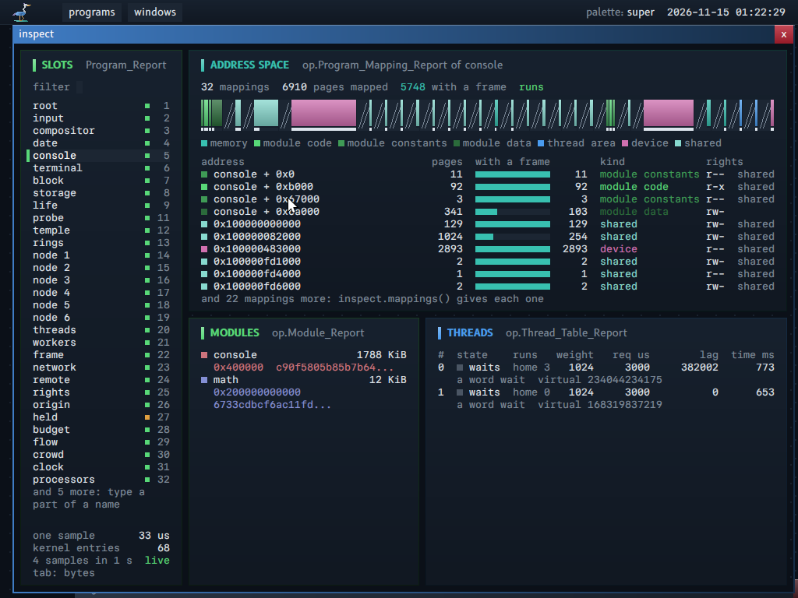

# Developer tools

The developer tools show memory and execution.

A developer tool (`glossary/network.md`) shows how the system runs. It reads reports of the kernel with a grant, and it changes nothing. Property 20 sets the limit: a tool inspects a program only with a handle that has the right to inspect.

## About this guide

**The idea in plain words.** In current systems a debugger or a task manager sees every program of the same user because it runs. Here a tool sees only what a grant lets it read: the kernel gives reports (counts, mappings, threads, modules) to a holder of the machine handle with the right **Inspect**, and gives no byte of the memory of another program. So each tool is a normal program, and its access is visible and revocable like any other.

**For whom.** A reader who wants to see how the system runs, and a reader who writes a tool, a source comment or a test of the system.

**Read before.** `PROPERTIES.md`, "20. No ambient access: the other holes to close" (line 2: debug access is a handle to one program). The terms developer tool, sample, folded gap, near export and confirmed place are in `glossary/network.md`.

**The map of this guide.**

| Section | What it says |
|---|---|
| "What each tool reads" | Each tool, its grant, and the reports that it reads |
| "The log" | The log of the kernel: its records, its channels and levels, and who reads it |
| "The program `inspect`" | The window that shows one program live |
| "Names and lines" | How an address becomes a procedure and a source line |
| "The debugger", "The debugger: the design" | The debugger service: who can debug which program, its exports, the commands of the console, debugging from another machine; then the reasons of its form and what the kernel gives it |
| "What `inspect` does not read: the bytes of another program", "The cost" | The limit of the grant, and the price of a sample |
| "The comments of the sources", "The form of a documented comment" | The rules that the tool checks on every comment, and the form of a comment that the site and the console show |
| "The commands of the tool" | The commands of `modustool`, the parts of the machine test that `modustool test` runs alone, the times of a test, the incremental build, and how the tool sends input and waits |
| "The bounds of the tests" | How a test waits, and why no test asserts a speed |



## What each tool reads

Each developer tool is a program of the boot image. The root service gives it its grants when it starts, and the kernel answers its operation `Inspect` with one report at a time. The table names, for each tool, the handle and the rights that it holds, and the reports that it reads.

A tool with no grant to inspect the machine reads nothing. It says so in its window and in the log: the monitor writes "no grant to inspect the machine".

| Tool | Grant | Reports |
|---|---|---|
| `monitor` | machine, Inspect | `System_Report`, `Program_Report` of each slot. It serves `programs()`, `counts()`, `count()`, `counts_named()` and `served()` |
| `pages` | machine, Inspect | `Mapping_Report` of its own page table and of the kernel half |
| `processors` | machine, Inspect | `Processor_Report` of each processor |
| `locks` | machine, Inspect | `System_Report.locks` |
| `scheduler` | machine, Inspect and Schedule | `Processor_Report`, `System_Report.strategy`, `Thread_Table_Report` (the machine number of its own threads; for the share policy, the threads of each program), `Program_Report` (the run time of each program) |
| `manual` | machine, Inspect; boot image; replacement table | the flat tables of the modules, `Module_Report` of each slot |
| `log` | the log records, Read | `op.Log_Record`. It serves `records(after)` and `value_runs(after)`, to each caller in its log scope, and `program_records(program, after)` and `program_value_runs(program, after)`, the records of a program whose handle the caller lends ("Who reads which records") |
| `debugger` | machine, Inspect; boot image; debug image; the commands `Debug` and `Debug_Store` of the root ring | `Program_Report`, `Module_Report` and `Thread_Table_Report` of the program that it debugs; the registers and the memory of that program through its handle with `Debug` ("The debugger"). It serves the exports of the debugger |
| `inspect` | machine, Inspect; boot image; debug image | `Program_Report`, `Module_Report`, and the four reports below, of the program that the principal chooses. It serves `mappings()`, `threads()` and `modules()` |

## The log

The log is the list of the lines that the kernel and the programs write as they run. The kernel keeps the newest records in memory and prints each one on the serial port. A record knows which of its bytes are values, so a window can color a size or a time without guessing from the text.

A log record (`glossary/running_code.md`) keeps its text and the value runs of the text: which bytes are a number, a size, a time, a module, a version or a status. The text is the text that the serial port prints, byte for byte: the machine tests wait for texts of the serial port, and a reader that ignores the runs reads the same record.

On the serial port, each line starts with the program and the channel in brackets. Two lines of the console, from the machine test:

```
[console] error: the instruction is at peek + 0x4 in probe (src/modules/probe/probe.odin:18)
[console] error: frame 0: peek + 0x4 in probe (src/modules/probe/probe.odin:18), the instruction
```

### The writer states the kind

A line of the log is made of parts (`system.log`, `system.log_in`, and `log` in the kernel). A text is plain. Each other part is a value with a value kind (`src/library/contract/value_kinds`):

| Part | Writes | Value kind |
|---|---|---|
| `u64`, `i64`, `Hex` | the number, in decimal or in 16 hexadecimal digits | Number |
| `Size{value, unit}` | the number, a space and the unit: `bytes`, `KiB`, `MiB`, `pages`, `blocks` | Size |
| `Duration{value, unit}` | the number, a space and the unit: `ns`, `us`, `ms`, `s` | Time |
| `Hash{bytes}` | two hexadecimal digits for each byte: the head of a hash is its first 8 bytes | Version |
| `Module_Name{name}` | the name of a program or of a module | Module |
| a status of the kernel (`system.Status`) | its number | Status |

No text is classified by its look. A value that a writer gives as a text stays plain. The reason: a guess from the look is wrong for a name that holds digits, and only the writer knows that `4096` is a size and not a count.

### The record and its value runs

A log record has 152 bytes of text and at most 8 value runs (`op.LOG_RUN_CAPACITY`): 3 bytes each, a start, a length and the kind. The operation `Log` takes the runs of its text in its seventh value, a count of at most 32 (`op.LOG_CALL_RUN_LIMIT`); the runs (6 bytes each, `Value_Run_In_Call`) follow the text at its address. The kernel copies them once and checks them in its copy: each run inside the text, after the run before it, with at least one byte and a kind. One run that fails: the record has no runs, and its text is whole. The kernel cuts the runs at the bounds of the records: a run across two records is one run in each. A text with more values than runs keeps the runs of its first values; the rest of its text is plain.

A run that fails its check costs the record its colors, never its text: the text is the fact, and the runs only describe it.

### The cost of the value runs

On the path of `log` in the kernel: one store of 6 bytes for each value, and at most 12 runs on the stack (72 bytes, `KERNEL_LOG_RUN_LIMIT` in `src/kernel/serial.odin`). In `log_record`, under the log lock: one pass over the runs for each record, at most 32 steps. No allocation. The serial port gets the same bytes as a record with no runs.

### The serial port and the log limit

The operation `Log` writes the records of the log only. The serial writer (`glossary/running_code.md`) prints them on the serial port after it: at each tick, a processor prints the lines of the records that the serial port does not have yet, in their order, for at most 100 µs, and only while the device takes bytes. Its time is charged to no budget. A processor that waits for a lock more than 1 s prints them too. So a `Log` never waits for the lines of other programs, and a hang of one processor does not silence the others. Before the first tick, each writer of a record prints it at once; before the machine stops, the kernel prints each record that is left; a report of a fault of the kernel prints them before its own lines. When the log wrote over records before the drain printed them, the serial port gets "kernel: <count> records of the log did not reach the serial port", and each scenario of the tool fails at once on that line, and once more on the whole log after the machine ends. A processor with nothing to run drains too, before its idle wait, at the rate of the port, with a window for interrupts after each byte: on a machine with an idle processor the serial port lags the log only by the rate of the port. A machine whose processors are all busy drains at the ticks only, and lags: a test that acts on the moment of a line under load must wait for a state instead. The first drains that wrote 64 KiB together write their measured rate once: "kernel: the drain of the serial port wrote <size> in <time> of port writes: <rate> bytes each second while it writes; <count> bytes in the idle loop, at that rate, and <count> at the ticks, at most <rate> each second for one busy processor". After the flush before the machine stops, the serial port gets the largest lag of a line in the run, from the time of its record to the write of its end on the port: "kernel: the largest lag of a line of the log on the serial port: <time> us". No test asserts either. In a flood, the programs write faster than the device keeps: the serial port then loses lines, and says how many.

The log records of each second are an amount of a budget, as its pages: a child budget takes its records from its starter, with its part of the count of this second, and gives both back when it ends. A budget counts only the records of its own programs, and a `Log` spends each record that its text takes: 4096 bytes are 27 records. So `No_Budget` from `Log` says only that the program wrote the amount of its budget in this second, never that another program wrote much. The kernel writes at most `op.LOG_RECORDS_OF_THE_KERNEL`, 64 records of its own in each second; past them it writes "kernel: <count> lines of the kernel were over its limit of 64 records in each second". The machine has `op.LOG_RECORDS_OF_THE_MACHINE`, 64 000: 1000 for each program slot. The root service gives each program `op.LOG_RECORDS_OF_A_PROGRAM`, 1000, and `limits` 40, and keeps 1000; a starter divides its own 1000 among its children. `system.log` never waits: a line that the kernel refuses is dropped and counted, and the next line that the kernel accepts comes after one record "<count> lines of this program were refused by its log limit". When a program stops after refused lines that no later line said, the kernel writes "kernel: <program>: <count> lines were refused by its log limit, the last ones before its stop". The design: `src/md/features/log_side_channels.md`.

### The window of the log

The program `log` shows the newest records, in 30 lines: the time, the mark of the level, the program, the channel, and the text in the font of the cells. A text is whole, on the lines that it needs: the window joins again the records of a text that the kernel kept in several records, and a line ends at a space, never where a record ended (`docs/INTERFACE.md`, "The text in a box"). A name of a program that is wider than its column takes more lines too. Each value run is in the color of its value kind (`docs/DESIGN.md`, "The colors of values"); the rest of the text is in the text color, or in the color "failed" for a record of the level error. The head of the column of the text is the legend: the six kinds that the logs write, each in its color. A text that starts with the name of its program and ": ", then its channel and ": ", shows without that start: the columns at its left say it. The record keeps its text whole.

The top line counts the records that the window did not read, in two counts. "Gone before its start" counts the records that the kernel wrote over before the window kept its first record: it says how long the machine ran before the window started. "Lost since" counts each record after the first kept record that the window did not read, in the color "failed" when it is not 0: the window was slower than the writers. After its first read of the ring, the window writes "log: the memory of the log: <count> records in <size>", then the same counts once: "log: ok, <count> records, <count> gone before its start, <count> lost since, <count> channels". The main machine test requires "0 lost since" and keeps the other count as a measure. The design: `src/md/features/log_window_losses.md`.

### The tables of the log service

`log.records(after)` gives one row for each record: its fields, the count of its value runs (`runs`), and its text. `log.value_runs(after)` gives the value runs: the number of the record, the start and the length in bytes of its text, and the name of the kind (`size`, `time`...). Join them on `number`. The first row of `records` also says in `lost` how many records after `after` the kernel wrote over before the call read them: a reader that is slow knows what it missed.

### Who reads which records

The log has the records of every program, and a program sees no other program. So the log service gives each caller the records of its log scope (`glossary/running_code.md`), and the caller never maps the memory of the log:

| Caller | Its log scope |
|---|---|
| A caller that acts for the principal: the console, `remote` | The whole log |
| Each other caller with a connection to the log service: `log_reader` | Its own records: the records with its program slot and its program serial |
| A program with no connection to the log service | No record through the service. Its records are on the serial port and in the whole log |
| Each caller, in `program_records` and `program_value_runs`, with a program handle that it lends with the right Read: a starter and the handle of its child | The records of that program only |

The kernel writes the program slot, the program serial and the own number in each record. The root service writes the two numbers of the caller in the grant of its connection, and the caller cannot change them (`modus:contract/log_scope`). A new program in the same slot has another serial, so it does not read the records of the program before it. A record that another program wrote about a program, such as "root: started log_reader", is not one of its own records.

A reader of its own records sees no number of the whole log. The number of each of its rows is the own number of the record (`glossary/running_code.md`): 0 for the first record of its program. It gives `after` in own numbers, and `lost` counts its own records that its ring no longer keeps. So it receives no number or count of the records of other programs.

Its rows come from the own log ring of its program (`glossary/running_code.md`): the kernel writes each record of a program in the whole log and in that ring, which keeps the last 64 records of the program and which only its records fill. A log storm of another program pushes records out of the whole log, never out of this ring, so the records that a reader lost say nothing of the others. The log service reads the ring with the kernel operation `Log_Read`, through its handle of the memory of the log (`docs/ARCHITECTURE.md`, "The own log ring of a program"). The ring ends when the slot of its program is free: after the stop, when the last handle to the program closes. A starter that holds the handle of a stopped child still reads the child's ring, and every record stays in the whole log until newer records push it out. A reader that wants more than its last 64 records keeps them as it reads them. A reader whose own records are all gone receives no row, and so no `lost`. The result of the two exports counts the rows of the scope. A reader chooses the rows of a channel with `where`: a log scope never names a channel, because a channel is a name that the writer chooses. `revoke("console", "acts_for_principal")` changes the scope of the console to its own records. If a service ring has no room for the new grants, the root service refuses the revocation with `No_Slot`, changes nothing, and writes "root: refused the revocation of acts_for_principal of <program>: the service <name> has no room for the new grants; nothing changed".

Each reader of the whole log keeps a copy of a record only when the kernel did not start to write over it during the copy (`op.log_copy_kept`): the record under the writer of the next one counts as lost, so a copy never holds the head of one record and the text of another. A reader then copies the last 2046 records at most, one fewer than the 2047 that the ring holds.

A starter reads the records of its children. A program sees the programs that it started, and the program handle of a child is the proof: `Program_Create` gives it to the starter only. So a starter lends the handle of a child, with the right Read, to `log.program_records(program, after)` and `log.program_value_runs(program, after)`. The log service asks the kernel for the program slot and the program serial of that program, and gives its records, numbered by their own numbers, as it gives a reader its own records: from the own log ring of that program, so a storm of one child never pushes out the records of another. One call gives the records of one program: the own numbers of two programs are two sequences. The scope of these two exports is the program of the handle, also for a caller that acts for the principal. A grandchild is the child of the child: its starter reads its records only if the child gives it the handle of the grandchild. The lent handle keeps the slot of the child, so a stopped child is still read, and a record of an earlier program of the slot is not given. A handle that names no program gives the error record `Handle_Kind`.

The program `log_reader` is the test: it writes one record, and starts two children that each write one record and stop. It then starts a third child, `log_reader storm`, which writes more records than the whole log keeps and stops; a refusal by the log limit of a second makes it write the record again in the next second, so each record reaches the log. The storm child takes 900 of the 1000 log records of each second of `log_reader`, which keeps 100 for its own lines, and gives them back at its stop. The storm pushes the records of `log_reader` and of its two children out of the whole log. `log_reader` then connects, reads the log from the own number 0, and writes "log_reader: its own records: 1 rows from the own number 0, its first record, in the slot <slot>, lost 0: no row of another program or of an earlier run: as it must". With the handle of each child, it then writes "log_reader: the records of log_reader child 1: 1 rows from the own number 0, its one record, lost 0: no row of this program, of the other child or of an earlier run: as it must", and the same for the child 2, then "log_reader: a child wrote <count> records after the records of this program and of its two children, more than the <capacity> that the whole log keeps, and the own log ring of each one kept its records: as it must", and "log_reader: the storm child took 900 of the 1000 log records of each second of this program, which kept 100, and each child gave its records back at its stop: as it must". A memory object in place of a program handle is refused with `Handle_Kind`. The program handle of the log service that `connect` gives has Read and no Give, so its lend fails with `No_Right`: a client reads no record of a service. The machine test starts it two times: the second run receives none of the records of the first one or of its children. It then reads the whole log through `remote`, in order: the last record of the storm child, "log_reader: ok", and the record "root: log_reader stopped with code 0". The design: `src/md/features/log_reader_scope.md`, `src/md/features/own_log_ring.md` and `src/md/features/log_side_channels.md`.

### The console and the terminal

A log record reaches the console only as the rows of these two tables. The console draws them as a table when a line asks for them. It also reads them itself for the programs that a line calls, and shows those records under the line, with each value run in the color of its value kind (`docs/CONSOLE.md`, "The log records of a line"). A program writes to its terminal apart from the log; a Text record of the terminal carries a value kind for each run (`Style.value_kind`), whose color the terminal chooses in the appearance in force, so a console that writes a record as runs of text, one run for each value run, needs no new form of the terminal.

## The program `inspect`

`inspect` is a window that shows one running program: its memory, its modules, its threads, and the stack trace when it stopped on a fault. It reads the same reports as any holder of the machine with **Inspect**, so it never sees the bytes of the program. The picture at the top of this guide shows it on the console.

One window for one program that the principal chooses in a list. It shows:

1. **The address space** (`Inspect_Kind.Program_Mappings`, `op.Program_Mapping_Report`): each mapping of the program, with its address, its pages, the first page of its memory object, the pages that have a frame (a count that each mapping keeps where an entry becomes present, under the program lock: the report reads one count for each mapping, not one entry for each page), the size and the serial of the memory object, and flags (`op.Program_Mapping_Flag`): Write, Execute, Uncached, Device, Contiguous, Shared (another mapping or handle names the object), Thread_Area, Uncommitted (an object made with Uncommitted: the field `committed` says which part its budget pays), Large (pages of 2 MiB), Protected (`Memory_Protect` changed pages of the mapping) and No_Access (its protection is No_Access now). The window draws one band scaled by address. A gap between two mappings is folded: it has a fixed width and lines at an angle (`DESIGN.md`, section 2: lines at an angle are a part with no measure on the scale). The kind of a mapping comes from these facts and from the module records: module code, module constants, module data, thread area, device, shared memory, memory of the program. The kernel does not know a stack: it is memory of the program.
2. **The modules** (`Module_Report`): name (from the boot image), hash, base and size. Each address in the window is `module + offset` when a module record holds it, as the stack trace of a fault names a frame (`MODULE_CONTRACT.md`, section 8).
3. **The threads** (`Inspect_Kind.Threads`, `op.Thread_Table_Report`): the machine number, the thread area, the state, the processor that runs it and its home queue, the weight and the request, the virtual time, the virtual deadline and the lag of the strategy, the processor time, the words of a word wait and its deadline. The kernel reads the fields of the scheduler with no run lock: each field is whole, two fields can come from two instants.
4. **The stop report** of a program that stopped on a fault (`Inspect_Kind.Stop`): the vector, the address, and each frame with the name of its procedure and its source line, `fault::three + 0x8 in fault (src/programs/fault/main.odin:15)`, from the debug image (section "Names and lines"). With no debug image, or a frame that no procedure of the debug object holds, the frame is `module + offset, near export`. The names are made when the stop report changes, not at each picture. The kernel filters the report (see below). The machine test waits for the log line `inspect: fault stopped: page fault at 0x0; stack: fault::three + 0x...`.
5. **Live**: a sample each 250 ms. A value that changed since the sample before is drawn in the color of the boot program for one sample. Space freezes the sample. The window shows the time of one sample and its kernel entries.
6. **A hex view** of the memory of `inspect` itself (the code of its export `entry`, and four pages of a memory object of which two were written): 16 bytes in each row, the address as `module + offset`, the ASCII at the right, the boundary of each page marked. A page with no frame is shown as such, and the tool does not read it: it asks `Inspect_Kind.Pages` (`op.Page_Report`) which pages have a frame, so its read gives no frame to a page. `Pages` answers for the program that asks only: about another program it is a side channel (a holder of Inspect watches which pages of a program get a frame, page by page, as the program runs), finer than each other report.
7. **One program, by its slot and its serial.** Each report has the serial of the program of the slot. A sample whose reports have two serials (a program ended, and a new one took its slot between two reports) is dropped, and the window keeps the sample before. The tool chooses a program by its slot and its serial, not by its name: two programs can have one name.

## Names and lines

A stop report gives addresses, and a reader wants the name of a procedure and a line of a source file. The names come from the debug object of each module, which the kernel never reads: a few programs with a grant read the debug image and translate. With no debug image, a frame keeps the form `module + offset`.

The kernel gives an address of a stop report as an address in a module record. The module names its exports only. The names of its other procedures and its source lines are in its debug object (`glossary/code.md`; `MODULE_CONTRACT.md`, "Debug information").

The debug object also holds what a debugger shows: the types, the global variables, and the parameters and the local variables of each procedure with their variable locations (`MODULE_CONTRACT.md`, "The types and the variables"). The names and the lines come from the symbol table and from the line program of the linked file; the types and the variables come from the entries of its DWARF. A program reads all of them through `src/library/contract/debug_object`, with no parser of DWARF.

- **One module, one debug object**: the debug object holds the BLAKE3 hash of its module file. A reader uses it only for a loaded module with that hash (`debug_object.describes_module`).
- **The source of a line**: the debug object holds, for each source file, its path from the root of the repository and the BLAKE3 hash of its content at the build. `debug_object.source_line_of` gives the path, the hash and the line of an instruction. A reader shows the text of the line only from a file with that hash, and says so when the hash differs.

- **Who names**: a program with the grant `Debug_Image` of the root service: `console`, `inspect`, `errors` and `debugger`. The root service maps the debug image read-only into each of them (the fixed range `Debug_Image`). The kernel reads no debug object: its line of the log stays "in module <hash> at offset X".
- **The form of a frame**: `procedure + offset in module (file:line)`. Frame 0 is the instruction. Each next frame is a return address: the procedure and the line are those of the call, the byte before the return address. The offset is the distance of the address from the start of the procedure.
- **The console**: a call host that stops on a fault prints "error: the instruction is at " and the name of its instruction, then one line "error: frame N: ..." for each frame (`fault_print`). A frame that no procedure of the debug object holds stays `module + offset`.
- **The program `errors`**: the case of the program `fault` writes its stack trace with the names: "fault::three + 0x8 in fault (src/programs/fault/main.odin:15), fault::two + 0x... in fault (src/programs/fault/main.odin:20), ...".
- **The machine test** (`Trace`): the tool takes the names that the system wrote, or names a frame `module + offset` from the debug object of the module in `build/modules`, with the same reader.
- **With no debug image** (a volume with no file `DEBUG/OBJECTS.IMG`): each frame is `module + offset`.

Lines of the machine test, after the console called the module `probe`, which tests the sandbox of an isolated call and reads an address that it must not read. Frame 1 is in a part of `host` that no procedure of its debug object holds:

```
[console] error: frame 0: peek + 0x4 in probe (src/modules/probe/probe.odin:18), the instruction
[console] error: frame 1: host + 0x2e14
[console] error: frame 2: entry + 0x224d in host (src/library/support/system/service.odin:337)
```

## The debugger

A debugger stops a program where its author asks, shows its threads, its registers, its stack and its variables, and runs it one instruction at a time. The debugger of the system is a service, the program `debugger`. Each command of the debugger is an export of that service, and each export gives a table of records: the console, a window and a developer on another machine call the same exports.

The code is `src/programs/debugger` (the service), `src/library/support/debugging` (the parts with no kernel operation: the path of a value, the walk of the frames, the place of a breakpoint, the location of a variable, the text of a value), `src/library/contract/debug_object` (the reader of the debug objects) and `src/programs/console/debugger_commands.odin` (the short names). The kernel part is in `ARCHITECTURE.md`, "The debugger of a program"; the reasons of the form are in "The debugger: the design" below.

### The service

- **Its start.** The root service starts `debugger` when a caller asks for a connection to it: `connect("debugger")`, or the first command of the debugger in the console. It has no window.
- **Its grants.** Serve (its exports); Debugger (the commands `Debug` and `Debug_Store` of the root ring, and no other command: `Debug_Store` gives a connection that reads only to the store of the debug object of a disk program that the service debugs, or that stopped on a fault, with the stop report that the root service kept of it); Inspect (the thread report and the module report of a program); Debug_Image (the debug objects); Image (the name of each module, from its hash).
- **How it debugs.** The service is the debugger of the program for the kernel: its main thread is the debug handler, so each breakpoint and each single step of the program is a fault record of that thread. It reads the threads and the module records with `Inspect`, the registers and the memory with `Thread_Control`, and the names, the lines, the types and the variables in the debug object of each module, by the hash of the module. It writes no byte in the program.
- **One program at a time.** The service debugs one program, for one caller. A second `attach` while it does gets the error `Full` (`Debugged_Programs`). Each export but `attach` acts only for the caller that attached.
- **The end of the debugging.** `detach()`; the end of the connection of the caller, or of the caller; the revocation of the grant `debug` of the caller; the stop of the program. The kernel then removes the breakpoints, clears the trap flag that the debugger wrote, and resumes each thread that the debugger held.
- **The log.** One line for each attach, for each stop of a thread at a breakpoint or a watch ("debugger: the thread 0 of clock stopped: breakpoint 1"), and for each end of a debugging.

### Who can debug which program

The root service gives the debug access: the handle of the program with the right `Debug`, and no other right. The service `debugger` asks for it with the command `Debug` of the root ring, on behalf of one of its callers: it names the call ring of the connection of that caller. The root service made that connection, so it knows the caller, and it applies the rule to the caller, not to the service. Only the program with the grant Debugger sends the command.

The rule compares two sets of grants. It names no program:

1. **The caller acts for the principal whose session runs the program.** The caller holds the grant to act for the principal, and the program is in the session of the same principal (`PRINCIPALS.md`). A program of the machine does not debug a program of a named principal, and a program of one principal does not debug a program of another.
2. **Each grant of the program is a grant that the caller holds.** A debugger acts with each handle of the program that it debugs and reads each byte of it, so the right `Debug` on a program is each grant of that program. The grants of the program are those that the root service gave it at its start, which the root service keeps in the state of the program that runs (`Started.role` in `src/programs/root/main.odin`): the rule reads no table by the name of a program, so it holds for a program that comes from a disk as for a program of the boot image.
3. **A revoked grant is not a grant that the caller holds.** After `revoke("console", "machine")`, the console does not debug a program that has a right of the machine.
4. **A grant refuses the debug access for each caller when what it reaches belongs to that one program.** Two holders of such a grant do not hold the same thing, so the caller does not hold what the program holds. The grants (`GRANTS_OF_ONE_PROGRAM` in `src/programs/root/main.odin`): Serve (a service holds what its callers lent it and what it keeps for them); Store and History_Store (a store of its own: a caller that acts for the principal reads each store of that principal and writes only its own, and through the registers of the program a debugger would write the store of the program); Terminal (a terminal of its own, with the keys typed in it); Network (an endpoint names its own remote and its own ports); Connect (the services that a program can connect to are its own list); Data_Disk, Scratch_Disk and Network_Device (a device service started for the program alone); Principals (a ring of its own, and the records of the principals); Remote_Clients (a connection for a row of the client table acts for the principal of that row, which is not the principal of the caller). Each other grant reaches one thing that each of its holders reaches: the machine by its rights, the boot image, the debug image, the replacement table, the settings page, the date page, the records of the log, the commands of the root ring.
5. **A revocation ends a debugging that the rule no longer gives.** After each revocation of a grant of a caller, the root service checks each debugging of that caller against the rule again, and ends each one that fails: the program is given back as on a detach, with no thread left stopped. So `revoke("console", "machine")` ends the debugging of `clock` by the console, and `revoke("remote", "acts_for_principal")` ends each debugging of the host. The end needs nothing of the caller. `detach()` needs no grant either.

What follows from the rule:

| Program | The answer for the console |
|---|---|
| A program with no grant (`debug_target`, `plasma`, `fault`, `hall_of_fame`, each program that the root service gives only the log and a window) | Given |
| A program with a right of the machine that the console holds, Inspect or Stop (`clock`, `processors`, `pages`, `flow`, `crowd`) | Given, until the grant `machine` of the console is revoked |
| A program with the boot image, with or without Inspect (`pointers`, `rings`, `boot`, `rights`, `frames`, `locks`, `address_space`, `imports`, `return_fault`, `fault_ring`, `debugged`, `cryptography_vectors`, `interface_through_module`) | Given, until the grant `image` of the console is revoked |
| A program with a private store (`notes`, `hierarchy`, `ranges`, `errors`, `unlock`) | Refused: the grant Store |
| A service (`storage`, `monitor`, `inspect`, `log`, `settings`, `date`, `manual`, `server`, `debugger`, the compositor) | Refused: the grant Serve |
| A program with a terminal (`flood`, a second console) | Refused: the grant Terminal |
| A program with an endpoint of the network (`net`, `fetch`, `quic_echo`, `remote`) | Refused: the grant Network, or Connect |
| A program that connects to services (`tables`, `log_reader`) | Refused: the grant Connect |
| A program with a device (`disk`, `network`) | Refused: the grant Scratch_Disk or Network_Device |
| A device service, a terminal | Refused: the grant System_Part, which the root service gives to the parts of the system that it starts by itself, and which no caller holds |
| A program with a grant that the console does not hold (`scheduler`: Schedule; `kernel_events`: Events) | Refused: that grant |

The grant that a refusal names is the first one of the program that refuses, in the order of the enumeration `Grant` (`src/library/contract/start_grant`).

A start grant and a recorded grant are not one to one. Several start grants are one recorded grant: `Inspect`, `Stop`, `Schedule`, `Events` and `Counters` are rights of the one handle `machine`. A start grant such as `Serve` has no recorded grant, and the recorded grants `log` and `debug` have no start grant.

**A window is not a grant.** Each program with no terminal has a window, and no grant names it, so the rule does not see it. The debugger of a program draws in the window of that program and reads the keys and the pointer events that the compositor sends to it. For the console this is the shell of the same principal, at the same screen.

A refusal is an error record of the kind `No_Grant` with the unit `Debug_Access`; `found` is 1 + the number of the start grant that refuses, in the enumeration `Grant` of `src/library/contract/start_grant`. The sentence of the record and the log of the root service name that grant with the same word, from the one table `GRANT_NAMES` of that package: the console prints "debugger.attach: the caller has no grant for this: the debug access to this program: the grant Store of the program refuses it", and the log has "root: refused console the debug access to notes: the grant Store of the program refuses it". The name of a start grant is the name of its member, with its capital letters (`Store`, `System_Part`); a name in lower case (`store`, `machine`) is a recorded grant, which `grants` shows and `revoke` takes. The number of a start grant does not change when a start grant is added: the new one takes the next number. A reader that does not know a number, because the root service is of a later build, writes "a grant of the program refuses it, the start grant number 28, which this program does not know". The other refusals: `No_Grant`, `Acts_For_Principal` (rule 1); `Absent`, `Programs` (no program has the name); `Full`, `Debugged_Programs` (another caller debugs the program).

The grant is a record of the root service: `debug` in `grants()`, a grant of the caller. `revoke` ends each handle that came from it, and the kernel ends the debugging with the last handle. The handle also ends when the connection of the caller to the service ends, when the caller stops, and when a revocation of another grant of the caller takes the access away (rule 5). After `detach()`, the service tells the root service that the debugging ended, with the same command.

The creator of a program also has the right `Debug` on the handle that the creation gave it (`ARCHITECTURE.md`, "The debugger of a program"). The root service gives the right to no program at its start.

### The exports of the service

Each export gives a table, or a negative number with an error record. A caller that does not act for the principal gets `No_Grant` (`Acts_For_Principal`). The reference of each export, with its parameters and its errors, is its comment in `src/programs/debugger/exports.odin`.

| Export | What it gives |
|---|---|
| `attach(program)` | One row: the program, its slot, its threads, its modules, and how many modules have a debug object |
| `detach()` | One row: the program, the breakpoints that the debugger had, the threads that it held |
| `threads()` | One row for each thread: its number, its state (`ready`, `waiting`, `held`, `stopped`), and for a thread that is held or stopped its instruction, with its module, its procedure, its offset, its file and its line |
| `hold(thread)`, `release(thread)` | Hold one thread; let one thread run. The row of the thread |
| `continue_all()` | Write the breakpoints in each thread, then let each thread run. One row for each thread |
| `registers(thread)` | 18 rows: the 16 general registers, `rip` with its procedure and its line, `rflags` with the flags that are set |
| `stack(thread)` | One row for each frame: the frame number, the module, the procedure, the offset, the file, the line, the frame pointer, the return address |
| `locals(thread, frame)` | One row for each parameter and each local variable that is visible at the instruction of the frame: its name, its role, its type, its value or "not readable", its location |
| `value(thread, frame, path)` | One variable or one global by a path: one row for each field of a record, each element of an array or of a slice, or one row for a value with no part. Each row: the name, the type, the value, the address |
| `source(thread, frame)` | One row: the line number, the path of the file, and the hash of the file at the build. The system holds no source text |
| `break_at(place)` | An execute breakpoint at a procedure (`fault::three`) or at a file and a line (`src/programs/fault/main.odin:15`). One row for each breakpoint |
| `watch(place, length)` | A data breakpoint on 1, 2, 4 or 8 bytes that the program writes, at an address or at a global. One row for each breakpoint |
| `breaks()`, `break_remove(number)` | The breakpoints of the debugger; remove one |
| `step(thread)` | One instruction. The row of the thread at its new instruction; `pending` 1 when the step did not end in 1000 ms |
| `step_line(thread)` | Instructions until the source line changes, at most 4096 and 2000 ms. The row of the thread; `pending` 1 when the line did not change yet |
| `step_over(thread)` | As `step_line`, and a call of the line runs to its end: the service puts a breakpoint at the instruction after the call, in a free place of the four, and lets the thread run to it. With no free place the thread stops at the first line of the call. A call that does not return in 2000 ms leaves the thread running with `pending` 1 and the breakpoint in place: the stop at the return is an event |
| `memory(place, count)` | At most 4096 bytes from an address or from a global, 16 in each row: the address, the bytes in hexadecimal, their printable characters |
| `events()` | One row for each stop of a thread since the last call: the thread, the kind (`breakpoint N`, `watch N`, `step`, `int3`, `int1`), the instruction, its module, its procedure, its offset, its file and its line |
| `wait_stop(milliseconds)` | Wait for the next stop, at most the given time and 3000 ms, then the rows of `events()` |
| `stop_report(program)` | With no attach: the stop report that the root service kept of a disk program of the principal of the caller that stopped on a fault. One row for each frame: the frame number, the module, the procedure, the offset, the file, the line, and in the row 0 what stopped the program (`MODULE_CONTRACT.md`, "The debug object of a disk program") |

**The errors.** Each failure is an error record (`MODULE_CONTRACT.md`, section 8):

| The failure | Kind, unit | Result |
|---|---|---|
| The caller attached to no program | `Absent`, `Debugged_Programs` | -2 |
| The service debugs a program already | `Full`, `Debugged_Programs` | -3 |
| The root service or the kernel refused | The record of the root service, or `Refused` with the status | -4 |
| No thread has the number; the thread is not held | `Absent`, `Threads`; `Absent`, `Held_Threads` | -5 |
| The module of the address has no debug object | `Absent`, `Debug_Objects` | -6 |
| The stack has no frame with the number | `Absent`, `Stack_Frames` | -7 |
| No variable and no global has the name, or the variable is not readable at this instruction | `Absent`, `Readable_Variables` | -8 |
| The text is not a path; a step of the path names nothing | `Bad_Byte`; `Bad_Value` | -9 |
| No procedure and no line has the place | `Absent`, `Source_Places` | -10 |
| No breakpoint is free; the number names no breakpoint | `Full`, `Breakpoints`; `Absent`, `Breakpoints` | -11 |
| The program does not map the address; a count or a length that the export does not take | `Bad_Address`; `Bad_Value`; `Not_Multiple` | -12 |
| The program stopped, or the debug access ended | `Absent`, `Programs` | -13 |
| Two programs that run have the name and the module | `Bad_Value`, `Programs` | -14 |
| A text argument is too long | `Too_Long`, `Bytes` | -15 |

**The stops.** A thread that reaches a breakpoint, that writes watched bytes or that ends a step waits for the debugger: `release`, `step` or `continue_all` lets it run. After an execute breakpoint the instruction of the thread is the one of the breakpoint, which did not run; `release` runs it once, and the breakpoint stays. After a watch and after a step, the instruction is the next one. The service takes each stop when it comes, keeps 32 of them for `events()`, and writes one line of the log. A caller learns of a stop with `wait_stop`, with no loop of `events()`.

**The breakpoints.** The debugger has four breakpoints, for execute breakpoints and watches together: they are the debug registers of a thread. The service writes them in each thread of the program when one is set or removed, and at `continue_all()`; a thread that the program makes later has none until then. A thread that runs is held for the write, then released. A watch does not see an access that the kernel makes for the program.

**A step.** The service writes the trap flag in the registers of the thread and lets it run; the record of the step comes after one instruction, and the service clears the flag at the next stop of the thread. The end of a step that its export waited for is the result of the export, not an event. A thread that waits in the kernel runs its next instruction only when its wait ends: `step` waits 1000 ms at most, then gives the row of a thread that runs, with `pending` 1, and the stop comes later as an event of the kind `step`. `step_line` enters a procedure that the line calls. A breakpoint or a watch that the thread reaches before the line changes ends `step_line` there, with `pending` 0, and the stop is also an event. At its bound of 4096 instructions or 2000 ms it gives the row of where the thread is, with `pending` 1, and the caller calls it again.

**The bounds of the exports.** The service has one thread and serves each caller of each principal, and the debugged program chooses how long one of its instructions takes. So no export waits longer than a stated bound, and each bound is under the 5000 ms after which `remote` ends a call:

| Export | What it waits for | Bound |
|---|---|---|
| `attach` | The answer of the root service | 2000 ms. A later answer is taken when it comes: the service closes the handle and tells the root service that the access ended |
| `stop_report` | The answer of the root service and the read of the debug object, together | 1500 ms. A later answer is taken when it comes: the service closes its handles and tells the root service to end the connection |
| `step` | The record of one step | 1000 ms |
| `step_line` | The records of its steps, together | 2000 ms, and 4096 instructions |
| `step_over` | The records of its steps and of the return of each call, together | 2000 ms, and 4096 instructions outside the calls |
| `wait_stop` | The next stop | 3000 ms, whatever the caller gives |
| `hold`, `break_at`, `watch`, `break_remove`, `continue_all` | The kernel, which waits until a thread on another processor left it | No wait of the service: one kernel operation for each thread |
| `detach`, and each other export | Nothing | No wait: the end command to the root service is sent with no wait for its answer |

**One program in two places.** The service finds the reports of the program by its name and by the hash of its module, which the root service gives with the handle. When two programs that run have that name and that module, the service cannot tell which one its handle names: the attach is refused (`Bad_Value`, `Programs`). The kernel gives no slot for a program handle; a result of `Handle_State` that gives it would end this limit.

### The commands of the console

Each command is an export of the service under a short name (`bound_call`, `CONSOLE.md`): the console connects to `debugger` when it has no connection to it, calls the export, and draws the table as it draws each table. The console holds no state of the debugging. The same exports are also commands with their full names after `connect("debugger")`: `debugger.threads()`.

| Command | Export | Why another name |
|---|---|---|
| `debug("clock")` | `attach` | The word for the act |
| `detach()` | `detach` | |
| `threads()`, `registers(thread)`, `stack(thread)`, `locals(thread, frame)`, `value(thread, frame, path)`, `source(thread, frame)` | The same names | |
| `hold(thread)` | `hold` | `stop` stops a whole program by its name |
| `resume(thread)` | `release` | `release` closes a handle of the console |
| `continue_all()` | `continue_all` | |
| `break_at(place)`, `watch(place, length)`, `breaks()`, `break_remove(number)` | The same names | |
| `step(thread)`, `step_line(thread)`, `step_over(thread)` | The same names | |
| `debug_memory(place, count)` | `memory` | `memory` gives the memory of the machine |
| `events()`, `wait_stop(milliseconds)` | The same names | |

A table of the debugger is a table as any other: `columns(stack(0), "frame procedure line")`, `where(locals(0, 1), "name", "total")`.

```
> debug("debug_target")
> break_at("debug_target::add_step")
> wait_stop(3000)
> columns(stack(0), "frame procedure")
frame  procedure
    0  debug_target::add_step
    1  debug_target::count_rounds
    2  debug_target::run_rounds
> value(0, 0, "debug_target::shape.size")
> step(0)
> detach()
```

### The variables and the types

- **The object of a module.** The service takes the hash of each module of the program from the module report, and uses only the debug object with that hash. With no such object it shows the module and the offset of an address, and an export that needs the object gets `Absent`, `Debug_Objects`.
- **A variable of the innermost frame.** The service takes the variables of the procedure that holds the instruction (`debug_object.variable_range_of_offset`), keeps those that are visible there (`debug_object.variable_at`), and reads each value by its variable location: a register of the register image, or memory at a register plus an offset. A variable whose range there is of the kind `Not_Readable` is shown as "not readable". The service computes no location that the table does not give.
- **A variable of a frame of a caller.** The instruction is the byte before the return address. Only the frame pointer of that frame is known, so only a variable location from the frame pointer is read; each other one is shown as "not readable in this frame".
- **Before a procedure set its frame pointer.** At the first instruction of a procedure, and after its `push rbp`, the frame pointer is still the one of the caller. A variable location from the frame pointer is shown there as "not readable: the procedure did not set its frame pointer yet".
- **A path.** A name, then steps: `.field`, `[number]`, `^` (`pair.next^.first`, `table[3]`). The name is a variable that is visible at the instruction of the frame, else a global. A global is named with its package (`debug_target::rounds`); a name with `::` needs no held thread. As in the language, the field of a pointer to a record is the field of the record. A path has 8 steps at most.
- **A value by its type.** An integer in decimal; a boolean; a float as its bits in hexadecimal ("float bits 0x3ff8000000000000"), because the system has no code that writes a float in decimal; a pointer and the address of a procedure as an address, with the procedure or the global that holds it, and `nil` for 0; an enumeration by the name of its value, or its number with "(no name)"; a record as `{field = value, ...}`, 8 fields and 3 records deep at most; an array as `[value, ...]`, 8 elements at most, then its count; a string by a second read of memory, 64 bytes at most, with "." for a byte that is not printable; a slice as its count and its address; each other type as its size. The service follows a pointer only when the path asks.
- **A global.** Its address is the address where the module is mapped plus the address of the global table (`debug_object.global_by_name`).
- **The stack.** Each procedure that the compiler wrote keeps the frame pointer: the word at `rbp` is the frame pointer of the caller and the word at `rbp` + 8 is the return address. The walk needs no table. It ends at a frame pointer of 0, at one that is not a multiple of 8, at an address that the program does not map, at a frame pointer that is not above the one before it, at a return address of 0, or after 32 frames. At the first instruction of a procedure the return address is the word at the stack pointer, and after its `push rbp` the word above it: the service knows the start of the procedure from the debug object. A procedure of an assembler file can keep no frame pointer: the walk skips its caller or ends there.
- **The source lines.** The debug object holds, for each source file, its path and the BLAKE3 hash of its content at the build (`debug_object.source_line_of`). It holds no source text, and the system has no source file: `source` gives the path, the line and the hash. A reader that has the sources shows the line only from a file with that hash.

### Debugging from another machine

Debugging from another machine needs no mechanism of its own.

- **The service `remote` carries the exports.** `remote` carries a call of an export over QUIC from another machine to a service that it can connect to (`QUIC.md`, section 7). `debugger` is one of them. On the host, `modustool call <key> "debugger.attach(\"clock\")"` calls an export against a machine that `modustool run` started, and prints its table.
- **Who the caller is.** The caller is `remote`, through a connection for one row of the client table: the root service applies the rule of "Who can debug which program" to `remote`, with the principal of that row, the principal that allowed the key of the client (`PRINCIPALS.md`, "The client keys of remote"). `remote` holds the grant to act for the principal, and grants Network, Connect and Remote_Clients, which reach things of `remote` alone: so a client on another machine debugs exactly the programs with no grant, in the session of the principal that allowed its key. Each other program is refused. The connection adds no right; `revoke("remote", "acts_for_principal")` ends each debugging of the host, and the end of the grant of a client key ends the connections to services of that key, and the debuggings with them.
- **What the host can do.** For a program with no grant, a client whose key a principal allowed reads each byte of its memory and each register, writes its registers, and so chooses what the program runs. With the handles of that program it draws in its window and reads the keys and the pointer events that the compositor sends to it. The clients of one principal are the one caller `remote`: they share one debugging, and one can steer or detach the debugging of another (`QUIC.md`, section 7, "Who may call").
- **The time of a call.** `remote` ends a call that takes more than 5000 ms, and with it its connection to the service: the root service then ends the debugging. Each export of the service has a bound under that time ("The bounds of the exports"). `wait_stop` waits 3000 ms at most: a caller on another machine calls it again, or reads `events()` after the line of the stop in the log.
- **The source line.** `modustool call` prints, after a table whose record has the fields `path`, `line` and `hash`, the text of each line from the file of the repository, only when the file has that hash: "source: src/programs/debug_target/main.odin:79: ...". With another hash it says that the file changed since the build. A path that is absolute, that has a part `..` or that names a file of the compiler is not read.
- **Where the debug objects are.** In the debug image of the debugged machine: the service names each address there. The module of a disk program is not in the debug image: at `attach`, the service reads its debug object from the store `programs`, beside its module file, through a connection that reads only and that the root service gives with the debug access (`MODULE_CONTRACT.md`, "The debug object of a disk program"). A caller on another machine can also read raw values (`registers`, `memory`) and name them with its own debug objects, by the hash of the module.

### The test

`modustool test debugger` runs two machines. The first one is the contract of the kernel (the program `debugged`). The second one is the commands: the console starts the program `debug_target`, which has no grant and values that the test knows, and waits for exact rows: a breakpoint by a procedure name and by a file and a line, the frames of the stack, a local variable of a caller, the fields of a record inside a record, an element of an array, the name of an enumeration value, a text, one step, one line, a watch of a global, and the detach. Then the rule: a program with a private store, a service and a device service are refused; a program with a right of the machine is given, the revocation of the grant `machine` of the console ends its debugging, and a new attach is refused; the revocation of the grant to act for the principal, while a thread is held, gives the program back. Then the same exports from the host through `remote`, with the source line that the tool reads in the repository. The parts with no kernel operation have host tests (`src/library/support/debugging`).

### The window of the debugger

The program `debugger_window` shows the rows of the service in one window, with a key or a click for each act: a developer needs the console for no act of the debugger. Start it from the menu of the programs, or with `start("debugger_window")`.


With no program attached, the keys type a name in the name field, then Enter attaches. With a program attached, and no focus in the debug place field:

| Key | What it does | The export |
|---|---|---|
| up, down | Chooses a thread | `threads` |
| page up, page down | Chooses a frame of the chosen thread | `stack`, then `locals` and `source` |
| `h` | Holds the chosen thread | `hold` |
| `r` | Lets it run | `release` |
| `c` | Lets each thread run | `continue_all` |
| `s` | One instruction | `step` |
| `l` | One source line | `step_line` |
| `o` | One source line, over each call | `step_over` |
| `b` | Puts a breakpoint at the source line of the chosen frame | `break_at` |
| `0` to `3` | Removes the breakpoint with that number | `break_remove` |
| `g` | Shows the registers of the chosen thread in the card of the variables, or the variables again | `registers` |
| `d` | Detaches | `detach` |
| Escape | Takes the focus from the debug place field: the keys above act again | |

**The debug place field.** A debug place is a text that names a place of the debugged program, as the console gives it to the export. A press on the field gives it the focus; then each key is a character of the place. Three buttons under the field take its text:

| Button | The debug place | The export |
|---|---|---|
| break at (or Enter in the field) | A procedure (`debug_target::add_step`), or a file and a line (`src/programs/debug_target/main.odin:82`) | `break_at` |
| watch | An address (`0x403010`) or a global (`debug_target::rounds`). A last word `1`, `2`, `4` or `8` after a space is the bytes of the watch: 8 with none | `watch` |
| memory | An address or a global: the memory view shows 128 bytes from it | `memory` |

A breakpoint or a watch that the service took empties the field: its text is in the card of the breakpoints. The memory view keeps the text in the field. The service parses the place: a place that it refuses gives the code of its error on the status line.

**A click on a row** does what a key does: a row of the threads chooses that thread; a row of the stack chooses that frame; a row of the source puts a breakpoint at its line; a row of the breakpoints removes that breakpoint.


The cards: the program, with the debug place field and its threads, each with its state and its place; under it the breakpoints and the watches, each with the number that removes it; the source line of the chosen frame; the memory view, each row an address, 16 bytes in hexadecimal and their printable characters; the stack of the chosen thread; the variables of the chosen frame, or the registers of the chosen thread in two columns. A thread that runs has no stack to read: the cards say so, and `h` holds it. The window reads the threads and the memory view again each 500 ms, so a thread that stops at a breakpoint shows as stopped with no key, and a byte that the program writes shows at the next read. The line under the field says what the last act did, or the code of an export that failed.

**What the window holds.** A connection to the service `debugger` and to no other service, the boot image to read the description of the exports of that service, and the grant to act for the principal, which the service asks of each caller. It holds no right over a program. The service debugs one program at a time: while the console is attached, the window attaches to nothing, and the other way.

**The records.** The window reads the rows by the layout of the records of the service. At its start it compares the size of each of those records with the description in the file of the service; when one differs it attaches to nothing and says why.

## The debugger: the design

The reasons of the form of the debugger. What is built is in "The debugger" above.

- **The commands are exports of a service, not code of the console.** A window, another program and a developer on another machine then use the debugger with no second implementation, and each result is a table that the caller combines with the generic commands of the console.
- **The serial port is not used.** The serial port is the log of the kernel. A second protocol on it would be a second way into the machine, with no grant and no connection that proves who calls.
- **The debugger injects no thread and no code into the program**, and writes no byte in its code: the kernel gives it the four parts below, each a right, a command or an argument of an operation that exists.

### What the kernel gives a debugger

Four additions, each a right, a command or an argument of an operation that exists: the count of operations does not change. Each one is built; its rules, its locks and its interleavings are in `ARCHITECTURE.md`, "The debugger of a program".

1. **Who may debug whom.** Property 20, line 2: "Debug access is a handle to one program". The grant is a right of a program handle, `Debug`, and a command of the root ring, `Debug` (a name). The root service gives the handle of the program with `Debug`, and no other right, to the debugger service, on behalf of a caller, by one rule over the grants of the program and of the caller ("Who can debug which program"). Two holders have `Debug` on a program, and no other: the debugger service, by this command, and the creator of the program, on the handle that the creation gave it, as it has the memory that it maps in that program (the test program `debugged` debugs its own children so). A thread of the program is named by its number and this handle.
2. **The faults of the debugged program go to the debugger.** A program names one of its own threads as its fault handler (`ARCHITECTURE.md`, "The fault ring"). The fourth argument of `Fault_Handler_Set` is a program handle with `Debug`: then the handler thread of the caller receives the faults of the kinds `Debug` and `Breakpoint` of that program, before the handler of the program itself, and `Fault_Answer` takes the same handle, with the answer `Resume` only. The ring stays in the thread record of the handler: the debugger pays for it. When the debugging ends (a detach, the end of the handler thread or of its program, the close or the revocation of the handle, the stop of the debugged program), the kernel removes the breakpoints of each thread, clears the trap flag that the debugger wrote, takes back the stops that the debugger made, and resumes each thread that waits for its answer: a debugger that ends never holds and never stops the debugged program. The debugger injects no thread and no code into the program.
3. **Breakpoints, with no write to the code.** The code of a module is shared: each program of the module maps the same pages without Write (`MODULE_CONTRACT.md`, "2. Loading"). A byte `CC` in those pages would stop each program of the module. `Memory_Protect` only takes rights away, and refuses an object that another program names (`Object_Shared`). A private copy of one page for one program needs a page of a mapping that differs from its memory object: the kernel keeps the state of a page in the slots of the object, not in the mapping, so that is a new structure of the kernel. The least addition is the debug registers of the processor: two commands of `Thread_Control`, `Read_Breakpoints` (Inspect) and `Write_Breakpoints` (only the debugger of the program, through its handle with `Debug`), with four breakpoints for each thread (`op.Thread_Breakpoints`): an execute breakpoint at an instruction, or a data breakpoint on 1, 2, 4 or 8 bytes that the thread writes, or reads or writes. The kernel checks that each address is below `USER_END`, writes only the local enable bits of `DR7`, and loads `DR0` to `DR3` and `DR7` at the switch to a thread that has them (one flag of the thread: the others pay one test). An execute breakpoint is a `Debug` fault before the instruction; the record gives the debug status in its error code (`op.DEBUG_STATUS_BREAKPOINTS`, `op.DEBUG_STATUS_STEP`), so the debugger knows which breakpoint; the answer `Resume` sets the resume flag, so the instruction runs once. A breakpoint is of one thread: it never appears in another program. The limit: four breakpoints for each thread, and a thread that the program makes later has none until the debugger sets them.
4. **The bytes of the debugged program.** No report reads the memory of another program (section "What `inspect` does not read"). A command of `Thread_Control`, `Read_Memory` (Inspect and Write: a thread handle with Inspect only sees the thread, it does not read secrets), copies at most 4096 bytes of the program of the thread, from the pages that the program maps, can read and that have a frame (no read gives a frame to a page). It gives the count of bytes before the first page that is not so, and `Bad_Address` when that page holds the first byte or the range is not below `USER_END`.

## What `inspect` does not read: the bytes of another program

The right **Inspect** on the machine shows how every program runs, but it must not show what a program holds: its keys, its documents, its passwords. So the kernel removes from a report each value that can come from the memory of the program. The rule and its reason follow.

The reports give counts, places, states and the stack trace. The stack trace comes from the stack of the program: with a chain of frame pointers that the program broke, a frame holds a word of its memory, and the address of a page fault can be a value that the program computed. The holder of the program handle with Read reads the whole stop report. For a holder of the machine with Inspect, the kernel gives a frame only when a module record of the program holds its address (else the frame is zero, and the tool shows "not code"), and the address of the fault only when it is in the first page or in a module record (else 0); the report counts the values that it took out (`hidden_value_count`). So no report through Inspect gives a byte of the memory of a program. To read the bytes of another program is a stronger right than Inspect: a tool with it reads the secrets of that program (property 20, line 2: "Debug access is a handle to one program. The program that created a program holds it for that program [...] For each other program, the principal grants it"). That right is `Debug`, a right of the program handle (one program, not the machine), that the creator of a program holds on its handle, and that the root service gives to the debugger service on behalf of a caller, visible in `grants()` and revocable ("Who can debug which program"). `inspect` does not have it: its hex view shows the memory of `inspect` itself.

## The cost

A tool that watches the system must not slow it in proportion to what it watches. Each report is built from counts that the kernel keeps anyway, so a sample costs the same for a small program and for a large one.

A sample makes one kernel entry for each report: the program reports of the list (one for each slot), and the mappings, the modules, the threads and the stop report of the chosen program. Each report costs one read for each mapping, thread or module: the pages with a frame are a count of each mapping, not a walk of the page table, so a program that maps 1 GiB 128 times costs the same as one that maps 128 pages. The test build checks the count against the page table at each unmap, in the walk that the unmap makes anyway. The window and the log give the measured time and entries of one sample.

## The comments of the sources

A comment must stay true for a reader who has only the source file. A number of a working record (the number of a property, the label of a review finding) means nothing to that reader, and it goes stale when the record changes. So a check refuses those numbers, and a comment gives its reason in words.

### What the check refuses

`modustool check` reads each comment of the sources and refuses a comment that names a property, a choice, a step, a review or a decision by its number, its label or its date. A comment gives the reason itself, in plain words. When the reason is long, a pointer names a document and its heading, as `(docs/MODULE_CONTRACT.md, "Did not fit, across calls")`, or a numbered section, as `(docs/CONSOLE.md, section 3)`.

The check reads the `.odin`, `.asm` and `.nix` files of `src/kernel`, `src/boot`, `src/runtime`, `src/library/contract`, `src/library/support`, `src/modules`, `src/programs` and `tools`, with their tests, and `flake.nix`. It reads a comment with the scanner of the site (`tools/modustool/site_source_readers.odin`): the lines of comment that follow each other are one text. A form that a line break cuts is found, at the line where it starts. A string of the code is not a comment.

| Form | Example | Message |
|---|---|---|
| A property by its number | `(property 14)`, `(properties 2 and 20)` | a property by its number |
| A property by its short label | `(P20)`, `(P13;`, `(P20):` | a property by its short label |
| A choice by its number | `(choice 186)` | a choice by its number |
| A step by its number, of two digits or more | `step 91`, `the step after 309` | a step by its number |
| A finding of a review | `finding W8`, `findings W4 and W-new` | a finding of a review by its label |
| The label of a finding alone in a parenthesis, of the letters B, C, F, K, N, W | `(N2)`, `(W-new)` | a finding of a review by its label |
| The label of a finding at the start of a comment, then a colon | `W2: outside recovery`, `F1 and F2: a RST` | a finding of a review by its label |
| The name of a review | `an independent read`, `the hostile read` | a review by its name |
| A review by its number | `Review 10` | a review by its number |
| A note of a review | `note 1 of the second read` | a note of a review by its number |
| A decision by its identifier | `D-047` | a decision by its identifier |
| Who made a decision | `decision of the coordinator`, `owner decision` | who made a decision |
| A date with "owner", "decision", "decided", "added on" or "coordinator" in the 48 bytes before it | `(owner, 2026-11-11: ...)`, `Added on 2026-11-11` | the date of a decision |

Each comment breach is one line of the output: the file, the line, the words, and what they name. One comment breach fails the check.

### What the check allows, and what it does not see

The forms that the check does not refuse:

- A pointer to a document with a section, a label or a heading: `docs/CONSOLE.md, section 3`, `docs/ARCHITECTURE.md, U3`. The heading in quotes of a pointer is not read: it is the text of a heading, and `modustool site` checks that the heading exists. `docs/PROPERTIES.md, property 10` is refused: the number of a property is not a heading.
- A number in a word, a hexadecimal number, a size, a port, a name of a standard: `P256`, `X25519`, `SHA-256`, `0xC2`, `C2_FIELD`, `4433`, `4 KiB`.
- A step of one digit: the steps of an algorithm or of a scenario (`RFC 6582 3.2, step 4`).
- A date with no word of a decision before it: an example of a format, a test vector, the date of a measure.

The check prefers a comment breach that it does not see to a correct comment that it refuses. It does not see:

- a property by its short label with no parenthesis (`P13` alone), and a label of a finding in a sentence with no parenthesis, no "finding" and no colon at the start (`B1` alone);
- the label of a section of a document with no path (`K2, memory`);
- a step of one digit, and a date of a decision with no word of a decision in the 48 bytes before it;
- a comment `/* ... */`, and a line of a string that runs over several lines (the scanner reads one line at a time).

A file that `src/library/support/cryptography/origin.manifest` lists is not read: it is taken from the cryptography of Odin, `modustool cryptography-origin` proves that it is its origin with listed changes only, and its comments are those of Odin. A file is exempt only by a manifest that the table of exemptions of `tools/modustool/comment_rule_check.odin` names, with the reason.

The marks of Markdown (next section) are not words: a list item, a mark of bold or a link is not a breach, and a breach in bold or in a list item is still a breach. The host test `comment_markdown_and_the_comment_rules` checks both.

## The form of a documented comment

The comments of the sources are also the reference of the system: the site and the console show them. So a comment that documents a declaration is written in a small part of Markdown, which both can show. The rules below say which part.

A comment above a declaration, on the line of a member of an enumeration, or before `package` is a documented comment: the site shows it on the reference pages (the kernel operations, the types, the modules and their exports, the console, the errors, the context, the grants), and a module carries the one of its package and of each export. A documented comment is Markdown, in a small part:

- **Paragraphs**: lines that follow each other are one paragraph; an empty comment line `//` separates two.
- **Emphasis**: `**bold**` and `*italics*`. A star with a space after it, or between two letters (`2*3`), is a star.
- **Code**: a code span in backticks. A span that names a declaration, a kernel operation, an error kind, a module or a command links to it by itself: this is the usual form of a name.
- **Lists**: a line that starts with `- ` or with a number and a period (`1. `). A line right after an item continues it; an item indented by two spaces more is nested.
- **Examples**: a fence of three backticks, with `odin` or with no language: the site colors it as Odin. A run of lines that start with a space, outside a list, is kept as it is and not colored: it is often words aligned in columns.
- **Links**: `[text](target)`, when the text is not the name of what it names. The target is:
  - an address of another host, `https://...`;
  - a term of the glossary, `term:handle`;
  - a guide, `docs/ARCHITECTURE.md`, or a heading of it by the id of the heading on its page, `docs/ARCHITECTURE.md#the-fault-ring`;
  - a kernel operation, an error kind, a module or a command of the console by its name (`Memory_Map`, `load()`);
  - an export of a module, `manual.edges`;
  - a declaration of the sources, `fault_deliver`, `operation.Fault_Record`, `system.word_wait`: a name that several packages declare takes its package.

A comment has no heading, no table, no quote, no line of HTML and no picture: it sits under the heading of its symbol, in a page or in a cell of a table, where a heading would break the outline of the page and a table would not fit. The site shows these lines as words of a paragraph.

A link is a claim of its author: `modustool site` stops on a link whose target names nothing, with its file and its line, as it stops on a pointer whose heading does not exist. A code span that names nothing stays code.

A module carries the same text, with its marks, and the program `manual` reads them in the system (`MODULE_CONTRACT.md`, "Description tables"): a bold word is in the bold weight, a word in italics has a thin line under it, a code span is in the font of the cells, a list item has its mark and its indentation, an example is a block, and a link is a colored name. The help of an export is the first sentence of the comment with the marks removed: the console prints it as one plain line. So the first sentence of a comment must read well with no mark.

The documentation of the kernel operations is the model: for each operation, one sentence that says what it does, its arguments as a list, its results, its statuses as a list with when each comes, the rights that it needs in bold, links to its records and to its guide, and an example call through `src/library/support/system` when one helps.

## The intent folder

The folder `src/md` holds the intent files (`glossary/project.md`, "Intent file"): one Markdown file for the design of each part of the system, by the standard of [srcmd.org](https://srcmd.org). Its entry point is `src/md/README.md`: an overview of the system, the points that a newcomer gets wrong, the rules of the form of a file (`src/md/README.md`, "The rules of this folder"), and the file index.

**Why a check.** A reader who starts work on a part reads the file index first, and opens only the files that it lists. A file that the index does not list is a design that nobody finds. An entry with no file sends a reader nowhere. Both faults come from a change that touched one side only, so a check keeps the two the same set.

`modustool check` runs `intent_index_check` (`tools/modustool/intent_index.odin`). It reads each `.md` file of `src/md` and of its folders, and refuses:

| Fault | Message |
|---|---|
| `src/md/README.md` is absent | "does not exist: the intent folder has no entry point" |
| The README has no heading `## File Index`, or more than one | "has N headings "## File Index": it has exactly one" |
| A line under that heading is not one link and a description, `- [path](path): description` | "a line of the file index is one link and a description" |
| An entry is not a path from `src/md` (it leaves the folder, or it is an address) | "is not a path from the intent folder" |
| An entry names a file that the folder does not have | "names no file of the intent folder" |
| An entry names the README | "the file index lists the other files, not itself" |
| A file of the folder is not in the index, or is there two times | "is not in the file index", "is N times in the file index" |
| The first heading of a file is not a heading of level 1 | "the first heading of the file is not a heading of level 1" |
| A relative link of a file names no file of the repository | "the link to ... names no file of the repository" |

The section of the index ends at the next heading. A line inside a fence of code is an example, and a link inside a code span is not a link. A link to an address of another site, and a link to a heading of the same file, are not read.

**The pointers of an intent file.** An intent file names a guide with a link whose text is the path of the guide, then the heading in quotes:

```
[`docs/CONSOLE.md`](../../../docs/CONSOLE.md), "8. The palette provider"
```

The link opens the guide for a reader of the repository. The labels after it are those of a document pointer, and the check of the pointers of the site reads them with the same rule (`site_document_pointer_problems`, which `modustool site` and the host test `site_document_pointers_of_the_repository` run): a heading that the guide does not have stops the command. A link to a Markdown file that is no document, with a heading after it, stops the command too: it is most often a link with a wrong count of `..` (a file of `src/md/features` is three folders under the root, and `src/md/README.md` is two), and its heading must not pass unread. A code span of an intent file that names a document is checked as a code span of a guide is.

**A pointer to an intent file.** An intent file is a working record: the site does not publish it. A comment of a source and a code span of a guide name one by its whole path, `src/md/features/palette.md`, with the labels of a place after it. On a page, the reference links to the file in the repository, at the line of the heading. A pointer to a file that the folder does not have is a stale pointer, and stops the command. The name of an intent file has letters, digits and `_`, so that a path in a sentence ends where the name ends.

**What the check does not prove.** It reads the form, not the content: a file that is listed and that says what the code no longer does passes. A design that changes with no change of its intent file passes too. That rule is held by the review of a change.

## The source paths in the documents

A code span of a document that names a file of the repository is a link on the site. A span whose file is gone stays plain code, with no error: the link is lost in silence. A source that moves, or that gets a new name, must change each document that names it. `modustool check` runs `source_paths_check` (`tools/modustool/source_paths_check.odin`), which is the proof of that change.

**What it reads.** Each document of `docs/` but the records of their time, `README.md`, `AGENTS.md`, and each intent file of `src/md`. In them, each code span outside a fence of code, also a span of a heading.

**Which span is a source path.** A span that starts with the path of a folder of the sources, or with the last part of that path, then a `/`. The folders of the sources are the constants of `tools/modustool/source_folders.odin`. The last part is the name that a folder had before a move: a span that still starts with it is read, and is refused, so an old path cannot stay in a document. The first part of a path that has more parts is not a start: under it, an intent file names a folder of a later state or of a refused form, and such a span names nothing on purpose.

| Span | How the check reads it |
|---|---|
| `src/kernel/enter.odin`, `src/library/support/system` | A file or a folder: it must exist |
| `src/kernel/enter.odin:34` | The path before the `:`. A line number is not checked |
| `src/programs/*/main.odin`, `src/programs/<name>/main.odin` | A name that is not written out ends the path at the folder before it: `src/programs` must exist |
| `build/modules/x`, `docs/reference/modules/` | Not a source path: the name of a source folder is inside a longer path |
| `modustool check`, `kernel`, `"modus:contract/ring"` | Not a source path: the span does not start with the name of a folder and a `/` |

A path is read from the root of the repository. A path that names nothing gives the document, the line and the span. When the path exists under the folder of its first name, the sentence gives the new path.

**What it does not read.**

- A fence of code: it holds a tree, a command or a log, not a pointer.
- A path in running text, outside a code span. The site makes no link from it.
- The news entries and the changelog.

**What the check does not prove.** It proves that a path names something, not that it names the right thing. A span that names a package and a declaration in one text, a folder then `.` and a name, is read as a file and is refused: write the declaration and the folder in two spans.

## The imports of the sources of the system

The system has one source library, so the compiler accepts each package of the library in each source: an import of a support package compiles in the kernel, and so does an import of a package of the core library. Three rules are then held by the tool, with `library_imports_check` (`tools/modustool/library_imports_check.odin`): a source that is not a test imports no package of the core library, which reaches the host; the kernel imports no support package; and a kernel part is imported from the kernel only.

**The kernel parts.** A kernel part is a pure package in a folder under `src/kernel`, with host tests: `iommu`, `acpi_processors`, `debug_exception`, `processor_counters`. It is imported through a second source library, `kernel`, with the flag `-collection:kernel=src/kernel`: `import "kernel:iommu"`. The tool gives that flag to the compile of the kernel, to the host test of each folder under `src/kernel`, and to its own compile, because two fuzz targets and the depth of the kernel stack read two kernel parts. No other module and no other host test gets it, so the compiler refuses a kernel part there. The check refuses it too in each file of `src/` outside `src/kernel`, because a language server gives one set of source libraries to every folder.

**The rule of each file.** Each import of each source file of `src/` names one of these, and nothing else:

| File | Imports allowed |
|---|---|
| A source of `src/kernel` or of a kernel part that is not a test | A package of `base:`, a contract package, or a kernel part (`kernel:<part>`) |
| A test of `src/kernel` or of a kernel part | The same, and a package of `core:` |
| A source of `src/library/contract` that is not a test | A package of `base:`, or a contract package |
| A test of `src/library/contract` | The same, and a package of `core:` |
| Any other source of `src/` that is not a test | A package of `base:`, or a package of `modus:` |
| Any other test of `src/` | The same, a package of `core:`, or a relative path of the repository that does not land in `src/kernel` |
| A file that `src/library/support/cryptography/origin.manifest` names | A package of `base:`, of `modus:`, of `core:`, or a relative path of the copy |

Each other import is refused:

- a package of `core:` in a source that is not a test: it reaches the host, and the system runs on the machine;
- a support package in a source of the kernel or of a contract package (`"modus:support/sentence"`);
- a kernel part in a file outside `src/kernel`: `"kernel:iommu"` in a program, a support package, a contract package or their tests, and a relative path that lands in `src/kernel` (`"../../../kernel/iommu"` in a host test of a support package), which the compiler reads from the folder of the file and accepts in a host test;
- `"kernel:"` alone and `"kernel:."`, which name the package of the kernel itself, and a part `.` after the name of a library (`"modus:contract/./ring"`), a second spelling of a package;
- a relative path in a source that is not a test, and in any file of the kernel or of a contract package (`"../../support/sentence"`);
- a path with `..` after the name of a library (`"modus:contract/../support/sentence"`, `"kernel:../programs/clock"`);
- a package of another library, the vendor library of the compiler too.

**The build line of a host test.** A test that imports a package of `core:` runs on the host: its first build line is `#+build !freestanding`, so that no build of the system reads it. A test with no such line is refused, with its file and the line of its first import of `core:`.

**The copy of the cryptography of Odin.** `src/library/support/cryptography/origin.manifest` names the files that the system took from the cryptography of Odin. They keep the imports of their origin, and `modustool cryptography-origin` proves that nothing else changed. A file that the manifest does not name follows the rule of its folder.

**A kernel part is pure.** The same parser walk reads each source of a kernel part that is not a test, so that its host tests run each procedure with no machine. It refuses, with the file and the line:

- a package variable with no `@(rodata)`: the compiler refuses a write to a variable that is `@(rodata)`, and the memory of the machine refuses a write through a pointer to it, so the attribute is the whole check;
- a variable marked `@(static)` or `@(thread_local)`, which keeps state from one call to the next;
- a foreign import and a foreign block, which link to code outside the part;
- an asm template;
- an intrinsic that reads or changes the machine (`read_cycle_counter`, `volatile_`, `non_temporal_`, `atomic_`, `cpu_relax`, `x86_`, `arm64_`, `wasm_`, `syscall`, `trap`, `debug_trap`, `prefetch_`, `objc_`, `valgrind_` and the names that start with them), under any local name of `base:intrinsics`. An intrinsic that computes a value from its arguments (`count_ones`) stays open.

The package of the kernel itself holds the state of the kernel, and this rule does not read it.

**Why this is complete.** If no file of `src/` imports outside its list, no chain of imports from the kernel reaches a support package, and no source that a build of the system reads imports a package of the core library.

**What it reads.** Each `.odin` file of `src/` and of each folder under it, with the parser of the library of the compiler. It reads more than the compiler compiles: a host test, a file that a build tag leaves out, and an import inside a `when` whatever its condition. The check is stricter than the compiler, never looser. A file with an error of syntax is refused as a file, because the parser does not read it whole. A foreign import names a file of assembly or an object, not a package: the check does not read its path, and refuses it only in a kernel part.

**When it runs.** Before the first compiler of each build starts: `build`, `test`, `run`, `measure`, `screenshots`, `film`, `repeat`, and `module <name>` with no step. `modustool check` runs it first, and `modustool library-imports` runs it alone. A refused import, and a test with no build line, stop the build with the file, the line and the text:

```
modustool: src/kernel/serial.odin:12: the import "modus:support/sentence" is refused: a source of src/kernel imports a package of base:, under modus:contract/ or under kernel:, by a path with no ".."; the kernel imports no support package
modustool: src/library/support/sentence/parse_test.odin:4: the test imports "core:testing" and has no build line: a test of src/ that imports a package of core: starts with "#+build !freestanding", so that no build of the system reads it
```

**What it does not prove.** It does not prove that a contract package uses no kernel operation: that rule is held by review.

## The table of the roles of the root service

The root service gives each program of the boot image the role of its row in the table `program_roles` (`src/programs/root/roles.odin`): its start grants and the other terms of its role. A name with no row gets the zero role, so the tool keeps the table whole (`tools/modustool/program_roles_check.odin`). It reads the rows with the parser of Odin and refuses:

- a program of the boot image (a source of `src/programs` in the boot image, not a disk program) with no row, the root service apart;
- a row that names no module of the boot image, a disk program or the root service;
- a program with two rows;
- a grant that is no member of `start_grant.Grant`;
- the grant System_Part on a row that the list `system_part_names` of the same file does not name, a name of that list with no row, and a part of the system whose row is not System_Part alone, with Serve beside it for the compositor, and no term: the debug access refuses a part of the system by that grant;
- a row in another form than `{name = "<program>", grants = {.A, .B}, terms = {...}}` with no type, or terms that hold a comment.

**When it runs.** Before the first compiler of each build starts, after the check of the imports, and when `modustool site` reads the table for the page of the grants. A fault stops the build with the file and the line:

```
modustool: src/programs/root/roles.odin: the program clock of the boot image has no row in program_roles: write its role, with no grant when it needs none
```

The host test `the_table_of_the_roles_is_whole` gives each fault to the check, the test `each_role_of_program_roles_takes_each_context_slot_once` checks that the handles of each row take one context slot each, and `the_layout_of_a_device_service_takes_each_slot_once` tries the ring of a device contract in each slot of the layout of a device service.

## The rules that a check holds

Four rules of the system are checked when the tool builds, not only read.

**The count of the kernel operations.** `PROPERTIES.md` states how many operations the kernel has, in the sentence "The kernel has <number> operations". The enumeration `Operation` of `src/library/contract/operation/operation.odin` declares them. The tool counts the members of the enumeration, without `None`, and compares the two numbers. A new operation is then refused until the property states the new count, with its reason.

**No source of the system calls an allocator.** A program has no heap: its memory is a mapping that it asks the kernel for, or a variable of its module. The tool reads each source file of the kernel, of the boot program, of the programs, of the modules and of the source library that is not a test, and refuses a line that calls `make`, `new`, `new_clone`, `delete`, `free` or `free_all`, or that names `context.allocator`, `context.temp_allocator` or `[dynamic]`. A comment and the text of a string are not read. A procedure of the system whose name ends with one of these words, as `caller_grant_make`, is not a call of the built-in procedure. The compiler also gets `-default-to-nil-allocator`: with it a call of an allocator fails when the program runs; the check refuses the call before the program exists.

**Each export that fails gives an error record.** A caller reads why a call failed from the error record of the export (`MODULE_CONTRACT.md`, "8. Errors that diagnose"), never from a bare negative number. A negative result can be an answer (`number("-5")` is -5), so the check reads the forms of a failure, not the values. `export_error_record_check` (`tools/modustool/export_error_record_check.odin`) parses each source file of `src/programs` and of `src/modules` that is not a test, one folder as one package. For each export with an `i64` result, no parameter `error`, and a name other than `entry`, it refuses a `return` whose value is:

- a minus before a literal, a call or a conversion, or before a constant of the package: `-1`, `-i64(status)`;
- a constant of the package whose value is a minus before a literal: `ERROR :: -1`;
- a `?:` or `if else` expression with such a value on one side, such a value in parentheses, or in a conversion to an integer type;
- a call of a procedure of the same package, in any of its files, with such a `return`, at any depth.

A minus before a variable is an answer, and a procedure literal inside the body is another procedure: the check reads neither. A refused `return` stops the check with its place:

```
modustool: src/programs/manual/main.odin:618: the export show gives a negative number with no error record: give it the last parameter error: ^errors.Error_Record, and write the record on this path with errors.fail (docs/MODULE_CONTRACT.md, "8. Errors that diagnose")
```

What it does not see: a `return` of a variable that holds a negative number, a helper of another package, and a failure that gives 0 or an empty text. A 0 and an empty text are also answers (`tally.last()` before the first add, `roman(0)`), and the source does not tell the two apart. Review holds them. The design: `src/md/api/export_error_records.md`.

**A closed set of choices is an enum.** A set of choices is an `enum`, never a family of integer constants passed as an integer. A word that carries a choice across a border (a value of the context, a field of a record, a word of a ring) becomes its member at one place, which refuses a word that names no member, and each `switch` on the member names each member. `choice_constant_check` (`tools/modustool/choice_constant_check.odin`) parses each source of the kernel, of the boot program, of the programs, of the modules, of the source library and of the tool that is not a test. It keeps the constants of each package whose value is from -255 to 255: an integer or a character literal, a negation of one (the answers of an export, `ERROR_NAME :: -3`), or a value computed from them and from other constants of the package (`B :: A + 1`, `KEY_EXTENDED | 0x53`), in a declaration of one name or of several. It refuses two constants or more of one package, with the same first word, or with the same last word when their first word gives no family (`READ_REQUEST`, `WRITE_REQUEST`), that the code uses as choices:

- a value of a `case`, except in a `switch` on `len(...)`, whose cases are quantities;
- an operand of `==` or `!=` whose other operand is a variable, not a constant, with a word of a choice in its name (`mode`, `kind`, `state`, `form`, `level`, `stage`, `strength`, `role`, `phase`, `action`, `origin`, `change`, `step`, `round`, `variety`, `reason`, `request`, `choice`, `strategy`, `answer`);
- a value given to such a name: an assignment, a declaration, a field of a literal, an index (`values[VALUE_MODE]`), or an argument of such a parameter.

A refused family stops the check with its place:

```
modustool: src/library/support/principals/principals.odin:93: the constants MODE_ of src/library/support/principals are a closed set of choices (MODE_CHANGE_PASSPHRASE, MODE_CREATE_PRINCIPAL, MODE_NEW_RECOVERY_KEY, MODE_SEAL_MACHINE_KEY, MODE_SET_MACHINE_PASSPHRASE, here a case of a switch): make them an enum, with the values of the contract when the value crosses a border, and one conversion at the border that refuses a value that names no member (src/md/infrastructure/choice_constants.md)
```

A short list of exceptions in the source names the open sets of outside standards (the frame types of QUIC, the protocol numbers of IPv4, the scan codes of the keyboard, the codes of DWARF and of ELF that the tool reads), and the places of the fields of a remote request, each with its reason. An exception that names no family stops the check too.

**A cast of a word to an enum.** The same check refuses a cast of a word to an enum, `Mode(word)`, `cast(Mode)word` or `transmute(Mode)word`, that the code keeps (a declaration, an assignment, a field, a return, an index, an operand of another expression), passes to a procedure, or switches on. A cast accepts each word, so it skips the border: the word becomes a member that the writer may not have named. The check accepts a cast only as one operand of `==` or `!=` whose other operand is a member (`.Ok`, `Status.Ok`, `system.Status.Ok`): the value is compared once and never kept. It knows each enum type of each package, those of a `when` block of a file included, a `distinct` type of one, and an alias of one (`Entry_Kind :: store_contract.Entry_Kind`), through the imports of each file, a relative import included. A cast to a pointer, an array or a slice of an enum (`(^Mode)(&word)^`, `transmute([4]Mode)bytes`) is refused the same way. Each `auto_cast` is refused: its target is a type that the compiler infers, which the syntax tree does not hold, so a conversion names its type. A refused cast stops the check with its place, the enum and its form:

```
modustool: src/library/support/sentence/error.odin:30: a cast of a word to the enum op.Object_Kind is kept: read the word through its border, which refuses a word that names no member, and pass the member; a cast is allowed only as one operand of == or != with a member (src/md/infrastructure/choice_constants.md)
```

A second short list names the casts of a design, each with its reason: the dispatch of the kernel on the kind of a command record, and the two tests that write a word of no member on purpose (the machine test of an unknown operation, and the peer that breaks a field of a remote request). A row names its file, its enum and its count of casts in the file: another count of such casts in the file, none included, refuses the row and its casts. The tool chooses a member by its place, from 0 (a draw of the fuzzer), with `enum_member_at`, which stops the tool on a place past the last member.

What the check does not see: a `#partial switch`, a constant declared inside a procedure or a `when` block, an enum declared inside a procedure, a value past 255 on either side of 0 (the stop codes of a program, an open set), a value computed from a constant of another package, and a family whose members share neither their first nor their last word. Review holds them. The design: `src/md/infrastructure/choice_constants.md`.

**When they run.** `modustool check` runs the four after the check of the imports, and `modustool rule-checks` runs them alone. A host test of the tool holds the same four conditions on the sources of the repository.

## The reuse list

The section "Reuse list" of `PROPERTIES.md` names each work of others that the system ships in a module or in the boot image, or that the repository holds as a copy. `modustool check` runs `reuse_list_check` (`tools/modustool/reuse_list.odin`), which compares the table with the records of the repository. The design: `src/md/infrastructure/reuse_list.md`.

**The form of the table.** The header is `| Work | Place | License | License file |`. Each row has four cells:

| Cell | What it holds |
|---|---|
| Work | The name of the work, in words |
| Place | One code span: the path of the work in the repository, or the import path of a library of the compiler (`base:runtime`). The check matches a row and a work by this cell |
| License | An SPDX identifier, or identifiers joined by `OR` and `AND`. `NONE` is a work with no license |
| License file | One code span: the file of the repository with the text of the license, or the notice that the license asks for |

**Where the tool finds the reused works.**

| Works | Record |
|---|---|
| The fonts | The three lists of `tools/modustool/vector_fonts.odin`; for each, `resources/fonts/<name>.license`, its line `License of the source: <words>.`, and the license file of the list |
| Spleen 8x16 | `src/library/support/graphics/FONT_LICENSE`, its line `SPDX-License-Identifier: <identifier>` |
| The pointer themes | Each theme that the build makes (`pointer_theme_builds`) whose manifest has a line `license` that is not the license of `LICENSE` |
| The cryptography of Odin | `src/library/support/cryptography/origin.manifest`: one line or more gives the work of `LICENSE.odin.txt`; a line under `_fiat/` gives the work of `LICENSE.fiat-crypto.txt` |
| The libraries of the compiler | `base:runtime`, always: the compiler puts it in each module. Each package of `core:` that a source of the system imports, in a file that is not a test and whose first line is not a build tag with `!freestanding`. Their license file is `LICENSE.odin.txt` |
| The portraits | Each row of `resources/hall_of_fame/CREDITS.md` |

The words of a record become an identifier through the table `site_spdx_names` of the page of the licenses (`SITE.md`, "The licenses"). The words "All rights reserved" give `NONE`. Words with no translation give no identifier, and the check then does not compare the license of that row.

**The faults.** Each one gives the line of the document and the place:

- a reused work with no row;
- a row whose place is no reused work: the system does not ship it and the repository does not hold it;
- two rows with one place;
- a license that is not the identifier of the record;
- a license file that is not the file of the record, or that does not exist;
- a row out of its form, and a document with no section "Reuse list".

```
modustool: docs/PROPERTIES.md: the package core:reflect of the Odin compiler (`core:reflect`) is shipped or copied by the system, and the reuse list has no row for it
```

**What it does not prove.** It does not read a license at the source of a work: it compares the list with what the repository recorded when the work was taken. A new source of a work is a new record, in the same commit. A package that an imported package of `core:` imports in its turn is not named: it has the same license and the same license file.

## The similarity finder

`modustool similarity` measures how similar the code pieces of the Odin sources are, and proposes where to factor them. A code piece is a procedure, a run of two or more statements of one block, or an expression (`glossary/project.md`, "Code piece"). The command reads `src/` and `tools/`, groups the similar pieces in similarity families, gives each family its factoring template, and ranks the families by the syntax nodes that a factoring saves. The design: `src/md/infrastructure/similarity_finder.md`.

It runs outside the build and outside `modustool check`, and it can take minutes. It never edits a source and never fails on a similarity: a human or an agent decides what to factor.

**The commands.**

```
nix develop -c modustool similarity
nix develop -c modustool similarity near src/programs/console/commands.odin:120
nix develop -c modustool similarity pair src/programs/root/main.odin:300 src/programs/unlock/main.odin:410
```

- With no argument, it prints the report with the first 30 families of each list and the time of each phase, and writes the whole report and two tables in `build/similarity/`.
- `near <file>:<line>` prints the procedures whose similarity score with the procedure that holds the line is 0.5 or more, at most 20, each with its template and its blanks.
- `pair <file>:<line> <file>:<line>` prints the score of two procedures, whatever its value, with their template and each blank.

**What it does not read.** The copies of the works of others that `src/library/support/cryptography/origin.manifest` names, and the sources that a command of the tool writes: `src/library/support/graphics/font.odin`, and each file whose first line starts with `// This file is the output of`. The report lists each file that it does not read, with the reason. It keeps three areas apart in each measure: the system (`src/`, no test), the tool (`tools/`, no test), and the tests (a file `_test.odin`, a scenario of the tool, a file whose first line is a build tag with `!freestanding`).

**The normal form.** Before it compares, the finder removes the differences that do not change what the code does: the layout, the comments, the parentheses, the names of the locals (each one becomes the order of its declaration in its procedure), the name of an import, the direction of a comparison (`a > b` is `b < a`), a negated equality, a double negation, `x += y` (it is `x = x + y`), the order of the operands of `==`, `!=`, `&`, `|` and `~` when both are pure, a counted `for` loop (it is `for i in a..<b`), a negated condition with two branches, a boolean return (`if c { return true }; return false` is `return c`), and the arithmetic of integer literals. The order of `+`, `*`, `&&` and `||`, the names of the fields and the names of the globals stay: without the types, the syntax does not prove that they are the same behaviour.

**The similarity score.** The finder anti-unifies two pieces: each node that both have stays in the template, and each place where they differ becomes a blank. The score is `2·|T| / (|A| + |B|)`: two times the nodes of the template over the sum of the sizes. It is 1 when the two are equal after the normal form (`glossary/project.md`, "Similarity score").

**The blanks.** A blank is printed `?1`, `?2`; the same pair of arguments at two places is one blank. Its kind says how a factored procedure takes it:

| Kind | Where | In the factored procedure |
|---|---|---|
| value | An expression that is read | A parameter |
| type | A type, a conversion to a type | A polymorphic parameter `$T` |
| place | An expression that is assigned or addressed | A pointer parameter |
| procedure | The name of a called procedure | A procedure parameter |
| not a parameter | An operator of a statement, a field name, a statement | None |

A place that some members do not have is a gap, printed `?-`.

**The categories.**

| Category | What it is |
|---|---|
| utility to centralise | Equal code pieces in two or more packages |
| local repetition | Equal code pieces in one package |
| parametric family | One template whose blanks are all parameters |
| repeated expression | An expression with three or more uses |
| similar behaviour | A gap, a child that only some members have, a blank that is not a parameter, or a run that control leaves (`return`, `break`, `continue`, `defer`, `or_return`): no one call replaces the members |
| kept apart by the rules | A member is in the kernel or in a contract package, or the template needs the host and the members are under `src/` and `tools/` |
| platform variant | The members are in files with one name and another system suffix (`_linux`, `_other`) |

A family whose members are all inside the members of a larger family, with as many uses or more, is not reported. Each member of a family covers at least 70% of its nodes with the template.

**The home.** The finder proposes the home of a factored procedure: the package of the members when they are in one package; "a contract package, by a decision" when a member is in `src/kernel` or `src/library/contract`, which import no support package; else the support package that each file of the members imports, or a new support package.

**The ranking.** A factoring of a family of `k` uses whose template has `|T|` nodes saves `(k - 1) · |T| - k` nodes, less one node for each value or type parameter and two for each place or procedure parameter. The finder takes the family that saves the most, marks the nodes of its members as used, counts the other families again without those nodes, and repeats. So the headline "a factoring of the ranked families saves N nodes and L lines" counts each node once.

**The bound of a run.** Above a product of 1,000,000 nodes of two pieces (`SIMILARITY_WEIGHTED_ALIGNMENT_NODE_PRODUCT_MOST`), the alignment of the children weighs them by their shape only. The report counts these pairs and marks each family that holds one.

**The output.**

| File | What it holds |
|---|---|
| `build/similarity/report.txt` | The measures, the totals of each area and category, the ranked families, the families that save nothing after them, the families that no call replaces, the kept families and the stale lines of the kept list. No time: the same sources give the same bytes |
| `build/similarity/families.tsv` | One row for each reported family: rank, category, saved nodes and lines, uses, lowest score, template nodes, blanks, gaps, home, template hash, first member, reason of a kept family |
| `build/similarity/members.tsv` | One row for each member: template hash of its family, file, first and last line, package, area, score with the first member, coverage, arguments of the blanks |

**The kept list.** A family that is similar on purpose is one line of `tools/modustool/similarity_kept.txt`: its template hash in 16 hexadecimal digits (the column `template_hash`), a space, and the reason in words.

```
3f2a9c0d41b7e6a5 the kernel keeps its own copy: it imports no support package
```

The template hash does not change when a file moves, when a local is renamed, or when an argument changes. A kept family leaves the ranking and stays in the measures. The report lists each line whose hash names no family, so the list stays true.

**What it does not prove.** A score of 1 says "equal after the normal form", not "the same behaviour". A type of another package in a conversion (`pkg.T(x)`) reads as a call, and a name that `using` brings is read as a global: the report marks a family whose members hold `using`.

## A module from a source outside the repository

`modustool module-build` builds an outside module (`glossary/communication.md`, "Outside module"): a module whose source is in a folder of another project. It writes the module file and the debug object. The build is the build of a module of the system: the same two steps, in the same procedures (`MODULE_CONTRACT.md`, "The steps of one module, as implemented"). The code is `tools/modustool/outside_module.odin`.

**What the folder holds.** One Odin package, its `.asm` files if it has some, and the module build file, `module.txt`. A source imports the packages of the system from the source library `modus`: `import "modus:support/system"`.

**The module build file.** Each line that is not empty is `key: value`. Each key is written at most one time.

```
name: my_program
imports: drawing
defines: DRAWING_THROUGH_MODULE=true
library: no
```

| Key | Value | When the key is absent |
|---|---|---|
| `name` | The name of the module: lower case letters, digits and `_`, at most 31 bytes | The build stops |
| `imports` | The names of modules of the system, in the order of the import table, with a space between two | No import |
| `defines` | Settings of the compiler for this module, `NAME=value`, with a space between two | None |
| `library` | `yes` for a library module (`glossary/desktop.md`, "Library module"), `no` for each other module | `no` |

The tool refuses a line that is not `key: value`, a key that is not in the table, a key that is written two times, and a value that it does not know. The message names the file and the line.

**The command.**

```
modustool module-build <folder of the module> [--system <folder of the system>] [--out <folder of the outputs>]
```

- **The folder of the system** is a checkout of the repository of the system. The tool takes it from `--system`, then from the environment variable `MODUS_SYSTEM`, then from the folder where the command runs. The tool makes the two other folders absolute, then moves to the folder of the system and builds there.
- **The command `modustool` of the flake** runs the binary of the tool in the folder of the system, which compiles itself again when its sources changed ("The tool built once"). It finds that folder with `MODUS_SYSTEM`. So a command that is typed in the folder of another project sets the variable.
- **The folder of the outputs** is `build` in the folder of the module when `--out` is absent. The tool writes `<name>.module`, `<name>.debug`, and a folder `<name>` with the files between the steps. The build writes no file in the folder of the system. The command of the flake writes there only the binary of the tool and its build record, in `build/tool`.
- **A module with an import** needs the built modules of the system: the import table holds the hash of the file of each import. Run `modustool build` in the folder of the system first. The tool reads `build/modules/<import>.module` there.

From the folder of a module, with the system in `~/modus`:

```
export MODUS_SYSTEM=~/modus
nix develop ~/modus#module -c modustool module-build .
```

The shell `module` of the flake has the build tools and the command `modustool`. It has no hook of the repository of the system: the default shell installs those hooks in the repository where it starts.

**What the command prints.** One line for the module file, with its size and its hash, which is the identity of the module. One line for the debug object. One line for each import, with the hash that the import table names. One line with the names of the exports.

```
modustool: the module my_program: /home/someone/my_program/build/my_program.module, 20480 bytes, hash 5d0c...
modustool: the debug object of my_program: /home/someone/my_program/build/my_program.debug, 9216 bytes
modustool: the module my_program imports drawing, hash 91ab...
modustool: the module my_program has 2 exports: start, count
```

The sizes, the hashes and the exports of this example are not those of a real module.

**The rules that hold for each module.** They are parts of the one build, so an outside module passes each of them:

- each function keeps its frame pointer;
- the module has no thread-local data;
- each declaration of an import agrees with the description of its export (`MODULE_CONTRACT.md`, "The declaration of an import is checked");
- a library module has no segment that the loader writes and that is read-only after the load;
- the debug object holds no path of the host;
- the compiler runs with `-vet`.

**The rule of the three places.** Each source that the compiler read for an outside module is in one of three places: the folder of the module or a folder under it, the source library `modus`, the libraries of the compiler. The tool reads the list that the compiler writes, after the compile step and before the conversion. A source in another place stops the build with its path. So a relative import that leaves the folder of the module is refused, and an import of a folder of the system that is not its library too. A package in a folder under the folder of the module is allowed, with a relative import.

**The rules that the tool does not apply to an outside module.** The rule of the comments, the rule of the names, the rule of the imports of the sources of the system, the check of the fixed addresses and the checks of the documents are rules of the repository of the system.

**The path of a source in the debug object.** A source of an outside module has the path from the folder that holds the folder of the module: `my_program/main.odin`. A stop report and the debugger show that path. The debug object holds no folder above the folder of the module.

**The proof.** `modustool check` builds two outside modules (`outside_module_examples_check`). Each is a copy of a module of the system: the program `tally`, which has no import, and the module `agenda`, which imports `calendar`.

1. The tool copies each `.odin` and `.asm` file of the module to `build/third_party_example/<name>`, with no change, and writes the module build file there.
2. It starts itself as a second process in that folder: `module-build . --system <folder of the system>`.
3. It reads `build/third_party_example/<name>/build/<name>.module`. The loader must accept the file. Each export must have the name and the call form of the same export of the module of the system. The line of documentation must be the same. The import table must name the hash of the file of each import of the build of the system.
4. It reads the debug object. No path of it starts with `/`, and one or more paths start with the name of the folder of the copy.

The check does not compare the bytes of the two module files. The compiler orders the procedures of a module by the path of its packages, and the package of the copy has another path. The passed line of each example prints the start of the two hashes and says whether the bytes are the same: it is a fact of the run, not a condition.

**An outside module in a machine.** A machine starts an outside module from a disk, as it starts any disk program ("The disk of the disk programs"): the boot image does not change. The command `program-disk` writes a data disk whose store `programs` holds each module file, under the name of its file, and its debug object `<name>.debug` from the same folder, under the hash of the module. It refuses a debug object that names another module. It prints the line of the console that starts each one:

```
modustool program-disk build/data_disk.img ~/my_program/build/my_program.module
modustool run
```

```
> start_from_disk("my_program", "<the 64 digits that the command printed>")
```

`modustool run` starts the machine with `build/data_disk.img`. The command writes no disk over a file that exists: a data disk holds the stores of a principal. The module runs with no grant and with the budget that it asks for, up to the largest budget of a disk program, paid by the one budget of the disk programs (`MODULE_CONTRACT.md`, "The budget that a module asks for"), and its name is no name of a module of the boot image (`MODULE_CONTRACT.md`, "A program from a disk"). The test part `disk_programs` builds a copy of the program `visitor` outside the sources under the name `outsider`, puts its file and its debug object on the disk, and starts it in the machine. The debugger attaches to it, holds its thread, and gives the frame of the procedure where it sleeps with its file and its line:

```
> columns(debug("outsider"), "program described")
outsider          1
> columns(hold(0), "thread state")
> columns(where(stack(0), "procedure", "entry"), "module procedure file line")
outsider  entry      outsider/main.odin    93
```

A module that faults needs no attach. The test part builds the same copy a second time, under the name `outsider_fault`, with a setting that writes to the address 0 three calls deep after the start. The root service keeps the stop report of a disk program that stopped on a fault, and the debugger names its frames:

```
> start_from_disk("outsider_fault", "<hash>")
> columns(where(stop_report("outsider_fault"), "procedure", "visitor::fault_three"), "module procedure file line")
outsider_fault  visitor::fault_three  outsider/main.odin   169
```

**What is not built.**

- An import names a module of the system. An outside module does not import another outside module.

## The commands of the tool

All the automation of the project is one program of the host, `tools/modustool`. Each task (a build, a test, the site, a release) is one of its commands, so the same steps run on each computer and in each check. Run a command with `nix develop -c modustool <command>`; `modustool help` prints the list with one line for each.

| Command | What it does |
|---|---|
| `build [whole] [processes]` | Builds the modules, the boot images and the boot programs: the usual one, and one for each volume that a test or a measure needs (a start that fails, a shortage of frames, a measure run, the volumes of the trusted boot that the boot program must refuse, the volumes of Secure Boot, one for each self test of the kernel). It keeps each module and each boot volume when its inputs are the same, and only converts a module when the file of an import changed; `build whole` keeps nothing ("The incremental build") |
| `module <name> ...` | Builds one module of the table, and its debug object; with `compile` or `convert` as its last argument, runs one of the two steps alone. The parallel build runs it for each step; run it by hand to see the errors of one module alone |
| `module-build <folder> [--system <folder>] [--out <folder>]` | Builds one outside module from a folder of another project, with its module build file `module.txt`: writes `<name>.module` and `<name>.debug`, and prints the hash of the module and the names of its exports ("A module from a source outside the repository") |
| `program-disk <disk file> <module file> ...` | Writes a data disk whose store `programs` holds each module file under the name of its file, and prints the line of the console that starts each one ("A module from a source outside the repository") |
| `volume <name>` | Builds one boot volume: its boot image with the system description, its boot program, and the volume file. The build runs it for each volume that it must build; run it by hand, after a build, to see the errors of one volume alone |
| `run [without_checks]` | Builds the modules and the main boot volume, then starts the machine under QEMU in a window, with the log of the kernel on the terminal. The data disk stays from run to run. It starts the peer that takes the calls of `modustool call`, draws the key of its client for this run, and prints it with the line to type in a console of the machine: `remote_allow("<key>")` |
| `call <key> "<call>"` | Calls an export of a service of the machine that `run` started, through the program `remote` over QUIC, and prints the typed result. The call acts for the principal that allowed the key of the client of the peer; with no such principal it fails: "remote refused the key of this client in the handshake (access_denied)" |
| `test [part]` | The parts of the machine test (below), several at once; the part `host_modules` holds the tests of the loader, of the system descriptions and of the debug objects on the host. It prints the time of each part, then the times of the test (below), and ends with "modustool: all tests passed" |
| `measure ...` | A measure run: a machine that measures with no other load. No argument: the locks. `scheduler N`, `clock`, `crowd`, `disk`, `flow`, `limits`: the program alone, and its lines. `windows`, `address_space`, `shortage`. The numbers are measures, never conditions ("A check by count, a measure by time") |
| `screenshots` | Builds the check `boot-test` of the flake, which Nix takes from the store when `nix flake check` passed on the same tree: the one run of the machine test of the full check (`src/md/infrastructure/full_check.md`). Then the copy of its pictures to `docs/screenshots` and to the development log, the copy of its logs to `build/`, the measure runs on the host whose numbers the measure record holds (the locks, `clock`, `disk`, `scheduler`), then the measure record. `screenshots compress` compresses the PNG files that are stored with no compression |
| `check` | `odin check -vet`, the imports of the sources of the system, the example of a program outside the sources and the host tests of each folder, several at once ("The host tests of the check"), the fuzz targets ("The fuzzing"), the checks of the sources (the origin of the cryptography, the mark, the fixed addresses, the bounds of the tests and the periods of each `time.sleep` of the tool, the rule on comments, the glossary, the file index of the intent folder, the source paths in the documents, the changelog, the news, the roadmap), then `test`, a second build that must give the same bytes, and the count of its checks in `build/checks_passed.txt`. Each of its builds is a whole build |
| `fuzz list`, `fuzz <target> [executions [processes [seed]]]`, `fuzz all [executions]`, `fuzz show <target> <file>`, `fuzz minimize <target> <file>`, `fuzz regression <target> <file>`, `fuzz corpus <target>` | Fuzzes the readers of the system on the host: the module file, the debug object, the storage format, QUIC and TLS, TCP and HTTP, the remote protocol and the call region, the records of a ring, the disk grant table, the system description and the boot image, the fonts, the pointer theme and the tables of the firmware. It builds the instrumented child, runs a fuzz target, and minimizes each fuzz finding ("The fuzzing") |
| `repeat <module> <count>` | Builds one module again and again, with no machine, and counts the distinct results (`docs/REPRODUCIBLE_BUILD.md`). Each of its builds is a whole build |
| `module-hashes write <file>`, `module-hashes compare <file>` | Records the hash of each module of the build in a file, or compares the build with such a record and fails when a module has another hash ("The hashes of the modules of two builds") |
| `site` | Writes the site in `build/site/` |
| `changelog ...`, `news ...`, `release_number` | The fragments of the changelog and its releases, the news entries, the number of the newest release |
| `ship step`, `ship correction`, `ship <release number>` | The release in one command: the changelog, a commit, a signed release tag, one atomic push to `master` ("The release") |
| `measure-history` | The copy of the measure record of each release tag that holds one, in `docs/measures/releases/` ("The release") |
| `roadmap check` | Checks the form of `ROADMAP.md`, the planned work, and refuses an entry whose work has an entry of the changelog ("The roadmap") |
| `key new <folder>`, `key write <folder>`, `key show` | The keys of the publisher of the system: the signing key, the firmware signing key, the release signing key; `key write` makes the folder from the secrets of a workflow (`secrets/README.md`) |
| `release image`, `release tag-check <tag>` | The files of a release in `dist/`: the GPT disk image of the release volume compressed with zstd, `SHA256SUMS.txt` and its release signature, with the keys of the publisher only and the pointer theme of the system only; the check that a tag names the release number (`INSTALL.md`, `src/md/infrastructure/release_image.md`) |
| `verify <image> <checksum list>` | Verifies the release signature of the checksum list with `resources/keys/release_signing_key.public`, then the SHA-256 of the image (`INSTALL.md`, "2. Verify the files") |
| `font`, `vector_fonts`, `pointers`, `logo`, `portraits` | Convert a source (a font, a pointer theme, the mark, the pictures of the hall of fame) into the files of the repository. A build reads the result, never the source |
| `mark <what> [options]` | Makes one file of the mark: the still mark, a frame, an animation, a tile map, the table of a tile map, the picture for a developer, as a PNG file, an icon file, a vector file or an animated PNG file; `mark uses` prints the table of the uses ("The pictures of the mark") |
| `similarity`, `similarity near <file>:<line>`, `similarity pair <file>:<line> <file>:<line>` | Measures how similar the code pieces of `src/` and `tools/` are: families with their factoring template, ranked by the nodes that a factoring saves, in `build/similarity/`; or the procedures most similar to one; or the score of two procedures ("The similarity finder") |
| `library-imports` | Checks that each import of each source file of `src/` follows the rule of its file, that the kernel and a contract package import no support package, and that each host test that imports a package of `core:` starts with `#+build !freestanding` ("The imports of the sources of the system") |
| `rule-checks` | Checks the count of the kernel operations against the properties, that no source of the system calls an allocator, that each export that fails gives an error record, that no family of integer constants is a closed set of choices, and that no cast of a word to an enum skips its border ("The rules that a check holds") |
| `cryptography-take`, `cryptography-system-hashes`, `cryptography-origin` | Take a file of the cryptography of Odin, list the files that the project wrote, and check the origin of each taken file (`docs/CRYPTOGRAPHY.md`) |
| `film [terminal \| palette \| heron \| boot]` | Films a scenario of the machine while the scenario types: `build/films/<name>.mp4` and `build/films/<name>.webm` ("The film"; needs ffmpeg), and `docs/films/<name>.webm` when a news entry names the film ("The film of a document"). No argument: the film of the terminal |

### The tool built once

The tool is compiled once for each change of its sources, not at each command. The design is in `src/md/infrastructure/repository_layout.md`.

- **In the development shell**, `modustool` runs `build/tool/modustool`. When the file is absent, the command compiles it first. Before each command, the binary computes the build key of its sources and compares it with its build record, `build/tool/modustool.build_record`, as the incremental build does for a module ("The incremental build"). The key covers the files that its compiler read (the tool, the source library, the kernel parts, `src/modules/cryptography`, the libraries of the compiler, the files of `#load`), every other file of their folders, the command of the compiler and the program `odin`. When the key differs, the binary prints `modustool: the tool is compiled again (<reason>)`, compiles the tool, and runs the new binary with the same arguments. A command after a change of a guide or of a host test starts with no compile.
- **In the check of the flake and in the release shell**, `modustool` is the binary of the derivation `modustoolBinary`, compiled from the `.odin` files that are not tests of those folders, and from the font that a fuzz target loads. Nix builds it again only when one of those files changes. That binary never compiles itself.
- **The measure.** Each compile in the development shell prints `modustool: measure: the compile of the tool: <seconds> s`. The derivation compiles with `-show-timings`: its build log (`nix log`) gives the time of each phase of the compiler. Each is a measure, never a condition.
- **A compile that fails** prints the errors of the compiler and runs no command; the next command compiles again.
- **The first command of a new work tree** compiles the tool two times: the command of the flake makes the first binary with no record, then that binary compiles again with its record.

### The host tests of the check

`modustool check` runs the `odin test` of each folder of `HOST_TEST_FOLDERS` at the same time as the others, in the pool of processes of the module build. The design is in `src/md/infrastructure/full_check.md`.

- **At once.** At most one process for each processor: the processors of the host, or `NIX_BUILD_CORES` when it is fewer. The tool comes first in the list, because it takes the longest. After a failure no new folder starts; the folders that run end.
- **The files of a folder.** Its log is `build/host_tests/<name>.txt`, where the name is the path of the folder with `_` for each `/`. Its compiler has its own temporary folder, `build/host_tests/<name>`, so that two compilers never write one object of an assembly file.
- **What the check prints.** One line for each folder that passed, with its time: `modustool: measure: the host tests of src/library/support/quic: <seconds> s`, then the time of all on the clock. For a folder that failed, the path of its log and its last 40 lines. Each time is a measure, never a condition.
- **The flag of the kernel parts** goes to the host tests of the folders under `src/kernel` and of the tool only.
- **One folder alone**: `nix develop -c odin test <folder> -vet -collection:modus=src/library`, with `-collection:kernel=src/kernel` for a kernel part or the tool.

### The fuzzing

A fuzz target gives the real code of the system millions of fuzz inputs, and checks its oracles after each one: no fault, an end before the hang bound, the contract of the reader, a round trip through its writer, a model, and a second reader of the system that agrees. The design is in `src/md/infrastructure/fuzzing.md`.

`modustool fuzz list` prints the targets:

| Target | Kind | What it checks |
|---|---|---|
| `module_file`, `module_generated` | raw, generated | A module file that `validate` accepts gives no read out of bounds through any reader of `src/library/contract/module`; a module built by the rules passes `validate` |
| `debug_object`, `debug_object_generated` | raw, generated | A debug object that `check` accepts gives each reader with no fault, and `encode` of its tables gives its bytes back |
| `storage_tree` | generated | The B-tree against a sorted model, its walk after each commit, then damaged nodes |
| `storage_mount` | generated | The open of a disk gives back each object of the writer of the tool; the open of a damaged disk never gives a wrong object as whole |
| `quic_datagram` | raw | One datagram to a server that waits for its client |
| `quic_connection` | generated | A client and a server in memory, with datagrams changed or resealed with new frames; with no change, the handshake completes |
| `tls_messages` | raw | The messages of TLS 1.3 to a client or a server, level by level |
| `quic_transport_parameters` | raw | The part of the transport parameters that this system sends, from a record that the reader accepts, writes and reads again to that part, with the defaults of RFC 9000 in the other parameters |
| `tcp_segment`, `tcp_connection` | raw, generated | The header reader and its writer agree; two tables in memory with injected segments, and the bytes arrive in order |
| `http_request` | raw | The reader of a request head: its fields stay in their limits, and the head reads the same from its own bytes |
| `remote_request`, `remote_answer` | raw | A call request that `request_check` accepts keeps each place in the call region; an answer that `answer_check` accepts names a status; each writes again to its own bytes |
| `remote_client_table` | raw | The client table reads as it is written, and each decision on a key names the right row |
| `isolated_call` | raw | `isolated.decode` of a description and a call region gives only slices inside the call region |
| `ring_records` | raw | Each input event, terminal input, service command and root command is the member that its word names, or a refusal with the zero value |
| `root_ring` | raw | The dispatch of a record of the root ring, for any role of its sender, stops at the border with `Unsupported` or at the sender with `No_Grant` exactly when the table of the senders refuses it; each word of a command and each refused Replace gives its member or its record; nothing changes |
| `disk_grant_table` | raw | A table behind its tag holds rows by its rules, and encodes and decodes to its part that persists |
| `system_description`, `boot_image_generated` | raw, generated | A description that `entries` accepts is the one that its writer gives; a boot image as built passes the checks, and a changed byte of a file or of the description fails them |
| `vector_font` | raw | A font that `font_open` accepts gives each glyph, outline, pair and substitution, and draws a glyph |
| `glyph_cache`, `font_outlines` | raw | A glyph cache that `validate` accepts gives each glyph in its line and its words; font outlines write again to the same fonts |
| `pointer_pictures` | raw | A theme that `validate` accepts gives a picture of each shape, size and time, with its pixels in the file |
| `firmware_tables` | raw | The tables DMAR, IVRS and MCFG that the readers accept keep their counts, ranges and units in their bounds |
| `acpi_processors` | raw | The processors that the table APIC names stay in the table of the caller, and those of the identifiers of 8 bits are processors of the other mode too |
| `sentences` | raw | The sentence of any error record is a valid text; in a small buffer it is the start of the whole sentence, then the cut mark with the count of the bytes that it lacks |
| `palette_table` | raw | The copies of the entries, of the result and of the candidates hold what the checks accept; the runs of a result and an argument write again to themselves |
| `demand_cache` | raw | An entry that `find` gives is of its face and of the frame, and its glyphs read words of the cache only; the writer of the font service publishes it again |
| `value_runs` | raw | The runs that `value_runs_check` accepts write again to themselves, and their parts in the records of the log are the runs cut at the bounds of the records |
| `text_encoding` | raw | The check of a text agrees with the reader of UTF-8 of the Odin library, each character encodes to its own bytes, and a cut ends after a whole character |
| `kept_stop_reports` | generated | A hidden stop report names no hidden value, and the table of the kept reports follows its model |
| `kept_settings` | raw | The kept record, the text of a zone and the settings page read as valid values, and write again to them |
| `tpm_answers` | raw | Each reader of an answer of the TPM agrees with the check of its header, gives no value on a refusal, and gives slices inside the answer |
| `text_shaping` | raw | One placed glyph for each character, at its first byte, with the advance of its table and its pair; a text or a range past its limit is refused |
| `operation_sequence`, `operation_sequence_generated` | raw, generated | An operation sequence that `check` accepts follows each rule of its format and writes again to its bytes, and a refusal names its step, its area or its argument; each sequence that the generator builds from the forms of `OPERATIONS` is one that `check` accepts and reads back whole |

A raw target reads its input as the bytes that the system reads. A generated target reads its input as choices, and builds a whole value from them.

**The child.** The tool runs a target in a child process, `modustool fuzz-child`, which a fault ends. The child and the tool share the mailbox, a file in `build/fuzzing/<target>/`: before each execution the child copies the input there and adds one to its count of executions. When the count stays still for the hang bound, the tool ends the child, and the input is an input that never returns. The child places each input against a page with no access, after it or before it, so that a read past the input faults even through a raw pointer.

**The instrumented child.** `modustool fuzz` and `modustool check` build `build/fuzzing/instrumented/modustool_instrumented`: the compiler writes the LLVM IR of each package, `opt -passes=sancov-module` adds an 8-bit edge counter to each edge of the packages under test and traces their comparisons (a package is the name that its sources declare: the folder `src/library/support/terminal` holds `terminal_records`), `llc` makes the objects, and `clang` links them with the flags that the compiler prints. The engine keeps an input that gives an edge a count in a class that no kept input gave.

**The corpus.** The corpus of each target is in `tools/modustool/fuzzing_corpus/<target>/`: the regression inputs in `regression/` and the reach inputs in `reach/`, one file for each input, named by the BLAKE3 hash of its bytes. A target holds at most 512 inputs and 1 MiB; the whole corpus holds at most 16 MiB. `modustool check` refuses a corpus over a bound, a name that is not the hash of its bytes, and a folder that names no target.

**In `modustool check`.** For each target, the child runs each input of its corpus, then a fixed count of new executions (20 000, fewer for a target whose execution does much). The seed is the BLAKE3 hash of the sources of the tool and of the source library: the same sources run the same inputs. The check fails on any fuzz finding. The line of each target prints the edges that it reached.

**A long run.** `modustool fuzz <target> <executions>` runs for its count of executions, with one child for each process. With no count it runs the count of the check, and it refuses a count of 0: a forgotten argument never starts a run with no end. The children share the inputs that they keep through `build/fuzzing/<target>/kept/`. It prints the executions in one second as a measure, never as a condition.

**A fuzz finding.** The tool minimizes the input while its signature stays (the oracle and the place of the fault), and writes it with a text to `build/fuzzing/<target>/findings/`. `modustool fuzz show <target> <file>` prints its outcome and its bytes as an Odin array, for a named host test of the reader. After the fix, `modustool fuzz regression <target> <file>` adds it to the regression inputs, which each check runs again; the command refuses an input that still breaks an oracle. `modustool fuzz corpus <target>` replaces the reach inputs with the smallest set of the kept inputs that gives each edge class.

### The parts of the machine test

The machine test is a list of test parts. A test part is one or more machines that share a data disk, a TPM state or a value from one machine to the next; two test parts share nothing. The design is in `src/md/infrastructure/machine_test_parts.md`.

`modustool test` with no argument runs every part, several at once: at most one part for each four processors of the host, since each machine has four. The parts start in the order of the table below, the longest first. After a part fails no new part starts, and the parts that run end. Each part starts from a new data disk of its own, `build/test_data_disk_<part>.img`, so it does the same work alone and in the whole test; the disk of a part that failed stays. Each machine writes its log in a file `build/test_output*.txt`, the other files of the machine beside its log (the picture of the screen that QEMU writes, the disk of the measures, the variable store of its firmware), and its pictures in `build/screenshots`. The lines of two parts that run at once are mixed on the terminal; the line `modustool: measure: the part <name> passed` ends each part, and the summary marks a part that did not start after a failure "not started". Each machine boots its volume with `snapshot=on`: several machines read one volume at once, and no machine writes it. All the pictures go to one folder, so a part that saves a picture with the name of a picture of another part fails its step. In the sandbox of Nix, `NIX_BUILD_CORES` bounds the count of the processors.

`modustool test <part>` runs one part only, for the work on it, and builds only the boot volumes of its row ("The incremental build", "The volumes of a command"). An argument that is not a part is refused before the build: the command prints the parts that it knows and ends with the exit code 2.

The table is in the tool (`test_parts`, `tools/modustool/test_parts.odin`), and a host test checks each line below against it: a new part is one row there and one line here.

| Part | What it checks | Its boot volumes |
|---|---|---|
| `main` | The main machine: the desktop, the console, the programs and the developer tools | `main` |
| `tcp` | The two machines of TCP | `main` |
| `random` | The three machines of the randomness: the first has the entropy device (`virtio-rng-pci`), the other two have none | `main` |
| `quic` | The machine of QUIC through the network service | `main` |
| `network` | The machine of the network service | `main` |
| `principals` | The two machines of the principals, then the ten machines of the keys sealed by the TPM, with a software TPM whose state they share: nine with Secure Boot on, on the volumes `secure_boot` and `other_system`, and one with Secure Boot off, where the seal is refused (`PRINCIPALS.md`, "8. The tests") | `main`, `secure_boot`, `other_system` |
| `disk_programs` | The six machines of the disk programs: a program that the boot image does not hold starts from the store `programs`, gets the store of its nickname, and finds its data after a restart; the module file service stores the same file from the network and lists the hash of the bytes of each file; a program calls a library module that the root service found in the store by the hash of its bytes, and is refused when the file of the library has other bytes; with the machine passphrase, its grant survives the restart, and a table that another key signed gives no grant and is not written over; a grant and a client key of `remote` that a console of the session of the named principal alice gives survive the restart and her unlock ("The disk of the disk programs") | `main` |
| `trusted_boot` | The volumes of the trusted boot: the five refusals of the boot program, the two machines of the measure with a software TPM, and the three machines of Secure Boot; then the release image: the volume of Secure Boot packaged as the files of a release, verified, decompressed and started from its GPT disk; then the six machines of the TPM floors, with one software TPM: a newer system raises the floors, swtpm alone plants an index with an authorization value and a foreign index, which the next start removes, the older system and the older key are then refused, and with Secure Boot off each floor is foreign | `main`, `changed_module`, `wrong_signature`, `other_system`, `changed_kernel`, `without_description`, `stated_hash`, `secure_boot`, `secure_boot_changed`, `newer_system`, `newer_key` |
| `hierarchy` | The machines of the hierarchy of storage | `main` |
| `power` | The loss of power: of the storage, of the settings, of the ranges, and the write that the disk drops | `main` |
| `persist` | The eight machines of the persistence of the storage on one disk, which the tool cuts and damages between two machines | `main` |
| `extended_state` | The three machines of the extended state | `main` |
| `return_fault` | The machine of the return to a program | `main`, `without_return_check` |
| `kernel_events` | The machine of the kernel events, then the thread counters on the same machine: `counters` counts a loop of 1 000 000 turns (at least one instruction retired for each turn, the one count that the test checks) and the same reads of 2 MiB in order and by page, as measures. After the machine, the tool reads the last boot line "kernel: performance counters" of the test machine; a line with counters must say that the first processor passed the trial of the registers. When the kernel found no counters, or a processor refused their trial, it checks only that the commands gave `Unsupported`, and it writes what the host gives as the explanation (`ARCHITECTURE.md`, "The counters of a thread") | `main` |
| `self_tests` | The machines of the self tests of the kernel: each one does one thing that the processor must refuse, from its own boot volume | `self_test_1`, `self_test_2`, `self_test_3`, `self_test_4`, `self_test_5`, `self_test_6`, `self_test_7` |
| `debugger` | The two machines of the debugger: the contract of the kernel, then the commands of the service `debugger` | `main` |
| `ranges` | The machines of the ranges of storage | `main` |
| `quic-real` | The QUIC client of OpenSSL against `quic_echo`, through the UDP relay of the peer | `main` |
| `outside_module` | No machine: the build of the examples of a module outside the sources, as a developer types it | `main` |
| `host_modules` | No machine: the loader, the descriptions of the exports and the debug objects of the build, on the host | `main` |
| `iommu_amd` | The machine with the IOMMU of AMD with interrupt remapping (`amd-iommu,dma-remap=on,intremap=on`, `kernel-irqchip=split`), with the disk of the measures and an entropy device behind a conventional bridge (`i82801b11-bridge`) at the place 28 of bus 0: the system with translation and interrupt remapping on, then the test device service `iommu_device` on that disk, which also holds the registers of the entropy device, so the kernel gives both one domain of the requester of the bridge; its message interrupt arrives through the interrupt table of that requester, and its device does not reach a page that it did not declare, with the line of the DMA fault from the event log; QEMU records no event for a refused message, so no line of a refused interrupt is waited for; without the registers of the entropy device, its declaration is refused, with the line of the kernel, and a read of the disk into a page that it declared before does not end: the tool stops the machine (which ends each read that QEMU took), gives the disk a new size with `block_resize` and starts it again, and the service then finds its page as it was and no interrupt of the device, the configuration interrupt of the new size too; then `net` through a device window | `main` |
| `iommu` | The machine with the IOMMU of Intel with interrupt remapping (`intel-iommu,intremap=on`, `kernel-irqchip=split`), with the disk of the measures behind a root port of PCI Express and the entropy device: the system with translation and interrupt remapping on, the two reads of the entropy device through the unit, then the test device service `iommu_device` on that disk, whose message interrupt arrives through its entry, whose messages to entries that it was not given are refused with a line, and whose device does not reach a page that it did not declare, then `net`, whose datagram region the network device reads through a device window (`ARCHITECTURE.md`, "K5. Device grant and interrupts") | `main` |
| `fault_ring` | The machine of the fault ring | `main` |
| `crypto` | The machine of the module `cryptography` | `main` |
| `guest` | The machine of a guest: `guest_demo` runs seven bytes of 16-bit code in a guest, receives its port write of 42 to the port 0x80 as an exit record, sees its `hlt`, and gets its `int1` as an exit `Other` with the exit code 0x88 (icebp). The tool reads the host first: on a host that gives the test machine no SVM, the machine checks only that `Guest_Run` gives `Unsupported`, and the tool writes that no guest ran, and why (`ARCHITECTURE.md`, "A guest") | `main` |
| `fails` | The machine of a start that fails: a boot image with no compositor | `fails` |
| `shortage` | The machine of the shortage of frames | `shortage` |

### The disk of the disk programs

The part `disk_programs` needs a data disk that holds a module file before any machine runs. The tool writes that disk itself (`tools/modustool/disk_programs.odin`): a file `build/test_disk_programs_disk.img` in the format of the storage service (`STORAGE.md`, "3. The format on the disk"), with the store `programs`, whose root tree holds the module files and, for the test, a disk grant table, and the store `programs.principal.1` of the named principal 1, with a module file and a disk grant table. The writer makes one commit of a new disk: the blocks of data and the object nodes of each file, one leaf with the entries in the order of their names, the store block, then the root. A block of zero bytes is a hole, as in the storage service. The writer changes no disk that exists, and takes at most the 24 entries of one leaf.

The tool prints one line for each file, with the hash that the command `start_from_disk` names:

```
modustool: build/test_disk_programs_disk.img: the store programs holds visitor, <count> bytes, hash <64 hexadecimal digits>
modustool: build/test_disk_programs_disk.img: the store programs holds the debug object of the module <64 hexadecimal digits>, <count> bytes
```

The module of the test is `visitor`: a row of the module table of the tool with no `image`, so the build makes its file and no boot image holds it. The disk of the test has these entries:

| Entry | Its bytes | What the machine checks |
|---|---|---|
| `visitor` | The module file | The root service starts it; the program writes that its context holds the log, a window and its budget, and no handle of a grant; with the grant store, it counts its visits in the store of its nickname |
| `changed` | The module file with one byte changed | The line names the hash of the module file: the root service refuses the bytes, and the log holds their hash |
| `notes` | The module file | The grant table of the root service gives the name `notes` a store: the root service refuses the name before any read |
| `outsider` | The module file of `visitor` built outside the sources by `module-build` ("An outside module in a machine") | The root service starts it with no grant; the debugger attaches to it and names a frame of its held thread by its procedure, its file and its line |
| the hash of `outsider` | The debug object of `outsider`, under the 64 hexadecimal digits of the hash of the module | The debugger service reads it through the connection that reads only of the debug access, and checks that it names that module (`MODULE_CONTRACT.md`, "The debug object of a disk program"); `programs.list()` does not list it, and the import scan does not read it: its name of 64 bytes is no name of a disk program |
| `grant_table` | A disk grant table that gives `visitor` the grant store, with a tag under a key of zero bytes | What a reader of the disk with no passphrase can write: the root service refuses it when the machine passphrase is set, and writes over it; restored later, it is refused under the opened key and kept |
| `store_library` | The library module `store_library`, a row of the module table that no boot image holds | The import scan finds it by the hash of its bytes, for `store_importer` |
| `store_importer` | The program `store_importer`, which imports `store_library` | The root service starts it with the library of the store; the program calls `triple(14)` and writes 42 |

The scenario also asks for a name with no entry. It starts the storage service before the first line that reads the store, so no step depends on the time of the open of the disk.

Then the scenario checks the disk grant table of principal 0 (`MODULE_CONTRACT.md`, "The grants of a disk program"):

1. `allow("visitor", "root_ring")` is refused: no command gives that grant.
2. `allow("visitor", "store")` gives the store to the file of `visitor` that runs.
3. `start_from_disk("visitor", <the hash of changed>)` is refused before any read: the nickname names another file.
4. `start_from_disk("visitor", "")` starts the file of the row with the store `disk-visitor`; the program writes its visit 1 there and reads it again.
5. Two calls of `nickname_move` point the nickname to another file and back; the log says "root: the file ... will get the data of visitor" before each change. The next start has the store, and the visit 2.

The first machine has QEMU user networking, and the listener of the tool serves the module file at `/visitor` (`NETWORK.md`, "The tests"). The console connects to the module file service (`MODULE_CONTRACT.md`, "A program from a disk"):

1. `programs.receive("received", "/visitor")` fetches the file through the network of the machine, stores it under the nickname `received`, and writes its size and the hash of its bytes: the hash that the tool computed.
2. `programs.receive("grant_table", "/visitor")` is refused: the service writes no file over the disk grant table.
3. `programs.list()` writes one line for each module file, with the hash of its bytes: the hash of `changed` is its own, and `received` and `visitor` have the same hash; then "listed 8 module files".
4. `start_from_disk("received", <the hash>)` starts the file with no grant.

Then the import scan (`MODULE_CONTRACT.md`, "A program from a disk"):

1. `start_from_disk("store_importer", <its hash>)`: the root service says that the program imports 1 module that the boot image does not hold, then that the import is the file `store_library` of the store, checked on its bytes. The program writes "triple(14) of the module store_library of the store programs gives 42".
2. `programs.receive("store_library", "/store_library_changed")` writes the library with one byte changed over its entry: the listener of the tool serves those bytes.
3. The same start is refused with one line: the program imports the hash of the library, and no file of the boot image or of the store has bytes with this hash; the scan read 7 files, each entry but the program and the disk grant table.

A second machine starts on the same disk. The table of principal 0 did not last: `start_from_disk("visitor", "")` is refused. After a start by the hash and a new `allow`, the program finds the visit 3 in the store of its nickname. Then `machine_passphrase()` opens the window of `unlock`, and the scenario types the passphrase two times there. The root service reads `grant_table`, refuses it with its line ("its tag does not verify under the key of the principal"), and writes its own table of 1 row (`PRINCIPALS.md`, "Principal 0 and its machine passphrase").

A third machine starts on the same disk, and the window of `unlock` asks for the machine passphrase. Before it is typed, `start_from_disk("visitor", "")` is refused, as the table has no row, and `allow` is refused. A wrong passphrase opens nothing. The right one gives the row back: the program has the store of its nickname, and finds the visit 4 there. `disk_persistence("visitor", "forget")` then writes a table of 0 rows. The console then restores the first version of `grant_table`, which the tool signed with the key of zero bytes (`storage.restore`).

A fourth machine starts on the same disk. The machine passphrase opens the record, and the table on the disk does not verify under its key: the root service refuses it and keeps it, with no write. `start_from_disk("visitor", "")`, `allow` and `machine_passphrase()` are refused.

The disk has a second store, `programs.principal.1`: the store of the module files of the named principal 1, written before that principal exists. It holds `visitor` and the same forged `grant_table` (`PRINCIPALS.md`, "The disk grant table of a named principal").

A fifth machine starts on the same disk. The scenario skips the machine passphrase with Enter, and `principal_create("alice")` opens the window of `unlock`, where the scenario types her passphrase two times. The root service reads the table of principal 1, refuses it, as the principal is new, and writes a table of 0 rows. A console started from the menu of the desktop runs in the session of alice. In it, `start_from_disk("visitor", <the hash>)` reads the store of alice, and `allow("visitor", "store")` writes a table of 1 row. `remote_allow("{client key}")` allows the key of the client of the peer for alice, and writes the table again with 1 client key of `remote`. The next `start_from_disk("visitor", "")` has the store `disk-visitor.principal.1`, and the visit 1 there.

A sixth machine starts on the same disk. The scenario skips the machine passphrase and types the passphrase of alice. The root service reads her table, 1 row and 1 client key, writes nothing, and the key holds again for alice with no new allow (`PRINCIPALS.md`, "The client keys of remote"). In a console of her session, `start_from_disk("visitor", "")` has the grant store again, and the visit 2. Then `remote` starts, and a call of the peer acts for alice. `remote_disallow` in her console writes the table with no key, `remote` ends the open connection with the code Revoked, and refuses the key in the next handshake.

Host tests check the writer with the code of the open of the storage service (`src/library/support/storage_mount`): no block of the image is wrong, the counts of the store are the counts of what it names, each object gives its bytes, each entry has the hash that its block tree gives, and a file with no hole has the BLAKE3 hash of its bytes.

### The clock of a test machine

The setting `appearance` is `auto` on a new disk, and `auto` follows the hour of the day (`docs/DESIGN.md`, "The appearances"). So the tool gives each test machine a real-time clock at 01:00 UTC of the day of the host (`-rtc base=`, `tools/modustool/machine_clock.odin`): each picture of a test is in the dark appearance, whatever the hour of the run, and a run has six hours before 07:00. `modustool run` gives the machine the clock of the host.

The tool keeps the difference between the clock that it gave and the clock of the host. Each check of a date of the machine (the step `Date`, a call with `date_after`, the field `Date` of `server`) takes the difference off, then checks the date by order against the clock of the host.

The step `Appearance_Auto` checks the line that the setting `auto` writes: "settings: the appearance in force is dark: auto, light from 07:00 to 19:00 of the local time; the local time is 01:04 with a zone of 0 s, at 1794791040 s since 1970". The tool checks the date of the line as a step `Date` does, then computes the rule of the day over that date and that zone with the procedure of the system (`src/library/support/appearance`), and the line must name the same appearance. The test does not choose the hour: it checks the rule at the hour that the machine read. With `expected`, the zone of the line, in seconds, must be that number.

The test of the time zone (`src/md/features/time_zone.md`) sets `settings.set("time_zone", "+08:00")`: the local time of the machine is then from 09:00 to 15:00, in the day. The step `Appearance_Auto` with `expected = "28800"` checks the line of the root service ("root: the appearance in force is light: ..."), which comes after the program `date` copied the zone. The step `Bar_Local_Time` checks the line of the bar: "compositor: the bar shows the local time 2026-11-16 09:04:05 with the time zone +08:00, at 1794791045 s since 1970". The tool checks the date of UTC as a step `Date` does, the zone against `expected`, and the local time against that date in that zone. The test then sets `+00:00` again and checks the dark appearance and the bar in UTC.

### The times of a test

`modustool test` reads the monotonic clock of the host at the start and at the end of the build, of each machine and of each step. At the end of a test that ran a machine, passed or failed, it writes `build/test_times.txt` and prints a summary. Each number is a measure: no test reads one, and no time makes a test fail ("The bounds of the tests").

Each part keeps the times of its own machines, and the file joins them in the order of the table of the parts. The file has one line for each machine: its log file, its part, its result, its whole time, the time from the start of QEMU to the first line of its log, the time of its steps and the time of its stop. Under it, one line for each step, in the order of the run, in fixed columns:

| Column | What it holds |
|---|---|
| `step` | The number of the step in its scenario, from 1 |
| `kind` | The kind of the step (`Wait`, `Type`, `Launch`, `Shot`, `Call`, ...) |
| `duration` | The time of the step, in seconds |
| `waited` | The part of that time in a wait for a line of the log |
| `keys`, `key_time` | The keys that the step sent, and the time in their sends, with the wait after each send |
| `pictures` | The pictures of the screen that the step saved |
| `text` | The first 60 bytes of the text of the step |

The last step of a machine that failed is the step that failed, when a step failed.

The summary is a list of lines that start with `modustool: measure:`:

- the whole test, the build, and the machines (the start to the first line of the log, the steps, the stops);
- when several parts ran, the sum of their times beside the time of the test, then each part with its time and its count of machines, the longest first: the longest part bounds the whole test;
- for each kind of step, the count of its steps and the sum of their durations;
- the count of the keys and the time in their sends;
- the count of the pictures and their time: in the step, the wait for a settled screen, each `screendump` of QEMU and the read of its file; on a worker thread, while the scenario goes on, the conversion to PNG and the write;
- the time waited for lines of the log, added by the program of the line. The program is the first word of the text of the step before its first `:` (`clock`, `scheduler`, `[console]`);
- the 25 slowest steps, with their text.

The time of a wait says how late the line came after the step before, not what the program did: a program that runs during several steps has its time in the step that waits for its line.

One run of `modustool test main`, before the tool sent its input in batches, is the measure that the batches answer. The whole test took 625.6 s: the build 147.0 s, the machine 478.4 s for 1013 steps.

| Part | Steps | Time |
|---|---|---|
| Typed lines (`Type`) | 224 | 280.9 s; 4818 keys in all the steps, 285.6 s in their sends |
| Pointer (`Launch`, `Front`, `Move`, `Close`, `Point`, `Click`, `Drag`) | 140 | 100.4 s |
| Waits for a line of the log (`Wait`) | 454 | 49.6 s |
| Pictures (`Shot`) | 66 | 41.2 s: the fixed wait 26.5 s, the `screendump` 6.6 s, the conversion to PNG 8.1 s |

About 400 s of the 478 s were pauses of the tool, not work of the system.

The same test with the input in batches took 83 s of machine time. Of these, the 66 pictures cost 27.0 s, 26.4 s of them in a fixed time of 400 ms before each picture, and the waits for lines of the log cost 41.7 s, most of it in programs that measured a rate for a fixed duration at their start. The two answers are "When the tool takes a picture" and "A check by count, a measure by time".

### The incremental build

A build keeps the outputs of an earlier build when their inputs are the same. The rule that makes it sound is the rule of the reproducible build: the same inputs give the same bytes (`REPRODUCIBLE_BUILD.md`, "The incremental build and the same bytes"). A kept module that is not the module of its sources is a wrong system, so the tool keeps an output only when it can prove each input, and builds in every case of doubt.

**The two steps of a module.** The build of a module has two steps, and each step has its own build key and its own build record.

| Step | What it runs | What it gives | What it reads of an import |
|---|---|---|---|
| The compile step | The compiler, `llc`, the assembler and the link | The linked file, `build/modules/<name>/linked.elf`; for a kernel, also its measure lines, `build/modules/<name>/kernel_stack.measure` ("The deepest stack of the kernel") | Nothing |
| The conversion | The tool only: no compiler | The module file, and its debug object | The whole file: its hash goes into the import table, and the number of each export that a slot names comes from it |

A source names an export of an import in a `foreign` block: a name, the parameters and the result, written by hand in the source of the importer. No file of the import stands behind it. The compiler makes a call to a symbol that is not defined, and the link leaves the symbol not defined (`ld.lld -shared`, with no file of the import on its command). So the linked file of an importer is the same for every file of its import, and the build key of the compile step holds no import. A change of the body of an export of a library compiles the library, and only converts each module that imports it.

**The inputs of the compile step.** The tool does not guess them: the compiler writes the list of the files that it read (`-export-dependencies:json`, in `build/modules/<name>/dependencies.json`).

| Input | How the tool knows it |
|---|---|
| The source files of the module and of each package that it imports, to any depth: the folder of the module, the source library (`modus:contract/`, `modus:support/`), and the libraries of the compiler (`base:`, `core:`) | The list of the compiler; the tool hashes each file |
| The files of `#load` | The same list |
| Every other file of the folder of each of these packages | The tool lists each folder. A file that the compiler did not read becomes a source with no change of a listed file in one way only: it is in such a folder (a new file, or a file whose build tag now admits the target) |
| The assembly files that the module links: `src/runtime/memory.asm`, the `.asm` files of its folder, and those of `src/library/support/system` for a program | The tool lists them as the build does |
| The command of the compiler and the command of `llc`, with each flag: the checks of the kernel, the kind of debug information (`-debug-info:same-code`), the direction of the instruction scheduler of `llc` (`-misched-topdown`), the settings of the module, the features of the target | The text of the two commands (`module_compile_command`, `module_object_command`) |
| The programs `odin`, `llc`, `nasm` and `ld.lld` | The path of each file after each link, its size and its time. In the store of Nix the path holds the hash of the package |
| The tool | One hash over every file of `tools/modustool` and of each package of the repository that it imports, to any depth. The code that builds a module is in the tool. The executable of the tool is not the identity: two builds of the tool do not give the same file |

**The inputs of the conversion.**

| Input | How the tool knows it |
|---|---|
| The linked file | Its hash, which the record of the compile step holds |
| The sources of the module: the conversion reads them for the description of the exports and for the documentation | The build key of the compile step, which holds each of them, is an input of the key of the conversion |
| The module file of each import of the module table | Its hash at the time of the key |
| The imports in the order of the module table | Their names, in that order: it is the order of the import table of the module file |
| Whether the build writes a debug object | One setting |
| The tool | The same hash as for the compile step |

**Why the compile step is sound with no import in its key.** A kept linked file must be the linked file that a compile step of now would give. Each way in which an import can reach the code of an importer was checked:

- **The body of an export.** The compiler, `llc` and the link never open a file of the import, so no body of it can be inlined in the importer. To inline across two bodies of code, their sources are compiled into one module (`MODULE_CONTRACT.md`, "Closed rules"); then they are sources of that module, and the list of the compiler holds them.
- **The description of an export** (its name, its parameters, its result). The compiled code depends on the declaration in the `foreign` block of the importer, which is a source of the importer. The description in the file of the import is not read by the compile step. The conversion compares the two: it reads each `foreign` procedure of the sources of the importer and the description of the export of that name in the module file of the import, and a declaration with another count of parameters, another type, direction, record layout, result, error record or calling convention stops the build with its file and its line, and so does a symbol that became a slot of the importer and has no compared declaration (`import_declarations.odin`; `MODULE_CONTRACT.md`, "The declaration of an import is checked"). A change of the sources changes the key of the compile step, which the key of the conversion holds, and a change of the import changes the key of the conversion: each runs the comparison again.
- **A library module** (`glossary/desktop.md`; the field `library` of the module table, set for `drawing`). The conversion refuses its module file when a segment that the loader writes is read-only after the load: a segment with a rebase (a table of addresses) or a slot (an import) (`MODULE_CONTRACT.md`, "A library as a module"). A segment of that range of the linker with no rebase and no slot is a constant segment for every module, and is not refused. After the modules, each build prints one measure line for each library module: the size of its file, and the size of the file of each module that imports it with their sum: "modustool: measure: the library module drawing has ... bytes; the files of the 24 modules that import it have ... bytes in all". It is a measure to compare two builds; no check reads it.
- **A program that draws through the drawing module** has two entries in its line of the module table: the import `drawing`, and the compiler setting `DRAWING_THROUGH_MODULE=true`, which makes the window layer of `src/library/support/interface` call the exports. A host test of the tool (`programs_that_draw_through_the_module_follow_its_rules`) refuses a line with the setting and no import, a line with the setting before the line of the drawing module in the table, and a source of such a program that starts a child of its own file with no load source. The build refuses an import that is not before its importer in the table, so the drawing module comes before the compositor.
- **The layout of a record, and a constant.** An importer that uses a record or a constant of a library imports the package that declares it (`modus:contract/`, `modus:support/`, or the folder of the module). That package is in the list of the compiler, so its files are inputs of the compile step.
- **A file of `#load`.** It is in the list of the compiler. No source loads a module file of the build; if one did, the list names that file, and the key of the compile step holds its hash.
- **The number of an export, and the hash of the import.** They are in the module file only, and the conversion writes them. They are why the conversion holds the whole file of the import, not its description.

**The build key and the build record.** A build key is one BLAKE3 hash over the inputs of its step, each list sorted. After the steps of a module ran, the tool writes two build records: `build/modules/<name>.compile.build_record` (the key of the compile step, the hash of the linked file, the list of the compiler) and `build/modules/<name>.convert.build_record` (the key of the conversion, the hash of the module and of its debug object). The build with no debug information has its own records in its own folder.

**When a module is kept, converted or built.** At the next build the tool hashes each file of the source folders of the repository one time, on several threads, before the first compiler starts. For each module it computes the key of the compile step again, from the files of the recorded list as they are now.

- The module is **built** (the compile step, then the conversion) when the record of the compile step is absent or damaged, when its key is not the key of now, or when the linked file is absent or has not its recorded hash.
- If not, the module is **converted** (the conversion alone) when the record of the conversion is absent or damaged, when its key is not the key of now, or when the module file or the debug object is absent or has not its recorded hash.
- If not, the module is **kept**: no process starts.

A damaged record is never an error. The tool decides for a module after its imports were built, converted or kept. A converted module has a new hash, as a built one, so each module that imports it is converted in its turn: a change goes up the levels of the imports as a chain of conversions. An import that is built again to the same bytes changes nothing above it. The tool prints one line with the counts, for example "modustool: 48 of 84 modules kept, 33 converted, 3 built: drawing (built: an input changed), clock (converted: an import or the linked file changed), ...".

**When no record is written.** The tool writes no record for a module when the compiler gave no list, or when it cannot prove that the hash and the build read the same bytes: an input file must be older than the start of the build by one second, and its size and its time must be the same after the build. The conversion reads the sources too, so the rule holds for a module that was only converted: its record of the conversion is removed. A file that was saved during the build, or in the last second before it, costs one more build of its modules.

**The boot volumes.** The build has 19 boot volumes. Each one has its own boot program, because the boot program holds its boot image and its kernel (`#load`).

| Volume | Its boot image | What differs from the main volume |
|---|---|---|
| `main` (`build/boot_volume.img`) | `boot.image`: every module of the image | The system as it is |
| `fails` | `boot_fails.image`: no compositor | The start must fail |
| `shortage` | `boot_shortage.image`: no input service | The root service starts only the program `shortage` |
| `measure` | `boot_measure.image`: every module, and the resource `measure_run` | A measure run ("A check by count, a measure by time") |
| `without_return_check` | `boot.image` | The kernel `kernel_without_return_check` |
| `changed_module`, `stated_hash` | `boot.image` | One byte of a module, or its stated hash, changed after the system description was made |
| `wrong_signature`, `without_description` | `boot.image` | One bit of the description signature changed; no description |
| `changed_kernel` | `boot.image` | One byte of the kernel changed after the description was made |
| `other_system` | `boot.image` | One byte of a module changed before the description was made; the boot program signed with the firmware signing key, for the machines of the TPM of `test principals` |
| `secure_boot`, `secure_boot_changed` | `boot.image` | The boot program signed with the firmware signing key; the same with one byte changed |
| `self_test_1` to `self_test_7` | `boot.image` | The flag `SELF_TEST` of the compiler of the boot program |

Each volume has its own object folder, `build/boot/<name>/`, and its own build record, `build/boot/<name>.build_record`. The build key of a volume covers:

- the boot image of the build that its boot image is made from, its kernel, the debug image and the public key of the system, as they are now;
- the sources of the boot program: the list of its compiler, with the same rule of the folders as for a module;
- the commands of the compiler, of the assembler and of the linker with each flag, and what the volume is (its self test, its change, its firmware signature);
- the assembly files, the test keys, the programs that build and sign, and the tool.

The outputs of the record are the files of the volume that a machine or a test reads: the volume, its boot image, the file that says which key signed it, and for `secure_boot` the variable store. The boot program and its object in the object folder are not in the record, as the object of a module is not: only the build of the volume and the checks of two whole builds read them. A volume is kept by the three conditions of a module. With the signing key of the publisher of the system (`SYSTEM_SIGNING_KEY`), no volume is kept, and the tool never hashes that key.

**The check of the kept volumes.** The tool first computes the key of each volume that the command needs. It then reads and hashes the outputs of all the volumes whose key is the same at once, on 8 threads at most: a volume is 64 MiB, and one volume after the other costs the hash of each one on one thread. The same holds for the records of the volumes that a build wrote. The tool always hashes the whole file. It does not trust the size and the time of a volume file in place of its hash: QEMU opens the boot volume for writes, so a machine can change it, and a file with other bytes, the same size and the same time would be a stale volume that a test boots.

**Which volumes a change builds.** Every volume holds the debug image, which has the debug object of each module of the table. So a change of the code of one program builds each of the 19 volumes that the command needs: the boot image tells apart only three groups (a change of the compositor does not change `boot_fails.image`, a change of the input service does not change `boot_shortage.image`), and the debug image removes that difference. A change of the boot program builds every volume. A change of the text of a link page (a term of the glossary, a section of a guide, or the comment or the one line of a declaration, that a module links) changes the resource `manual_pages`, so it builds every volume too. A change that gives the same module and the same debug object (a host test that a build tag leaves out) builds no volume: the module is built again, its bytes are the same, and so are the boot image and the debug image.

**The volumes are built at the same time.** Each volume that must be built has its own process of the tool (the command `volume`), as each module has. Two volume processes write no common file: each writes its object folder, its boot image, its volume and the files beside it, and each of these paths holds the name of the volume. The public key of the system, which every boot program loads, is written one time before the first volume process starts. The variable store of Secure Boot is written by the process of the volume `secure_boot` only. The count of processes at once is the count of `build <processes>`, or the count of the processors, at most 8: one volume process runs one compiler with `-o:speed` on a program that holds a boot image of 11 MB, mostly on one thread, and holds the volume of 64 MiB in its memory, so the bound keeps the memory of all the processes under a few gigabytes on a host with many processors.

**The volumes of a command.** A command builds only the volumes that it boots.

| Command | The boot volumes that its build builds |
|---|---|
| `build`, `test` with no part, `check` | The 19 volumes |
| `test <part>` | The volumes of its part ("The parts of the machine test") |
| `run`, `film` | The main volume |
| `measure`, with each argument but `shortage`, and `screenshots` | The volume `measure`: `screenshots` takes the machine test from the check of the flake, and starts only its measure runs on the host |
| `measure shortage` | The volume `shortage` |

The volumes of the parts are in the table of the parts (`test_parts`, `tools/modustool/test_parts.odin`), and those of the other commands in `command_volumes`, with the procedures that start the machines of each row: a host test reads the sources of the tool and fails when such a procedure names a volume that is not in its row, or is in no row.

A volume that a command does not need is not built and not checked. It stays with its record, and the next command that needs it compares the record with the inputs of that time. A machine never starts from such a volume: the tool starts a machine only from a volume that the build of the same process built or kept, and refuses any other with an error.

**The volume file.** A volume is 64 MiB, and its files fill its start. The tool writes the bytes up to the last byte that is not zero, then gives the file its whole size: the file system stores no block for the end, and a read of it gives zero bytes. QEMU reads the volume as a raw disk and sees the same bytes; the hash of the build record is the hash of the content, with the zero bytes.

**What runs at each build.** The debug image, the pointer themes, the glyph caches, the link pages of the manual (`MODULE_CONTRACT.md`, "The links of a page of the manual") and the four boot images are built at each build: each one reads outputs of the modules or files of the repository, and its time is in the measure.

**How to force a whole build.** `modustool build whole` ignores every record, builds each module and each boot volume, and writes new records. The commands that prove the build always build whole, with no option: `check` and `repeat`, and the two procedures of the second build set it themselves, so no caller can compare two builds of which one kept its outputs. `nix flake check` builds in an empty folder, with no record.

**What costs a whole build.** A change of a file of `tools/modustool`, or of a package that the tool imports, changes the identity of the tool, so every module and every boot volume that the command needs is built again: a scenario of a machine test is such a file. A change of the compiler or of a program of the build does the same. A change of a file of a package builds again each module that compiles the package in, also when the file is a host test that a build tag leaves out. A change of a file of a module that other modules import (an import of the module table, not a package) builds that module and converts the others.

**The measure.** Each `build` prints its measure, lines that start with `modustool: measure: the build`: the whole time, the time of the hash of the input files with their count and their bytes, the time of the modules with the count of the modules built, converted and kept (and in it the time of the compile steps, the time of the conversions, the checks and the writes of the records; the time of a step is the time on the clock from the start of its first process to the end of its last one, in each level, with several processes at once), then one line for each later step: the debug image, the pointer themes, the glyph caches, the link pages of the manual, the four boot images, the checks and the writes of the build records of the boot volumes, and the boot volumes in all. One line gives the count of the volumes built, kept and not needed by the command, with the count of volume processes at once; then one line for each built volume gives the whole time of its process. The last line gives the budget that each module asks for, from the table `Budget` of its file, each module one time, kept modules too: its pages, its programs and its threads (`MODULE_CONTRACT.md`, "The budget that a module asks for"). The process of a volume prints its own line, `modustool: measure: the build of the boot volume <name>`: the signed boot image, the compiler of the boot program, the assembler with the link and the firmware signature, and the volume file. Each number is a measure: nothing reads one.

One whole build before the incremental build, on a host with 16 processors, read in the times of the files that it wrote: 83 s from the first LLVM IR file to the last module (84 modules, one compiler process for each processor), under 1 s for the debug image, the pointer themes and the three boot images, then 51 s for the 18 boot volumes, one after the other, 2.8 s each.

### The deepest stack of the kernel

Each processor has one kernel stack of 16 pages (65 536 bytes, `op.KERNEL_STACK_PAGES`), between guard pages (`glossary/running_code.md`: kernel stack, deepest chain). The compile step of each kernel module measures the deepest chain of calls on it, after the check of the vector instructions. The design is in `src/md/infrastructure/kernel_stack_depth.md`.

**What the tool reads.**

| What | Where it comes from |
|---|---|
| The frame of each compiled procedure | The section `.stack_sizes` of the linked file: `llc -stack-size-section` writes the address and the bytes of each frame. No segment holds the section, so the module file does not change |
| The frame of each procedure of assembly that compiled code calls | The table `assembly_frames` of `kernel_stack_rules` in `tools/modustool/kernel_stack.odin`: the bytes that it pushes, read from its source |
| The calls | The listing of `llvm-objdump -d` of the linked kernel, which the check of the vector instructions reads too: a `call` to the start of a procedure is a call, a jump to the start of another procedure is a tail call |
| The arguments pushed outside a frame, and the indirect tail calls | The scan of the stack pointer (`glossary/running_code.md`) through each compiled procedure of the listing: the count at a call, less the frame, is pushed under the callee; a jump through a register at a count of 0 is a tail call |
| The places where the kernel starts on the stack | The table `entries` of `kernel_stack_rules`: `kernel_interrupt` from a program (the frame of 22 values and a return address above it), `kernel_interrupt` after a return that the processor refused (48 bytes more), `first_run`, `schedule_from_the_top` and `processor_entry` (a null return address) |

**The rules that the listing cannot give.** Each one is a row of a table, with its reason:

- A call through a register, or a jump through a register where no frame stays (an indirect tail call): the table of the indirect calls names its procedure and what it reaches (the self test, which reaches no procedure of the kernel). The kernel has no indirect tail call: each of its jumps through a register is a branch of a table of a `switch`, inside its frame.
- A direct call into data: the table of the calls into data names the caller and the data symbol (the self test calls the array `test_code`).
- A procedure that calls itself: the table of the recursions gives the most levels of it on one chain. `execute` has two: a command with a table of error details runs its operation under two frames of `execute`. `tables_free` of the IOMMU and `walk` of `mappings_report` have one level for each level of their table: `iommu.DOMAIN_TABLE_LEVELS_MOST` and `info.PAGE_TABLE_LEVELS`, 4 each. The overflow of the self test has none: the measure leaves it out.
- A cycle break (`glossary/running_code.md`): a cycle through several procedures that a state of the kernel cuts. The measure takes the depth of the procedure of the row with the other procedure left out. The kernel has three:
  - `lock_order_broken` logs, and the log takes a lock; but it starts the report of a fault first, and from then the log takes no lock. No chain below it runs `lock_take`.
  - `queue_ready` logs only on the report of a thread outside its placement, after the start of the report of a fault; from then the log wakes no reader. No chain below it runs `word_wake`.
  - `program_stop` marks its program Stopped first, and `thread_finish` stops only a program that is not Stopped. No chain below it runs `program_stop` again.
- A compiled procedure that no entry reaches: a row of the table of the procedures that no code calls (the conversions of 16-bit floating point numbers that Odin adds).

The measure stops the build with a line that names the procedure when a chain reaches a procedure with no frame, when a call goes to an address where no procedure starts, when a reached procedure has an indirect call or an indirect tail call or calls itself with no row, when a cycle passes through several procedures with no cycle break, and when a compiled procedure has no row and no entry reaches it. It also stops the build when the scan of the stack pointer of a reached procedure cannot read it: a `ret` or a tail call with bytes on the stack, a `pop` under the entry, another write of `%rsp`, a jump to an address where nothing starts, or a call that no path reaches.

**One interrupt over the kernel.** The kernel takes an interrupt of the machine only in `idle_wait` and in `interrupt_window`, the window after each byte of the drain of the serial port in the idle loop (rules `idle_wait` and `interrupt_windows`). The measure adds, to the deepest chain to either of them, 8 bytes of alignment, the frame of the interrupt, a return address and the deepest chain of `kernel_interrupt`.

**The refusal of a register trial.** It is the one protection fault of the kernel that returns. The measure adds, to the deepest chain from an entry to `model_specific_register_trial_read` or `model_specific_register_trial_write` (the table `register_trials`), 8 bytes of alignment, the frame of the fault, a return address, the frame of `kernel_interrupt` and the deepest chain of `kernel::register_trial_refusal_address` (the row `refusal_callee`; nothing when it is inline). The frame of `kernel_interrupt` alone is the bound: the refusal returns before any other path of it. The chain of the first processor runs on the stack of the boot program and is not measured; the start of another processor and the self test are.

**The check.** Each stack keeps a quarter of its bytes free (`STACK_LEAST_FREE_PART`). The build fails when less than 4 pages (16 384 bytes) of the kernel stack stay free after the deepest chain, the entries, the interrupt at the idle wait and the refusal of a register trial together. The measure counts each push and each tail call of the listing, so the margin is for a chain of the graph that no input runs and for a change of the code between two builds.

**The interrupt stacks.** The gates of four vectors name an interrupt stack: the double fault (4 pages), the debug exception, the non-maskable interrupt and the machine check (2 pages each). Each other vector, the timer and the devices too, runs on the kernel stack. On the stacks of the double fault, of the non-maskable interrupt and of the machine check, `kernel_interrupt` runs the report of a stop only: the start of the report, its line, the reason of a fault of the kernel, the stop. The table `report_callees` names these callees. A name that `kernel_interrupt` does not call stops the build. Under the report the log takes no lock and wakes no reader, so the measure leaves out `lock_take` and `word_wake` there. The measure adds one fault inside the report, which the processor pushes on the same stack, and which `fault_report_begin` ends with one line. On the stack of the debug exception only the stub runs: its frame. Each interrupt stack keeps a quarter of its bytes free too, or the build fails with the chain.

**The measure lines.** The step writes four lines in `build/modules/<name>/kernel_stack.measure`, and each build prints them, a kept kernel too, for `kernel` and for `kernel_without_return_check`. In a chain, "(... bytes pushed for the call)" after a procedure gives the arguments that it pushed outside its frame for the call of the next procedure:

```
modustool: measure: the kernel stack of kernel: the deepest chain uses ... of 65536 bytes, ... bytes free, and the build fails under 16384 bytes free: an interrupt at the idle wait over kernel_interrupt -> ... -> idle_wait (... bytes), then kernel_interrupt -> ... -> kernel::execute (2 levels) -> ...
modustool: measure: the kernel stack of kernel: each entry: an entry from a program ... bytes, ...; an interrupt at the idle wait ... bytes; a fault of the kernel over the deepest chain ... bytes (not checked)
modustool: measure: the kernel stack of kernel: the refusal of a register trial uses ... of 65536 bytes, ... bytes free, and the build fails under 16384 bytes free: the refusal of a register trial over kernel::processor_entry -> ... -> model_specific_register_trial_... (... bytes), then kernel_interrupt ...
modustool: measure: the interrupt stacks of kernel: the double fault ... of 16384 bytes, ... free, the build fails under 4096; the non-maskable interrupt ... of 8192 bytes, ...; the debug exception 176 of 8192 bytes, ... (the stub only); the report: kernel_interrupt -> kernel::log -> ..., then a fault inside it: kernel_interrupt -> kernel::fault_report_begin -> ...
```

The first line names the deepest chain, procedure by procedure. A fault of the kernel stops the machine, so its bound on the kernel stack is printed and not checked: if its report passes the guard page, the processor reports a double fault on its own stack, and the fourth line checks that stack. The third line is the chain of a refused register trial, which the margin checks as the others.

### The hashes of the modules of two builds

The hash of a module file is its identity. A change that must not change the system is proved by it: a move of the sources, a new name of a folder, a change of the tool. Each module of the build after the change has the hash of the build before.

```
nix develop -c modustool build
nix develop -c modustool module-hashes write /tmp/module_hashes_before
(the change)
nix develop -c modustool build
nix develop -c modustool module-hashes compare /tmp/module_hashes_before
```

- `module-hashes write <file>` writes the record: the line `module hashes, form 1`, then one line for each module of the table of the modules, the BLAKE3 hash of `build/modules/<name>.module` in 64 hexadecimal digits, a space and the name.
- `module-hashes compare <file>` hashes the same files again and compares them with the record, by the name of the module. It prints one line for each module whose hash differs, with the two hashes, and one line for each module that only the record or only the build has. Its last line gives the count of the modules with the same hash. It fails when one module differs or is in one of the two only.

The command builds nothing: it reads the build that is there, and stops when a module of the table has no file. The record is a file of the developer, outside the repository.

A build key holds the path of each source, so a move of a folder builds each module again; the comparison then says whether the compiler gave the same bytes. A debug object holds the path of each source, so it changes with a move; the command does not read it.

### How the tool sends input and waits

The machine test acts as the keyboard and the mouse of the machine. Each key and each move goes to the virtual keyboard and the virtual mouse of QEMU, so the input service of the system reads them from the keyboard controller as it reads real devices. The tool has no other way in: no export of the system takes a key or a move.

The tool talks to QEMU on its machine protocol (QMP), on a Unix socket beside the log of the machine (`build/test_output*.qmp`). A second socket of the same protocol is for the worker of a film only ("The film"). A command is one line of JSON, and QEMU answers each command with one line: the tool knows when QEMU did it (`tools/modustool/qmp.odin`, `qmp_socket_linux.odin`, `machine_input.odin`). The monitor of QEMU for a reader stays on the standard input: the tool ends QEMU through it.

**No wait is a fixed time.** After an input, the tool waits for a condition, with the bound of a hang ("The bounds of the tests"):

- **Keys.** The keys of a typed line, with its Enter, are one list. One command of QMP (`input-send-event`) presses and releases several keys with no time between two events. The queue of the virtual keyboard holds 16 bytes, and QEMU drops, with no error, a byte that finds it full; a key is 3 bytes, a key with a prefix (an arrow, Page Up) 5, a key with Shift 6. So the tool cuts the list into commands of 16 bytes at most, and sends the next command when the keyboard controller says that it holds no byte: the system read the bytes before. The tool reads the status of the controller through QEMU, and the read changes nothing in the machine.
- **The condition after the keys.** When the program `remote` runs, the tool reads the count of key records of `compositor.pointer()` before the list, and goes on when the count grew by one record for each press and each release: one call for each read of the count, not several for each key. A count that stops short is a failure, and the message has the count. The same read gives `keys_refused`, the key records that the compositor lost because a window did not read: a number above 0 is a failure. Before `remote` runs, and when the scenario revoked its grant, the condition is that the system read each byte of the keyboard. The input service takes a byte of the keyboard from the controller only when the input ring has room for its record (`ARCHITECTURE.md`, "The path of a key"), so "the controller holds no byte" also says that the input ring took each key record.
- **The dependency on QEMU.** "The controller holds no byte" is bit 0 of the status port at 0. QEMU sets that bit again inside the read of the data port while the queue of the device holds a byte, so the bit at 0 means that the queue is empty. This holds while the property `kbd-throttle` of the i8042 device is false, which is its default; with `kbd-throttle` true the bit stays 0 for 1 ms after each byte, and the condition is false. The tool does not set that property.
- **The echo of a line of the console.** The two conditions above stop at the compositor or at the input ring. A key then goes through the ring of the window and the terminal ring. The console writes each line that it enters on the log, as `[console] > text`, before it runs it. So after the keys of a step `Type` that goes to the console, the tool waits for that line of the log: each key of the line and its Enter reached the console, in order. A line with no echo fails at the step that typed it. The message names the line, gives the counts `keys`, `keys_waiting` and `keys_refused` of the compositor when the tool can call it, and quotes each line of the log that says that a queue refused a record or that the input ring was full. The tool waits for the echo only when it knows that the console takes the line now (`tools/modustool/console_echo.odin`):
  - The console is in front: the last step that changed the front window was the step `Front` of the console, or a step `Click_Element` or `Wheel` in the console. A step `Wheel` in another window makes that window the front one. A step `Launch`, `Move`, `Close`, `Click` or `Drag`, a step `Click_Element` in another window or in the palette, the key of the palette, and a typed line that has `start(` make the front window unknown. The tool then waits for no echo, as for a line typed into the window of another program.
  - No line can still run: a step `Wait` passed since the step `Type` before. The console enters a line only when the line before it ended. A line typed with no `Wait` since the line before it is owed: the tool waits for its echo, in order, at the next step `Type` of the console that has a `Wait` before it.
  - A step `Keys` and a step `Key` have no echo: they enter no line.
- **The pointer.** A move is a list of relative moves of 40 pixels at most, one packet of the virtual mouse for each, with the same rule of 16 bytes. A packet has 4 bytes: the input service asks the mouse for the IntelliMouse protocol, whose fourth byte is the wheel. A wheel notch is one command of its own (a button `wheel-down` or `wheel-up` that goes down and up), and one packet. With `remote`, the tool then reads `compositor.pointer()` until the pointer is at the place, or until the compositor received each packet: a pointer that is elsewhere moves again from the place that the compositor gives (a confirmed place, `glossary/network.md`). A press and a release wait until the compositor has the button in that state. Without `remote`, each waits until the system read its packet, and the place that the tool believes is the sum of its moves. That sum can be wrong: the input service joins the moves that find its ring full into one move, and the edge of the screen cuts a joined move where it would not cut each move alone. So the compositor writes the place of each press of the left button ("compositor: a press of the left button at 112,12"), and a press of the tool waits for that line: a press at another place is released, the tool takes the place that the compositor wrote, and moves again, at most 6 times (`POINTER_TRIES`). The line of the log that the step already waits for (the menu is open, the window is in front, the window moved) then shows the effect. The menu of the windows lists a window from its first picture, so a step `Front` first waits for "compositor: window <title> is shown", which comes after the line of its surface.
- **The log.** A wait for a line of the log ends when QEMU wrote in the file: the kernel of the host tells the tool (inotify, `log_watch_linux.odin`). A poll with a short period of the whole file would cost a read of the file at each turn. The poll of 50 ms stays under the watch, for the time before QEMU made the file.
- **A picture.** The tool takes a picture when the screen is settled ("When the tool takes a picture"). A step `Shot` after typed keys comes after a step `Wait` for a line that says that the program took the keys: "compositor: the field 1 of revoke shows \"log\"", "console: the history search \"leng\" chooses the row 2 of <count>", "rings: the key a adds a record: <count> records in all". Two equal pictures before the program drew the keys also settle the condition by pictures. The command `screendump` of QMP answers when the file of the picture is whole. A worker thread of the tool then makes the PNG file while the scenario goes on; the tool waits for each worker before the test of the machine ends, and a picture that is not written fails the test.
- **The QUIC cases of the peer.** A step `Peer_Quic` ends when its case ends. Its message quotes the last counts of `quic_echo` that the log has; the program writes them at most once in one second, so they can be older than the case. A count that a scenario needs has a step `Wait` of its own. No time passes between two cases, so a case does not depend on what the cases before it left of a budget of the server: `quic_echo` checks 4 Initial packets of one address at once, then one in each second, and drops the others with no answer. A client of the peer whose handshake ends at its deadline starts a new connection, as a client program does, and the result of the case gives the count of these.
- **A property that a program has only after a time.** A scenario waits for the line that says so before it reads the property. The program `server` sends the field `Date` only when the date is known, and the program `date` knows it up to one second after its start: the scenario waits for "date: ok, " before the first fetch.

**The numbers of time that stay in the step runner:**

| Constant | Value | Role |
|---|---|---|
| `HANG_BOUND`, `BOOT_HANG_BOUND`, `PROGRESS_CASE_HANG_BOUND_SECONDS` | 120 s, 180 s, 660 s | The bound of a hang |
| `CONDITION_POLL_PERIOD` | 1 ms | The period between two reads of a condition through QEMU or through `remote` |
| `LOG_POLL_PERIOD` | 50 ms | The period of the poll of the log when no change of the file woke the wait |
| The poll of the step `Power_Loss` | 1 ms | The period between two reads of the state of the disk that the tool serves |
| `FILM_RATE` | 30 pictures in one second | The rate of a film (`modustool film`): a rate, not a wait |

A film has two more kinds of time, and only a film has them: the period between two typed keys and the hold of a state for its viewer ("The film"). No scenario of a test has such a step, and a host test checks that.

### How a step presses an element

A step `Click_Element` presses an element of a window by its element name (`glossary/desktop.md`, "Element name"), not at a place that the scenario computes. The window writes where the element is, so a change of the layout moves the press with the element. The design is `src/md/infrastructure/test_pointer.md`.

- **The element line.** A window that draws with the interface package writes one line of the log when the rectangle of a named element changes, and one line when the element is gone: `interface: debugger_window: the element watch at <x>,<y>,<width>,<height>` and `interface: debugger_window: the element breakpoint 0 is gone`. The four numbers are in pixels of the surface of the window. A frame with no change writes no line.
- **The names.** A button is named by its label, a text input by its placeholder, an arrow button of a named scroll bar by the name of the bar and "arrow up", "arrow down", "arrow left" or "arrow right", and the view of a named scroll bar by the name of the bar and "view". A program names its other elements with `interface.element_name`: a row of the debugger is "source row 0", "frame 0", "thread 0" or "breakpoint 0"; a row of the list of `inspect` is the name of its program; a color of `paint` is its name. The first element of a frame with a name keeps it.
- **The palette.** The palette is a panel of the compositor, not a window. The compositor writes the element lines of the panel, in pixels of the screen: `compositor: the palette: the element round_robin at <x>,<y>,<width>,<height>`. Each field of a form that the band shows is "field 0", "field 1", ...; each button of a field is the name of its candidate; the arrow buttons of the scroll bar of the list are "scroll bar arrow up" and "scroll bar arrow down". When the panel closes, each element is gone. The step names the palette with the text `the palette` (`PALETTE_ELEMENTS`).
- **The step.** The tool reads the last element line of the element. When the log has no line of it, or the last line says that it is gone, the tool waits for a new line, with the hang bound. It then presses the middle of the rectangle: for a window, from the place of the window that the compositor gives.
- **The window in front.** Before the press, the tool brings the window to the front when another window covers the middle of the element. With `remote`, `compositor.windows()` gives the place and the order of each window. Without `remote`, the log gives no order, and the tool brings the window to the front each time. A step `Close` does the same for the close button of its window.
- **The wheel.** A step `Wheel` turns the wheel by `notches` (`NOTCH_TOWARD_THE_END` for each notch toward the end of a content, its negative toward the start) over the middle of an element. The compositor gives the notches only to the window in front, so the tool brings the window to the front first when `compositor.windows()` does not say that it is in front. The element is often the view of a named scroll bar, "<name> view": "scroll bar view" of the console and of the palette. The next step waits for the line of the view that moved: `terminal: the wheel moves the view of console: the view follows the last lines`, `compositor: the wheel moves the rows of the palette: the rows from 4`, `interface_elements: the list chooses compositor`.
- **The line describes the last drawn frame.** A program can write the line of an act before it draws the frame that moves an element. A scenario that presses an element that the act before just moved waits first for the new element line of the element (the step `Wait`).
- **What still takes a place.** A step `Drag` and a step `Point` give a place in pixels: a drag goes to a point of a track, and a step `Point` reads the shape of the pointer at a point. The window `pointers` builds its frames with no window layer and writes no element line: its button stays a step `Click` at a place.

### How a step reads a text off the screen

A step `Screen_Text` reads the text of a named element of a window from a picture of the screen. It is for a value that the machine shows and writes nowhere else: the recovery key of a machine key sealed by the TPM, which the log must never hold (`PRINCIPALS.md`, "The machine key sealed by the TPM").

- **The place.** The tool reads the element line of the element, as a step `Click_Element` does, and the place of the window. It then takes a picture of a settled screen.
- **The font.** The text must be drawn in Spleen 8x16, the bitmap font of the cells: the scenario sets the setting `font` to `spleen` before (`settings.set("font", "spleen")`). The vector font blends its glyphs, and a read of it would be a guess.
- **The read.** Each cell of 8 by 16 pixels is compared, pixel by pixel, with each glyph of the font. A pixel that is not the color of the pixel just left of the first cell is ink. A cell that matches no glyph fails the read: the tool never guesses a character. `cells_text` is the read; a host test draws a text into a picture and reads it back.
- **The read is the condition.** The element line comes from the layout of a frame, before its picture reaches the screen. With no `remote`, a settled screen means only that two pictures in a row were the same, so it can show the window before the change. The tool therefore takes settled pictures until the cells of the element read as a text of the font with no blank cell at its start or at its end: the box of the element is as wide as its text. A read that never holds fails the step at the hang bound.
- **The use.** A later step of the same test part, in the same machine or in a later one, names the text with `{screen text}` in its text: the step `Type` of the recovery key in `test principals`. `{screen text before}` names the text of the read before the last one: a recovery key that a new one replaced, which a step types to show that it opens nothing new. A step that names a text before the read that gives it fails. A step `Screen_Text` with `shown_only` reads its text under the same condition, and keeps nothing: it proves that a window shows the text, and the two texts kept before stay for the later steps.

### When the tool takes a picture

A picture shows a window that its program drew after the line of the log that the step before waited for. The picture is right when the screen is settled: the screen shows the last picture of each window. That is two facts, and each one alone is not enough:

1. each program sent the picture of its last change;
2. the compositor drew each picture that it received.

A picture that is taken too early is wrong, and no test fails. So the tool reads the two facts, and takes the picture when they hold. The code is `tools/modustool/screen_settle.odin`.

**The condition by calls.** When the tool can call the compositor through `remote`, it makes three reads in this order: `monitor.programs()`, then `compositor.windows()` and `compositor.screen()`, then `monitor.programs()` again. The screen is settled when, for each window:

- its program is in the state `waiting` in the two reads of the programs, with the same count of kernel entries;
- the window has at least one picture of its program (`presents`), no picture that waits for a frame (`waits`), and no change that waits for its next picture (`due`);

and when no change of the desktop itself waits for a frame (`desktop` of `compositor.screen()`: the pointer, the bar, a menu, the palette, a window that appeared, moved or closed).

Why this is the two facts. A program that waits, then runs, then waits again enters the kernel to wait. So a program that waits in the two reads with the same count of kernel entries did not run between them: each picture that it sent, it sent before the first read. The compositor reads the ring of each window before it answers a call, so it counted each of these pictures. With no picture and no change of the desktop that waits for a frame, the screen shows them. The window of a program that writes in a terminal has the title of that program, and the terminal draws it: so the condition holds for each program `terminal` too, which is in a wait in the two reads with the same count of kernel entries.

**A picture that is due.** A program that paces its pictures, such as a terminal (at most one picture in each `FRAME_TIME`), can wait on its clock with a change that it did not draw. That wait looks the same as a wait with nothing to draw: the same state and the same count of kernel entries. So the program says it. Before it waits with such a change, it sends `Picture_Due` with 1 on the ring of its window (`display.picture_due_set`). Its next `Present` ends it, and a frame that changed nothing sends `Picture_Due` with 0. `compositor.windows()` gives it in the field `due`, and the condition does not hold while a window has `due` 1. The program states the fact itself, so the condition needs no time and no copy of the pace of a program. A picture of the console that the condition took before this fact existed showed the head of a table and not its row.

The terminal states it at the start of each turn of its loop, before each wait, from one read of the count of the records that it took (`terminal_records.picture_wait_choose`). A record that comes while the terminal draws a picture is such a change too: the `Present` of that picture ends the due state, so the next wait must state it again. A picture of the console that the condition took when the terminal stated it only before it drew showed the state of a running call and not its result. The design: `src/md/features/terminal_due_picture.md`.

**What the condition by calls leaves out.**

- A window that draws with no end has no last picture: `life`, `plasma`, `threads`, `workers`, `rings`, `processors`, `limits`, `flood` (`programs_that_draw_without_end`). Its part of the picture is the frame that is there. No check compares the pixels of such a window. A program that draws with no end and is not in the list never settles: the picture fails at the hang bound, and the message names its window.
- The windows of `remote` and `monitor`: these two programs run because of the reads themselves, and their windows count the calls.
- A window whose program stopped: it gets no picture more.

**What the condition by calls does not say.** It reads the program of the window, not the programs that work for it. A program that waits for the answer of a service is in a wait: if it draws when the answer comes, the picture can be before that. The step before a picture must wait for the line of the log that the program writes after the answer. The condition closes the time between that line and the picture of the program, which no line of the log marks.

**The condition by pictures.** Before `remote` runs, when the scenario revoked its grant, on a machine with no `remote`, and when a read of the condition by calls fails, the tool takes pictures of the screen one after the other until two in a row are the same. It leaves out the rectangle of each window that draws with no end; the place and the size of the window come from the lines of the compositor in the log. This condition is weaker: it says that the screen did not change during the time of one `screendump` (about 100 ms on the host of the measures above). A program that computes for longer than that before it draws gives two equal pictures of the screen before its change. A scenario that needs more starts `remote` before the picture.

The hang bound ends a wait for a screen that never settles. The test fails, and the message gives the reason of the last read: the window whose program still ran or whose picture waited, or the place of the first pixel that differed.

### The film

`modustool film <name>` builds the main boot volume, starts a test machine, runs the scenario of the film, and writes two files from the same pictures: `build/films/<name>.mp4` and `build/films/<name>.webm`. It copies the MP4 file and three of its pictures, as PNG files, to a new folder of the development log (`<date>_film_<name>`). It copies the WebM file to `docs/films/<name>.webm` when a news entry names the film ("The film of a document"). A film is not a test: no check runs it. The code is `tools/modustool/film.odin`.

| Film | What it shows | Scenario |
|---|---|---|
| `terminal` (also with no argument) | The program `flood` writes lines in the terminal; the keys move in the lines, stop them and start them again | `scenario_film` (`machine.odin`) |
| `palette` | The palette: a program, a window, a command and its record, the form of a command with its candidates, a question before an entry that destroys, a setting that changes the font of the desktop | `scenario_palette_film` (`palette_film_scenario.odin`) |
| `heron` | The program `heron`: the heron plays in its own order; the dash at full speed, then four times slower; the lines of the cells with the hop, the stretch and the flap; the dash frame by frame, with the changed cells outlined; one held frame in the free way and on the grid; the three cell sizes | `scenario_heron_film` (`heron_film_scenario.odin`) |
| `boot` | The check of the boot program, then the boot display held at the stage of the boot program, then drawn again by the root service at each stage, the desktop, then the window of the boot display with the records of the kernel | `scenario_boot_film` (`boot_film_scenario.odin`) |

The films differ by their scenario only. The worker, the list of the encoder and the encoders are the same code.

**The display.** A test machine has no display (`-display none`): the firmware and the boot program write their console to the serial port, and QEMU draws nothing before the first picture of the system. The machine of a film has a display with no window instead (`-display vnc=unix:build/test_output*.vnc.sock`), so QEMU draws that console, and the film of the start shows the check of the boot program before the boot display. A window never opens: a film runs headless, as a test.

**The machine waits for the scenario.** The machine of a film starts paused (`-S`), and its scenario resumes it with the step `Monitor "cont"`. The tool is then ready before the first line of the start, and it freezes the machine on a line that a viewer must read. A test machine starts at once.

**A key with no line.** The program `heron` writes no line for the dot, for Space, for the keys `s` and `z`, and for an animation of its own order. The film of `heron` sends such a key, holds, and then waits for the next line that the program writes: the line of the key `g` or `l` names the animation, its frame and "held", so it proves the dots and the pause before it. No line names the cell size or the slow play: the film shows them, and no step proves them.

**The worker.** Between the steps `Film_Start` and `Film_Stop`, a thread of the tool asks QEMU for a picture of the screen 30 times in one second (`FILM_RATE`), while the scenario runs its steps. The worker has its own connection to QEMU: each test machine has a second socket of the machine protocol (`build/test_output*.film.qmp`), and a machine with no film leaves it with no connection. The keys of the scenario go on the first socket. So a batch of keys and a picture never share a reply, and the tool needs no lock. QEMU does one command at a time: a batch of keys waits at most for one picture, and a picture at most for one batch.

**The name of a picture is its time.** A picture is `build/films/<name>/<microseconds>.ppm`: the time since the start of the film when the worker asked for it, in ten digits, rounded up. The reply of QEMU comes when the file is whole, and the worker asks for the next picture at the start of the next slot of 1/30 s. When a picture took longer than one slot, the slots that passed get no picture.

**The list of the encoder.** After the machine, the tool reads the times in the names and gives the encoder one list (`pictures.ffconcat`): each picture with the time that it stays on the screen. A slot shows the newest picture that was asked for before its end. A slot with no picture of its own shows the picture before, and the pictures after it keep their own slots: a picture that came late shifts nothing, and the film has the speed of the machine, also on a loaded host. The time of a run of slots is the difference of its two ends in microseconds, so no rounding adds from run to run.

**The encoders.** `ffmpeg`, from the development shell, runs twice on the same list. The two commands differ by the arguments of their encoder (`FILM_MP4_ENCODER`, `FILM_WEBM_ENCODER`) and by their output only:

```
ffmpeg -f concat -safe 0 -i build/films/<name>/pictures.ffconcat
  -vf fps=30,scale=iw*2:ih*2:flags=neighbor:out_color_matrix=bt709:out_range=tv
  -c:v libx264 -preset slow -crf 18 -movflags +faststart -pix_fmt yuv420p
  -colorspace bt709 -color_primaries bt709 -color_trc bt709 -color_range tv
  build/films/<name>.mp4

ffmpeg -f concat -safe 0 -i build/films/<name>/pictures.ffconcat
  -vf fps=30,scale=iw*2:ih*2:flags=neighbor:out_color_matrix=bt709:out_range=tv
  -c:v libsvtav1 -preset 6 -crf 45 -an -pix_fmt yuv420p
  -colorspace bt709 -color_primaries bt709 -color_trc bt709 -color_range tv
  build/films/<name>.webm
```

| File | Format | For |
|---|---|---|
| `build/films/<name>.mp4` | H.264 in MP4, the index at the start of the file | The development log, and a post on another site: each site that takes a film plays H.264. The repository does not hold it |
| `build/films/<name>.webm` | AV1 in WebM, no sound | The repository and the site ("The film of a document") |

Measured on the film of the palette (36.8 s): the MP4 file has 3 169 392 bytes and the WebM file 1 572 784 bytes, about half, with the text of the screen sharp.

Each file is at a constant 30 pictures in one second. Each pixel of the screen is a square of 2 by 2 pixels of the film, with no filter: the screen of 1024 by 768 is a film of 2048 by 1536. The color planes of the pixel format `yuv420p` have half the size of the picture, so with this scale each pixel of the screen keeps its own color, and the squares of the design stay sharp. The colors are converted and named as those of a film in high definition, so that a player shows the colors of the screen. The tool makes no GIF and no WebP file: at this size and length, with a window that draws at each frame, such a file is many times larger than the MP4 file.

### The film of a document

A news entry can name a film: `film: docs/films/<name>.webm` in its head (`news/README.md`, "The film"). The repository holds that file, as it holds the screen pictures, so `modustool site` copies it and needs no encoder.

- `modustool film <name>` writes `docs/films/<name>.webm` after its two files, when a news entry names the film with that name (`film_is_named_by_a_news_entry`). A film that no entry names stays in the build folder. So the line `film:` is written first, then the command runs.
- The file is the WebM file of the build folder, byte for byte.
- Before the copy, the command makes the checks of `modustool news check` on the file (`film_document_problem`): a WebM file (an EBML header of the document type `webm`), at most 4 MiB (`FILM_DOCUMENT_SIZE_LIMIT`), whose tracks state the width and the height of its pictures. A file that fails is not copied: the repository keeps the film that it has, and the command fails.
- The bound of 4 MiB: each version of the file stays in the history of the repository, and a reader of the site loads it on a phone. The film of the palette, 36.8 s of the whole screen, has 1.5 MiB.
- A film is not the same bytes at each run: the pictures are taken at the times of the host. Run the command to change the film, and commit the new file only then.

The tool reads the width and the height of the pictures from the file itself (`film_document_picture_size`: the element `Tracks` of the segment, the first track with `PixelWidth` and `PixelHeight`). The site states them on the `video` element (`SITE.md`, "The film of a news entry"). The code is `tools/modustool/film_document.odin`.

**A film shows time; a test waits for conditions.** A scenario of a test has no fixed time ("How the tool sends input and waits"). A film is for a viewer, who must see a text being typed and must have the time to read a state. So a film has two kinds of step with a fixed time, and they exist only in the scenario of a film:

| Step | The fixed time | Why |
|---|---|---|
| `Film_Type` | 70 ms between two keys (`FILM_KEY_PERIOD_MILLISECONDS`), more or less at most 25 ms (`FILM_KEY_VARIATION_MILLISECONDS`) | A test types a line in a few milliseconds: no viewer sees the list narrow. A generator with a fixed seed draws each period, so the typing does not look mechanical, and two runs type at the same times |
| `Film_Hold` | `FILM_HOLD_BEAT` 400 ms, `FILM_HOLD_GLANCE` 700 ms, `FILM_HOLD_LOOK` 1200 ms, `FILM_HOLD_READ` 2000 ms | The time that a viewer needs: between two acts, for a list that changed, for a new state of the desktop, for a result or a question to read |

These times never stand for a condition. After each key of `Film_Type` the tool waits, as in a test, until the system read the key. Each scene waits for its line of the log (a step `Wait`) before its hold: the film never shows a state that the machine did not reach, and a film on a slow host is longer, not wrong. The film of the palette uses the keys and the lines of the main scenario of the machine test: it shows what the test checks. It runs without `remote`: the condition after a key is that the system read each byte of the keyboard.

**The measures.** At `Film_Stop` the tool prints, as measures: the count of the pictures and the rate that they reached, the slots with no picture of their own, the longest time between two pictures, and the time of one picture of QEMU (in the middle, and at most). No number of these makes a film fail. Measured on one host with a bare QEMU: two sockets of the machine protocol at once, and 1.7 ms for one picture of 0.86 MB; a picture of the screen of the system is 2.3 MB. The pictures of one film of 37 s are about 2.5 GB in `build/films/<name>/`; the tool removes them after the encoder.

### The pictures of the mark

One generator makes each file of the mark (`tools/modustool/mark_pictures.odin`, `mark_formats.odin`, `mark_tile_map.odin`, `mark_developer_picture.odin`). The data of the mark is in `src/library/support/mark`; the generator turns a request into the bytes of a file. Three commands ask it:

| Command | What it asks |
|---|---|
| `logo` | Each row of the repository of the table of the uses of the mark, then the font of the name and the picture for a developer |
| `site` | Each row of the site of the table of the uses: the pictures, the tile maps, the icons, the icon file and the vector icon |
| `mark` | One request, from the words of the command |

The table of the uses is in `DESIGN.md`, "The variants of the mark". It is the one table of the files of the mark. `logo` and `site` hold no number of a picture: a new file of the mark is a new row of that table.

A request says what to draw and how:

| Part | Values | Meaning |
|---|---|---|
| What | `still`, `frame`, `animation`, `tile_map`, `table` | The still mark; one frame of an animation; every frame of one animation, as one animated file; a tile map; the table of a tile map, as JSON |
| `--format` | `png`, `ico`, `svg`, `apng`, `json` | The format of the file: see "The formats" below. With no format: `png` for a picture and a tile map, `apng` for an animation, `json` for a table |
| `--entry` | `<variant>:<cell>:<pixels>` | One more entry of an icon file: its variant, its cell size and the side of its square picture. It takes the color scheme and the background of the request. The option can come several times |
| `--dark-rule` | `yes`, `no` | A vector file with the rule that gives the colors of the dark scheme to a reader that asks for dark. The default is `no` |
| `--variant` | `smooth`, `cells` | The variant of the mark. The default is `smooth` |
| `--cell` | A whole count of pixels | The side of a cell of the heron. The default is 8 |
| `--scheme` | `dark`, `light` | The colors. The default is `dark` |
| `--background` | `none`, `scheme` | On nothing, or on the background of the color scheme. The default is `none` |
| `--size` | `<pixels>` or `<width>x<height>` | The drawing is centred in a picture of that size. With no size the picture has the size of its drawing |
| `--name-cell`, `--gap` | Whole counts of pixels | The name under the heron, at that cell size, that many pixels under it |
| `--animation` | A name of `DESIGN.md`, "The animations" | The animation of a frame. For a tile map: that animation only; with no name, every animation |
| `--frame` | A number from 0 | The frame of the animation; 0 is the still heron |
| `--forms` | `yes`, `no` | A tile map with the drawn forms of the moves, or with the frames only. The default is `yes` |
| `--width` | A whole count of pixels | The widest tile map. With no width, a row holds 16 sprites |
| `--out` | A path | The file. The default is `build/mark_<what>` with the end of its format: `.png`, `.ico`, `.svg`, `.apng` or `.json` |

Two more words take no option: `mark uses` prints the table of the uses, and `mark developer` writes `build/mark_animations.png`, every frame and every drawn form with its texts.

Examples:

```
modustool mark still --variant cells --cell 1 --scheme light
modustool mark frame --animation dash --frame 2 --cell 16
modustool mark tile_map --animation hop --width 1024
modustool mark table --forms no --variant cells --cell 1
modustool mark still --format ico --variant cells --cell 1 --size 32 --scheme light --entry smooth:2:48
modustool mark still --format svg --variant cells --cell 1 --scheme light --dark-rule yes
modustool mark animation --animation dash --format apng
```

The fifth example writes the bytes of `favicon.ico` of the site, and the sixth the bytes of its `icon.svg`.

**The formats.** Each format starts from the pixels of one picture, which one procedure of the generator draws. No format computes a color of the heron a second time.

| Format | What the file is | For |
|---|---|---|
| `png` | The pixels of one picture, or of a tile map | `still`, `frame`, `tile_map` |
| `ico` | An icon file: a directory, then one PNG file of the generator for each entry. The first entry is the picture of the request, and each `--entry` adds one. A reader chooses an entry by its size | `still`, `frame` |
| `svg` | A vector file: the pixels of the picture as rectangles of one color. A run of cells of one color in a row is one rectangle, at each cell size. With `--dark-rule yes`, a rule of style gives each rectangle its color of the dark scheme for a reader that asks for dark | `still`, `frame`, in the cells variant |
| `apng` | An animated PNG file: each frame of one animation as one picture, in its place, for the time that `src/library/support/mark` gives it. The file plays with no end. A reader that does not know the animated form shows the first frame | `animation` |
| `json` | The text of the table of a tile map | `table` |

- The smooth variant is not written as a vector file. The gradient of a part is linear across the picture, and a vector file can state a linear gradient. But the reader of the file then computes each color: it goes between the two rounded colors of the ends, and it rounds in its own way. Some pixels are then one unit away from the colors of `src/library/support/mark`, on some readers. In the cells variant the tool computes the one color of each cell, and a rectangle of one color is the same in every reader.
- An animated PNG file is a PNG file with three more kinds of chunk: `acTL` holds the count of the frames, `fcTL` the size and the time of one frame, and `fdAT` the data of a frame after the first. The data of each frame is the data of the PNG file that the generator writes for that frame.
- An animated PNG file shows the frames of the heron in its place. It does not show the move of the heron across a page: that is the work of the script of the home of the site.
- Some places choose the reader of a file by the end of its name. For such a place, name the animated file with `--out <name>.png`: the bytes are a PNG file.
- The command writes an animated file where `--out` says. The repository holds none.

The generator refuses a request with no sense, with a sentence, and writes no file. It never bends a request into another one:

- The smooth variant at one pixel for a cell: that picture is the cells variant.
- A cell size that is not a whole count of pixels from 1.
- A picture smaller than its drawing, a width with no height, a side longer than 8192 pixels.
- A gap with no name.
- The still mark with an animation or a frame; a frame with no animation, or past the last frame.
- A tile map with the name, with a background or with a size; a tile map with a frame; a tile map narrower than one tile.
- A format that does not hold what is asked: a tile map as a vector file, the still mark as an animated file, an animation as one PNG picture.
- The smooth variant as a vector file.
- The rule of the dark scheme with a format that is not `svg`, or with a picture of the dark scheme.
- An entry of an icon file that is larger than 256 pixels on a side; two entries of one size; `--entry` with a format that is not `ico`.
- An animation with no name of an animation, or with a frame.

A PNG file of the generator is the smallest that the encoder of the Odin standard library writes for its pixels: the highest level of its deflate, once with each row filter, the smallest kept. No pixel is lost. The picture for a developer is written at the common level, in one pass.

The host tests of the generator are in `mark_pictures_test.odin` and `mark_formats_test.odin`: each kind of request, each refusal, the table of the uses, the words of the command, and each format read back. The test of the icon file compares each entry with the PNG file of its picture, byte for byte. The test of the vector file draws its rectangles as a reader does, for each color scheme, and compares each pixel with the picture. The test of the animated file builds one PNG file from the data of each frame, decodes it, and compares its pixels and its time with the frame. `only_the_generator_draws_the_mark` fails when a file of the tool outside the generator calls a drawing procedure of `src/library/support/mark`, or builds an icon file, a vector file or an animated file of the mark.

### The release

A release (`glossary/project.md`, "Release") is one section of `CHANGELOG.md`, one commit on `master`, and its release tag `v<release number>` on that commit. `modustool ship` makes the three and pushes them at once. The intent is `src/md/infrastructure/releases.md`. The push of the release tag starts the release workflow, which publishes the release image of the release with `modustool release image` (`INSTALL.md`, `src/md/infrastructure/release_image.md`).

```
## [0.93.0] - 2026-11-15 18:48

### Added

- **A thing**: what the system does now.

[0.93.0]: https://github.com/sachahjkl/modus/releases/tag/v0.93.0
[0.92.0]: https://github.com/sachahjkl/modus/releases/tag/v0.92.0
```

- The heading gives the release time (`glossary/project.md`, "Release time"): the day and the minute in UTC, with no zone in the text. An old heading whose time no record holds gives its day alone; the newest release always has its time.
- The release links (`glossary/project.md`, "Release link") close the file: one empty line after the last release, then one line for each release, newest first, with no empty line between them.

| Command | What it does |
|---|---|
| `modustool ship step` | The release `0.(N+1).0` after the newest release `0.N.x`: a release of new work |
| `modustool ship correction` | The release `0.N.(x+1)`: a correction after the newest release |
| `modustool ship <release number>` | That release; it must come after the newest release |
| `modustool ship ... --dry-run` | Checks the branch, the tree and `origin/master`, then prints the number, the release tag, the commands and the changes of the release. It writes nothing; the fetch updates the remote-tracking branches only |
| `modustool changelog release <release number>` | Writes the section with the time of the host in UTC and its release link, sets `RELEASE_NUMBER`, deletes the fragments, and copies the measure record to `docs/measures/releases/<release number>.txt` (below). `ship` runs it |
| `modustool measure-history` | Gives each release tag `v*` whose tree holds `docs/measures/measures.txt` its copy in `docs/measures/releases/`, with the rule of the copy below. It changes no file that exists, and prints the count of the tags, of the tags with a record, and of the copies written |
| `modustool changelog times` | Gives each old heading with its day alone the time of the commit of its release, and adds each missing release link |

**What `ship` does, in order.**

1. It refuses a branch other than `master`, a tree with changes that are not committed, and a `master` that does not hold `origin/master` after a fetch.
2. It takes the newest release: the higher of `RELEASE_NUMBER` in `src/library/contract/release/release.odin`, read from the file, and of the highest tag `v*`. It takes the next number from it.
3. It runs `changelog release`. If that fails, it puts the tree back to the last commit, and removes the copy of the measure record that git does not track yet.
4. It commits `CHANGELOG.md`, the source of the release number, the deleted fragments and the copy of the measure record, with the message `Release <number>`.
5. It makes the release tag with `git tag -s -a`: annotated, and signed by the git configuration of the publisher of the system. If git cannot sign, `ship` undoes the commit and stops.
6. It pushes with `git push --atomic origin HEAD:refs/heads/master refs/tags/v<number>`: `origin` gets the commit and the tag, or neither.
7. If `origin` refuses the push because `origin/master` moved, `ship` deletes the tag, undoes the commit, fetches, merges `origin/master`, and goes back to step 2 with the next number. It tries three times at most (`SHIP_ATTEMPT_COUNT`). A merge with a conflict is aborted, and `ship` stops.

`ship` does not run the full check: run it on the commit before `ship`. The release workflow starts from the tag.

**The copy of the measure record.** The measure history (`glossary/project.md`) keeps the measure record of each release, for the chart of each measure over the releases (`SITE.md`, "The measure history"; `src/md/features/measure_history.md`). `changelog release` reads `docs/measures/measures.txt` and the history before it writes a file, and refuses a record that does not read. It writes no copy when the copy of the release before holds the same run, the same `time` and `commit`: no full check ran between the two releases. With no record, it writes no copy and says so. The folder `docs/measures/releases/` must exist for the add of `ship`: it holds the copies of the old releases, from `modustool measure-history`.

**The old headings.** `changelog times` reads three records of git for each heading with its day alone, in this order, and takes the first whose commit was made on the day of the heading, in the zone of the committer: the release tag; the oldest commit that wrote `RELEASE_NUMBER :: "<number>"` in a file `*release/release.odin`; the oldest commit that added the heading to `CHANGELOG.md`. It writes that time in UTC. A heading with no record on its day keeps its day alone, and the command names it. The command writes nothing when the result does not have the form that `changelog check` asks for.

`changelog check` refuses, for the release:

| Fault | The rule |
|---|---|
| The heading | `## [<major>.<minor>.<patch>] - <yyyy-mm-dd hh:mm>`, a day of the calendar and a time of the day; the day alone only for a release that is not the newest |
| The order | The release numbers descend and the release times do not rise. Two headings with a time compare by the minute; with a day alone, by the day |
| The release links | One for each release, in the order of the releases, each with the address of its release tag; no link for a number that is not a release; no empty line between two links; nothing after them |

The code is `tools/modustool/changelog.odin` and `tools/modustool/ship.odin`; the host tests are `changelog_test.odin` and `ship_test.odin`. A test checks the plan of git commands as data, and never runs git.

### The roadmap

`ROADMAP.md`, at the root of the repository, holds the planned work of the system. It is the one place of the plans: a guide says what is built and what is not built, and no other file lists the work to come. The changelog is its other half: `CHANGELOG.md` lists the work that is done, `ROADMAP.md` the work that is planned.

The file is plain Markdown that a reader understands with no tool. It has no front matter, no metadata field and no HTML.

```
# Roadmap

A few lines that say what the file is.

## Now

- **A short summary.** One or two sentences on what the work gives the user.

## Next

- **Another summary.** One sentence. [Design](src/md/features/the_design.md)

## Later

## Maybe

- **A third summary.** Two ways are open, and each waits for one thing.
```

- The title is `# Roadmap`. A preamble of text can follow it.
- The sections are `## Now`, `## Next` and `## Later`, in this order, each one time. **Now** is the work that is in progress. **Next** is the work that is decided and comes after. **Later** is the work that is wanted and has no order.
- An optional last section `## Maybe` holds what may be done one day and is not decided: each entry says the ways open and what each waits for. It comes after `## Later`, one time or not at all. The file has no other heading.
- A section is a list, which can be empty. An entry (`glossary/project.md`, "Roadmap entry") is `- **<summary>.** <one or two sentences>`. The summary is plain text of at most 80 bytes (`ROADMAP_SUMMARY_MOST`), with its period inside the bold. A next line of the same entry starts with two spaces.
- The sentences say what the work gives a user of the system, or a developer who builds on it. They do not say how the code changes.
- When an intent file holds the design of the work, the entry ends with its design link: `[Design](src/md/<file>.md)`. An entry has no other link.
- The file gives no date: a planned date that passed is a false sentence that nothing corrects. It names no person: git keeps who decided what.

**Who changes the file, and when.** The file is written by hand. An entry is added when a work is planned, and it moves from one section to another when its state changes. When a work is done, its entry is removed in the commit that adds the changelog fragment of the work. A work that is done in part keeps an entry whose summary names the part that is left.

`modustool roadmap check` checks the file; `modustool check` runs it, and `modustool site` stops on the same faults of form. Each problem is one sentence with the line of its fault. The check refuses:

| Fault | The rule |
|---|---|
| The title or a section | Line 1 is `# Roadmap`. The three sections are present, in their order, each one time; `## Maybe` comes after them, one time or not at all; no other heading exists |
| The lines | One empty line before and after a heading, no two empty lines, one line feed at the end, no tab, no space at the end of a line |
| The preamble | No front matter (`---`), no field `key: value`, no entry before the first section |
| The form of an entry | A bold summary with its period, not empty, at most 80 bytes, with none of the characters `*`, `[`, `]`, `<`, `>`; then one space and one or two sentences. A sentence ends at a `.`, a `?` or a `!` outside a code span, before a space or the end of the text |
| A date | A text `yyyy-mm-dd`, or the name of a month with a year after it. A year alone is not refused: `2048 pixels` is a count |
| HTML, a role | A tag of HTML outside a code span; the word `owner` |
| A link | A link in the sentences; a design link that is not the last part of the entry, or that names no file `src/md/<file>.md`, or a file that does not exist |
| An entry twice | Two summaries that are the same but for the case and the marks: on the site they would have one address |
| A work that is done | A summary that is the bold summary of a fragment, or of an entry of a release |

**The last rule, and its limit.** The tool cannot know that a work is done. It knows that an entry of the changelog has the summary of an entry of the roadmap. So the fragment that ends a planned work takes the summary of its roadmap entry as its bold summary, and the check then fails until the entry is removed: the removal cannot be forgotten in that commit. A fragment with another summary is not seen: the rule helps the writer who follows it, and proves nothing about the others. Two summaries that are equal by chance name two works with one name; the roadmap entry then takes a more exact summary. Two summaries are compared with no regard to the case and to the marks (`roadmap_summary_key`).

The code is `tools/modustool/roadmap.odin`; the host tests are `roadmap_test.odin`. The page of the site: `SITE.md`, "The roadmap".

## The bounds of the tests

A test checks a condition: a value, a state, a line of the log. A test that depends on the speed of the computer that runs it fails on a loaded host with no fault of the system, so no test asserts a speed.

- **A time in a test has one role: to end a hang.** The bound is generous, and the same for each wait that has no reason of its own. It is never tuned to how fast the work is on some host.
  - A step of a machine test, and each wait of the tool after an input (the keys, the pointer, a reply of QEMU): `HANG_BOUND`, 120 s (`tools/modustool/machine.odin`). The QUIC cases and the cases of `remote` of the peer, the HTTP client of the host, the calls of the host, the wait for a key and the start of swtpm use the same bound. A TCP case of the peer has `CASE_TIME_LIMIT`, 180 s: one case runs several timers of the server of 10 s and more, in time of the machine.
  - The first Wait of a machine, its boot: `BOOT_HANG_BOUND`, 180 s.
  - The checks of a program that a machine test runs: `system.TEST_HANG_BOUND_MILLISECONDS`, 60 s (`src/library/support/system/test_bounds.odin`). It is under the bound of a step, so that the program writes its own report of the hang before the tool ends the machine.
- **A case that can count its progress has a bound on a stall.** It ends when its count does not grow for `system.TEST_HANG_BOUND_MILLISECONDS`, or after `system.TEST_PROGRESS_OVERALL_BOUND_MILLISECONDS` (600 s) in all. The report names the step where the count stopped: a step that stays still tells a lost wake from a slow host. The Wait for the line of such a case has `PROGRESS_CASE_HANG_BOUND_SECONDS` (660 s), more than the overall bound of the program.
- **A number of speed is a measure.** A duration, a rate, a count in one second or "at most N ms" is printed, and can go to the measure record (`docs/measures/measures.txt`). It never makes a test fail. A rate over a duration is measured in a measure run only ("A check by count, a measure by time").
- **A behaviour in time of the system is checked by order and by its own clock.** A deadline that ends a wait, a budget of processor time that throttles a program, a timer of TCP, the idle timeout of QUIC and the clock are behaviours. The check has a lower bound where the behaviour is "not before" ("the idle end held its bound": the end came no earlier than the idle timeout, in time of the machine). Its upper side is the hang bound only, and the line prints how late the end came. A wake is checked by a deadline that is the hang bound: a wait that ended before its deadline was woken.
- **A test waits for a condition, never for a fixed time.** A thread that must be in its wait before a wake is read with `Thread_State` or `Program_State` until it is `Waiting`. A stress of a fixed time goes on until each side did its work at least once.

`modustool check` checks the steps of the machine tests (`tools/modustool/test_bound_check.odin`). The field `seconds` of a step is a named constant, never a number, and a line of comment just above the constant gives its reason. The steps with a bound of their own today: the long case of the fault ring (its progress) and the firmware of the TPM and of Secure Boot (a command of the TPM that the firmware abandons costs it about two minutes).

The same check reads each `time.sleep` of the tool: its period is a name, and no digit stands outside a name in it (`time.Millisecond * 20` is refused too). A poll inside a bounded wait sleeps `CONDITION_POLL_PERIOD` (`tools/modustool/machine_input.odin`); any other period is a constant with its reason, as the pause between the sends of the HTTP case "split" (`HTTP_SPLIT_SEND_PAUSE`), which shapes the input and waits for no state.

The check does not read the checks of the programs: `system.time() + 1000` is a poll interval in one place and a bound in another, and no rule on the text tells them apart. The rule for them is this section.

### A check by count, a measure by time

A program that shows a property of the system has two kinds of numbers. A check is a condition that a test must see: no record lost, each page returned, no spinner starved, the heavier weight got more. A measure is a rate: records in one second, reads in one second. A rate needs a duration, and a duration in each start of each program is time that a test waits for no condition.

So a program separates the two:

- **In a test, a program checks by count.** Each check ends after a fixed count of work, and its line gives the count. No check ends after a duration; the hang bound ends a check that never reaches its count, as a failure.
- **In a measure run, a program measures by time.** It runs the same work for a fixed duration, writes its rates, and still checks its counts.

A **measure run** is a machine whose boot image holds the resource `measure_run`. The root service then writes 1 in the value 22 of the context (`CONTEXT_VALUE_MEASURE_RUN`) of each program that it starts, and a program reads it with `system.measure_run()`. The modules are the modules of the test, byte for byte: the tool builds one boot image more (`build/boot_measure.image`, `build/boot_volume_measure.img`) from the same modules. A measure is then a measure of the code that the test checked. `modustool test` never starts a measure run; each form of `modustool measure` does.

`modustool measure <program>` starts one program alone on a measure run, waits for the lines of its measures and for its last line, stops the machine, and prints the lines of the program. The log is `build/test_output_measure_<program>.txt`. `modustool screenshots` runs the measure runs whose numbers the measure record holds on the host, one machine at a time, after it took the test from the check of the flake.

| Program | The check of a test, by count | The measure of a measure run |
|---|---|---|
| `clock` | 1 000 000 reads of the time page with 0 kernel entries; 100 000 reads with a kernel entry; the page against the cycle counter over 16 changes of the page | Reads in one second in each way, for 1 s each; the page against the cycle counter for 0.5 s |
| `flow` | 200 000 records through each of 4 rings, each one read in order, 0 lost | Records in one second, for 1 s for each ring |
| `crowd` | 50 000 records from each writer through each of 5 queues, each one read one time | Records in one second, for 1 s for each queue |
| `disk` | 256 requests in each of 5 runs, 0 errors; 128 blocks written, flushed and read back | Blocks in one second, for 1 s for each run |
| `locks` | 16 384 kernel entries and 2048 pages on first use for each locker, with 1, 2 and 4 lockers; 2000 turns of the word wait alone and while 2 lockers enter the kernel 65 536 times each; 16 objects of 600 pages and 2048 pages for each locker of the case of the frames | Kernel entries and pages on first use in one second (300 ms for each row), wakes in one second (500 ms), rounds of 500 ms of the case of the frames |
| `scheduler` | Under each strategy: 16 turns of the two threads, and 8 turns that a wake ended under EEVDF, by the counts of the kernel; each spinner ran 30 ticks, by the thread report, in each case of the shares; each of the four programs of the share policy ran 30 ticks, by its program report | Wakes in one second (400 ms), the late wakes of a thread that sleeps 2 ms 60 times, the work in one second and the shares over 500 ms; the shares of the four programs of the share policy over 1 s |
| `limits` | The processor time of each budget in the first whole interval of one second, against its limit | The same in the second interval, where each thread computes from the start of the interval |
| `processors` | The three pictures, with no pause between them, then the line of their times | No measure run: the times of the pictures are printed in each run |

Two programs keep a time in their check, because the property is a behaviour in time of the system. `limits` checks a limit of processor time for each second: its check needs one period of the budgets. `scheduler` checks shares, which are proportions over a time: its interval ends on a count of ticks of the spinner with the least share, not on a time of the clock, so a loaded host makes the interval longer and the check the same.

The window of each of these programs shows, in a test, the counts of its checks, and says that the rates are measured by `modustool measure`. It shows no rate that it did not measure.

