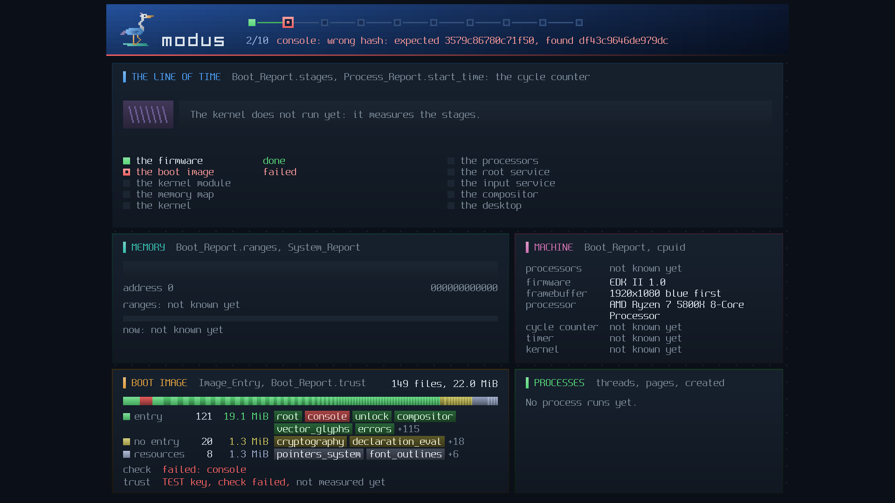
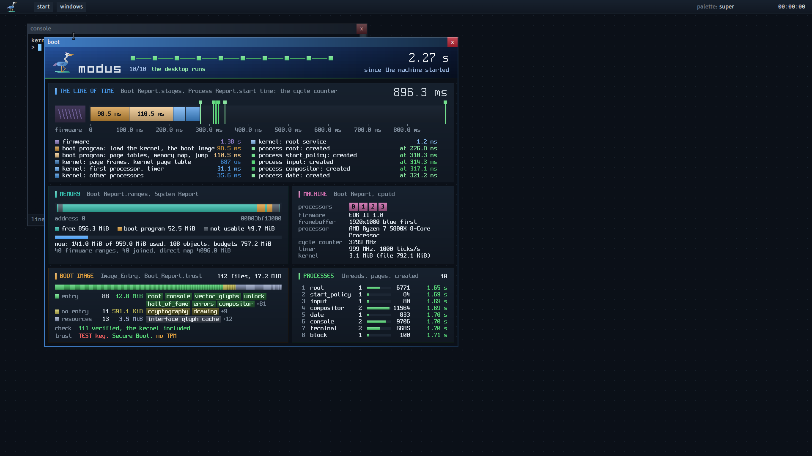
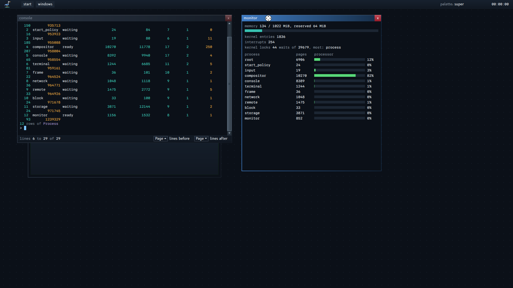

# Trusted boot

This guide says what verifies what at the start of the machine, with which key, and at which moment. It also says what each part does not protect. The terms are in `docs/glossary/trusted_boot.md`.

**The idea in plain words.** The system is one list of hashes: the hash of the kernel and of each module and resource. The principal that signs the system signs that list, the system description. Before the kernel starts, the boot program checks the signature and compares each file with its hash, so a changed file stops the start with a picture that names it. The firmware then records the hash of the list in the TPM, and with Secure Boot on, the firmware checks the boot program itself before it runs it.

**For whom.** A reader who wants to know what the start of the machine proves and what it does not, and a reader who makes, keeps or replaces the signing key.

**Read before.** `PROPERTIES.md`, "11. Reproducible system" and "17. Trusted boot: UEFI program, Secure Boot, TPM".

**The map of this guide.** "1. The claims" lists what the start proves. "2. What each layer protects, and what it does not" takes each layer in turn. "3. The system description" gives its format; "4. What a failure shows" the boot display of a refusal; "5. The signing key" its creation, use, backup, loss and theft; "6. The measure" the TPM; "7. Secure Boot" the firmware signing key; "8. The costs" and "9. Code" close; "10. The TPM floors" says how the TPM refuses an older system and a revoked key.



The trusted boot has four layers. Each layer works without the next one.

| Layer | What it adds | State |
|---|---|---|
| 1. The signed system description | The boot program verifies a signature and every hash before the kernel starts. The root service checks the boot image again | Built |
| 2. The measure | The firmware extends PCR 11 of the TPM with the hash of the system description, before the kernel starts | Built |
| 3. Secure Boot | The firmware verifies the Authenticode signature of the boot program before it starts it | Built |
| 4. The TPM floors | The boot program refuses a system description whose security version, or a boot program whose key number, is below its floor in the TPM | Built |

## 1. The claims

Each claim names what verifies, what it verifies, with which key, and when.

1. At each boot, before the kernel starts, the boot program verifies the description signature with the Ed25519 public key that it holds. The signed message is the label `system description signature 1` and the BLAKE3 hash of the system description.
2. After that, and before the kernel starts, the boot program compares the kernel module file and each module and resource of the boot image with the system description: the name, the kind, the size, the BLAKE3 hash of the bytes, and the hash that the boot image states in its entry.
3. The boot program checks the copy of the boot image that the kernel receives, and the kernel module file that it loads.
4. When the firmware has a TPM, and after the checks of claims 1 and 2, the firmware extends PCR 11 with the SHA-256 hash of the system description, at the request of the boot program. The boot program reads PCR 11 back and writes the value in the trust record.
5. Before it starts the first process, the root service takes the system description of the boot image only if its BLAKE3 hash is the hash that the boot program wrote in the trust record. Then it compares each module and resource of the boot image with it, as in claim 2.
6. After claim 5, no process can change a module of the boot image: the kernel gives the pages of the boot image to the root service with the right Read and with no right Write.
7. Nothing verifies the boot program while Secure Boot is off. The trust record and the boot display say "verified by the boot program, which the firmware did not verify".
8. With Secure Boot on, before it starts the boot program, the firmware verifies its Authenticode signature with the certificates in its variable `db`. The build signs the boot program with the firmware signing key, and the test machine has the certificate of that key as its only entry of `db`.
9. The boot program reads the variable `SecureBoot` of the firmware. With the value 1, the trust record says `Firmware_And_Boot_Program`, and the boot display says "verified by: the firmware (Secure Boot), then the boot program". The value 1 means that a certificate of `db` verified the boot program: on a machine whose `db` also holds the certificates of a vendor, it can be a certificate of that vendor (section 7).
10. When the firmware has a TPM, after claims 1 and 2 and before the measure, the boot program reads the two TPM floors through the firmware. It stops the start when the key number that it holds is below the key floor, or when the security version of the description is below the version floor (section 10).
11. When the firmware verified the boot program, the boot program then raises each floor to its own number, before the measure. Only a boot program with the same PCR 7, the state of Secure Boot with the certificate of the publisher, and before the measure of PCR 11, can raise a floor: no kernel and no process can.

## 2. What each layer protects, and what it does not

### Layer 1: the signed system description

It protects against:

- a module, a resource or the kernel that a fault of a disk, a copy or a build changed;
- a module of another build put in the boot image;
- a system description that someone changed without the private key of the signing key.

It does not protect against:

- **a replaced boot program.** The firmware does not verify the boot program. Anyone who can write the boot volume can replace the boot program, its public key and its checks. So the checks find a damaged or swapped file. They do not stop an attacker who can write the boot volume.
- **a system that the test signing key signed.** Its private key is published: anyone can sign a system with it. The boot display shows "the TEST key: its private key is public" in red, and the root service writes a warning on the log.
- **an older system that the same key signed, alone.** The signature of an older description verifies. Layer 4 refuses it once a system with a higher security version started on the machine (section 10).
- **a stolen private key.** Anyone who has it can sign a system that the boot program accepts, and a replacement row that the root service accepts. Layer 4 refuses the boot programs of that key once a system with a newer key started on the machine.
- **the firmware, and the kernel after the start.** The checks run once, at the start. A fault of the kernel or a device that writes memory directly (DMA) is not in their scope.
- **a changed debug image.** The debug image (`DEBUG/OBJECTS.IMG`, beside the boot program) is not in the boot image, the system description does not list it, and the boot program reads it with no check. Anyone who can write the boot volume can make a stop report show false names of procedures and lines. No code comes from it, and each reader checks the form of each debug object before it reads it (`MODULE_CONTRACT.md`, "Debug information").

The second check, by the root service, finds a fault of the path from the boot program to the first process: a fault of the copy of the boot image, or of the kernel. It does not find an attacker: no process can write the pages of the boot image before it. Its time on the test machines: 5.9 to 7.9 ms for 86 or 87 modules and resources, over the 43 machines of one run of the tests (QEMU with KVM on an AMD Ryzen 7 5800X). The line `root: the boot image agrees ...` of the log gives it at each boot, for example "root: the boot image agrees with the system description that the boot program verified: 87 modules and resources checked in 6087 us; the kernel was checked by the boot program only".

### Layer 2: the measure

It adds a record that the TPM keeps until the next reset of the machine. No code that runs after the boot program can set PCR 11 back to an earlier value. A sealed key or a remote party can depend on that value. The TPM service seals the machine key to it, with PCR 7 (`PRINCIPALS.md`, "The machine key sealed by the TPM"); no remote party reads it yet. The root service puts the value in the record of principal 0, the machine (`PRINCIPALS.md`, section 2).

It does not protect against:

- **a boot program that lies.** A replaced boot program can extend PCR 11 with the hash of a correct description and then start other code. The measure is as honest as the boot program. The firmware of the test machine also measures the boot program itself into PCR 4 (TCG PC Client Platform Firmware Profile), so a party that reads PCR 4 and PCR 11 together can see a replaced boot program. The system does not read PCR 4.
- **a machine with no TPM.** The boot continues. The trust record says `No_Tpm`, and the boot display says "no TPM".
- **a TPM that the firmware stopped using.** The boot continues. The trust record says `Refused`, and the boot display says "TPM refused the measure" in red (section 6).
- **a TPM that is software.** The test machine uses `swtpm` on the host. The host can read and change its state.
- **a reader of the bus of a hardware TPM.** The machine key sealed by the TPM crosses the interface in clear at each seal and unseal: no session encrypts it (`ROADMAP.md`).
- **another system on the same machine that replaces the record of the machine key.** The proof of the creation refuses an object that it made, so this system takes no table of its key; but the disk alone says which form the record has, so that system can make the disk grants of principal 0 absent (`PRINCIPALS.md`, "The machine key sealed by the TPM").

### Layer 3: Secure Boot

It closes the gap of layer 1: the firmware starts only a boot program that a certificate of its `db` verifies. Anyone who can write the boot volume can no longer replace the boot program, its public key or its checks without the private key of the firmware signing key. Then a measure in PCR 11 comes from a boot program that the firmware verified.

It does not protect against:

- **an older boot program, or an older system, that the same keys signed.** The firmware starts it. Layer 4 makes its boot program refuse itself, after a newer system started.
- **the other certificates of `db`.** A machine whose `db` holds the certificates of a vendor starts each boot program that the vendor signed.
- **a change of the variables of the firmware by anyone at the machine.** The setup of the firmware can turn Secure Boot off or enrol another certificate. The machine still starts. PCR 7, where the firmware measures its Secure Boot state, is in the policy of the machine key sealed by the TPM: after such a change the TPM does not release that key, and the recovery key opens it.
- **PCR 4.** The firmware measures the boot program there. The system does not read it.

## 3. The system description

The system description is one file. It is the identity of one version of the whole system (`src/library/contract/system_description`). It lists each file of the system with its size and its hash, in one fixed order, so one system has exactly one description and one hash: two machines with the same hash of the description run the same bytes.

```
Header, 24 bytes:
  magic             u64   0x5243534544535953 (the bytes "SYSDESCR")
  version           u32   2
  entry_count       u32   1 to 4096
  security_version  u32   1 to 64: the number that the version floor compares
  reserved          u32   0
Entry, 80 bytes, entry_count times:
  name         [32]u8   the name; zero bytes after it
  kind         u32      1 kernel, 2 module, 3 resource
  reserved     u32      0
  size         u64      the bytes of the file
  hash         [32]u8   the BLAKE3 hash of the bytes of the file
```

All numbers are little-endian. The file has no other byte.

The rules that make one system have one description, and one hash:

- Entry 0 is the kernel module. The modules of the boot image come next, in the order of the boot image. The resources come last, in the order of the boot image.
- A name has one byte at least, then zero bytes only. Each reserved field is zero.
- The reader refuses a file of another size, another magic, another version, or another order of kinds.
- The reader refuses a security version of 0 or above 64. The build writes `system_description.SECURITY_VERSION`, which the publisher of the system raises only in the commit that fixes a flaw that a return to an older system would bring back (section 10).
- The reader refuses two entries with one name: the loader finds a module by its name.
- A boot volume with no system description does not boot: there is no state "not signed".

The boot image holds the system description and its description signature as its two last resources: `system_description` and `system_description_signature`. The description does not list these two resources: a file cannot hold its own hash. The description also does not list the boot program, for the same reason: the boot program holds the boot image. Layer 3 covers the boot program.

The checks fail on the first entry that differs:

| Fault | Meaning |
|---|---|
| `Not_Valid` | The description does not follow the format |
| `Image_Not_Valid` | The tables of the boot image do not fit in it, or its two last resources are not the description and its signature |
| `Count_Differs` | The boot image has more or fewer entries than the description lists |
| `Name_Differs`, `Kind_Differs`, `Size_Differs` | The entry at this place differs |
| `Stated_Hash_Differs` | The boot image states another hash in its entry. The loader gives that hash to the process as its identity |
| `Hash_Differs` | The bytes of the file have another hash |
| `Outside_Image` | The entry points outside the boot image |

## 4. What a failure shows

A failed check of the boot program stops the boot. The kernel does not start.

- The serial log has one line with the file and the two hashes: `boot program: console does not have the hash of the system description: expected <64 digits>, found <64 digits>`. A wrong signature gives `boot program: the signature of the system description is wrong`.
- A refusal of a TPM floor gives `boot program: the security version 1 of the system description is below the version floor 2 of the TPM: an older system`, or `boot program: the key number 1 of this boot program is below the key floor 2 of the TPM: its key is revoked`. The boot display shows the same sentence.
- The boot display shows the same failure in red in its head, with the first 16 digits of each hash. It takes the scale of the screen among the sizes of its font, Spleen: 1.5 on the reference screen of 1920 × 1080, in the middle of the screen, with its text in Spleen 12x24. The font is data of the boot program itself, signed with it: the boot program reads no file of the boot image to draw a failure (`src/md/features/boot_display_scale.md`). Its step is "the kernel module" for the kernel, else "the boot image". The boot program checks each file of the boot image before the kernel, in the order of the steps of the display: the boot image comes first.
- The boot program turns off the watchdog of the firmware, so the failure stays on the screen until the machine is stopped by hand. It never returns to the firmware: the firmware does not try the next boot option. After the draw, the log has `boot program: the boot display shows the failure`. With no screen, the log has `boot program: no boot display: the failure stays on the console of the firmware`, and the failure stays there. After a call of `ExitBootServices` that failed, the firmware allows only its services of the memory: the boot program then writes on the serial port only, turns no watchdog off, and with no screen writes `boot program: no boot display: the failure is on the serial port only`.
- Each other stop of the boot program has the same form, with its step on the boot display: no memory from the firmware (`boot program: the firmware gives no memory for <count> pages`), a memory map that the firmware refuses, that grows at each of 4 reads, that does not fit its buffer, whose step between descriptors is below 40 bytes or past one page, or whose usable range starts inside a page or ends past 2^52, a kernel module that cannot be loaded, a firmware that refuses to end its services. The boot program never powers the machine off (`src/md/features/missing_hardware.md`, "The stop of the boot program").
- With Secure Boot on, a boot program that the firmware refuses never starts. The boot manager of the firmware writes `BdsDxe: failed to load Boot<number>` on the serial console, and tries its next boot option.

A failed check of the root service stops the start of the processes. The boot display shows "the start failed:" and the file, and the log has the two hashes.

The card of the boot image (`docs/DESIGN.md`, section 12) has one line "check": the count of the verified files, or, after a failure, "failed: " and the whole name of the file, in red. The part and the tile of that file are red too. The line "trust" is the last line of the card, from the trust record, in three parts with a color each. The short words fit the card; the log has the long forms.

| Part | Values |
|---|---|
| The key | "TEST key" (red), or "key" and the first 4 bytes of the public key |
| What verified | "boot program only" (the firmware did not verify the boot program), or "Secure Boot" (claim 9), or "check failed" (red) |
| The measure | "PCR 11" and the first 4 bytes of the value, or "no TPM", or "TPM refused the measure" (red), or "PCR not read" (red) |

After its first draw of the display, the boot program writes its lines on the serial port only, not through the console of the firmware, which also writes on the screen.

## 5. The signing key

The signing key is an Ed25519 key pair of the principal that signs the system. Its public key is built into the boot program; its private key signs each system description. Whoever holds the private key decides which systems the machine starts, so the rules below keep it out of the repository and out of reach of other users, and say what to do when it is lost or stolen.

- **Where it lives**: the private key is a file outside the repository. The environment variable `SYSTEM_SIGNING_KEY` names it at build time. The tool refuses a path inside the repository. The boot volume holds the public key and the description signature only.
- **With no variable**: the build signs with the test signing key and the test firmware signing key of `resources/keys`, and the machine says that it is not trusted.
- **The rule of the file**: the tool refuses a private key file that another user owns, or that the group or the others can read, write or run. It finds the repository from the folder of `flake.nix` above the working folder, and compares resolved paths: a symbolic link to the repository is inside it.
- **In memory**: the tool clears the private key after it signed.
- **A volume for a test machine only**: beside each boot volume, the tool writes `<volume>.signed_by`. For a volume that the test keys signed, it says "the TEST signing key, whose private key is published: do not install this volume on a real machine". Do not install such a volume on a real machine: anyone can sign a system that it accepts. The test builds and the pictures of the site use the test keys.

### Creation

1. Run `nix develop -c modustool key new <folder>`, with a folder outside the repository.
2. The tool writes `<folder>/signing_key`: the private key, 64 hexadecimal digits, readable by its owner only, in a folder that only its owner can open. It writes `<folder>/signing_key.public`: the public key. It creates each file exclusively: a file or a symbolic link at that path makes it stop.
3. The tool then writes the firmware signing key with `openssl`: `<folder>/firmware_signing_key.pem` (the RSA-2048 private key) and `<folder>/firmware_signing_key.crt` (its certificate).
4. The tool then writes the release signing key: `<folder>/release_signing_key` (its 32-byte seed in base64url with no padding, readable by its owner only) and `<folder>/release_signing_key.public` ("The release signing key", below).
5. The tool refuses to replace an existing key.
6. To enrol the certificate in the firmware of a real machine, someone present at the machine uses the setup of the firmware: the certificate `firmware_signing_key.crt` as an entry of `db`, or as the platform key, the key exchange key and the one entry of `db`, then Secure Boot on. The steps depend on the firmware of the machine (`INSTALL.md`, "4. Start with Secure Boot").
7. For a release, commit `release_signing_key.public` as `resources/keys/release_signing_key.public` and the certificate as `resources/keys/firmware_signing_key.crt`, and put the four values of the folder in the secrets of the repository (`secrets/README.md`).
8. Add the line `<key number> <public key>` to `resources/keys/key_numbers`, with the next key number: the build refuses a key with no line (section 10).

### Use

1. Set `SYSTEM_SIGNING_KEY=<folder>/signing_key` before each build.
2. Run `modustool key show` to print the public key that the build uses, and its key number.
3. The build puts the public key and its key number in the boot program and signs the description of each boot volume. With the same key it signs each replacement row of the replacement list of the boot image: the root service writes a replacement of a module only for a row that verifies under this key (`MODULE_CONTRACT.md`, "Who may replace a module").

### Backup

1. Copy `signing_key` and `firmware_signing_key.pem` to two media that stay offline, in two places. The 64 digits of `signing_key` can also be printed on paper.
2. The public key and the certificate are not secret.

### Loss

1. A lost private key cannot sign a new system description. The boot program of the machine still accepts the descriptions that the lost key signed.
2. To recover, make a new key, give it the next key number in `resources/keys/key_numbers`, build a new boot program with the new public key, and install it on the boot volume. Its first start raises the key floor, so the lost key is revoked too. With Secure Boot, the firmware signing key must also sign that boot program.
3. If the firmware signing key is lost too, the firmware refuses each new boot program until someone present at the machine enrols a new certificate in the setup of the firmware.

### Theft

Anyone who has the private key can sign a system that the boot program accepts. Make a new key at once, give it the next key number in `resources/keys/key_numbers`, and install a system signed with it. Its first start raises the key floor of the TPM: each boot program of the stolen key, and of each key before it, then refuses to start on that machine (section 10). A machine on which no system of the new key started yet still starts a system of the stolen key. On a machine where a system of the thief started, its boot program raised the version floor of the stolen key, up to 64, and the key floor up to the stolen number: the new key has a version floor of its own, so it starts. Its kernel and its processes could raise no floor: the policy needs PCR 11 before the measure. They could, with the TPM, remove the floors (section 10, "Code with the TPM"); the first start of the new key defines them again.

### The release signing key

The release signing key is a third key, an Ed25519 key, in the same folder. It signs the checksum list of the files of a release; it signs no system (`INSTALL.md`, "2. Verify the files"). The design is `src/md/infrastructure/release_image.md`.

- **Where it lives**: `<folder>/release_signing_key`, beside the signing key. `modustool release image` finds it from `SYSTEM_SIGNING_KEY`, with the rules of a private key file above.
- **Its public key** is `resources/keys/release_signing_key.public`, and the site publishes it. The release command refuses a key whose public key is another one.
- **The form**: a key is 32 bytes in base64url with no padding, and a release signature covers the context `modus release checksums 1` and an end of line, then the checksum list: the forms of the package `signing` of gui_toolkit.
- **Loss or theft**: make a new key, commit its public key, and replace its secret. No machine holds it, so no machine changes. A stolen key signs files that `modustool verify` accepts, until the commit of the new public key.
- **A release refuses the test keys**: with no `SYSTEM_SIGNING_KEY`, with the test signing key or the test firmware signing key, `modustool release image` stops before its build.

## 6. The measure

The measure is a record in the TPM of which system started: the hash of the system description, extended into one register before the kernel starts. No later code can set the register back, so a key sealed to it, or a remote party that reads it, learns which system runs. Today the record of principal 0, the boot display and the TPM service read it: the TPM service seals the machine key to it (`PRINCIPALS.md`, "The machine key sealed by the TPM").

- **The register**: PCR 11. The TCG rules for PC firmware leave PCR 8 to 15 to the operating system. The conventions of Linux give PCR 11 to the whole system image that a boot stage measures before the kernel starts, which is what this measure is. The firmware of the test machine does not write PCR 11.
- **The value**: the firmware hashes the system description with SHA-256 and extends PCR 11 with it, in each active bank. In the SHA-256 bank, after a reset, PCR 11 then holds `SHA-256(32 zero bytes || SHA-256(description))`. `modustool` computes the same value from the description of the boot volume and compares it with the value that the boot program read back.
- **The event**: type `EV_IPL`, in the event log of the firmware. Its data is the signed message: the label and the BLAKE3 hash. The event log names the system by its identity, BLAKE3; the TPM has no BLAKE3 bank, so the register holds SHA-256.
- **The path**: the boot program calls `HashLogExtendEvent` of `EFI_TCG2_PROTOCOL`, then `TPM2_PCR_Read` through `SubmitCommand`. The firmware talks to the TPM. The boot program has no TPM driver.
- **The order**: the boot program measures after the checks of section 1 and before it leaves the firmware services.
- **The tries**: when `HashLogExtendEvent` fails, the boot program tries again, 4 tries in all, 0.5 s apart through `Stall` of the firmware: at most 1.5 s more. A slow interface can finish a later try; the log then says "the measure succeeded at try N", and the trust record keeps the count.
- **The rule when every try fails**: the boot continues, and a stop would protect nothing. The trust record says `Refused` with the status of the firmware; the boot display says "TPM refused the measure" in red; the root service writes a warning with the status and the count of tries. A party that reads PCR 11 sees that it does not hold the measure. The root service then starts no TPM service, so a machine key sealed to the measure stays sealed: the window of `unlock` asks for its recovery key.
- **After the start**: the TPM service owns the TPM (`PRINCIPALS.md`, "The machine key sealed by the TPM"). It talks to the CRB interface of the TPM at `0xFED40000`, with no firmware. The boot program still has no TPM driver.
- **What the log says of a refusal**: after the last try, the boot program reads PCR 11 through `SubmitCommand` of the same protocol and writes the result. When that read fails too, and no command reaches the TPM, the firmware has stopped using its TPM.

### PCR 12: the start policy

PCR 11 says which system started; PCR 12 says which start policy that system ran, so an attestation sees whether the machine started the default start policy of the boot image, the rescue, or a start policy from the disk that principal 0 chose (`PRINCIPALS.md`, "The start policy of principal 0").

- **The register**: PCR 12. The conventions of Linux give PCR 12 to the configuration that selects what a signed system does, which is what a start policy is. The system uses no other register of 8 to 15. The firmware of the test machine does not write PCR 12.
- **The value**: one extend for each start policy that starts, in the SHA-256 bank, with `SHA-256(the hash of its module || the hash of its list)`; a start policy from the disk has no list, and its second hash is 32 zero bytes. A rescue after a failure is a second extend, so PCR 12 says both, in their order. After a reset, the first value is `SHA-256(32 zero bytes || digest)`.
- **The path**: the root service computes the digest and sends the command `Measure_Start_Policy` on the measure ring of the TPM service, a ring that only the root service holds, before the `Process_Start` of the start policy. The TPM service sends `TPM2_PCR_Extend`, then `TPM2_PCR_Read`, and gives the value back. The TPM ring of `unlock` refuses the command: no other process extends a PCR.
- **A measure that fails.** A chosen start policy from the disk never runs unmeasured: when its measure fails (no answer within 30 s, a refusal of the TPM, a TPM service that stopped), it is not started, with its line, and the rescue starts in its place. Else PCR 12 would show the rescue alone after a module of the disk ran and failed, and an attestation would not see that module. A start policy of the boot image starts unmeasured, with the line of the cause: the system description already names it in PCR 11.
- **The bound**: two extends in one start, each counted when the TPM service sends it. The TPM service refuses a third with `Measure_Limit` and sends nothing to the TPM, so no later process makes another start policy look measured.
- **The seal does not read it.** The seal of the machine key and of the keys of a named principal reads PCR 7 and PCR 11 only: the selection of the seal holds no bit of PCR 12, and a host test checks it. A new choice of a start policy then changes no unseal; a seal that read PCR 12 would lock the machine at each new choice, as the choice is read with the machine key.
- **The log**: `root: the start policy 5f0c1a2b… (nickname "tiny") is measured into PCR 12: PCR 12 = <64 digits>`, or `of the list start_list` in place of the nickname; with no TPM service, `root: the start policy 5f0c1a2b… of the list start_list is not measured: the system is not measured into a TPM`. `modustool` computes PCR 12 from the hashes of the start policies and compares it with the value of the line.
- **Not built**: the attestation that reads PCR 12 and the event log of these extends.

### A measure that does not depend on the event path of the firmware

Designed, not built. When `HashLogExtendEvent` fails, the boot program can send `TPM2_PCR_Extend` itself through `SubmitCommand`, with the SHA-256 hash of the description that it computes with `src/library/support/cryptography/sha2` (the boot program links it already for Ed25519). The event log of the firmware then has no entry, and the display must say "measured, with no entry in the event log". It is not built because it does not help in the case that the test machines show: in the firmware of EDK II, as far as its source is known here, `SubmitCommand` checks the same flag "TPM present" as `HashLogExtendEvent`, and fails at once when the firmware cleared it. The one path that does not depend on that flag is a driver of the interface of the TPM in the boot program, and the boot program has no TPM driver: it talks to the TPM through the firmware.

### The machines of the TPM

The machines of the TPM run a software TPM (swtpm) behind the CRB interface of QEMU. They run in each full check: the two machines of the measure and the six machines of the TPM floors in `modustool test trusted_boot`, the ten machines of the keys sealed by the TPM in `modustool test principals`, and the three machines of a start policy from the disk in `modustool test start_policy`. The TPM device is an option of a test machine, apart from its firmware.

**The fault that QEMU 10.2 had.** With the QEMU of Nixpkgs, about one start in four of a machine of the TPM failed. The firmware sent one of its own measures (a `TPM2_PCR_Extend`, before the boot manager), waited, cancelled the command, and then marked its TPM as absent. `HashLogExtendEvent` of the boot program then failed at once with `EFI_DEVICE_ERROR` (status `8000000000000007`), and no command reached the TPM.

- **What the trace shows.** QEMU gives the command to swtpm. swtpm runs it and writes its answer before it reads the next control command. The firmware polls the start bit of the CRB interface for its time-out of 90 s, counted in its own delay loop (about 135 s of the clock), then writes the cancel bit (offset `0x48`); swtpm receives the control command "cancel" (`00 00 00 09`). The start bit clears only after the cancel, more than 3 s after the answer, with no new byte from swtpm.
- **Why it is QEMU.** A worker thread of QEMU reads the answer of swtpm, then asks the main loop to complete the request; only the main loop clears the start bit. Since QEMU 10.2, the main loop waits through io_uring, and it sometimes misses that wake-up. It then sleeps until another event, here the cancel of the firmware. swtpm, the firmware and the system have no part in it. QEMU issue 4581 reports the same fault, still open in QEMU 11.1: <https://gitlab.com/qemu-project/qemu/-/work_items/4581>.
- **The fix.** The development shell builds QEMU with no io_uring (`pkgs.qemu.override { uringSupport = false; }` in `flake.nix`, with the one target `x86_64-softmmu`). The main loop then waits through epoll. Remove the override when Nixpkgs ships a QEMU with a fix of that issue.
- **The measured runs with that QEMU.** `modustool test principals` twice (12 machines of the TPM) and `modustool test trusted_boot` twice (4 machines of the TPM): each machine printed "1 Startup, 0 commands abandoned", and each run passed.

What the test machines do:

- **The machines of the measure use a firmware without Secure Boot**: `pkgs.OVMF.override { tpmSupport = true; }` (`OVMF_TPM_CODE`): the TPM driver, no Secure Boot, so no system management mode, and the CRB interface. Nixpkgs builds no such variant: the flake builds it from the source of EDK II, once.
- **The machines of the keys sealed by the TPM use the firmware with Secure Boot** (`OVMF_FULL_CODE`, with the variable store in which the build enrolled the certificate of the test firmware signing key) and a software TPM. That firmware has a TPM driver and measures the state of Secure Boot into PCR 7. A seal needs the verifier `Firmware_And_Boot_Program` (`PRINCIPALS.md`, "The machine key sealed by the TPM"), and these machines run the root service of a release, so the rule of the seal holds in each of them. They start two signed volumes: the signed main volume (`secure_boot`), and the other system (`other_system`), whose boot program the build also signs. The signature changes no byte of the boot image, so the other system keeps its own PCR 11.
- **One machine of the keys sealed by the TPM has Secure Boot off.** It starts the signed other system on `OVMF_TPM_CODE`, which starts a signed boot program too. Its PCR 11 is the PCR 11 of the last seal; only PCR 7 differs. The TPM refuses, the recovery key opens the key, `unlock` does not seal it again, and `machine_seal()` is refused, because the firmware did not verify the boot program.
- **The three machines of Secure Boot of `test trusted_boot` have no TPM device**: they test what the firmware starts, not the measure. The six machines of the TPM floors of the same part have a software TPM, and Secure Boot on in five of them (section 10).
- **What each machine of the TPM prints**: the count of `Startup` commands, the count of abandoned commands, and the name of the command before the first cancel. A good machine has one `Startup` and no abandoned command. QEMU writes a trace of the device with the time of each line (`<machine>_qemu_tpm_trace.log`: each command that the device received, each write of the firmware to the device, a start or a cancel).
- **The firmware with Secure Boot and a software TPM failed at each run with the QEMU that waits through io_uring**, with system management mode (`OVMFFull`) and without it. Its trace showed the same fault as the machines of the measure: a `TPM2_PCR_Extend` that swtpm answered, and a cancel of the firmware 152 s later. If a machine of the keys sealed by the TPM prints an abandoned command, read its trace first.
- **The run.** `modustool test principals` runs them, and so does each full check (`PRINCIPALS.md`, "8. The tests").
- **The software TPM alone.** After the last machine of `test principals`, the tool starts swtpm with no QEMU on the state of the TPM of the part: its commands on a TCP port of the loopback, with the flags `not-need-init,startup-clear`, so swtpm starts the TPM itself. The tool sends `TPM2_DictionaryAttackLockReset` there, as another system on the machine can, and reads the answer. It sends the same command first to a new state, to show that the bytes reset a TPM whose lockout value is empty (`PRINCIPALS.md`, "8. The tests").

The steps of a machine of the TPM or of Secure Boot after `boot program: started` have a bound of 300 s each, and the wait for `boot program: PCR 11 = ` ends at once with the line of a refusal.

## 7. Secure Boot

Secure Boot makes the firmware check the boot program before it runs it, which closes the one gap of layer 1: a replaced boot program. The firmware checks only RSA signatures, so the principal that signs the system holds a second key for it.



1. **A second key.** UEFI Secure Boot verifies Authenticode signatures with RSA keys and X.509 certificates. It cannot verify Ed25519. So the principal that signs the system has a firmware signing key: an RSA-2048 key and a self-signed certificate, that `modustool key new` makes with `openssl req -new -x509 -newkey rsa:2048 -sha256 -days 36500 -nodes`, in the folder of the signing key. The firmware does not check the dates of a certificate of `db`.
2. **The test pair** is `resources/keys/test_firmware_signing_key.pem` and `.crt`, beside the test signing key, and its private key is published in the same way. `modustool key test-firmware-new` writes it once.
3. **The signature of the boot program**: `sbsign --key <key> --cert <certificate> --output <signed> <unsigned>`, of the package `sbsigntool`. The build keeps the unsigned boot program as its output and writes the signed copy beside it.
4. **The variable store of the test machine**: `virt-fw-vars` of the package `python3Packages.virt-firmware` writes a copy of `OVMF_FULL_VARS` with the certificate as PK, KEK and the one entry of `db`, and Secure Boot on (`--set-pk`, `--add-kek`, `--add-db`, `--secure-boot`). No certificate of a vendor is enrolled.
5. **The machines** of `modustool test trusted_boot`: the signed boot program starts, and its trust record says `Firmware_And_Boot_Program`; these machines have no TPM device; the signed boot program with one byte changed does not start; the unsigned boot program does not start. For the last two, the tool waits for the line `BdsDxe: failed to load Boot` of the firmware, then checks that the log has no line `boot program: started`. The machines of the keys sealed by the TPM of `modustool test principals` run this firmware with a software TPM ("The machines of the TPM").
6. **The release image**: after the machines of Secure Boot, the tool packages their signed volume as the files of a release, with a release signing key of the test and the one packaging that accepts the test keys, verifies the files, decompresses the image with zstd, and starts a machine with the usual firmware from the GPT disk, up to the console (`src/md/infrastructure/release_image.md`).

The machines with this firmware run with four processors, as every other machine, with the system management mode of QEMU (`-machine q35,smm=on`). The first wait of such a machine is the line `boot program: started`, by name, with a bound of 600 seconds: this firmware starts slower than the usual one, and slower still on a loaded host. The tool prints the time of the first wait of each machine.

## 8. The costs

- **Time**: the boot program hashes the kernel and the whole boot image, and the root service hashes the boot image again. The log gives both times: `root: the boot program checked the signature and every hash in <n> us` and `root: the boot image agrees with the system description ...: <n> modules and resources checked in <n> us`. In one run of the tests (QEMU with KVM, an AMD Ryzen 7 5800X), the boot program took 8.3 to 9.7 ms and the root service 5.9 to 7.9 ms, of a start whose firmware alone takes about 1.5 s (`docs/measures/measures.txt`).
- **Two hash functions**: BLAKE3 is the identity of each file and of the description. The TPM uses SHA-256 because it has no BLAKE3 bank.
- **Two keys with Secure Boot**: an Ed25519 key for the description and an RSA key for the firmware.
- **The start of the firmware with system management mode**: the tool prints the time from the start of QEMU to `boot program: started` for each machine with that firmware.
- **The boot volume of each test**: the build signs one boot image for each boot volume, because the kernel of one test volume differs.
- **The TPM floors**: five commands through the firmware at each start (PCR 7, then the public area and the bytes of each floor), and, at a start that raises a floor, a policy session, `TPM2_PolicyPCR`, `TPM2_NV_SetBits` and a flush, after a definition when the index is new. No measure gives their time apart yet. Each security version and each key number is one of 64 bits of its floor.

## 9. Code

| Part | File |
|---|---|
| The format, its reader and its checks | `src/library/contract/system_description/system_description.odin` |
| The trust record | `src/library/contract/boot_info/boot_info.odin` (`Boot_Trust`) |
| The checks and the measure of the boot program | `src/boot/trust.odin` |
| The stop of the boot program, on the boot display, and the read of the memory map | `src/boot/main.odin` (`stop`, `boot_stop`, `read_memory_map`), `src/library/private/boot_program/firmware_memory_map` |
| The check of the root service | `src/modules/system/root/trust.odin` |
| The line of the trust and the line of the check on the boot display | `src/library/support/bootscreen/bootscreen.odin` (`trust_line`, `check_line`) |
| The places of the card of the boot image | `src/library/support/bootscreen/image_card` |
| The signature, the keys, the key numbers, the command `key` | `tools/modustool/build/system_description.odin`, `resources/keys/key_numbers` |
| The eighteen machines of `test trusted_boot`, and the plant of another system with swtpm alone | `tools/modustool/machine/trusted_boot_scenario.odin` |
| The check and the raise of the TPM floors by the boot program | `src/boot/trust.odin` (`floors_check`, `floor_raise`) |
| The commands of the indices of the floors, the checks of their answers, the decisions | `src/library/support/tpm2` |
| The firmware signing key, `sbsign`, the variable store with Secure Boot | `tools/modustool/build/secure_boot.odin` |
| The release volume, the GPT disk, the release signature, `release`, `verify`, `key write` | `tools/modustool/build/release_image.odin` |
| The Ed25519 code of the boot program | `src/library/support/cryptography/ed25519` (`docs/CRYPTOGRAPHY.md`) |
| The TPM service, after the start | `src/modules/system/tpm`, `src/library/support/tpm2`, `src/library/contract/tpm_service` |
| The key R, the load options and the rescue boot entry | `src/boot/rescue.odin`; the start request and the record of the load options in `src/library/contract/boot_info/boot_info.odin` |

## 10. The TPM floors

The TPM floors make the TPM refuse an older system and a revoked key. The design and its refused forms are in `src/md/features/rollback_floors.md`.

**The two numbers.**

- The security version is a field of the header of the system description (section 3): 1 to 64. The description signature covers it. The publisher of the system raises `system_description.SECURITY_VERSION` only in the commit that fixes a flaw that a return to an older system would bring back. A release with no such fix keeps it, so a principal can go back to the release before.
- The key number is a number from 1 to 64 that the boot program holds beside the public key of the signing key. `resources/keys/key_numbers` gives each public key of the publisher its number: the test signing key has 1, the signing key of the publisher 2. With Secure Boot on, nobody changes it without the firmware signing key. The boot program has no setting for it: a release refuses a test volume whose number is raised.

**The floors** are indices of the TPM of the type `TPM_NT_BITS`: 64 bits, to which `TPM2_NV_SetBits` only adds bits. The floor is the place of the highest set bit plus one, or 0.

| Floor | Index | It refuses |
|---|---|---|
| The key floor | `0x01806D00` | A boot program whose key number is below it: its signing key is revoked |
| The version floor of the key number n | `0x01806D00` + n | A system description, with a boot program of the key number n, whose security version is below it |

A system that a stolen key signed can carry the security version 64, and raise the version floor of that key to it; the version floor of the next key stays apart.

Each index has the attributes `TPMA_NV_POLICYWRITE`, `TPMA_NV_AUTHREAD` with an empty authorization value, and `TPMA_NV_NO_DA`. Its policy is `TPM2_PolicyPCR` of PCR 7 at its definition and of PCR 11 before the measure (32 zero bytes). PCR 7 holds the state of Secure Boot and the certificate that verified the boot program. So only a boot program that the certificate of the publisher verified, with Secure Boot on, and before it measures the system, raises a floor. No kernel and no process can.

**The check and the raise, by the boot program.** After the signature and the hashes, before the measure, through `SubmitCommand` of the firmware:

1. It reads PCR 7, and computes from it the policy of a floor.
2. It reads the public area of the key floor and of the version floor of its key number. An absent index is the floor 0. An index with other attributes or another policy is foreign: the floor 0. An index with the area of a floor that was never written is the floor 0 too: the boot program writes each floor that it defines at once, so another system planted it.
3. It reads the 8 bytes of each index that was written. A read whose authorization the TPM refuses is the floor 0: another system planted the index with an authorization value.
4. It stops the start when its key number is below the key floor, then when the security version is below the version floor of its key number.
5. With Secure Boot on, it raises both floors: it removes a foreign, planted or unreadable index, defines an absent or removed one, and sets the bit of its number in a policy session.
6. Then it measures the system into PCR 11.

The log has the lines `boot program: the TPM floors: the key floor 1 (held), the version floor of the key number 1 2 (held)`, `boot program: this boot program has the key number 1, and the system description the security version 2`, then one line for each step of a raise: `boot program: the key floor: removed a foreign index: another system defined it, or PCR 7 changed`, `boot program: the key floor: defined its index`, `boot program: the version floor of the key number 1 rose from 0 to 2`, or `boot program: the key floor is 1: this boot program, with the number 1, leaves it`. With Secure Boot off: `boot program: the TPM floors stay as they are: the firmware did not verify this boot program`. The trust record keeps the numbers, the floors that the boot program read and their states (`Absent`, `Held`, `Foreign`, `Never_Written`, `Read_Refused`, `Not_Read`). A refused system runs no kernel and no process.

**When the floor rises.** At the first start of a new system, after its checks and before its measure. A new release with a fault later in its start already refuses the release before it then: the way back is a new image of the publisher with the same security version.

**The recovery of a machine whose floor is above every image.**

1. Start an image of the publisher whose key number is at or above the key floor, and whose security version is at or above the version floor of that key number. The publisher signs one.
2. Or clear the TPM in the menu of the firmware. The clear removes every floor and every key sealed by the TPM; the recovery keys open those keys.

**What the floors do not protect against.**

- **A clear of the TPM.** It removes every floor. Each signed system then starts, until the next start with Secure Boot on defines them again.
- **Code with the TPM.** The owner hierarchy has no authorization value. So another system on the machine (with Secure Boot off, or under a vendor certificate of `db`), or the current system once a flaw gives an attacker its kernel or its TPM service, removes a floor with `TPM2_NV_UndefineSpace` or puts its own index there, then writes an older signed image with a known flaw to the boot volume. The boot program takes the floor 0, the older system starts, and its boot program defines the floors at its own, lower, numbers: the flaw stays across restarts. The floors stop a rollback by anyone who can only choose which signed volume starts, not by code that runs with the TPM. Such code cannot raise a floor: the policy needs PCR 11 before the measure.
- **A change of PCR 7.** A change of `db` or of `dbx`, or a firmware update that resets the variables, changes PCR 7. An update of `dbx` needs no principal at the machine: any system can apply one that a KEK of the firmware signed. At the next start every floor is foreign, so each older signed system passes, and the first start with Secure Boot on defines the floors at its own numbers: an older system then makes its numbers the floors.
- **Another software at the two handles.** The range of the owner is shared. The boot program removes any index at a handle of a floor that is not a floor that it can read, also the counter or the secret of another process that chose the same handle.
- **A machine with no TPM, or whose firmware stopped using it.** No floor is read, and nothing is refused. Such a machine opens no key sealed by the TPM either.
- **Secure Boot off.** PCR 7 differs, so each index looks foreign and the floor is 0, and the boot program changes no floor. A boot program that nothing verified can skip the check anyway.
- **A boot program built before the floors.** It has no check. None was ever built with the production firmware signing key (`resources/keys/README.md`).
- **A leaked firmware signing key.** Its holder signs a boot program with any key number. The answer is a new certificate in `db`.

**The machines.** `modustool test trusted_boot` runs six machines of the floors, with one software TPM whose state they share. A newer system (`boot_volume_newer_system.img`, the security version one above the repository) defines and raises the key floor and the version floor of its key number. Then swtpm alone, as another system can, puts at the version floor an index with the area of a floor and an authorization value, never written, and at the key floor a foreign index; the next start of the newer system removes both and puts its floors back. The signed main volume is then refused for its security version. A newer system whose boot program has the key number one above (`boot_volume_newer_key.img`) raises the key floor and starts the version floor of its key. The boot program of the first machine is then refused: its key is revoked. Last, the signed main volume on the firmware with Secure Boot off, so another PCR 7: each floor is foreign, the older system starts, and its boot program changes no floor. A refused machine shows its failure, and the tool checks that its kernel never started.

## 11. The rescue start policy

The boot program can ask the root service for the rescue start policy at one start, in place of the chosen one (`src/md/features/start_policy.md`). It writes the start request in the boot record: `Chosen`, the zero value, or `Rescue`, with its source. The kernel copies both words, and the root service reads them through one border, `boot_info.start_request_of_words`.

- **The key R.** The boot program reads the keys that the firmware holds, with `ReadKeyStroke` of the Simple Text Input protocol, at its start and again before it leaves the firmware services. Each read takes the keys that wait and does not wait for one. The log has `boot program: the key R is held: the root service starts the rescue start policy`. The boot program reads the console input of the firmware: on a machine with no screen, as a test machine of QEMU with `-display none` or a server, that input is the serial terminal, so the key R typed on the serial console asks for the rescue. A keyboard that the firmware does not put in its console input, as the PS/2 keyboard of the test machine, gives nothing.
- **The boot entry "modus (rescue)".** At a start where the entry is absent, the boot program writes a `Boot####` variable with that description, the device path of the boot program, and a record of 16 bytes as its optional data: the tag `MODUSOPT`, the version 1, and the word `Rescue`. It puts the number at the end of `BootOrder`, so the firmware starts the entry only when the entries before it fail, and writes `boot program: the boot entry modus (rescue) is written as Boot0003`. The entry is found among the entries that `BootOrder` names, by its description and the device path of the boot program. With no `BootOrder`, the boot program writes the entry and no `BootOrder`, and the line ends with `; the firmware has no BootOrder`. A refusal of the firmware is one line, `boot program: the boot entry modus (rescue) is not written: ...`, and the start goes on.
- **The load options.** The boot program copies its `LoadOptions` once and reads the copy. Load options with no tag are a normal start: the firmware gives a normal start load options of its own. A tagged record that is not 16 bytes, has another version, or holds a word that names no start request stops the boot program, with the cause on the boot display, as a refusal of trust does: `the load options hold the tag MODUSOPT with the word 2, which names no start request`.
- **No new authority.** The rescue list is a resource of the boot image, signed and checked with the system, and its rows are modules of the boot image with their roles. A boot variable is a variable that the principal at the machine already controls. The firmware measures the boot variables into PCR 1; the seal of the machine key reads PCR 7 and PCR 11 only, so the entry changes no unseal.
- **The measure.** The rescue is measured into PCR 12, as each start policy ("PCR 12: the start policy").



**The machines.** `modustool test start_policy` writes the key R on the serial line of the machine, through a FIFO that is the input of its serial chardev, until the line of the boot program; a start list whose row of the console names a module that does not exist; three machines with one variable store: the boot program writes the entry, `BootNext` set with `virt-fw-vars` to that entry starts the rescue with no key, and the same entry with the word 2 stops the boot program; then three machines with a software TPM and Secure Boot on: principal 0 chooses a start policy from the disk, the next start runs it and PCR 12 holds the value that the tool computes, and a chosen start policy that fails gives way to the rescue, with PCR 12 after two extends.
