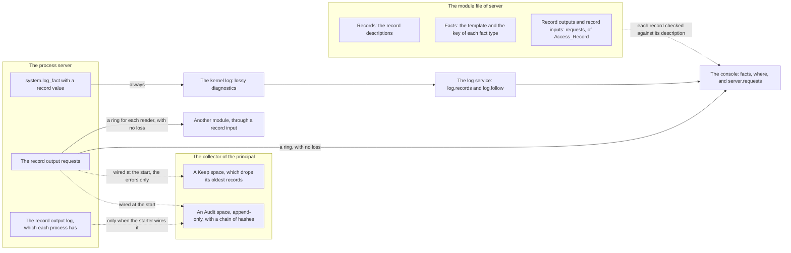
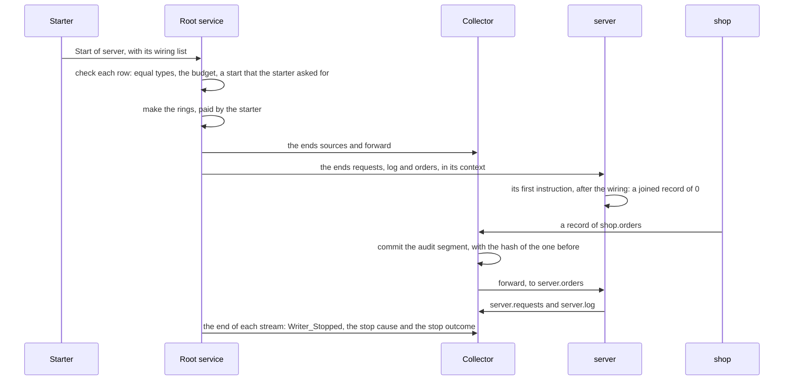

# Record outputs and record inputs of a module: typed streams of records between processes

## Purpose

A module declares record outputs and record inputs. A record output is a stream of records of one record type that the module writes while it works, with no known end. A record input is a stream of records of one record type that the module reads. A starter, a start policy or the console wires a record output of one process to a record input of another, and the root service makes one ring for that pair. This is the answer of the system to the `stdin`, `stdout` and `stderr` that [`docs/PROPERTIES.md`](../../../docs/PROPERTIES.md), "19. A command is a function: no text between processes", refuses: the cost that property names ("streams of data with no known end need a typed stream form above rings") is paid here.

An export answers one call with one result. A record output gives records for as long as the process works: the access records of a web server, the records of a measure, the rows of a result too large for one call. Today such a stream goes as text lines on the log, because no other path exists: `server` writes one log record for each request, and limits them to a count in each second.

**The log is lossy diagnostics. It is not a record output, and a record output is never the log.** The log of the kernel evicts, refuses past a budget and drops lines on the serial port, and a reader reaches it through its log scope ([log_reader_scope.md](log_reader_scope.md)). A record output loses no record that it wrote into a ring, has flow control, is reached through a handle that someone gave, and is part of the contract of its module. The log design is [log_facts.md](log_facts.md), "What the log is, and what it is not". The two designs share the record description, and the record type of the record output `log` is the log record of that design ("The record output `log`").

The terms are in [`docs/glossary/communication.md`](../../../docs/glossary/communication.md): "Record output", "Record input", "Generic record input", "Generic record output", "Output ring", "Place word", "Joined record", "Gap record", "End record", "Wiring", "Wiring list", "Wiring terms", "Wiring ring", "Record stream", "Body region", "Collector", "Collector space" and "Audit space". A record input is not the Input of the group Access, which is the keys and the pointer.

## Constraints

- **No text between processes** (property 19). A reader parses no text of a writer.
- **A process starts with nothing** ([`docs/PROPERTIES.md`](../../../docs/PROPERTIES.md), "2. Sandbox by default"). It holds only what its starter, or the principal through a grant, gave it.
- **One communication mechanism** ([`docs/PROPERTIES.md`](../../../docs/PROPERTIES.md), "6. One communication mechanism between processes"). Two processes talk through a ring in memory that both map ([`docs/ARCHITECTURE.md`](../../../docs/ARCHITECTURE.md), "K4. Rings and wait"). Each queue has one writer and one reader. The receiver copies each record, then checks it as hostile data.
- **No shared tree of names** ([`docs/PROPERTIES.md`](../../../docs/PROPERTIES.md), "8. No global, mutable, shared file system"), and **one private store for each process** ([`docs/PROPERTIES.md`](../../../docs/PROPERTIES.md), "9. A storage engine with one private store per process").
- **No process reaches another by a name** ([`docs/PROPERTIES.md`](../../../docs/PROPERTIES.md), "20. No ambient access: the other holes to close", rows 4 and 11). Each grant is recorded, visible and can be revoked (row 13), and each resource is a handle with a limit (row 16).
- **Data belong to a principal** ([`docs/PROPERTIES.md`](../../../docs/PROPERTIES.md), "21. Principals: who acts, without users"). The grant records are the audit of who acts.
- **No queue drops a record in silence** ([key_path.md](key_path.md)). A full queue stops its writer, or refuses and says so.
- **The process that asks for the work pays for its memory** ([`docs/PROPERTIES.md`](../../../docs/PROPERTIES.md), "14. Memory is supplied by the caller").
- **Module metadata is flat tables** ([`docs/PROPERTIES.md`](../../../docs/PROPERTIES.md), "12. Module metadata in flat tables, read through functions").
- **The policy is outside the root service** ([start_policy.md](start_policy.md)). The root service keeps the mechanism of a wiring, and a process chooses which wiring to ask for.
- **No contract depends on one language** (property 19). The ring, the place word, the wiring list and the tables are memory layouts and numbers.
- **The general form first, and short forms over it for the frequent tasks.** A frequent task has an expression that reads as its intent. A short form is a wrapper over the general form, never a second mechanism beside it.
- **No backward compatibility.** A changed record type is a changed contract, checked at the wiring.

## The chosen form

The whole design on one picture: one record description serves the exports, the log facts and the record outputs; the kernel log and the rings of the record outputs are two paths that share nothing else; the record output `log` joins them only when a starter wires it.



### The declaration in the module

The source declares each record output and each record input as a package variable of a generic type of `modus:support/system`, with a documented comment:

```odin
// One request that the server answered.
requests: system.Record_Output(Access_Record)

// The orders to serve.
orders: system.Record_Input(Order)
```

The tool reads these declarations, as it reads the signature of an export (`describe.odin`), and writes two tables of the module file:

| Table | One row describes |
|---|---|
| `Record_Outputs` | One record output: its name, its line of help and its documentation text in the string table; the index of its record description in the table `Records`, or 0 for a generic record output; and the mark `Paired` for a generic record output that has one ring for each wiring of the generic record input of its module. |
| `Record_Inputs` | One record input: the same name, help and text; the index of its record description, or 0 for a generic record input; the index of the record description of its wiring terms, or 0 for none; and its count of wirings: `One`, `Many` (several wirings of one type) or `Many_Types` (several wirings, each of its own type, for a generic record input only). |

A module declares as many record outputs and record inputs as it needs. The only bound is the field of the format: the index of a record output or a record input is 16 bits in a wiring, so 65 535 of each. A declaration costs its row and its strings in the module file, and nothing while it is not wired. The tool refuses two record outputs or two record inputs with one name, a declaration that is not a package variable of the package of the module, a generic record output in a module that has no generic record input or two, `Many_Types` on a record input that is not generic, and `Paired` on a record output that is not generic. The tables change the hash of the module, as each byte of the metadata does.

Each process also has one record output that no module declares: `log` ("The record output `log`").

### The shared part: the record description

The record of a record output is described in the table `Records` and the table `Fields` of the module file: the one form that describes the records of the exports, and that [log_facts.md](log_facts.md) uses for the record of a log fact (`docs/glossary/communication.md`, "Record description"). The row of `Record_Outputs` or `Record_Inputs` holds the index of a row of `Records`, as a parameter of an export holds the index of a record description in its detail, and as a row of the table `Facts` of the log design holds it in its field `record`. The tool describes each record type once, whichever declaration names it: an export, a log fact, a record output, a record input or the terms of a record input. Nothing in a record description says which.

The kinds of a field are the kinds of the record description, with the kinds that the log design adds (a hexadecimal Integer, a status of a contract enum, a module name, a hash).

The refusals of the log design for a record type, and which ones hold for the record of a record output or a record input:

| Refusal of a log fact | For a record output | Why |
|---|---|---|
| A byte that no field covers (padding) | Holds | The record goes into memory that another process reads. A byte that no field names carries memory of the writer across the border. The tool refuses it. |
| A Handle field | Holds | A handle number in shared memory names nothing for the reader: a handle crosses a border only through `Handle_Give`, which the kernel checks. A handle that a stream must carry is a later design, which waits for a user. |
| At most 144 bytes of fields (`op.LOG_FACT_VALUE_CAPACITY`) | Does not hold | The bound of a log fact is the values of one log record of 256 bytes. The record of a record output has the bound of each record description, 256 bytes, because the ring holds the record whole: the log record itself fits. A body larger than that lives in the body region of the record output, and the record holds its place there ("A large body"). |

### The ring and its records

An output ring is a ring ([`docs/ARCHITECTURE.md`](../../../docs/ARCHITECTURE.md), "K4. Rings and wait") whose command queue holds records of the size of the record description, and whose completion queue holds the records of 64 bytes of each ring. One memory object holds:

1. The head page: the counters of the two queues, as in each ring, and the end words of the root service ("The end of a stream").
2. The command queue: one place for each record. A place is the place word (8 bytes), then the record, rounded up to a multiple of 64 bytes: a record of 72 bytes takes a place of 128 bytes, and a log record of 256 bytes a place of 320 bytes.
3. The completion queue: records of 64 bytes, the same capacity.

**The place word** is a kind (`Place_Kind`, an enum with explicit values: `Record = 0`, `Gap = 1`, `End = 2`, `Joined = 3`) and the serial of the record (32 bits). The serial counts the records of the record output, not of the ring: the writer gives the same serial to the copy of a record in each ring. A zero place word is a record, so a zero place is a valid record of zero fields.

**Each side computes the size of a place and the capacity itself**, from the record description and the size of the memory that the kernel gives. Neither side reads them from the shared memory. The ring contract gains one form of `open` that takes the size of a command record, with its host tests; a ring of 64 bytes is the case of today.

**The reader checks each record** at one border, `output.record_of_place`, a pure procedure of a contract package with host tests. It copies the place once into private memory, then checks it against its record description: its own, from its module file, for a declared record input; the one that the root service read from the module file of the writer, for a generic record input or for the console. Never one that the writer sends.

- the place word: a kind that names no member is a damaged place;
- the first place of a ring: it must be a joined record, and no later place can be one;
- the serial: the serial that the joined record names, then each next serial in order; after a gap record of the count N, the next serial is N more. Any other serial is a damaged place;
- each Text field: UTF-8 with no control character, then zero bytes to the end of the field ([text_encoding.md](../data/text_encoding.md));
- each status field of a contract enum: a value that names no member;
- each body place: inside the body region, with no overflow;
- a joined record, a gap record or an end record: the bytes after the place word that its kind does not name are zero.

A refused record does not reach the reader of the record input. The reader writes one completion with the status `Bad_Record`, the serial of the record as the tag, and the error record that names the field. It writes no completion for a record that it takes: the counter `read` of the queue says that it took it.

**The completion queue** carries the refusals and the acknowledgement of the end. The reader reads a record only while the completion queue has room for its answer, as the kernel does for a kernel ring ([../api/kernel_ring_completion_room.md](../api/kernel_ring_completion_room.md)). A writer that never reads its completions stops its own stream at the first refused records, and only that stream.

### The joined record

A wiring can come while the writer runs: the console reads `server.requests` an hour after `server` started. The records that the writer wrote before the wiring are not in the new ring, and no one keeps them for it: a reader joins a stream in the middle, as a radio picked up in the middle of a song.

So **the first place of each output ring is a joined record**. The writer writes it when it takes the new end, before its next record. It holds the serial of the next record of the record output: the count of the records that the writer wrote before this reader joined. A joined record of 0 says that the reader has the whole stream. A joined record of 5 000 says that it lacks the first 5 000 records, and that its first record has the serial 5 000.

The reader takes the joined record through its border, and gives it to its code as the first record of the record input: the console draws it as one dim row, "joined after 5 000 records". A reader that needs the start of a stream is wired in the wiring list of the start of the writer ("The wiring list of a start"): its joined record is then 0, by construction.

The test, with the refusals first: a ring whose first place is a record and not a joined record; a second joined record; a serial after a joined record that is not its serial; then a wiring in the start (joined at 0, also when the writer writes in its first instruction), and a wiring after N writes (joined at N, first serial N), with N at 1 and past the capacity of the ring, so that the serial is no place of the ring.

### A large body

A record output whose record holds a body place gets a body region: a memory object of the writer, which the root service gives each reader with the right Read only. A body place is a field kind of the record description, `Body` (16 bytes: an offset and a count in the body region), which only the record of a record output or a record input takes: the tool refuses it in the record of an export or of a log fact. The writer writes the bytes before the record, and reuses them only after the counter `read` of each reader passed the record. The reader copies the bytes once before it reads them, as it copies the record. This waits for a first user.

### The wiring and its rights

A **wiring** is the act that joins one record output of one process to one record input of another process, and the record of that act in the root service. The root service makes the output ring, gives the writer its end with the rights Read and Write, gives the reader its end with the rights Read and Write, and records the wiring as a recorded grant of its asker. `grants(server)` shows it.

**The type check at the wiring.** The root service reads the two record descriptions from the two module files that it loaded, and refuses a wiring whose descriptions are not equal: the name of the record, its size, and each field (name, offset, type, sign, integer unit, detail). The sentence names the first field that differs. A generic record input or output is checked against the type that its first wiring fixed ("Generic record inputs and the utility modules").

**One command, `Wire`, with two ends.** Each end of a wiring is one of three forms (`Wiring_End`, an enum with explicit values):

- `Started`: a process whose start the asker asked for, named by the handle that the completion of its `Start` gave. The root service checks it by the rule of `Stop`: it records which process asked for each start, and refuses an end that names a process that the asker did not start.
- `Connected`: a record output or a record input of a service to which the asker holds a connection. A caller that acts for the principal can name each record output and each record input of the service. Another caller can name one only when its process role names it, as the role names the services that it can connect to.
- `Asker`: the asker itself, as the reader, with no declared record input: the console reads a stream this way.

Each end names its record output or record input by its index in the tables of its module. The record output `log` is named only as the end of the child in the wiring list of a start ("The record output `log`"). The same command serves each asker: a starter, a start policy, the console. The old command `Output_Connect` is the case `Connected` to `Asker`.

**The wiring terms.** A record input can declare a record type for its terms: the values that the asker gives with the wiring, which the reader receives with its end. The asker passes the record with the wiring, as an argument record in a memory object that it lends. The root service checks its size against the description of the terms, copies it once, and gives the copy with the end. The reader checks its fields, as each record. The condition of `filter` and the terms of a space of the collector are wiring terms. A free text is never a term: a field is typed.

**The pace of a wiring.** The asker chooses one of three paces, a member of `Wiring_Pace` with explicit values: `Writer_Chooses = 0`, where the writer waits or refuses by its own call ("Fan-out and flow control"); `Never_Holds_Writer = 1`, where the writer never waits for this ring: a full ring refuses the record for this reader only, and the reader gets a gap record; and `Always_Holds_Writer = 2`, where the writer waits for room in this ring whatever its call says, the pace of an audit. The writer receives the pace with the end, in its wiring ring, so its library applies it at each write.

**How an end reaches a process.** A process that declares a record output or a record input gets a wiring ring from the root service at its start: one command record gives or ends one end, with its handle lent through that ring, its pace, its terms and, for a generic record input, its record description. The ends of the wiring list of its start are the first records of the wiring ring. The writer reads the wiring ring at each write with one compare of its counters, so a reader added while the process runs gets the next record after its joined record. A process that declares no record output and no record input gets no wiring ring: the end of its `log`, when its starter wires it, comes in its context ("The record output `log`").

**A record output of a process to a record input of the same process** is refused at the wiring with `Bad_State`. A thread that waits for room in a queue that it alone reads never wakes, and a queue inside one process crosses no border: it needs no check and no ring of the root service.

**Who can end a wiring.** The wiring belongs to its asker: it is in the wiring page of the asker ("The budget"), and only the asker, or the principal with `revoke` from a console that acts for it, ends it. The process at an end of a wiring has no command that ends it. It can stop writing, or close its own end: that is silence in the stream, never a removal of a record that it wrote. At its stop, the root service writes `Writer_Stopped` with its stop cause and its stop outcome in each of its rings ([../api/process_stop.md](../api/process_stop.md)).

### The wiring list of a start

The start of an audited server, from the start command to the end of its streams: the root service applies the whole list before the first instruction of the child, so the audit misses no record.



A starter that starts a process can give the wiring of the child in the `Start` command itself: a **wiring list**, a table of wiring records. The root service applies the whole list **before the first instruction of the child**: it makes each ring, writes each end into the wiring ring of the child, and only then starts its first thread. So no record of the child is lost, and the first place of each ring of a record output of the child is a joined record of 0.

**The wiring record** (`Wiring`, a contract record of fixed size, all-zero bytes refused):

| Field | Meaning |
|---|---|
| `child_end` | The kind of the end of the child: `Record_Output`, `Record_Input` or `Log`. 0 names nothing and is refused. |
| `child_index` | The index of the record output or the record input of the child in the tables of its module; 0 for `Log`. |
| `other_end` | The other end, a `Wiring_End`: `Started`, `Connected` or `Asker`. |
| `other_handle` | The place, in the list of handles lent with the `Start`, of the process handle (`Started`) or the connection (`Connected`); 0 for `Asker`. |
| `other_kind`, `other_index` | The record output or the record input of the other end, and its index. |
| `pace` | A `Wiring_Pace`. |
| `capacity` | The places of the ring, a power of two from 32 to 4096; 0 is the default of 256. |
| `terms_offset`, `terms_count` | The wiring terms in the lent memory object, or 0 and 0. |

A record output of the child that no row names has no reader: its records are discarded with a count, as each record output with no reader. So "the record output `requests` and the log to a collector, and the rest to nothing" is two rows, and nothing more.

**The form composes.** A wiring list is a table of records of one description. In the console it is a value of the kind `Table(Wiring)`, and `+` on two tables of one description gives the rows of both: one general operation of tables, which the console adds for each table, not a wiring operation. Each short form of "The frequent tasks" is a command that gives such a table. A start list holds the same records, so a start policy applies the same form for its rows.

**The refusals.** The list is whole or refused: on any refusal the root service starts nothing, ends each ring that it made for the list, gives back each page to the budget of the starter, and answers the `Start` with the status and an error record that names the row (the value) and the field (the unit). It refuses:

- a damaged row: a word that names no member of its enum, a reserved byte that is not 0, a capacity that is not a power of two in its range;
- a `child_index` past the table of the module of the child, a `child_end` of `Log` with an index, and a second row that wires `log` of the child;
- an `other_handle` past the lent handles, a process that the starter did not start or that stopped, a connection that the starter does not hold or whose role does not name the end;
- two record descriptions that differ, and a generic end whose type is not fixed;
- a record input of the child of the count `One` named by two rows;
- a row whose two ends are the child;
- wiring terms of another size than their description, or outside the lent memory;
- a list past the lent memory, or whose count does not fit it;
- the budget of the starter that refuses a ring or a page of the wiring page.

A record input of the child that no row names has no writer: `system.input_read` gives `No_Writer` at once, as a record output with no reader gives `No_Reader`.

**The tests.** Each refusal first, with the check that nothing changed: no process in the table of the processes, the budget of the starter as before, no ring left. Then the success: a child whose first instruction writes a record of its record output, and whose reader finds the joined record of 0 and that record of serial 0; a child whose `log` is wired, and whose first log record is in the reader with the serial 0, after the joined record of 0; a child whose `log` is not wired, whose slot holds 0; a list of two tables joined with `+`.

The start list of the default start policy gets a table of wiring rows beside its start rows, which name a row of the start list in place of a lent handle. The tool checks each wiring row at the build of the image, against the module files of the two rows: the indexes, the equal descriptions and the terms. [start_policy.md](start_policy.md) changes in the step that builds it.

### The record output `log`

Each process has one record output that its module does not declare: `log`. It carries the log records of the process, text records and log facts, as records of the contract record `Log_Output_Record` of [log_facts.md](log_facts.md), "The record output `log`": 256 bytes, the body of a log record (the level, the form, the time that the writer reads in its time page, the module hash, the fact key, the count of the bytes, `more`, and the bytes of the text or of the values), with no process slot, no process serial, no own number and no name, because the wiring names the writer and the serial of the place numbers the record. The contract describes it, in `Records` of no module file, so the type check of a wiring of `log` compares the description of the contract on both sides. A reader reads its body through the border of the form, as each reader of the log does.

**The log of the kernel does not change.** It stays lossy diagnostics: each log record still goes to the whole log and to the own log ring, with the budget of each second and the serial port ([log_side_channels.md](log_side_channels.md)). The record output `log` does not read the log of the kernel and does not make it a data path: it is a second copy, which the process writes into a ring, with the guarantees of a record output.

**Only the starter wires it, at the start, to one reader.** `log` is named only in the wiring list of a start: no wiring of `log` comes while the process runs, so a process whose log is wired has each of its records from its first one, after a joined record of 0. `log` takes one wiring: a second row that names `log` of the child is refused with `Bad_Wiring`. A second reader of the same log reads it from the first one, as the collector forwards.

**How its end reaches the child: one handle slot of the context.** The context of a process has one handle slot for the end of `log`, beside the log handle (`docs/MODULE_CONTRACT.md`, "6. The context"). The root service writes there, before the first instruction, the handle of the output ring with the rights Read and Write, only when the wiring list of the start wires `log`. The library maps the ring at the first write of the log, and computes its places from the size of the memory and the description of `Log_Output_Record`. The end of `log` never goes through the wiring ring, so a process whose only wiring is `log` gets no wiring ring.

**The writer path when `log` is wired**, in the order of [log_facts.md](log_facts.md), "The record output `log`". `system.log` and `system.log_fact` write each record twice:

1. To the record output `log`, with `system.output_write` and no deadline: the writer waits while the ring is full. No record is lost, and a reader that does not read stops the writer: the starter that wires `log` takes that cost for its child.
2. To the log of the kernel, with `Log`, as today. A refusal of the budget of each second drops the record in the log of the kernel only; the ring already holds it.

The kernel does not write the ring: the kernel keeps no table of rings and stays off the path of the data (property 5). The time in the record is the claim of the writer; the collector writes its own time beside each record that it keeps. When the reader stops or closes its end, the write gives `Ended`, the library unmaps the ring, and the process goes on with the log of the kernel only; the reader knows the serial of the last record that it read, so the end of the audit is known.

**What a process with no wiring of `log` pays: nothing more than today.** Its slot holds 0. Each write of its log reads that one word, in the line of the context that the log path already reads for the log handle, and goes on to `Log`, as today: no ring, no page, no wiring ring. Measure 9 proves it.

**What the record output `log` does not hold.** The records that another process writes about this process (the line of the root service at its start, the report of the kernel at a fault) are not its own records, and are not in its `log`. Its stop comes with the end word `Writer_Stopped`, its stop cause and its stop outcome.

### A declared record output with no reader

A record output with no reader has no ring. A write to it gives the status `No_Reader` at once, writes nothing, and the library counts it. The writer can ask `system.output_read_by(&requests)` before it builds a record, so a stream that nobody reads costs one load. `record_outputs(server)` in the console shows the count with the other counts of the record output.

This is a discard on purpose, not a loss: no reader asked for the records, and the writer knows it. The root service never wires a record output because it has no reader: that is a policy, which a starter states in a wiring list.

### Fan-out and flow control

**One ring for each reader.** The writer copies each record into the ring of each reader, and each reader has its own counters, so each reader has its own flow control. The process of the writer pays the copies in its time. The count of the readers of a record output has no constant bound: each reader is one wiring, paid by its asker ("The budget").

**A write is whole or refused, over the rings that hold the writer.** Before it writes, the writer checks that each ring of the pace `Writer_Chooses` has room. Only the writer adds records to its queues, so a queue that has room keeps it until the push. A write then writes into each of those rings, or into none:

- **`system.output_write(&output, record)`** waits on the word of the full ring until its reader makes room, with the deadline that the writer gives. With several readers, the slowest one of the pace `Writer_Chooses` sets the speed of the writer. Nothing is lost.
- **`system.output_write(&output, record, wait = false)`** gives `Full` at once when such a ring is full, and writes nothing. The writer counts each refused record in a loss period.

A ring of the pace `Never_Holds_Writer` that is full refuses the record for its reader alone, and the write goes on to the others.

**The gap record.** When a ring that refused records has room again, the library writes a gap record into it, with the count of the records that it refused, before the next record. So the reader knows the place and the count of what is missing, and the stream is never cut in silence.

A ring of the pace `Always_Holds_Writer` that is full makes the write wait, also a write with `wait = false`, until its deadline; past the deadline the write gives `Full` and writes nothing, so the record is not lost: the writer keeps it.

A writer that serves the network, as `server` does, does not wait for a reader of its own choice: it uses `wait = false`. An audit takes that choice away from the writer: the starter wires it with the pace `Always_Holds_Writer` ("The audit").

### The end of a stream

- **The writer ends its stream** with `system.output_end(&output, error)`: an end record with an error record, zero for a clean end, then the close of its handle. The reader reads each record before the end, takes the end, writes its acknowledgement in the completion queue, and closes its end.
- **The writer stops with no end record.** When the root service reaps the writer, it maps the head page of each ring of the writer, writes the end word `Writer_Stopped` with the stop cause and the stop outcome of the writer, and wakes the reader. The reader takes the two words through the border of [../api/process_stop.md](../api/process_stop.md); later, the error record of a failed stop comes in the place where an end record holds its error record. Only the root service writes an end word, and only after the writer stopped, so the one-writer rule of each queue holds. The reader reads the end word only when the queue is empty: each record that the writer published before its stop reaches it.
- **The reader stops, or closes its end.** The root service writes the end word `Reader_Stopped` and wakes the writer, which waits on the counter `read`. The library of the writer removes that ring from the record output at its next write, and closes its handle. A writer with no reader left gets `No_Reader`.
- **The asker stops.** Its budget pays the wiring, so the wiring ends with it: the root service writes the end word `Asker_Stopped` in each of its rings, as for a revocation. A start policy outlives the processes that it starts; a console that reads a stream is its own asker.
- **A revocation** writes the end word `Revoked` in the ring and wakes both sides. Each library closes its end at its next operation. The root service revokes the handles after both sides closed, or after the hang bound: a process that touches the ring after it then stops on a page fault, as an export that keeps a lent mapping does.

### Errors

Each failure of a record output or a record input gives a status and an error record ([../api/export_error_records.md](../api/export_error_records.md)): `No_Reader`, `No_Writer`, `Full`, `Ended` (the other side ended or stopped, with its end word, and with the stop cause and the stop outcome of a writer that stopped), `Bad_Record` (with the field), and the refusals of a wiring: `Bad_Type` (the first field that differs, or a generic end whose type is not fixed), `Bad_State` (the same process), `No_Right` (a process that the asker did not start, a connection whose role does not name the end), `Bad_Terms` (wiring terms of another size than their description), `Bad_Wiring` (a damaged row of a wiring list, with the row and the field), `No_Budget` (the budget of the asker refuses the ring or the place of the wiring).

### Generic record inputs and the utility modules

A module that moves records and reads no field of them has no record type of its own: `merge`, `filter` and the collector work on any stream. Such a module declares a **generic record input**, `system.Record_Input(system.Any_Record)`, whose row names the record description 0. The wiring of a generic record input fixes its type: the root service takes the record description of the record output from the module file of the writer, and gives it to the reader with its end. With the count `Many`, the first wiring fixes one type for each later wiring. With the count `Many_Types`, each wiring keeps its own type. A **generic record output**, `system.Record_Output(system.Any_Record)`, takes the type of the one generic record input of its module; with the mark `Paired`, it has one ring for each wiring of that record input, of the type of that wiring. A wiring of a generic record output before its type is fixed is refused with `Bad_Type`.

**This keeps the equal check.** A generic declaration is a type that a wiring binds, as a type parameter of a procedure is bound at its call. Each wiring after it compares two fixed descriptions and refuses a difference: the second source of `merge` must equal the first, and the reader of the record output of `filter` must equal the writer of its record input. What changes is who holds the description that the reader checks: for a generic record input, the description comes from the module file of the writer, read by the root service, not from the module file of the reader. The writer still sends no description.

The utility modules are ordinary modules of the module group `libraries`, with no window and no grant. The console and the start policies start them and wire them.

| Module | Record inputs | Record output | What it does |
|---|---|---|---|
| `merge` | `sources`: generic, `Many` | `merged`: the type of `sources` | It writes each record of each source in the order in which it reads them, with the serials of its own record output. A gap record of a source becomes a gap record of the record output with the same count. It ends its record output when each source ended: a clean end when each source ended clean, else the first error record. A joined record of a source that is not 0 becomes a gap record of its count, so the reader of `merged` knows what the sources lacked. |
| `filter` | `source`: generic, `One`, with the wiring terms `Condition` | `kept`: the type of `source` | It writes each record that passes its condition. The condition is one field and one comparison: the index of the field in the description, the operator (`=`, `!=`, `<`, `<=`, `>`, `>=`), and an Integer or a Text of up to 64 bytes. At the wiring of its record input it checks the condition against the description: a field that does not exist, or a value of another kind than the field, ends its record output with the error record that names it. Two conditions are two filters. The test of a condition is the support package `record_condition`, which the console and the collector compile in too: one code for one rule. |

**No `tee` module.** The fan-out of each record output is the tee: the root service gives a record output a new reader at any time, and the pace `Never_Holds_Writer` keeps a slow reader from holding the writer. A `tee` module adds a process, a copy and a ring for each record, and gives nothing that a wiring does not give.

**A reader of many rings.** A thread waits on at most 64 words (`op.WORD_WAIT_CAPACITY`), two for each queue, so one wait holds 30 rings with the event word and the wiring ring. `merge` and the collector read their sources in groups of 30, one wait for each group in turn with a spin, or with a thread for each group. That is a cost of the reader in time, not a bound of the declaration.

### The collector

The collector is a module that reads the record outputs that a wiring list gives it, and keeps their records in its own store. It is not the log, and it never reads the log: it is one more reader of record outputs, with no right that another reader lacks. Its declarations:

- `sources`: a generic record input, `Many_Types`, with the wiring terms `Space_Terms`: the kind of the space (`Keep` or `Audit`), its bound in blocks, an optional condition, and whether it forwards.
- `forward`: a generic record output with the mark `Paired`: one ring for each source whose terms ask to forward, of the type of that source.

**No policy in the root service.** No wiring to the collector is systematic. A starter that wants the records of its child kept names the collector in the wiring list of the start of that child; a start policy does it in its rows. The root service never wires a record output to the collector by itself, and never because it has no reader: which streams are kept, and how, is a policy, and the policy leaves the root service ([start_policy.md](start_policy.md)).

**One collector for each principal.** The collector keeps its records in its private store (property 9), and the data of a process belong to the principal of its session (property 21), which is the principal of its starter. So one collector serves one principal: the start policy starts the collector of principal 0, with the store of principal 0. A starter names its collector with the end `Started` when it started it, or `Connected` when it holds a connection to it.

**A collector space for each pair of a source and a record output.** The collector keeps each pair, the name of the source process (its module name, or its nickname for a disk process) and the name of the record output (or `log`), in its own space, with its own bound in blocks of the store. The root service gives the collector, with each end, the name of the source, the name of the record output and its record description: the facts that the collector needs to key a space, which the starter chose to give it. A new version of a source whose record description changed gets a new space; the old space stays until its bound or its end. The collector writes its own time beside each record.

**Two kinds of space**, a member of `Space_Kind`:

- **`Keep`.** When the space is full, the collector removes its oldest records and counts them, as the limit of a store thins its oldest versions (property 9). A noisy record output fills only its own space. The starter wires it with the pace `Never_Holds_Writer`, so a slow disk gives the space a gap record, never a slow source. An optional condition keeps only the records that pass it.
- **`Audit`.** The space is append-only: the collector never removes a record of it, and has no export that removes one. When the space is full, the collector stops reading its ring, so the writer waits: an audit holds its source rather than lose a record. The collector writes one line of the log at the first wait of a full audit space, and its counts show it. The starter wires it with the pace `Always_Holds_Writer`, so the library of the writer waits on an audit ring whatever its call says. Only the principal ends an audit space whole, with `collector.end_space`, from a console that acts for it; the end is a record of the collector that names the space, its count and the hash of its last segment.

**Who reads a space.** The collector serves its spaces as a service: `collector.spaces()` and `collector.records(space, after)`. The root service writes the principal of the caller and its process slot and serial in the grant of each connection ([log_reader_scope.md](log_reader_scope.md)). The collector serves a caller only when it acts for the principal of the collector, which is the principal of the starter of each source that it keeps, and never the source of the space: a caller whose process slot and serial are those of the source reads nothing of its own space. A process that does not act for the principal reads nothing. `collector.records` gives a table of the record description of the space, which travels with the table, as the console makes the description of the table that `join` gives.

**Nothing new to back up.** A space is objects of the private store of the collector, with versions and the retention rule of each store. The collector writes the records of a space as a new object at each segment of a fixed size, never changed after it closes, so a version shares its blocks with the last one and the history costs the last segment only.

**The budget of a space.** The blocks come from the store of the collector, which the role of the collector gives. The tool checks at the build of the image that the sum of the bounds of the wiring rows of the start list fits that store; the collector refuses at run time a space whose bound does not fit what is left, and the refusal ends the wiring with the error record of the terms.

### The audit

The guide is a server: each record that enters or leaves `server` goes to an audit space of its principal, in the store of the collector.

**What leaves.** The wiring list of the start of `server` names each record output of `server` and its `log`, each to the record input `sources` of the collector, with the terms `Audit` and the pace `Always_Holds_Writer`. The rings exist before the first instruction of `server`, so the first place of each is a joined record of 0, and the writer waits when an audit space is full. The forward of what enters is wired with the same pace.

**What enters.** A record input of `server`, `orders`, has a writer, `shop`. For an audit of what enters, the starter places the collector between them: `shop.orders` to the collector, with terms that say `Audit` and forward, and the record output `forward` of the collector to `server.orders`. The collector commits the segment that holds a record, then forwards it: `server` never reads a record that the audit space lacks. This is the collector with its record output `forward`, not a new module.

**What the child cannot do.**

- **Unwire.** The wiring is in the wiring page of the starter. `server` has no command that ends it; it can only close its own end or stop writing, which leaves silence in the stream and removes no record. A record input wired through the collector gives `server` only what the audit space holds.
- **Read.** `server` holds no connection to the collector, unless its role names the collector; even then, the collector never serves a source its own space.
- **Erase.** The audit space is append-only, in the store of the collector, of the principal of the starter. `server` holds no handle to that store.

**What the audit proves, and what it does not.** It proves that each record that `server` wrote into a wired record output, and each record that it received through the collector, is in the audit space, in order, with its serial. It cannot prove that `server` wrote a record for each act: a hostile process that does not write a record leaves no record. For the records that enter through the collector, the audit is whole.

**The chain of the segments.** Each segment of an audit space starts with the BLAKE3 hash of the segment before it, and the space keeps the hash of its last segment in its state. `collector.verify(space)` walks the chain. A removal or a change of a segment in the middle breaks the chain at that place; a removal of the last segments shows as a last hash that is not the hash in the state, and the principal can copy that hash out of the machine to prove the end too. Recommendation: the chain in each audit space, not in a space `Keep`, whose oldest records leave by design. Its cost is one hash of each segment when it closes: at the rate of BLAKE3 on one processor, about 1 to 2 GB in one second, a segment of 64 KiB costs about 40 µs, and a record of 128 bytes about 0.1 µs. Measure 10 gives the true number. What the chain does not stop: the collector or the storage service, which can write the whole space again. The versions of the store keep the space as it was, and a hash copied out of the machine keeps the last one.

### The console form

**Typed names, with completion, and no free text.** Each name of a line is checked against a description before the line runs, and the completion list offers it:

- the record outputs and the record inputs of a module are names of the command table, from its module file: `server.requests`, `server.log`, `server.orders`; the completion after `server.` lists the exports, the record outputs and the record inputs;
- inside `where(...)` and `columns(...)` after a stream, a table or a record output, a name is a field of its record description, never a variable: `status`, `target`; the completion lists the fields with their kinds;
- a field that the description lacks fails the line before any call: `error: where: Access_Record has no field statut; its fields are remote, port, method, status, target, bytes, time`.

The console holds the reader end of a wiring as a value of the kind Stream: `Stream(Access_Record)`, beside `Table(Access_Record)`.

**The pipe operator.** `a |> f(b, c)` is `f(a, b, c)`: the value on the left is the first argument of the call on the right. It adds no meaning to a call, so a line with `|>` checks and runs as the same line with calls in calls. A Stream is one more kind of value on its left. Why `|>` and not `|`: `|>` is never ambiguous, and `|` stays free for a union of sets; the arrow reads as "goes to"; Elixir, Gleam and R give the same sign this meaning, and F#, where it comes from, the same with the value last. The operator is built for the calls of today ([pipe_operator.md](pipe_operator.md)).

**The comparison form of `where`.** `where(t, status >= 500)` keeps the rows whose field `status` passes the comparison. The operators are `=`, `!=`, `<`, `<=`, `>` and `>=`; an Integer field takes an Integer, a Text field takes a Text with `=` and `!=`. This form replaces `where(t, "status", 500)` in the same step, for tables and for streams: the console keeps one form. `columns(t, remote, target, status)` names its fields the same way, in place of one text of names. On a record output of a module that is not started yet, `where` gives the same record output with a condition, which a wiring takes as its terms.

**What takes a Stream.** `where` and `columns` take a Stream and give a Stream: they work on each record. `first(stream, count)` gives a Table once `count` records came or the stream ended. `table(stream)` gives a Table at the end of the stream, at most `TABLE_KEPT` bytes of rows. `sort`, `join`, `rows`, `row` and `skip` need the whole of their rows, so they refuse a Stream with one sentence: `error: sort takes a Table; a Stream has no end: first(s, n) or table(s) makes one`.

**The draw of a Stream.** A Stream at the end of a line is drawn by the drawer of a table, one row at a time as each record comes. The width of each column comes from the record description, not from the rows, so a row never moves the rows above it. The joined record is the first row, dim: "joined after 5 000 records", or nothing when it is 0. A gap record is one dim row with its count. The line runs until the end of the stream, or until Escape: Escape closes the reader end, and the writer gets `Reader_Stopped`. A variable keeps no Stream: a Stream is a wiring, and a variable outlives its line.

**The general form of a wiring.** `wire(from, to)` gives a `Table(Wiring)` of one row: `from` is a record output, `to` a record input, each named by its typed name. `start(module, list)` starts a module with a wiring list. Each short form below gives the same rows.

**The counts of a record output.** `record_outputs(server)` gives a table: each record output, its record, its readers, and the records written, refused as `Full`, and discarded with no reader. These counts are facts of the process of the writer, so the console asks the service for them; the root service holds only the wirings.

## The frequent tasks

Each frequent task has one expression that reads as its intent. Each short form is a command of the console that gives a wiring list or a Stream from the general forms (`wire`, `start`, `Wire`), and a start list holds the same rows. No short form has a path of its own in the root service or in the collector.

| Task | Expression | What it expands to |
|---|---|---|
| Audit everything that a server receives and sends | `start(server, audit(server) + audited(wire(shop.orders, server.orders)))` | `audit(server)`: one row for each record output of `server` and for `server.log`, to `collector.sources` with the terms `Audit` and the pace `Always_Holds_Writer`. `audited(row)`: two rows, the source to `collector.sources` with the terms `Audit` and forward, and `collector.forward` to the record input of the row. |
| Keep the errors of a server | `start(server, keep(server.requests \|> where(status >= 500)))` | One row: `server.requests` to `collector.sources`, with the terms `Keep`, the default bound and the condition, and the pace `Never_Holds_Writer`. |
| Watch one record output live | `server.requests` | `Wire` from the record output `requests` of the connected service to the console (`Connected` to `Asker`), drawn as a Stream. |
| Join two record outputs into one stream | `merge(alpha.requests, beta.requests) \|> where(status >= 500)` | `start(merge, ...)`: the rows from the two record outputs to `merge.sources`, then a wiring of `merge.merged` to the console. |
| Read an audit space later | `collector.records(server.requests) \|> where(status >= 500)`, `collector.verify(server.log)` | Calls of exports of the collector; the console resolves `server.requests` among the spaces that `collector.spaces()` lists, by its completion. |

**The check for an incantation.** An expression is an incantation when its reader must know a mechanism to read its intent: a number of a kind, an order of positional flags, a name in a text, two commands that must come in one order. Each expression above names the task (`audit`, `keep`, `merge`, `records`, `verify`), the source and the record output by their typed names, and a condition in the form of `where`. None names a ring, a capacity, a pace or a handle: each short form chooses them, and the general form `wire` is there for a reader that wants to choose them.

**What is refused.** A second mechanism beside the wiring: an audit flag of `Start`, a journal in the root service, a collector that the root service wires by itself, a log path of its own for the audit. Each would hold the same records with other rules, and a reader would have to know which one holds a record.

### The budget

A declaration costs nothing at run time. Each wiring costs memory, and **the asker of a wiring pays it**: the console for a stream that it reads, the starter or the start policy for the wirings that it asks for. A wiring has two costs, both counted in the budget of the asker:

- **The ring.** The root service makes the memory object of the ring from the budget of the asker, with the budget handle that it holds for each process that it started. Its pages: the head page, the places and the completions. The capacity is the choice of the asker, a power of two from 32 to 4096 places, 256 by default. With a record of up to 56 bytes, a place is 64 bytes, and the default ring is 1 + 4 + 4 = 9 pages: 36 KiB. With a record of up to 120 bytes, it is 1 + 8 + 4 = 13 pages: 52 KiB. The ring of `log`, with places of 320 bytes, is 1 + 20 + 4 = 25 pages: 100 KiB.
- **The place of the wiring in the root service.** The root service keeps the record of each wiring (its two ends, its pace, the handle of its ring) in a wiring page of the asker: a page that the root service makes from the budget of the asker and maps in itself alone, as the kernel keeps the own log ring of a process from the budget of that process ([own_log_ring.md](own_log_ring.md)). A page holds 64 wiring records of 64 bytes. The first wiring of an asker makes its first page, its 65th wiring a second page, and the page goes back to the budget when its last wiring ends. So the root service has no table of a fixed size and no bound of the machine: each wiring is one record in a page that its asker pays.

A start policy that wires has a larger budget: the tool adds the pages of the rings and of the wiring pages of each wiring row of the start list to the budget that the role of the start policy asks for ([module_budget_request.md](module_budget_request.md)).

The writer pays its body region, when it has one, and the time of its copies. The collector pays the blocks of its spaces, from its store.

### The version rule of a record type

The record description is the version. A wiring needs two equal descriptions: no prefix rule, no version number in a record. A new field changes the description, and the writer and each reader are built again with it, as with each record of the system (no backward compatibility). A record whose fields stay and whose meaning changes takes a new name, so the equal check refuses it, as [../api/library_modules.md](../api/library_modules.md) requires for the record of an export.

### How a test waits on a record output

A test waits on a record output by reading it as a record input, never by a delay. A test module declares the record input, its starter wires it in the wiring list of the start, and the test reads with `system.input_read(&input, deadline)` where the deadline is the hang bound (`system.TEST_HANG_BOUND_MILLISECONDS`). The test checks a condition on the records: a count, a field, an order. The tool waits for the verdict of the test module, as it waits today. The refusals come first: a wiring of two record types that differ, a damaged place, a first place that is not a joined record, a serial that does not follow, a record with a bad Text field, a write with no reader, a read with no writer, a full ring with `wait = false` and its gap record, a full ring of the pace `Never_Holds_Writer` that does not hold the writer, each refusal of a wiring list with nothing changed, a second source of `merge` of another type, a generic record output wired before its type is fixed, a condition of `filter` on a field that does not exist, a wiring of a process to itself, a `Wire` of a process that the asker did not start, the stop of the writer with no end record, the stop of the asker, a full audit space that holds its writer, a read of an audit space by its source, a broken chain of segments.

The reader border `output.record_of_place`, the type check of a wiring, the border of a wiring list and the check of the wiring terms are pure procedures: their host tests try each refusal at its edges, and a fuzz target reads random places and random wiring lists.

## The steps

Each step is a commit on `master` that leaves a working system, with its tests.

### The steps of the mechanism

1. **The declarations.** The tables `Record_Outputs` and `Record_Inputs` of the module file, generic declarations, counts and wiring terms included, their extraction by the tool with the refusals, and the version of the module format. No process writes a record output yet.
2. **The output ring.** The form of `open` with the size of a command record, the place word with the joined record, the end words and the border `output.record_of_place`, in contract packages with host tests.
3. **The wiring.** The wiring ring, the command `Wire` of the root ring with its three ends and the rule of the asker, the wiring list of `Start` applied before the first instruction, the type check, the wiring terms, the pace, the wiring pages and the rings from the budget of the asker, the end words at each stop, the recorded grant and its revocation, and `system.output_write`, `output_end`, `input_read`. The test modules `output_writer` and `output_reader` and their machine test, with each refusal of the list above and the joined record at 0 and at N.
4. **The console.** The kind Stream, the typed names of record outputs and record inputs with their completion, the fields of a description as names inside `where` and `columns`, a Stream on the left of `|>` (the operator itself is built), `+` on two tables of one description, the comparison form of `where` in place of the old form, `first` and `table` on a Stream, the draw of a Stream with its joined record and Escape, `wire`, `start` with a wiring list, `record_outputs()`.

### The migration

5. **The access records of `server`: from a log fact to a record output.** This is the first migration step. Until record outputs exist, `server` writes its access records as the log fact `server.Access_Record` ([log_facts.md](log_facts.md), "Each former channel, sorted"). In this step the record output `requests` takes them, with `wait = false`, and the log fact leaves in the same commit: a fact has one place. The limit of its log lines in each second leaves too, because a record output refuses with a count in place of a drop. The record loses its padding and its separate length of the target: the target becomes a Text field. Its window keeps its last records. The machine test of `server` reads the records through the console, `server.requests |> where(status = 404) |> first(1)`, in place of a wait on the log, and a second read after 10 requests checks the joined record at 10.

### The steps after the first migration

6. **Fan-out and the pace**, tested with two readers of `server.requests`, one slow of each pace.
7. **The record output `log`**: the handle slot of the context, the contract record `Log_Output_Record`, the second write of `system.log` and `system.log_fact`, and the measure that a process with no wiring pays nothing more. The step is the step of [log_facts.md](log_facts.md) for the record output `log` and `log.follow`, and is built once.
8. **Generic record inputs, `merge` and `filter`**, with their machine test through the console and through a start list.
9. **The start list wires rows**, with a demonstration pair whose rows the default start policy wires.
10. **The collector** of principal 0: the spaces `Keep` and `Audit`, their bounds, the chain of the segments, the read by a caller that acts for the principal, the refusal of one that does not and of the source, the forward, and the start list that audits `server` and its log.
11. **The short forms of the frequent tasks** in the console: `audit`, `audited`, `keep`, `merge`, `collector.verify`.
12. **The body region**, with its first user.

**Other first users.** The search of the former log channels ([log_facts.md](log_facts.md), "Each former channel, sorted") finds one stream of records only: `requests`. A second search of this design, over each call of `system.log_in` with the level Info, before the channel left, in `src/modules` and `src/library` and over each reader of `log.records`, found no other: no process reads the log as the data of its work. The readers of the log are the tests, the console, the window `log` and `remote`, and each of them reads diagnostics. The facts that come near (the starts and the stops of the root service, the element places of a window, the measures of the compositor) have a test or the tool as their reader, and stay log facts. The ends of the connections of `server` are diagnostics with a limit, and stay on the log. A process whose log a principal must keep whole now has a form for it: the record output `log`, wired by its starter. The log design adds one more user, which it designs: `log.follow`, a record output of the log service with the rows of the log scope of the connection from the next record on, whose gap records say where the log of the kernel lost records before the service read them ([log_facts.md](log_facts.md), "The record output `log`" and its frequent tasks). It is the first user of the gap record that a writer of the system writes, and its test checks one.

## The forms refused

- **A byte pipe.** A stream of bytes needs a framing and a parser in each reader, and a format that no tool checks: the text between processes that property 19 refuses.
- **Text lines with a schema** (JSON lines, `key=value`). The same parser in each reader, the names repeated in each record, and a schema that the receiver must trust. The record description is the schema, checked once at the wiring.
- **The log as a data path.** It loses records by design (eviction, the budget of each second, the serial port), promises no order with the work, and its reader needs a log scope and not a handle. `server` drops access lines past its limit today: that is the fault that a record output removes.
- **A lossless log of the kernel.** The log of the kernel would wait for its slowest reader, and a process could stop the log of every other one. The record output `log` gives the guarantee to one process, at the cost of that process, through a wiring of its starter.
- **The kernel writes the ring of `log`.** The kernel would know the layout of a ring and carry the data (property 5). The library writes it.
- **A wiring of `log` while the process runs.** The record output `log` serves an audit, which needs the first record; a reader that wants the records of now reads `log.follow`.
- **A wiring ring for each process, for `log`.** Every process would pay a ring and its pages for a wiring that most never get. The end of `log` comes in one handle slot of the context, which holds 0 when nothing is wired.
- **A broadcast ring by default** (one ring, several readers with a counter each). The slowest reader holds every reader, a reader can see how far the others read, and a reader that writes a false counter harms the others. One ring for each reader keeps each queue at one writer and one reader, and its cost is one copy for each reader, which the writer pays.
- **Reaching a record output by a name** (a global topic, a path of the system). Property 20, row 11: no global name exists. The console names `server.requests` inside a connection that it holds, or a module that it starts: the name is local to that handle.
- **A static bound of the declarations.** A count of record outputs that a module declares costs nothing until a wiring; a constant bound refuses a module for no cost, and a fixed table in the root service is a bound of the machine that no budget pays.
- **A wiring list applied after the start of the child.** The child would run before its readers, and its first records would go to nothing. The root service applies the list before the first instruction.
- **A wiring list applied in part.** A child that runs with half of its audit is worse than a child that does not run. The list is whole or refused.
- **A replay of the records before a wiring.** The writer would keep each record for a reader that may come: a buffer with no reader, paid by the writer, of a size that nobody chooses. A reader that needs the start is wired in the start; a reader that needs the past reads the collector.
- **A joined record only for a wiring while the writer runs.** The reader could not tell "I have the whole stream" from "no joined record came". The first place of each ring is a joined record.
- **The command record of 64 bytes with the record in a separate slot region.** Two writes and two places for each record, and a second index that both sides must agree on.
- **An acknowledgement for each record.** The counter `read` already says it. A completion for each record doubles the writes and fills the completion queue that the writer must read.
- **A prefix rule for a changed record.** It keeps two versions alive, which the system refuses, and the zero of a missing field reads as a value.
- **The description sent by the writer in the ring.** The reader then checks against what the writer claims.
- **A generic record input with no type at all.** The reader then checks nothing. A generic record input is a type that a wiring fixes.
- **A per-reader drop in silence when a reader is slow.** A writer that cannot wait gets `Full`, and a ring of the pace `Never_Holds_Writer` gives its reader a gap record with its count.
- **A `tee` module.** The fan-out of each record output is the tee.
- **A module for the audit of what enters.** The collector with its record output `forward` is that module.
- **A forward before the commit.** A stop of the collector after the forward and before the commit leaves a record that `server` read and the audit space lacks.
- **A mapping of the end of a wiring that the child cannot unmap.** It needs a new rule of the kernel for each mapping of a starter. It would stop the child from closing its end, not from writing nothing: the audit would gain nothing that the silence of the stream does not show.
- **A wiring of a process to itself.** A deadlock when one thread writes and reads, and no border to check.
- **The timed stream as a record output.** A timed stream says when its content reaches a device ([timed_stream.md](timed_stream.md)). A record output says only what, in order.
- **The reader pays the ring.** The asker decides that the wiring exists, and its stop ends what it paid for.
- **A systematic wiring to the collector, by the root service or by default.** It is a policy in the root service. A starter states it in a wiring list.
- **One collector for the machine.** It keeps the records of the processes of every principal in one store, so the data of a principal live under the key of another (property 21).
- **The collector reads the log.** The log is lossy and scoped, and a log fact is a claim of its writer ([log_facts.md](log_facts.md), "Which reader sees which fields"). A space would then hold diagnostics with holes.
- **One bound for all the spaces of the collector.** A noisy source would remove the records of a quiet one.
- **An audit space that removes its oldest records when it is full.** The audit would lose what it exists to keep. A full audit space holds its writer.
- **An audit flag of `Start`, or a journal in the root service.** A second mechanism beside the wiring, with other rules for the same records.

## Subtle points

- **One writing thread for each record output.** Each queue has one writer. A process that writes one record output from several threads holds its own lock around the write; `system.log` already serializes its writes to `log`.
- **A record that the reader refuses is lost to the reader.** It is not lost in silence: the writer reads its serial and its field in a completion.
- **The reader checks the record against a description that the writer does not send.** A status field is checked against the enum that the reader compiles in: an enum of the module itself has no description of its members, so a reader that needs the members converts it at its own border ([log_facts.md](log_facts.md), "Open questions", the enum of a module). A generic reader cannot check a status field of an enum that it does not compile in, and passes it as an Integer.
- **The slowest reader that holds the writer sets its speed.** An audit is such a reader: a full audit space or a slow disk slows `server`. That is the price of an audit with no loss, and the principal sees it in the counts of the collector.
- **An end word is read after the queue is empty.** A reader that reads the end word first can miss the last records.
- **A gap record needs a place.** The writer writes it only when the ring that refused has room again, before the next record.
- **The serial is the count of the record output.** The serials of one ring jump only after a joined record or a gap record, by its count. Any other jump is a damaged ring.
- **A wiring ends with its asker.** A starter that stops ends the streams that it wired between its children, and the audit of its children. A child whose audit must outlive its starter is started by a start policy.
- **The record output `log` is a second copy, not a move.** Each log record of a wired process is in the log of the kernel and in its ring. The log of the kernel keeps its readers and its losses; the ring keeps the audit.
- **`Log_Output_Record` has the fields of the writer only.** It has no slot, no serial of the process and no name: the reader knows the source by its wiring, which the writer cannot change.
- **An output ring is not a call ring.** It carries no export index and no lent handle in its records. A handle reaches a process through its wiring ring only.
- **The console holds a Stream only while its line runs.** A stream that a variable kept would hold a wiring and its memory after the line, with no reader.
- **The collector is a reader, not a sink of the system.** It sees only what a wiring list gave it, and the names of its sources come from the root service with each end.
- **The spaces of the collector are versions of a store.** The bound of a space says how many records it keeps; the retention of the store says how much history of its objects it keeps. The chain of an audit space is checked over the current segments; an older version of the space is a second proof, never the chain.

## The measures that decide it

Each measure is printed, never asserted ([`docs/TOOLS.md`](../../../docs/TOOLS.md), "The bounds of the tests"). Each runs on the test machine under KVM, in cycles, the least and the median of 1 000 records, with the access record of `server` as the record.

1. **One record through a record output, against a call of an export, against a log fact.** The time of `system.output_write` with a reader that reads on another processor; the time of an isolated call of an export that takes the same record; the time of `system.log_fact` of the same record. The claim to prove: a write with no wake costs less than one kernel entry. If the record output costs more than the log fact, the place layout changes before step 5.
2. **The wake.** The time from a write to the read when the reader waits, and the count of records for each wake in a burst of 1 000. It decides whether the writer wakes the reader at each record or at each half of the queue.
3. **The check of the reader.** The time of `output.record_of_place` for one access record, against a check compiled for the type. It decides whether the generic check stays.
4. **The fan-out.** The time of a write with 1, 2, 4 and 16 readers.
5. **The memory of one wiring.** The pages of an output ring at 32, 256 and 4096 places, and the count of refused records of `server` under a load of 10 000 requests with the console as its reader. It chooses the default capacity.
6. **The server.** The requests of `server` in one second with no reader, with the record output read by the console, with an audit of `requests` and `log`, and with the log fact of today.
7. **A utility module.** The time of one record through `filter` from `server` to the console, against `where` in the console.
8. **The collector.** The records in one second that the collector keeps for one space before a gap or a wait, and the blocks of the store for 100 000 access records. It chooses the size of a segment.
9. **The log with no wiring.** The time of `system.log` and of `system.log_fact` of one line in a process whose `log` is not wired, against the same calls before the step. The claim to prove: the two medians are equal within the spread of two runs of the same code. Then the same calls with `log` wired, to give the cost of the audit of a log.
10. **The chain.** The time of the hash of one segment at 64 KiB and at 1 MiB, and that time divided by the records of the segment, and the time of `collector.verify` for 100 000 records.
11. **The forward.** The time from a write of `shop.orders` to the read of `server.orders`, with no collector, and through the collector with the forward after the commit. It chooses how many records the collector commits at once.

## Open questions

1. **The collector of a session.** A process that the console of a session starts gets the wiring list of its starter, but the collector of that principal must run for the starter to name it. Recommendation: the session starts the collector of its principal as its first process, and the console names it as a connection. The other way is a policy for each session, chosen as the start policy is.
2. **A handle in a record.** Recommendation: none until a user needs it. Then the wiring ring carries it, with the serial of its record.
3. **A wiring by a disk process.** A disk process has no root ring. Recommendation: none until a disk process needs it; then a start grant that sends `Wire` and `Start` only.
4. **The hash of the last segment out of the machine.** A chain proves the middle; the end needs a copy outside. Recommendation: `collector.verify` gives the last hash, and the principal copies it by hand until a remote reader of audit spaces exists.

## State

Designed, not built. No module declares a record output or a record input, no output ring exists, and `server` writes its access records on the log.
