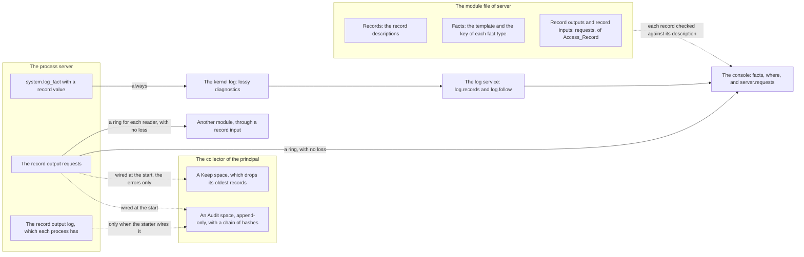
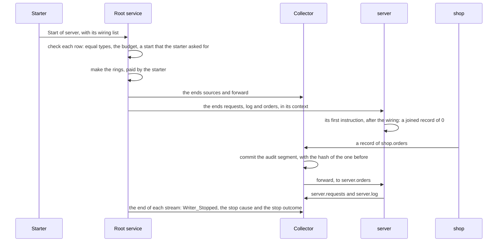

# Record outputs and record inputs of a module: typed streams of records between processes

## Purpose

A module declares record outputs and record inputs. A record output is a stream of records of one record type that the module writes while it works, with no known end. A record input is a stream of records of one record type that the module reads. A starter, a start policy or the console wires a record output of one process to a record input of another, and the root service makes one ring for that pair. This is the answer of the system to the `stdin`, `stdout` and `stderr` that [`docs/PROPERTIES.md`](../../../docs/PROPERTIES.md), "19. A command is a function: no text between processes", refuses: the cost that property names ("streams of data with no known end need a typed stream form above rings") is paid here.

An export answers one call with one result. A record output gives records for as long as the process works: the access records of a web server, the records of a measure, the rows of a result too large for one call. Today such a stream goes as text lines on the log, because no other path exists: `server` writes one log record for each request, and limits them to a count in each second.

**The log is lossy diagnostics. It is not a record output, and a record output is never the log.** The log of the kernel evicts, refuses past a budget and drops lines on the serial port, and a reader reaches it through its log scope ([log_reader_scope.md](log_reader_scope.md)). A record output loses no record that it wrote into a ring, has flow control, is reached through a handle that someone gave, and is part of the contract of its module. The log design is [log_facts.md](log_facts.md), "What the log is, and what it is not". The two designs share the record description, and the record type of the record output `log` is the log record of that design ("The record output `log`").

The terms are in [`docs/glossary/communication.md`](../../../docs/glossary/communication.md): "Record output", "Record input", "Generic record input", "Generic record output", "Output ring", "Compartment", "Compartment word", "Joined record", "Gap record", "End record", "Wiring", "Wiring list", "Wiring terms", "Wiring ring", "Record stream", "Body region", "Collector", "Collector space" and "Audit space". A record input is not the Input of the group Access, which is the keys and the pointer.

## Constraints

- **No text between processes** (property 19). A reader parses no text of a writer.
- **A process starts with nothing** ([`docs/PROPERTIES.md`](../../../docs/PROPERTIES.md), "2. Sandbox by default"). It holds only what its starter, or the principal through a grant, gave it.
- **One communication mechanism** ([`docs/PROPERTIES.md`](../../../docs/PROPERTIES.md), "6. One communication mechanism between processes"). Two processes talk through a ring in memory that both map ([`docs/ARCHITECTURE.md`](../../../docs/ARCHITECTURE.md), "K4. Rings and wait"). Each queue has one writer and one reader. The receiver copies each record, then checks it as hostile data.
- **No shared tree of names** ([`docs/PROPERTIES.md`](../../../docs/PROPERTIES.md), "8. No global, mutable, shared file system"), and **one private store for each process** ([`docs/PROPERTIES.md`](../../../docs/PROPERTIES.md), "9. A storage engine with one private store per process").
- **No process reaches another by a name** ([`docs/PROPERTIES.md`](../../../docs/PROPERTIES.md), "20. No ambient access: the other holes to close", rows 4 and 11). Each grant is recorded, visible and can be revoked (row 13), and each resource is a handle with a limit (row 16).
- **Data belong to a principal** ([`docs/PROPERTIES.md`](../../../docs/PROPERTIES.md), "21. Principals: who acts, without users"). The grant records are the audit of who acts.
- **No queue drops a record in silence** ([key_path.md](key_path.md)). A full queue stops its writer, or refuses and says so.
- **The process that asks for the work pays for its memory** ([`docs/PROPERTIES.md`](../../../docs/PROPERTIES.md), "14. Memory is supplied by the caller").
- **Module metadata is flat tables** ([`docs/PROPERTIES.md`](../../../docs/PROPERTIES.md), "12. Module metadata in flat tables, read through functions").
- **The policy is outside the root service** ([start_policy.md](start_policy.md)). The root service keeps the mechanism of a wiring, and a process chooses which wiring to ask for.
- **No contract depends on one language** (property 19). The ring, the compartment word, the wiring list and the tables are memory layouts and numbers.
- **The general form first, and short forms over it for the frequent tasks.** A frequent task has an expression that reads as its intent. A short form is a wrapper over the general form, never a second mechanism beside it.
- **No backward compatibility.** A changed record type is a changed contract, checked at the wiring.

## The chosen form

The whole design on one picture: one record description serves the exports, the log facts and the record outputs; the kernel log and the rings of the record outputs are two paths that share nothing else; the record output `log` joins them only when a starter wires it.



### The declaration in the module

The source declares each record output and each record input as a package variable of a generic type of `modus:support/system`, with a documented comment:

```odin
// One request that the server answered.
requests: system.Record_Output(Access_Record)

// The orders to serve.
orders: system.Record_Input(Order)
```

The count of wirings and the mark `Paired` are parameters with defaults, so a declaration that takes the defaults is the short form above. A record input with wiring terms is a third type, which names its terms second:

```odin
// The streams to keep, each with the terms of its space.
sources: system.Record_Input_With_Terms(system.Any_Record, Space_Terms, .Many_Types)

// The kept records, one ring for each source that asks to forward.
forward: system.Record_Output(system.Any_Record, .Paired)
```

`system.Record_Output($Record_Type, $pairing = .Unpaired)`, `system.Record_Input($Record_Type, $wirings = .One)` and `system.Record_Input_With_Terms($Record_Type, $Terms_Type, $wirings = .One)` hold the state of the variable: first the index of its row, which the loader writes, then the counts of the writer (`system.Output_State`: the next serial, the records written, discarded and refused, the end word of the last ring that ended) or of the reader (`system.Input_State`). The ends themselves are in one table of the library, with the ends that a process holds at most. The arguments go by place or by name. A parameter of a procedure that takes a record stream by its address declares none; the tool reads no other form of the three types.

**Why a third type for the terms.** Odin gives a value parameter of a generic type a default, and a type parameter none. One type with the terms as a parameter would then make each record input name its terms, `system.Record_Input(Order, .One, system.No_Terms)`, the frequent case too: two words that say nothing of the stream, an incantation by the test of "The frequent tasks". With two types, the frequent declaration is `system.Record_Input(Order)`, and only a record input that takes terms, `filter` and the collector, names them, in the second place, where they read as what sets the stream apart: `system.Record_Input_With_Terms(system.Any_Record, Condition)`. A record input with no terms has no type of terms to name, so no `No_Terms` type exists.

The tool reads these declarations, as it reads the signature of an export (`describe.odin`), and writes two tables of the module file:

| Table | One row describes |
|---|---|
| `Record_Outputs` | One record output: its name, its line of help and its documentation text in the string table; the index of its record description in the table `Records`, or 0 for a generic record output; and the mark `Paired` for a generic record output that has one ring for each wiring of the generic record input of its module. |
| `Record_Inputs` | One record input: the same name, help and text; the index of its record description, or 0 for a generic record input; the index of the record description of its wiring terms, or 0 for none; and its count of wirings: `One`, `Many` (several wirings of one type) or `Many_Types` (several wirings, each of its own type, for a generic record input only). |

A module declares at most `module.RECORD_STREAM_INDEX_MOST` (64) record outputs and 64 record inputs. No module of this design needs more than a few: the collector, the largest, has one generic record input and one record output. The bound is one of cost, not of the field: `validate`, which runs in the kernel for the root service, checks each place against each segment and each other write of a loader, the rebases and the import slots. With no bound, a hostile file of 4 MiB would cost it about 4 × 10^12 reads of a row. So `validate` refuses a table past the bound before it reads a row (`Too_Many_Record_Streams`), sorts the places once on its stack, refuses two rows at one place (equal neighbours of the sorted run), and finds each location among them with one search. The tool refuses a module that declares more, with its sentence. A declaration costs its row and its strings in the module file, and nothing while it is not wired. The tool refuses two record outputs or two record inputs with one name, a record output and a record input with one name (`server.name` names one stream in the console), a declaration that is not a package variable of the package of the module (a local variable, a constant, a type, a field of a record, a declaration inside a `when`, a parameter by value, a variable of another package that the module compiles in), `Record_Input_With_Terms` with no terms and `Record_Input` with terms, a generic record output in a module that has no generic record input or two, `Many_Types` on a record input that is not generic, and `Paired` on a record output that is not generic. The tables change the hash of the module, as each byte of the metadata does.

**How a declaration knows its index: the place of its variable.** The wiring ring names a record output or a record input by its index in the tables of the module, which the tool sorts by name. A call of the library, `system.output_write(&requests, record)`, has the address of the variable and not its name, and a process has no copy of its own module file. So each row gives the place of its variable, its memory offset in the writable data, and each loader writes the index of the row there, as it writes the hash at the own-hash place ([log_facts.md](log_facts.md), "The record"): the first field of `system.Record_Output` and of `system.Record_Input` is that index, a u32. The tool finds the variable by its symbol in the linked file, `package.name`; a variable that no code uses is dropped by the link, and its row has the place 0, so no loader writes for it. `validate` refuses a place that is not 0 and not 4 aligned bytes in a segment that the loader writes, as for the own-hash place, so a file cannot make the loader write in its code. The kernel writes the places of the root service, as it writes its own hash. The format is version 5 since the place. Refused: the index as a parameter of the declaration, which the source must keep equal to the order of the names (a number that the build knows, written by hand); the module file mapped in each process with a wiring ring, and a call that names its stream by a text (a name in a text where the variable exists).

The rows of each table are sorted by name, as the rows of `Facts` are sorted by key. The contract reader `module.record_streams_check` then checks a whole file in one walk of each table and one walk of the two: each row (`module.record_output`, `module.record_input`), the order of the names, no name in both tables, and the rule of a generic record output. The root service checks a module file with it before a wiring; the tool checks each file that it writes with it. A sort by name also makes the index of a row stable when a source moves a declaration to another file.

Each process also has one record output that no module declares: `log` ("The record output `log`").

### The shared part: the record description

The record of a record output is described in the table `Records` and the table `Fields` of the module file: the one form that describes the records of the exports, and that [log_facts.md](log_facts.md) uses for the record of a log fact (`docs/glossary/communication.md`, "Record description"). The row of `Record_Outputs` or `Record_Inputs` holds the index of a row of `Records`, as a parameter of an export holds the index of a record description in its detail, and as a row of the table `Facts` of the log design holds it in its field `record`. The tool describes each record type once, whichever declaration names it: an export, a log fact, a record output, a record input or the terms of a record input. Nothing in a record description says which.

The kinds of a field are the kinds of the record description, with the kinds that the log design adds (a hexadecimal Integer, a status of a contract enum, a module name, a hash).

The refusals of the log design for a record type, and which ones hold for the record of a record output or a record input:

| Refusal of a log fact | For a record output | Why |
|---|---|---|
| A byte that no field covers (padding) | Holds | The record goes into memory that another process reads. A byte that no field names carries memory of the writer across the border. The tool refuses it. |
| A Handle field | Holds | A handle number in shared memory names nothing for the reader: a handle crosses a border only through `Handle_Give`, which the kernel checks. A handle that a stream must carry is a later design, which waits for a user. |
| At most 144 bytes of fields (`op.LOG_FACT_VALUE_CAPACITY`) | Does not hold | The bound of a log fact is the values of one log record of 256 bytes. The record of a record output has the bound of each record description, 256 bytes, because the ring holds the record whole: the log record itself fits. A body larger than that lives in the body region of the record output, and the record holds its place there ("A large body"). |

### The ring and its records

An output ring is a ring ([`docs/ARCHITECTURE.md`](../../../docs/ARCHITECTURE.md), "K4. Rings and wait") whose command queue holds records of the size of the record description, and whose completion queue holds the records of 64 bytes of each ring. One memory object holds:

1. The head page: the counters of the two queues, as in each ring, and the end words of the root service ("The end of a stream").
2. The command queue: one compartment for each record. A compartment is the compartment word (8 bytes), then the record, rounded up to a multiple of 64 bytes: a record of 72 bytes takes a compartment of 128 bytes, and a log record of 256 bytes a compartment of 320 bytes.
3. The completion queue: records of 64 bytes, the same capacity.

**The compartment word** is a kind (`Compartment_Kind`, an enum with explicit values: `Record = 0`, `Gap = 1`, `End = 2`, `Joined = 3`) and the serial of the record (32 bits): `output.Compartment_Word`, the word of the kind then the serial. The serial counts the records of the record output, not of the ring: the writer gives the same serial to the copy of a record in each ring. A zero compartment word is a record, so a zero compartment is a valid record of zero fields. The serial wraps at the top of its 32 bits, as the counters of a ring do.

What each kind holds after its word, at offset 8: a record, its bytes; a gap record, its count as 32 bits, and its serial is the serial of the first refused record; an end record, its error record of 56 bytes, and its serial is the count of the records; a joined record, nothing, and its serial is the serial of the next record. So each compartment of an output ring is at least 64 bytes, and each byte after what the kind names is 0, the bytes between the end of a record and the end of its compartment too.

**Each side computes the size of a compartment and the capacity itself**, from the record description and the size of the memory that the kernel gives. Neither side reads them from the shared memory. The ring contract gains one form of `open` that takes the size of a command record, `ring.compartment_open(memory, page_count, compartment_size)`, with its host tests: the memory is the head page, then the compartments, then the completions with no gap between them, so a ring of `1 + ceil(capacity × (compartment_size + 64) / 4096)` pages; with compartments of 64 bytes it is the ring of `ring.open` at each capacity, the case of today. The writer and the reader copy a whole compartment in and out (`ring.compartment_push`, `ring.compartment_pop`), and the reader checks its copy only.

**The reader checks each record** at one border, `output.record_of_compartment`, a pure procedure of a contract package with host tests. It copies the compartment once into private memory, then checks it against its record description: its own, from its module file, for a declared record input; the one that the root service read from the module file of the writer, for a generic record input or for the console. Never one that the writer sends.

- the compartment word: a kind that names no member is a damaged compartment;
- the first compartment of a ring: it must be a joined record, and no later compartment can be one;
- the serial: the serial that the joined record names, then each next serial in order; after a gap record of the count N, the next serial is N more. Any other serial is a damaged compartment;
- each Text field: UTF-8 with no control character, then zero bytes to the end of the field ([text_encoding.md](../data/text_encoding.md));
- each status field of a contract enum: a value that names no member;
- each body place: inside the body region, with no overflow;
- a joined record, a gap record or an end record: the bytes after the compartment word that its kind does not name are zero;
- a record: the bytes of its compartment after the record are zero, as the padding of a record is refused;
- a gap record of 0 records, and any compartment after the end record.

The border gives the fault, an enum `output.Compartment_Fault`, and the error record: its `value` is the wrong value (the kind word, the serial, the offset of the byte), its `limit` what the border expected, and its `found` the part, 0 for the compartment word and the bytes of its kind, the number of a field from 1, or the count of the fields + 1 for the bytes after the record. On a refusal the state of the reader, `output.Read_State` in its private memory, does not change. A description with a Handle field, or a field that the border cannot read, is refused as `Bad_Field`: the reader takes its description through `module.record_stream_type`, which refuses both, and the border does not trust that.

A refused record does not reach the reader of the record input. The reader writes one completion with the status `Bad_Record`, the serial of the record as the tag, and the error record that names the field. It writes no completion for a record that it takes: the counter `read` of the queue says that it took it. The kind of a completion is `output.Completion_Kind` (`End_Taken = 0`, `Bad_Record = 1`); the writer takes it through `output.completion_of_record`, which refuses a kind that names no member and an `End_Taken` with values.

**The completion queue** carries the refusals and the acknowledgement of the end. The reader writes one completion at most for each ring, and closes the ring after it: a refusal or the end. An honest writer then never fills the queue, and a queue that the reader finds full comes from a writer that wrote its counters: the reader refuses that ring ("Fan-out and flow control"). The writer closes a ring at the first refusal that it reads, so it never feeds a ring that no one reads.

### The joined record

A wiring can come while the writer runs: the console reads `server.requests` an hour after `server` started. The records that the writer wrote before the wiring are not in the new ring, and no one keeps them for it: a reader joins a stream in the middle, as a radio picked up in the middle of a song.

So **the first compartment of each output ring is a joined record**. The writer writes it when it takes the new end, before its next record. It holds the serial of the next record of the record output: the count of the records that the writer wrote before this reader joined. A joined record of 0 says that the reader has the whole stream. A joined record of 5 000 says that it lacks the first 5 000 records, and that its first record has the serial 5 000.

The reader takes the joined record through its border, and gives it to its code as the first record of the record input: the console draws it as one dim row, "joined after 5 000 records". A reader that needs the start of a stream is wired in the wiring list of the start of the writer ("The wiring list of a start"): its joined record is then 0, by construction.

The test, with the refusals first: a ring whose first compartment is a record and not a joined record; a second joined record; a serial after a joined record that is not its serial; then a wiring in the start (joined at 0, also when the writer writes in its first instruction), and a wiring after N writes (joined at N, first serial N), with N at 1 and past the capacity of the ring, so that the serial is no compartment of the ring.

### A large body

A record output whose record holds a body place gets a body region: a memory object of the writer, which the root service gives each reader with the right Read only. A body place is a field kind of the record description, `Body` (16 bytes: an offset and a count in the body region), which only the record of a record output or a record input takes: the tool refuses it in the record of an export or of a log fact. The writer writes the bytes before the record, and reuses them only after the counter `read` of each reader passed the record. The reader copies the bytes once before it reads them, as it copies the record. This waits for a first user.

### The wiring and its rights

A **wiring** is the act that joins one record output of one process to one record input of another process, and the record of that act in the root service. The root service makes the output ring, gives the writer its end with the rights Read and Write, gives the reader its end with the rights Read and Write, and records the wiring as a recorded grant of its asker. `grants(server)` shows it.

**The type check at the wiring.** The root service reads the two record descriptions from the two module files that it loaded, and refuses a wiring whose descriptions are not equal: the name of the record, its size, its count of fields, and each field (name, offset, type, sign, integer unit, detail, field kind and contract enum). The field kind and the contract enum are part of the check because the reader checks a Status field against its enum. The check is the pure procedure `output.record_descriptions_compare`, with host tests: it gives the first part that differs, 0 for the record as a whole and the number of a field from 1, and the sentence names it. A description that `module.record_stream_type` refuses on either side is refused as well, never compared. A generic record input or output is checked against the type that its first wiring fixed ("Generic record inputs and the utility modules").

**One command, `Wire`, with two ends.** Each end of a wiring is one of four forms (`output.Wiring_End`, an enum with explicit values; 0 names nothing):

- `Child = 1`: the process that the `Start` of the list starts. Only a wiring list of a start names it.
- `Started = 2`: a process whose start the asker asked for, named by the process handle that the completion of its `Start` gave. The root service records the asker of each start (`Started.asker`), and refuses an end that names a process that the asker did not start, as `Stop` refuses it to a start policy.
- `Connected = 3`: a record output or a record input of a service to which the asker holds a connection, named by the process handle that the completion of `Connect` gave. A caller that acts for the principal can name each record output and each record input of the service. A role that names a record stream of a service for a caller that does not act for the principal is a later step: until it, such a caller is refused with `No_Right`.
- `Asker = 4`: the asker itself, as the reader, with no declared record input: the console reads a stream this way. It is never a writer.

Each end names its record output or record input by its index in the tables of its module. The record output `log` is named only as the end of the child in the wiring list of a start ("The record output `log`"), and its step builds it: until then a row that names it is refused with `Unsupported`. The same command serves each asker: a starter, a start policy, the console. The old command `Output_Connect` is the case `Connected` to `Asker`.

**`Wire` is a wiring list of one row, in the list page of the asker.** A wiring list is the head (`output.Wiring_List_Head`: the count of the rows and the count of the lent handles), then the rows (`output.Wiring`), then the table of the lent handles (32 bits each), then the wiring terms. values[0] of `Wire` is a `root_ring.Wire_Step`, and values[1..6] are 0:

- `List_Page = 1`: the root service makes the list page of the asker once, `output.WIRING_LIST_PAGES_MOST` pages from the budget of the asker, keeps its own handle, and gives the asker a handle with Read and Write through the root ring. An asker with no wiring ring gets one with it, in values[1] of the completion, as the ends of the rows whose reader it is come there.
- `Apply = 2`: the root service maps its own handle of the list page, copies the page, unmaps it, and takes the copy through `output.wiring_list_check`; a list for `Wire` has one row and no end `Child`.

A `Start` names the same page in values[4] (`root_ring.Start_Wiring_List.In_The_List_Page`), with any count of rows ("The wiring list of a start"). One form and one border serve both: a second form for `Wire` would be a second border to keep equal to the first.

**Why the root service owns the list page.** The first form lent a memory object of the asker, which the root service mapped to copy it. A second thread of the asker revokes its own handle in a loop, the mapping of the root service goes during the copy, and the root service stops on a page fault: one process stops the system. A revocation ends the holdings that came from the handle that it names. The handle of the asker came from the handle of the root service (`Handle_Give`), so a revocation by the asker reaches its own handle and what it gave, never the handle or the mapping of the root service. The asker cannot end the pages either: a decommit needs an object that only its caller names. The other way is a copy by the kernel of a lent range, which [`ROADMAP.md`](../../../ROADMAP.md) plans; a page that the root service owns needs no new operation.

**How the root service names a lent handle.** Each lent handle comes through the root ring of the asker: the root service proves it with `Handle_State` and the memory of that ring, then reads the process slot and the process serial of its process with `Process_State`, and finds the process of the table whose slot and serial are those. A handle number that the asker did not give through the ring, a number in two places of the list, a handle of another kind than a process, and a handle that names no process of the table are refused. The root service closes each number that came through the root ring of the asker, whatever its kind, on each path: the success, each refusal of the list, each refused word of the command. A list names at most `output.WIRING_LIST_HANDLE_LIMIT` lent handles, two for each wiring that an asker can hold, as each one is a handle in the table of the root service until the command ends.

**The completion of `Wire`.** values[0] the number of the wiring, the tag of its ends in the wiring rings. A reader that is the asker receives its end in its wiring ring as an `Asker_End` with that tag, with the description file of the record, as each reader: it checks each record against the description that the root service compared, never against one that the writer sends.

**The wiring terms.** A record input can declare a record type for its terms: the values that the asker gives with the wiring, which the reader receives with its end. The asker passes the record with the wiring, as an argument record in a memory object that it lends. The root service checks its size against the description of the terms, copies it once, and gives the copy with the end. The reader checks its fields, as each record. The condition of `filter` and the terms of a space of the collector are wiring terms. A free text is never a term: a field is typed.

**The pace of a wiring.** The asker chooses one of three paces, a member of `Wiring_Pace` with explicit values: `Writer_Chooses = 0`, where the writer waits or refuses by its own call ("Fan-out and flow control"); `Never_Holds_Writer = 1`, where the writer never waits for this ring: a full ring refuses the record for this reader only, and the reader gets a gap record; and `Always_Holds_Writer = 2`, where the writer waits for room in this ring whatever its call says, the pace of an audit. The writer receives the pace with the end, in its wiring ring, so its library applies it at each write.

**How an end reaches a process: the wiring ring.** A process whose module declares a record output or a record input gets a wiring ring from the root service at its start, in the handle 16 of its context (`op.CONTEXT_WIRING_RING`). It is a ring of `ring.open` with records of 64 bytes, made with the context of the process and paid from its budget: 32 records in 2 pages, or the next power of two of the ends that the wiring list of its start names. The root service writes the commands; the process reads them and writes one completion for each.

- **One command gives one end**, a member of `output.Wiring_Command` with explicit values: `Writer_End = 1`, where the process writes the output ring; `Reader_End = 2`, where it reads it into a record input; `Asker_End = 3`, where it reads it as the asker, with no record input. 0 names nothing.
- **The words of the command**, at the indexes `output.WIRING_VALUE_`: values[0] the handle of the output ring, with Read and Write; values[1] the index of the record output or the record input in the tables of the module, from 1, and 0 for `Asker_End`; values[2] the word of the pace for a writer end, 0 for a reader; values[3] for a `Reader_End` the memory object of its wiring terms, with Read only and the terms at offset 0, or 0; values[4] for a reader its description file, with Read only, and 0 for a writer; values[5] the end page of the wiring, with Read only, for each end; values[6] 0. The tag is the number that the root service gives the wiring, and the completion carries it back.
- **The description file of a reader.** A process has no copy of its own module file, and a generic reader has no description of its own. So the root service gives each reader a description file: a module file with the one record of the wiring at the index 1, its fields and their names, written from the module file of the writer after the type check (`output.description_file_write`). The reader checks each compartment against it.
- **Each handle comes through the wiring ring.** The root service gives it with `Handle_Give` and the memory of the wiring ring as its target, so the process proves with `Handle_State` that the handle came through that ring. A number that the process did not receive this way names a handle that it holds for itself, and the library refuses it.
- **The border** `output.given_end_of_record` takes one command, and refuses a kind that names no member, a handle of 0 or past 32 bits, an index of 0 or past `module.RECORD_STREAM_INDEX_MOST`, a pace that names no member, a pace word beside a reader end, terms beside a writer end, and a reserved word that is not 0. The error record names the word: its `argument` is the index of the value + 1, and 0 for the kind.
- **Two words at most for each end**: its answer, then the word `Closed`. The answer is the status `Ok` with the `output.Wiring_Answer` `Taken = 0` when the process took the end, else the status of the refusal and its error record (`output.wiring_completion`). An `Ok` with `Closed = 1` (`output.wiring_closed_completion`) says that the process closed the end that it took, after the end of its stream or after a fault of the other side. The root service takes each word through `output.wiring_completion_of_record`, which refuses a status that names no member, an answer word that names no member, and an `Ok` with another value. A refused answer ends the wiring with `Refused`: the process does not hold the end. `Closed` gives back the end of that side to the count of its process; while the other side holds its end, the root service writes it the end word `Side_Closed`; a wiring whose two sides closed ends with no end word, as no one reads it. Each later word is dropped with one line for the wiring. The words that name no wiring of the process give one line at the first for that process and their count at its stop: the root service waits on each wiring ring, so a process that writes such words in a loop would else fill the log.
- **The window of a side.** Before its answer, any word of a side that is not `Taken` refuses the end, and the wiring ends with `Refused`: the side does not hold it. After the answer, no word of a side ends a wiring that the other side holds: `Closed` ends only the part of that side, and the other side reads `Side_Closed` after each record that came before it.
- **No command ends an end.** The end of a wiring is a fact of its output ring: the root service writes it in the end words, which both sides read already ("The end of a stream"). A second path for one fact would let the two disagree.
- **A full wiring ring refuses.** A `Wire` while the process runs, whose wiring ring has no room, is refused with `Busy`: the process does not read its wiring ring, and the root service does not wait for it.

A generic record input receives the record description of the type that its wiring fixed in the same description file. The ends of the wiring list of its start are the first records of the wiring ring. The writer reads the wiring ring at each write with one compare of its counters, so a reader added while the process runs gets the next record after its joined record. A process that declares no record output and no record input gets no wiring ring, and its handle 16 is 0: the end of its `log`, when its starter wires it, comes in its context ("The record output `log`").

**Why a handle of the context, and a larger context.** The handles 0 to 13 have the roles that the root service and its process agree on, and each is taken by some role; 14 is the log and 15 the budget. Any process can declare a record stream, so the wiring ring needs a slot that no role takes. The context grows from 16 to 18 handles: 16 is the wiring ring, and 17 is left for the end of `log`, which the step of the record output `log` takes. Refused: a value of the context that holds the number of the handle, because each handle that a start gives takes its own handle slot, which the checked writes of the starter keep apart ([../api/root_ring.md](../api/root_ring.md)); and a slot that a role already takes, because the role and the record stream would then refuse each other.

**A record output of a process to a record input of the same process** is refused at the wiring with `Bad_State`. A thread that waits for room in a queue that it alone reads never wakes, and a queue inside one process crosses no border: it needs no check and no ring of the root service.

**Who can end a wiring.** The wiring belongs to its asker: it is in the wiring page of the asker ("The budget"), and only the asker, or the principal with `revoke` from a console that acts for it, ends it. The process at an end of a wiring has no command that ends it. It can stop writing, or close its own end: that is silence in the stream, never a removal of a record that it wrote. Its word `Closed` frees only its own count, and the other side reads the end word `Side_Closed` after the records that came before it; the wiring ends when both sides closed. At its stop, the root service writes `Writer_Stopped` with its stop cause and its stop outcome in each of its rings ([../api/process_stop.md](../api/process_stop.md)). A process that ends with no stop that the kernel recorded, an abandoned start, gets `Revoked` with one line: a reader never reads a stop that did not happen.

### The wiring list of a start

The start of an audited server, from the start command to the end of its streams: the root service applies the whole list before the first instruction of the child, so the audit misses no record.



A starter that starts a process can give the wiring of the child in the `Start` command itself: a **wiring list**, a table of wiring records. The root service applies the whole list **before the first instruction of the child**: it makes each ring, writes each end into the wiring ring of the child, and only then starts its first thread. So no record of the child is lost, and the first compartment of each ring of a record output of the child is a joined record of 0.

**The wiring record** (`output.Wiring`, 64 bytes of words of 32 bits, all-zero bytes refused). It names the writer and the reader of one wiring, each by the same fields:

| Field | Meaning |
|---|---|
| `writer_end` | The end of the writer, a `Wiring_End`: `Child`, `Started` or `Connected`. |
| `writer_handle` | The place from 1, in the table of the lent handles, of the process handle of a `Started` or `Connected` writer; 0 for `Child`. |
| `writer_stream` | What the writer writes, an `output.Writer_Stream`: `Record_Output = 1`, or `Log = 2`, the record output `log` of the child. |
| `writer_index` | The index of the record output in the tables of the module of the writer, from 1; 0 for `Log`. |
| `reader_end` | The end of the reader: `Child`, `Started`, `Connected` or `Asker`. |
| `reader_handle` | The place from 1 of the process handle of a `Started` or `Connected` reader; 0 for `Child` and `Asker`. |
| `reader_index` | The index of the record input of the reader, from 1; 0 for `Asker`. |
| `pace` | A `Wiring_Pace`. |
| `capacity` | The compartments of the ring, a power of two from 32 to 4096; 0 is the default of 256. |
| `terms_offset`, `terms_count` | The wiring terms in the lent memory object, in bytes from its start, or 0 and 0. |
| `reserved` | Five words of 0. |

**Why a writer and a reader, and not a child and another end.** The first form named the end of the child and the other end. A `Wire` has no child, so it would need a second record; with a writer and a reader, one record serves `Wire` and `Start`, and the end `Child` is one more form of an end. The check "a row whose two ends are the child" stays one comparison.

A record output of the child that no row names has no reader: its records are discarded with a count, as each record output with no reader. So "the record output `requests` and the log to a collector, and the rest to nothing" is two rows, and nothing more.

**The form composes.** A wiring list is a table of records of one description. In the console it is a value of the kind `Table(Wiring)`, and `+` on two tables of one description gives the rows of both: one general operation of tables, which the console adds for each table, not a wiring operation. Each short form of "The frequent tasks" is a command that gives such a table. A start list holds the same records, so a start policy applies the same form for its rows.

**The refusals.** The list is whole or refused: on any refusal the root service starts nothing, ends each ring that it made for the list, gives back each page to the budget of the starter, and answers the `Start` with the status and an error record that names the row (the value) and the field (the unit). It refuses:

- a damaged row: a word that names no member of its enum, a reserved word that is not 0, a capacity that is not a power of two in its range, a handle place of 0 for an end that needs one or not 0 for one that has none, an index of 0 or past `module.RECORD_STREAM_INDEX_MOST` for an end that needs one, an `Asker` writer, a `Log` with an index (`output.wiring_row_check`, pure, with host tests);
- the end `Child` in a `Wire`, and more than one row in a `Wire`;
- an index past the table of the module of its process, and a second row that wires `log` of the child;
- a handle place past the lent handles, a lent handle that did not come through the root ring, a process that the starter did not start or that stopped, a connection that the starter does not hold or for which it does not act for the principal;
- two record descriptions that differ, and a generic end, whose type no wiring fixes before the step of generic record inputs;
- a record input of the count `One` named by two rows;
- a row whose two ends are one process: the child twice, or one process named twice;
- wiring terms of another size than their description, outside the lent memory, or given to a record input that takes none;
- a list past the lent memory, a count of rows of 0, or counts that do not fit it (`output.wiring_list_check`, pure, with host tests);
- the budget of the starter that refuses a ring or a page of the wiring page;
- more than six rows whose reader is the asker: the completion of the `Start` gives the process handle in values[0], then the ring of each such row in the order of the rows, in values[1..6].

**The words of `Start`.** values[0..3] the name, as before; values[4] a `root_ring.Start_Wiring_List`: `None = 0`, or `In_The_List_Page = 1`, the wiring list of the child in the list page of the sender; values[5] a `root_ring.Start_Answer`: `Nothing = 0`, or `Process_Handle = 1`, for which the completion gives the process handle with Read and Give in values[0], the handle that `Wire` names as a `Started` end: Give lets the sender lend it back through its root ring. A copy carries Read and Give at most: it can stop nothing and map nothing, and the revocation of the root service reaches each copy. A start policy receives it always, as before. values[6] is 0. A word that names no member, and values[6] that is not 0, are refused, and the lent numbers of the list page are closed. values[1..6] of the completion: the number of each row whose reader is the sender, in the order of those rows; a row that ended keeps its place, with 0.

**Before the first instruction: a list that the starter makes after the load.** `system.process_start` takes a `system.Start_Wiring`: the ends to give the child, each with the handles of the starter, or `ends_make`, which makes the objects of the ends and gives them; whether the starter keeps a budget handle of the child; and it gives back the handle of the wiring ring and that budget handle. It loads the modules of the child, calls `ends_make`, makes the wiring ring from the budget of the child when the module declares a record output or a record input, writes it at the handle 16, gives each handle of each end through its memory, writes each command, and only then runs `Process_Start`. The root service checks the list before the call, and makes its rings, its end pages, its description files and its wiring page in `ends_make`. The first form made them before the call: the loader then prepared each module of the child with those handles in the table of the root service, and the first run of the test found that table full at the load of the writer (["The budget"](#the-budget)). A refusal of `ends_make` stops the start, and the root service ends what the list made.

**The other ends after the whole start.** The root service gives the ends of the other processes, and of the asker, only when the whole start passed, its terminal too. A start that fails after the list is made ends what it made, and no process but the child, which stops, saw an end: the list is whole or refused.

**The recorded grant.** The wirings that a process asked for are the recorded grant `wirings` of that process (`system.Root_Grant.Wirings`). `grants(console)` shows it while the console holds a wiring, and `revoke(console, "wirings")` ends each of them with the end word `Revoked`. At each end of a wiring, the root service writes the end word, wakes both sides, unmaps the ring, closes its own handle and frees the wiring record: the memory of the ring ends with the last end that a side holds, and its pages go back to the budget of the asker then. The revocation of the end of a side that never closes it, after the hang bound, is left.

A record input of the child that no row names has no writer: `system.input_read` gives `No_Writer` at once, as a record output with no reader gives `No_Reader`.

**The tests.** Each refusal first, with the check that nothing changed: no process in the table of the processes, the budget of the starter as before, no ring left. Then the success: a child whose first instruction writes a record of its record output, and whose reader finds the joined record of 0 and that record of serial 0; a child whose `log` is wired, and whose first log record is in the reader with the serial 0, after the joined record of 0; a child whose `log` is not wired, whose slot holds 0; a list of two tables joined with `+`.

The start list of the default start policy gets a table of wiring rows beside its start rows, which name a row of the start list in place of a lent handle. The tool checks each wiring row at the build of the image, against the module files of the two rows: the indexes, the equal descriptions and the terms. [start_policy.md](start_policy.md) changes in the step that builds it.

### The record output `log`

Each process has one record output that its module does not declare: `log`. It carries the log records of the process, text records and log facts, as records of the contract record `Log_Output_Record` of [log_facts.md](log_facts.md), "The record output `log`": 256 bytes, the body of a log record (the level, the form, the time that the writer reads in its time page, the module hash, the fact key, the count of the bytes, `more`, and the bytes of the text or of the values), with no process slot, no process serial, no own number and no name, because the wiring names the writer and the serial of the compartment numbers the record. The contract describes it, in `Records` of no module file, so the type check of a wiring of `log` compares the description of the contract on both sides. A reader reads its body through the border of the form, as each reader of the log does.

**The log of the kernel does not change.** It stays lossy diagnostics: each log record still goes to the whole log and to the own log ring, with the budget of each second and the serial port ([log_side_channels.md](log_side_channels.md)). The record output `log` does not read the log of the kernel and does not make it a data path: it is a second copy, which the process writes into a ring, with the guarantees of a record output.

**Only the starter wires it, at the start, to one reader.** `log` is named only in the wiring list of a start: no wiring of `log` comes while the process runs, so a process whose log is wired has each of its records from its first one, after a joined record of 0. `log` takes one wiring: a second row that names `log` of the child is refused with `Bad_Wiring`. A second reader of the same log reads it from the first one, as the collector forwards.

**How its end reaches the child: one handle slot of the context.** The context of a process has one handle slot for the end of `log`, the handle 17, beside the wiring ring (`docs/MODULE_CONTRACT.md`, "6. The context"). The root service writes there, before the first instruction, the handle of the output ring with the rights Read and Write, only when the wiring list of the start wires `log`. The library maps the ring at the first write of the log, and computes its compartments from the size of the memory and the description of `Log_Output_Record`. The end of `log` never goes through the wiring ring, so a process whose only wiring is `log` gets no wiring ring.

**The writer path when `log` is wired**, in the order of [log_facts.md](log_facts.md), "The record output `log`". `system.log` and `system.log_fact` write each record twice:

1. To the record output `log`, with `system.output_write` and no deadline: the writer waits while the ring is full. No record is lost, and a reader that does not read stops the writer: the starter that wires `log` takes that cost for its child.
2. To the log of the kernel, with `Log`, as today. A refusal of the budget of each second drops the record in the log of the kernel only; the ring already holds it.

The kernel does not write the ring: the kernel keeps no table of rings and stays off the path of the data (property 5). The time in the record is the claim of the writer; the collector writes its own time beside each record that it keeps. When the reader stops or closes its end, the write gives `Ended`, the library unmaps the ring, and the process goes on with the log of the kernel only; the reader knows the serial of the last record that it read, so the end of the audit is known.

**What a process with no wiring of `log` pays: nothing more than today.** Its slot holds 0. Each write of its log reads that one word, in the line of the context that the log path already reads for the log handle, and goes on to `Log`, as today: no ring, no page, no wiring ring. Measure 9 proves it.

**What the record output `log` does not hold.** The records that another process writes about this process (the line of the root service at its start, the report of the kernel at a fault) are not its own records, and are not in its `log`. Its stop comes with the end word `Writer_Stopped`, its stop cause and its stop outcome.

### A declared record output with no reader

A record output with no reader has no ring. A write to it gives the status `No_Reader` at once, writes nothing, and the library counts it. The writer can ask `system.output_read_by(&requests)` before it builds a record, so a stream that nobody reads costs one load. `record_outputs(server)` in the console shows the count with the other counts of the record output.

This is a discard on purpose, not a loss: no reader asked for the records, and the writer knows it. The root service never wires a record output because it has no reader: that is a policy, which a starter states in a wiring list.

### Fan-out and flow control

**One ring for each reader.** The writer copies each record into the ring of each reader, and each reader has its own counters, so each reader has its own flow control. The process of the writer pays the copies in its time. The count of the readers of a record output has no constant bound: each reader is one wiring, paid by its asker ("The budget").

**A write is whole or refused, over the rings that hold the writer.** Before it writes, the writer checks that each ring of the pace `Writer_Chooses` has room. Only the writer adds records to its queues, so a queue that has room keeps it until the push. A write then writes into each of those rings, or into none:

- **`system.output_write(&output, record)`** waits on the word of the full ring until its reader makes room, with the deadline that the writer gives. With several readers, the slowest one of the pace `Writer_Chooses` sets the speed of the writer. Nothing is lost.
- **`system.output_write(&output, record, wait = false)`** gives `Full` at once when such a ring is full, and writes nothing. The writer counts each refused record in a loss period.

A ring of the pace `Never_Holds_Writer` that is full refuses the record for its reader alone, and the write goes on to the others.

**The gap record.** When a ring that refused records has room again, the library writes a gap record into it, with the count of the records that it refused, before the next record. So the reader knows where records are missing and how many, and the stream is never cut in silence.

A ring of the pace `Always_Holds_Writer` that is full makes the write wait, also a write with `wait = false`, until its deadline; past the deadline the write gives `Full` and writes nothing, so the record is not lost: the writer keeps it.

**A side decides from a counter that it loaded once, and waits on that same value.** The writer loads `read` of each ring, decides the room from it (`output.ring_room_of`), and waits on `read` with that value; the reader loads `write`, finds the ring empty, and waits on `write` with that value. A reader that reads, or reads all and waits, between the decision of the writer and its wait changes the word, so the wait ends at once. A second load for the wait would see the new value and sleep until the deadline, which is `WAIT_FOREVER` by default. The decisions are pure functions of the loaded counters (`output.ring_room_of`, `output.write_step_of`, `output.reader_ring_fault_of`), and a host test gives each count that a hostile side can write.

**A side refuses counters that no honest side writes.** A count of the reader past the write of the writer is `Broken`: the writer closes that ring and counts it, never waits on a word that is never equal. A count of the writer past the capacity, or a completion queue that the writer never empties, is refused by the reader as `Bad_Record` with its error record: the reader closes that ring, never reads stale compartments, and never spins on a queue that stays full.

A writer that serves the network, as `server` does, does not wait for a reader of its own choice: it uses `wait = false`. An audit takes that choice away from the writer: the starter wires it with the pace `Always_Holds_Writer` ("The audit").

### The end of a stream

- **The writer ends its stream** with `system.output_end(&output, error)`: an end record with an error record, zero for a clean end, then the close of its handle. The reader reads each record before the end, takes the end, writes its acknowledgement in the completion queue, and closes its end.
- **The end words.** The first 64 bytes of the end page of the wiring: a memory object of one page that the root service makes for each wiring, writes alone, and gives each side with the right Read only, so a side that writes there stops on a page fault. They were first in the head page of the ring, which both sides write: either side could then forge the end of the other. The kernel gives no part of a memory object with fewer rights than the rest, so the end page is one more object for each wiring. The words: the word of an `output.End_Word` (`None = 0`, `Writer_Stopped = 1`, `Reader_Stopped = 2`, `Asker_Stopped = 3`, `Revoked = 4`, `Refused = 5`: a side refused its end in its wiring ring, so the wiring ends before its first record; `Side_Closed = 6`: the other side closed its end), then the words of the stop cause and of the stop outcome, 0 for each end but `Writer_Stopped`, then reserved words of 0. `output.end_words_write` writes the two stop words, then the end word with a release; `output.end_words_read` reads the end word first. The border `output.end_of_words` refuses an end word that names no member, a stop word beside another end, and a reserved word that is not 0. Until the stop cause and the stop outcome are built ([../api/process_stop.md](../api/process_stop.md)), the border gives their two words as they are, and the reader takes them through the border of the stop.
- **The writer stops with no end record.** When the root service reaps the writer, it maps the end page of each wiring of the writer, writes the end word `Writer_Stopped` with the stop cause and the stop outcome of the writer, wakes each side that waits on the end word, and unmaps the page: it holds no mapping of a wiring that runs. A side waits on the end word beside its queue. The reader takes the two words through the border of [../api/process_stop.md](../api/process_stop.md); later, the error record of a failed stop comes in the place where an end record holds its error record. Only the root service writes an end word, and only after the writer stopped, so the one-writer rule of each queue holds. The reader reads the end word only when the queue is empty: each record that the writer published before its stop reaches it.
- **The reader stops.** The root service writes the end word `Reader_Stopped` and wakes the writer, which waits on the counter `read`. The library of the writer removes that ring from the record output at its next write, and closes its handle. A writer with no reader left gets `No_Reader`.
- **A side closes its end.** It writes the word `Closed` in its wiring ring, and the root service gives back that end to the count of the process. A reader closes its end after the end record, or after a compartment that it refused; a writer after its end record, or past the deadline of `output_end`. While the other side holds its end, the root service writes the end word `Side_Closed` and wakes it: a writer would else wait for room in a ring that no one reads, until its deadline, `WAIT_FOREVER` by default, and a reader for a record that never comes. The other side reads the word after each record that came before it, closes its end, and says `Closed` in turn, as the root service has not ended the wiring. The wiring ends when both sides closed, with no end word.
- **One end word for each end page, ever.** The root service writes an end word only over `None` (`output.end_word_to_write`), and marks the wiring. A side that read `Side_Closed` then never reads the stop words of a later end beside it, such as a writer that closed, then stopped before the reader read, whose stop would else write `Revoked` or `Writer_Stopped` over a stream that ended cleanly. A side that closed its end and then stops, while the other side holds its end, leaves the wiring with no word (`output.stop_step_of`, `Detach`): the wiring no longer names its process, whose place another process can take, and it ends at the `Closed` or the stop of the other side. Each other stop ends the wiring. Host tests give each order of a close and a stop.
  - **Why a new member and not `Reader_Stopped`.** A writer does the same for both: it drops the ring. A reader does not: `Writer_Stopped` carries the stop cause and the stop outcome of a process that stopped, and a writer that closed its end runs and has no stop. One word, `Side_Closed`, serves both sides: the side that reads it did not close, so it names the other side.
- **The asker stops.** Its budget pays the wiring, so the wiring ends with it: the root service writes the end word `Asker_Stopped` in each of its rings, as for a revocation. A start policy outlives the processes that it starts; a console that reads a stream is its own asker.
- **A revocation** writes the end word `Revoked` in the ring and wakes both sides. Each library closes its end at its next operation. The root service revokes the handles after both sides closed, or after the hang bound: a process that touches the ring after it then stops on a page fault, as an export that keeps a lent mapping does.

### Errors

Each failure of a record output or a record input gives a status and an error record ([../api/export_error_records.md](../api/export_error_records.md)).

**The library calls** give an `output.Stream_Status`, an enum with explicit values, which names what the caller learns: `Ok = 0`; `No_Reader = 1`, the record output has no ring, and nothing was written; `No_Writer = 2`, the record input has no ring; `Full = 3`, a ring that holds the writer has no room before the deadline, and nothing was written; `Ended = 4`, the other side ended or stopped, with its end word, and with the stop cause and the stop outcome of a writer that stopped; `Bad_Record = 5`, the reader refused a compartment, with the field; `No_Record = 6`, the deadline of a read passed and no compartment came. These are not kernel statuses: the library gives them, and no kernel operation does.

**The refusals of a wiring** are the completion of a command of the root ring, so their kind is an `op.Status`, as for each command. `op.Status` does not grow: each refusal is a status that the caller already knows, and an error record whose unit names the part of the wiring. Four units are added to `errors.Unit`:

| Refusal | Status | Error record |
|---|---|---|
| A damaged row of a wiring list | `Bad_Operation` | `Bad_Value`, unit `Wiring_Rows`: `found` the row from 1, `argument` the field from 1 in the order of `output.Wiring`, `value` the word, `limit` the largest word |
| A damaged list: its size, its counts | `Bad_Operation` | `Out_Of_Range` or `Bad_Value`, unit `Wiring_Rows`, `found` 0 |
| Two record descriptions that differ, or a generic end | `Bad_Operation` | `Bad_Value`, unit `Record_Types`: `found` the row, `value` the `output.Description_Difference`, `limit` the number of the first field that differs, 0 for the record |
| Wiring terms of another size, outside the memory, or for no terms | `Bad_Operation` | `Bad_Value` or `Out_Of_Range`, unit `Wiring_Terms`, `found` the row |
| A process that the asker did not start, a connection for which it does not act for the principal | `No_Right` | `No_Grant`, unit `Wirings`, `found` the row |
| A lent handle that did not come through the ring, or that names no process of the table | `Bad_Handle` | `Handle_Absent`, unit `Lent_Handles`, `value` the place |
| A lent handle of another kind than a process | `Bad_Handle` | `Handle_Kind`, unit `Lent_Handles`, `value` the place, `limit` the kind `Process`, `found` the kind of its object |
| One process at both ends | `Bad_State` | `Bad_Value`, unit `Wirings`, `found` the row |
| A record input of the count `One` that has a wiring, in the list or running | `Bad_State` | `Exists`, unit `Wirings`, `argument` the field `reader_index`, `found` the row |
| A running process with no wiring ring, or a process with no module file of the boot image (a disk process, a part that the root service starts by itself) | `Bad_State` | `Absent`, unit `Wirings` or `Modules`, `found` the row |
| The record output `log`, before its step | `Bad_Operation` | `Unsupported`, unit `Wiring_Rows`, `found` the row |
| A wiring ring with no room | `No_Slot` | `Busy`, unit `Wirings`, `limit` the capacity of that ring |
| A wiring ring of an asker, or the rings of a started process, past the queues that the wait of the root service holds | `No_Slot` | `Full`, unit `Words`, `value` the words with the new queues, `limit` `op.WORD_WAIT_CAPACITY` |
| Past the wirings of the asker, of the machine, the ends of a process, the share of the asker in the ends of a connected service, or the askers that hold a list page | `No_Slot` | `Full`, unit `Wirings`, `value` the count with the list, `limit` the limit, `found` the row for the ends of a process and for the share |
| An asker with no list page | `Bad_State` | `Absent`, unit `Wirings` |
| The budget of the asker refuses a ring, a terms page or a wiring page | `No_Budget` | the record of the kernel |

### Generic record inputs and the utility modules

A module that moves records and reads no field of them has no record type of its own: `merge`, `filter` and the collector work on any stream. Such a module declares a **generic record input**, `system.Record_Input(system.Any_Record)`, whose row names the record description 0. The wiring of a generic record input fixes its type: the root service takes the record description of the record output from the module file of the writer, and gives it to the reader with its end. With the count `Many`, the first wiring fixes one type for each later wiring. With the count `Many_Types`, each wiring keeps its own type. A **generic record output**, `system.Record_Output(system.Any_Record)`, takes the type of the one generic record input of its module; with the mark `Paired`, it has one ring for each wiring of that record input, of the type of that wiring. A wiring of a generic record output before its type is fixed is refused with `Bad_Type`.

**This keeps the equal check.** A generic declaration is a type that a wiring binds, as a type parameter of a procedure is bound at its call. Each wiring after it compares two fixed descriptions and refuses a difference: the second source of `merge` must equal the first, and the reader of the record output of `filter` must equal the writer of its record input. What changes is who holds the description that the reader checks: for a generic record input, the description comes from the module file of the writer, read by the root service, not from the module file of the reader. The writer still sends no description.

The utility modules are ordinary modules of the module group `libraries`, with no window and no grant. The console and the start policies start them and wire them.

| Module | Record inputs | Record output | What it does |
|---|---|---|---|
| `merge` | `sources`: generic, `Many` | `merged`: the type of `sources` | It writes each record of each source in the order in which it reads them, with the serials of its own record output. A gap record of a source becomes a gap record of the record output with the same count. It ends its record output when each source ended: a clean end when each source ended clean, else the first error record. A joined record of a source that is not 0 becomes a gap record of its count, so the reader of `merged` knows what the sources lacked. |
| `filter` | `source`: generic, `One`, with the wiring terms `Condition` | `kept`: the type of `source` | It writes each record that passes its condition. The condition is one field and one comparison: the index of the field in the description, the operator (`=`, `!=`, `<`, `<=`, `>`, `>=`), and an Integer or a Text of up to 64 bytes. At the wiring of its record input it checks the condition against the description: a field that does not exist, or a value of another kind than the field, ends its record output with the error record that names it. Two conditions are two filters. The test of a condition is the support package `record_condition`, which the console and the collector compile in too: one code for one rule. |

**No `tee` module.** The fan-out of each record output is the tee: the root service gives a record output a new reader at any time, and the pace `Never_Holds_Writer` keeps a slow reader from holding the writer. A `tee` module adds a process, a copy and a ring for each record, and gives nothing that a wiring does not give.

**A reader of many rings.** A thread waits on at most 64 words (`op.WORD_WAIT_CAPACITY`), two for each queue, so one wait holds 30 rings with the event word and the wiring ring. `merge` and the collector read their sources in groups of 30, one wait for each group in turn with a spin, or with a thread for each group. That is a cost of the reader in time, not a bound of the declaration.

### The collector

The collector is a module that reads the record outputs that a wiring list gives it, and keeps their records in its own store. It is not the log, and it never reads the log: it is one more reader of record outputs, with no right that another reader lacks. Its declarations:

- `sources`: a generic record input, `Many_Types`, with the wiring terms `Space_Terms`: the kind of the space (`Keep` or `Audit`), its bound in blocks, an optional condition, and whether it forwards.
- `forward`: a generic record output with the mark `Paired`: one ring for each source whose terms ask to forward, of the type of that source.

**No policy in the root service.** No wiring to the collector is systematic. A starter that wants the records of its child kept names the collector in the wiring list of the start of that child; a start policy does it in its rows. The root service never wires a record output to the collector by itself, and never because it has no reader: which streams are kept, and how, is a policy, and the policy leaves the root service ([start_policy.md](start_policy.md)).

**One collector for each principal.** The collector keeps its records in its private store (property 9), and the data of a process belong to the principal of its session (property 21), which is the principal of its starter. So one collector serves one principal: the start policy starts the collector of principal 0, with the store of principal 0. A starter names its collector with the end `Started` when it started it, or `Connected` when it holds a connection to it.

**A collector space for each pair of a source and a record output.** The collector keeps each pair, the name of the source process (its module name, or its nickname for a disk process) and the name of the record output (or `log`), in its own space, with its own bound in blocks of the store. The root service gives the collector, with each end, the name of the source, the name of the record output and its record description: the facts that the collector needs to key a space, which the starter chose to give it. A new version of a source whose record description changed gets a new space; the old space stays until its bound or its end. The collector writes its own time beside each record.

**Two kinds of space**, a member of `Space_Kind`:

- **`Keep`.** When the space is full, the collector removes its oldest records and counts them, as the limit of a store thins its oldest versions (property 9). A noisy record output fills only its own space. The starter wires it with the pace `Never_Holds_Writer`, so a slow disk gives the space a gap record, never a slow source. An optional condition keeps only the records that pass it.
- **`Audit`.** The space is append-only: the collector never removes a record of it, and has no export that removes one. When the space is full, the collector stops reading its ring, so the writer waits: an audit holds its source rather than lose a record. The collector writes one line of the log at the first wait of a full audit space, and its counts show it. The starter wires it with the pace `Always_Holds_Writer`, so the library of the writer waits on an audit ring whatever its call says. Only the principal ends an audit space whole, with `collector.end_space`, from a console that acts for it; the end is a record of the collector that names the space, its count and the hash of its last segment.

**Who reads a space.** The collector serves its spaces as a service: `collector.spaces()` and `collector.records(space, after)`. The root service writes the principal of the caller and its process slot and serial in the grant of each connection ([log_reader_scope.md](log_reader_scope.md)). The collector serves a caller only when it acts for the principal of the collector, which is the principal of the starter of each source that it keeps, and never the source of the space: a caller whose process slot and serial are those of the source reads nothing of its own space. A process that does not act for the principal reads nothing. `collector.records` gives a table of the record description of the space, which travels with the table, as the console makes the description of the table that `join` gives.

**Nothing new to back up.** A space is objects of the private store of the collector, with versions and the retention rule of each store. The collector writes the records of a space as a new object at each segment of a fixed size, never changed after it closes, so a version shares its blocks with the last one and the history costs the last segment only.

**The budget of a space.** The blocks come from the store of the collector, which the role of the collector gives. The tool checks at the build of the image that the sum of the bounds of the wiring rows of the start list fits that store; the collector refuses at run time a space whose bound does not fit what is left, and the refusal ends the wiring with the error record of the terms.

### The audit

The guide is a server: each record that enters or leaves `server` goes to an audit space of its principal, in the store of the collector.

**What leaves.** The wiring list of the start of `server` names each record output of `server` and its `log`, each to the record input `sources` of the collector, with the terms `Audit` and the pace `Always_Holds_Writer`. The rings exist before the first instruction of `server`, so the first compartment of each is a joined record of 0, and the writer waits when an audit space is full. The forward of what enters is wired with the same pace.

**What enters.** A record input of `server`, `orders`, has a writer, `shop`. For an audit of what enters, the starter places the collector between them: `shop.orders` to the collector, with terms that say `Audit` and forward, and the record output `forward` of the collector to `server.orders`. The collector commits the segment that holds a record, then forwards it: `server` never reads a record that the audit space lacks. This is the collector with its record output `forward`, not a new module.

**What the child cannot do.**

- **Unwire.** The wiring is in the wiring page of the starter. `server` has no command that ends it; it can only close its own end or stop writing, which leaves silence in the stream and removes no record. A record input wired through the collector gives `server` only what the audit space holds.
- **Read.** `server` holds no connection to the collector, unless its role names the collector; even then, the collector never serves a source its own space.
- **Erase.** The audit space is append-only, in the store of the collector, of the principal of the starter. `server` holds no handle to that store.

**What the audit proves, and what it does not.** It proves that each record that `server` wrote into a wired record output, and each record that it received through the collector, is in the audit space, in order, with its serial. It cannot prove that `server` wrote a record for each act: a hostile process that does not write a record leaves no record. For the records that enter through the collector, the audit is whole.

**The chain of the segments.** Each segment of an audit space starts with the BLAKE3 hash of the segment before it, and the space keeps the hash of its last segment in its state. `collector.verify(space)` walks the chain. A removal or a change of a segment in the middle breaks the chain at that place; a removal of the last segments shows as a last hash that is not the hash in the state, and the principal can copy that hash out of the machine to prove the end too. Recommendation: the chain in each audit space, not in a space `Keep`, whose oldest records leave by design. Its cost is one hash of each segment when it closes: at the rate of BLAKE3 on one processor, about 1 to 2 GB in one second, a segment of 64 KiB costs about 40 µs, and a record of 128 bytes about 0.1 µs. Measure 10 gives the true number. What the chain does not stop: the collector or the storage service, which can write the whole space again. The versions of the store keep the space as it was, and a hash copied out of the machine keeps the last one.

### The console form

**Typed names, with completion, and no free text.** Each name of a line is checked against a description before the line runs, and the completion list offers it:

- the record outputs and the record inputs of a module are names of the command table, from its module file: `server.requests`, `server.log`, `server.orders`; the completion after `server.` lists the exports, the record outputs and the record inputs;
- inside `where(...)` and `columns(...)` after a stream, a table or a record output, a name is a field of its record description, never a variable: `status`, `target`; the completion lists the fields with their kinds;
- a field that the description lacks fails the line before any call: `error: where: Access_Record has no field statut; its fields are remote, port, method, status, target, bytes, time`.

The console holds the reader end of a wiring as a value of the kind Stream: `Stream(Access_Record)`, beside `Table(Access_Record)`.

**The pipe operator.** `a |> f(b, c)` is `f(a, b, c)`: the value on the left is the first argument of the call on the right. It adds no meaning to a call, so a line with `|>` checks and runs as the same line with calls in calls. A Stream is one more kind of value on its left. Why `|>` and not `|`: `|>` is never ambiguous, and `|` stays free for a union of sets; the arrow reads as "goes to"; Elixir, Gleam and R give the same sign this meaning, and F#, where it comes from, the same with the value last. The operator is built for the calls of today ([pipe_operator.md](pipe_operator.md)).

**The comparison form of `where`.** `where(t, status >= 500)` keeps the rows whose field `status` passes the comparison. The operators are `=`, `!=`, `<`, `<=`, `>` and `>=`; an Integer field takes an Integer, a Text field takes a Text with `=` and `!=`. This form replaces `where(t, "status", 500)` in the same step, for tables and for streams: the console keeps one form. `columns(t, remote, target, status)` names its fields the same way, in place of one text of names. On a record output of a module that is not started yet, `where` gives the same record output with a condition, which a wiring takes as its terms.

**What takes a Stream.** `where` and `columns` take a Stream and give a Stream: they work on each record. `first(stream, count)` gives a Table once `count` records came or the stream ended. `table(stream)` gives a Table at the end of the stream, at most `TABLE_KEPT` bytes of rows. `sort`, `join`, `rows`, `row` and `skip` need the whole of their rows, so they refuse a Stream with one sentence: `error: sort takes a Table; a Stream has no end: first(s, n) or table(s) makes one`.

**The draw of a Stream.** A Stream at the end of a line is drawn by the drawer of a table, one row at a time as each record comes. The width of each column comes from the record description, not from the rows, so a row never moves the rows above it. The joined record is the first row, dim: "joined after 5 000 records", or nothing when it is 0. A gap record is one dim row with its count. The line runs until the end of the stream, or until Escape: Escape closes the reader end, and the writer gets `Reader_Stopped`. A variable keeps no Stream: a Stream is a wiring, and a variable outlives its line.

**The general form of a wiring.** `wire(from, to)` gives a `Table(Wiring)` of one row: `from` is a record output, `to` a record input, each named by its typed name. `start(module, list)` starts a module with a wiring list. Each short form below gives the same rows.

**The counts of a record output.** `record_outputs(server)` gives a table: each record output, its record, its readers, and the records written, refused as `Full`, and discarded with no reader. These counts are facts of the process of the writer, so the console asks the service for them; the root service holds only the wirings.

## The frequent tasks

Each frequent task has one expression that reads as its intent. Each short form is a command of the console that gives a wiring list or a Stream from the general forms (`wire`, `start`, `Wire`), and a start list holds the same rows. No short form has a path of its own in the root service or in the collector.

| Task | Expression | What it expands to |
|---|---|---|
| Audit everything that a server receives and sends | `start(server, audit(server) + audited(wire(shop.orders, server.orders)))` | `audit(server)`: one row for each record output of `server` and for `server.log`, to `collector.sources` with the terms `Audit` and the pace `Always_Holds_Writer`. `audited(row)`: two rows, the source to `collector.sources` with the terms `Audit` and forward, and `collector.forward` to the record input of the row. |
| Keep the errors of a server | `start(server, keep(server.requests \|> where(status >= 500)))` | One row: `server.requests` to `collector.sources`, with the terms `Keep`, the default bound and the condition, and the pace `Never_Holds_Writer`. |
| Watch one record output live | `server.requests` | `Wire` from the record output `requests` of the connected service to the console (`Connected` to `Asker`), drawn as a Stream. |
| Join two record outputs into one stream | `merge(alpha.requests, beta.requests) \|> where(status >= 500)` | `start(merge, ...)`: the rows from the two record outputs to `merge.sources`, then a wiring of `merge.merged` to the console. |
| Read an audit space later | `collector.records(server.requests) \|> where(status >= 500)`, `collector.verify(server.log)` | Calls of exports of the collector; the console resolves `server.requests` among the spaces that `collector.spaces()` lists, by its completion. |

**The check for an incantation.** An expression is an incantation when its reader must know a mechanism to read its intent: a number of a kind, an order of positional flags, a name in a text, two commands that must come in one order. Each expression above names the task (`audit`, `keep`, `merge`, `records`, `verify`), the source and the record output by their typed names, and a condition in the form of `where`. None names a ring, a capacity, a pace or a handle: each short form chooses them, and the general form `wire` is there for a reader that wants to choose them.

**What is refused.** A second mechanism beside the wiring: an audit flag of `Start`, a journal in the root service, a collector that the root service wires by itself, a log path of its own for the audit. Each would hold the same records with other rules, and a reader would have to know which one holds a record.

### The budget

A declaration costs nothing at run time. Each wiring costs memory, and **the asker of a wiring pays it**: the console for a stream that it reads, the starter or the start policy for the wirings that it asks for. A wiring has two costs, both counted in the budget of the asker:

- **The ring.** The root service makes the memory object of the ring from the budget of the asker, with the budget handle that it holds for each process that it started. Its pages: the head page, the compartments and the completions. The capacity is the choice of the asker, a power of two from 32 to 4096 compartments, 256 by default. With a record of up to 56 bytes, a compartment is 64 bytes, and the default ring is 1 + 4 + 4 = 9 pages: 36 KiB. With a record of up to 120 bytes, it is 1 + 8 + 4 = 13 pages: 52 KiB. The ring of `log`, with compartments of 320 bytes, is 1 + 20 + 4 = 25 pages: 100 KiB.
- **The place of the wiring in the root service.** The root service keeps the record of each wiring (its two ends, its pace, the handle of its ring) in a wiring page of the asker: a page that the root service makes from the budget of the asker and maps in itself alone, as the kernel keeps the own log ring of a process from the budget of that process ([own_log_ring.md](own_log_ring.md)). A page holds a head of 64 bytes, with the address of the next page of the asker, and 63 wiring records of 64 bytes. The first wiring of an asker makes its page, and the page goes back to the budget when its last wiring ends. So the root service has no table of a fixed size: each wiring is one record in a page that its asker pays. The bounds of the wirings are the handles and the mappings of the root service ("The handles and the mappings of the root service", below).

**The budget handle of an asker.** To pay from the budget of the asker, the root service needs a handle of that budget with the right Spend. Only a process that can send `Wire` (`root_ring.sender_allowed`) can ask for a wiring, so `system.process_start` gives the starter a second handle of the budget of such a process, with Read and Spend, and the root service keeps it in the place of the process, and closes it when the process stops. The budget of a process then ends when the process and the root service both closed their handles: the root service closes its handle at the reap, after it ended each wiring that the budget paid.

**The handles and the mappings of the root service.** Each process has 128 handles and 128 mappings, the root service too, and one asker must not fill them. What it costs the root service:

- **A wiring that runs:** one handle, of its end page, and no mapping. The ring, the terms and the description file are closed once the sides hold them.
- **An asker that took a list page:** 4 handles (its budget, its list page, its wiring ring, its wiring page) and at most 2 mappings: its wiring page while it has a wiring, and its wiring ring while it holds an end, as for each process below. The wiring page goes back to the budget with the last wiring of the asker. The list page and the wiring ring stay until the asker stops: the asker holds its own handle of each, and its library its own mapping of the wiring ring, so a ring that the root service gave back would leave the asker a ring that no command reaches, and a new `List_Page` would need a second form of the take in the library.
- **A process with a record stream:** the handle of its wiring ring. The root service maps the ring only while the process holds an end, whose answers come there: to count the room of its commands and write an end (`wiring_ring_hold`), and until the end of the pass of its loop in which the process holds no end (`wiring_rings_let_go`). It maps the ring of a child at its start only when the start gave it ends. A ring that is mapped again holds only words for ends that ended while it was not mapped, and they are dropped. The first form mapped the ring of each process with a record stream for its whole life, whether a wiring used it or not: the readers that wait for a Wire and the ring of an asker with no end held mappings of the root service, whose table also serves the preparation of each module that it loads.
- **One command:** at most `output.WIRING_LIST_HANDLE_LIMIT` (16) lent handles, closed before the command ends.

The limits, each refused past with `Full` of the unit `Wirings`: `output.WIRINGS_OF_AN_ASKER_MOST` (8), `WIRINGS_OF_THE_MACHINE_MOST` (24), `ENDS_OF_A_PROCESS_MOST` (16, the table of the library), `CONNECTED_ENDS_OF_AN_ASKER_MOST` (4: the share of one asker in the ends of a connected service, so that two askers alone cannot take the ends of a service from the others), and `LIST_PAGE_ASKERS_MOST` (4, the askers that hold a list page). The peak that the wirings add to the root service is then 24 + 4 × 4 + 16 = 56 handles, beside one handle for each process with a record stream. Its peak of mappings:

- **The wiring rings:** each one is a queue of the wait of the loop, counted by its handle, so at most `ROOT_WAITED_QUEUES_MOST` (26) together with the root rings and the control rings of the network, which the root service maps too. With no wiring, a wiring ring costs no mapping.
- **The wiring pages:** 4, one for each asker with a list page.
- **One command:** 1 more for its time: the list page, a description file, a terms page or an end page, each mapped and unmapped in one step.

So the rings that the loop waits on and the wirings cost the root service 26 + 4 + 1 = 31 mappings at most, of its 128; the first form reached the same peak, and held it with no wiring. The default start list has one asker, the console. The peak of the root service before the wirings is not measured. A start that fails with `No_Slot` writes the count of the mappings and of the handles of the root service, from the reports `Process` and `Process_Mappings` of its own slot (`root/own_tables.odin`), so a line names the table that was full.

**The handle table of the root service is the limit that a run reaches first.** The first run of the test of the record outputs failed at the start of `output_writer`: the line of the tables said 33 mappings and 125 handles, of 128 each, and the loader needs a few handles of the root service to prepare a module. The root service holds handles for each process that it starts and for each service of the system:

- **Fixed:** about 25 handles that the machine and the services of the system hold whatever runs (the machine, the image, the compositor and its control ring, the date page, the entropy ring, the TPM rings, the settings, the replacement table, the disk processes, the framebuffer).
- **For each process:** its process handle; its root ring for a role that has one; its service ring for a service; the queues of a device service; the control ring of the network service.
- **For each module that a process runs:** the part Code and the part Fixed of the table of the prepared modules, up to `PREPARED_CAPACITY` (64) parts, which the loader keeps while a process maps them. This table is a cache, and it yields (below).
- **What the wirings add:** the budget of each process that can send `Wire` (the console, the start policy, the asker of a test); the list page and the wiring ring of an asker; the wiring page of an asker with wirings; the end page of each wiring; the wiring ring of each process with a record stream; and, for the time of a start with a list, the ring, the end page and the description file of each row.

The first form kept the budget of each process with a root ring, the senders of `Connect` among them, though only a sender of `Wire` asks for wirings: the root service keeps it now for a sender of `Wire` only (`root_ring.sender_allowed`). The first form also made the objects of the list of a start before the load of the child, so the loader prepared its modules with 3 handles for each row and the wiring page in the table: they are made after the load now (`Start_Wiring.ends_make`). Each other handle above serves a later command: a gift through the root ring, the proof of a lent handle, an end given through a wiring ring, a module that the next start maps. The cut of the wirings was not enough: the next run failed at the same start, with the record `Full` of the unit `Handles` (127 handles held). The parts of the prepared modules were the largest cost, up to 64 handles, and they serve only the speed of the next start.

**The table of the prepared modules yields its room.** A cache gives its room back when its owner needs it:

- **When.** Before each start, each `Wire` with `List_Page`, and each `Wire` with `Apply` that makes rows, the root service reads its own handle count (`own_handle_count`, one `Inspect` of the report `Process` of its slot). If fewer handles are free than the work needs, it calls `system.prepared_yield`. A start costs one kernel entry more; a count that the service kept at each make and each close was refused, as each handle of the service, the loader's own included, would have to pass through it, and a missed path would make the count lie.
- **What it closes.** First each part that no process maps (`prepared_sweep`). Then the parts used least recently, until the need is free or no part is left. `system.prepared_drop_choose` is the pure choice, with host tests. A table whose 64 places are all held yields one place the same way when a load needs it (`prepared_find`), and never the part Code that the same load holds while it finds the part Fixed: the first form refused that load with `Room`.
- **The order.** Each find in the table increments a counter of the table and stamps the part that it gives (`Prepared.last_use`). No time and no clock: the order of the finds is the order of use. The imports that each start finds, `system` among them, stay at the top.
- **The parts in use.** The loader finds the parts of a module and maps them under the lock of the table, and `prepared_yield` takes that lock: no start holds a pointer to a part while it closes parts, and no part outlives its place. A pointer to a part never leaves `place_map`.
- **The cost of a closed part.** The process that maps it keeps its mapping, which holds the memory object. The next start of the module prepares the part again: time, and the pages of a second copy of the part for as long as the first process runs. A closed part never changes what a process runs.
- **The margin.** The need of a start is `start_handles_needed` in `root/own_tables.odin`: 16 handles that the start holds past its modules (the handles of its role, its process, its budget, its stack, its context, its rings), 3 for each of 3 modules that the table does not hold (the child and two imports: the part Code and the part Fixed kept, and one object written at a time), and, with a list, 4 for each row (its ring, its end page, its description file, its terms) up to `output.WIRINGS_OF_AN_ASKER_MOST` (8) rows and 1 for the wiring page. So 25 for a start with no list and 58 for a start with a full list. `List_Page` needs 2: the list page and the wiring ring. The number is an upper bound of the handles that the work makes, so the work never meets a full table while the cache still holds a part that it could close.

A table that holds no part to close and is still short lets the work run: its refusal then names the full table, as before. The root service writes its tables after the stop of each sender of `Wire`, with the count of the prepared parts among its handles, and the measure record reads the line after the stop of `output_wiring`, so each run shows the margin and the part of it that the cache holds.

**The words of the wait of the root service.** The loop of the root service waits once for each pass, on one list of `op.WORD_WAIT_CAPACITY` (64) words, and it waits on the completions of each wiring ring, so that an answer of a side starts a pass. A list that does not fit ends each wait at once: the loop would turn with no wait, and the queues past the capacity would never be waited on. The count (`root/wait_words.odin`):

- **The fixed words:** 12. The event word 1, the date page 1, the control ring of the compositor 2, the ring of the entropy service 2, the call of a load from the disk 2, the call of the persisted table of each of the 2 principals 4.
- **Each queue:** 2 words, its counter and the word that says that the root service waits. The queues are the root rings, the control rings of the network and the wiring rings.
- **The bound:** `ROOT_WAITED_QUEUES_MOST` = (64 − 12) / 2 = 26 queues, checked against `op.WORD_WAIT_CAPACITY` by an `#assert`. `STARTED_CAPACITY` (32) processes could hold two queues each, so honest use reaches it.

The root service refuses a new queue past the bound where it is made, with `Full` of the unit `Words`, the words with the new queues as the value and 64 as the limit (`root_ring.waited_queues_refusal`, with host tests at 26, 27 and no queue added):

- **A `Start`** whose process brings a root ring, a control ring of the network or a wiring ring. The check is in `start_prepare`, after the role and before the first service that the start starts for the process (the network service, the storage service, a device service): a refused start leaves no service running for it. Any later refusal abandons the start, which stops the device service that it started. The record goes back through the start to the completion of the command, also for a start that it made first (the storage service), as the state after the start no longer shows it.
- **The start of a start policy from a disk**, with one line that names the queues.
- **`List_Page`** for an asker with no wiring ring.

A wait that does not fit anyway writes one line, once.

**The start policy and its rescue.** When the chosen start policy is refused for its queues, the rescue is refused too: it needs the same one queue, and the count did not change. The machine then runs with no start policy, and the line of the root service names the queues as the cause. The queues are not reserved for the start policy: a reserve would hold one queue that no other process can take for the whole life of the machine, for a case that needs 26 queues of other processes first.

A start policy that wires has a larger budget: the tool adds the pages of the rings and of the wiring pages of each wiring row of the start list to the budget that the role of the start policy asks for ([module_budget_request.md](module_budget_request.md)).

The writer pays its body region, when it has one, and the time of its copies. The collector pays the blocks of its spaces, from its store.

### The version rule of a record type

The record description is the version. A wiring needs two equal descriptions: no prefix rule, no version number in a record. A new field changes the description, and the writer and each reader are built again with it, as with each record of the system (no backward compatibility). A record whose fields stay and whose meaning changes takes a new name, so the equal check refuses it, as [../api/library_modules.md](../api/library_modules.md) requires for the record of an export.

### How a test waits on a record output

A test waits on a record output by reading it as a record input, never by a delay. A test module declares the record input, its starter wires it in the wiring list of the start, and the test reads with `system.input_read(&input, deadline)` where the deadline is the hang bound (`system.TEST_HANG_BOUND_MILLISECONDS`). The test checks a condition on the records: a count, a field, an order. The tool waits for the verdict of the test module, as it waits today. The refusals come first: a wiring of two record types that differ, a damaged compartment, a first compartment that is not a joined record, a serial that does not follow, a record with a bad Text field, a write with no reader, a read with no writer, a full ring with `wait = false` and its gap record, a full ring of the pace `Never_Holds_Writer` that does not hold the writer, each refusal of a wiring list with nothing changed, a second source of `merge` of another type, a generic record output wired before its type is fixed, a condition of `filter` on a field that does not exist, a wiring of a process to itself, a `Wire` of a process that the asker did not start, the stop of the writer with no end record, the stop of the asker, a full audit space that holds its writer, a read of an audit space by its source, a broken chain of segments.

The reader border `output.record_of_compartment`, the type check of a wiring, the border of a wiring list and the check of the wiring terms are pure procedures: their host tests try each refusal at its edges, and a fuzz target reads random compartments and random wiring lists.

## The steps

Each step is a commit on `master` that leaves a working system, with its tests.

### The steps of the mechanism

1. **The declarations.** The tables `Record_Outputs` and `Record_Inputs` of the module file, generic declarations, counts and wiring terms included, their extraction by the tool with the refusals, and the version of the module format. No process writes a record output yet.
2. **The output ring.** The form of `open` with the size of a command record, the compartment word with the joined record, the end words and the border `output.record_of_compartment`, in contract packages with host tests.
3. **The wiring.** The wiring ring, the command `Wire` of the root ring with its three ends and the rule of the asker, the wiring list of `Start` applied before the first instruction, the type check, the wiring terms, the pace, the wiring pages and the rings from the budget of the asker, the end words at each stop, the recorded grant and its revocation, and `system.output_write`, `output_end`, `input_read`. The test modules `output_writer` and `output_reader` and their machine test, with each refusal of the list above and the joined record at 0 and at N.
4. **The console.** The kind Stream, the typed names of record outputs and record inputs with their completion, the fields of a description as names inside `where` and `columns`, a Stream on the left of `|>` (the operator itself is built), `+` on two tables of one description, the comparison form of `where` on a Stream (on a table it is built), `columns` with field names, `first` and `table` on a Stream, the draw of a Stream with its joined record and Escape, `wire`, `start` with a wiring list, `record_outputs()`.

### The migration

5. **The access records of `server`: from a log fact to a record output.** This is the first migration step. Until record outputs exist, `server` writes its access records as the log fact `server.Access_Record` ([log_facts.md](log_facts.md), "Each former channel, sorted"). In this step the record output `requests` takes them, with `wait = false`, and the log fact leaves in the same commit: a fact has one place. The limit of its log lines in each second leaves too, because a record output refuses with a count in place of a drop. The record loses its padding and its separate length of the target: the target becomes a Text field. Its window keeps its last records. The machine test of `server` reads the records through the console, `server.requests |> where(status = 404) |> first(1)`, in place of a wait on the log, and a second read after 10 requests checks the joined record at 10.

### The steps after the first migration

6. **Fan-out and the pace**, tested with two readers of `server.requests`, one slow of each pace.
7. **The record output `log`**: the handle slot of the context, the contract record `Log_Output_Record`, the second write of `system.log` and `system.log_fact`, and the measure that a process with no wiring pays nothing more. The step is the step of [log_facts.md](log_facts.md) for the record output `log` and `log.follow`, and is built once.
8. **Generic record inputs, `merge` and `filter`**, with their machine test through the console and through a start list.
9. **The start list wires rows**, with a demonstration pair whose rows the default start policy wires.
10. **The collector** of principal 0: the spaces `Keep` and `Audit`, their bounds, the chain of the segments, the read by a caller that acts for the principal, the refusal of one that does not and of the source, the forward, and the start list that audits `server` and its log.
11. **The short forms of the frequent tasks** in the console: `audit`, `audited`, `keep`, `merge`, `collector.verify`.
12. **The body region**, with its first user.

**Other first users.** The search of the former log channels ([log_facts.md](log_facts.md), "Each former channel, sorted") finds one stream of records only: `requests`. A second search of this design, over each call of `system.log_in` with the level Info, before the channel left, in `src/modules` and `src/library` and over each reader of `log.records`, found no other: no process reads the log as the data of its work. The readers of the log are the tests, the console, the window `log` and `remote`, and each of them reads diagnostics. The facts that come near (the starts and the stops of the root service, the element places of a window, the measures of the compositor) have a test or the tool as their reader, and stay log facts. The ends of the connections of `server` are diagnostics with a limit, and stay on the log. A process whose log a principal must keep whole now has a form for it: the record output `log`, wired by its starter. The log design adds one more user, which it designs: `log.follow`, a record output of the log service with the rows of the log scope of the connection from the next record on, whose gap records say where the log of the kernel lost records before the service read them ([log_facts.md](log_facts.md), "The record output `log`" and its frequent tasks). It is the first user of the gap record that a writer of the system writes, and its test checks one.

## The forms refused

- **A byte pipe.** A stream of bytes needs a framing and a parser in each reader, and a format that no tool checks: the text between processes that property 19 refuses.
- **Text lines with a schema** (JSON lines, `key=value`). The same parser in each reader, the names repeated in each record, and a schema that the receiver must trust. The record description is the schema, checked once at the wiring.
- **The log as a data path.** It loses records by design (eviction, the budget of each second, the serial port), promises no order with the work, and its reader needs a log scope and not a handle. `server` drops access lines past its limit today: that is the fault that a record output removes.
- **A lossless log of the kernel.** The log of the kernel would wait for its slowest reader, and a process could stop the log of every other one. The record output `log` gives the guarantee to one process, at the cost of that process, through a wiring of its starter.
- **The kernel writes the ring of `log`.** The kernel would know the layout of a ring and carry the data (property 5). The library writes it.
- **A wiring of `log` while the process runs.** The record output `log` serves an audit, which needs the first record; a reader that wants the records of now reads `log.follow`.
- **A wiring ring for each process, for `log`.** Every process would pay a ring and its pages for a wiring that most never get. The end of `log` comes in one handle slot of the context, which holds 0 when nothing is wired.
- **A broadcast ring by default** (one ring, several readers with a counter each). The slowest reader holds every reader, a reader can see how far the others read, and a reader that writes a false counter harms the others. One ring for each reader keeps each queue at one writer and one reader, and its cost is one copy for each reader, which the writer pays.
- **Reaching a record output by a name** (a global topic, a path of the system). Property 20, row 11: no global name exists. The console names `server.requests` inside a connection that it holds, or a module that it starts: the name is local to that handle.
- **One type of record input that always names its terms, with `system.No_Terms` for none.** Each frequent declaration would write two words that say nothing of its stream. A third type, `system.Record_Input_With_Terms`, names terms only where they exist.
- **A static bound of the declarations.** A count of record outputs that a module declares costs nothing until a wiring; a constant bound refuses a module for no cost, and a fixed table in the root service is a bound of the machine that no budget pays.
- **A wiring list applied after the start of the child.** The child would run before its readers, and its first records would go to nothing. The root service applies the list before the first instruction.
- **A wiring list applied in part.** A child that runs with half of its audit is worse than a child that does not run. The list is whole or refused.
- **A replay of the records before a wiring.** The writer would keep each record for a reader that may come: a buffer with no reader, paid by the writer, of a size that nobody chooses. A reader that needs the start is wired in the start; a reader that needs the past reads the collector.
- **A joined record only for a wiring while the writer runs.** The reader could not tell "I have the whole stream" from "no joined record came". The first compartment of each ring is a joined record.
- **The command record of 64 bytes with the record in a separate slot region.** Two writes and two compartments for each record, and a second index that both sides must agree on.
- **An acknowledgement for each record.** The counter `read` already says it. A completion for each record doubles the writes and fills the completion queue that the writer must read.
- **A prefix rule for a changed record.** It keeps two versions alive, which the system refuses, and the zero of a missing field reads as a value.
- **The description sent by the writer in the ring.** The reader then checks against what the writer claims.
- **A generic record input with no type at all.** The reader then checks nothing. A generic record input is a type that a wiring fixes.
- **A per-reader drop in silence when a reader is slow.** A writer that cannot wait gets `Full`, and a ring of the pace `Never_Holds_Writer` gives its reader a gap record with its count.
- **A `tee` module.** The fan-out of each record output is the tee.
- **A module for the audit of what enters.** The collector with its record output `forward` is that module.
- **A forward before the commit.** A stop of the collector after the forward and before the commit leaves a record that `server` read and the audit space lacks.
- **A mapping of the end of a wiring that the child cannot unmap.** It needs a new rule of the kernel for each mapping of a starter. It would stop the child from closing its end, not from writing nothing: the audit would gain nothing that the silence of the stream does not show.
- **A wiring of a process to itself.** A deadlock when one thread writes and reads, and no border to check.
- **The timed stream as a record output.** A timed stream says when its content reaches a device ([timed_stream.md](timed_stream.md)). A record output says only what, in order.
- **The reader pays the ring.** The asker decides that the wiring exists, and its stop ends what it paid for.
- **A systematic wiring to the collector, by the root service or by default.** It is a policy in the root service. A starter states it in a wiring list.
- **One collector for the machine.** It keeps the records of the processes of every principal in one store, so the data of a principal live under the key of another (property 21).
- **The collector reads the log.** The log is lossy and scoped, and a log fact is a claim of its writer ([log_facts.md](log_facts.md), "Which reader sees which fields"). A space would then hold diagnostics with holes.
- **One bound for all the spaces of the collector.** A noisy source would remove the records of a quiet one.
- **An audit space that removes its oldest records when it is full.** The audit would lose what it exists to keep. A full audit space holds its writer.
- **An audit flag of `Start`, or a journal in the root service.** A second mechanism beside the wiring, with other rules for the same records.

## Subtle points

- **The part of the command queue that holds one record is a compartment.** "Place" is a term of the storage service, and "slot" the 8 bytes of a module that hold the address of an import: the compartment word would read as the word of either.
- **The calls of the library run in one thread of a process at a time.** The table of the ends and the wiring ring are state of the whole process. A process that writes and reads from several threads holds its own lock around each call.
- **One writing thread for each record output.** Each queue has one writer. A process that writes one record output from several threads holds its own lock around the write; `system.log` already serializes its writes to `log`.
- **A record that the reader refuses is lost to the reader.** It is not lost in silence: the writer reads its serial and its field in a completion.
- **The reader checks the record against a description that the writer does not send.** A status field is checked against the enum that the reader compiles in: an enum of the module itself has no description of its members, so a reader that needs the members converts it at its own border ([log_facts.md](log_facts.md), "Open questions", the enum of a module). A generic reader cannot check a status field of an enum that it does not compile in, and passes it as an Integer.
- **The slowest reader that holds the writer sets its speed.** An audit is such a reader: a full audit space or a slow disk slows `server`. That is the price of an audit with no loss, and the principal sees it in the counts of the collector.
- **An end word is read after the queue is empty.** A reader that reads the end word first can miss the last records.
- **A gap record needs a compartment.** The writer writes it only when the ring that refused has room again, before the next record.
- **The serial is the count of the record output.** The serials of one ring jump only after a joined record or a gap record, by its count. Any other jump is a damaged ring.
- **A wiring ends with its asker.** A starter that stops ends the streams that it wired between its children, and the audit of its children. A child whose audit must outlive its starter is started by a start policy.
- **The record output `log` is a second copy, not a move.** Each log record of a wired process is in the log of the kernel and in its ring. The log of the kernel keeps its readers and its losses; the ring keeps the audit.
- **`Log_Output_Record` has the fields of the writer only.** It has no slot, no serial of the process and no name: the reader knows the source by its wiring, which the writer cannot change.
- **An output ring is not a call ring.** It carries no export index and no lent handle in its records. A handle reaches a process through its wiring ring only.
- **The console holds a Stream only while its line runs.** A stream that a variable kept would hold a wiring and its memory after the line, with no reader.
- **The collector is a reader, not a sink of the system.** It sees only what a wiring list gave it, and the names of its sources come from the root service with each end.
- **The spaces of the collector are versions of a store.** The bound of a space says how many records it keeps; the retention of the store says how much history of its objects it keeps. The chain of an audit space is checked over the current segments; an older version of the space is a second proof, never the chain.

## The measures that decide it

Each measure is printed, never asserted ([`docs/TOOLS.md`](../../../docs/TOOLS.md), "The bounds of the tests"). Each runs on the test machine under KVM, in cycles, the least and the median of 1 000 records, with the access record of `server` as the record.

1. **One record through a record output, against a call of an export, against a log fact.** The time of `system.output_write` with a reader that reads on another processor; the time of an isolated call of an export that takes the same record; the time of `system.log_fact` of the same record. The claim to prove: a write with no wake costs less than one kernel entry. If the record output costs more than the log fact, the compartment layout changes before step 5.
2. **The wake.** The time from a write to the read when the reader waits, and the count of records for each wake in a burst of 1 000. It decides whether the writer wakes the reader at each record or at each half of the queue.
3. **The check of the reader.** The time of `output.record_of_compartment` for one access record, against a check compiled for the type. It decides whether the generic check stays.
4. **The fan-out.** The time of a write with 1, 2, 4 and 16 readers.
5. **The memory of one wiring.** The pages of an output ring at 32, 256 and 4096 compartments, and the count of refused records of `server` under a load of 10 000 requests with the console as its reader. It chooses the default capacity.
6. **The server.** The requests of `server` in one second with no reader, with the record output read by the console, with an audit of `requests` and `log`, and with the log fact of today.
7. **A utility module.** The time of one record through `filter` from `server` to the console, against `where` in the console.
8. **The collector.** The records in one second that the collector keeps for one space before a gap or a wait, and the blocks of the store for 100 000 access records. It chooses the size of a segment.
9. **The log with no wiring.** The time of `system.log` and of `system.log_fact` of one line in a process whose `log` is not wired, against the same calls before the step. The claim to prove: the two medians are equal within the spread of two runs of the same code. Then the same calls with `log` wired, to give the cost of the audit of a log.
10. **The chain.** The time of the hash of one segment at 64 KiB and at 1 MiB, and that time divided by the records of the segment, and the time of `collector.verify` for 100 000 records.
11. **The forward.** The time from a write of `shop.orders` to the read of `server.orders`, with no collector, and through the collector with the forward after the commit. It chooses how many records the collector commits at once.

## Open questions

1. **The collector of a session.** A process that the console of a session starts gets the wiring list of its starter, but the collector of that principal must run for the starter to name it. Recommendation: the session starts the collector of its principal as its first process, and the console names it as a connection. The other way is a policy for each session, chosen as the start policy is.
2. **A handle in a record.** Recommendation: none until a user needs it. Then the wiring ring carries it, with the serial of its record.
3. **A wiring by a disk process.** A disk process has no root ring. Recommendation: none until a disk process needs it; then a start grant that sends `Wire` and `Start` only.
4. **The hash of the last segment out of the machine.** A chain proves the middle; the end needs a copy outside. Recommendation: `collector.verify` gives the last hash, and the principal copies it by hand until a remote reader of audit spaces exists.
5. **The handle table of the root service.** The kernel gives each process a table of 128 handles (`op.HANDLE_TABLE_CAPACITY`), the root service too, and the root service holds handles for each process of the machine and each service. The table of the prepared modules now yields its room before each start (["The budget"](#the-budget)), so no kernel change is needed for the current system. The question stays open for a machine that runs more processes than the table of the root service can name, prepared parts apart. The ways open:
   - **A table of the size of a role, named at the start.** `Process_Create`, or the kernel for the root service, takes the count of the handle table, from 128 up to a bound of the kernel, paid by the budget of the process as its pages are: a page of the table for each 128 handles. The root service asks for 512. A process with no such need keeps 128, and the bound of each table stays a fact that a test reads. This waits for the measure of the kernel memory of a larger table, and for a decision on which grant may ask for one.
   - **A table that grows with the budget.** The kernel adds a page of 128 handles when the table is full and the budget pays for it, up to a bound. No role names a size; a process that leaks handles takes its budget, never the table of another. This waits for the same measure, and for a decision on the bound.

   Recommendation: none while the measure of `ROOT_TABLES_AFTER_THE_ASKER` shows a margin with the prepared parts apart. If a run shows that the handles of the processes alone near the table, then a table of the size of a role, as the root service is the one process that holds handles for others by design.

## State

Built: the declarations and the output ring as contracts. The tables `Record_Outputs` and `Record_Inputs` of the module format, version 5 with the place of each variable, which each loader writes (the kernel for the root service), with their readers and `module.record_streams_check`; the generic types `system.Record_Output`, `system.Record_Input`, `system.Record_Input_With_Terms` and `system.Any_Record`; their extraction by the tool with each refusal, the check of each file that it writes, and the comparison of `modustool test descriptions`; the fuzz target of the module file over the two tables. The form of `open` with the size of a compartment (`ring.compartment_open`); the contract package `output` with the compartment word, the compartments of each kind, the border `output.record_of_compartment`, the end words and the completions. Each with its host tests. Of the wiring: the wiring ring as a contract (`output.Wiring_Command`, `output.Wiring_Pace`, the border `output.given_end_of_record`, the completion and its border, the capacity for the ends of a start), the handle 16 of the context that holds it, and the type check `output.record_descriptions_compare`, each with its host tests. The wiring list as a contract (`output.Wiring_List_Head`, `output.Wiring`, the borders `output.wiring_list_check` and `output.wiring_row_check` with one border for each word of an enum, and their host tests), the command `Wire` and the words of `Start` (`root_ring.Start_Answer`), the units of the error records, `output.Stream_Status` and the end word `Refused`. In the root service: `Wire` with its ends `Started`, `Connected` and `Asker`, the proof of each lent handle and the name of its process by its slot and its serial, the rule of the asker, the type check from the two module files, the terms, the count `One`, the room of each wiring ring; the wiring list of a `Start` from the console, resolved against the child before it exists and given before its first instruction by `system.process_start` (`system.Start_Wiring`); the rings, the terms pages and the wiring pages from the budget of the asker, with the budget handle of each process that it starts; the end words at the stop of the writer, the reader and the asker; the completions of each wiring ring; the recorded grant `wirings` and its revocation. `module.records_equal` compares the sign of a field, with its host test.

Built with the fixes of the review of the wiring: the list page that the root service owns, the end page of each wiring with Read only for the sides, the description file of each reader, the end `Asker_End`, the limits of the wirings of an asker, of the machine and of the ends of a process, the delivery after the whole start, the close of each lent number on each path, and no mapping of a running wiring in the root service. The library: `system.output_write`, `output_end`, `output_read_by`, `output_reader_count`, `input_read`, `input_has_writer`, `asker_read`, `wiring_wait` and `wiring_ring_take`, with the ends of a process in one table of `STREAM_END_CAPACITY`. The test modules `output_wiring`, `output_writer` and `output_reader` and their steps in the main machine test: the refusals of `Wire` and of `Start` with the budget of the asker unchanged after each, the joined record at 0 and at 5, a clean end record, the end words `Writer_Stopped`, `Reader_Stopped`, `Revoked` and `Asker_Stopped`, the limit of an asker and one past it, a list whose rings the budget refuses after some were made, and a revocation of the list page by its asker.

Built with the fixes of the second review: each side decides from a counter that it loaded once and waits on that value, and refuses counters that no honest side writes (`output.ring_room_of`, `output.write_step_of`, `output.reader_ring_fault_of`, with host tests of each hostile count); the writer closes a ring at the first refusal of its reader; the word `Closed` (`output.Wiring_Answer`) and two words at most for each end in the root service; the close of each lent number whatever its kind, from the one copy of the list; `output.WIRING_LIST_HANDLE_LIMIT` at two for each wiring of an asker; the askers that hold a list page and the share of an asker in the ends of a connected service; `Revoked` for a writer with no recorded stop; and the refusal by `module.validate` of a place in a segment `Read_Only_After_Load` or that meets the own-hash place, a rebase location or an import slot. The machine test checks each error record whole, the list page past the budget, a new handle of the list page after its asker closed its own, 140 lent memory handles, a `Start` past the limit of an asker, and a side (`output_side`) that refuses its end, writes words that the root service drops, and never reads its wiring ring until an end is refused with `Busy`.

Built with the fixes of the third review: `module.RECORD_STREAM_INDEX_MOST` at 64 rows for each table, refused by `validate` before any row is read (`Too_Many_Record_Streams`) and by the build, and the places sorted once for the check of the locations; the bound of the queues of the wait of the root service, with its refusal where a queue is made; the end word `Side_Closed` for the side that still holds its end; one line for each process for the words that name no wiring; the share of a connected service counted on its `Connected` ends only; the words `Closed` that wait for room in the waits of the library; a fuzz generator whose places meet no other write of a loader, with a host test of the inputs of the seed of the finding; and `side_case` with a probe of `output_side` and the end word `Side_Closed`, in an order that no pass of the root service changes.

Built with the fixes of the fourth review: the check of the queues in `start_prepare` before any service starts, and `start_abandon` on each refusal after it; the record of the refusal through the start, a nested start included; one end word for each end page, and a side that closed and then stopped leaves the wiring (`output.end_word_to_write`, `output.stop_step_of`, with host tests); the decision of the queues in the contract `root_ring`, with host tests; the refusal of two rows at one place. Not in a machine test: a start refused for its queues, as it needs 26 queues of other processes in the main machine test; the check comes before the first service that the start starts, so no service can be left.

Left: no module of the system declares a record output yet, and `server` writes its access records on the log. Of the wiring: the wiring terms in the reader (the library takes their handle and does not map them yet); a joined record past the capacity of a ring; in a machine test, a start that fails after its list is made (no test input makes the load of a child fail), and the limits that one asker cannot reach alone: the ends of a process, the wirings of the machine, the askers that hold a list page and the share of a connected service; the record output `log`, a wiring list from a start policy, generic ends, and the revocation of an end that a side never closes after the hang bound; the measure of the peak of the handles of the root service. Each step after the wiring is left.

Of the console form, the pipe operator and the comparison form of `where` on a table are built, the second with the readers of the log facts ([log_facts.md](log_facts.md), "Filters of a reader: one form"); `columns` still takes one text of names.
